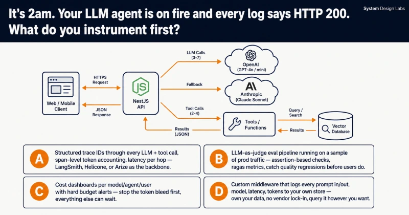

# Ngày 58: Observability for LLM Agent Pipelines

[← Ngày trước](day-57-consistency-for-payment-confirmation-reads.md) | [Mục lục](README.md) | [Ngày tiếp theo →](day-59-designing-idempotency-keys-for-payments.md)

---

# NGÀY 58 · SYSTEM DESIGN: GIÁM SÁT TOÀN DIỆN CHO PIPELINE CỦA LLM AGENT (OBSERVABILITY FOR LLM AGENT PIPELINES)

## Đề bài tình huống (Scenario)

Đồng hồ điểm 2 giờ sáng. **LLM Agent** của bạn đang gặp sự cố nghiêm trọng (on fire) nhưng mọi dòng nhật ký ghi nhận (logs) đều hiển thị mã trạng thái `HTTP 200`.

Bạn đã triển khai (ship) một trợ lý ảo hỗ trợ người dùng ứng dụng AI (AI-powered support agent) cách đây 6 tuần. Hệ thống này thực hiện gọi các công cụ (tools), nối chuỗi 4–5 câu lệnh gợi ý (prompts) cho mỗi yêu cầu, truy vấn tìm kiếm vector (vector search), và gọi ngược lại (callback) vào chính API nội bộ của bạn. Người dùng đang liên tục phàn nàn. Câu trả lời đưa ra bị sai lệch. Hóa đơn chi phí token đã tăng gấp 3 lần so với tuần trước.

Bạn mở nhật ký hệ thống (logs). Mọi thứ đều báo xanh (green). Bạn mở hệ thống phân vết (traces). Bạn chỉ nhìn thấy duy nhất một đoạn vết (span) mang tên `POST /chat` kéo dài tận 14 giây. Chỉ có vậy. Đó là toàn bộ khả năng quan sát (visibility) mà bạn có.

### Cấu hình kiến trúc hiện tại (The Setup)
* **API Gateway / Backend:** NestJS API → OpenAI (`GPT-4o` + `GPT-4o-mini`) + Anthropic (`Claude Sonnet` dự phòng / fallback).
* **Quy mô lưu lượng:** ~8.000 lượt chạy agent mỗi ngày (`~8,000 agent runs/day`), mỗi lượt chạy nối chuỗi 3–7 lượt gọi LLM (`LLM calls`) kèm theo 2–4 lượt gọi công cụ (`tool calls`).
* **Chi phí bất thường:** Chi phí tiêu thụ token tăng vọt từ **$180/ngày** lên **$540/ngày** trong tuần này, hoàn toàn không rõ luồng thực thi (flow) nào là nguyên nhân trực tiếp.
* **Độ lệch môi trường:** Bộ kiểm thử đánh giá (Eval suite) vượt qua 94% trong quy trình CI, nhưng người dùng thực tế trên môi trường sản xuất (prod users) lại liên tục gặp phải tình trạng bịa đặt thông tin (hallucinations) mà bạn không tài nào tái hiện lại được.
* **Tình trạng On-call:** Kỹ sư trực ban (on-call engineer) theo đúng nghĩa đen hoàn toàn bất lực không thể trả lời câu hỏi: *"Tại sao lượt chạy này lại chậm / đắt đỏ / sai kết quả?"*

Bạn có đúng một chu kỳ phát triển (one sprint) để khắc phục triệt để vấn đề mất khả năng quan sát này trước khi sự cố tiếp theo ập đến. **Bạn sẽ gắn các công cụ đo lường và theo dõi (instrument) thành phần nào đầu tiên?**

---

## Các phương án lựa chọn (Options)

* **A)** Thiết lập các mã định danh phân vết có cấu trúc (**Structured Trace IDs**) xuyên suốt từng lượt gọi LLM và công cụ, hạch toán lượng token ở cấp độ từng span con (**span-level token accounting**), đo độ trễ trên từng chặng (**latency per hop**) — sử dụng LangSmith, Helicone, hoặc Arize làm nền tảng xương sống (backbone).
* **B)** Xây dựng pipeline đánh giá dùng mô hình LLM làm trọng tài (**LLM-as-judge eval pipeline**) chạy trên một tập mẫu lưu lượng thực tế (production traffic) — áp dụng các kiểm tra dựa trên mệnh đề khẳng định (**assertion-based checks**), các bộ chỉ số đo lường ragas (**ragas metrics**), nhằm bắt các lỗi suy giảm chất lượng (quality regressions) trước khi người dùng phát hiện ra.
* **C)** Xây dựng bảng theo dõi chi phí (**Cost dashboards**) phân tách theo từng model/agent/user đi kèm cơ chế cảnh báo ngân sách nghiêm ngặt (**hard budget alerts**) — chặn đứng tình trạng thất thoát chi phí token trước tiên, mọi thứ khác đều có thể chờ sau.
* **D)** Tự viết phần mềm trung gian tùy biến (**Custom middleware**) để ghi nhật ký mọi câu lệnh vào/ra (prompt in/out), loại mô hình, độ trễ, số lượng token vào chính kho lưu trữ riêng của bạn — tự làm chủ dữ liệu của mình (own your data), tránh phụ thuộc nhà cung cấp (no vendor lock-in), tùy ý truy vấn theo bất kỳ cách nào bạn muốn.

---

## Đáp án & Giải thích chi tiết (Answers & Explanations)

### Đáp án đúng: A

> [!IMPORTANT]
> ### Tại sao A chiến thắng (Why A wins):
> Mọi vấn đề được nêu ra trong tình huống đều xuất phát từ cùng một nguyên nhân gốc rễ (root cause) — **bạn hoàn toàn không thể nhìn thấy hình thái thực thi (shape) của một lượt chạy agent đơn lẻ**.
>
> * **Chậm? (Slow?)** → Lượt nào trong số 7 lượt gọi LLM đã gây ra độ trễ.
> * **Đắt đỏ? (Expensive?)** → Mô hình nào, tại bước thực thi nào đã đốt cháy lượng token đó.
> * **Sai kết quả? (Wrong?)** → Lượt truy xuất dữ liệu (retrieval) nào đã trả về kết quả rác khiến câu lệnh gợi ý (prompt) tiếp theo bị sai lệch dây chuyền (poisoned).
>
> Không câu hỏi nào trong số đó có thể tìm được lời giải nếu thiếu đi một trace hoàn chỉnh. Và các vết phân tích của LLM (LLM traces) không giống như các vết HTTP thông thường — bạn cần các thuộc tính chi tiết ở cấp độ từng span con (**span-level attributes**): tên mô hình (model name), lượng token đầu vào (prompt tokens), lượng token đầu ra (completion tokens), chi phí (cost), tên công cụ (tool name), ID của các tài liệu truy xuất (retrieval doc IDs), và toàn bộ tải trọng (payload) câu lệnh/phản hồi thực tế. Đó chính là những gì mà LangSmith, Helicone, Arize, và Langfuse cung cấp sẵn ngay khi tích hợp (out of the box).
>
> **Khi bạn đã sở hữu năng lực này:** Span kéo dài 14 giây ban đầu sẽ mở bung ra thành 7 span con (sub-spans). Bạn sẽ nhìn thấy ngay span mất 9 giây thực chất là một lượt chuyển hướng dự phòng sang Claude (Claude fallback) được kích hoạt bởi lỗi vượt ngưỡng tần suất (rate limit). Đợt chi phí tăng vọt $540/ngày xuất phát từ việc một người dùng duy nhất đang liên tục gửi tải nặng vào một agent tự gọi đệ quy chính nó (recursively calls itself). Các trường hợp ảo giác/bịa đặt (hallucinations) tương quan chặt chẽ với các lượt truy xuất vector trả về 0 đoạn dữ liệu (0 chunks).

---

### Phân tích các phương án còn lại

#### Tại sao B là chiếc bẫy dành cho kỹ sư cấp cao (Why B is the senior engineer trap):
Các bộ đánh giá (Evals) trả lời cho một câu hỏi hoàn toàn khác: *chất lượng đang có xu hướng tăng lên hay giảm đi theo thời gian?* Chúng **không phải** là công cụ chẩn đoán và khắc phục lỗi (debugging tool). Khi môi trường production đang gặp sự cố nghiêm trọng, một con số như *"độ chính xác đạt 78% trên 200 mẫu gần nhất"* không mang lại bất kỳ thông tin giá trị nào về chính yêu cầu cụ thể vừa bị sập. Tệ hơn nữa — việc chạy evals mà thiếu đi hệ thống tracing sẽ dẫn đến tình trạng không thể kiểm chứng hay phản nghiệm được (unfalsifiable). Khi điểm số chất lượng tụt dốc, bạn hoàn toàn không có cách nào để đào sâu (drill down) vào các mẫu thất bại nhằm tìm hiểu nguyên nhân tại sao. Evals chỉ là Bước 2. Chúng phải được vận hành và xây dựng dựa trên nền tảng của các traces.

> [!WARNING]
> #### Tại sao C chỉ giải quyết phần ngọn/triệu chứng (Why C treats the symptom):
> *"Chi phí tăng gấp 3 lần"* cũng chỉ là thông tin mà bạn vốn dĩ đã nhìn thấy từ hóa đơn thanh toán. Số liệu chi phí tổng hợp (aggregate cost) nếu thiếu đi sự quy kết trách nhiệm ở cấp độ span con (**span-level attribution**) thì chẳng khác nào chỉ cho bạn biết căn phòng đang bốc cháy nhưng lại không thể chỉ ra bức tường nào đang bắt lửa. Bạn không thể xây dựng cơ chế phân bổ chi phí theo từng agent, từng người dùng nếu không gắn các công cụ đo đạc vào các span trước. Cảnh báo ngân sách (budget alerts): chắc chắn là cần, hãy triển khai chúng. Nhưng nếu coi đó là hạng mục đầu tư ưu tiên số một: bạn chỉ đang đi giải quyết vấn đề của Giám đốc Tài chính (CFO), chứ không hề giải quyết vấn đề của kỹ sư trực ban (on-call engineer).

> [!NOTE]
> #### Tại sao D trên thực tế không hề mang tính thực dụng (Why D isn't actually pragmatic):
> *"Tự làm chủ dữ liệu của mình, không lo bị phụ thuộc vào nhà cung cấp (Own your data, no vendor lock-in)"* chính là câu nói đã làm tiêu tốn nhiều tháng trời làm việc của vô số đội ngũ kỹ thuật hơn bất kỳ câu nói nào khác. Bạn sẽ phải tự tay xây dựng: lược đồ dữ liệu (schema) cho các lượt chạy agent lồng nhau, giao diện trực quan hóa cây phân vết (trace tree visualizer), các mã định danh tương quan (correlation IDs) xuyên suốt các lượt gọi công cụ bất đồng bộ (async tool calls), logic lấy mẫu dữ liệu (sampling logic), chính sách lưu trữ/giữ lại dữ liệu (retention), cơ chế làm sạch/loại bỏ dữ liệu nhạy cảm (PII redaction), và logic tổng hợp chi phí (cost rollups). Bạn vừa tự tái tạo lại một phiên bản Langfuse tồi tàn, trong những khoảng thời gian rảnh rỗi chắp vá, trong khi sự cố thực tế vẫn đang mở toang. Mọi công cụ giám sát LLM nghiêm túc ngày nay đều phát ra các spans tương thích chuẩn **OpenTelemetry** — bạn hoàn toàn có thể chuyển đổi nhà cung cấp chỉ trong vòng một tuần nếu cần thiết. Hãy tích hợp giải pháp của các nhà cung cấp chuyên dụng ngay bây giờ, và chỉ xem xét lại việc tự lưu trữ (self-hosting) khi bạn đã giải quyết xong sự cố trước mắt và thực sự cần đối mặt với bài toán đó.

---

### Bảng tổng kết so sánh phương án

| Phương án | Bản chất kiến trúc | Điểm mạnh | Lỗ hổng cốt tử | Đánh giá |
| :--- | :--- | :--- | :--- | :--- |
| **A. LLM Tracing (LangSmith, Arize...)** | Structured Tracing & Span-level Observability | Bóc tách từng mắt xích: LLM hop latency, token burn per step, retrieval chunk context. | Cần tích hợp SDK hoặc proxy của nhà cung cấp. | **Lựa chọn tối ưu nhất (Winner)** |
| **B. LLM-as-judge / Evals** | Offline & Production Sampling Quality Gates | Theo dõi xu hướng suy giảm chất lượng toàn cục theo thời gian. | Không debug được lỗi tức thời (real-time incident); không có trace thì eval điểm thấp không rõ lý do. | Bẫy kỹ sư (Trap answer) |
| **C. Cost Dashboards & Alerts** | Metric Aggregation & Budget Guardrails | Giới hạn thất thoát tài chính ở mức vĩ mô. | Chỉ chữa triệu chứng; không chỉ ra được request/user/step nào gây đột biến. | Chữa phần ngọn (Symptom-treating) |
| **D. Custom Middleware Logging** | In-house Custom Data Ingestion | Toàn quyền kiểm soát dữ liệu, không vendor lock-in. | Tốn hàng tháng để reinvent the wheel (UI, Span Tree, Async Correlation, PII). | Thiếu thực tế (Not pragmatic) |

---

[← Ngày trước](day-57-consistency-for-payment-confirmation-reads.md) | [Mục lục](README.md) | [Ngày tiếp theo →](day-59-designing-idempotency-keys-for-payments.md)
