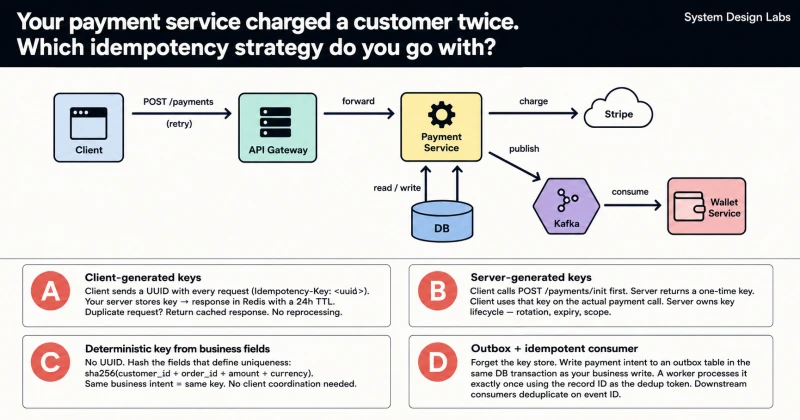
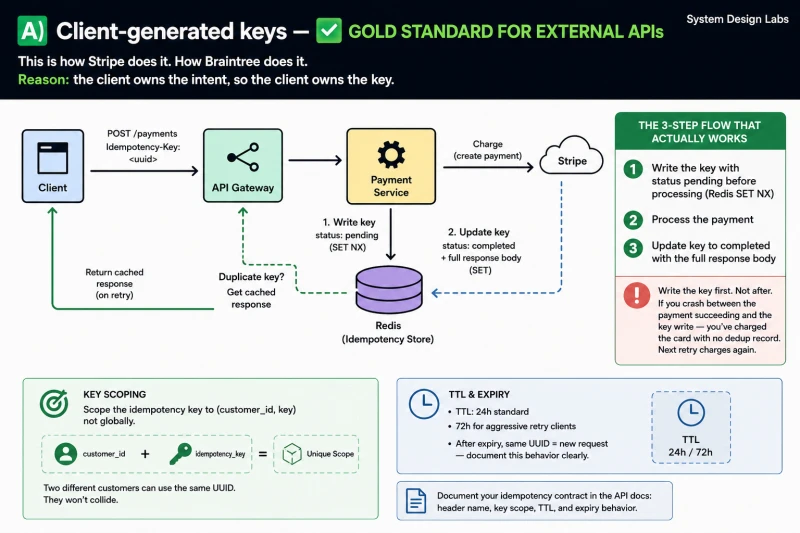

# Ngày 59: Designing Idempotency Keys for Payments

[← Ngày trước](day-58-observability-for-llm-agent-pipelines.md) | [Mục lục](README.md) | [Ngày tiếp theo →](day-60-architecting-a-saas-platform-from-scratch.md)

---

# NGÀY 59 · THIẾT KẾ HỆ THỐNG (SYSTEM DESIGN)
## Thiết Kế Khóa Bất Biến (Idempotency Keys) Cho Hệ Thống Thanh Toán (Payments)

Hệ thống thanh toán (*payment service*) của bạn vừa trừ tiền một khách hàng hai lần.

Cùng một request. Khác mã phản hồi (*response code*). Phía Client đã thử lại (*retried*). Bạn không hề có logic khử trùng lặp (*dedup logic*).

Đó không phải là tranh chấp dữ liệu (*race condition*). Đó là một **quyết định thiết kế bị bỏ sót (*missing design decision*)**.

Và quyết định ở đây không phải là *có nên* dùng khóa bất biến (*idempotency keys*) hay không. Mà là **bạn sinh (*generate*) chúng như thế nào**.

---

### Đề Bài Tình Huống (Scenario)

API của bạn xử lý các giao dịch thanh toán. Các Client có thể và chắc chắn sẽ gửi lại yêu cầu (*retry*) khi gặp sự cố mạng (*network failures*). Các lệnh gọi downstream của bạn (Stripe, Kafka, nạp tiền ví / *wallet credit*) một khi đã được kích hoạt thì không thể hoàn tác (*undone*). Một lỗi `500` hoặc hết thời gian chờ (*timeout*) từ phía máy chủ của bạn trông hoàn toàn giống hệt một tín hiệu "hãy thử lại" (*try again*) dưới góc nhìn của client.

**Bạn sẽ chọn chiến lược bất biến (*idempotency strategy*) nào?**

---

### Các Phương Án Lựa Chọn (Options)

* **A) Khóa do Client tự sinh (*Client-generated keys*)**  
  Client gửi một UUID kèm theo mỗi request (`Idempotency-Key: <UUID>`). Server của bạn lưu ánh xạ `key → response` vào Redis với thời gian sống (TTL - *Time-To-Live*) 24 giờ. Request bị trùng lặp? Trả về phản hồi đã lưu trong bộ đệm (*cached response*). Không xử lý lại (*No reprocessing*).

* **B) Khóa do Server tự sinh (*Server-generated keys*)**  
  Client gọi `POST /payments/init` trước. Server trả về một khóa dùng một lần (*one-time key*). Client dùng khóa đó trong lệnh gọi thanh toán thực tế. Server toàn quyền sở hữu vòng đời của khóa (*key lifecycle*) — cơ chế xoay vòng (*rotation*), hết hạn (*expiry*), và phạm vi hiệu lực (*scope*).

* **C) Khóa xác định dựa trên các trường nghiệp vụ (*Deterministic key from business fields*)**  
  Không dùng UUID. Băm (*hash*) các trường định danh tính duy nhất: `sha256(customer_id + order_id + amount + currency)`. Cùng ý đồ nghiệp vụ (*business intent*) = cùng một khóa. Không cần cơ chế điều phối từ phía client (*No client coordination needed*).

* **D) Mẫu Outbox kết hợp Consumer bất biến (*Outbox + idempotent consumer*)**  
  Áp dụng Transactional Outbox Pattern kết hợp với logic xử lý bất biến ở tầng downstream.

---

---

# NGÀY 59 · ĐÁP ÁN & GIẢI THÍCH CHI TIẾT (ANSWERS & EXPLANATIONS)

---

### Câu Trả Lời 1

#### ✓ CÂU TRẢ LỜI ĐÚNG
### A) Khóa do Client tự sinh (*Client-generated keys*) — ✅ TIÊU CHUẨN VÀNG (GOLD STANDARD) CHO CÁC EXTERNAL API

Đây là cách Stripe triển khai. Cũng là cách Braintree triển khai. 

> [!NOTE]
> **Nguyên nhân cốt lõi:** Phía Client là bên sở hữu ý đồ giao dịch (*client owns the intent*), do đó Client phải là bên sở hữu khóa (*client owns the key*).

#### Luồng hoạt động thực chiến hiệu quả trong môi trường Production:
1. **Ghi khóa với trạng thái `pending` trước khi xử lý:** Sử dụng lệnh `SET NX` trong Redis.
2. **Tiến hành xử lý giao dịch thanh toán (*Process the payment*).**
3. **Cập nhật khóa sang trạng thái `completed`** đi kèm với toàn bộ nội dung phản hồi (*full response body*).

> [!CAUTION]
> **Ghi khóa TRƯỚC TIÊN, không phải ghi sau cùng.** Nếu hệ thống gặp sự cố sập (*crash*) ở khoảng giữa thời điểm thanh toán thành công và thời điểm ghi khóa — bạn đã trừ tiền trên thẻ của khách hàng nhưng không có bản ghi khử trùng lặp (*dedup record*). Lần thử lại (*retry*) tiếp theo sẽ trừ tiền thêm một lần nữa!

#### Những lưu ý quan trọng về thiết kế:
* **Phạm vi khóa (*Key scoping*):** Cần đóng phạm vi theo cụm `(customer_id, key)`, không bao giờ dùng chung một phạm vi toàn cục (*globally*).
* **Thời gian sống (*TTL*):** Tiêu chuẩn là `24h`, nâng lên `72h` đối với các client có cơ chế thử lại hung hăng (*aggressive retry clients*).
* Sau khi hết hạn TTL, cùng một UUID đó sẽ được xem là một **yêu cầu hoàn toàn mới** — bạn cần phải ghi rõ tài liệu (*document*) điều này cho các bên tích hợp.

---

### Câu Trả Lời 2

### B) Khóa do Server tự sinh (*Server-generated keys*) — ✅ PHÙ HỢP KHI BẠN KHÔNG TIN TƯỞNG CLIENT

Mô hình 2 bước (*two-step*) tạo cảm giác như một chi phí phụ trội (*overhead*). Nhưng thực chất đó lại là một tính năng kiến trúc.

**Lệnh gọi khởi tạo (`/init`) mang lại cho bạn:**
* Cơ chế tiền kiểm tra (*pre-validation*) trước khi dòng tiền thực sự di chuyển.
* Dấu vết kiểm toán (*audit trail*) ngay tại thời điểm phát hành khóa.
* Khả năng phòng vệ trước việc client gửi các UUID rác (UUID v1 dính dấu thời gian/timestamp, các ID tăng tuần tự/sequential IDs, hoặc các giá trị không duy nhất).
* Toàn quyền kiểm soát vòng đời khóa (*key lifecycle*) ở phía server.

| Nơi tỏa sáng (*Where it shines*) | Nơi gặp bất lợi (*Where it hurts*) |
| :--- | :--- |
| • Các API nội bộ giữa service-to-service. • Các môi trường bị kiểm soát nghiêm ngặt (*regulated environments*). • Bất kỳ hệ thống nào mà việc trùng lặp khóa (*key collision*) là vi phạm quy chuẩn tuân thủ (*compliance issue*). | • Các ứng dụng di động (*mobile clients*) trên mạng chập chờn (*flaky networks*) giờ đây có 2 lệnh gọi độc lập đều có nguy cơ thất bại. • Độ phức tạp của logic thử lại (*retry complexity*) tăng lên chứ không hề giảm đi. |

---

### Câu Trả Lời 3

### C) Khóa xác định từ nghiệp vụ (*Deterministic key*) — ❌ CẠM BẪY CỦA KỸ SƯ KINH NGHIỆM (THE SENIOR ENGINEER TRAP)

Nhìn qua tưởng chừng rất gọn gàng, nhưng sẽ sụp đổ hoàn toàn trước các tình huống thử lại hợp lệ (*legitimate retries*).

> [!WARNING]
> **Kịch bản lỗi 1:** Cùng một khách hàng, cùng số tiền, cùng món hàng — nhưng là một **đơn hàng mới toanh sau khi đơn trước đã được hoàn tiền (*refund*)**. Chuỗi băm (*hash*) của bạn sẽ trùng khớp với request đã hoàn tất trước đó. Kết quả: Bạn trả về phản hồi thành công từ cache cho một khoản trừ tiền hoàn toàn mới lẽ ra phải được thực thi.

> [!WARNING]
> **Kịch bản lỗi 2: Sai lệch tuần tự hóa trường dữ liệu (*Field serialization drift*) qua các phiên bản SDK.**  
> SDK v1 sắp xếp thứ tự các trường khác với SDK v2. Chuỗi băm sinh ra sẽ khác nhau. Toàn bộ cửa sổ khử trùng lặp (*dedup window*) của bạn sẽ âm thầm biến mất mà không có bất kỳ cảnh báo nào.

**Quy tắc:** Chỉ sử dụng khóa tất định (*deterministic keys*) cho việc khử trùng lặp các tác vụ nội bộ (*internal job dedup*) — ví dụ: các tác vụ lập lịch định kỳ (*cron tasks*), đường ống xử lý theo lô (*batch pipelines*), nơi mà ý đồ nghiệp vụ thực sự là duy nhất. **Tuyệt đối không bao giờ dùng cho các luồng thanh toán hướng tới người dùng cuối (*customer-facing payment flows*).**

---

### Câu Trả Lời 4

### D) Outbox + Idempotent Consumer — ✅ MẠNH MẼ NHẤT CHO CÁC HỆ THỐNG PHÂN TÁN (STRONGEST FOR DISTRIBUTED SYSTEMS)

Đây là lựa chọn **duy nhất** đảm bảo tính nguyên tử (*atomic*) giữa bản ghi thanh toán (*payment record*) và sự kiện downstream (*downstream event*).

> [!IMPORTANT]
> **Lỗ hổng của các phương án A/B/C:** Thao tác ghi khóa vào Redis, ghi cơ sở dữ liệu (DB write), và lệnh gọi Stripe là **ba thao tác hoàn toàn tách rời nhau**. Hệ thống sập (*crash*) ở giữa bất kỳ hai thao tác nào = trạng thái dữ liệu bất nhất (*inconsistent state*).

#### Cách mẫu Outbox khắc phục triệt để:
1. Ghi bản ghi thanh toán (*payment record*) + sự kiện outbox (*outbox event*) trong **cùng một giao dịch cơ sở dữ liệu (*single DB transaction*)**.
2. Một tiến trình công nhân (*worker*) xử lý downstream (gọi Stripe, Kafka) sử dụng chính `row ID` của bản ghi làm mã khử trùng lặp (*dedup token*).
3. Các consumer downstream tiến hành khử trùng lặp dựa trên `event ID`.

#### Đánh giá đánh đổi (Trade-off):
* **Ưu điểm:** Không cần một kho lưu trữ khóa riêng biệt (*No separate key store*). Không phụ thuộc vào Redis (*No Redis dependency*). Đảm bảo ngữ nghĩa xử lý chính xác một lần (*exactly-once*) được thực thi ngay tại tầng Database.
* **Chi phí (*The cost*):** Đòi hỏi bảng outbox + hệ thống worker đáng tin cậy + các consumer có tính bất biến (*idempotent consumers*). Yêu cầu hạ tầng thực sự bài bản (*Real infrastructure*).
* **Kết luận:** Là sự thiết kế thừa thãi (*overkill*) nếu hệ thống chỉ xử lý 100 thanh toán/ngày; nhưng lại là **kiến trúc duy nhất có thể bảo vệ được hệ thống** ở quy mô `10.000 TPS` đi kèm các yêu cầu nghiêm ngặt về mặt quy chuẩn/pháp lý (*regulatory requirements*).

---

[← Ngày trước](day-58-observability-for-llm-agent-pipelines.md) | [Mục lục](README.md) | [Ngày tiếp theo →](day-60-architecting-a-saas-platform-from-scratch.md)
