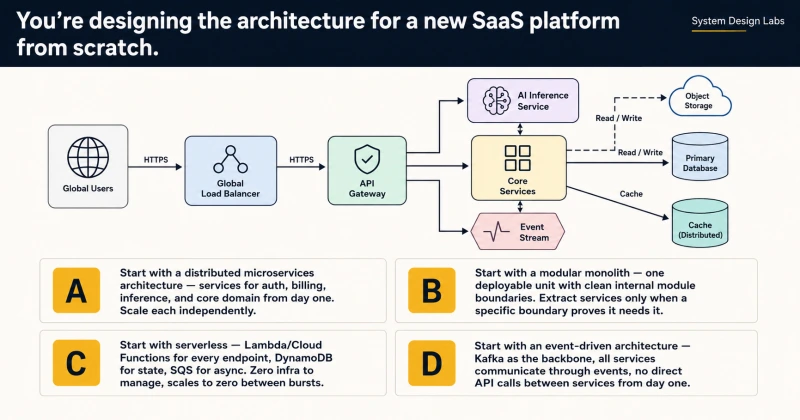
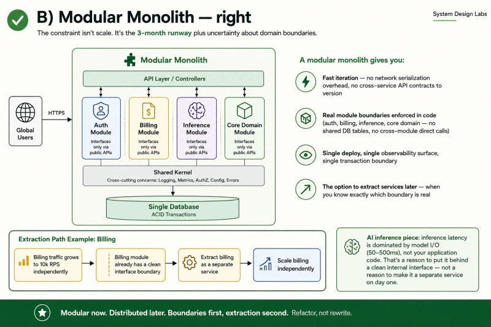

# Ngày 60: Architecting a SaaS Platform from Scratch

[← Ngày trước](day-59-designing-idempotency-keys-for-payments.md) | [Mục lục](README.md) | [Ngày tiếp theo →](README.md)

---

# NGÀY 60 · THIẾT KẾ HỆ THỐNG (DAY 60 · SYSTEM DESIGN)

## Thiết kế Kiến trúc Nền tảng SaaS từ Con số Không (Architecting a SaaS Platform from Scratch)

Bạn đang thiết kế kiến trúc cho một nền tảng SaaS hoàn toàn mới từ con số không (*from scratch*).

Hệ thống cần phải xử lý **50.000 yêu cầu mỗi giây (50,000 requests per second - RPS)** ngay khi ra mắt (*launch*). Hỗ trợ đa người thuê (**Multi-tenant**). Dữ liệu thời gian thực (**Real-time data**). Người dùng trên toàn cầu (**Global users**). Tích hợp sẵn suy luận trí tuệ nhân tạo (**AI inference built in**).

Giám đốc Công nghệ (**CTO**) cho bạn thời hạn **3 tháng** và một tờ giấy trắng hoàn toàn (*blank slate*).

Bạn đã suy nghĩ về điều này suốt một tuần. Cuối cùng, bạn ngồi xuống để vẽ chiếc hộp đầu tiên.

Dưới đây là những gì các kỹ sư thực sự tranh luận trong căn phòng đó:

* **A)** Bắt đầu với kiến trúc microservices phân tán (**Distributed Microservices Architecture**) — tách riêng các dịch vụ cho xác thực (**auth**), thanh toán (**billing**), suy luận (**inference**) và nghiệp vụ cốt lõi (**core domain**) ngay từ ngày đầu tiên. Mở rộng quy mô từng dịch vụ độc lập (**Scale independently**).
* **B)** Bắt đầu với kiến trúc khối mô-đun hóa (**Modular Monolith**) — một đơn vị triển khai duy nhất (**single deployable unit**) với các ranh giới mô-đun nội bộ rõ ràng, tách bạch (**clean internal module boundaries**). Chỉ trích xuất thành các dịch vụ riêng lẻ khi một ranh giới cụ thể chứng minh rằng nó thực sự cần điều đó.
* **C)** Bắt đầu với kiến trúc không máy chủ (**Serverless**) — dùng **AWS Lambda / Cloud Functions** cho mọi điểm cuối (**endpoint**), **DynamoDB** để quản lý trạng thái (**state**), **SQS** cho giao tiếp bất đồng bộ (**async**). Không tốn công quản lý hạ tầng (**Zero infra to manage**), tự động thu nhỏ về 0 giữa các đợt bùng nổ tải (**scales to zero between bursts**).
* **D)** Bắt đầu với kiến trúc hướng sự kiện (**Event-Driven Architecture - EDA**) — sử dụng **Kafka** làm xương sống (**backbone**), tất cả các dịch vụ giao tiếp qua sự kiện (**events**), không có các cuộc gọi API trực tiếp giữa các dịch vụ ngay từ ngày đầu tiên.

---

# NGÀY 60 · CÂU TRẢ LỜI & GIẢI THÍCH CHI TIẾT (DAY 60 · ANSWERS & EXPLANATIONS)

### Câu trả lời 1 (Answer 1)

> [!NOTE]
> ### ✓ CÂU TRẢ LỜI ĐÚNG:
> **B) Modular Monolith — Chính xác**

Rào cản/ràng buộc lớn nhất ở đây **không phải là quy mô (scale)**. Ràng buộc thực sự là **thời gian chạy đua chỉ có 3 tháng (3-month runway)** cộng với **sự bất định về các ranh giới nghiệp vụ (uncertainty about domain boundaries)**.

Một khối mô-đun hóa (**Modular Monolith**) mang lại cho bạn:

* **Tốc độ lặp/phát triển nhanh (Fast iteration)** — không tốn chi phí quá tải tuần tự hóa mạng (**network serialization overhead**), không cần quản lý phiên bản hợp đồng API liên dịch vụ (**cross-service API contracts to version**).
* **Các ranh giới mô-đun thực sự được thực thi trong mã nguồn (Real module boundaries enforced in code)**: xác thực (**auth**), thanh toán (**billing**), suy luận (**inference**), nghiệp vụ cốt lõi (**core domain**) — không dùng chung bảng cơ sở dữ liệu (**no shared DB tables**), không gọi trực tiếp xuyên mô-đun (**no cross-module direct calls**).
* **Triển khai đơn nhất (Single deploy)**, một giao diện giám sát duy nhất (**single observability surface**), một ranh giới giao dịch duy nhất (**single transaction boundary**).
* **Khả năng tách thành các dịch vụ sau này (The option to extract services later)** — khi bạn đã biết chính xác ranh giới nào là ranh giới thực sự.

Khi mô-đun thanh toán (**billing**) đạt mức 10.000 RPS một cách độc lập và cần mở rộng quy mô riêng biệt, bạn tách nó ra. Ranh giới khi đó đã hoàn toàn sạch sẽ. Việc di chuyển lúc này chỉ là một đợt tái cấu trúc mã (**refactor**), chứ không phải viết lại toàn bộ (**rewrite**).

#### Xét riêng về phần suy luận AI (The AI inference piece specifically):
Độ trễ suy luận bị chi phối chủ yếu bởi I/O của mô hình (**model I/O: 50–500ms**), chứ không phải do mã ứng dụng của bạn. Đó là lý do để đặt nó đằng sau một giao diện nội bộ rõ ràng (**clean internal interface**) — chứ không phải là lý do để biến nó thành một dịch vụ riêng biệt ngay từ ngày đầu tiên.

---

### Câu trả lời 2 (Answer 2)

> [!WARNING]
> ### A) Microservices ngay từ ngày đầu tiên — SAI
> Con số **50.000 RPS** nghe có vẻ như bạn cần microservices. Nhưng thực tế thì **không phải**.

Đó là bài toán cân bằng tải (**Load Balancing**) đã có lời giải, chứ không phải bài toán phân tán hệ thống (**distribution problem**).

Những gì microservices mang lại cho bạn ngay từ ngày đầu tiên thực chất là:

* Hơn 6 dịch vụ có thể triển khai độc lập ngay cả trước khi bạn tìm ra ranh giới nghiệp vụ thực tế của mình.
* Các giao dịch phân tán (**Distributed Transactions**) xuyên suốt giữa auth, billing, inference và core domain.
* Các bước nhảy mạng (**network hops**) trên mỗi yêu cầu mà đáng lẽ ra chỉ là các lời gọi hàm nội bộ trong tiến trình (**in-process calls**).
* Mất 3 tháng chỉ để làm công việc hạ tầng (**infra work**) thay vì xây dựng sản phẩm (**product**).

Quy tắc "đội ngũ hai chiếc pizza" (**Two-pizza teams**) của Amazon vốn dành cho các dịch vụ đã tồn tại với ranh giới đã được xác định rõ ràng. Quy tắc đó không dành cho các miền nghiệp vụ mới, nơi bạn vẫn đang trong quá trình khám phá xem ranh giới thực sự nằm ở đâu.

> [!IMPORTANT]
> Xác định ranh giới là phần khó nhất. Và bạn thì chưa thể biết nó vào lúc này.

---

### Câu trả lời 3 (Answer 3)

> [!WARNING]
> ### C) Serverless — SAI (Bẫy dành cho Kỹ sư Cấp cao / Senior Engineer Trap)
> "Thu nhỏ về 0" (**Scales to zero**) nghe có vẻ tuyệt vời cho đến khi bạn tính toán chi phí cho mức tải duy trì ổn định **50.000 RPS** trên **AWS Lambda**.

**Bài toán chi phí & hiệu năng (The math):**
* $50.000 \text{ req/s} \times 100\text{ms trung bình} = 5.000 \text{ thực thi Lambda đồng thời (concurrent executions)}$.
* Ở quy mô đó, bạn phải trả chi phí cao hơn nhiều so với việc thuê một cụm máy chủ ảo dành riêng (**Reserved EC2 cluster**).
* Khởi động nguội (**Cold starts**) là vấn đề có thật, trong khi bạn đã cam kết cung cấp "dữ liệu thời gian thực" (**real-time data**).
* Chạy suy luận AI trên Lambda = Khởi động nguội (**cold start**) + Giới hạn bộ nhớ (**memory limit**) + Giới hạn thời gian tối đa 15 phút (**15-min hard timeout**) = **Thảm họa đau đớn (pain)**.

Serverless phát huy tối đa hiệu quả cho các khối lượng công việc theo sự kiện bùng nổ, không thể đoán trước (**bursty, unpredictable event workloads**). Một nền tảng SaaS với tải ổn định liên tục cùng các yêu cầu thời gian thực hoàn toàn không phải là khối lượng công việc kiểu đó.

---

### Câu trả lời 4 (Answer 4)

> [!WARNING]
> ### D) Hướng sự kiện ngay từ ngày đầu tiên — SAI
> Lựa chọn này thường đánh lừa các kỹ sư đã từng đọc về kiến trúc Kafka tại Netflix và Uber.

Kiến trúc hướng sự kiện (**Event-driven**) là câu trả lời đúng — nhưng là dành cho **Netflix và Uber**, sau khi họ đã vẽ xong bản đồ ranh giới nghiệp vụ của mình.

Bắt đầu với Kafka trước khi bạn có một hệ thống hoạt động hoàn chỉnh đồng nghĩa với:

* Mọi tính năng đều đòi hỏi phải có một lược đồ sự kiện (**event schema**), một bên sản xuất sự kiện (**producer**) và một bên tiêu thụ sự kiện (**consumer**) trước khi nó có thể chạy được.
* Phải ngồi gỡ lỗi (*debug*) câu hỏi *"tại sao sự kiện này không được xử lý"* ngay trong tuần thứ 2 của quá trình phát triển.
* Tính nhất quán cuối cùng (**Eventual Consistency**) trở thành trạng thái mặc định, trong khi bạn còn chưa biết rõ thao tác nào thực sự cần tính nhất quán mạnh (**Strong Consistency**).
* Gánh nặng vận hành Kafka (**Kafka operational overhead**) đè nặng ngay trước cả khi bạn kịp kiểm chứng sản phẩm trên thị trường (**validated the product**).

> [!TIP]
> Kiến trúc hướng sự kiện là một giải pháp tối ưu hóa cho một hệ thống đã được thấu hiểu tường tận (**known system**). Nó không phải là nền tảng thích hợp cho một hệ thống còn đang ở phía trước chưa rõ ràng (**unknown system**).

---

### Bảng tóm tắt so sánh chiến lược kiến trúc

| Tiêu chí | A) Microservices | B) Modular Monolith (Đúng) | C) Serverless | D) Event-Driven |
| :--- | :--- | :--- | :--- | :--- |
| **Tiến độ (Deadline 3 tháng)** | ❌ Rất chậm (tốn thời gian dựng infra, CI/CD, cross-contracts) | ✅ **Rất nhanh (phát triển tập trung, zero network overhead)** | ⚠️ Trung bình (vướng setup nhiều function, IAM, event routing) | ❌ Chậm (phải thiết kế schema, producer, consumer cho mọi API) |
| **Chi phí & Độ trễ ở 50k RPS** | ⚠️ Tốn kém network serialization, nhiều network hops | ✅ **Tối ưu (in-process calls, scale bằng Load Balancer)** | ❌ Cực kỳ đắt đỏ; dính Cold Starts | ⚠️ Chi phí vận hành cụm broker/consumer lớn |
| **AI Inference** | ⚠️ Tách service quá sớm khi chưa rõ contract | ✅ **Tách qua clean interface nội bộ, tránh overhead** | ❌ Bị giới hạn RAM, Timeout 15p, Cold start cao | ⚠️ Phức tạp hóa luồng request-response đồng bộ |
| **Độ rõ ràng về Domain** | ❌ Bị khóa cứng ranh giới khi chưa hiểu rõ domain | ✅ **Linh hoạt tái cấu trúc mã (refactor > rewrite)** | ❌ Phân mảnh logic nghiệp vụ quá sớm | ❌ Buộc dùng Eventual Consistency khi chưa rõ yêu cầu |

---

[← Ngày trước](day-59-designing-idempotency-keys-for-payments.md) | [Mục lục](README.md) | [Ngày tiếp theo →](README.md)
