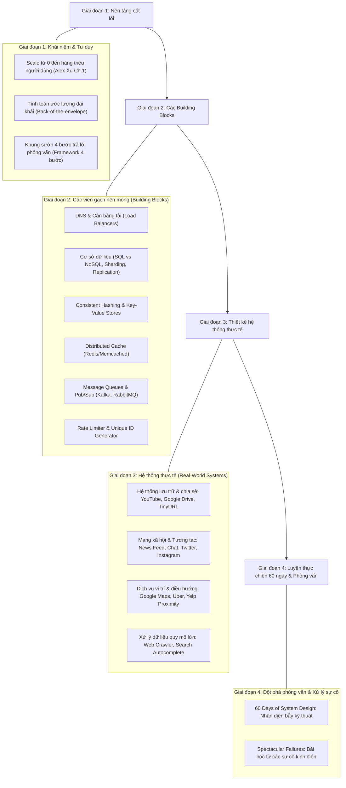

# 📚 Kho Tàng Sách Thiết Kế Hệ Thống Toàn Diện (System Design Ebooks - Vietnamese Edition)

Chào mừng bạn đến với kho lưu trữ tài liệu **System Design (Thiết kế hệ thống phân tán)** được dịch thuật nguyên văn, đầy đủ 100% sang tiếng Việt với định dạng Markdown chuẩn GitHub.

Tài liệu được biên soạn công phu, chuẩn hóa thuật ngữ quốc tế kết hợp giải thích chi tiết, kèm hình ảnh sơ đồ kiến trúc trích xuất gốc có độ phân giải cao và điều hướng chương/bài thuận tiện.

---

## 🗂️ Danh Mục Sách & Tài Liệu

Kho lưu trữ gồm 4 bộ tài liệu kinh điển hàng đầu thế giới về System Design:

| STT | Tên Bộ Sách / Tài Liệu | Số Chương / Bài | Định Dạng & Hình Ảnh | Thư Mục Truy Cập |
|:---:|:---|:---:|:---:|:---:|
| **01** | **Alex Xu - System Design Interview (Volume 1)** *(Cẩm nang phỏng vấn thiết kế hệ thống từ 0 đến hàng triệu người dùng)* | 16 chương + Lời mở đầu | Markdown + 226 sơ đồ sắc nét | [👉 Xem Tập 1](alex-xu-system-design-volume-1/README.md) |
| **02** | **Grokking Modern System Design for Engineers & Managers** *(Khóa học kinh điển từ Educative.io: 16 Building Blocks + 13 Hệ thống thực tế)* | 41 chuyên đề | Markdown + 1.825 sơ đồ kiến trúc | [👉 Xem Grokking](grokking-modern-system-design/README.md) |
| **03** | **60 Days of System Design Questions** *(60 Ngày luyện câu hỏi tình huống thực chiến & phân tích cạm bẫy)* | 60 ngày thực chiến | 60 kịch bản + 120 sơ đồ | [👉 Xem 60 Ngày](60-days-of-system-design/README.md) |
| **04** | **Alex Xu - System Design Byte-Sized (Volume 0)** *(Kiến thức kiến trúc cô đọng, trực quan dễ nhớ)* | 7 chuyên đề cốt lõi | Flashcards & 76 sơ đồ minh họa | [👉 Xem Byte-Sized](alex-xu-system-design-byte-sized/README.md) |

---

> [!NOTE]
> **Về tài liệu Alex Xu - Volume 2:**
> Tệp PDF gốc của Volume 2 (`system-design-interview VOL 2 BUY.pdf` - 120 MB) là bản scan hình ảnh 100% (427 trang ảnh không có text layer). Để đảm bảo chất lượng văn bản tốt nhất, các chương thuộc Volume 2 có thể được xử lý qua pipeline nhận dạng quang học OCR hoặc nhập liệu chuyên sâu trong các bản cập nhật tiếp theo. Mọi chủ đề trọng điểm của Volume 2 (như S3 Blob Store, Distributed Counter, Map/Uber, Proximity Yelp, Ad Click Event, Distributed Message Queue, v.v.) hiện đã được dịch **nguyên văn đầy đủ và chi tiết hơn rất nhiều** trong bộ **Grokking Modern System Design** và **60 Days of System Design** ngay trong kho lưu trữ này!

---

## 🗺️ Lộ Trình Học System Design Đề Xuất (Roadmap)

---

## 📖 Hướng Dẫn Sử Dụng & Đọc Sách Trên GitHub

1. **Mục lục điều hướng nhanh**: Ở đầu và cuối mỗi file chương đều có các nút điều hướng `[← Chương trước]`, `[Mục lục]` và `[Chương tiếp theo →]`.
2. **Hình ảnh minh họa**: Tất cả sơ đồ kiến trúc đều được trích xuất và nhúng trực tiếp, hỗ trợ phóng to và xem rõ nét trên mọi thiết bị (Mobile, Tablet, Desktop).
3. **Thuật ngữ song ngữ**: Các thuật ngữ chuyên ngành được giữ chuẩn quốc tế (ví dụ: *Sharding*, *Consistent Hashing*, *Eventual Consistency*, *Bloom Filter*, *Throughput*, *Latency*...) kèm giải nghĩa tiếng Việt chi tiết để bạn tự tin khi làm việc và phỏng vấn tại các tập đoàn công nghệ lớn.

---

## 🤝 Đóng Góp (Contributing) & Bản Quyền

- Dự án phục vụ mục đích học tập phi lợi nhuận cho cộng đồng kỹ sư phần mềm Việt Nam.
- Mọi đóng góp, sửa lỗi chính tả hoặc nâng cấp nội dung vui lòng tạo **Pull Request** hoặc mở **Issue** tại repo này.

---
⭐ *Hãy bấm **Star** repository nếu tài liệu này hữu ích cho sự nghiệp của bạn!*
