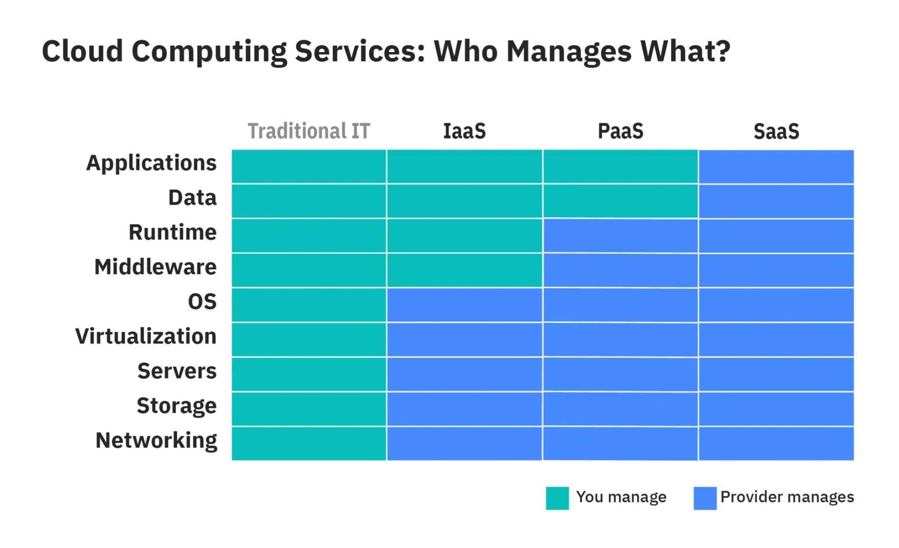

# Phân biệt Điện toán đám mây IaaS, PaaS và SaaS

[← Mục lục](README.md)

---

# IaaS / PaaS / SaaS là gì? (What is IaaS/PaaS/SaaS?)

Sơ đồ bên dưới minh họa sự khác biệt giữa **IaaS** (*Infrastructure-as-a-Service* - Hạ tầng như một Dịch vụ), **PaaS** (*Platform-as-a-Service* - Nền tảng như một Dịch vụ), và **SaaS** (*Software-as-a-Service* - Phần mềm như một Dịch vụ).

---

Đối với một ứng dụng không dùng đám mây (**non-cloud application**), chúng ta tự sở hữu và quản lý toàn bộ phần cứng lẫn phần mềm. Chúng ta gọi ứng dụng này là **on-premises** (tại chỗ / tự triển khai cục bộ).

Với điện toán đám mây (**cloud computing**), các nhà cung cấp dịch vụ đám mây (**cloud service vendors**) đem đến 3 mô hình chính để chúng ta sử dụng: **IaaS**, **PaaS**, và **SaaS**.

---

### Bảng so sánh trách nhiệm quản lý giữa các mô hình

| Khía cạnh | On-Premises | IaaS | PaaS | SaaS |
| :--- | :---: | :---: | :---: | :---: |
| **Ứng dụng (Applications)** | Bạn quản lý | Bạn quản lý | Bạn quản lý | Nhà cung cấp quản lý |
| **Dữ liệu (Data)** | Bạn quản lý | Bạn quản lý | Bạn quản lý | Nhà cung cấp quản lý |
| **Runtime & Middleware** | Bạn quản lý | Bạn quản lý | Nhà cung cấp quản lý | Nhà cung cấp quản lý |
| **Hệ điều hành (OS)** | Bạn quản lý | Bạn quản lý | Nhà cung cấp quản lý | Nhà cung cấp quản lý |
| **Ảo hóa & Máy chủ (Virtualization & Servers)** | Bạn quản lý | Nhà cung cấp quản lý | Nhà cung cấp quản lý | Nhà cung cấp quản lý |
| **Lưu trữ & Mạng (Storage & Networking)** | Bạn quản lý | Nhà cung cấp quản lý | Nhà cung cấp quản lý | Nhà cung cấp quản lý |

---

### 1. IaaS (Infrastructure-as-a-Service)
**IaaS** cung cấp cho chúng ta quyền truy cập vào cơ sở hạ tầng của các nhà cung cấp dịch vụ đám mây, chẳng hạn như máy chủ (**servers**), hệ thống lưu trữ (**storage**), và mạng lưới (**networking**). Chúng ta trả phí cho dịch vụ hạ tầng, đồng thời tự cài đặt và quản lý các phần mềm hỗ trợ trên đó để phục vụ ứng dụng của mình.

### 2. PaaS (Platform-as-a-Service)
**PaaS** tiến xa hơn một bước. Mô hình này cung cấp sẵn một nền tảng gồm nhiều loại phần mềm trung gian (**middleware**), khung phát triển (**frameworks**), và các công cụ để xây dựng ứng dụng. Chúng ta chỉ cần tập trung vào việc phát triển ứng dụng (**application development**) và quản trị dữ liệu (**data**).

### 3. SaaS (Software-as-a-Service)
**SaaS** cho phép ứng dụng chạy hoàn toàn trên nền tảng đám mây. Chúng ta trả một khoản phí định kỳ hàng tháng hoặc hàng năm để sử dụng sản phẩm **SaaS**.

---

> **Tới lượt bạn (Over to you):** Bạn đã từng sử dụng những sản phẩm IaaS/PaaS/SaaS nào? Làm thế nào để bạn quyết định nên chọn mô hình kiến trúc nào?

*Nguồn hình ảnh (Image Source): [https://www.ibm.com/cloud/learn/iaas-paas-saas](https://www.ibm.com/cloud/learn/iaas-paas-saas)*

---

[← Mục lục](README.md)
