# Chương 01: Quy Mô Từ 0 Đến Hàng Triệu Người Dùng (Scale From Zero To Millions Of Users)

[← Lời Mở Đầu](00-loi-mo-dau.md) | [Mục lục](README.md) | [Chương 02: Ước lượng đại khái →](chuong-02-uoc-luong-dai-khai.md)

---


# Phần 1: Thiết lập máy chủ đơn lẻ, Cơ sở dữ liệu & Bộ cân bằng tải

## Thiết lập máy chủ đơn lẻ (Single server setup)

Hành trình vạn dặm bắt đầu từ một bước chân, và việc xây dựng một hệ thống phức tạp cũng không ngoại lệ. Để bắt đầu với một cấu hình đơn giản, mọi thứ đều được chạy trên một máy chủ duy nhất (single server). Hình 1-1 minh họa một thiết lập máy chủ đơn lẻ (single server setup) nơi mọi thứ cùng chạy trên một máy chủ: ứng dụng web (web app), cơ sở dữ liệu (database), bộ nhớ đệm (cache), v.v.

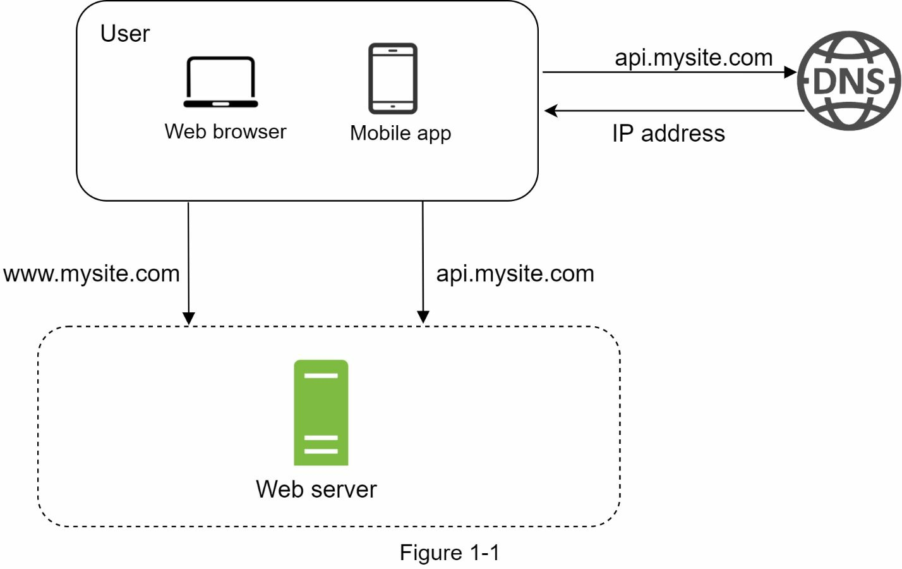

Để hiểu rõ thiết lập này, việc tìm hiểu luồng yêu cầu (request flow) và nguồn lưu lượng (traffic source) là rất hữu ích. Trước tiên, hãy cùng xem xét luồng yêu cầu (Hình 1-2).


1. Người dùng truy cập các trang web thông qua tên miền (domain name), chẳng hạn như `api.mysite.com`. Thông thường, Hệ thống phân giải tên miền (Domain Name System - DNS) là một dịch vụ trả phí do bên thứ ba cung cấp chứ không phải do máy chủ của chúng ta lưu trữ (host).
2. Địa chỉ Giao thức Internet (Internet Protocol - IP) được trả về cho trình duyệt hoặc ứng dụng di động. Trong ví dụ này, địa chỉ IP `15.125.23.214` được trả về.
3. Khi đã có được địa chỉ IP, các yêu cầu theo Giao thức truyền siêu văn bản (Hypertext Transfer Protocol - HTTP) [1] sẽ được gửi trực tiếp đến máy chủ web (web server) của bạn.
4. Máy chủ web trả về các trang HTML hoặc phản hồi JSON (JSON response) để hiển thị (rendering).

Tiếp theo, hãy cùng xem xét nguồn lưu lượng (traffic source). Lưu lượng truy cập đến máy chủ web của bạn đến từ hai nguồn: ứng dụng web (web application) và ứng dụng di động (mobile application).

- **Ứng dụng web (Web application):** sử dụng kết hợp các ngôn ngữ phía máy chủ (server-side languages như Java, Python, v.v.) để xử lý logic nghiệp vụ (business logic), lưu trữ (storage), v.v., và các ngôn ngữ phía máy khách (client-side languages như HTML và JavaScript) để hiển thị giao diện (presentation).
- **Ứng dụng di động (Mobile application):** giao thức HTTP là giao thức truyền thông giữa ứng dụng di động và máy chủ web. Định dạng ký hiệu đối tượng JavaScript (JavaScript Object Notation - JSON) là định dạng phản hồi API (API response format) thường được sử dụng để truyền dữ liệu nhờ tính đơn giản của nó. Dưới đây là một ví dụ về phản hồi API ở định dạng JSON:

```http
GET /users/12 – Lấy đối tượng người dùng cho id = 12
```

```json
{
  "id": 12,
  "firstName": "John",
  "lastName": "Smith",
  "address": {
    "streetAddress": "21 2nd Street",
    "city": "New York",
    "state": "NY",
    "postalCode": 10021
  },
  "phoneNumbers": [
    {
      "type": "home",
      "number": "212 555-1234"
    },
    {
      "type": "fax",
      "number": "646 555-4567"
    }
  ]
}
```

---

## Cơ sở dữ liệu (Database)

Cùng với sự gia tăng của lượng người dùng, một máy chủ là không đủ và chúng ta cần nhiều máy chủ: một máy chủ dành cho lưu lượng web/di động, máy chủ còn lại dành cho cơ sở dữ liệu (Hình 1-3). Việc tách biệt máy chủ lưu lượng web/di động (tầng web - web tier) và máy chủ cơ sở dữ liệu (tầng dữ liệu - data tier) cho phép chúng có thể mở rộng độc lập với nhau.

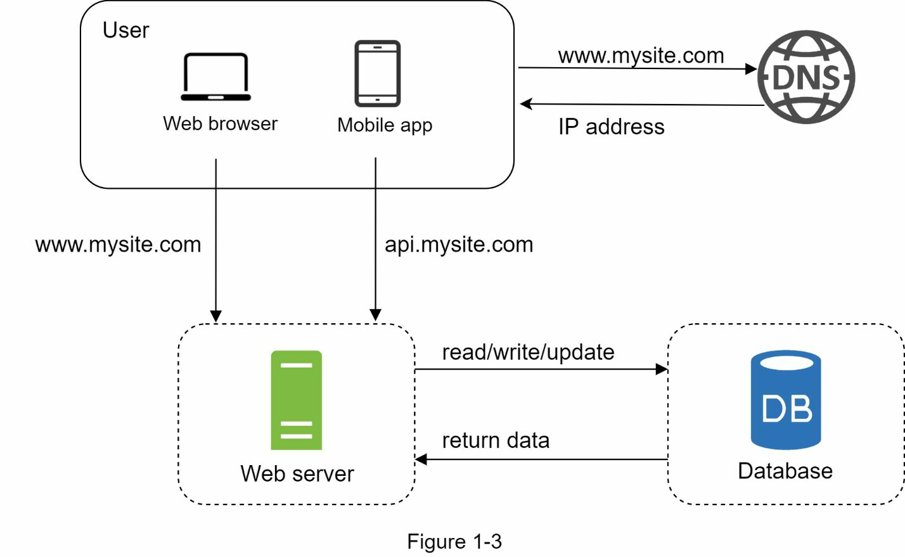

### Nên sử dụng cơ sở dữ liệu nào?

Bạn có thể lựa chọn giữa cơ sở dữ liệu quan hệ (relational database) truyền thống và cơ sở dữ liệu phi quan hệ (non-relational database). Hãy cùng xem xét sự khác biệt giữa chúng.

**Cơ sở dữ liệu quan hệ (Relational databases)** còn được gọi là hệ quản trị cơ sở dữ liệu quan hệ (Relational Database Management System - RDBMS) hoặc cơ sở dữ liệu SQL (SQL database). Những hệ quản trị phổ biến nhất là MySQL, Oracle database, PostgreSQL, v.v. Cơ sở dữ liệu quan hệ biểu diễn và lưu trữ dữ liệu dưới dạng các bảng (tables) và hàng (rows). Bạn có thể thực hiện các thao tác kết hợp (join operations) bằng SQL qua các bảng cơ sở dữ liệu khác nhau.

**Cơ sở dữ liệu phi quan hệ (Non-relational databases)** còn được gọi là cơ sở dữ liệu NoSQL (NoSQL databases). Những cái tên phổ biến là CouchDB, Neo4j, Cassandra, HBase, Amazon DynamoDB, v.v. [2]. Các cơ sở dữ liệu này được chia thành bốn nhóm: lưu trữ khóa-giá trị (key-value stores), lưu trữ đồ thị (graph stores), lưu trữ theo cột (column stores) và lưu trữ tài liệu (document stores). Nhìn chung, các thao tác kết hợp (join operations) không được hỗ trợ trong cơ sở dữ liệu phi quan hệ.

Đối với hầu hết các nhà phát triển, cơ sở dữ liệu quan hệ là lựa chọn tốt nhất vì chúng đã tồn tại hơn 40 năm qua và trong lịch sử, chúng luôn hoạt động rất hiệu quả. Tuy nhiên, nếu cơ sở dữ liệu quan hệ không phù hợp với các trường hợp sử dụng cụ thể của bạn, việc tìm hiểu ngoài cơ sở dữ liệu quan hệ là điều vô cùng quan trọng. Cơ sở dữ liệu phi quan hệ có thể là lựa chọn đúng đắn nếu:

- Ứng dụng của bạn đòi hỏi độ trễ cực thấp (super-low latency).
- Dữ liệu của bạn là phi cấu trúc (unstructured), hoặc bạn không có bất kỳ dữ liệu mang tính quan hệ nào.
- Bạn chỉ cần tuần tự hóa và giải tuần tự hóa dữ liệu (serialize and deserialize data như JSON, XML, YAML, v.v.).
- Bạn cần lưu trữ một lượng dữ liệu khổng lồ (massive amount of data).

---

## Mở rộng theo chiều dọc so với mở rộng theo chiều ngang (Vertical scaling vs horizontal scaling)

Mở rộng theo chiều dọc (Vertical scaling), còn được gọi là "nâng cấp cấu hình" (scale up), là quá trình bổ sung thêm tài nguyên phần cứng (CPU, RAM, v.v.) vào máy chủ hiện tại của bạn. Mở rộng theo chiều ngang (Horizontal scaling), còn được gọi là "mở rộng quy mô" (scale-out), cho phép bạn mở rộng bằng cách thêm nhiều máy chủ hơn vào nhóm tài nguyên (pool of resources) của mình.

Khi lưu lượng truy cập còn thấp, mở rộng theo chiều dọc là một lựa chọn tuyệt vời, và tính đơn giản chính là ưu điểm lớn nhất của nó. Đáng tiếc là, phương pháp này đi kèm với những hạn chế nghiêm trọng:

- Mở rộng theo chiều dọc có một giới hạn cứng (hard limit). Không thể bổ sung vô hạn CPU và bộ nhớ vào một máy chủ đơn lẻ.
- Mở rộng theo chiều dọc không có khả năng dự phòng chuyển đổi khi gặp sự cố (failover) và tính dư thừa (redundancy). Nếu máy chủ bị sập, toàn bộ trang web/ứng dụng sẽ ngừng hoạt động hoàn toàn theo.

Do những hạn chế của mở rộng theo chiều dọc, mở rộng theo chiều ngang là lựa chọn đáng mong muốn hơn đối với các ứng dụng quy mô lớn (large scale applications).

Trong thiết kế trước đó, người dùng kết nối trực tiếp đến máy chủ web (web server). Người dùng sẽ không thể truy cập trang web nếu máy chủ web bị ngoại tuyến (offline). Trong một kịch bản khác, nếu có nhiều người dùng truy cập máy chủ web cùng lúc và lưu lượng đạt tới giới hạn tải của máy chủ, người dùng thường sẽ trải nghiệm tốc độ phản hồi chậm hơn hoặc không thể kết nối đến máy chủ. Bộ cân bằng tải (load balancer) là kỹ thuật tốt nhất để giải quyết các vấn đề này.

---

## Bộ cân bằng tải (Load balancer)

Một bộ cân bằng tải (load balancer) phân phối đồng đều lưu lượng truy cập đến giữa các máy chủ web được xác định trong một tập hợp cân bằng tải (load-balanced set). Hình 1-4 minh họa cách thức hoạt động của một bộ cân bằng tải.


Như thể hiện trong Hình 1-4, người dùng kết nối trực tiếp đến địa chỉ IP công khai (public IP) của bộ cân bằng tải. Với thiết lập này, các máy khách (clients) không còn có thể tiếp cận trực tiếp các máy chủ web được nữa. Để tăng cường bảo mật, các địa chỉ IP nội bộ (private IPs) được sử dụng để giao tiếp giữa các máy chủ với nhau. Một địa chỉ IP nội bộ (private IP) là địa chỉ IP chỉ có thể truy cập được giữa các máy chủ trong cùng một mạng; tuy nhiên, nó không thể truy cập được thông qua internet. Bộ cân bằng tải giao tiếp với các máy chủ web thông qua các địa chỉ IP nội bộ này.

Trong Hình 1-4, sau khi bổ sung thêm một bộ cân bằng tải và một máy chủ web thứ hai, chúng ta đã giải quyết thành công vấn đề thiếu hụt cơ chế dự phòng sự cố (no failover issue) và cải thiện tính sẵn sàng (availability) của tầng web (web tier). Chi tiết được giải thích như sau:

- Nếu máy chủ 1 (server 1) bị ngoại tuyến (offline), toàn bộ lưu lượng sẽ được định tuyến sang máy chủ 2 (server 2). Điều này ngăn chặn trang web khỏi việc bị ngoại tuyến. Chúng ta cũng sẽ thêm một máy chủ web mới khỏe mạnh vào nhóm máy chủ (server pool) để cân bằng tải.
- Nếu lưu lượng trang web tăng trưởng nhanh chóng và hai máy chủ là không đủ để xử lý lưu lượng, bộ cân bằng tải có thể xử lý vấn đề này một cách mượt mà và linh hoạt (gracefully). Bạn chỉ cần thêm nhiều máy chủ hơn vào nhóm máy chủ web (web server pool), và bộ cân bằng tải sẽ tự động bắt đầu gửi các yêu cầu đến chúng.

Bây giờ tầng web (web tier) trông đã ổn định, vậy còn tầng dữ liệu (data tier) thì sao? Thiết kế hiện tại chỉ có một cơ sở dữ liệu duy nhất,

---

## Phần 2: Sao chép cơ sở dữ liệu Master-Slave (Database Replication) (Trang 11-14)

...do đó nó không hỗ trợ khả năng chuyển đổi dự phòng (failover) và tính dư thừa (redundancy). Sao chép cơ sở dữ liệu (Database replication) là một kỹ thuật phổ biến để giải quyết các vấn đề này. Chúng ta hãy cùng tìm hiểu.

#### Sao chép cơ sở dữ liệu (Database replication)

Trích dẫn từ Wikipedia: *“Sao chép cơ sở dữ liệu (Database replication) có thể được sử dụng trong nhiều hệ quản trị cơ sở dữ liệu, thường là với mối quan hệ master/slave giữa bản gốc (master) và các bản sao (slaves)”* [3].

Một cơ sở dữ liệu master thông thường chỉ hỗ trợ các thao tác ghi (write operations). Một cơ sở dữ liệu slave nhận các bản sao dữ liệu từ cơ sở dữ liệu master và chỉ hỗ trợ các thao tác đọc (read operations). Tất cả các câu lệnh chỉnh sửa dữ liệu như chèn (insert), xóa (delete), hoặc cập nhật (update) đều phải được gửi đến cơ sở dữ liệu master. Hầu hết các ứng dụng đều yêu cầu tỷ lệ đọc trên ghi (read-to-write ratio) cao hơn rất nhiều; do đó, số lượng cơ sở dữ liệu slave trong một hệ thống thường lớn hơn số lượng cơ sở dữ liệu master. Hình 1-5 minh họa một cơ sở dữ liệu master với nhiều cơ sở dữ liệu slave.

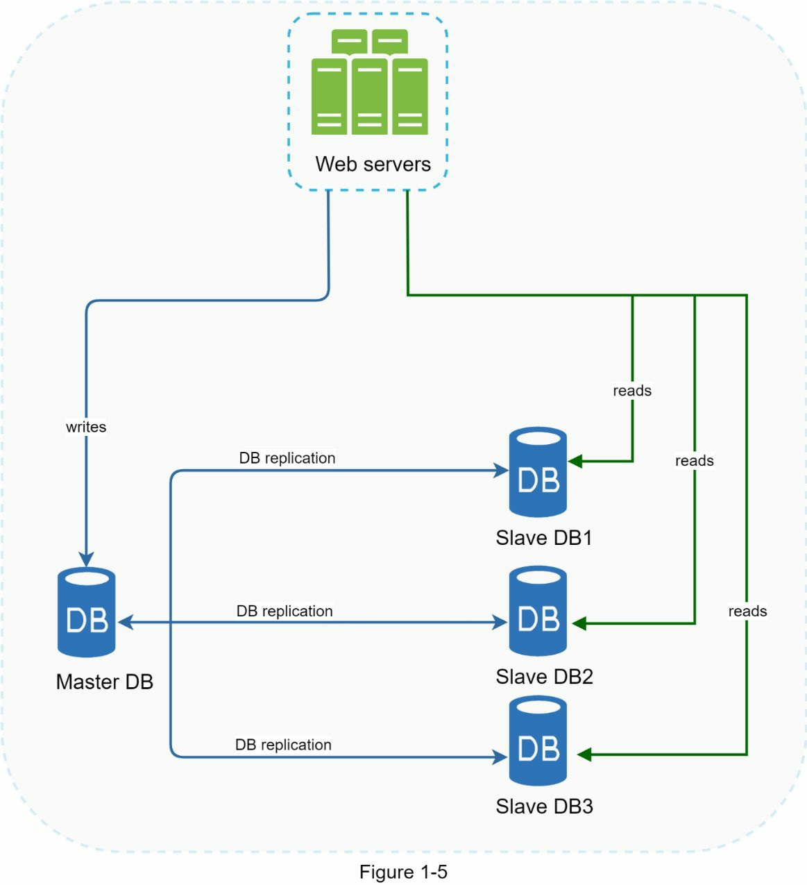

**Các ưu điểm của sao chép cơ sở dữ liệu (Database replication):**

* **Hiệu năng tốt hơn (Better performance):** Trong mô hình master-slave, tất cả các thao tác ghi và cập nhật đều diễn ra tại các nút master; trong khi đó, các thao tác đọc được phân phối trên các nút slave. Mô hình này cải thiện hiệu năng vì nó cho phép nhiều truy vấn được xử lý song song hơn.
* **Độ tin cậy (Reliability):** Nếu một trong các máy chủ cơ sở dữ liệu của bạn bị phá hủy bởi thiên tai, chẳng hạn như bão hoặc động đất, dữ liệu vẫn được bảo toàn. Bạn không cần phải lo lắng về việc mất dữ liệu vì dữ liệu đã được sao chép qua nhiều địa điểm khác nhau.
* **Tính sẵn sàng cao (High availability):** Bằng cách sao chép dữ liệu qua các địa điểm khác nhau, trang web của bạn vẫn duy trì hoạt động ngay cả khi một cơ sở dữ liệu bị ngoại tuyến (offline), vì bạn có thể truy cập dữ liệu được lưu trữ trong một máy chủ cơ sở dữ liệu khác.

Trong phần trước, chúng ta đã thảo luận về cách một bộ cân bằng tải (load balancer) giúp cải thiện tính sẵn sàng của hệ thống (system availability). Ở đây, chúng ta cũng đặt ra một câu hỏi tương tự: điều gì sẽ xảy ra nếu một trong các cơ sở dữ liệu bị ngoại tuyến (offline)? Thiết kế kiến trúc được thảo luận trong Hình 1-5 có thể xử lý trường hợp này:

* **Nếu chỉ có một cơ sở dữ liệu slave khả dụng và nó bị ngoại tuyến (offline):** Các thao tác đọc sẽ tạm thời được điều hướng trực tiếp đến cơ sở dữ liệu master. Ngay khi sự cố được phát hiện, một cơ sở dữ liệu slave mới sẽ thay thế cho cơ sở dữ liệu cũ. Trong trường hợp có nhiều cơ sở dữ liệu slave khả dụng, các thao tác đọc sẽ được chuyển hướng sang các cơ sở dữ liệu slave khỏe mạnh khác. Một máy chủ cơ sở dữ liệu mới sẽ thay thế máy chủ cũ.
* **Nếu cơ sở dữ liệu master bị ngoại tuyến (offline):** Một cơ sở dữ liệu slave sẽ được nâng cấp (promoted) để trở thành master mới. Tất cả các thao tác cơ sở dữ liệu sẽ tạm thời được thực thi trên cơ sở dữ liệu master mới này. Một cơ sở dữ liệu slave mới sẽ ngay lập tức thay thế cơ sở dữ liệu cũ để phục vụ việc sao chép dữ liệu.

Trong các hệ thống thực tế (production systems), việc thăng cấp một master mới phức tạp hơn do dữ liệu trong cơ sở dữ liệu slave có thể chưa được cập nhật mới nhất (up to date). Dữ liệu bị thiếu cần phải được cập nhật bằng cách chạy các tập lệnh phục hồi dữ liệu (data recovery scripts). Mặc dù một số phương pháp sao chép khác như đa master (multi-masters) và sao chép vòng tròn (circular replication) có thể hỗ trợ, nhưng các thiết lập đó phức tạp hơn nhiều; và việc thảo luận về chúng nằm ngoài phạm vi của cuốn sách này. Độc giả quan tâm vui lòng tham khảo các tài liệu tham khảo được liệt kê [4] [5].

Hình 1-6 minh họa thiết kế hệ thống sau khi bổ sung bộ cân bằng tải (load balancer) và sao chép cơ sở dữ liệu (database replication).

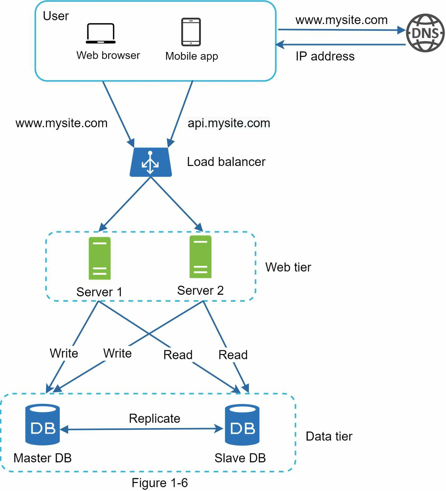

Chúng ta hãy cùng xem xét thiết kế này:

* Người dùng lấy địa chỉ IP của bộ cân bằng tải (load balancer) từ DNS.
* Người dùng kết nối với bộ cân bằng tải bằng địa chỉ IP này.
* Yêu cầu HTTP (HTTP request) được định tuyến đến Máy chủ 1 (Server 1) hoặc Máy chủ 2 (Server 2).
* Một máy chủ web (web server) đọc dữ liệu người dùng từ một cơ sở dữ liệu slave.
* Một máy chủ web (web server) định tuyến bất kỳ thao tác chỉnh sửa dữ liệu nào đến cơ sở dữ liệu master. Điều này bao gồm các thao tác ghi (write), cập nhật (update) và xóa (delete).

Giờ đây, bạn đã nắm vững kiến thức về tầng web (web tier) và tầng dữ liệu (data tier), đã đến lúc cải thiện thời gian tải/phản hồi (load/response time). Điều này có thể được thực hiện bằng cách thêm một tầng bộ nhớ đệm (cache layer) và chuyển nội dung tĩnh (các tệp JavaScript/CSS/hình ảnh/video) sang mạng phân phối nội dung (CDN - Content Delivery Network).

---

### Bộ nhớ đệm (Cache)

Bộ nhớ đệm (Cache) là một vùng lưu trữ tạm thời dùng để lưu kết quả của các phản hồi tốn kém tài nguyên (expensive responses) hoặc dữ liệu thường xuyên được truy cập vào bộ nhớ (memory), giúp các yêu cầu tiếp theo được phục vụ nhanh hơn. Như được minh họa trong Hình 1-6, mỗi khi một trang web mới được tải, một hoặc nhiều lệnh gọi cơ sở dữ liệu (database calls) sẽ được thực thi để lấy dữ liệu. Hiệu năng của ứng dụng bị ảnh hưởng nghiêm trọng do việc gọi cơ sở dữ liệu liên tục lặp đi lặp lại. Bộ nhớ đệm có thể giảm thiểu vấn đề này.

#### Tầng bộ nhớ đệm (Cache tier)

Tầng bộ nhớ đệm (Cache tier) là một lớp lưu trữ dữ liệu tạm thời, có tốc độ nhanh hơn nhiều so với cơ sở dữ liệu. Lợi ích của việc có một tầng bộ nhớ đệm riêng biệt bao gồm: nâng cao hiệu năng hệ thống, khả năng giảm tải khối lượng công việc cho cơ sở dữ liệu, và khả năng mở rộng quy mô tầng bộ nhớ đệm một cách độc lập. Hình 1-7 thể hiện một mô hình thiết lập máy chủ bộ nhớ đệm khả thi:


Sau khi nhận được yêu cầu, máy chủ web (web server) trước tiên sẽ kiểm tra xem bộ nhớ đệm (cache) đã có sẵn phản hồi hay chưa. Nếu có, nó sẽ gửi dữ liệu về lại cho máy khách (client). Nếu chưa có, nó sẽ truy vấn cơ sở dữ liệu, lưu phản hồi vào bộ nhớ đệm, rồi gửi trả lại cho máy khách. Chiến lược lưu trữ bộ nhớ đệm này được gọi là *read-through cache*. Các chiến lược lưu trữ bộ nhớ đệm khác cũng có sẵn tùy thuộc vào loại dữ liệu, kích thước và mô hình truy cập (access patterns). Một nghiên cứu trước đây đã giải thích chi tiết cách thức hoạt động của các chiến lược lưu trữ bộ nhớ đệm khác nhau [6].

Việc tương tác với các máy chủ bộ nhớ đệm rất đơn giản vì hầu hết các máy chủ bộ nhớ đệm đều cung cấp API cho các ngôn ngữ lập trình phổ biến. Đoạn mã dưới đây minh họa các API tiêu biểu của Memcached:

```java
SECONDS = 1
cache.put('myKey', 'myValue', 10 * SECONDS)
cache.get('myKey')
```

#### Những lưu ý khi sử dụng bộ nhớ đệm (Considerations for using cache)

Dưới đây là một số lưu ý khi sử dụng hệ thống bộ nhớ đệm:

- **Quyết định khi nào nên sử dụng bộ nhớ đệm (Decide when to use cache):** Cân nhắc sử dụng bộ nhớ đệm khi dữ liệu được đọc thường xuyên nhưng hiếm khi bị sửa đổi. Vì dữ liệu đệm được lưu trữ trong bộ nhớ khả biến (volatile memory), máy chủ bộ nhớ đệm không lý tưởng cho việc lưu trữ dữ liệu bền vững (persisting data). Ví dụ, nếu máy chủ bộ nhớ đệm khởi động lại, toàn bộ dữ liệu trong bộ nhớ sẽ bị mất. Do đó, dữ liệu quan trọng cần phải được lưu vào các kho dữ liệu bền vững (persistent data stores).
- **Chính sách hết hạn (Expiration policy):** Việc triển khai một chính sách hết hạn là một thực hành tốt. Khi dữ liệu đệm hết hạn, nó sẽ bị xóa khỏi bộ nhớ đệm. Nếu không có chính sách hết hạn, dữ liệu đệm sẽ được lưu vĩnh viễn trong bộ nhớ. Bạn không nên đặt thời gian hết hạn quá ngắn vì điều này sẽ khiến hệ thống phải tải lại dữ liệu từ cơ sở dữ liệu quá thường xuyên. Đồng thời, bạn cũng không nên đặt thời gian hết hạn quá dài vì dữ liệu có thể bị cũ/lỗi thời (stale).
- **Tính nhất quán (Consistency):** Điều này liên quan đến việc duy trì sự đồng bộ giữa kho dữ liệu và bộ nhớ đệm. Sự không nhất quán có thể xảy ra do các thao tác sửa đổi dữ liệu trên kho dữ liệu và bộ nhớ đệm không nằm trong cùng một giao dịch (single transaction). Khi mở rộng quy mô trên nhiều khu vực (multiple regions), việc duy trì tính nhất quán giữa kho dữ liệu và bộ nhớ đệm là một thách thức lớn. Để biết thêm chi tiết, vui lòng tham khảo bài báo có tựa đề “Scaling Memcache at Facebook” do Facebook xuất bản [7].
- **Giảm thiểu lỗi (Mitigating failures):** Một máy chủ bộ nhớ đệm đơn lẻ tạo thành một điểm lỗi đơn lẻ tiềm tàng (Single Point of Failure - SPOF), được Wikipedia định nghĩa như sau: “Điểm lỗi đơn lẻ (SPOF) là một phần của hệ thống mà nếu nó bị lỗi, toàn bộ hệ thống sẽ ngừng hoạt động” [8]. Do đó, việc triển khai nhiều máy chủ bộ nhớ đệm trên các trung tâm dữ liệu (data centers) khác nhau được khuyến nghị nhằm tránh SPOF. Một phương pháp được khuyến nghị khác là cấp phát dư bộ nhớ cần thiết (overprovision) theo một tỷ lệ phần trăm nhất định. Điều này tạo ra một vùng đệm an toàn khi mức sử dụng bộ nhớ gia tăng.

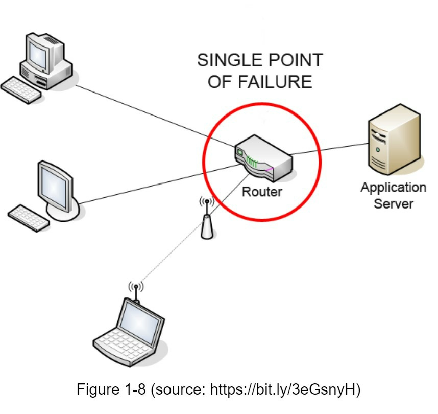

- **Chính sách trục xuất (Eviction Policy):** Một khi bộ nhớ đệm bị đầy, bất kỳ yêu cầu thêm mục mới nào vào bộ nhớ đệm cũng có thể khiến các mục hiện có bị xóa bỏ. Quá trình này được gọi là trục xuất bộ nhớ đệm (cache eviction). Ít được sử dụng gần đây nhất (Least-recently-used - LRU) là chính sách trục xuất bộ nhớ đệm phổ biến nhất. Các chính sách trục xuất khác, chẳng hạn như Ít được sử dụng thường xuyên nhất (Least Frequently Used - LFU) hoặc Vào trước ra trước (First in First Out - FIFO), có thể được áp dụng để đáp ứng các trường hợp sử dụng (use cases) khác nhau.

---

### Mạng phân phối nội dung (Content Delivery Network - CDN)

CDN là một mạng lưới gồm các máy chủ phân tán về mặt địa lý được sử dụng để phân phối nội dung tĩnh (static content). Các máy chủ CDN lưu trữ đệm các nội dung tĩnh như hình ảnh, video, tệp CSS, tệp JavaScript, v.v.

Lưu trữ đệm nội dung động (Dynamic content caching) là một khái niệm tương đối mới và nằm ngoài phạm vi của cuốn sách này. Nó cho phép lưu trữ đệm các trang HTML dựa trên đường dẫn yêu cầu (request path), chuỗi truy vấn (query strings), cookie và tiêu đề yêu cầu (request headers). Tham khảo bài viết được đề cập trong tài liệu tham khảo [9] để biết thêm thông tin. Cuốn sách này tập trung vào cách sử dụng CDN để lưu trữ đệm nội dung tĩnh.

Dưới đây là cách thức hoạt động của CDN ở mức khái quát (high-level): khi người dùng truy cập một trang web, máy chủ CDN ở gần người dùng nhất sẽ phân phối nội dung tĩnh. Về mặt trực quan, người dùng càng ở xa máy chủ CDN thì trang web tải càng chậm. Ví dụ, nếu các máy chủ CDN đặt tại San Francisco, người dùng ở Los Angeles sẽ nhận được nội dung nhanh hơn so với người dùng ở châu Âu. Hình 1-9 là một ví dụ tuyệt vời cho thấy cách CDN cải thiện thời gian tải trang.

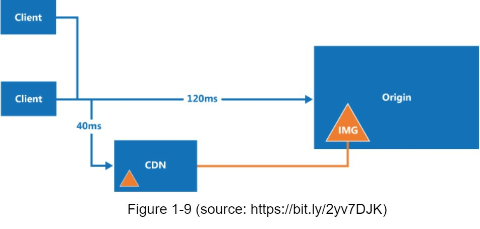

Hình 1-10 minh họa quy trình làm việc của CDN (CDN workflow).


1. Người dùng A (User A) cố gắng lấy tệp `image.png` bằng cách sử dụng một URL hình ảnh. Miền (domain) của URL được cung cấp bởi nhà cung cấp dịch vụ CDN. Hai URL hình ảnh sau đây là ví dụ minh họa cấu trúc URL hình ảnh trên CDN của Amazon và Akamai:
   - `https://mysite.cloudfront.net/logo.jpg`
   - `https://mysite.akamai.com/image-manager/img/logo.jpg`
2. Nếu máy chủ CDN không có tệp `image.png` trong bộ nhớ đệm, máy chủ CDN sẽ yêu cầu tệp đó từ máy chủ gốc (origin), nơi có thể là một máy chủ web (web server) hoặc kho lưu trữ trực tuyến như Amazon S3.
3. Máy chủ gốc trả về tệp `image.png` cho máy chủ CDN, trong đó có thể bao gồm tiêu đề HTTP tùy chọn Thời gian tồn tại (Time-to-Live - TTL) quy định thời gian hình ảnh được lưu trong bộ nhớ đệm.
4. CDN lưu đệm hình ảnh và trả về cho Người dùng A. Hình ảnh vẫn được lưu trữ đệm trong CDN cho đến khi giá trị TTL hết hạn.
5. Người dùng B (User B) gửi một yêu cầu để lấy cùng một hình ảnh đó.
6. Hình ảnh được trả về trực tiếp từ bộ nhớ đệm chừng nào TTL vẫn chưa hết hạn.

#### Những lưu ý khi sử dụng CDN (Considerations of using a CDN)

- **Chi phí (Cost):** CDN được vận hành bởi các nhà cung cấp bên thứ ba và bạn sẽ bị tính phí cho dữ liệu truyền vào và ra khỏi CDN (data transfers in and out). Việc lưu trữ đệm các tài nguyên ít được sử dụng không mang lại lợi ích đáng kể, vì vậy bạn nên cân nhắc chuyển chúng ra khỏi CDN.
- **Thiết lập thời gian hết hạn bộ nhớ đệm phù hợp (Setting an appropriate cache expiry):** Đối với nội dung nhạy cảm với thời gian (time-sensitive content), việc thiết lập thời gian hết hạn bộ nhớ đệm là rất quan trọng. Thời gian hết hạn bộ nhớ đệm không nên quá dài cũng không nên quá ngắn. Nếu quá dài, nội dung có thể không còn mới mẻ/chính xác nữa. Nếu quá ngắn, nó có thể gây ra việc tải lại nội dung liên tục từ các máy chủ gốc về CDN.
- **Cơ chế dự phòng khi CDN gặp sự cố (CDN fallback):** Bạn nên xem xét cách trang web/ứng dụng của mình đối phó với sự cố CDN ngừng hoạt động. Nếu xảy ra sự cố ngừng hoạt động CDN tạm thời (temporary CDN outage), các máy khách (clients) phải có khả năng phát hiện sự cố và gửi yêu cầu tài nguyên trực tiếp đến máy chủ gốc.
- **Hủy hiệu lực tệp (Invalidating files):** Bạn có thể xóa một tệp khỏi CDN trước khi nó hết hạn bằng cách thực hiện một trong các thao tác sau:
  - Hủy hiệu lực đối tượng CDN (Invalidate the CDN object) bằng cách sử dụng các API được cung cấp bởi các nhà cung cấp CDN.
  - Sử dụng cơ chế quản lý phiên bản đối tượng (object versioning) để phục vụ một phiên bản khác của đối tượng. Để quản lý phiên bản cho một đối tượng, bạn có thể thêm một tham số vào URL, chẳng hạn như số phiên bản. Ví dụ, số phiên bản 2 được thêm vào chuỗi truy vấn: `image.png?v=2`.

Hình 1-11 minh họa thiết kế hệ thống sau khi bổ sung CDN và bộ nhớ đệm (cache).

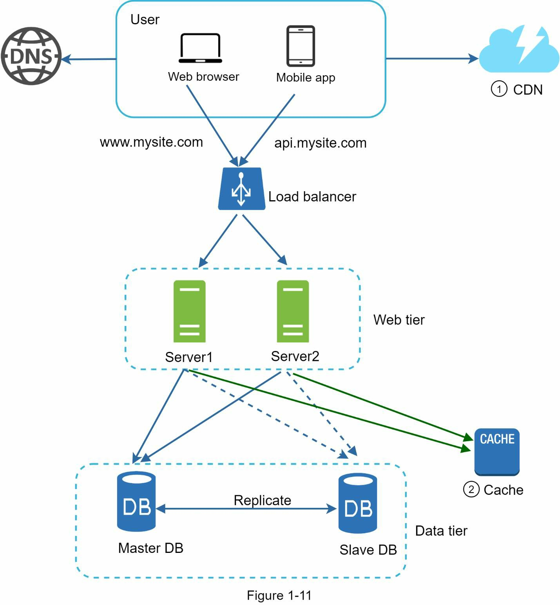

1. Tài nguyên tĩnh (Static assets: JS, CSS, hình ảnh, v.v.) không còn do các máy chủ web (web servers) phân phối nữa. Chúng được lấy trực tiếp từ CDN để mang lại hiệu năng tốt hơn.
2. Tải của cơ sở dữ liệu được giảm nhẹ bằng cách lưu trữ dữ liệu vào bộ nhớ đệm (cache).

---

# Phần 4: Tầng Web phi trạng thái & Đa trung tâm dữ liệu (Trang 20-24)

## Tầng Web phi trạng thái (Stateless web tier)

Bây giờ là lúc xem xét việc mở rộng quy mô tầng web theo chiều ngang (scaling the web tier horizontally). Để thực hiện điều này, chúng ta cần chuyển trạng thái (state - ví dụ như dữ liệu phiên làm việc của người dùng / user session data) ra khỏi tầng web. Một thực hành tốt (good practice) là lưu trữ dữ liệu phiên (session data) trong bộ lưu trữ bền vững (persistent storage) chẳng hạn như cơ sở dữ liệu quan hệ (relational database) hoặc NoSQL. Mỗi máy chủ web (web server) trong cụm (cluster) đều có thể truy cập dữ liệu trạng thái (state data) từ các cơ sở dữ liệu. Điều này được gọi là **tầng web phi trạng thái (stateless web tier)**.

### Kiến trúc có trạng thái (Stateful architecture)

Một máy chủ có trạng thái (stateful server) và máy chủ phi trạng thái (stateless server) có một số điểm khác biệt then chốt. Máy chủ có trạng thái ghi nhớ dữ liệu của máy khách (client data / state) từ yêu cầu (request) này sang yêu cầu tiếp theo. Máy chủ phi trạng thái không lưu giữ bất kỳ thông tin trạng thái nào.

Hình 1-12 hiển thị một ví dụ về kiến trúc có trạng thái (stateful architecture).

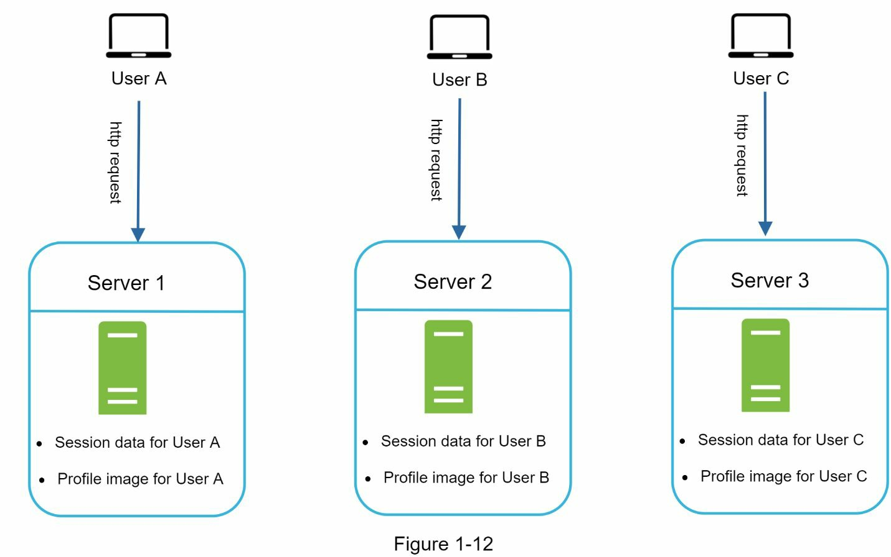

Trong Hình 1-12, dữ liệu phiên (session data) và ảnh hồ sơ (profile image) của Người dùng A (User A) được lưu trữ tại Máy chủ 1 (Server 1). Để xác thực Người dùng A (User A), các yêu cầu HTTP (HTTP requests) bắt buộc phải được định tuyến đến Máy chủ 1. Nếu một yêu cầu được gửi tới các máy chủ khác như Máy chủ 2 (Server 2), quá trình xác thực sẽ thất bại vì Máy chủ 2 không chứa dữ liệu phiên của Người dùng A. Tương tự, tất cả các yêu cầu HTTP từ Người dùng B (User B) phải được định tuyến đến Máy chủ 2; tất cả các yêu cầu từ Người dùng C (User C) phải được gửi tới Máy chủ 3 (Server 3).

Vấn đề ở đây là mọi yêu cầu từ cùng một máy khách (client) phải được định tuyến tới cùng một máy chủ. Điều này có thể được thực hiện thông qua cơ chế phiên dính (sticky sessions) trên hầu hết các bộ cân bằng tải (load balancers) [10]; tuy nhiên, điều này làm tăng chi phí vận hành (adds overhead). Việc bổ sung hoặc loại bỏ các máy chủ trở nên khó khăn hơn nhiều với cách tiếp cận này. Nó cũng gây thách thức lớn trong việc xử lý sự cố lỗi máy chủ (server failures).

### Kiến trúc phi trạng thái (Stateless architecture)

Hình 1-13 minh họa kiến trúc phi trạng thái (stateless architecture).


Trong kiến trúc phi trạng thái này, các yêu cầu HTTP (HTTP requests) từ người dùng có thể được gửi tới bất kỳ máy chủ web (web servers) nào, nơi sẽ lấy dữ liệu trạng thái (state data) từ một kho dữ liệu dùng chung (shared data store). Dữ liệu trạng thái được lưu trữ trong một kho dữ liệu dùng chung và tách biệt hoàn toàn khỏi các máy chủ web. Một hệ thống phi trạng thái (stateless system) sẽ đơn giản hơn, mạnh mẽ hơn (more robust) và dễ mở rộng quy mô hơn (scalable).

Hình 1-14 minh họa thiết kế được cập nhật với tầng web phi trạng thái (stateless web tier).

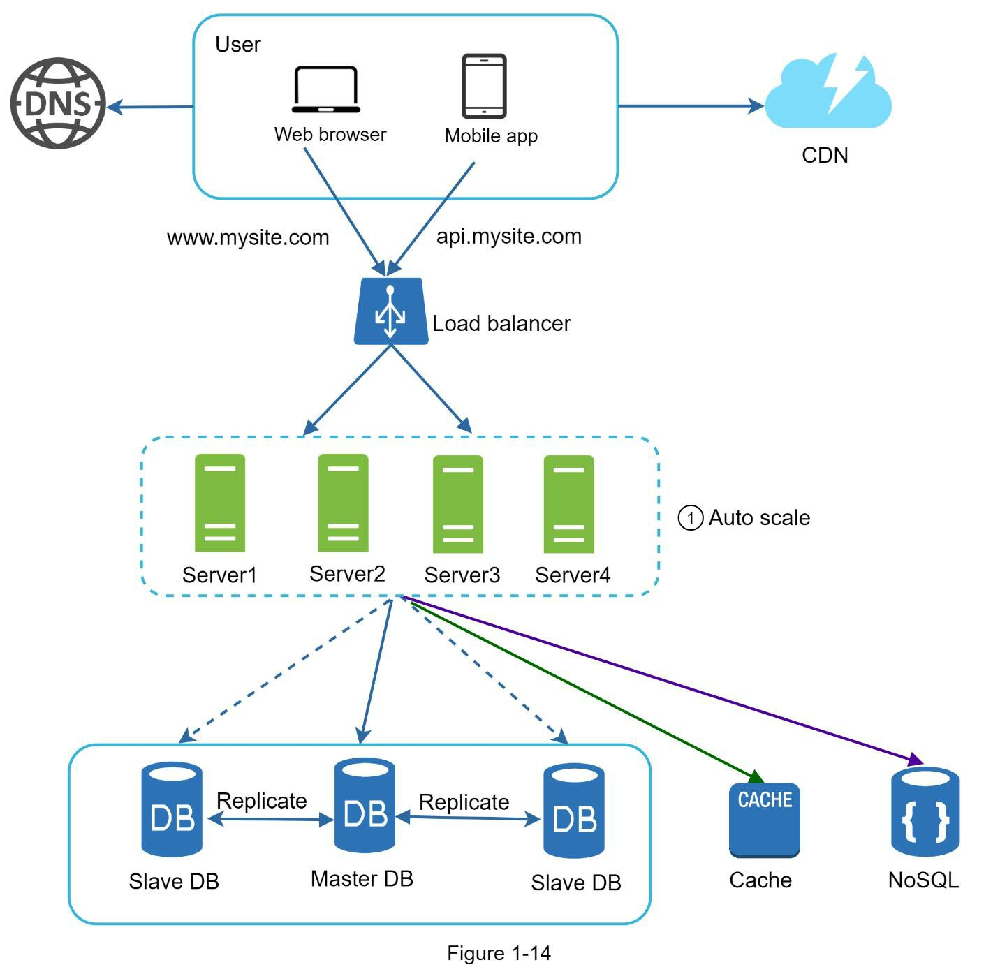

Trong Hình 1-14, chúng ta chuyển dữ liệu phiên (session data) ra khỏi tầng web (web tier) và lưu trữ chúng vào kho dữ liệu bền vững (persistent data store). Kho dữ liệu dùng chung (shared data store) này có thể là một cơ sở dữ liệu quan hệ (relational database), Memcached/Redis, NoSQL, v.v. Kho lưu trữ dữ liệu NoSQL được lựa chọn vì nó rất dễ mở rộng quy mô (easy to scale). Tự động mở rộng quy mô (Autoscaling) có nghĩa là tự động thêm hoặc bớt các máy chủ web dựa trên tải lưu lượng truy cập (traffic load). Sau khi dữ liệu trạng thái được đưa ra khỏi các máy chủ web, việc tự động co giãn (auto-scaling) của tầng web có thể dễ dàng đạt được bằng cách bổ sung hoặc loại bỏ máy chủ dựa trên tải lưu lượng truy cập.

Trang web của bạn phát triển nhanh chóng và thu hút một lượng lớn người dùng quốc tế. Để cải thiện tính sẵn sàng (availability) và mang lại trải nghiệm người dùng tốt hơn trên các khu vực địa lý rộng lớn hơn, việc hỗ trợ đa trung tâm dữ liệu (multiple data centers) là vô cùng quan trọng.

---

## Trung tâm dữ liệu (Data centers)

Hình 1-15 minh họa một thiết lập ví dụ với hai trung tâm dữ liệu (two data centers). Trong điều kiện hoạt động bình thường, người dùng được định tuyến theo địa lý thông qua geoDNS (geoDNS-routed, còn được gọi là geo-routed) đến trung tâm dữ liệu gần nhất, với tỷ lệ phân chia lưu lượng truy cập là x% tại US-East (Miền Đông Hoa Kỳ) và (100 – x)% tại US-West (Miền Tây Hoa Kỳ). geoDNS là một dịch vụ DNS cho phép phân giải tên miền (domain names) thành các địa chỉ IP (IP addresses) dựa trên vị trí địa lý của người dùng.


Trong trường hợp xảy ra sự cố ngừng hoạt động nghiêm trọng tại bất kỳ trung tâm dữ liệu nào (significant data center outage), chúng ta sẽ chuyển hướng toàn bộ lưu lượng truy cập đến một trung tâm dữ liệu còn hoạt động tốt (healthy data center). Trong Hình 1-16, trung tâm dữ liệu 2 (US-West) ngoại tuyến (offline), và 100% lưu lượng truy cập được định tuyến đến trung tâm dữ liệu 1 (US-East).

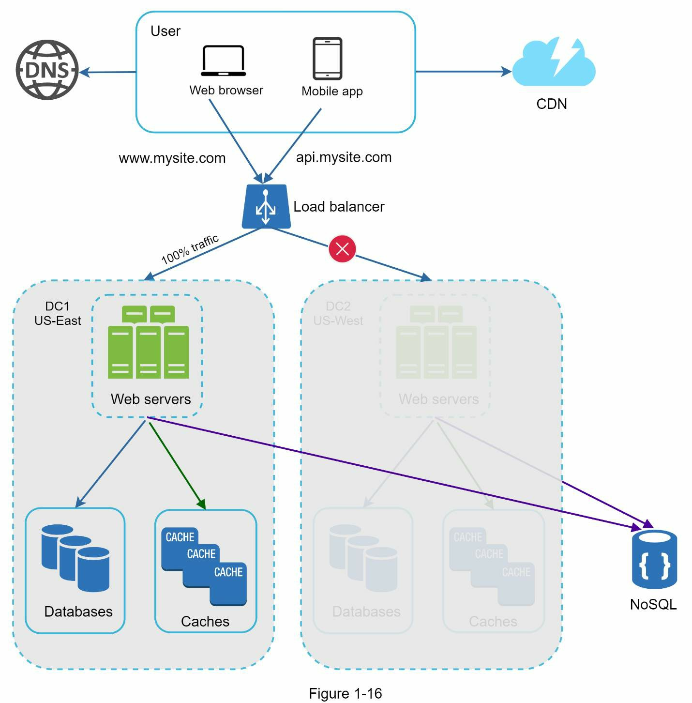

Một số thách thức kỹ thuật (technical challenges) cần phải được giải quyết để hiện thực hóa thiết lập đa trung tâm dữ liệu (multi-data center setup):

* **Chuyển hướng lưu lượng truy cập (Traffic redirection):** Cần có các công cụ hiệu quả để điều hướng lưu lượng truy cập đến đúng trung tâm dữ liệu. GeoDNS có thể được sử dụng để điều hướng lưu lượng đến trung tâm dữ liệu gần nhất tùy thuộc vào vị trí của người dùng.
* **Đồng bộ hóa dữ liệu (Data synchronization):** Người dùng từ các khu vực khác nhau có thể sử dụng các cơ sở dữ liệu cục bộ (local databases) hoặc bộ nhớ đệm cục bộ (local caches) khác nhau. Trong các trường hợp chuyển đổi dự phòng (failover), lưu lượng truy cập có thể bị định tuyến đến một trung tâm dữ liệu mà dữ liệu tại đó không khả dụng. Một chiến lược phổ biến là sao chép dữ liệu trên nhiều trung tâm dữ liệu (replicate data across multiple data centers). Một nghiên cứu trước đây đã chỉ ra cách thức Netflix triển khai việc sao chép bất đồng bộ trên nhiều trung tâm dữ liệu (asynchronous multi-data center replication) [11].
* **Kiểm thử và triển khai (Test and deployment):** Với thiết lập đa trung tâm dữ liệu, việc kiểm thử trang web/ứng dụng của bạn tại các địa điểm khác nhau là rất quan trọng. Các công cụ triển khai tự động (automated deployment tools) đóng vai trò sống còn để duy trì tính nhất quán của các dịch vụ trên toàn bộ các trung tâm dữ liệu [11].

Để mở rộng quy mô hệ thống hơn nữa, chúng ta cần tách rời các thành phần khác nhau của hệ thống (decouple different components) để chúng có thể được mở rộng độc lập (scaled independently). Hàng đợi thông điệp (Messaging queue) là một chiến lược then chốt được nhiều hệ thống phân tán trong thực tế sử dụng để giải quyết vấn đề này.

---

# Phần 5: Message Queue, Logging, Metrics & Tự động hóa (Trang 25-27)

---

## Hàng đợi thông điệp (Message queue)

Hàng đợi thông điệp (*message queue*) là một thành phần có tính bền vững (*durable component*), được lưu trữ trong bộ nhớ (*in-memory*), hỗ trợ giao tiếp bất đồng bộ (*asynchronous communication*). Nó đóng vai trò như một bộ đệm (*buffer*) và phân phối các yêu cầu bất đồng bộ. Kiến trúc cơ bản của một hàng đợi thông điệp rất đơn giản. Các dịch vụ đầu vào, được gọi là bên sản xuất / bên phát hành (*producers/publishers*), tạo ra các thông điệp (*messages*) và phát hành chúng vào một hàng đợi thông điệp (*message queue*). Các dịch vụ hoặc máy chủ khác, được gọi là bên tiêu thụ / bên đăng ký nhận tin (*consumers/subscribers*), kết nối tới hàng đợi và thực hiện các hành động được định nghĩa bởi các thông điệp đó. Mô hình này được thể hiện trong Hình 1-17.

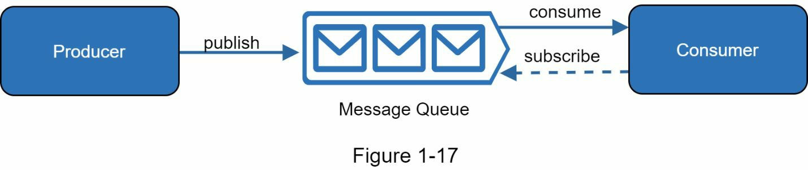

Việc tách rời liên kết (*decoupling*) khiến hàng đợi thông điệp trở thành một kiến trúc ưu tiên để xây dựng một ứng dụng có khả năng mở rộng (*scalable*) và đáng tin cậy (*reliable*). Với hàng đợi thông điệp, bên sản xuất (*producer*) có thể gửi thông điệp vào hàng đợi ngay cả khi bên tiêu thụ (*consumer*) chưa sẵn sàng hoặc không khả dụng để xử lý nó. Ngược lại, bên tiêu thụ (*consumer*) có thể đọc các thông điệp từ hàng đợi ngay cả khi bên sản xuất (*producer*) không khả dụng.

Hãy xem xét trường hợp sử dụng (*use case*) sau: ứng dụng của bạn hỗ trợ tùy chỉnh hình ảnh, bao gồm cắt xén (*cropping*), làm nét (*sharpening*), làm mờ (*blurring*), v.v. Những tác vụ tùy chỉnh đó cần thời gian để hoàn thành. Trong Hình 1-18, các máy chủ web (*web servers*) phát hành các tác vụ xử lý ảnh vào hàng đợi thông điệp (*message queue*). Các tiến trình công nhân xử lý ảnh (*photo processing workers*) lấy các tác vụ từ hàng đợi thông điệp và thực hiện các tác vụ tùy chỉnh ảnh một cách bất đồng bộ (*asynchronously*). Bên sản xuất (*producer*) và bên tiêu thụ (*consumer*) có thể được mở rộng độc lập (*scaled independently*). Khi kích thước hàng đợi trở nên lớn, nhiều tiến trình công nhân (*workers*) sẽ được thêm vào để giảm thời gian xử lý. Tuy nhiên, nếu hàng đợi hầu như luôn trống, số lượng tiến trình công nhân (*workers*) có thể được giảm bớt.

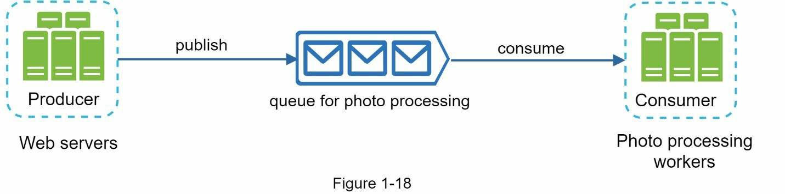

---

## Ghi nhật ký, số liệu đo lường, tự động hóa (Logging, metrics, automation)

Khi làm việc với một trang web quy mô nhỏ chạy trên một vài máy chủ, việc hỗ trợ ghi nhật ký (*logging*), các chỉ số đo lường (*metrics*), và tự động hóa (*automation*) là những thực hành tốt nhưng chưa phải là điều bắt buộc. Tuy nhiên, khi trang web của bạn đã phát triển để phục vụ cho một doanh nghiệp lớn, việc đầu tư vào các công cụ này là vô cùng thiết yếu.

- **Ghi nhật ký (Logging):** Việc giám sát các bản ghi nhật ký lỗi (*error logs*) rất quan trọng vì nó giúp xác định các lỗi và sự cố trong hệ thống. Bạn có thể giám sát nhật ký lỗi ở cấp độ từng máy chủ (*per server level*) hoặc sử dụng các công cụ để tổng hợp chúng về một dịch vụ tập trung (*centralized service*) nhằm tìm kiếm và xem xét dễ dàng.
- **Số liệu đo lường (Metrics):** Việc thu thập các loại số liệu đo lường khác nhau giúp chúng ta có được những góc nhìn sâu sắc về mặt kinh doanh (*business insights*) và hiểu được tình trạng sức khỏe (*health status*) của hệ thống. Một số số liệu sau đây rất hữu ích:
  - **Số liệu cấp độ máy chủ (Host level metrics):** CPU, Bộ nhớ (Memory), I/O của đĩa (disk I/O), v.v.
  - **Số liệu cấp độ tổng hợp (Aggregated level metrics):** ví dụ như hiệu năng của toàn bộ tầng cơ sở dữ liệu (*database tier*), tầng bộ nhớ đệm (*cache tier*), v.v.
  - **Các số liệu kinh doanh cốt lõi (Key business metrics):** người dùng hoạt động hàng ngày (*daily active users*), tỷ lệ giữ chân (*retention*), doanh thu (*revenue*), v.v.
- **Tự động hóa (Automation):** Khi một hệ thống trở nên lớn và phức tạp, chúng ta cần xây dựng hoặc tận dụng các công cụ tự động hóa để nâng cao năng suất. Tích hợp liên tục (*Continuous Integration - CI*) là một thực hành tốt, trong đó mỗi lần bàn giao mã nguồn (*code check-in*) đều được xác minh thông qua tự động hóa, cho phép các nhóm phát hiện vấn đề từ sớm. Ngoài ra, việc tự động hóa quy trình xây dựng (*build*), kiểm thử (*test*), triển khai (*deploy*), v.v. có thể cải thiện đáng kể năng suất của lập trình viên.

### Bổ sung hàng đợi thông điệp và các công cụ hỗ trợ khác (Adding message queues and different tools)

Hình 1-19 thể hiện thiết kế đã được cập nhật. Do giới hạn về không gian hiển thị, chỉ có một trung tâm dữ liệu (*data center*) được thể hiện trong hình.

1. Thiết kế bao gồm một hàng đợi thông điệp (*message queue*), giúp hệ thống được liên kết lỏng lẻo hơn (*loosely coupled*) và có khả năng chống chịu lỗi (*failure resilient*) tốt hơn.
2. Các công cụ ghi nhật ký (*logging*), giám sát (*monitoring*), thu thập chỉ số đo lường (*metrics*) và tự động hóa (*automation*) được tích hợp vào hệ thống.

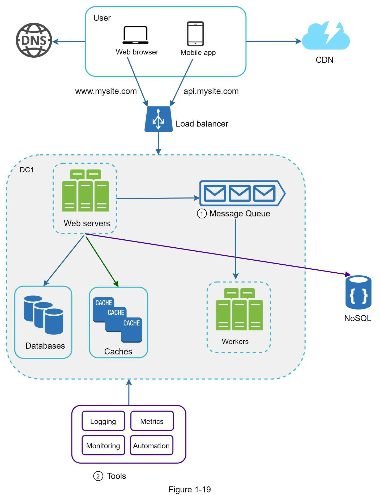

---

Khi dữ liệu tăng trưởng mỗi ngày, cơ sở dữ liệu của bạn càng trở nên quá tải hơn. Đã đến lúc phải mở rộng quy mô tầng dữ liệu (*data tier*).

---

# Mở rộng quy mô cơ sở dữ liệu (Database scaling)

Có hai phương pháp tiếp cận khái quát để mở rộng quy mô cơ sở dữ liệu: mở rộng theo chiều dọc (vertical scaling) và mở rộng theo chiều ngang (horizontal scaling).

### Mở rộng theo chiều dọc (Vertical scaling)

Mở rộng theo chiều dọc (vertical scaling), còn được gọi là nâng cấp hệ thống (scaling up), là hình thức mở rộng bằng cách bổ sung thêm tài nguyên (CPU, RAM, DISK, v.v.) vào một máy chủ hiện có. Hiện nay có một số máy chủ cơ sở dữ liệu rất mạnh mẽ. Theo Amazon Relational Database Service (RDS) [12], bạn có thể có được một máy chủ cơ sở dữ liệu với 24 TB RAM. Loại máy chủ cơ sở dữ liệu mạnh mẽ như thế này có thể lưu trữ và xử lý rất nhiều dữ liệu. Ví dụ, trang web stackoverflow.com vào năm 2013 có hơn 10 triệu lượt truy cập duy nhất hàng tháng (monthly unique visitors), nhưng nó chỉ sử dụng duy nhất 1 cơ sở dữ liệu máy chủ chính (master database) [13]. Tuy nhiên, mở rộng theo chiều dọc đi kèm với một số nhược điểm nghiêm trọng:

* Bạn có thể bổ sung thêm CPU, RAM, v.v. vào máy chủ cơ sở dữ liệu của mình, nhưng luôn có các giới hạn phần cứng (hardware limits). Nếu bạn có lượng người dùng lớn, một máy chủ đơn lẻ (single server) là không đủ đáp ứng.
* Nguy cơ cao gặp phải điểm lỗi duy nhất (single point of failures - SPOF).
* Tổng chi phí cho việc mở rộng theo chiều dọc là rất cao. Các máy chủ cấu hình mạnh có giá đắt hơn rất nhiều.

### Mở rộng theo chiều ngang (Horizontal scaling)

Mở rộng theo chiều ngang (horizontal scaling), còn được gọi là phân mảnh (sharding), là việc bổ sung thêm nhiều máy chủ vào hệ thống. Hình 1-20 so sánh giữa mở rộng theo chiều dọc và mở rộng theo chiều ngang.


Kỹ thuật phân mảnh (Sharding) chia tách các cơ sở dữ liệu lớn thành các phần nhỏ hơn, dễ quản lý hơn gọi là các phân mảnh (shards). Mỗi shard đều dùng chung một cấu trúc lược đồ (schema), mặc dù dữ liệu thực tế trên mỗi shard là duy nhất cho riêng shard đó.

Hình 1-21 minh họa một ví dụ về các cơ sở dữ liệu được phân mảnh. Dữ liệu người dùng được phân bổ vào một máy chủ cơ sở dữ liệu dựa trên mã định danh người dùng (user IDs). Bất cứ khi nào bạn truy cập dữ liệu, một hàm băm (hash function) sẽ được sử dụng để tìm ra phân mảnh (shard) tương ứng. Trong ví dụ của chúng ta, hàm băm được sử dụng là `user_id % 4`. Nếu kết quả bằng 0, shard 0 sẽ được dùng để lưu trữ và truy xuất dữ liệu. Nếu kết quả bằng 1, shard 1 sẽ được sử dụng. Logic tương tự áp dụng cho các shard còn lại.


Hình 1-22 hiển thị bảng người dùng (user table) trong các cơ sở dữ liệu đã được phân mảnh.

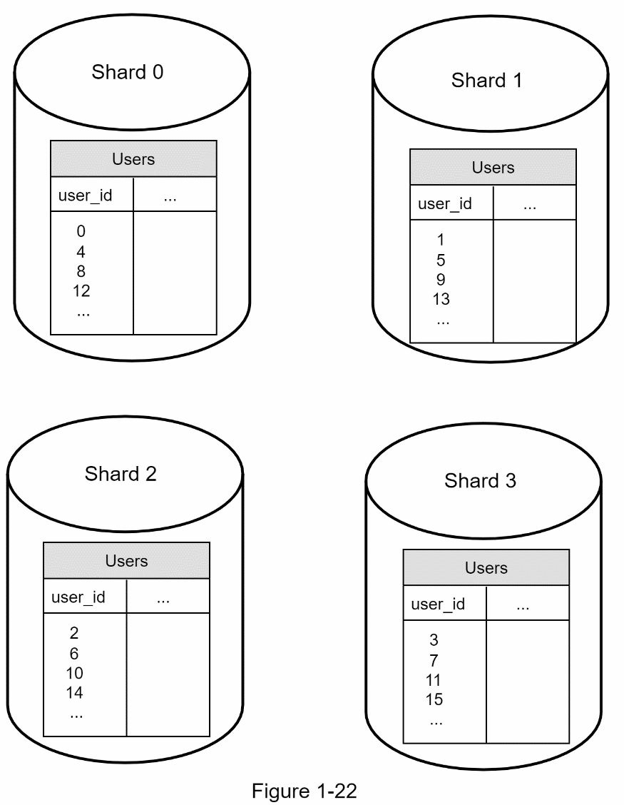

Yếu tố quan trọng nhất cần cân nhắc khi triển khai chiến lược phân mảnh là việc lựa chọn khóa phân mảnh (sharding key). Khóa phân mảnh (còn được gọi là partition key) bao gồm một hoặc nhiều cột dùng để xác định cách thức phân phối dữ liệu. Như được hiển thị trong Hình 1-22, “user_id” chính là khóa phân mảnh (sharding key). Một sharding key cho phép bạn truy xuất và chỉnh sửa dữ liệu một cách hiệu quả bằng cách định tuyến các truy vấn cơ sở dữ liệu đến đúng cơ sở dữ liệu đích. Khi lựa chọn một sharding key, một trong những tiêu chí quan trọng nhất là chọn một khóa có thể phân phối đều dữ liệu (evenly distributed data).

Phân mảnh (Sharding) là một kỹ thuật tuyệt vời để mở rộng quy mô cơ sở dữ liệu nhưng nó còn cách rất xa một giải pháp hoàn hảo. Nó mang lại sự phức tạp và những thách thức mới cho hệ thống:

* **Tái phân mảnh dữ liệu (Resharding data):** Việc tái phân mảnh dữ liệu là cần thiết khi:
  1. Một shard đơn lẻ không còn khả năng chứa thêm dữ liệu do sự tăng trưởng nhanh chóng.
  2. Một số shard nhất định có thể gặp tình trạng cạn kiệt shard (shard exhaustion) nhanh hơn các shard khác do sự phân phối dữ liệu không đồng đều. Khi hiện tượng cạn kiệt shard xảy ra, hệ thống yêu cầu phải cập nhật hàm phân mảnh (sharding function) và di chuyển dữ liệu qua lại. Kỹ thuật băm nhất quán (Consistent hashing) – sẽ được thảo luận chi tiết trong Chương 5 – là một kỹ thuật phổ biến được sử dụng để giải quyết vấn đề này.
* **Vấn đề người nổi tiếng (Celebrity problem):** Vấn đề này còn được gọi là sự cố khóa điểm nóng (hotspot key problem). Việc truy cập quá mức vào một shard cụ thể có thể gây ra tình trạng quá tải máy chủ (server overload). Hãy tưởng tượng dữ liệu của Katy Perry, Justin Bieber và Lady Gaga đều nằm trên cùng một shard. Đối với các ứng dụng mạng xã hội, shard đó sẽ bị quá tải hoàn toàn bởi các thao tác đọc (read operations). Để giải quyết vấn đề này, chúng ta có thể cần phải cấp phát riêng một shard cho từng người nổi tiếng. Thậm chí mỗi shard đó còn có thể đòi hỏi phải phân vùng nhỏ hơn nữa (further partition).
* **Thao tác kết hợp bảng và phi chuẩn hóa dữ liệu (Join and de-normalization):** Một khi cơ sở dữ liệu đã được phân mảnh trên nhiều máy chủ, rất khó để thực hiện các thao tác kết hợp bảng (join operations) xuyên suốt qua các shard cơ sở dữ liệu. Một giải pháp thay thế phổ biến là phi chuẩn hóa (de-normalize) cơ sở dữ liệu để các truy vấn có thể được thực hiện ngay trong một bảng đơn lẻ.

Trong Hình 1-23, chúng ta phân mảnh các cơ sở dữ liệu để đáp ứng lưu lượng dữ liệu đang gia tăng nhanh chóng. Đồng thời, một số tính năng phi quan hệ (non-relational) được chuyển sang kho lưu trữ dữ liệu NoSQL để giảm tải cho cơ sở dữ liệu. Dưới đây là bài viết bao quát nhiều trường hợp sử dụng (use cases) của NoSQL [14].

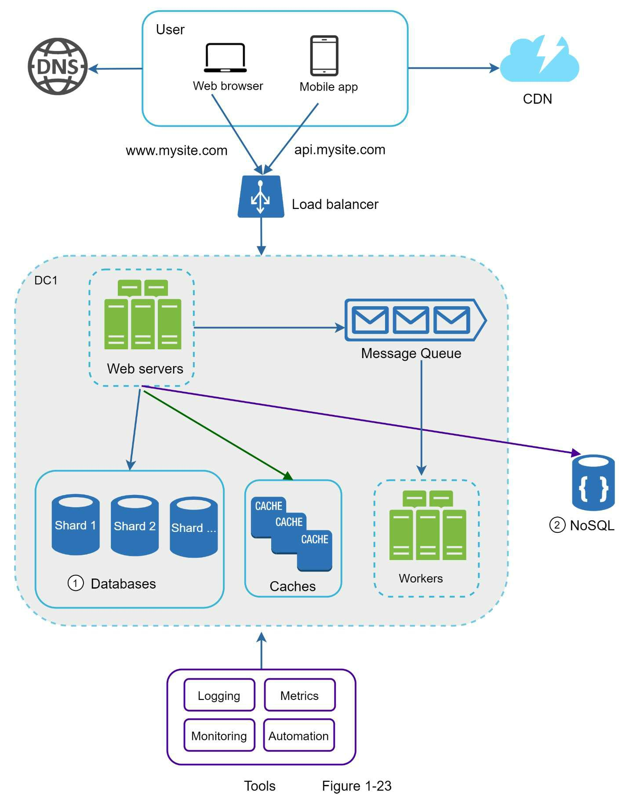

---

# Hàng triệu người dùng và xa hơn nữa (Millions of users and beyond)

Mở rộng quy mô một hệ thống là một quy trình lặp đi lặp lại (iterative process). Việc liên tục tinh chỉnh và áp dụng lặp lại những gì chúng ta đã học trong chương này có thể đưa chúng ta tiến rất xa. Cần có nhiều tinh chỉnh hơn nữa cùng các chiến lược mới để mở rộng quy mô vượt trên hàng triệu người dùng. Chẳng hạn, bạn có thể cần phải tối ưu hóa hệ thống của mình và tách rời (decouple) hệ thống thành các dịch vụ thậm chí còn nhỏ hơn nữa. Toàn bộ các kỹ thuật đã học trong chương này sẽ cung cấp một nền tảng vững chắc để giải quyết các thách thức mới. Để đúc kết chương này, chúng tôi cung cấp bản tóm tắt về cách thức chúng ta mở rộng quy mô hệ thống để phục vụ hàng triệu người dùng:

* Giữ cho tầng web phi trạng thái (Keep web tier stateless)
* Xây dựng tính dự phòng ở mọi tầng (Build redundancy at every tier)
* Lưu bộ nhớ đệm dữ liệu nhiều nhất có thể (Cache data as much as you can)
* Hỗ trợ nhiều trung tâm dữ liệu (Support multiple data centers)
* Lưu trữ các tài nguyên tĩnh trên CDN (Host static assets in CDN)
* Mở rộng tầng dữ liệu của bạn bằng kỹ thuật phân mảnh (Scale your data tier by sharding)
* Chia nhỏ các tầng thành từng dịch vụ độc lập (Split tiers into individual services)
* Giám sát hệ thống của bạn và sử dụng các công cụ tự động hóa (Monitor your system and use automation tools)

Xin chúc mừng bạn đã đi được một chặng đường dài đến đây! Giờ hãy tự thưởng cho mình một cái vỗ vai khích lệ. Làm tốt lắm!

---

# Tài liệu tham khảo (Reference materials)

* [1] Hypertext Transfer Protocol: https://en.wikipedia.org/wiki/Hypertext_Transfer_Protocol
* [2] Should you go Beyond Relational Databases?: https://blog.teamtreehouse.com/should-you-go-beyond-relational-databases
* [3] Replication: https://en.wikipedia.org/wiki/Replication_(computing)
* [4] Multi-master replication: https://en.wikipedia.org/wiki/Multi-master_replication
* [5] NDB Cluster Replication: Multi-Master and Circular Replication: https://dev.mysql.com/doc/refman/5.7/en/mysql-cluster-replication-multi-master.html
* [6] Caching Strategies and How to Choose the Right One: https://codeahoy.com/2017/08/11/caching-strategies-and-how-to-choose-the-right-one/
* [7] R. Nishtala, "Facebook, Scaling Memcache at," 10th USENIX Symposium on Networked Systems Design and Implementation (NSDI ’13).
* [8] Single point of failure: https://en.wikipedia.org/wiki/Single_point_of_failure
* [9] Amazon CloudFront Dynamic Content Delivery: https://aws.amazon.com/cloudfront/dynamic-content/
* [10] Configure Sticky Sessions for Your Classic Load Balancer: https://docs.aws.amazon.com/elasticloadbalancing/latest/classic/elb-sticky-sessions.html
* [11] Active-Active for Multi-Regional Resiliency: https://netflixtechblog.com/active-active-for-multi-regional-resiliency-c47719f6685b
* [12] Amazon EC2 High Memory Instances: https://aws.amazon.com/ec2/instance-types/high-memory/
* [13] What it takes to run Stack Overflow: http://nickcraver.com/blog/2013/11/22/what-it-takes-to-run-stack-overflow
* [14] What The Heck Are You Actually Using NoSQL For: http://highscalability.com/blog/2010/12/6/what-the-heck-are-you-actually-using-nosql-for.html


---

[← Lời Mở Đầu](00-loi-mo-dau.md) | [Mục lục](README.md) | [Chương 02: Ước lượng đại khái →](chuong-02-uoc-luong-dai-khai.md)
