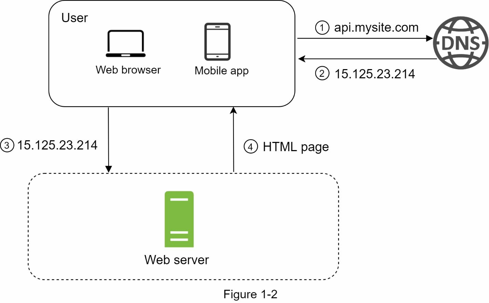
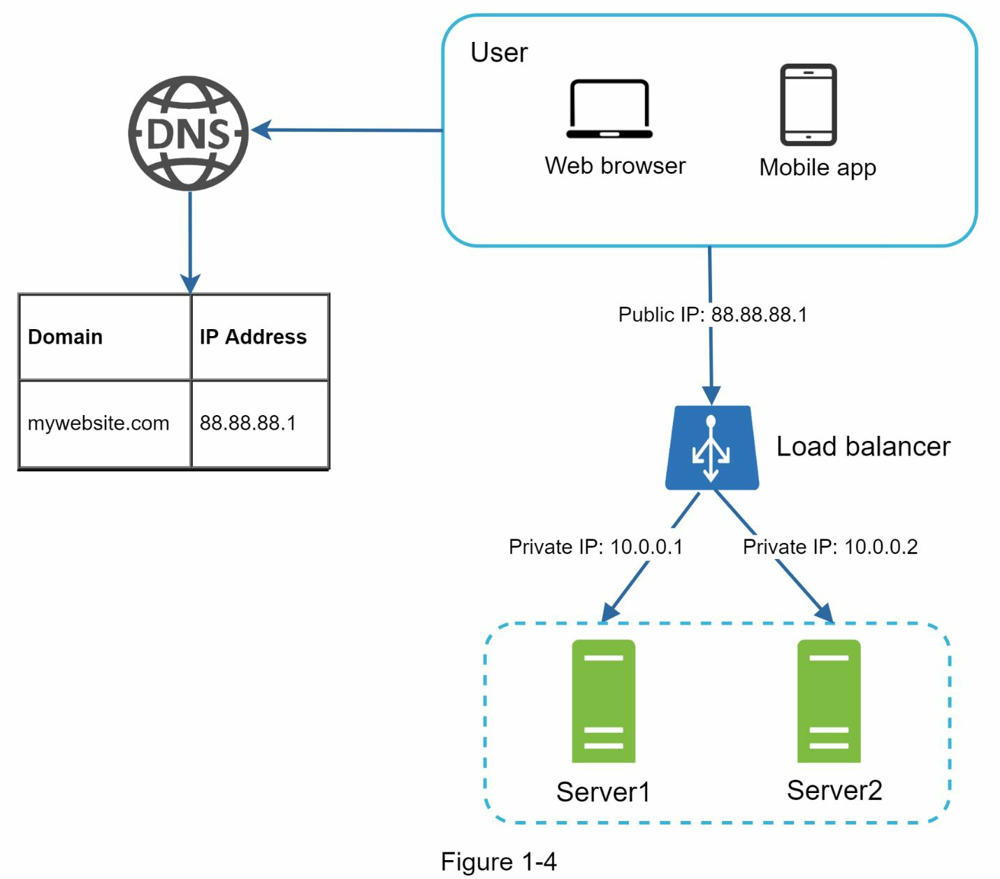
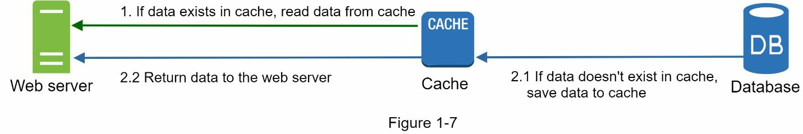
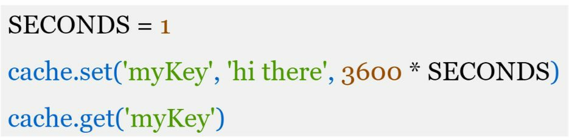
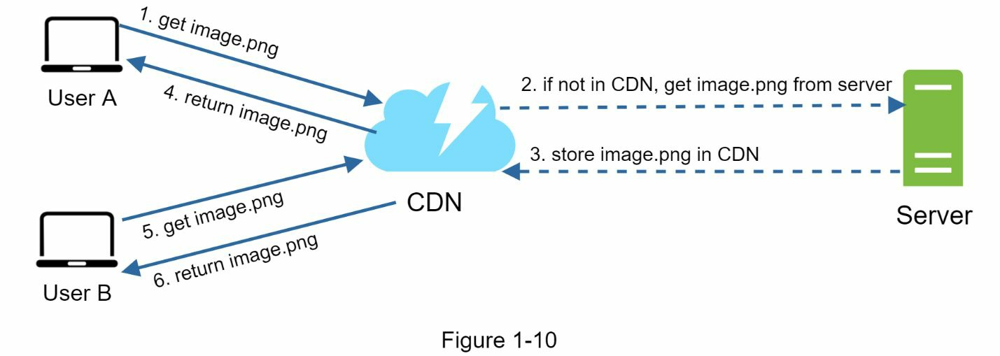
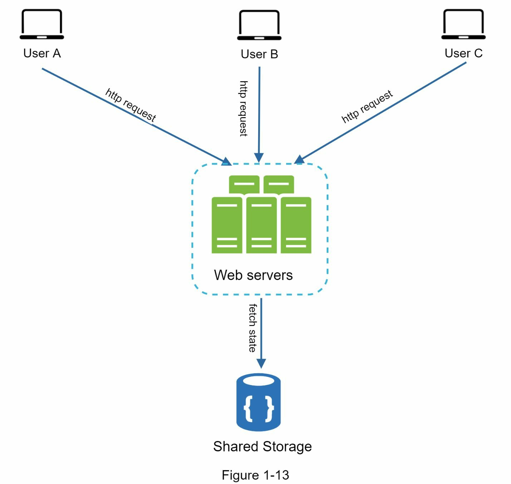
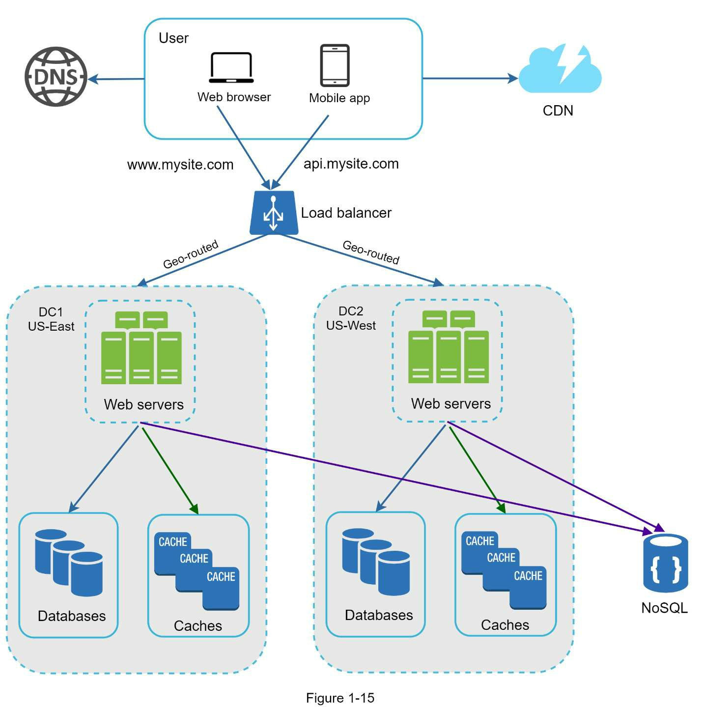
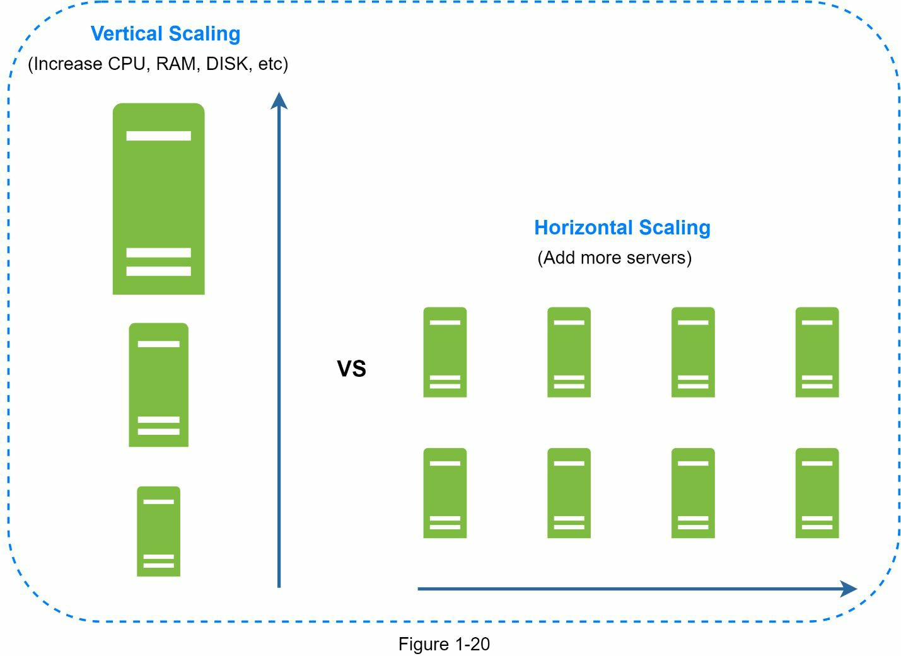
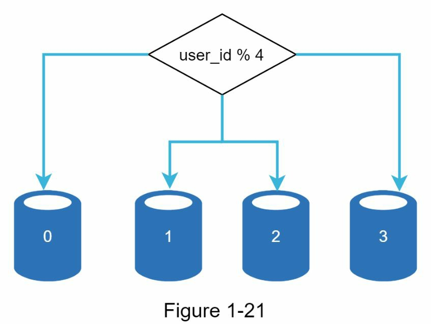

# Chương 01: Quy Mô Từ 0 Đến Hàng Triệu Người Dùng (Scale From Zero To Millions Of Users)

[← Lời Mở Đầu](00-loi-mo-dau.md) | [Mục lục](README.md) | [Chương 02: Ước lượng đại khái →](chuong-02-uoc-luong-dai-khai.md)

---


# CHƯƠNG 1: MỞ RỘNG TỪ 0 ĐẾN HÀNG TRIỆU NGƯỜI DÙNG (SCALE FROM ZERO TO MILLIONS OF USERS)

Thiết kế một hệ thống hỗ trợ hàng triệu người dùng là một thử thách lớn, và đó là một hành trình đòi hỏi sự tinh chỉnh liên tục cùng những cải tiến không ngừng nghỉ. Trong chương này, chúng ta sẽ xây dựng một hệ thống ban đầu chỉ phục vụ một người dùng duy nhất và từng bước mở rộng quy mô (scale up) để phục vụ hàng triệu người dùng. Sau khi đọc xong chương này, bạn sẽ làm chủ một loạt các kỹ thuật nền tảng giúp bạn vượt qua xuất sắc các câu hỏi phỏng vấn thiết kế hệ thống (system design interview).

---

## Thiết lập trên một máy chủ đơn lẻ (Single server setup)

Hành trình vạn dặm bắt đầu từ một bước chân, và việc xây dựng một hệ thống phức tạp cũng không ngoại lệ. Để bắt đầu với một mô hình đơn giản nhất, mọi thứ đều được chạy trên một máy chủ duy nhất (single server). **Hình 1-1** minh họa thiết lập máy chủ đơn lẻ, nơi tất cả các thành phần đều cùng vận hành trên một máy chủ vật lý/máy chủ ảo: ứng dụng web (web app), cơ sở dữ liệu (database), bộ nhớ đệm (cache), v.v.


Để hiểu rõ thiết lập này, việc phân tích luồng xử lý yêu cầu (request flow) và nguồn lưu lượng truy cập (traffic source) là rất hữu ích. Trước tiên, hãy cùng xem xét luồng yêu cầu (**Hình 1-2**).



1. Người dùng truy cập các trang web thông qua tên miền (domain name), ví dụ: `api.mysite.com`. Thông thường, Hệ thống phân giải tên miền (**DNS - Domain Name System**) là một dịch vụ trả phí được cung cấp bởi bên thứ ba (3rd party) chứ không được lưu trữ (host) trực tiếp trên máy chủ của chúng ta.
2. Địa chỉ Giao thức Internet (**IP - Internet Protocol**) được trả về cho trình duyệt (browser) hoặc ứng dụng di động (mobile app). Trong ví dụ này, địa chỉ IP `15.125.23.214` được trả về.
3. Khi đã có được địa chỉ IP, các yêu cầu theo Giao thức truyền tải siêu văn bản (**HTTP - Hypertext Transfer Protocol**) [1] sẽ được gửi trực tiếp đến máy chủ web (**Web Server**) của bạn.
4. Máy chủ web trả về các trang HTML hoặc phản hồi JSON (JSON response) để ứng dụng hiển thị (rendering).

Tiếp theo, hãy cùng xem xét nguồn lưu lượng truy cập (traffic source). Lưu lượng truy cập đến máy chủ web của bạn đến từ hai nguồn chính: ứng dụng web (web application) và ứng dụng di động (mobile application).

- **Ứng dụng web (Web application):** sử dụng kết hợp giữa các ngôn ngữ phía máy chủ (server-side languages như Java, Python, v.v.) để xử lý logic nghiệp vụ (business logic), lưu trữ dữ liệu (storage), v.v., và các ngôn ngữ phía máy khách (client-side languages như HTML và JavaScript) để hiển thị giao diện người dùng (presentation).
- **Ứng dụng di động (Mobile application):** Giao thức HTTP là giao thức giao tiếp giữa ứng dụng di động và máy chủ web. Định dạng ký hiệu đối tượng JavaScript (**JSON - JavaScript Object Notation**) thường được sử dụng làm định dạng phản hồi API (API response format) để truyền dữ liệu nhờ vào tính đơn giản và gọn nhẹ của nó. Một ví dụ về phản hồi API ở định dạng JSON được hiển thị dưới đây:

```http
GET /users/12 – Lấy thông tin đối tượng người dùng có id = 12
```

```json
{
  "id": 12,
  "firstName": "John",
  "lastName": "Smith",
  "address": {
    "streetAddress": "21 2nd Street",
    "city": "New York",
    "state": "NY",
    "postalCode": "10021"
  },
  "phoneNumbers": [
    {
      "type": "home",
      "number": "212 555-1234"
    }
  ]
}
```

---

## Cơ sở dữ liệu (Database)

Cùng với sự gia tăng của lượng người dùng, một máy chủ là không còn đủ, và chúng ta cần nhiều máy chủ: một máy chủ dành cho lưu lượng web/mobile, và máy chủ còn lại dành cho cơ sở dữ liệu (**Hình 1-3**). Việc tách biệt các máy chủ xử lý lưu lượng web/mobile (tầng web - web tier) và cơ sở dữ liệu (tầng dữ liệu - data tier) cho phép chúng được mở rộng quy mô một cách độc lập.


### Lựa chọn cơ sở dữ liệu nào? (Which databases to use?)

Bạn có thể lựa chọn giữa cơ sở dữ liệu quan hệ truyền thống (relational database) và cơ sở dữ liệu phi quan hệ (non-relational database). Hãy cùng phân tích sự khác biệt giữa chúng.

**Cơ sở dữ liệu quan hệ (Relational databases)** còn được gọi là hệ quản trị cơ sở dữ liệu quan hệ (**RDBMS - Relational Database Management System**) hoặc cơ sở dữ liệu SQL (**SQL database**). Các hệ cơ sở dữ liệu phổ biến nhất bao gồm MySQL, Oracle database, PostgreSQL, v.v. Cơ sở dữ liệu quan hệ biểu diễn và lưu trữ dữ liệu dưới dạng các bảng (tables) và các hàng (rows). Bạn có thể thực hiện các thao tác kết hợp dữ liệu (join operations) bằng ngôn ngữ SQL giữa các bảng dữ liệu khác nhau.

**Cơ sở dữ liệu phi quan hệ (Non-Relational databases)** còn được gọi là cơ sở dữ liệu NoSQL (**NoSQL databases**). Những cái tên phổ biến bao gồm CouchDB, Neo4j, Cassandra, HBase, Amazon DynamoDB, v.v. [2]. Các cơ sở dữ liệu này được phân thành bốn nhóm chính:
- Lưu trữ khóa - giá trị (**Key-value stores**)
- Lưu trữ đồ thị (**Graph stores**)
- Lưu trữ theo cột (**Column stores / Wide-column**)
- Lưu trữ tài liệu (**Document stores**)

Các thao tác kết nối bảng (join operations) nhìn chung không được hỗ trợ trong các cơ sở dữ liệu phi quan hệ.

Đối với phần lớn các kỹ sư phát triển, cơ sở dữ liệu quan hệ là lựa chọn tối ưu nhất bởi vì chúng đã tồn tại và phát triển hơn 40 năm qua và trong lịch sử, chúng luôn hoạt động rất hiệu quả. Tuy nhiên, nếu cơ sở dữ liệu quan hệ không phù hợp với trường hợp sử dụng cụ thể của bạn, việc khám phá vượt ra ngoài phạm vi cơ sở dữ liệu quan hệ là điều mang tính sống còn. Cơ sở dữ liệu phi quan hệ có thể là sự lựa chọn đúng đắn nếu:

- Ứng dụng của bạn yêu cầu độ trễ siêu thấp (super-low latency).
- Dữ liệu của bạn là phi cấu trúc (unstructured), hoặc bạn không có bất kỳ dữ liệu mang tính quan hệ nào.
- Bạn chỉ cần tuần tự hóa và giải tuần tự hóa dữ liệu (serialize and deserialize data như JSON, XML, YAML, v.v.).
- Bạn cần lưu trữ một khối lượng dữ liệu khổng lồ (massive amount of data).

---

## Mở rộng theo chiều dọc và Mở rộng theo chiều ngang (Vertical scaling vs horizontal scaling)

**Mở rộng theo chiều dọc (Vertical scaling)**, hay còn được gọi là **“scale up”**, là quá trình bổ sung thêm tài nguyên phần cứng mạnh hơn (CPU, RAM, v.v.) vào các máy chủ hiện tại của bạn. **Mở rộng theo chiều ngang (Horizontal scaling)**, hay còn được gọi là **“scale-out”**, cho phép bạn mở rộng bằng cách bổ sung thêm nhiều máy chủ vào cụm tài nguyên (resource pool) của mình.

Khi lưu lượng truy cập còn thấp, mở rộng theo chiều dọc là một lựa chọn tuyệt vời, và tính đơn giản chính là ưu điểm lớn nhất của phương pháp này. Đáng tiếc thay, nó đi kèm với những hạn chế rất nghiêm trọng:

- **Mở rộng theo chiều dọc có một giới hạn cứng (hard limit):** Không thể thêm vô hạn CPU và bộ nhớ RAM vào một máy chủ duy nhất.
- **Mở rộng theo chiều dọc không có tính năng chuyển đổi dự phòng (failover) và tính dư thừa (redundancy):** Nếu máy chủ duy nhất đó gặp sự cố ngừng hoạt động (goes down), toàn bộ trang web/ứng dụng sẽ sập hoàn toàn theo nó.

Mở rộng theo chiều ngang là giải pháp đáng mong muốn hơn đối với các ứng dụng quy mô lớn nhờ khắc phục được các hạn chế của mở rộng theo chiều dọc.

Trong thiết kế trước đó, người dùng kết nối trực tiếp đến máy chủ web. Người dùng sẽ không thể truy cập vào trang web nếu máy chủ web bị ngắt kết nối (offline). Trong một kịch bản khác, nếu có quá nhiều người dùng truy cập máy chủ web cùng một lúc và chạm ngưỡng chịu tải của máy chủ, người dùng nhìn chung sẽ trải qua tình trạng phản hồi chậm hoặc thậm chí không thể kết nối tới máy chủ. **Bộ cân bằng tải (Load Balancer)** chính là kỹ thuật tốt nhất để giải quyết triệt để những vấn đề này.

---

## Mở rộng theo chiều dọc (Vertical Scaling) so với Mở rộng theo chiều ngang (Horizontal Scaling)

**Mở rộng theo chiều dọc (Vertical scaling)**, hay còn gọi là **“scale up”**, là quá trình bổ sung thêm tài nguyên phần cứng (CPU, RAM, v.v.) vào các máy chủ hiện có của bạn. **Mở rộng theo chiều ngang (Horizontal scaling)**, hay còn gọi là **“scale-out”**, cho phép bạn mở rộng quy mô bằng cách bổ sung thêm nhiều máy chủ vào cụm tài nguyên (resource pool) của mình.

Khi lưu lượng truy cập (traffic) ở mức thấp, mở rộng theo chiều dọc là một lựa chọn tuyệt vời, và sự đơn giản chính là ưu điểm lớn nhất của nó. Tuy nhiên, phương pháp này đi kèm với những hạn chế nghiêm trọng:

*   **Vertical scaling có giới hạn phần cứng (hard limit):** Về mặt kỹ thuật, việc bổ sung vô hạn CPU và bộ nhớ vào một máy chủ đơn lẻ là điều bất khả thi.
*   **Vertical scaling không hỗ trợ khả năng chịu lỗi (failover) và tính dư thừa (redundancy):** Nếu máy chủ gặp sự cố và ngừng hoạt động (goes down), toàn bộ website/ứng dụng sẽ sập hoàn toàn.

Đối với các ứng dụng quy mô lớn, **Horizontal scaling** luôn là giải pháp được ưu tiên hơn do những hạn chế cố hữu của mở rộng theo chiều dọc.

Trong thiết kế trước đó, người dùng kết nối trực tiếp đến web server. Người dùng sẽ không thể truy cập vào website nếu web server này ngoại tuyến (offline). Ở một kịch bản khác, nếu có quá nhiều người dùng truy cập web server cùng lúc và vượt ngưỡng chịu tải (load limit) của máy chủ, người dùng thường sẽ gặp phải tình trạng phản hồi chậm hoặc thậm chí không thể kết nối tới máy chủ. **Bộ cân bằng tải (Load Balancer)** chính là kỹ thuật tối ưu nhất để giải quyết triệt để các vấn đề này.

---

## Bộ cân bằng tải (Load Balancer)

**Bộ cân bằng tải (Load Balancer)** có nhiệm vụ phân phối đều lưu lượng truy cập đến (incoming traffic) giữa các web server được định nghĩa trong một nhóm cân bằng tải (load-balanced set). **Hình 1-4** minh họa cơ chế hoạt động của một bộ cân bằng tải:



Như thể hiện trong **Hình 1-4**, người dùng kết nối trực tiếp đến địa chỉ IP công khai (public IP) của load balancer. Với kiến trúc này, các web server sẽ không còn bị truy cập trực tiếp bởi máy khách (client) nữa. Để tăng cường tính bảo mật, các địa chỉ IP nội bộ (private IPs) được sử dụng để giao tiếp giữa các máy chủ. Một IP nội bộ là một địa chỉ IP chỉ có thể truy cập được giữa các máy chủ trong cùng một mạng; tuy nhiên, nó hoàn toàn không thể truy cập được thông qua Internet. Load balancer sẽ giao tiếp với các web server thông qua các địa chỉ IP nội bộ này.

Trong **Hình 1-4**, sau khi load balancer và một web server thứ hai được bổ sung, chúng ta đã giải quyết thành công bài toán thiếu cơ chế chịu lỗi (failover) và nâng cao đáng kể tính sẵn sàng (availability) của tầng web (web tier). Chi tiết được giải thích như sau:

*   Nếu **Server 1** ngoại tuyến (goes offline), toàn bộ lưu lượng truy cập sẽ tự động được điều hướng sang **Server 2**. Điều này giúp ngăn chặn website bị ngừng hoạt động hoàn toàn. Đồng thời, chúng ta cũng sẽ bổ sung thêm một web server mới đang hoạt động tốt vào cụm máy chủ (server pool) để cân bằng tải.
*   Nếu lưu lượng truy cập website tăng trưởng đột biến và hai máy chủ không còn đủ năng lực xử lý, load balancer có thể xử lý vấn đề này một cách rất mượt mà (gracefully). Bạn chỉ cần bổ sung thêm các máy chủ mới vào cụm web server pool, và load balancer sẽ tự động chuyển tiếp các yêu cầu (requests) đến chúng.

Hiện tại tầng web trông đã rất ổn, vậy còn tầng dữ liệu (data tier) thì sao? Thiết kế hiện tại chỉ có duy nhất một cơ sở dữ liệu (database), do đó nó không hỗ trợ cơ chế chịu lỗi (failover) và tính dư thừa (redundancy). **Sao chép dữ liệu (Database replication)** là một kỹ thuật phổ biến để giải quyết các vấn đề này. Hãy cùng tìm hiểu chi tiết.

---

## Sao chép cơ sở dữ liệu (Database Replication)

Trích dẫn từ Wikipedia: *“Sao chép cơ sở dữ liệu (Database replication) có thể được sử dụng trong nhiều hệ quản trị cơ sở dữ liệu, thông thường thông qua mối quan hệ master/slave giữa bản gốc (master) và các bản sao (slaves)”* [3].

Một cơ sở dữ liệu **master** nhìn chung chỉ hỗ trợ các thao tác ghi (write operations). Một cơ sở dữ liệu **slave** nhận các bản sao dữ liệu từ cơ sở dữ liệu master và chỉ hỗ trợ các thao tác đọc (read operations). Tất cả các câu lệnh làm biến đổi dữ liệu (data-modifying commands) như `insert`, `delete` hoặc `update` bắt buộc phải được gửi đến database master. Hầu hết các ứng dụng đều có tỷ lệ thao tác đọc trên thao tác ghi (read-to-write ratio) cao hơn rất nhiều; do đó, số lượng database slave trong một hệ thống thường lớn hơn số lượng database master. **Hình 1-5** thể hiện mô hình một cơ sở dữ liệu master kết hợp cùng nhiều cơ sở dữ liệu slave:


### Các ưu điểm của việc sao chép cơ sở dữ liệu (Database replication):

*   **Hiệu năng tốt hơn (Better performance):** Trong mô hình master-slave, tất cả các tác vụ ghi và cập nhật đều diễn ra tại các nút master; trong khi đó, các thao tác đọc lại được phân tán đều qua các nút slave. Mô hình này giúp cải thiện hiệu năng rõ rệt vì nó cho phép xử lý đồng thời (in parallel) nhiều truy vấn hơn.
*   **Độ tin cậy cao (Reliability):** Nếu một trong các máy chủ cơ sở dữ liệu của bạn bị phá hủy hoàn toàn bởi thảm họa thiên nhiên (như bão lớn hay động đất), dữ liệu vẫn được bảo toàn nguyên vẹn. Bạn không cần lo lắng về việc mất mát dữ liệu vì dữ liệu đã được sao chép phân tán qua nhiều vị trí địa lý khác nhau.
*   **Tính sẵn sàng cao (High availability):** Bằng cách nhân bản dữ liệu qua nhiều vị trí khác nhau, website của bạn vẫn tiếp tục vận hành bình thường ngay cả khi một cơ sở dữ liệu bị ngoại tuyến (offline), bởi vì bạn hoàn toàn có thể truy cập dữ liệu được lưu trữ tại một máy chủ cơ sở dữ liệu khác.

Trong phần trước, chúng ta đã thảo luận về cách một bộ cân bằng tải giúp cải thiện tính sẵn sàng của hệ thống. Chúng ta cũng đặt ra một câu hỏi tương tự ở đây: **Điều gì sẽ xảy ra nếu một trong các cơ sở dữ liệu bị ngoại tuyến (offline)?** Thiết kế kiến trúc được mô tả trong **Hình 1-5** có thể xử lý trọn vẹn trường hợp này:

*   **Nếu chỉ có một database slave duy nhất và nó bị ngoại tuyến:** Các thao tác đọc sẽ tạm thời được điều hướng trực tiếp sang database master. Ngay khi sự cố được phát hiện, một database slave mới sẽ được khởi tạo để thay thế cho máy chủ cũ. Trong trường hợp hệ thống có nhiều database slave, các thao tác đọc sẽ được chuyển hướng sang các database slave còn lại đang hoạt động tốt. Một máy chủ cơ sở dữ liệu mới sau đó sẽ được bổ sung để thay thế máy chủ đã hỏng.
*   **Nếu database master bị ngoại tuyến:** Một database slave sẽ được thăng cấp (promoted) để trở thành master mới. Mọi thao tác cơ sở dữ liệu sẽ tạm thời được thực thi trên database master mới này. Một database slave mới sẽ lập tức được đưa vào để thay thế nhằm tiếp tục quy trình sao chép dữ liệu (data replication).

Trong các hệ thống thực tế (production systems), việc thăng cấp một slave lên làm master phức tạp hơn rất nhiều, bởi vì dữ liệu trên database slave có thể chưa được đồng bộ mới nhất (up to date). Phần dữ liệu còn thiếu cần phải được bù đắp và cập nhật thông qua việc chạy các tập lệnh phục hồi dữ liệu (data recovery scripts). Mặc dù một số phương pháp sao chép dữ liệu khác như **multi-masters** và **circular replication** có thể hỗ trợ giải quyết vấn đề này, tuy nhiên việc thiết lập chúng phức tạp hơn đáng kể và nằm ngoài phạm vi thảo luận của cuốn sách này. Bạn đọc quan tâm có thể tham khảo thêm các tài liệu được liệt kê ở mục tài liệu tham khảo [4] [5].

**Hình 1-6** mô tả toàn bộ thiết kế hệ thống sau khi đã tích hợp thêm bộ cân bằng tải và cơ chế sao chép cơ sở dữ liệu:



Hãy cùng phân tích luồng hoạt động của thiết kế này:

1.  Người dùng nhận được địa chỉ IP của load balancer thông qua hệ thống phân giải tên miền DNS.
2.  Người dùng kết nối tới load balancer bằng địa chỉ IP này.
3.  Yêu cầu HTTP (HTTP request) được định tuyến tới **Server 1** hoặc **Server 2**.
4.  Web server đọc dữ liệu người dùng từ một cơ sở dữ liệu **slave**.
5.  Web server điều hướng bất kỳ thao tác biến đổi dữ liệu nào tới cơ sở dữ liệu **master**. Điều này bao gồm các thao tác ghi (write), cập nhật (update) và xóa (delete).

Giờ đây, bạn đã nắm vững kiến thức về tầng web và tầng dữ liệu. Đã đến lúc chúng ta tối ưu hóa thời gian tải trang và độ trễ phản hồi (load/response time). Điều này có thể đạt được bằng cách bổ sung một **tầng bộ nhớ đệm (cache layer)** và chuyển các nội dung tĩnh (static content gồm các tệp JavaScript, CSS, hình ảnh, video) sang **mạng phân phối nội dung (CDN - Content Delivery Network)**.

---

## Bộ nhớ đệm (Cache)

**Bộ nhớ đệm (Cache)** là một vùng lưu trữ tạm thời, giữ lại kết quả của các phản hồi tiêu tốn nhiều tài nguyên xử lý (expensive responses) hoặc các dữ liệu được truy cập thường xuyên ngay trong bộ nhớ (in-memory), nhờ đó các yêu cầu tiếp theo sẽ được phục vụ nhanh chóng hơn. 

Như được minh họa trong **Hình 1-6**, mỗi lần một trang web mới được tải, một hoặc nhiều lệnh gọi cơ sở dữ liệu sẽ được thực thi để truy xuất dữ liệu. Hiệu năng ứng dụng bị ảnh hưởng nghiêm trọng do việc gọi cơ sở dữ liệu lặp đi lặp lại liên tục. Bộ nhớ đệm hoàn toàn có thể giảm thiểu vấn đề này.

### Tầng bộ nhớ đệm (Cache tier)

**Tầng bộ nhớ đệm (Cache tier)** là một lớp lưu trữ dữ liệu tạm thời, có tốc độ nhanh hơn rất nhiều so với cơ sở dữ liệu. Lợi ích của việc sở hữu một tầng bộ nhớ đệm độc lập bao gồm: nâng cao hiệu năng hệ thống, giảm tải áp lực cho cơ sở dữ liệu và khả năng mở rộng quy mô (scale) tầng cache một cách hoàn toàn độc lập. 

**Hình 1-7** minh họa một mô hình triển khai máy chủ cache khả thi:



Sau khi nhận được yêu cầu, web server trước tiên sẽ kiểm tra xem cache đã có sẵn dữ liệu phản hồi hay chưa. Nếu đã có sẵn (cache hit), nó sẽ gửi dữ liệu trả về ngay cho client. Nếu chưa có (cache miss), nó sẽ truy vấn cơ sở dữ liệu, ghi lưu dữ liệu phản hồi đó vào bộ nhớ đệm (cache), rồi mới gửi trả lại cho client. Chiến lược lưu trữ đệm này được gọi là **read-through cache** (hoặc cache-aside). Ngoài ra còn có các chiến lược caching khác tùy thuộc vào loại dữ liệu, kích thước và các mẫu hình truy cập (access patterns). Một nghiên cứu trước đây đã giải thích chi tiết cách thức hoạt động của các chiến lược caching khác nhau [6].

Việc tương tác với các máy chủ cache rất đơn giản vì hầu hết các máy chủ cache đều cung cấp các giao diện lập trình ứng dụng (APIs) hỗ trợ các ngôn ngữ lập trình phổ biến. Đoạn mã dưới đây minh họa các API tiêu biểu của Memcached:

```python
# Ví dụ tương tác với Memcached qua API
memcached.get(key)
memcached.set(key, data, ttl)
```

### Những lưu ý quan trọng khi sử dụng Cache (Considerations for using cache)

Dưới đây là một số lưu ý kỹ thuật khi áp dụng hệ thống cache:

*   **Xác định thời điểm nên sử dụng cache (Decide when to use cache):** Cân nhắc sử dụng cache khi dữ liệu được **đọc thường xuyên nhưng rất ít khi bị chỉnh sửa**. Vì dữ liệu lưu trong cache nằm ở bộ nhớ khả biến (volatile memory - RAM), máy chủ cache không phải là lựa chọn lý tưởng cho việc lưu trữ dữ liệu bền vững (persisting data). Ví dụ: nếu máy chủ cache khởi động lại (restarts), toàn bộ dữ liệu trong bộ nhớ sẽ bị mất sạch. Do đó, các dữ liệu quan trọng bắt buộc phải được lưu trữ trong các kho lưu trữ dữ liệu bền bỉ (persistent data stores).
*   **Chính sách hết hạn dữ liệu (Expiration policy):** Việc triển khai một chính sách hết hạn (TTL - Time to Live) là một phương pháp tối ưu (good practice). Một khi dữ liệu đệm hết hạn, nó sẽ tự động bị xóa bỏ khỏi cache. Nếu không có chính sách hết hạn, dữ liệu đệm sẽ nằm vĩnh viễn trong bộ nhớ. Lời khuyên là không nên đặt thời gian hết hạn quá ngắn vì điều này sẽ khiến hệ thống phải nạp lại dữ liệu từ cơ sở dữ liệu quá thường xuyên. Đồng thời, cũng không nên đặt thời gian hết hạn quá dài vì dữ liệu có nguy cơ bị cũ/lỗi thời (stale data).
*   **Tính nhất quán dữ liệu (Consistency):** Yếu tố này liên quan đến việc duy trì sự đồng bộ giữa kho lưu trữ dữ liệu (data store) và cache. Sự bất nhất (inconsistency) có thể xảy ra do các thao tác biến đổi dữ liệu trên data store và cache không nằm trong cùng một giao dịch nguyên tử (single transaction). Khi mở rộng quy mô trên nhiều vùng địa lý (multiple regions), việc duy trì tính nhất quán giữa...

---

# Thiết Kế Hệ Thống Quy Mô Lớn (System Design)

---

## 1. Bộ Nhớ Đệm (Cache)

**Bộ nhớ đệm (Cache)** là vùng lưu trữ tạm thời lưu giữ kết quả của các phản hồi tốn nhiều tài nguyên tính toán (expensive responses) hoặc dữ liệu thường xuyên được truy cập vào bộ nhớ RAM (in-memory) để các yêu cầu tiếp theo được phục vụ nhanh hơn. Như minh họa trong **Hình 1-6**, mỗi khi một trang web mới được tải, một hoặc nhiều lệnh gọi cơ sở dữ liệu (database calls) được thực thi để lấy dữ liệu. Hiệu năng ứng dụng bị ảnh hưởng nghiêm trọng do việc gọi cơ sở dữ liệu lặp đi lặp lại. Bộ nhớ đệm có thể giảm thiểu vấn đề này.


### Tầng Bộ Nhớ Đệm (Cache Tier)

**Tầng bộ nhớ đệm (Cache tier)** là một lớp lưu trữ dữ liệu tạm thời, nhanh hơn cơ sở dữ liệu rất nhiều. Các lợi ích của việc sở hữu một tầng bộ nhớ đệm riêng biệt bao gồm: nâng cao hiệu năng hệ thống, khả năng giảm tải công việc cho cơ sở dữ liệu (database workloads), và khả năng mở rộng độc lập cho tầng cache (scale the cache tier independently). 

**Hình 1-7** minh họa một mô hình thiết lập máy chủ cache khả thi:


Sau khi nhận được yêu cầu, máy chủ web (Web Server) trước tiên sẽ kiểm tra xem cache có sẵn phản hồi hay không. 
- Nếu có, nó gửi dữ liệu trở lại cho client. 
- Nếu không, nó truy vấn cơ sở dữ liệu, lưu phản hồi vào cache và gửi lại cho client. 

Chiến lược lưu trữ đệm này được gọi là **Read-through cache** (hoặc *Cache-aside*). Các chiến lược caching khác cũng có sẵn tùy thuộc vào loại dữ liệu, kích thước và mô hình truy cập (access patterns). Một nghiên cứu trước đây giải thích cách thức hoạt động của các chiến lược caching khác nhau [6].

Việc tương tác với các máy chủ cache rất đơn giản vì hầu hết các máy chủ cache đều cung cấp API cho các ngôn ngữ lập trình phổ biến. Đoạn mã sau minh họa các API điển hình của Memcached:

```python
# Ví dụ tương tác Memcached API
memcached.set("user_123", user_data, expire=3600)
user = memcached.get("user_123")
```

### Các Cân Nhắc Khi Sử Dụng Bộ Nhớ Đệm (Considerations for using cache)

Dưới đây là một số lưu ý quan trọng khi triển khai hệ thống cache:

- **Quyết định thời điểm sử dụng cache (Decide when to use cache):** Cân nhắc sử dụng cache khi dữ liệu được đọc thường xuyên (read frequently) nhưng ít khi bị sửa đổi (modified infrequently). Vì dữ liệu cache được lưu trữ trong bộ nhớ dễ bay hơi (volatile memory), máy chủ cache không phải là nơi lý tưởng để lưu trữ dữ liệu bền vững (persisting data). Ví dụ: nếu máy chủ cache khởi động lại, toàn bộ dữ liệu trong bộ nhớ sẽ bị mất. Do đó, dữ liệu quan trọng phải được lưu trữ trong các kho lưu trữ dữ liệu bền vững (persistent data stores).
- **Chính sách hết hạn (Expiration policy):** Việc áp dụng một chính sách hết hạn là một thực hành tốt (good practice). Một khi dữ liệu cache hết hạn, nó sẽ bị xóa khỏi cache. Khi không có chính sách hết hạn, dữ liệu cache sẽ lưu lại trong bộ nhớ vĩnh viễn. Khuyến cáo không nên đặt thời gian hết hạn quá ngắn vì điều này sẽ khiến hệ thống phải tải lại dữ liệu từ cơ sở dữ liệu quá thường xuyên. Đồng thời, cũng không nên đặt thời gian hết hạn quá dài vì dữ liệu có thể bị lỗi thời (stale data).
- **Tính nhất quán (Consistency):** Điều này liên quan đến việc giữ cho kho dữ liệu (data store) và cache luôn đồng bộ với nhau. Tình trạng không nhất quán (inconsistency) có thể xảy ra do các thao tác sửa đổi dữ liệu trên kho dữ liệu và trên cache không nằm trong cùng một transaction duy nhất. Khi mở rộng hệ thống trên nhiều khu vực (multi-region), việc duy trì tính nhất quán giữa kho dữ liệu và cache là một thách thức lớn. Để biết thêm chi tiết, tham khảo tài liệu *"Scaling Memcache at Facebook"* do Facebook công bố [7].
- **Giảm thiểu lỗi (Mitigating failures):** Một máy chủ cache đơn lẻ tiềm ẩn nguy cơ trở thành điểm lỗi đơn lẻ (**Single Point of Failure - SPOF**), được Wikipedia định nghĩa như sau: *"Một điểm lỗi đơn lẻ (SPOF) là một thành phần của hệ thống mà nếu nó gặp sự cố, toàn bộ hệ thống sẽ ngừng hoạt động"* [8]. Do đó, kiến trúc nên sử dụng nhiều máy chủ cache phân bổ trên các trung tâm dữ liệu (data centers) khác nhau để tránh SPOF. Một phương pháp tiếp cận khác được khuyến nghị là cấp phát dư thừa dung lượng bộ nhớ yêu cầu theo tỷ lệ phần trăm nhất định (overprovisioning memory), tạo ra vùng đệm dự phòng khi mức sử dụng bộ nhớ tăng đột biến.
- **Chính sách loại bỏ dữ liệu (Eviction Policy):** Một khi cache bị đầy, bất kỳ yêu cầu thêm phần tử mới nào vào cache cũng có thể khiến các phần tử hiện có bị loại bỏ. Quá trình này được gọi là **Cache eviction**. Chính sách loại bỏ phần tử ít được sử dụng gần đây nhất (**Least-Recently-Used - LRU**) là chính sách cache eviction phổ biến nhất. Các chính sách eviction khác, chẳng hạn như Ít được sử dụng nhất (**Least Frequently Used - LFU**) hoặc Vào trước ra trước (**First In First Out - FIFO**), có thể được áp dụng tùy theo các tình huống sử dụng (use cases) khác nhau.

---

## 2. Mạng Phân Phối Nội Dung (Content Delivery Network - CDN)

**CDN** là một mạng lưới các máy chủ phân tán về mặt địa lý được sử dụng để phân phối nội dung tĩnh (static content). Các máy chủ CDN lưu trữ đệm (cache) các nội dung tĩnh như hình ảnh, video, tệp CSS, JavaScript, v.v.

Caching nội dung động (Dynamic content caching) là một khái niệm tương đối mới và nằm ngoài phạm vi của cuốn sách này. Nó cho phép lưu cache các trang HTML dựa trên đường dẫn yêu cầu (request path), chuỗi truy vấn (query strings), cookie và tiêu đề yêu cầu (request headers). Tham khảo bài viết được đề cập trong tài liệu tham khảo [9] để biết thêm chi tiết. Cuốn sách này tập trung vào cách sử dụng CDN để lưu trữ đệm nội dung tĩnh.

Ở mức tổng quan (high-level), CDN hoạt động như sau: khi người dùng truy cập một trang web, máy chủ CDN gần người dùng nhất về mặt địa lý sẽ phân phối nội dung tĩnh. Theo trực quan, người dùng càng ở xa máy chủ CDN, trang web tải càng chậm. Ví dụ: nếu các máy chủ CDN đặt tại San Francisco, người dùng ở Los Angeles sẽ nhận được nội dung nhanh hơn người dùng ở Châu Âu. 

**Hình 1-9** là một ví dụ trực quan minh họa cách CDN cải thiện thời gian tải trang:


**Hình 1-10** thể hiện luồng quy trình làm việc (workflow) của CDN:



1. **User A** cố gắng tải `image.png` bằng cách sử dụng một URL hình ảnh. Tên miền của URL do nhà cung cấp CDN cung cấp. Hai URL hình ảnh mẫu sau đây minh họa định dạng URL hình ảnh trên CDN của Amazon và Akamai:
   - `https://mysite.cloudfront.net/logo.jpg`
   - `https://mysite.akamai.com/image-manager/img/logo.jpg`
2. Nếu máy chủ CDN không có `image.png` trong cache, máy chủ CDN sẽ yêu cầu tệp này từ máy chủ gốc (**Origin Server**), có thể là một máy chủ web hoặc dịch vụ lưu trữ trực tuyến như Amazon S3.
3. Máy chủ gốc trả về `image.png` cho máy chủ CDN, đi kèm với tiêu đề HTTP tùy chọn **Time-to-Live (TTL)** quy định khoảng thời gian hình ảnh được lưu trong bộ nhớ đệm.
4. CDN lưu hình ảnh vào cache và trả về cho **User A**. Hình ảnh vẫn được lưu trữ đệm trong CDN cho đến khi giá trị TTL hết hạn.
5. **User B** gửi yêu cầu lấy cùng hình ảnh đó.
6. Hình ảnh được trả về trực tiếp từ cache của CDN miễn là thời hạn TTL chưa hết.

### Các Cân Nhắc Khi Sử Dụng CDN (Considerations of using a CDN)

- **Chi phí (Cost):** CDN được vận hành bởi các nhà cung cấp bên thứ ba (third-party providers), và bạn phải trả phí cho dung lượng dữ liệu truyền vào và truyền ra khỏi CDN (data transfer in/out). Việc lưu cache các tài nguyên hiếm khi được truy cập không mang lại lợi ích đáng kể, do đó bạn nên cân nhắc chuyển chúng ra khỏi CDN.
- **Thiết lập thời gian hết hạn cache phù hợp (Setting an appropriate cache expiry):** Đối với các nội dung nhạy cảm về mặt thời gian (time-sensitive content), việc thiết lập thời gian hết hạn cache là rất quan trọng. Thời gian hết hạn cache không nên quá dài cũng không nên quá ngắn. Nếu quá dài, nội dung có thể không còn mới/chính xác. Nếu quá ngắn, nó có thể gây ra việc liên tục tải lại nội dung từ máy chủ gốc (origin servers) sang CDN.
- **Cơ chế dự phòng khi CDN gặp sự cố (CDN fallback):** Bạn nên tính toán cách trang web/ứng dụng ứng phó khi CDN gặp sự cố. Nếu xảy ra gián đoạn dịch vụ CDN tạm thời (temporary CDN outage), client phải có khả năng phát hiện sự cố và gửi yêu cầu tài nguyên trực tiếp về máy chủ gốc.
- **Hủy bỏ hiệu lực tệp (Invalidating files):** Bạn có thể xóa một tệp khỏi CDN trước khi nó hết hạn bằng cách thực hiện một trong các thao tác sau:
  - Vô hiệu hóa đối tượng trên CDN (Invalidate the CDN object) bằng cách sử dụng các API do nhà cung cấp CDN cung cấp.
  - Sử dụng cơ chế đánh phiên bản đối tượng (**Object Versioning**) để phân phối một phiên bản khác của đối tượng. Để đánh phiên bản cho đối tượng, bạn có thể thêm một tham số vào URL, chẳng hạn như số phiên bản. Ví dụ: số phiên bản 2 được thêm vào chuỗi truy vấn: `image.png?v=2`.

**Hình 1-11** thể hiện thiết kế hệ thống sau khi bổ sung thêm CDN và Cache:
1. Các tài nguyên tĩnh (JS, CSS, hình ảnh, v.v.) không còn do các máy chủ web phục vụ nữa. Chúng được lấy từ CDN để đạt hiệu năng tối ưu hơn.
2. Tải trên cơ sở dữ liệu được giảm nhẹ đáng kể nhờ việc lưu cache dữ liệu.

---

## 3. Tầng Web Phi Trạng Thái (Stateless Web Tier)

Bây giờ là lúc xem xét việc **mở rộng theo chiều ngang (scale horizontally)** cho tầng web. Để làm được điều này, chúng ta cần đưa trạng thái (ví dụ: dữ liệu phiên người dùng - user session data) ra khỏi tầng web. Một giải pháp kiến trúc tốt là lưu trữ dữ liệu session trong các hệ thống lưu trữ bền vững (persistent storage) như cơ sở dữ liệu quan hệ (Relational Database) hoặc NoSQL. Mỗi máy chủ web trong cụm (cluster) đều có thể truy cập dữ liệu trạng thái từ các cơ sở dữ liệu này. Mô hình này được gọi là **Tầng web phi trạng thái (Stateless web tier)**.

### Kiến Trúc Có Trạng Thái (Stateful Architecture)

Máy chủ có trạng thái (stateful server) và máy chủ phi trạng thái (stateless server) có một số điểm khác biệt then chốt. Máy chủ có trạng thái ghi nhớ dữ liệu client (trạng thái - state) từ yêu cầu này sang yêu cầu tiếp theo. Trong khi đó, máy chủ phi trạng thái không lưu giữ bất kỳ thông tin trạng thái nào.

**Hình 1-12** minh họa một ví dụ về kiến trúc có trạng thái:


Trong **Hình 1-12**, dữ liệu session và ảnh hồ sơ của User A được lưu trữ tại Server 1. Để xác thực User A, các yêu cầu HTTP bắt buộc phải được định tuyến (routed) đến Server 1. Nếu một yêu cầu được gửi đến các máy chủ khác như Server 2, quá trình xác thực sẽ thất bại vì Server 2 không chứa dữ liệu session của User A. Tương tự, tất cả các yêu cầu HTTP từ User B phải được định tuyến đến Server 2; tất cả các yêu cầu từ User C phải được gửi đến Server 3.

Vấn đề ở đây là: **mọi yêu cầu từ cùng một client phải được định tuyến đến cùng một máy chủ duy nhất**. Điều này có thể được giải quyết bằng kỹ thuật **Sticky Sessions** (phiên bám dính) trên hầu hết các bộ cân bằng tải (Load Balancers) [10]; tuy nhiên, kỹ thuật này làm tăng thêm chi phí vận hành (overhead). Việc bổ sung hoặc loại bỏ các máy chủ trở nên khó khăn hơn rất nhiều với cách tiếp cận này. Đồng thời, việc xử lý khi máy chủ gặp sự cố (server failures) cũng là một thách thức lớn.

### Kiến Trúc Phi Trạng Thái (Stateless Architecture)

**Hình 1-13** minh họa kiến trúc phi trạng thái (Stateless architecture).

---

## Tầng Web Phi Trạng Thái (Stateless Web Tier)

Bây giờ là lúc chúng ta cân nhắc việc mở rộng quy mô tầng web theo chiều ngang (scaling horizontally). Để làm được điều này, chúng ta cần chuyển trạng thái (state) – ví dụ như dữ liệu phiên làm việc của người dùng (user session data) – ra khỏi tầng web. Một thực hành tối ưu (good practice) là lưu trữ dữ liệu phiên làm việc vào hệ thống lưu trữ bền vững (persistent storage) như cơ sở dữ liệu quan hệ (relational database) hoặc NoSQL. Mỗi máy chủ web (web server) trong cụm (cluster) đều có thể truy cập dữ liệu trạng thái từ các cơ sở dữ liệu này. Mô hình này được gọi là **tầng web phi trạng thái (stateless web tier)**.

### Kiến Trúc Có Trạng Thái (Stateful Architecture)

Máy chủ có trạng thái (stateful server) và máy chủ phi trạng thái (stateless server) có một số điểm khác biệt cốt lõi. Máy chủ có trạng thái ghi nhớ dữ liệu của máy khách (client data / state) từ yêu cầu (request) này sang yêu cầu tiếp theo. Ngược lại, máy chủ phi trạng thái không lưu giữ bất kỳ thông tin trạng thái nào.

Hình 1-12 minh họa một ví dụ về kiến trúc có trạng thái.


*Hình 1-12: Kiến trúc có trạng thái (Stateful architecture)*

Trong Hình 1-12, dữ liệu phiên làm việc và ảnh đại diện (profile image) của Người dùng A (User A) được lưu trữ tại Server 1. Để xác thực Người dùng A, các yêu cầu HTTP (HTTP requests) bắt buộc phải được điều hướng (routed) đến Server 1. Nếu một yêu cầu được gửi tới các máy chủ khác như Server 2, quá trình xác thực sẽ thất bại vì Server 2 không chứa dữ liệu phiên làm việc của Người dùng A. Tương tự, tất cả các yêu cầu HTTP từ Người dùng B phải được điều hướng đến Server 2; tất cả các yêu cầu từ Người dùng C phải được gửi đến Server 3.

Vấn đề ở đây là: **mọi yêu cầu từ cùng một máy khách phải luôn được định tuyến đến cùng một máy chủ**. Điều này có thể thực hiện được thông qua cơ chế phiên dính (sticky sessions) trên hầu hết các bộ cân bằng tải (Load Balancers) [10]; tuy nhiên, giải pháp này làm tăng chi phí phụ trội (overhead). Việc thêm mới hoặc loại bỏ máy chủ trở nên khó khăn hơn rất nhiều với cách tiếp cận này. Nó cũng tạo ra thách thức lớn trong việc xử lý các sự cố lỗi máy chủ (server failures).

---

### Kiến Trúc Phi Trạng Thái (Stateless Architecture)

Hình 1-13 thể hiện kiến trúc phi trạng thái.

Trong kiến trúc phi trạng thái này, các yêu cầu HTTP từ người dùng có thể được gửi đến bất kỳ máy chủ web nào, và các máy chủ này sẽ nạp dữ liệu trạng thái từ một kho dữ liệu dùng chung (shared data store). Dữ liệu trạng thái được lưu trữ tập trung tại kho dữ liệu dùng chung và tách biệt hoàn toàn khỏi các máy chủ web. Một hệ thống phi trạng thái sẽ đơn giản hơn, mạnh mẽ hơn (robust) và dễ mở rộng quy mô (scalable) hơn.

Hình 1-14 minh họa thiết kế cập nhật với tầng web phi trạng thái.



*Hình 1-14: Thiết kế hệ thống với tầng web phi trạng thái (Stateless web tier)*

---

Trong Hình 1-14, chúng ta chuyển dữ liệu phiên làm việc ra khỏi tầng web và lưu trữ chúng trong kho dữ liệu bền vững (persistent data store). Kho dữ liệu dùng chung này có thể là cơ sở dữ liệu quan hệ (relational database), Memcached/Redis, NoSQL, v.v. Kho dữ liệu NoSQL được chọn vì tính chất dễ mở rộng quy mô (easy to scale). 

Tự động mở rộng quy mô (Autoscaling) đồng nghĩa với việc tự động thêm vào hoặc loại bỏ bớt các máy chủ web dựa trên tải lưu lượng truy cập (traffic load). Sau khi dữ liệu trạng thái được tách rời hoàn toàn khỏi các máy chủ web, việc tự động mở rộng quy mô của tầng web được thực hiện một cách dễ dàng bằng cách thêm hoặc bớt máy chủ dựa theo tải lưu lượng.

Trang web của bạn phát triển nhanh chóng và thu hút một lượng người dùng quốc tế đáng kể. Để nâng cao tính sẵn sàng (availability) và mang lại trải nghiệm người dùng tốt hơn trên các khu vực địa lý rộng lớn, việc hỗ trợ nhiều trung tâm dữ liệu (multiple data centers) trở nên tối quan trọng.

---

## Trung Tâm Dữ Liệu (Data Centers)

Hình 1-15 minh họa một mô hình thiết lập ví dụ với hai trung tâm dữ liệu. Trong điều kiện vận hành bình thường, người dùng được điều hướng theo vị trí địa lý thông qua geoDNS (geoDNS-routed, hay còn gọi là geo-routed) đến trung tâm dữ liệu gần nhất, với tỉ lệ phân chia lưu lượng là `x%` tới US-East (Miền Đông Hoa Kỳ) và `(100 – x)%` tới US-West (Miền Tây Hoa Kỳ). geoDNS là một dịch vụ DNS cho phép phân giải tên miền thành địa chỉ IP dựa trên vị trí địa lý thực tế của người dùng.



*Hình 1-15: Thiết lập đa trung tâm dữ liệu với định tuyến geoDNS*

Trong tình huống xảy ra sự cố ngừng hoạt động nghiêm trọng (significant outage) tại bất kỳ trung tâm dữ liệu nào, chúng ta sẽ điều hướng toàn bộ lưu lượng truy cập về trung tâm dữ liệu đang hoạt động khỏe mạnh (healthy data center). Trong Hình 1-16, trung tâm dữ liệu 2 (US-West) rơi vào trạng thái ngoại tuyến (offline), và 100% lưu lượng truy cập được định tuyến đến trung tâm dữ liệu 1 (US-East).

---

Để hiện thực hóa việc thiết lập đa trung tâm dữ liệu (multi-data center setup), cần phải giải quyết một số thách thức kỹ thuật sau:

* **Điều hướng lưu lượng truy cập (Traffic redirection):** Cần các công cụ hiệu quả để điều hướng lưu lượng truy cập đến đúng trung tâm dữ liệu. GeoDNS có thể được sử dụng để phân phối lưu lượng đến trung tâm dữ liệu gần nhất tùy thuộc vào vị trí của người dùng.
* **Đồng bộ hóa dữ liệu (Data synchronization):** Người dùng từ các khu vực khác nhau có thể sử dụng các cơ sở dữ liệu hoặc bộ nhớ đệm (caches) cục bộ khác nhau. Trong các kịch bản chuyển đổi dự phòng (failover), lưu lượng truy cập có thể bị định tuyến đến một trung tâm dữ liệu mà tại đó dữ liệu chưa sẵn sàng. Một chiến lược phổ biến là nhân bản dữ liệu (replicate data) xuyên suốt nhiều trung tâm dữ liệu. Một nghiên cứu trước đây đã chứng minh cách Netflix triển khai cơ chế nhân bản đa trung tâm dữ liệu bất đồng bộ (asynchronous multi-data center replication) [11].
* **Kiểm thử và triển khai (Test and deployment):** Với thiết lập đa trung tâm dữ liệu, việc kiểm thử trang web/ứng dụng của bạn tại các vị trí địa lý khác nhau là vô cùng quan trọng. Các công cụ triển khai tự động (automated deployment tools) đóng vai trò sống còn để duy trì tính nhất quán của các dịch vụ trên toàn bộ các trung tâm dữ liệu [11].

Để mở rộng quy mô hệ thống xa hơn nữa, chúng ta cần phân tách (decouple) các thành phần khác nhau của hệ thống để chúng có thể được mở rộng quy mô độc lập (scaled independently). Hàng đợi thông điệp (Messaging queue) là một chiến lược then chốt được nhiều hệ thống phân tán thực tế áp dụng để giải quyết bài toán này.

---

## Hàng Đợi Thông Điệp (Message Queue)

Hàng đợi thông điệp (Message queue) là một thành phần có tính bền vững (durable component), được lưu trữ trong bộ nhớ (stored in memory), hỗ trợ cơ chế giao tiếp bất đồng bộ (asynchronous communication). Nó đóng vai trò như một bộ đệm (buffer) và phân phối các yêu cầu bất đồng bộ. Kiến trúc cơ bản của một hàng đợi thông điệp khá đơn giản:
* Các dịch vụ đầu vào, được gọi là **bên sản xuất / bên phát hành (producers/publishers)**, tạo ra thông điệp (messages) và gửi (publish) chúng vào hàng đợi thông điệp.
* Các dịch vụ hoặc máy chủ khác, được gọi là **bên tiêu thụ / bên đăng ký (consumers/subscribers)**, kết nối vào hàng đợi và thực thi các hành động được định nghĩa bởi các thông điệp đó.

Mô hình này được thể hiện trong Hình 1-17.


*Hình 1-17: Mô hình cơ bản của Hàng đợi thông điệp (Message queue)*

Việc phân tách (Decoupling) biến hàng đợi thông điệp thành kiến trúc được ưu tiên lựa chọn để xây dựng một ứng dụng có độ tin cậy cao (reliable) và có khả năng mở rộng tốt (scalable). Với hàng đợi thông điệp, bên sản xuất (producer) có thể đăng một thông điệp vào hàng đợi ngay cả khi bên tiêu thụ (consumer) đang không khả dụng để xử lý nó. Ngược lại, bên tiêu thụ vẫn có thể đọc các thông điệp từ hàng đợi ngay cả khi bên sản xuất đang ngoại tuyến.

Hãy xem xét trường hợp sử dụng (use case) sau: ứng dụng của bạn hỗ trợ tùy biến ảnh (photo customization), bao gồm cắt ảnh (cropping), làm sắc nét (sharpening), làm mờ (blurring), v.v. Các tác vụ tùy biến này cần thời gian để xử lý hoàn tất. 

Trong Hình 1-18, các máy chủ web (web servers) đẩy các tác vụ xử lý ảnh (photo processing jobs) vào hàng đợi thông điệp. Các tiến trình xử lý ảnh (photo processing workers) sẽ tiếp nhận công việc từ hàng đợi thông điệp và thực thi các tác vụ tùy biến ảnh một cách bất đồng bộ.


*Hình 1-18: Hệ thống xử lý ảnh bất đồng bộ với Message Queue và Workers*

Bên sản xuất và bên tiêu thụ có thể được mở rộng quy mô hoàn toàn độc lập với nhau. Khi kích thước của hàng đợi tăng lên quá lớn (queue size becomes large), nhiều workers hơn sẽ được bổ sung để giảm thiểu thời gian xử lý. Ngược lại, nếu hàng đợi hầu như luôn ở trạng thái rỗng (empty), số lượng workers có thể được cắt giảm để tối ưu tài nguyên.

---

### Hàng đợi thông điệp (Message queue)

Hàng đợi thông điệp (**Message queue**) là một thành phần có tính bền vững (*durable*), được lưu trữ trong bộ nhớ (*in-memory*), hỗ trợ giao tiếp bất đồng bộ (*asynchronous communication*). Nó đóng vai trò như một bộ đệm (*buffer*) và phân phối các yêu cầu bất đồng bộ. Kiến trúc cơ bản của một hàng đợi thông điệp khá đơn giản. Các dịch vụ đầu vào, được gọi là bên sản xuất/xuất bản (**producers/publishers**), sẽ tạo ra các thông điệp (*messages*) và phát hành (*publish*) chúng vào hàng đợi thông điệp. Các dịch vụ hoặc máy chủ khác, được gọi là bên tiêu thụ/đăng ký (**consumers/subscribers**), sẽ kết nối tới hàng đợi và thực thi các hành động được định nghĩa bởi các thông điệp đó. Mô hình này được minh họa trong Hình 1-17.


Việc phân tách (*decoupling*) biến hàng đợi thông điệp trở thành một kiến trúc được ưu tiên lựa chọn để xây dựng một ứng dụng có khả năng mở rộng (*scalable*) và độ tin cậy cao (*reliable*). Với hàng đợi thông điệp, bên sản xuất (*producer*) có thể gửi thông điệp vào hàng đợi ngay cả khi bên tiêu thụ (*consumer*) đang bận hoặc không khả dụng để xử lý. Ngược lại, bên tiêu thụ vẫn có thể đọc thông điệp từ hàng đợi ngay cả khi bên sản xuất đang ngừng hoạt động.

Hãy xem xét trường hợp sử dụng (*use case*) sau: ứng dụng của bạn hỗ trợ tính năng tùy biến hình ảnh, bao gồm cắt xén (*cropping*), làm nét (*sharpening*), làm mờ (*blurring*), v.v. Những tác vụ tùy biến này cần nhiều thời gian để hoàn thành. Trong Hình 1-18, các máy chủ web (**web servers**) phát hành các tác vụ xử lý ảnh vào hàng đợi thông điệp. Các tiến trình xử lý ảnh (**photo processing workers**) sẽ tiếp nhận các tác vụ từ hàng đợi thông điệp và thực hiện các thao tác tùy biến ảnh một cách bất đồng bộ. Bên sản xuất và bên tiêu thụ có thể được mở rộng quy mô một cách hoàn toàn độc lập (**scaled independently**). Khi kích thước hàng đợi trở nên lớn, nhiều tiến trình xử lý (*workers*) hơn sẽ được thêm vào để giảm thời gian xử lý. Tuy nhiên, nếu hàng đợi hầu như luôn trống, số lượng worker có thể được thu giảm lại.


---

### Ghi log, chỉ số đo lường, tự động hóa (Logging, metrics, automation)

Khi làm việc với một trang web nhỏ chỉ chạy trên một vài máy chủ, việc hỗ trợ ghi log (**logging**), các chỉ số đo lường (**metrics**) và tự động hóa (**automation**) là các phương pháp thực hành tốt (*good practices*) nhưng không phải là điều bắt buộc. Tuy nhiên, khi trang web của bạn đã phát triển để phục vụ cho một doanh nghiệp quy mô lớn, việc đầu tư vào các công cụ này là tối quan trọng (*essential*).

- **Ghi log (Logging):** Giám sát nhật ký lỗi (*error logs*) là rất quan trọng vì nó giúp phát hiện các lỗi và vấn đề phát sinh trong hệ thống. Bạn có thể giám sát log lỗi ở cấp độ từng máy chủ (*per server level*) hoặc sử dụng các công cụ để tổng hợp chúng về một dịch vụ tập trung (*centralized service*) nhằm tìm kiếm và theo dõi dễ dàng.
- **Chỉ số đo lường (Metrics):** Việc thu thập các loại chỉ số khác nhau giúp chúng ta có được những góc nhìn kinh doanh sâu sắc (*business insights*) và hiểu rõ trạng thái sức khỏe (*health status*) của hệ thống. Một số chỉ số hữu ích sau đây:
  - **Chỉ số cấp máy chủ (Host level metrics):** CPU, Bộ nhớ (Memory), disk I/O, v.v.
  - **Chỉ số cấp tổng hợp (Aggregated level metrics):** ví dụ: hiệu năng của toàn bộ tầng cơ sở dữ liệu (*database tier*), tầng bộ nhớ đệm (*cache tier*), v.v.
  - **Chỉ số kinh doanh cốt lõi (Key business metrics):** người dùng hoạt động hàng ngày (*daily active users* - DAU), tỷ lệ giữ chân (*retention*), doanh thu (*revenue*), v.v.
- **Tự động hóa (Automation):** Khi một hệ thống trở nên lớn và phức tạp, chúng ta cần xây dựng hoặc tận dụng các công cụ tự động hóa để nâng cao năng suất. Tích hợp liên tục (**Continuous Integration - CI**) là một phương pháp tối ưu, trong đó mỗi lần đẩy mã nguồn (*code check-in*) đều được xác thực thông qua tự động hóa, cho phép các nhóm phát hiện vấn đề từ sớm. Bên cạnh đó, việc tự động hóa quy trình xây dựng (*build*), kiểm thử (*test*), triển khai (*deploy*), v.v., có thể cải thiện đáng kể năng suất của lập trình viên.

#### Bổ sung hàng đợi thông điệp và các công cụ khác nhau

Hình 1-19 mô tả thiết kế đã được cập nhật. Do giới hạn về không gian, hình minh họa chỉ hiển thị một trung tâm dữ liệu (*data center*).

1. Thiết kế bao gồm một hàng đợi thông điệp (**message queue**), giúp hệ thống trở nên liên kết lỏng lẻo hơn (*loosely coupled*) và có khả năng chống chịu lỗi tốt hơn (*failure resilient*).
2. Các công cụ ghi log (*logging*), giám sát (*monitoring*), chỉ số (*metrics*) và tự động hóa (*automation*) cũng được tích hợp vào hệ thống.

---

Khi dữ liệu tăng trưởng từng ngày, cơ sở dữ liệu của bạn ngày càng bị quá tải. Đã đến lúc phải mở rộng quy mô tầng dữ liệu (**data tier**).

---

### Mở rộng quy mô cơ sở dữ liệu (Database scaling)

Có hai phương pháp tiếp cận chính để mở rộng quy mô cơ sở dữ liệu: mở rộng theo chiều dọc (**vertical scaling**) và mở rộng theo chiều ngang (**horizontal scaling**).

#### Mở rộng theo chiều dọc (Vertical scaling)

Mở rộng theo chiều dọc, còn được gọi là nâng cấp (*scaling up*), là việc mở rộng quy mô bằng cách bổ sung thêm tài nguyên (CPU, RAM, Ổ ĐĨA/DISK, v.v.) vào một cỗ máy hiện có. Hiện có những máy chủ cơ sở dữ liệu vô cùng mạnh mẽ. Theo thông số từ dịch vụ Amazon Relational Database Service (RDS) [12], bạn có thể sở hữu một máy chủ cơ sở dữ liệu với dung lượng RAM lên đến 24 TB. Loại máy chủ cơ sở dữ liệu cực mạnh này có thể lưu trữ và xử lý một lượng dữ liệu khổng lồ. Ví dụ, vào năm 2013, trang web stackoverflow.com đã có hơn 10 triệu lượt truy cập độc lập hàng tháng (*monthly unique visitors*), nhưng hệ thống chỉ vận hành với 1 máy chủ cơ sở dữ liệu chính (**master database**) [13]. Tuy nhiên, việc mở rộng theo chiều dọc đi kèm với một số nhược điểm nghiêm trọng:

- Bạn có thể bổ sung thêm CPU, RAM, v.v. cho máy chủ cơ sở dữ liệu của mình, nhưng phần cứng luôn có những giới hạn vật lý. Nếu bạn có một lượng người dùng khổng lồ, một máy chủ đơn lẻ là không đủ.
- Nguy cơ cao về điểm lỗi đơn lẻ (**Single Point of Failures - SPOF**).
- Tổng chi phí (*overall cost*) cho việc mở rộng theo chiều dọc rất đắt đỏ. Những máy chủ cấu hình khủng có giá thành cao hơn rất nhiều.

#### Mở rộng theo chiều ngang (Horizontal scaling)

Mở rộng theo chiều ngang, còn được gọi là phân mảnh dữ liệu (**sharding**), là kỹ thuật bổ sung thêm nhiều máy chủ. Hình 1-20 so sánh giữa mở rộng theo chiều dọc (*vertical scaling*) và mở rộng theo chiều ngang (*horizontal scaling*).



Kỹ thuật Sharding chia tách các cơ sở dữ liệu lớn thành các phần nhỏ hơn, dễ quản lý hơn gọi là các mảnh (**shards**). Mỗi shard dùng chung một cấu trúc lược đồ (**schema**), mặc dù dữ liệu thực tế trên mỗi shard là duy nhất và độc lập đối với shard đó.

Hình 1-21 minh họa một ví dụ về các cơ sở dữ liệu được phân mảnh (*sharded databases*). Dữ liệu người dùng được phân bổ vào máy chủ cơ sở dữ liệu dựa trên mã định danh người dùng (*user IDs*). Bất cứ khi nào bạn truy cập dữ liệu, một hàm băm (**hash function**) sẽ được sử dụng để tìm shard tương ứng. Trong ví dụ của chúng ta, hàm `user_id % 4` được dùng làm hàm băm. Nếu kết quả bằng `0`, shard 0 được sử dụng để lưu trữ và truy xuất dữ liệu. Nếu kết quả bằng `1`, shard 1 được sử dụng. Logic tương tự được áp dụng cho các shard còn lại.

Hình 1-22 hiển thị bảng dữ liệu người dùng (`user table`) trong các cơ sở dữ liệu đã được sharding.



Yếu tố quan trọng nhất cần cân nhắc khi triển khai chiến lược sharding là việc lựa chọn khóa phân mảnh (**sharding key**). Khóa phân mảnh (còn được gọi là khóa phân vùng - **partition key**) bao gồm một hoặc nhiều cột dùng để xác định cách dữ liệu được phân phối. Như trong Hình 1-22, `user_id` chính là sharding key. Một sharding key cho phép bạn truy xuất và chỉnh sửa dữ liệu một cách hiệu quả bằng cách điều hướng các truy vấn cơ sở dữ liệu đến đúng máy chủ cơ sở dữ liệu. Khi lựa chọn một sharding key, một trong những tiêu chí quan trọng nhất là chọn một khóa có thể phân phối dữ liệu một cách đồng đều (*evenly distributed*).

Sharding là một kỹ thuật tuyệt vời để mở rộng cơ sở dữ liệu, nhưng nó còn cách rất xa một giải pháp hoàn hảo. Nó mang lại sự phức tạp và những thách thức mới cho hệ thống:

- **Tái phân mảnh dữ liệu (Resharding data):** Việc tái phân mảnh dữ liệu là cần thiết khi:
  1. Một shard đơn lẻ không còn khả năng chứa thêm dữ liệu do sự tăng trưởng quá nhanh.
  2. Một số shard nhất định có thể bị cạn kiệt tài nguyên lưu trữ (*shard exhaustion*) nhanh hơn các shard khác do việc phân bổ dữ liệu không đồng đều. Khi hiện tượng cạn kiệt shard xảy ra, hệ thống yêu cầu cập nhật lại hàm sharding và thực hiện dịch chuyển dữ liệu (*moving data around*). Thuật toán băm nhất quán (**Consistent hashing**), sẽ được thảo luận trong Chương 5, là một kỹ thuật thường dùng để giải quyết vấn đề này.
- **Sự cố người nổi tiếng (Celebrity problem):** Vấn đề này còn được gọi là sự cố khóa nóng (**hotspot key problem**). Việc truy cập quá mức vào một shard cụ thể có thể gây quá tải máy chủ. Hãy tưởng tượng dữ liệu của Katy Perry, Justin Bieber và Lady Gaga đều nằm chung trên một shard duy nhất. Đối với các ứng dụng mạng xã hội, shard đó sẽ bị quá tải nghiêm trọng bởi các thao tác đọc (*read operations*). Để giải quyết vấn đề này, chúng ta có thể cần phải cấp phát riêng một shard cho từng người nổi tiếng. Mỗi shard đó thậm chí có thể cần phải phân vùng nhỏ hơn nữa (*further partition*).
- **Phép nối và phi chuẩn hóa (Join and de-normalization):** Một khi cơ sở dữ liệu đã được phân mảnh trên nhiều máy chủ, việc thực hiện các thao tác nối bảng (**join operations**) xuyên suốt qua các shard cơ sở dữ liệu là rất khó khăn. Một giải pháp phổ biến là phi chuẩn hóa cơ sở dữ liệu (**de-normalize**) để các truy vấn có thể được thực thi trực tiếp trên một bảng đơn lẻ.

Trong Hình 1-23, chúng ta tiến hành sharding các cơ sở dữ liệu để hỗ trợ lưu lượng truy cập dữ liệu đang tăng nhanh chóng mặt. Đồng thời, một số tính năng phi quan hệ (*non-relational functionalities*) được chuyển sang kho lưu trữ dữ liệu NoSQL (**NoSQL data store**) nhằm giảm tải cho cơ sở dữ liệu. Dưới đây là bài viết bao quát nhiều trường hợp sử dụng của NoSQL [14].


---

### Hàng triệu người dùng và xa hơn nữa (Millions of users and beyond)

Mở rộng quy mô một hệ thống là một quá trình mang tính lặp đi lặp lại (*iterative process*). Việc lặp lại và tối ưu những gì chúng ta đã học trong chương này có thể đưa chúng ta đi rất xa. Cần có thêm nhiều sự tinh chỉnh (*fine-tuning*) và các chiến lược mới để mở rộng quy mô vượt mốc hàng triệu người dùng. Ví dụ, bạn có thể cần tối ưu hóa hệ thống của mình và phân rã hệ thống thành các dịch vụ thậm chí còn nhỏ hơn nữa (*smaller services*). Tất cả các kỹ thuật được học trong chương này sẽ cung cấp một nền tảng vững chắc để giải quyết các thách thức mới. Để kết luận chương này, chúng tôi cung cấp bản tóm tắt về cách chúng ta mở rộng quy mô hệ thống để hỗ trợ hàng triệu người dùng:

- **Giữ cho tầng web phi trạng thái (Keep web tier stateless)**
- **Xây dựng tính dự phòng ở mọi tầng (Build redundancy at every tier)**
- **Lưu bộ nhớ đệm dữ liệu nhiều nhất có thể (Cache data as much as you can)**
- **Hỗ trợ đa trung tâm dữ liệu (Support multiple data centers)**
- **Lưu trữ các tài nguyên tĩnh trên CDN (Host static assets in CDN)**
- **Mở rộng tầng dữ liệu bằng kỹ thuật phân mảnh (Scale your data tier by sharding)**
- **Chia tách các tầng thành các dịch vụ riêng biệt (Split tiers into individual services)**
- **Giám sát hệ thống và sử dụng các công cụ tự động hóa (Monitor your system and use automation tools)**

Chúc mừng bạn đã đi được một chặng đường dài đến đây! Hãy tự thưởng cho bản thân một cái vỗ vai khích lệ. Làm tốt lắm!

---

### Tài liệu tham khảo (Reference materials)

* **[1] Hypertext Transfer Protocol:** https://en.wikipedia.org/wiki/Hypertext_Transfer_Protocol  
* **[2] Should you go Beyond Relational Databases?:** https://blog.teamtreehouse.com/should-you-go-beyond-relational-databases  
* **[3] Replication:** https://en.wikipedia.org/wiki/Replication_(computing)  
* **[4] Multi-master replication:** https://en.wikipedia.org/wiki/Multi-master_replication  
* **[5] NDB Cluster Replication: Multi-Master and Circular Replication:** https://dev.mysql.com/doc/refman/5.7/en/mysql-cluster-replication-multi-master.html  
* **[6] Caching Strategies and How to Choose the Right One:** https://codeahoy.com/2017/08/11/caching-strategies-and-how-to-choose-the-right-one/  
* **[7] R. Nishtala, "Facebook, Scaling Memcache at,"** 10th USENIX Symposium on Networked Systems Design and Implementation (NSDI ’13).  
* **[8] Single point of failure:** https://en.wikipedia.org/wiki/Single_point_of_failure  
* **[9] Amazon CloudFront Dynamic Content Delivery:** https://aws.amazon.com/cloudfront/dynamic-content/  
* **[10] Configure Sticky Sessions for Your Classic Load Balancer:** https://docs.aws.amazon.com/elasticloadbalancing/latest/classic/elb-sticky-sessions.html  
* **[11] Active-Active for Multi-Regional Resiliency:** https://netflixtechblog.com/active-active-for-multi-regional-resiliency-c47719f6685b  
* **[12] Amazon EC2 High Memory Instances:** https://aws.amazon.com/ec2/instance-types/high-memory/  
* **[13] What it takes to run Stack Overflow:** http://nickcraver.com/blog/2013/11/22/what-it-takes-to-run-stack-overflow  
* **[14] What The Heck Are You Actually Using NoSQL For:** http://highscalability.com/blog/2010/12/6/what-the-heck-are-you-actually-using-nosql-for.html


---

[← Lời Mở Đầu](00-loi-mo-dau.md) | [Mục lục](README.md) | [Chương 02: Ước lượng đại khái →](chuong-02-uoc-luong-dai-khai.md)
