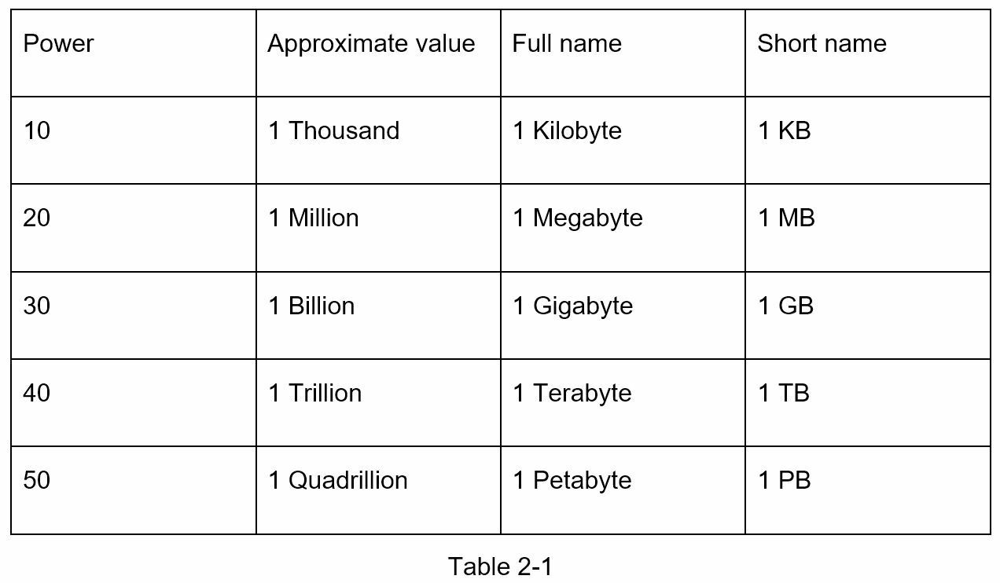
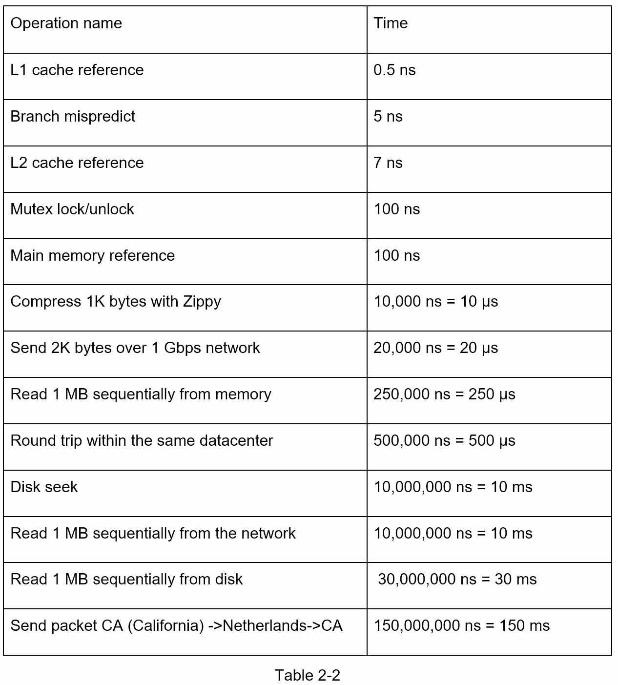
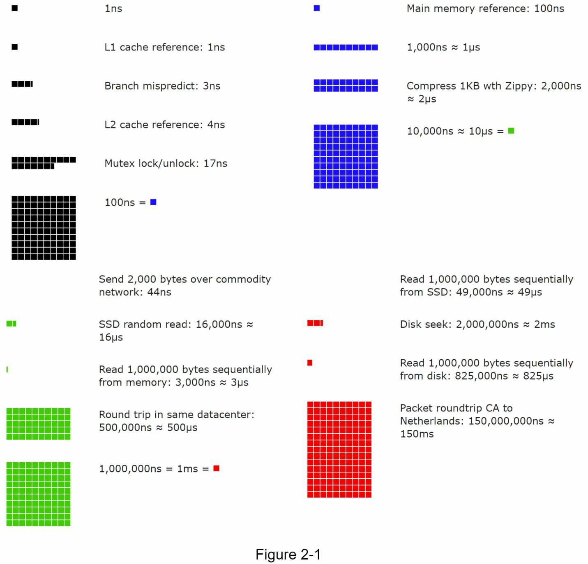
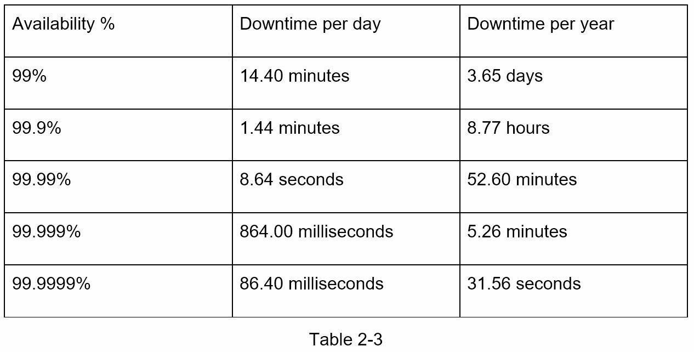

# Chương 02: Ước lượng đại khái (Back-of-the-envelope Estimation)

[← Chương trước](chuong-01-scale-tu-0-den-trieu-nguoi-dung.md) | [Mục lục](README.md) | [Chương tiếp theo →](chuong-03-khung-suon-phong-van-system-design.md)

---

# CHƯƠNG 2: ƯỚC TÍNH PHÁC THẢO NHANH (BACK-OF-THE-ENVELOPE ESTIMATION)

Trong một buổi phỏng vấn thiết kế hệ thống (system design interview), đôi khi bạn sẽ được yêu cầu ước tính dung lượng hệ thống hoặc các yêu cầu về hiệu năng bằng phương pháp ước tính phác thảo nhanh (*back-of-the-envelope estimation*). Theo Jeff Dean, Google Senior Fellow: *“Ước tính phác thảo nhanh là những tính toán gần đúng mà bạn tạo ra bằng cách kết hợp giữa các thí nghiệm tư duy (thought experiments) và các chỉ số hiệu năng thông dụng để có được cảm nhận rõ ràng về việc những thiết kế nào sẽ đáp ứng được các yêu cầu của bạn”* [1].

Bạn cần có sự thấu hiểu sâu sắc về các nguyên lý mở rộng cơ bản (scalability basics) để thực hiện ước tính phác thảo nhanh một cách hiệu quả. Các khái niệm sau đây cần được nắm vững: lũy thừa của 2 (*power of two*) [2], các chỉ số độ trễ mọi lập trình viên cần biết (*latency numbers every programmer should know*), và các chỉ số về tính sẵn sàng (*availability numbers*).

---

## Lũy thừa của 2 (Power of two)

Mặc dù khối lượng dữ liệu có thể trở nên khổng lồ khi làm việc với các hệ thống phân tán (distributed systems), mọi tính toán rốt cuộc đều quy về những điều cơ bản nhất. Để tính toán chính xác, việc nắm rõ đơn vị dung lượng dữ liệu bằng lũy thừa của 2 là vô cùng thiết yếu. Một byte là một chuỗi gồm 8 bit. Một ký tự ASCII sử dụng một byte bộ nhớ (8 bit). Dưới đây là bảng giải thích các đơn vị dung lượng dữ liệu (Bảng 2-1).

---

## Các chỉ số độ trễ mọi lập trình viên cần biết (Latency numbers every programmer should know)

Tiến sĩ Dean từ Google đã công bố thời gian thực thi của các thao tác máy tính điển hình vào năm 2010 [1]. Một số con số hiện nay đã cũ do máy tính ngày càng trở nên nhanh hơn và mạnh mẽ hơn. Tuy nhiên, những con số này vẫn mang lại cho chúng ta cái nhìn trực quan về mức độ nhanh và chậm của các thao tác máy tính khác nhau.

### Ghi chú (Notes)
-----------
- $\text{ns} = \text{nanosecond}$ (nano giây), $\mu\text{s} = \text{microsecond}$ (micro giây), $\text{ms} = \text{millisecond}$ (mili giây)
- $1\text{ ns} = 10^{-9}\text{ giây}$
- $1\ \mu\text{s} = 10^{-6}\text{ giây} = 1,000\text{ ns}$
- $1\text{ ms} = 10^{-3}\text{ giây} = 1,000\ \mu\text{s} = 1,000,000\text{ ns}$

---

Một kỹ sư phần mềm tại Google đã xây dựng một công cụ để trực quan hóa các con số của Tiến sĩ Dean. Công cụ này cũng đưa yếu tố thời gian vào xem xét. Hình 2-1 biểu diễn trực quan hóa các con số độ trễ tính đến năm 2020 (nguồn hình ảnh: tài liệu tham khảo [3]).

Bằng cách phân tích các con số trong Hình 2-1, chúng ta rút ra được các kết luận sau:
- **Bộ nhớ (Memory) thì nhanh nhưng ổ đĩa (Disk) thì chậm.**
- **Hạn chế tối đa việc tìm kiếm trên đĩa (disk seeks) nếu có thể.**
- **Các thuật toán nén đơn giản chạy rất nhanh.**
- **Hãy nén dữ liệu trước khi gửi qua mạng Internet nếu có thể.**
- **Các trung tâm dữ liệu (Data centers) thường nằm ở các khu vực địa lý khác nhau, và việc truyền dữ liệu giữa chúng sẽ mất nhiều thời gian.**

---

## Các chỉ số về tính sẵn sàng (Availability numbers)

Tính sẵn sàng cao (*High availability*) là khả năng của một hệ thống có thể hoạt động liên tục trong một khoảng thời gian dài như mong muốn. Tính sẵn sàng cao được đo lường bằng tỷ lệ phần trăm, với 100% đồng nghĩa với một dịch vụ có thời gian ngừng hoạt động (*downtime*) bằng 0. Hầu hết các dịch vụ đều nằm trong khoảng từ 99% đến 100%.

Cam kết chất lượng dịch vụ (*Service Level Agreement - SLA*) là một thuật ngữ thường dùng của các nhà cung cấp dịch vụ. Đây là một thỏa thuận giữa bạn (nhà cung cấp dịch vụ) và khách hàng của bạn, và thỏa thuận này xác định một cách chính thức mức độ thời gian hoạt động (*uptime*) mà dịch vụ của bạn sẽ cung cấp. Các nhà cung cấp đám mây như Amazon [4], Google [5] và Microsoft [6] đều đặt SLA của họ ở mức 99.9% trở lên. Uptime theo truyền thống được đo bằng "các chữ số 9" (*nines*). Càng nhiều chữ số 9 thì càng tốt. Như được thể hiện trong Bảng 2-3, số lượng chữ số 9 tương ứng với thời gian ngừng hoạt động dự kiến của hệ thống.

---

## Ví dụ: Ước tính QPS và yêu cầu lưu trữ của Twitter (Example: Estimate Twitter QPS and storage requirements)

*Xin lưu ý rằng các con số sau đây chỉ phục vụ cho bài tập này vì chúng không phải là số liệu thực tế từ Twitter.*

### Các giả định (Assumptions):
- **300 triệu** người dùng hoạt động hàng tháng (Monthly Active Users - MAU).
- **50%** người dùng sử dụng Twitter hàng ngày.
- Trung bình mỗi người dùng đăng **2 tweet** mỗi ngày.
- **10%** số lượng tweet có chứa tệp đa phương tiện (media).
- Dữ liệu được lưu trữ trong vòng **5 năm**.

### Các ước tính (Estimations):

#### Ước tính số lượng truy vấn mỗi giây (Query per second - QPS):
- Số người dùng hoạt động hàng ngày (Daily Active Users - DAU):
  $$\text{DAU} = 300\text{ triệu} \times 50\% = 150\text{ triệu}$$
- QPS đăng tweet (Tweets QPS):
  $$\text{Tweets QPS} = \frac{150\text{ triệu} \times 2\text{ tweets}}{24\text{ giờ} \times 3600\text{ giây}} \approx 3,500$$
- QPS lúc cao điểm (Peak QPS):
  $$\text{Peak QPS} = 2 \times \text{QPS} \approx 7,000$$

#### Chúng ta sẽ chỉ ước tính dung lượng lưu trữ cho tệp đa phương tiện (media storage) ở đây:
- Kích thước trung bình của một tweet:
  - `tweet_id`: 64 bytes
  - `text`: 140 bytes
  - `media`: 1 MB
- Dung lượng lưu trữ media mỗi ngày:
  $$150\text{ triệu} \times 2 \times 10\% \times 1\text{ MB} = 30\text{ TB/ngày}$$
- Dung lượng lưu trữ media trong 5 năm:
  $$30\text{ TB} \times 365 \times 5 \approx 55\text{ PB}$$

---

### Mẹo hữu ích (Tips)

Ước tính sơ bộ (Back-of-the-envelope estimation) mấu chốt nằm ở **quy trình tư duy**. Việc giải quyết vấn đề quan trọng hơn là đạt được kết quả con số tuyệt đối. Người phỏng vấn có thể đang kiểm tra kỹ năng giải quyết vấn đề (problem-solving skills) của bạn. Dưới đây là một vài mẹo bạn nên áp dụng:

* **Làm tròn và Ước lượng (Rounding and Approximation):** Rất khó để thực hiện các phép toán phức tạp trong buổi phỏng vấn. Ví dụ, kết quả của phép tính "$99987 / 9.1$" là bao nhiêu? Không cần thiết phải lãng phí thời gian quý báu để giải các bài toán phức tạp như vậy. Độ chính xác tuyệt đối không phải là điều được kỳ vọng ở đây. Hãy tận dụng các con số làm tròn và phép tính ước lượng để tạo lợi thế cho mình. Phép chia trên có thể được đơn giản hóa như sau: "$100,000 / 10$".
* **Ghi lại các giả định của bạn (Write down your assumptions):** Việc ghi chép lại các giả định đã đưa ra là một ý tưởng hay để có thể tham chiếu lại sau này.
* **Ghi rõ đơn vị đo lường (Label your units):** Khi bạn viết ra con số "$5$", nó có nghĩa là $5\text{ KB}$ hay $5\text{ MB}$? Bạn có thể tự làm chính mình bối rối vì điều này. Hãy luôn ghi kèm đơn vị vì "$5\text{ MB}$" sẽ giúp loại bỏ sự mơ hồ.
* **Các phép ước tính sơ bộ thường gặp (Commonly asked back-of-the-envelope estimations):** QPS, peak QPS (QPS đỉnh điểm), dung lượng lưu trữ (storage), bộ nhớ đệm (cache), số lượng máy chủ (number of servers), v.v. Bạn có thể luyện tập các phép tính này khi chuẩn bị cho buổi phỏng vấn. Trăm hay không bằng tay quen (Practice makes perfect).

Chúc mừng bạn đã đi được chặng đường xa đến mức này! Giờ hãy tự vỗ vai khích lệ bản thân mình. Bạn đã làm rất tốt!

---

### Tài liệu tham khảo (Reference materials)

* **[1]** J. Dean. *Google Pro Tip: Use Back-Of-The-Envelope-Calculations To Choose The Best Design*:  
  [http://highscalability.com/blog/2011/1/26/google-pro-tip-use-back-of-the-envelope-calculations-to-choo.html](http://highscalability.com/blog/2011/1/26/google-pro-tip-use-back-of-the-envelope-calculations-to-choo.html)
* **[2]** *System design primer*:  
  [https://github.com/donnemartin/system-design-primer](https://github.com/donnemartin/system-design-primer)
* **[3]** *Latency Numbers Every Programmer Should Know*:  
  [https://colin-scott.github.io/personal_website/research/interactive_latency.html](https://colin-scott.github.io/personal_website/research/interactive_latency.html)
* **[4]** *Amazon Compute Service Level Agreement*:  
  [https://aws.amazon.com/compute/sla/](https://aws.amazon.com/compute/sla/)
* **[5]** *Compute Engine Service Level Agreement (SLA)*:  
  [https://cloud.google.com/compute/sla](https://cloud.google.com/compute/sla)
* **[6]** *SLA summary for Azure services*:  
  [https://azure.microsoft.com/en-us/support/legal/sla/summary/](https://azure.microsoft.com/en-us/support/legal/sla/summary/)

---

[← Chương trước](chuong-01-scale-tu-0-den-trieu-nguoi-dung.md) | [Mục lục](README.md) | [Chương tiếp theo →](chuong-03-khung-suon-phong-van-system-design.md)
