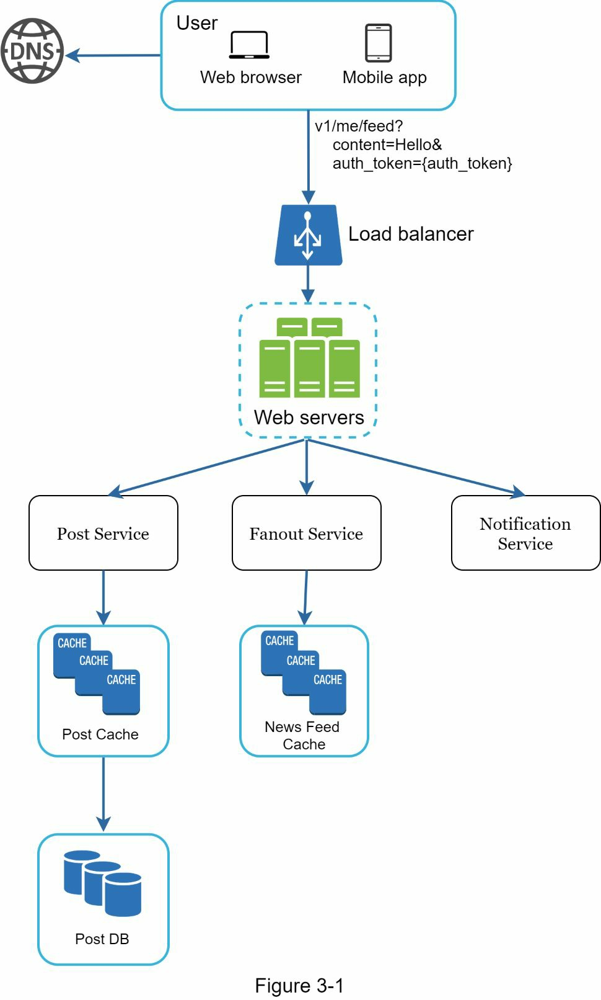
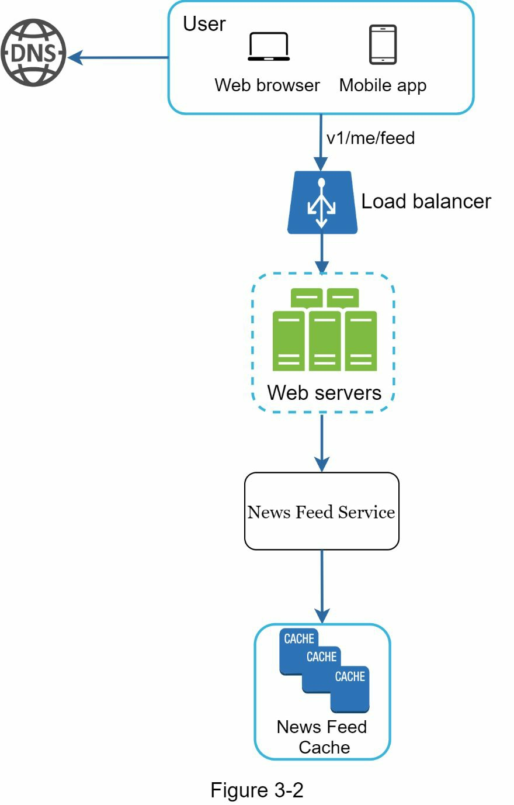

# Chương 03: Khung sườn phỏng vấn System Design (A Framework For System Design Interviews)

[← Chương trước](chuong-02-uoc-luong-dai-khai.md) | [Mục lục](README.md) | [Chương tiếp theo →](chuong-04-thiet-ke-rate-limiter.md)

---

# CHƯƠNG 3: KHUÔN KHỔ CHO PHỎNG VẤN THIẾT KẾ HỆ THỐNG (A FRAMEWORK FOR SYSTEM DESIGN INTERVIEWS)

Bạn vừa giành được một buổi phỏng vấn trực tiếp (*on-site interview*) đáng mơ ước tại công ty mục tiêu của mình. Điều phối viên tuyển dụng (*hiring coordinator*) gửi cho bạn lịch trình chi tiết trong ngày hôm đó. Lướt qua danh sách, bạn cảm thấy khá tự tin cho đến khi ánh mắt dừng lại ở phiên phỏng vấn này: **Phỏng vấn Thiết kế Hệ thống (System Design Interview)**.

Các buổi phỏng vấn thiết kế hệ thống thường mang lại cảm giác vô cùng đáng sợ. Đề bài có thể mơ hồ đến mức chỉ là: *"Hãy thiết kế một sản phẩm X nổi tiếng nào đó?"*. Các câu hỏi thì nhập nhằng, thiếu rõ ràng và dường như rộng đến mức phi lý. Sự lo lắng của bạn là hoàn toàn dễ hiểu. Rốt cuộc, làm sao một ai đó có thể thiết kế trong vòng vỏn vẹn một giờ đồng hồ một sản phẩm phổ biến vốn đã tiêu tốn hàng trăm, thậm chí hàng ngàn kỹ sư xây dựng trong nhiều năm?

Tin tốt là không ai kỳ vọng bạn phải làm được điều đó cả. Thiết kế hệ thống trong thế giới thực là vô cùng phức tạp. Ví dụ, công cụ tìm kiếm của Google trông có vẻ đơn giản đến đánh lừa; tuy nhiên, khối lượng công nghệ ẩn mình bên dưới để tạo nên sự đơn giản đó thực sự đáng kinh ngạc. Nếu không ai kỳ vọng bạn thiết kế một hệ thống thực tế hoàn chỉnh chỉ trong một giờ, vậy thì lợi ích của buổi phỏng vấn thiết kế hệ thống là gì?

Phỏng vấn thiết kế hệ thống mô phỏng lại quá trình giải quyết vấn đề trong đời thực, nơi hai người đồng nghiệp cùng nhau hợp tác xử lý một bài toán còn mơ hồ và đưa ra một giải pháp đáp ứng được các mục tiêu đề ra. Vấn đề đặt ra là một câu hỏi mở (*open-ended*), và không hề có một câu trả lời hoàn hảo duy nhất nào. Thiết kế cuối cùng thực ra ít quan trọng hơn so với nỗ lực và quá trình bạn đầu tư vào từng bước thiết kế. Buổi phỏng vấn này cho phép bạn thể hiện kỹ năng thiết kế, bảo vệ các lựa chọn kỹ thuật của mình và tiếp nhận phản hồi theo một cách mang tính xây dựng.

Hãy đảo ngược góc nhìn và xem điều gì đang diễn ra trong đầu người phỏng vấn khi cô ấy bước vào phòng họp để gặp bạn. Mục tiêu hàng đầu của người phỏng vấn là đánh giá chính xác năng lực của bạn. Điều cuối cùng cô ấy mong muốn là phải đưa ra một đánh giá không có kết luận rõ ràng (*inconclusive evaluation*) chỉ vì buổi phỏng vấn diễn ra nghèo nàn và không thu thập đủ các tín hiệu (*signals*). Vậy người phỏng vấn đang tìm kiếm điều gì trong một buổi phỏng vấn thiết kế hệ thống?

Nhiều người nghĩ rằng phỏng vấn thiết kế hệ thống chỉ xoay quanh kỹ năng thiết kế kỹ thuật của một ứng viên. Nó rộng hơn thế rất nhiều. Một buổi phỏng vấn thiết kế hệ thống hiệu quả sẽ mang lại những tín hiệu mạnh mẽ về khả năng cộng tác, khả năng làm việc dưới áp lực và năng lực giải quyết các yếu tố mơ hồ một cách xây dựng. Khả năng đặt câu hỏi hay cũng là một kỹ năng thiết yếu, và rất nhiều người phỏng vấn đặc biệt tìm kiếm kỹ năng này.

Một người phỏng vấn giỏi cũng sẽ chủ động tìm kiếm các dấu hiệu cảnh báo (*red flags*). **Thiết kế quá mức cần thiết (Over-engineering)** là một căn bệnh thực sự của rất nhiều kỹ sư, khi họ quá say mê với sự thuần khiết trong thiết kế (*design purity*) mà phớt lờ đi các bài toán đánh đổi (*tradeoffs*). Họ thường không nhận thức được chi phí cộng dồn (*compounding costs*) khổng lồ của các hệ thống bị over-engineer, và rất nhiều công ty đã phải trả một cái giá quá đắt cho sự thiếu hiểu biết đó. Bạn chắc chắn không muốn thể hiện xu hướng này trong một buổi phỏng vấn thiết kế hệ thống. Các dấu hiệu cảnh báo khác bao gồm tư duy hẹp hòi (*narrow-mindedness*), sự cứng đầu bảo thủ (*stubbornness*), v.v.

Trong chương này, chúng ta sẽ cùng điểm qua một số mẹo hữu ích và giới thiệu một khuôn khổ (*framework*) đơn giản, hiệu quả để giải quyết các bài toán phỏng vấn thiết kế hệ thống.

---

## Quy trình 4 bước cho một buổi phỏng vấn thiết kế hệ thống hiệu quả (A 4-step process for effective system design interview)

Mỗi buổi phỏng vấn thiết kế hệ thống đều có sự khác biệt. Một buổi phỏng vấn thiết kế hệ thống xuất sắc luôn mang tính mở và không có giải pháp rập khuôn nào phù hợp cho mọi trường hợp (*no one-size-fits-all solution*). Tuy nhiên, luôn có các bước và những điểm chung cốt lõi cần phải bao quát trong bất kỳ buổi phỏng vấn thiết kế hệ thống nào.

---

### Bước 1 – Hiểu rõ vấn đề và xác định phạm vi thiết kế (Step 1 - Understand the problem and establish design scope)

> *"Tại sao con hổ lại gầm lên?"*  
> Một cánh tay giơ vội lên ở phía cuối lớp học.  
> *"Thầy mời Jimmy?"*, giáo viên đáp lời.  
> *"Bởi vì nó ĐÓI ạ"*.  
> *"Rất giỏi, Jimmy."*

Suốt thời thơ ấu, Jimmy luôn là người đầu tiên giơ tay trả lời các câu hỏi trong lớp. Bất cứ khi nào giáo viên đặt câu hỏi, trong lớp luôn có một đứa trẻ thích xung phong thử sức ngay lập tức, bất kể cậu bé có thực sự biết câu trả lời hay không. Đứa trẻ đó chính là Jimmy.

Jimmy là một học sinh xuất sắc. Cậu tự hào vì luôn biết mọi câu trả lời thật nhanh chóng. Trong các kỳ thi, cậu luôn là người đầu tiên hoàn thành bài làm. Cậu luôn là lựa chọn hàng đầu của giáo viên cho bất kỳ cuộc thi học thuật nào.

**ĐỪNG giống như Jimmy.**

Trong một buổi phỏng vấn thiết kế hệ thống, việc vội vàng đưa ra câu trả lời ngay lập tức mà không suy nghĩ thấu đáo sẽ không mang lại cho bạn bất kỳ điểm cộng nào. Trả lời khi chưa hiểu tường tận các yêu cầu là một dấu hiệu cảnh báo lớn (*huge red flag*), bởi buổi phỏng vấn này không phải là một cuộc thi đố vui nhanh. Ở đây không có đáp án đúng duy nhất.

Vì vậy, đừng vội vàng lao ngay vào việc đưa ra giải pháp. Hãy chậm lại. Suy nghĩ thật sâu và đặt các câu hỏi để làm rõ những yêu cầu cùng các giả định. Điều này cực kỳ quan trọng.

Là kỹ sư, chúng ta thường thích giải quyết các bài toán khó và nhảy bổ ngay vào bản thiết kế cuối cùng; tuy nhiên, cách tiếp cận này rất dễ khiến bạn thiết kế sai toàn bộ hệ thống. Một trong những kỹ năng quan trọng nhất của một kỹ sư là biết đặt đúng câu hỏi, đưa ra các giả định hợp lý và thu thập đầy đủ mọi thông tin cần thiết để xây dựng một hệ thống. Do đó, đừng ngần ngại đặt câu hỏi.

Khi bạn đặt câu hỏi, người phỏng vấn sẽ trả lời trực tiếp câu hỏi của bạn hoặc yêu cầu bạn tự đưa ra các giả định của riêng mình. Nếu trường hợp thứ hai xảy ra, hãy ghi lại các giả định đó lên bảng trắng hoặc giấy. Bạn có thể sẽ cần dùng đến chúng ở các phần tiếp theo.

Nên đặt những câu hỏi như thế nào? Hãy đặt các câu hỏi giúp bạn hiểu chính xác các yêu cầu. Dưới đây là danh sách câu hỏi gợi ý giúp bạn bắt đầu:
- **Các tính năng cụ thể nào chúng ta sẽ xây dựng?**
- **Sản phẩm có bao nhiêu người dùng?**
- **Công ty dự kiến tốc độ mở rộng quy mô (*scale up*) nhanh như thế nào? Quy mô dự kiến trong 3 tháng, 6 tháng và 1 năm tới là bao nhiêu?**
- **Ngăn xếp công nghệ (*technology stack*) của công ty là gì? Có những dịch vụ hiện có nào mà bạn có thể tận dụng để đơn giản hóa thiết kế không?**

#### Ví dụ (Example)
Nếu bạn được yêu cầu thiết kế một hệ thống bảng tin tin tức (*News Feed System*), bạn cần đặt các câu hỏi để làm rõ yêu cầu. Cuộc hội thoại giữa bạn và người phỏng vấn có thể diễn ra như sau:

- **Ứng viên:** Đây là ứng dụng di động (*mobile app*)? Hay là ứng dụng web (*web app*)? Hay bao gồm cả hai?
- **Người phỏng vấn:** Cả hai.
- **Ứng viên:** Những tính năng quan trọng nhất đối với sản phẩm này là gì?
- **Người phỏng vấn:** Khả năng đăng bài viết (*make a post*) và xem bảng tin (*news feed*) của bạn bè.
- **Ứng viên:** Bảng tin được sắp xếp theo thứ tự thời gian đảo ngược (*reverse chronological order*) hay theo một thứ tự đặc biệt nào khác? Thứ tự đặc biệt ở đây có nghĩa là mỗi bài đăng được gán một trọng số khác nhau. Chẳng hạn, bài đăng từ bạn bè thân thiết sẽ quan trọng hơn bài đăng từ một nhóm.
- **Người phỏng vấn:** Để giữ mọi thứ đơn giản, hãy giả định bảng tin được sắp xếp theo thứ tự thời gian đảo ngược.
- **Ứng viên:** Một người dùng có thể có tối đa bao nhiêu bạn bè?
- **Người phỏng vấn:** 5.000 người.
- **Ứng viên:** Lưu lượng truy cập (*traffic volume*) là bao nhiêu?
- **Người phỏng vấn:** 10 triệu người dùng hoạt động hàng ngày (DAU - Daily Active Users).
- **Ứng viên:** Bảng tin có thể chứa hình ảnh, video hay chỉ có văn bản thuần túy?
- **Người phỏng vấn:** Bảng tin có thể chứa các tệp đa phương tiện (*media files*), bao gồm cả hình ảnh và video.

Trên đây là một số câu hỏi mẫu mà bạn có thể hỏi người phỏng vấn. Điều cốt lõi là phải hiểu rõ yêu cầu và làm sáng tỏ mọi điểm còn mơ hồ.

---

### Bước 2 – Đề xuất thiết kế tổng quan và đạt được sự đồng thuận (Step 2 - Propose high-level design and get buy-in)

Ở bước này, mục tiêu của chúng ta là xây dựng một thiết kế kiến trúc tổng quan (*high-level design*) và đạt được sự thống nhất với người phỏng vấn về thiết kế đó. Việc chủ động cộng tác với người phỏng vấn trong suốt quá trình này là một ý tưởng tuyệt vời.

- **Đưa ra một bản phác thảo ban đầu (*initial blueprint*) cho thiết kế.** Xin ý kiến phản hồi. Hãy coi người phỏng vấn như một đồng đội và cùng nhau làm việc. Nhiều người phỏng vấn giỏi rất thích trao đổi và tham gia trực tiếp vào quá trình này.
- **Vẽ các sơ đồ khối (*box diagrams*) thể hiện các thành phần chính lên bảng trắng hoặc giấy.** Các thành phần này có thể bao gồm: máy khách (*clients: mobile/web*), các API, máy chủ web (*web servers*), kho lưu trữ dữ liệu (*data stores*), bộ nhớ đệm (*cache*), mạng phân phối nội dung (*CDN*), hàng đợi thông điệp (*message queue*), v.v.
- **Thực hiện các phép tính ước tính nhanh sơ bộ (*back-of-the-envelope calculations*)** để đánh giá xem bản phác thảo của bạn có đáp ứng được các ràng buộc về quy mô hay không. Hãy suy nghĩ thành tiếng (*think out loud*). Hãy trao đổi với người phỏng vấn xem việc tính toán sơ bộ có thực sự cần thiết hay không trước khi đi sâu vào chi tiết.

Nếu có thể, hãy đi qua một vài trường hợp sử dụng cụ thể (*concrete use cases*). Điều này sẽ giúp bạn định hình rõ khung thiết kế tổng quan. Các trường hợp sử dụng này cũng rất có thể sẽ giúp bạn phát hiện ra các trường hợp biên (*edge cases*) mà trước đó bạn chưa nghĩ tới.

Chúng ta có nên đưa các điểm cuối API (*API endpoints*) và lược đồ cơ sở dữ liệu (*database schema*) vào bước này không? Điều này phụ thuộc vào từng bài toán cụ thể. Đối với các bài toán thiết kế quy mô cực lớn như *"Thiết kế công cụ tìm kiếm Google"*, việc này có phần quá chi tiết ở mức thấp (*too low level*). Nhưng đối với một bài toán như thiết kế backend cho một trò chơi poker nhiều người chơi (*multi-player poker game*), đây là điều hoàn toàn hợp lý. Hãy luôn trao đổi thẳng thắn với người phỏng vấn.

#### Ví dụ (Example)
Hãy sử dụng bài toán *"Thiết kế hệ thống bảng tin tin tức (news feed system)"* để minh họa cách tiếp cận thiết kế tổng quan. Ở phần này, bạn chưa bắt buộc phải hiểu sâu toàn bộ cách hệ thống thực sự vận hành bên dưới. Toàn bộ các chi tiết sẽ được giải thích cặn kẽ trong Chương 11.

Ở mức tổng quan (*high level*), thiết kế được chia thành hai luồng xử lý chính: **đăng tin (feed publishing)** và **xây dựng bảng tin (news feed building)**.

- **Đăng tin (Feed publishing):** khi một người dùng đăng một bài viết, dữ liệu tương ứng sẽ được ghi vào bộ nhớ đệm (*cache*) / cơ sở dữ liệu (*database*), và bài viết đó sẽ được phân phối (*populated*) vào bảng tin của bạn bè họ.
- **Xây dựng bảng tin (Newsfeed building):** bảng tin được tổng hợp bằng cách gom các bài đăng của bạn bè lại theo thứ tự thời gian đảo ngược.

Hình 3-1 và Hình 3-2 lần lượt trình bày thiết kế kiến trúc tổng quan cho luồng đăng tin và luồng xây dựng bảng tin.

---

### Bước 3 – Đi sâu vào chi tiết thiết kế (Step 3 - Design deep dive)

Đến bước này, bạn và người phỏng vấn đáng lẽ đã phải hoàn thành được các mục tiêu sau:
- Thống nhất về các mục tiêu tổng thể và phạm vi tính năng (*overall goals and feature scope*).
- Phác thảo xong bản thiết kế tổng quan (*high-level blueprint*) cho toàn bộ kiến trúc.
- Nhận được phản hồi từ người phỏng vấn về thiết kế tổng quan đó.
- Nắm được một số ý tưởng ban đầu về các khu vực cần tập trung đào sâu dựa trên phản hồi của cô ấy.

Bạn cần làm việc cùng người phỏng vấn để xác định và ưu tiên các thành phần trọng yếu trong kiến trúc. Cần nhấn mạnh một lần nữa rằng mỗi buổi phỏng vấn là một trường hợp khác nhau. Đôi khi, người phỏng vấn có thể phát ra các gợi ý cho thấy cô ấy muốn tập trung vào thiết kế tổng quan. Đôi khi, đối với một buổi phỏng vấn ứng viên cấp cao (*senior candidate*), cuộc thảo luận có thể xoay quanh các đặc tính hiệu năng của hệ thống, thường tập trung vào các điểm nghẽn cổ chai (*bottlenecks*) và ước tính tài nguyên (*resource estimations*). Trong phần lớn các trường hợp, người phỏng vấn sẽ muốn bạn đào sâu vào chi tiết của một số thành phần nhất định trong hệ thống. 

Đối với hệ thống rút gọn URL (*URL shortener*), việc đi sâu vào thiết kế hàm băm (*hash function design*) giúp chuyển đổi một URL dài thành một URL ngắn là một chủ đề rất thú vị. Đối với một hệ thống trò chuyện (*chat system*), làm thế nào để giảm độ trễ (*reduce latency*) và làm thế nào để hỗ trợ trạng thái trực tuyến/ngoại tuyến (*online/offline status*) là hai chủ đề hấp dẫn.

Quản lý thời gian là yếu tố sống còn vì bạn rất dễ bị sa đà vào những tiểu tiết vụn vặt không giúp thể hiện được năng lực của mình. Bạn phải trang bị cho mình những tín hiệu giá trị nhất để thể hiện cho người phỏng vấn thấy. Hãy cố gắng không đi vào những chi tiết không cần thiết. Ví dụ, việc trình bày chi tiết về thuật toán EdgeRank dùng để xếp hạng bảng tin của Facebook là không lý tưởng trong một buổi phỏng vấn thiết kế hệ thống, bởi vì việc này chiếm rất nhiều thời gian quý báu mà lại không chứng minh được khả năng thiết kế một hệ thống có khả năng mở rộng (*scalable system*) của bạn.

#### Ví dụ (Example)
Tại thời điểm này, chúng ta đã thảo luận xong thiết kế tổng quan cho hệ thống bảng tin tin tức, và người phỏng vấn đã hài lòng với đề xuất của bạn. Tiếp theo, chúng ta sẽ khảo sát hai trường hợp sử dụng quan trọng nhất:
1. **Đăng tin (Feed publishing)**
2. **Truy xuất bảng tin (News feed retrieval)**

Hình 3-3 và Hình 3-4 thể hiện thiết kế chi tiết cho hai trường hợp sử dụng nêu trên, các phần này sẽ được giải thích chi tiết trong Chương 11.

---

### Bước 4 - Tổng kết (Step 4 - Wrap up)

Trong bước cuối cùng này, người phỏng vấn có thể hỏi bạn một vài câu hỏi tiếp nối (follow-up questions) hoặc cho bạn sự tự do để thảo luận về các điểm bổ sung khác. Dưới đây là một số hướng đi có thể tham khảo:

* **Xác định các điểm nghẽn và cải tiến:** Người phỏng vấn có thể muốn bạn chỉ ra các điểm nghẽn của hệ thống (system bottlenecks) và thảo luận về các cải tiến tiềm năng. **Tuyệt đối không bao giờ nói rằng thiết kế của bạn đã hoàn hảo và không còn gì để cải thiện.** Luôn luôn có điểm nào đó có thể tối ưu hơn. Đây là một cơ hội tuyệt vời để thể hiện tư duy phản biện (critical thinking) và để lại ấn tượng tốt đẹp sau cùng.
* **Tóm tắt lại thiết kế:** Việc tóm tắt lại (recap) thiết kế cho người phỏng vấn có thể rất hữu ích. Điều này đặc biệt quan trọng nếu bạn đã đề xuất nhiều giải pháp khác nhau. Việc làm mới lại trí nhớ của người phỏng vấn sẽ rất có ích sau một buổi phỏng vấn kéo dài.
* **Các trường hợp lỗi (Error cases):** Các tình huống lỗi (sự cố sập máy chủ - *server failure*, mất kết nối mạng - *network loss*, v.v.) là những chủ đề rất thú vị để trao đổi.
* **Các vấn đề vận hành (Operation issues):** Rất đáng để đề cập. Bạn giám sát các chỉ số (metrics) và nhật ký lỗi (error logs) như thế nào? Quy trình triển khai (roll out) hệ thống ra sao?
* **Đường cong mở rộng tiếp theo (Next scale curve):** Cách xử lý khi hệ thống tăng trưởng lên quy mô tiếp theo cũng là một chủ đề hấp dẫn. Ví dụ, nếu thiết kế hiện tại của bạn hỗ trợ 1 triệu người dùng, bạn cần thực hiện những thay đổi gì để hỗ trợ 10 triệu người dùng?
* **Đề xuất tinh chỉnh:** Đề xuất các tinh chỉnh khác mà bạn cần thực hiện nếu có thêm thời gian.

---

Để tổng kết, chúng tôi tóm tắt một danh sách các điều **Nên làm (Dos)** và **Không nên làm (Don’ts)**.

#### Những điều nên làm (Dos)
* **Luôn luôn yêu cầu làm rõ (clarification).** Đừng mặc định rằng giả định của bạn là đúng.
* **Hiểu rõ các yêu cầu** của bài toán.
* **Không có câu trả lời đúng duy nhất cũng như không có câu trả lời tốt nhất.** Một giải pháp được thiết kế để giải quyết các vấn đề của một startup non trẻ sẽ khác hoàn toàn với giải pháp dành cho một công ty đã định hình với hàng triệu người dùng. Hãy chắc chắn rằng bạn hiểu rõ các yêu cầu.
* **Cho người phỏng vấn biết bạn đang nghĩ gì.** Hãy giao tiếp liên tục với người phỏng vấn.
* **Đề xuất nhiều hướng tiếp cận** nếu có thể.
* **Khi đã thống nhất với người phỏng vấn về bản thiết kế tổng thể (blueprint), hãy đi vào chi tiết từng thành phần.** Thiết kế các thành phần quan trọng nhất (most critical components) trước tiên.
* **Trao đổi và đối chiếu ý tưởng (bounce ideas) với người phỏng vấn.** Một người phỏng vấn giỏi sẽ làm việc cùng bạn như một người đồng đội (teammate).
* **Không bao giờ bỏ cuộc.**

#### Những điều không nên làm (Don’ts)
* **Đừng bước vào phỏng vấn mà không chuẩn bị** cho các câu hỏi phỏng vấn điển hình.
* **Đừng vội vàng lao vào một giải pháp** mà chưa làm rõ các yêu cầu và các giả định.
* **Đừng đi quá sâu vào chi tiết của một thành phần đơn lẻ ngay từ đầu.** Hãy đưa ra thiết kế tổng quan ở mức cao (high-level design) trước, sau đó mới đào sâu chi tiết (drill down).
* **Nếu bạn bị bế tắc, đừng ngần ngại yêu cầu gợi ý (hints).**
* **Một lần nữa, hãy giao tiếp.** Đừng suy nghĩ trong im lặng.
* **Đừng nghĩ rằng buổi phỏng vấn đã kết thúc ngay khi bạn đưa ra xong thiết kế.** Bạn chưa hoàn thành cho đến khi người phỏng vấn nói rằng bạn đã xong. Hãy hỏi xin phản hồi (feedback) sớm và thường xuyên.

---

### Phân bổ thời gian cho từng bước (Time allocation on each step)

Các câu hỏi phỏng vấn thiết kế hệ thống thường rất rộng, và 45 phút hoặc một giờ là không đủ để bao quát toàn bộ thiết kế. Quản lý thời gian là yếu tố cốt lõi. Bạn nên dành bao nhiêu thời gian cho mỗi bước? 

Bảng dưới đây là hướng dẫn mang tính ước lượng sơ bộ về việc phân bổ thời gian trong một buổi phỏng vấn kéo dài **45 phút**. Xin lưu ý rằng đây chỉ là ước tính sơ bộ, và việc phân bổ thời gian thực tế sẽ phụ thuộc vào phạm vi của bài toán cũng như yêu cầu từ phía người phỏng vấn.

| Bước | Nội dung | Thời gian ước tính |
| :--- | :--- | :--- |
| **Bước 1** | **Hiểu bài toán và xác định phạm vi thiết kế** (*Understand the problem and establish design scope*) | **3 - 10 phút** |
| **Bước 2** | **Đề xuất thiết kế tổng quan và nhận sự đồng thuận** (*Propose high-level design and get buy-in*) | **10 - 15 phút** |
| **Bước 3** | **Đi sâu vào chi tiết thiết kế** (*Design deep dive*) | **10 - 25 phút** |
| **Bước 4** | **Tổng kết** (*Wrap up*) | **3 - 5 phút** |

---

[← Chương trước](chuong-02-uoc-luong-dai-khai.md) | [Mục lục](README.md) | [Chương tiếp theo →](chuong-04-thiet-ke-rate-limiter.md)
