# Chương 04: Thiết kế Bộ giới hạn tốc độ (Design A Rate Limiter)

[← Chương trước](chuong-03-khung-suon-phong-van-system-design.md) | [Mục lục](README.md) | [Chương tiếp theo →](chuong-05-thiet-ke-consistent-hashing.md)

---


# CHƯƠNG 4: THIẾT KẾ BỘ GIỚI HẠN TỐC ĐỘ (DESIGN A RATE LIMITER)

Trong một hệ thống mạng, **bộ giới hạn tốc độ** (*rate limiter*) được sử dụng để kiểm soát lưu lượng truy cập (rate of traffic) do client hoặc một dịch vụ gửi đi. Trong thế giới HTTP, một rate limiter giới hạn số lượng request từ client được phép gửi đi trong một khoảng thời gian xác định. Nếu số lượng request tới API vượt quá ngưỡng được định nghĩa bởi rate limiter, tất cả các lệnh gọi vượt mức (excess calls) đều sẽ bị chặn lại. Dưới đây là một vài ví dụ:

- Một người dùng không thể viết quá 2 bài đăng mỗi giây.
- Bạn chỉ có thể tạo tối đa 10 tài khoản mỗi ngày từ cùng một địa chỉ IP.
- Bạn không thể nhận thưởng quá 5 lần mỗi tuần từ cùng một thiết bị.

Trong chương này, bạn được yêu cầu thiết kế một rate limiter. Trước khi bắt đầu thiết kế, trước tiên chúng ta cùng xem xét các lợi ích của việc sử dụng một API rate limiter:

- **Ngăn chặn tình trạng cạn kiệt tài nguyên (resource starvation) do tấn công Từ chối Dịch vụ (Denial of Service - DoS) [1]:** Hầu hết tất cả các API được công bố bởi các công ty công nghệ lớn đều áp dụng một số hình thức giới hạn tốc độ (rate limiting). Ví dụ: Twitter giới hạn số lượng tweet là 300 tweet mỗi 3 giờ [2]. Google Docs API có giới hạn mặc định như sau: 300 request đọc cho mỗi người dùng trong mỗi 60 giây [3]. Một rate limiter sẽ ngăn chặn các cuộc tấn công DoS, dù là cố ý hay vô ý, bằng cách chặn các lệnh gọi dư thừa.
- **Giảm thiểu chi phí (Reduce cost):** Giới hạn các request dư thừa đồng nghĩa với việc cần ít máy chủ hơn và phân bổ nhiều tài nguyên hơn cho các API có mức độ ưu tiên cao. Rate limiting cực kỳ quan trọng đối với các công ty sử dụng API trả phí của bên thứ ba. Ví dụ: bạn bị tính phí trên từng lượt gọi (per-call basis) cho các API bên ngoài sau: kiểm tra tín dụng, thực hiện thanh toán, truy xuất hồ sơ y tế, v.v. Việc giới hạn số lượng cuộc gọi là điều thiết yếu để cắt giảm chi phí.
- **Ngăn chặn máy chủ bị quá tải (Prevent servers from being overloaded):** Để giảm tải cho máy chủ, một rate limiter được sử dụng để lọc bỏ các request vượt mức do bot hoặc hành vi sai trái của người dùng gây ra.

---

## Bước 1 - Hiểu rõ bài toán và xác định phạm vi thiết kế (Understand the problem and establish design scope)

Rate limiting có thể được triển khai bằng nhiều thuật toán khác nhau, mỗi thuật toán đều có những ưu và nhược điểm riêng. Cuộc trao đổi giữa người phỏng vấn (*interviewer*) và ứng viên (*candidate*) sẽ giúp làm rõ loại rate limiter mà chúng ta đang hướng tới xây dựng.

> **Ứng viên:** Chúng ta sẽ thiết kế loại rate limiter nào? Đó là rate limiter phía client hay rate limiter cho API phía server?  
> **Người phỏng vấn:** Câu hỏi rất hay. Chúng ta tập trung vào rate limiter cho API phía server (server-side API rate limiter).  
> 
> **Ứng viên:** Rate limiter này sẽ điều tiết (throttle) các request API dựa trên IP, User ID hay các thuộc tính khác?  
> **Người phỏng vấn:** Rate limiter cần đủ linh hoạt để hỗ trợ nhiều bộ quy tắc điều tiết (throttle rules) khác nhau.  
> 
> **Ứng viên:** Quy mô của hệ thống là bao nhiêu? Nó được xây dựng cho một công ty khởi nghiệp (startup) hay một công ty lớn với lượng người dùng khổng lồ?  
> **Người phỏng vấn:** Hệ thống phải có khả năng xử lý một lượng lớn các request.  
> 
> **Ứng viên:** Hệ thống có hoạt động trong môi trường phân tán (distributed environment) không?  
> **Người phỏng vấn:** Có.  
> 
> **Ứng viên:** Rate limiter là một dịch vụ độc lập (separate service) hay nên được triển khai ngay bên trong mã nguồn ứng dụng (application code)?  
> **Người phỏng vấn:** Đây là quyết định thiết kế tùy thuộc vào bạn.  
> 
> **Ứng viên:** Chúng ta có cần thông báo cho những người dùng bị điều tiết (throttled) không?  
> **Người phỏng vấn:** Có.  

### Các yêu cầu (Requirements)
Dưới đây là bản tóm tắt các yêu cầu đối với hệ thống:
- **Giới hạn chính xác các request vượt mức:** (Accurately limit excessive requests).
- **Độ trễ thấp (Low latency):** Rate limiter không được làm chậm thời gian phản hồi HTTP (HTTP response time).
- **Sử dụng càng ít bộ nhớ càng tốt:** (Use as little memory as possible).
- **Giới hạn tốc độ phân tán (Distributed rate limiting):** Rate limiter có thể được chia sẻ trên nhiều máy chủ hoặc tiến trình khác nhau.
- **Xử lý ngoại lệ (Exception handling):** Hiển thị các ngoại lệ rõ ràng cho người dùng khi request của họ bị điều tiết.
- **Khả năng chịu lỗi cao (High fault tolerance):** Nếu có bất kỳ sự cố nào xảy ra với rate limiter (ví dụ: một máy chủ bộ nhớ đệm / cache server bị ngoại tuyến), điều đó không được làm ảnh hưởng đến toàn bộ hệ thống.

---

## Bước 2 - Đề xuất thiết kế cấp cao và đạt được sự đồng thuận (Propose high-level design and get buy-in)

Hãy giữ mọi thứ đơn giản và sử dụng mô hình client - server cơ bản để giao tiếp.

### Đặt rate limiter ở đâu? (Where to put the rate limiter?)
Về mặt trực quan, bạn có thể triển khai rate limiter ở phía client hoặc phía server:

- **Triển khai phía client (Client-side implementation):** Nhìn chung, client là một nơi không đáng tin cậy để thực thi rate limiting vì các request từ client có thể dễ dàng bị giả mạo bởi các tác nhân độc hại. Hơn nữa, chúng ta có thể không có quyền kiểm soát đối với việc triển khai ở phía client.
- **Triển khai phía server (Server-side implementation):** **Hình 4-1** minh họa một rate limiter được đặt ở phía server.

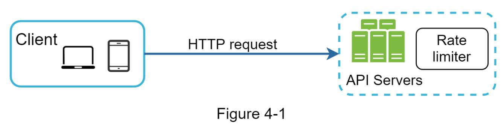

Bên cạnh cách triển khai ở phía client và server, còn có một phương pháp thay thế khác. Thay vì đặt rate limiter tại các API server, chúng ta tạo ra một middleware rate limiter chuyên điều tiết các request gửi đến API của bạn như minh họa trong **Hình 4-2**.

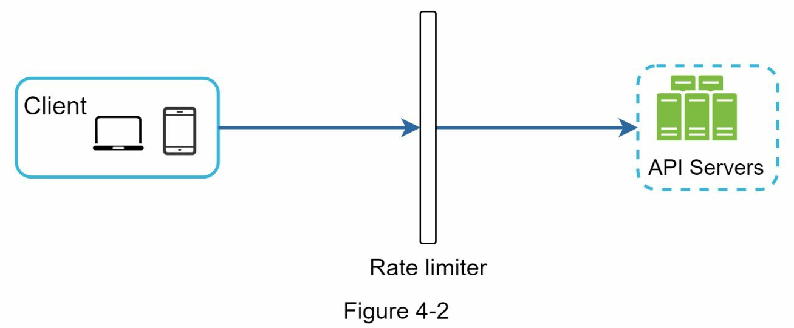

Hãy sử dụng ví dụ trong **Hình 4-3** để minh họa cách thức hoạt động của rate limiting trong thiết kế này. Giả sử API của chúng ta cho phép 2 request mỗi giây, và một client gửi 3 request đến máy chủ trong vòng một giây. Hai request đầu tiên được định tuyến đến các API server. Tuy nhiên, middleware rate limiter sẽ điều tiết request thứ ba và trả về mã trạng thái HTTP 429 (`HTTP status code 429`). Mã trạng thái phản hồi HTTP 429 chỉ ra rằng người dùng đã gửi quá nhiều request.

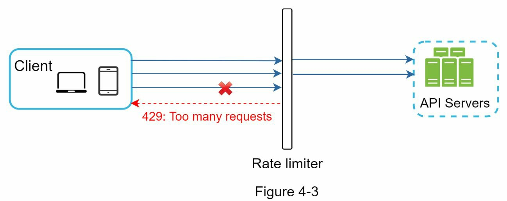

Kiến trúc Cloud microservices [4] đã trở nên vô cùng phổ biến và rate limiting thường được triển khai bên trong một thành phần gọi là **API Gateway**. API Gateway là một dịch vụ được quản lý toàn diện (fully managed service) hỗ trợ rate limiting, kết thúc SSL (SSL termination), xác thực (authentication), danh sách IP cho phép (IP whitelisting), phục vụ nội dung tĩnh (servicing static content), v.v. Hiện tại, chúng ta chỉ cần biết rằng API Gateway là một middleware có hỗ trợ rate limiting.

Khi thiết kế một rate limiter, một câu hỏi quan trọng cần tự đặt ra là: *rate limiter nên được triển khai ở đâu, ở phía server hay trong một gateway?* Không có câu trả lời tuyệt đối. Điều này phụ thuộc vào ngăn xếp công nghệ (technology stack) hiện tại của công ty bạn, nguồn lực kỹ thuật, các ưu tiên, mục tiêu, v.v. Dưới đây là một vài chỉ dẫn chung:

- **Đánh giá ngăn xếp công nghệ hiện tại của bạn:** Chẳng hạn như ngôn ngữ lập trình, dịch vụ bộ nhớ đệm (cache service), v.v. Đảm bảo ngôn ngữ lập trình hiện tại của bạn đủ hiệu quả để triển khai rate limiting ở phía server.
- **Xác định thuật toán rate limiting phù hợp với nhu cầu nghiệp vụ của bạn:** Khi bạn tự triển khai mọi thứ ở phía server, bạn có toàn quyền kiểm soát thuật toán. Tuy nhiên, sự lựa chọn của bạn có thể bị giới hạn nếu bạn sử dụng gateway của bên thứ ba.
- **Tận dụng kiến trúc sẵn có:** Nếu bạn đã sử dụng kiến trúc microservice và đưa API Gateway vào thiết kế để thực hiện xác thực, tạo danh sách IP cho phép, v.v., bạn có thể tích hợp thêm rate limiter vào API Gateway.
- **Cân nhắc nguồn lực phát triển:** Việc tự xây dựng dịch vụ rate limiting riêng sẽ tốn thời gian. Nếu bạn không có đủ nguồn lực kỹ thuật để triển khai một rate limiter, một commercial API Gateway là một lựa chọn tốt hơn.

---

## Các thuật toán cho Rate Limiting (Algorithms for rate limiting)

Rate limiting có thể được triển khai bằng nhiều thuật toán khác nhau, và mỗi thuật toán đều có những ưu điểm cũng như nhược điểm rõ rệt. Mặc dù chương này không tập trung chuyên sâu vào các thuật toán, nhưng việc hiểu chúng ở mức độ tổng quan sẽ giúp lựa chọn đúng thuật toán hoặc sự kết hợp các thuật toán phù hợp với các trường hợp sử dụng của chúng ta. Dưới đây là danh sách các thuật toán phổ biến:

- **Token bucket** (Thùng thẻ bài / Xô token)
- **Leaking bucket** (Thùng rò rỉ)
- **Fixed window counter** (Bộ đếm cửa sổ cố định)
- **Sliding window log** (Nhật ký cửa sổ trượt)
- **Sliding window counter** (Bộ đếm cửa sổ trượt)

---

### Thuật toán Token Bucket (Token bucket algorithm)

Thuật toán **Token Bucket** được sử dụng rộng rãi cho việc rate limiting. Nó đơn giản, dễ hiểu và được sử dụng phổ biến bởi các công ty Internet. Cả Amazon [5] và Stripe [6] đều sử dụng thuật toán này để điều tiết các API request của họ.

Thuật toán Token Bucket hoạt động như sau:

- Một **token bucket** là một bộ chứa (container) có dung lượng được xác định trước (pre-defined capacity). Các token được đưa vào thùng theo tỷ lệ định trước một cách định kỳ. Khi thùng đã đầy, sẽ không có thêm token nào được bổ sung. Như được minh họa trong **Hình 4-4**, dung lượng của token bucket là 4. Bộ nạp lại (*refiller*) đưa 2 token vào thùng mỗi giây. Khi thùng đã đầy, các token thừa sẽ bị tràn ra ngoài (overflow).

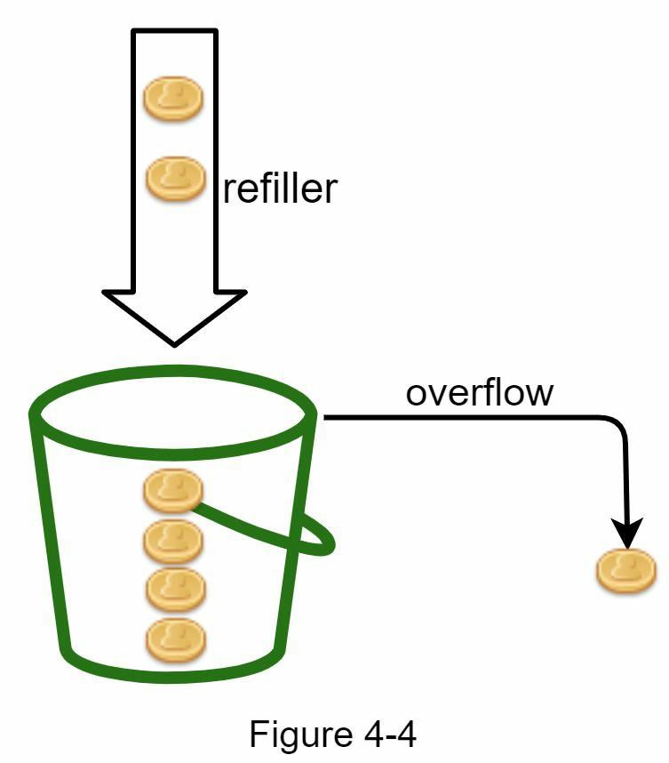

- Mỗi request tiêu thụ một token. Khi một request đến, chúng ta kiểm tra xem có đủ token trong thùng hay không. **Hình 4-5** giải thích cách thức hoạt động của quá trình này:
  - Nếu có đủ token, chúng ta lấy một token ra cho mỗi request và request đó được phép đi qua.
  - Nếu không có đủ token, request sẽ bị loại bỏ (dropped).

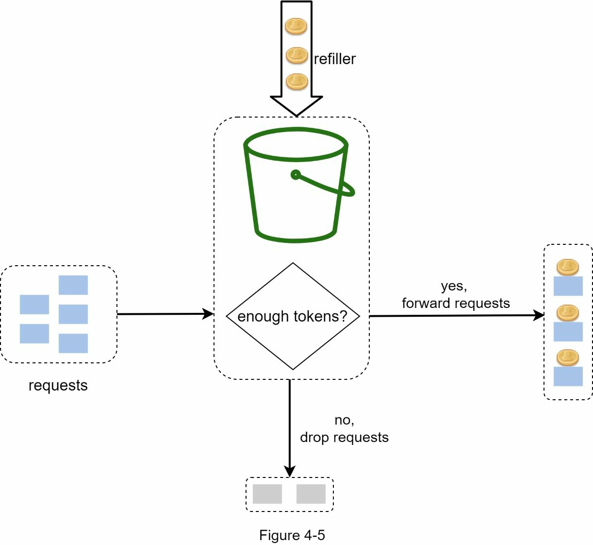

**Hình 4-6** minh họa cách thức hoạt động của logic tiêu thụ token, nạp lại token và logic giới hạn tốc độ. Trong ví dụ này, kích thước của token bucket là 4, và tốc độ nạp lại là 4 token trên mỗi 1 phút.

---

Thuật toán **Token Bucket** nhận hai tham số:
* **Kích thước thùng (Bucket size):** số lượng token tối đa được phép chứa trong thùng.
* **Tốc độ nạp (Refill rate):** số lượng token được đưa vào thùng mỗi giây.

Chúng ta cần bao nhiêu thùng? Điều này có thể thay đổi và phụ thuộc vào các quy tắc giới hạn tốc độ (rate-limiting rules). Dưới đây là một vài ví dụ:
* Thông thường cần phải có các thùng khác nhau cho các endpoint API khác nhau. Ví dụ: nếu một người dùng được phép đăng 1 bài viết mỗi giây, thêm 150 bạn bè mỗi ngày và thích (like) 5 bài viết mỗi giây, thì cần 3 thùng cho mỗi người dùng.
* Nếu chúng ta cần điều tiết lưu lượng (throttle) yêu cầu dựa trên địa chỉ IP, mỗi địa chỉ IP sẽ yêu cầu một thùng riêng.
* Nếu hệ thống cho phép tối đa 10.000 yêu cầu mỗi giây, việc sử dụng một thùng toàn cục (global bucket) dùng chung cho tất cả các yêu cầu là điều hợp lý.

**Ưu điểm (Pros):**
* Thuật toán dễ triển khai.
* Tiết kiệm bộ nhớ (memory efficient).
* Token bucket cho phép xử lý lưu lượng truy cập đột biến (burst of traffic) trong các khoảng thời gian ngắn. Một yêu cầu có thể được thông qua miễn là trong thùng vẫn còn token.

**Nhược điểm (Cons):**
* Hai tham số trong thuật toán là kích thước thùng (*bucket size*) và tốc độ nạp token (*token refill rate*). Tuy nhiên, việc tinh chỉnh chúng một cách chuẩn xác có thể là một thách thức.

---

### Thuật toán Leaking Bucket

Thuật toán **Leaking Bucket** tương tự như Token Bucket, ngoại trừ việc các yêu cầu được xử lý ở một tốc độ cố định (*fixed rate*). Nó thường được triển khai bằng một hàng đợi vào trước - ra trước (FIFO queue - *first-in-first-out*). Thuật toán hoạt động như sau:
* Khi một yêu cầu đến, hệ thống kiểm tra xem hàng đợi đã đầy hay chưa. Nếu chưa đầy, yêu cầu sẽ được thêm vào hàng đợi.
* Ngược lại, nếu hàng đợi đã đầy, yêu cầu sẽ bị hủy bỏ (dropped).
* Các yêu cầu được lấy ra khỏi hàng đợi và xử lý theo các khoảng thời gian đều đặn (regular intervals).

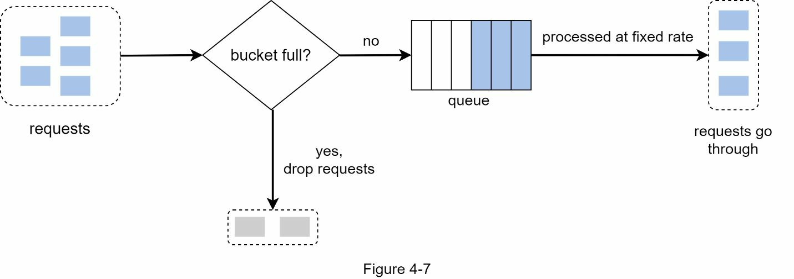
*Hình 4-7 giải thích cách thức hoạt động của thuật toán.*

Thuật toán Leaking Bucket nhận hai tham số sau:
* **Kích thước thùng (Bucket size):** bằng kích thước của hàng đợi. Hàng đợi này lưu giữ các yêu cầu chờ được xử lý ở tốc độ cố định.
* **Tốc độ dòng ra (Outflow rate):** xác định có bao nhiêu yêu cầu có thể được xử lý ở một tốc độ cố định, thường tính bằng giây.

Shopify, một công ty thương mại điện tử, sử dụng Leaking Bucket cho việc giới hạn tốc độ [7].

**Ưu điểm (Pros):**
* Tiết kiệm bộ nhớ nhờ kích thước hàng đợi giới hạn.
* Các yêu cầu được xử lý ở tốc độ cố định, do đó nó rất phù hợp cho các trường hợp sử dụng cần một tốc độ dòng ra ổn định (*stable outflow rate*).

**Nhược điểm (Cons):**
* Một đợt bùng nổ lưu lượng (burst of traffic) sẽ làm đầy hàng đợi bằng các yêu cầu cũ, và nếu chúng không được xử lý kịp thời, các yêu cầu mới gần đây sẽ bị giới hạn tốc độ (rate limited).
* Thuật toán có hai tham số, và việc tinh chỉnh chúng cho phù hợp có thể không hề dễ dàng.

---

### Thuật toán Fixed Window Counter (Bộ đếm cửa sổ cố định)

Thuật toán **Fixed Window Counter** hoạt động như sau:
* Thuật toán chia dòng thời gian thành các cửa sổ thời gian có kích thước cố định (*fix-sized time windows*) và gán một bộ đếm (counter) cho mỗi cửa sổ.
* Mỗi yêu cầu đến sẽ tăng giá trị bộ đếm lên 1.
* Một khi bộ đếm đạt đến ngưỡng được xác định trước (*pre-defined threshold*), các yêu cầu mới sẽ bị hủy bỏ cho đến khi một cửa sổ thời gian mới bắt đầu.

---

Chúng ta hãy cùng xem xét một ví dụ cụ thể để hiểu cách thức hoạt động của nó. Trong Hình 4-8, đơn vị thời gian là 1 giây và hệ thống cho phép tối đa 3 yêu cầu mỗi giây. Trong mỗi cửa sổ 1 giây, nếu nhận được nhiều hơn 3 yêu cầu, các yêu cầu vượt mức sẽ bị loại bỏ như được minh họa trong Hình 4-8.

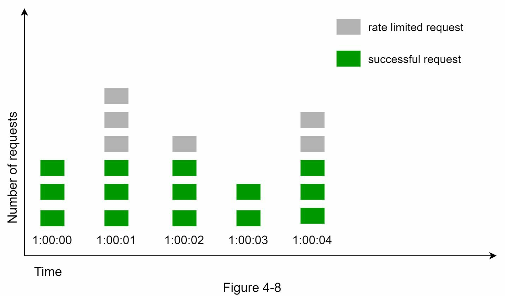

Vấn đề lớn của thuật toán này là sự bùng nổ lưu lượng truy cập ở ranh giới của các cửa sổ thời gian (edges of time windows) có thể khiến số lượng yêu cầu vượt quá hạn mức cho phép lọt qua. Hãy xem xét trường hợp sau:

Trong Hình 4-9, hệ thống cho phép tối đa 5 yêu cầu mỗi phút và hạn mức khả dụng sẽ được đặt lại (reset) vào đầu mỗi phút chẵn. Như đã thấy, có 5 yêu cầu trong khoảng từ 2:00:00 đến 2:01:00 và có thêm 5 yêu cầu nữa từ 2:01:00 đến 2:02:00. Đối với cửa sổ 1 phút nằm giữa khoảng 2:00:30 và 2:01:30, có tới 10 yêu cầu đã được thông qua. Con số này nhiều gấp đôi so với số lượng yêu cầu được cho phép.

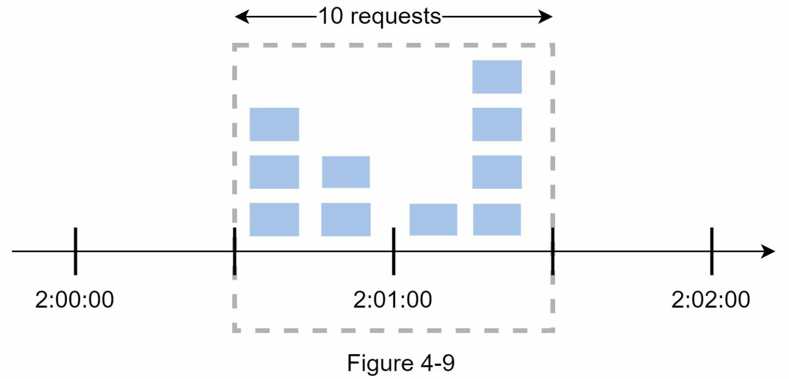

**Ưu điểm (Pros):**
* Tiết kiệm bộ nhớ.

---

* Dễ hiểu.
* Việc đặt lại hạn mức khả dụng ở cuối mỗi cửa sổ thời gian phù hợp với một số trường hợp sử dụng nhất định.

**Nhược điểm (Cons):**
* Lưu lượng tăng đột biến tại các biên của cửa sổ thời gian có thể khiến số lượng yêu cầu lọt qua nhiều hơn hạn mức cho phép.

---

### Thuật toán Sliding Window Log (Nhật ký cửa sổ trượt)

Như đã thảo luận trước đó, thuật toán Fixed Window Counter có một vấn đề lớn: nó cho phép nhiều yêu cầu lọt qua hơn ở các cạnh của cửa sổ thời gian. Thuật toán **Sliding Window Log** khắc phục được vấn đề này. Nó hoạt động như sau:
* Thuật toán theo dõi dấu thời gian (timestamp) của các yêu cầu. Dữ liệu timestamp thường được lưu trong bộ nhớ đệm cache, chẳng hạn như Sorted Sets của Redis [8].
* Khi một yêu cầu mới đến, loại bỏ tất cả các timestamp đã hết hạn (*outdated timestamps*). Timestamp hết hạn được định nghĩa là những timestamp cũ hơn thời điểm bắt đầu của cửa sổ thời gian hiện tại.
* Thêm timestamp của yêu cầu mới vào log.
* Nếu kích thước của log bằng hoặc nhỏ hơn số lượng cho phép, yêu cầu sẽ được chấp nhận. Ngược lại, yêu cầu sẽ bị từ chối.

Chúng tôi giải thích thuật toán thông qua một ví dụ như được trình bày trong Hình 4-10.

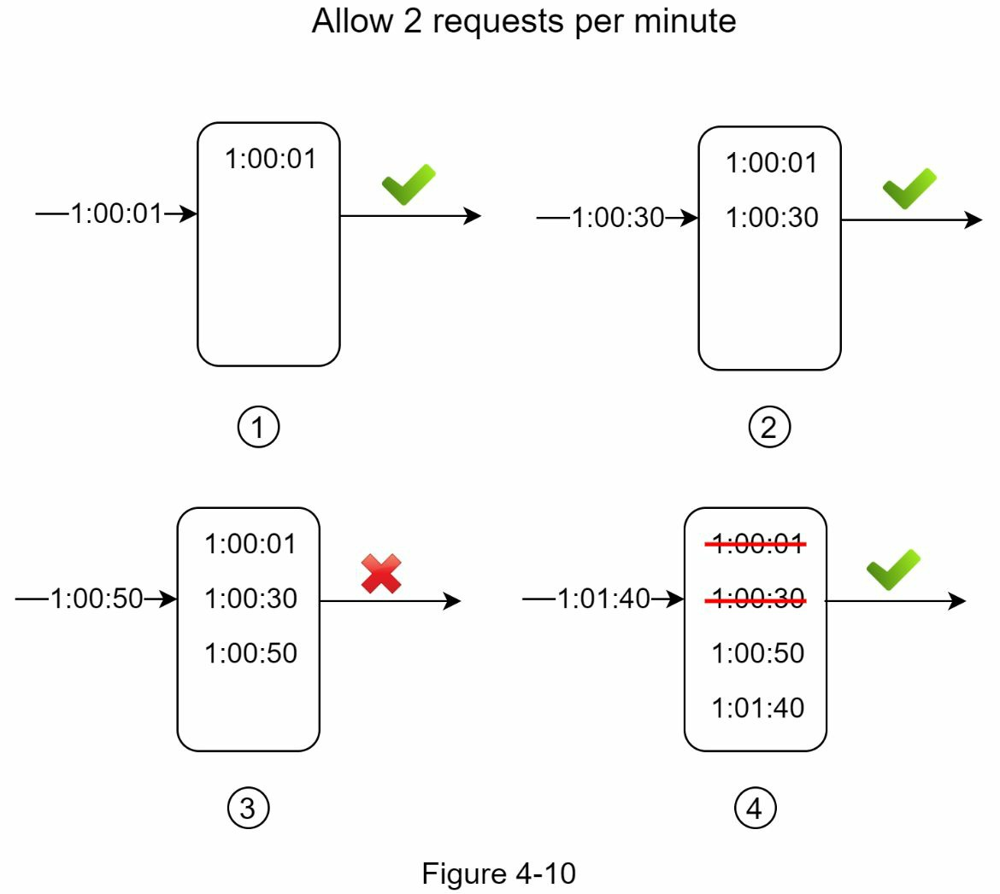

Trong ví dụ này, Rate Limiter cho phép 2 yêu cầu mỗi phút. Thông thường, các Linux timestamp sẽ được lưu trữ trong log. Tuy nhiên, định dạng thời gian trực quan (human-readable) được sử dụng trong ví dụ của chúng tôi để dễ đọc hơn.
* Log đang trống khi một yêu cầu mới đến lúc 1:00:01. Do đó, yêu cầu này được cho phép.

---

* Một yêu cầu mới đến lúc 1:00:30, timestamp 1:00:30 được thêm vào log. Sau khi chèn, kích thước log là 2, không lớn hơn số lượng cho phép. Do đó, yêu cầu được chấp nhận.
* Một yêu cầu mới đến lúc 1:00:50, và timestamp được thêm vào log. Sau khi chèn, kích thước log là 3, lớn hơn kích thước cho phép là 2. Vì vậy, yêu cầu này bị từ chối mặc dù timestamp vẫn được lưu lại trong log.
* Một yêu cầu mới đến lúc 1:01:40. Các yêu cầu nằm trong khoảng $[1:00:40, 1:01:40)$ thuộc khung thời gian mới nhất, trong khi các yêu cầu được gửi trước 1:00:40 đã hết hạn. Hai timestamp hết hạn là 1:00:01 và 1:00:30 bị xóa khỏi log. Sau thao tác xóa, kích thước log trở thành 2; do đó, yêu cầu được chấp nhận.

**Ưu điểm (Pros):**
* Cơ chế Rate Limiting được triển khai bằng thuật toán này có độ chính xác rất cao. Trong bất kỳ cửa sổ trượt (rolling window) nào, các yêu cầu cũng sẽ không vượt quá giới hạn tốc độ.

**Nhược điểm (Cons):**
* Thuật toán tiêu tốn rất nhiều bộ nhớ vì ngay cả khi một yêu cầu bị từ chối, timestamp của nó vẫn có thể được lưu trữ trong bộ nhớ.

---

### Thuật toán Sliding Window Counter (Bộ đếm cửa sổ trượt)

Thuật toán **Sliding Window Counter** là một phương pháp tiếp cận lai (hybrid) kết hợp giữa Fixed Window Counter và Sliding Window Log. Thuật toán có thể được triển khai theo hai cách tiếp cận khác nhau. Chúng tôi sẽ giải thích một cách triển khai trong phần này và cung cấp tài liệu tham khảo cho cách triển khai còn lại ở cuối phần. Hình 4-11 minh họa cách hoạt động của thuật toán này.

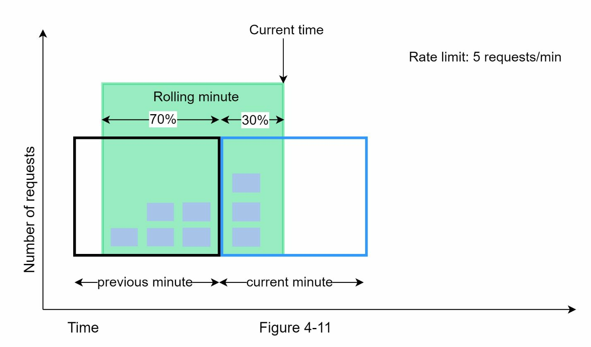

Giả sử Rate Limiter cho phép tối đa 7 yêu cầu mỗi phút, và có 5 yêu cầu trong phút trước đó cùng 3 yêu cầu trong phút hiện tại. Đối với một yêu cầu mới đến ở vị trí 30% trong phút hiện tại, số lượng yêu cầu trong cửa sổ trượt (rolling window) được tính theo công thức sau:
* **Số yêu cầu trong cửa sổ hiện tại + Số yêu cầu trong cửa sổ trước đó $\times$ Tỷ lệ phần trăm chồng lấn giữa cửa sổ trượt và cửa sổ trước đó**

---

* Sử dụng công thức này, chúng ta có: $3 + 5 \times 70\% = 6.5$ yêu cầu. Tùy thuộc vào trường hợp sử dụng, con số này có thể được làm tròn lên hoặc làm tròn xuống. Trong ví dụ của chúng tôi, nó được làm tròn xuống thành 6.

Vì Rate Limiter cho phép tối đa 7 yêu cầu mỗi phút, yêu cầu hiện tại có thể được thông qua. Tuy nhiên, giới hạn sẽ chạm ngưỡng ngay sau khi nhận thêm một yêu cầu nữa.

Do giới hạn không gian tài liệu, chúng tôi sẽ không thảo luận về cách triển khai còn lại ở đây. Những độc giả quan tâm nên xem thêm tài liệu tham khảo [9]. Thuật toán này không hoàn hảo; nó có những ưu và nhược điểm riêng.

**Ưu điểm (Pros):**
* Nó làm mượt các đợt lưu lượng truy cập tăng đột biến vì tốc độ được dựa trên tốc độ trung bình của cửa sổ trước đó.
* Tiết kiệm bộ nhớ (memory efficient).

**Nhược điểm (Cons):**
* Nó chỉ hoạt động đối với cửa sổ nhìn lại (look back window) không quá khắt khe. Đây là một giá trị xấp xỉ của tốc độ thực tế vì nó giả định các yêu cầu trong cửa sổ trước đó được phân bổ đều. Tuy nhiên, vấn đề này có thể không nghiêm trọng như vẻ ngoài của nó. Theo các thử nghiệm được thực hiện bởi Cloudflare [10], chỉ có 0.003% trong tổng số 400 triệu yêu cầu bị cho phép hoặc bị giới hạn tốc độ sai.

---

### Kiến trúc tổng thể (High-level architecture)

Ý tưởng cơ bản của các thuật toán giới hạn tốc độ (rate limiting) rất đơn giản. Ở mức tổng quan (high-level), chúng ta cần một bộ đếm (counter) để theo dõi xem có bao nhiêu yêu cầu được gửi từ cùng một người dùng, địa chỉ IP, v.v. Nếu bộ đếm lớn hơn giới hạn, yêu cầu sẽ không được phép.

Chúng ta nên lưu trữ các bộ đếm ở đâu? Sử dụng cơ sở dữ liệu (database) không phải là một ý tưởng hay do tốc độ truy cập đĩa cứng chậm. Bộ nhớ đệm trong bộ nhớ (in-memory cache) được chọn vì nó nhanh và hỗ trợ chiến lược hết hạn theo thời gian (time-based expiration strategy). Ví dụ: Redis [11] là một lựa chọn phổ biến để triển khai rate limiting. Đây là một kho lưu trữ trong bộ nhớ (in-memory store) cung cấp hai lệnh chính: `INCR` và `EXPIRE`.
* `INCR`: Tăng bộ đếm được lưu trữ lên 1.
* `EXPIRE`: Đặt thời gian hết hạn (timeout) cho bộ đếm. Nếu hết thời gian timeout, bộ đếm sẽ tự động bị xóa.

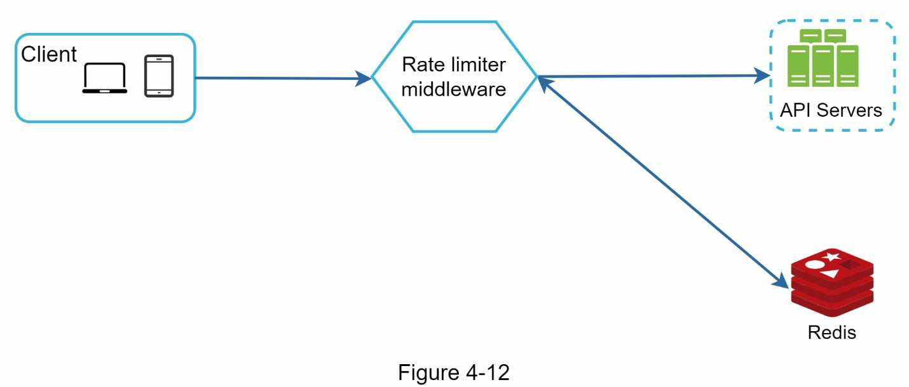

Hình 4-12 thể hiện kiến trúc tổng thể cho việc giới hạn tốc độ (rate limiting), và cơ chế này hoạt động như sau:
* Client gửi một yêu cầu đến middleware giới hạn tốc độ (rate limiting middleware).
* Middleware giới hạn tốc độ truy xuất bộ đếm từ bucket tương ứng trong Redis và...

---

kiểm tra xem giới hạn (limit) đã đạt tới hay chưa.
* Nếu đã đạt giới hạn, yêu cầu (request) sẽ bị từ chối.
* Nếu chưa đạt giới hạn, yêu cầu sẽ được chuyển tiếp đến các máy chủ API (API servers). Đồng thời, hệ thống sẽ tăng biến đếm (counter) thêm 1 và lưu ngược lại vào Redis.

---

### Bước 3 - Thiết kế chi tiết (Design deep dive)

Thiết kế mức cao (high-level design) ở Hình 4-12 chưa giải đáp được các câu hỏi sau:
* Các quy tắc giới hạn tốc độ (rate limiting rules) được tạo ra như thế nào? Các quy tắc này được lưu trữ ở đâu?
* Xử lý các yêu cầu bị giới hạn tốc độ (rate-limited requests) như thế nào?

Trong phần này, trước tiên chúng ta sẽ trả lời các câu hỏi liên quan đến quy tắc giới hạn tốc độ, sau đó xem xét các chiến lược xử lý những yêu cầu bị giới hạn. Cuối cùng, chúng ta sẽ thảo luận về giới hạn tốc độ trong môi trường phân tán (distributed environment), thiết kế chi tiết, tối ưu hóa hiệu năng và giám sát (monitoring).

#### Quy tắc giới hạn tốc độ (Rate limiting rules)

Lyft đã mã nguồn mở thành phần giới hạn tốc độ (rate-limiting component) của họ [12]. Chúng ta sẽ cùng khám phá bên trong thành phần này và xem qua một số ví dụ về các quy tắc giới hạn tốc độ:

```yaml
domain: messaging
descriptors:
  - key: message_type
    Value: marketing
    rate_limit:
      unit: day
      requests_per_unit: 5
```

Trong ví dụ trên, hệ thống được cấu hình để cho phép tối đa 5 tin nhắn tiếp thị (marketing messages) mỗi ngày. Dưới đây là một ví dụ khác:

```yaml
domain: auth
descriptors:
  - key: auth_type
    Value: login
    rate_limit:
      unit: minute
      requests_per_unit: 5
```

Quy tắc này cho thấy máy khách (client) không được phép đăng nhập quá 5 lần trong vòng 1 phút. Các quy tắc thường được viết trong các tệp cấu hình (configuration files) và được lưu trên đĩa (disk).

#### Vượt quá giới hạn tốc độ (Exceeding the rate limit)

Trong trường hợp một yêu cầu bị giới hạn tốc độ, các API sẽ trả về mã phản hồi HTTP `429 (Too Many Requests)` cho máy khách. Tùy thuộc vào các trường hợp sử dụng (use cases), chúng ta có thể đưa các yêu cầu bị giới hạn vào hàng đợi (enqueue) để xử lý sau. Ví dụ: nếu một số đơn hàng bị giới hạn tốc độ do hệ thống bị quá tải, chúng ta có thể giữ lại các đơn hàng đó để xử lý sau.

#### Các tiêu đề của bộ giới hạn tốc độ (Rate limiter headers)

Làm thế nào để máy khách biết được mình có đang bị điều tiết/nghẽn tốc độ (throttled) hay không? Và làm thế nào để máy khách biết được số lượng yêu cầu còn lại được phép thực hiện trước khi bị điều tiết? Câu trả lời nằm ở các tiêu đề phản hồi HTTP (HTTP response headers). Bộ giới hạn tốc độ (Rate Limiter) trả về các tiêu đề HTTP sau cho máy khách:

* `X-Ratelimit-Remaining`: Số lượng yêu cầu còn lại được phép thực hiện trong khoảng thời gian (window) hiện tại.
* `X-Ratelimit-Limit`: Cho biết máy khách có thể thực hiện bao nhiêu lệnh gọi trong mỗi khoảng thời gian (time window).
* `X-Ratelimit-Retry-After`: Số giây cần chờ cho đến khi bạn có thể thực hiện lại yêu cầu mà không bị điều tiết (throttled).

Khi người dùng gửi quá nhiều yêu cầu, lỗi `429 Too Many Requests` và tiêu đề `X-Ratelimit-Retry-After` sẽ được trả về cho máy khách.

---

#### Thiết kế chi tiết (Detailed design)

Hình 4-13 trình bày thiết kế chi tiết của hệ thống.

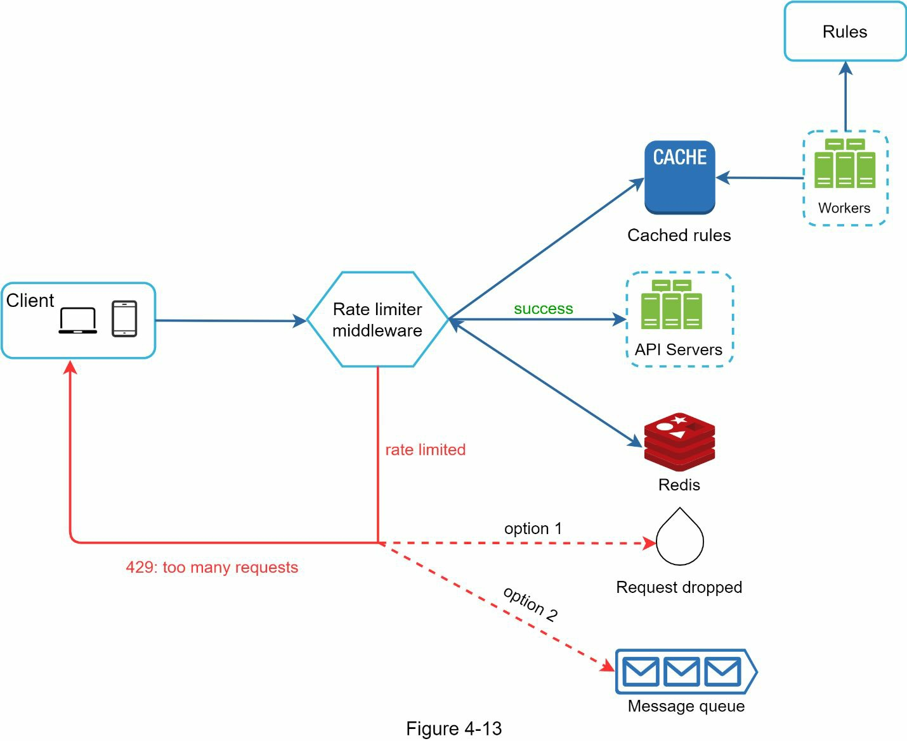

* Các quy tắc (rules) được lưu trữ trên đĩa. Các tiến trình xử lý nền (workers) thường xuyên kéo (pull) các quy tắc từ đĩa và lưu chúng vào bộ nhớ đệm (cache).
* Khi một máy khách gửi một yêu cầu đến máy chủ, yêu cầu đó trước tiên sẽ được chuyển đến phần mềm trung gian giới hạn tốc độ (rate limiter middleware).
* Phần mềm trung gian giới hạn tốc độ tải các quy tắc từ bộ đệm (cache). Nó lấy các biến đếm (counters) và dấu thời gian của yêu cầu cuối cùng (last request timestamp) từ bộ đệm Redis (Redis cache). Dựa trên kết quả phản hồi, bộ giới hạn tốc độ sẽ quyết định:
  * Nếu yêu cầu không bị giới hạn tốc độ, nó sẽ được chuyển tiếp đến các máy chủ API (API servers).
  * Nếu yêu cầu bị giới hạn tốc độ, bộ giới hạn tốc độ sẽ trả về lỗi `429 Too Many Requests` cho máy khách. Đồng thời, yêu cầu đó sẽ bị hủy bỏ (dropped) hoặc được chuyển tiếp vào hàng đợi (queue).

---

#### Bộ giới hạn tốc độ trong môi trường phân tán (Rate limiter in a distributed environment)

Xây dựng một bộ giới hạn tốc độ hoạt động trong môi trường một máy chủ đơn lẻ (single server) không khó. Tuy nhiên, việc mở rộng quy mô hệ thống để hỗ trợ nhiều máy chủ và các luồng đồng thời (concurrent threads) lại là một câu chuyện hoàn toàn khác. Có hai thách thức lớn:

* Điều kiện tương tranh (Race condition)
* Vấn đề đồng bộ hóa (Synchronization issue)

##### Điều kiện tương tranh (Race condition)

Như đã thảo luận trước đó, ở mức độ khái quát (high-level), bộ giới hạn tốc độ hoạt động như sau:
* Đọc giá trị biến đếm từ Redis.
* Kiểm tra xem $(counter + 1)$ có vượt quá ngưỡng (threshold) hay không.
* Nếu không, tăng giá trị biến đếm thêm 1 trong Redis.

Điều kiện tương tranh có thể xảy ra trong môi trường có tính đồng thời cao (highly concurrent environment) như được minh họa trong Hình 4-14.

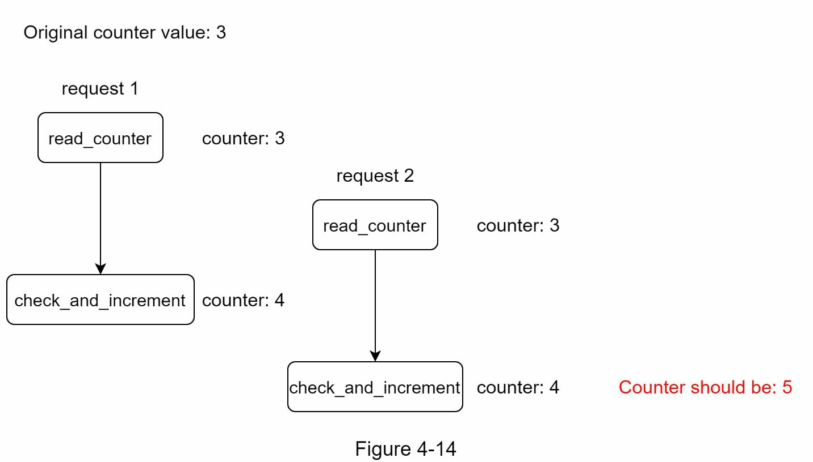

Giả sử giá trị biến đếm trong Redis đang là 3. Nếu hai yêu cầu đồng thời đọc giá trị biến đếm trước khi một trong hai kịp ghi giá trị mới trở lại, mỗi yêu cầu sẽ tăng biến đếm thêm 1 và ghi ngược lại mà không hề kiểm tra luồng còn lại. Cả hai yêu cầu (luồng) đều tin rằng chúng đang nắm giữ giá trị biến đếm chính xác là 4. Tuy nhiên, giá trị biến đếm đúng phải là 5.

Khóa (Locks) là giải pháp hiển nhiên nhất để giải quyết điều kiện tương tranh. Tuy nhiên, khóa sẽ làm chậm hệ thống một cách đáng kể. Hai chiến lược thường được sử dụng phổ biến để giải quyết vấn đề này là: kịch bản Lua (**Lua script**) [13] và cấu trúc dữ liệu sorted sets trong Redis [8]. Đối với những độc giả quan tâm đến các chiến lược này, vui lòng tham khảo các tài liệu tham khảo tương ứng [8] [13].

##### Vấn đề đồng bộ hóa (Synchronization issue)

Đồng bộ hóa là một yếu tố quan trọng khác cần cân nhắc trong môi trường phân tán. Để hỗ trợ hàng triệu người dùng, một máy chủ giới hạn tốc độ có thể không đủ để xử lý lưu lượng truy cập. Khi nhiều máy chủ giới hạn tốc độ được sử dụng, việc đồng bộ hóa là bắt buộc. Ví dụ, ở phía bên trái của Hình 4-15, client 1 gửi các yêu cầu đến rate limiter 1, và client 2 gửi các yêu cầu đến rate limiter 2.

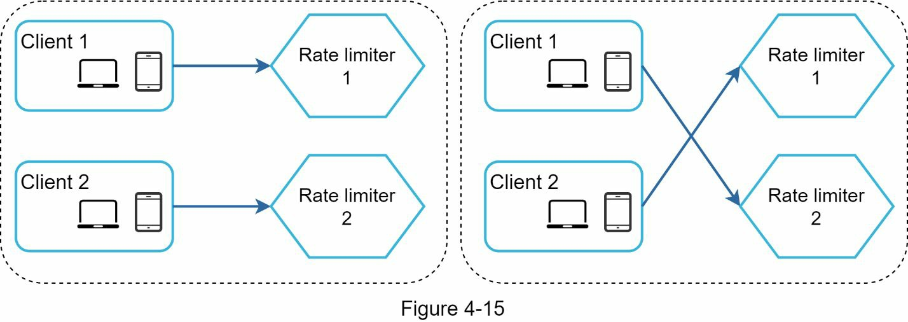

Do tầng web là phi trạng thái (stateless), các máy khách có thể gửi yêu cầu đến một bộ giới hạn tốc độ khác như minh họa ở phía bên phải của Hình 4-15. Nếu không có sự đồng bộ hóa diễn ra, rate limiter 1 sẽ không chứa bất kỳ dữ liệu nào về client 2. Do đó, bộ giới hạn tốc độ không thể hoạt động chính xác.

Một giải pháp khả thi là sử dụng phiên cố định (**sticky sessions**), cho phép một máy khách luôn gửi lưu lượng truy cập đến cùng một bộ giới hạn tốc độ. Giải pháp này không được khuyến khích vì nó không có khả năng mở rộng quy mô (scalable) cũng như không linh hoạt. Một cách tiếp cận tốt hơn là sử dụng các kho lưu trữ dữ liệu tập trung (**centralized data stores**) như Redis. Thiết kế này được thể hiện trong Hình 4-16.

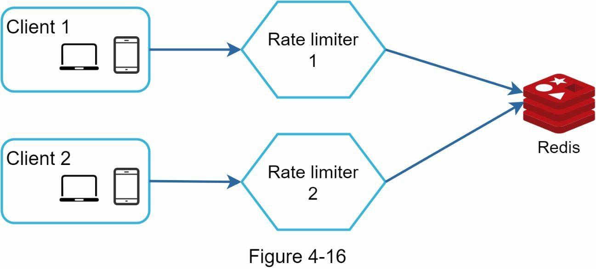

#### Tối ưu hóa hiệu năng (Performance optimization)

Tối ưu hóa hiệu năng là một chủ đề phổ biến trong các cuộc phỏng vấn thiết kế hệ thống (system design interviews). Chúng ta sẽ đề cập đến hai khía cạnh cần cải thiện.

Đầu tiên, thiết lập đa trung tâm dữ liệu (**multi-data center setup**) là yếu tố sống còn đối với một bộ giới hạn tốc độ, bởi vì độ trễ (latency) sẽ rất cao đối với những người dùng ở xa trung tâm dữ liệu. Hầu hết các nhà cung cấp dịch vụ đám mây (cloud service providers) đều xây dựng nhiều vị trí máy chủ biên (**edge servers**) trên khắp thế giới. Ví dụ: tính đến ngày 20/05/2020, Cloudflare đã có 194 máy chủ biên phân tán theo vị trí địa lý [14]. Lưu lượng truy cập sẽ tự động được định tuyến đến máy chủ biên gần nhất để giảm thiểu độ trễ.

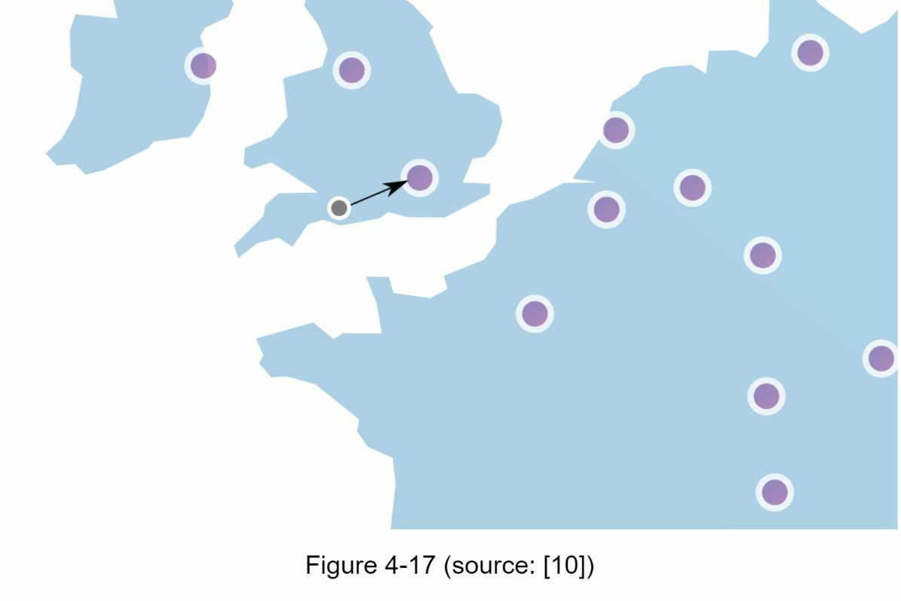

---

Thứ hai, đồng bộ hóa dữ liệu với mô hình nhất quán cuối cùng (**eventual consistency model**). Nếu bạn chưa rõ về mô hình nhất quán cuối cùng, vui lòng tham khảo phần "Tính nhất quán" (Consistency) trong "Chương 6: Thiết kế kho lưu trữ Khóa - Giá trị (Design a Key-value Store)".

#### Giám sát (Monitoring)

Sau khi bộ giới hạn tốc độ được đưa vào hoạt động, việc thu thập dữ liệu phân tích (analytics data) để kiểm tra xem bộ giới hạn tốc độ có hoạt động hiệu quả hay không là vô cùng quan trọng. Về cơ bản, chúng ta muốn đảm bảo rằng:
* Thuật toán giới hạn tốc độ (rate limiting algorithm) hoạt động hiệu quả.
* Các quy tắc giới hạn tốc độ (rate limiting rules) hoạt động hiệu quả.

Ví dụ: nếu các quy tắc giới hạn tốc độ quá nghiêm ngặt, nhiều yêu cầu hợp lệ sẽ bị hủy bỏ (dropped). Trong trường hợp này, chúng ta sẽ muốn nới lỏng các quy tắc một chút. Trong một ví dụ khác, chúng ta nhận thấy bộ giới hạn tốc độ của mình trở nên kém hiệu quả khi có sự gia tăng đột biến về lưu lượng truy cập như trong các đợt mở bán chớp nhoáng (flash sales). Trong kịch bản này, chúng ta có thể thay thế thuật toán để hỗ trợ lưu lượng truy cập tăng đột biến (burst traffic). Thuật toán Thùng chứa thẻ bài (**Token bucket**) là một lựa chọn rất phù hợp ở đây.

---

### Bước 4 - Tổng kết (Step 4 - Wrap up)

Trong chương này, chúng ta đã thảo luận về các thuật toán giới hạn tốc độ (**rate limiting**) khác nhau cùng các ưu/nhược điểm của chúng.

Các thuật toán đã được thảo luận bao gồm:
* **Token bucket** (Thùng thẻ token)
* **Leaking bucket** (Thùng rò rỉ)
* **Fixed window** (Cửa sổ cố định)
* **Sliding window log** (Nhật ký cửa sổ trượt)
* **Sliding window counter** (Bộ đếm cửa sổ trượt)

Tiếp theo, chúng ta đã thảo luận về kiến trúc hệ thống, bộ giới hạn tốc độ (**rate limiter**) trong môi trường phân tán (**distributed environment**), tối ưu hóa hiệu năng (**performance optimization**) và giám sát (**monitoring**). Tương tự như bất kỳ câu hỏi phỏng vấn thiết kế hệ thống (**system design interview**) nào, có những chủ đề thảo luận bổ sung mà bạn có thể đề cập nếu thời gian cho phép:

* **Giới hạn tốc độ cứng và giới hạn tốc độ mềm (Hard vs soft rate limiting):**
  * **Hard (Cứng):** Số lượng request không được phép vượt quá ngưỡng quy định.
  * **Soft (Mềm):** Requests có thể vượt quá ngưỡng trong một khoảng thời gian ngắn.
* **Giới hạn tốc độ ở các tầng khác nhau (Rate limiting at different levels):** Trong chương này, chúng ta chỉ mới đề cập đến việc giới hạn tốc độ ở tầng ứng dụng (**application level - HTTP: layer 7**). Hoàn toàn có thể áp dụng giới hạn tốc độ ở các tầng khác. Ví dụ, bạn có thể áp dụng giới hạn tốc độ theo địa chỉ IP bằng cách sử dụng **Iptables** [15] (**IP: layer 3**).  
  *Ghi chú:* Mô hình kết nối các hệ thống mở (**OSI model - Open Systems Interconnection model**) gồm có 7 tầng [16]:
  * Tầng 1: Tầng vật lý (**Layer 1: Physical layer**)
  * Tầng 2: Tầng liên kết dữ liệu (**Layer 2: Data link layer**)
  * Tầng 3: Tầng mạng (**Layer 3: Network layer**)
  * Tầng 4: Tầng giao vận (**Layer 4: Transport layer**)
  * Tầng 5: Tầng phiên (**Layer 5: Session layer**)
  * Tầng 6: Tầng trình diễn (**Layer 6: Presentation layer**)
  * Tầng 7: Tầng ứng dụng (**Layer 7: Application layer**)
* **Tránh bị giới hạn tốc độ (Avoid being rate limited):** Thiết kế phía máy khách (**client**) của bạn theo các thực hành tốt nhất (**best practices**):
  * Sử dụng bộ nhớ đệm phía client (**client cache**) để tránh thực hiện các lệnh gọi API (**API calls**) quá thường xuyên.
  * Nắm rõ giới hạn và không gửi quá nhiều request trong một khoảng thời gian ngắn.
  * Thêm mã nguồn để bắt các ngoại lệ (**exceptions**) hoặc lỗi để client của bạn có thể phục hồi một cách uyển chuyển (**gracefully recover**) từ các ngoại lệ.
  * Bổ sung đủ khoảng thời gian chờ lùi lại (**backoff time**) vào logic thử lại (**retry logic**).

Xin chúc mừng bạn đã đi được một chặng đường dài đến đây! Hãy tự thưởng cho bản thân một cái vỗ vai khích lệ. Làm tốt lắm!

---

### Tài liệu tham khảo (Reference materials)

* **[1] Rate-limiting strategies and techniques:**  
  https://cloud.google.com/solutions/rate-limiting-strategies-techniques
* **[2] Twitter rate limits:**  
  https://developer.twitter.com/en/docs/basics/rate-limits
* **[3] Google docs usage limits:**  
  https://developers.google.com/docs/api/limits
* **[4] IBM microservices:**  
  https://www.ibm.com/cloud/learn/microservices
* **[5] Throttle API requests for better throughput:**  
  https://docs.aws.amazon.com/apigateway/latest/developerguide/api-gateway-request-throttling.html
* **[6] Stripe rate limiters:**  
  https://stripe.com/blog/rate-limiters
* **[7] Shopify REST Admin API rate limits:**  
  https://help.shopify.com/en/api/reference/rest-admin-api-rate-limits
* **[8] Better Rate Limiting With Redis Sorted Sets:**  
  https://engineering.classdojo.com/blog/2015/02/06/rolling-rate-limiter/
* **[9] System Design — Rate limiter and Data modelling:**  
  https://medium.com/@saisandeepmopuri/system-design-rate-limiter-and-data-modelling-9304b0d18250
* **[10] How we built rate limiting capable of scaling to millions of domains:**  
  https://blog.cloudflare.com/counting-things-a-lot-of-different-things/
* **[11] Redis website:**  
  https://redis.io/
* **[12] Lyft rate limiting:**  
  https://github.com/lyft/ratelimit
* **[13] Scaling your API with rate limiters:**  
  https://gist.github.com/ptarjan/e38f45f2dfe601419ca3af937fff574d#request-rate-limiter
* **[14] What is edge computing:**  
  https://www.cloudflare.com/learning/serverless/glossary/what-is-edge-computing/
* **[15] Rate Limit Requests with Iptables:**  
  https://blog.programster.org/rate-limit-requests-with-iptables
* **[16] OSI model:**  
  https://en.wikipedia.org/wiki/OSI_model#Layer_architecture


---

[← Chương trước](chuong-03-khung-suon-phong-van-system-design.md) | [Mục lục](README.md) | [Chương tiếp theo →](chuong-05-thiet-ke-consistent-hashing.md)
