# Chương 05: Thiết kế Băm nhất quán (Design Consistent Hashing)

[← Chương trước](chuong-04-thiet-ke-rate-limiter.md) | [Mục lục](README.md) | [Chương tiếp theo →](chuong-06-thiet-ke-key-value-store.md)

---

Tôi cần kiểm tra nội dung các bảng (Table 5-1, Table 5-2) hoặc các hình ảnh được cung cấp trong thư mục `images/` (hoặc kiểm tra xem có file nào chứa text hay hình để trích xuất chính xác bảng Table 5-1 và Table 5-2 không). Hãy chạy lệnh hoặc kiểm tra file trong workspace.
# CHƯƠNG 5: THIẾT KẾ BĂM NHẤT QUÁN (CONSISTENT HASHING)

Để đạt được khả năng mở rộng quy mô theo chiều ngang (horizontal scaling), việc phân phối các yêu cầu/dữ liệu một cách hiệu quả và đồng đều trên các máy chủ là vô cùng quan trọng. **Băm nhất quán (Consistent Hashing)** là một kỹ thuật thường được sử dụng để đạt được mục tiêu này. Nhưng trước tiên, chúng ta hãy xem xét chuyên sâu vào bản chất của bài toán.

---

## Vấn đề tái băm (The rehashing problem)

Nếu bạn có $n$ máy chủ bộ nhớ đệm (cache servers), một cách phổ biến để cân bằng tải là sử dụng phương pháp băm sau:

$$\text{serverIndex} = \text{hash}(\text{key}) \pmod N$$

*Trong đó $N$ là kích thước của nhóm máy chủ (server pool).*

Hãy lấy một ví dụ để minh họa cách phương pháp này hoạt động. Như được hiển thị trong Bảng 5-1, chúng ta có 4 máy chủ và 8 khóa chuỗi (string keys) cùng giá trị băm tương ứng của chúng.

Để xác định máy chủ nơi lưu trữ một khóa, chúng ta thực hiện phép toán lấy số dư (modular operation) $f(\text{key}) \pmod 4$. Chẳng hạn, $\text{hash}(\text{key0}) \pmod 4 = 1$ đồng nghĩa với việc máy khách (client) phải liên hệ với máy chủ 1 (server 1) để lấy dữ liệu được lưu trong bộ nhớ đệm.

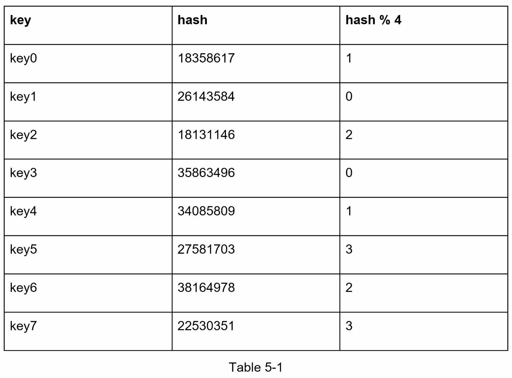

*Hình 5-1 minh họa sự phân phối của các khóa dựa trên Bảng 5-1.*

---

Cách tiếp cận này hoạt động rất tốt khi kích thước của nhóm máy chủ là cố định và sự phân phối dữ liệu là đồng đều. Tuy nhiên, các vấn đề sẽ phát sinh khi có máy chủ mới được thêm vào hoặc máy chủ hiện có bị gỡ bỏ. 

Ví dụ, nếu **server 1** bị ngắt kết nối (offline), kích thước của nhóm máy chủ sẽ giảm xuống còn 3. Khi sử dụng cùng một hàm băm, chúng ta vẫn nhận được cùng một giá trị băm cho một khóa. Nhưng việc áp dụng phép toán chia lấy số dư sẽ cho ra các chỉ số máy chủ (server indexes) hoàn toàn khác nhau vì tổng số lượng máy chủ đã giảm đi 1. 

Chúng ta thu được các kết quả như trong Bảng 5-2 bằng cách áp dụng phép toán $\text{hash} \pmod 3$:

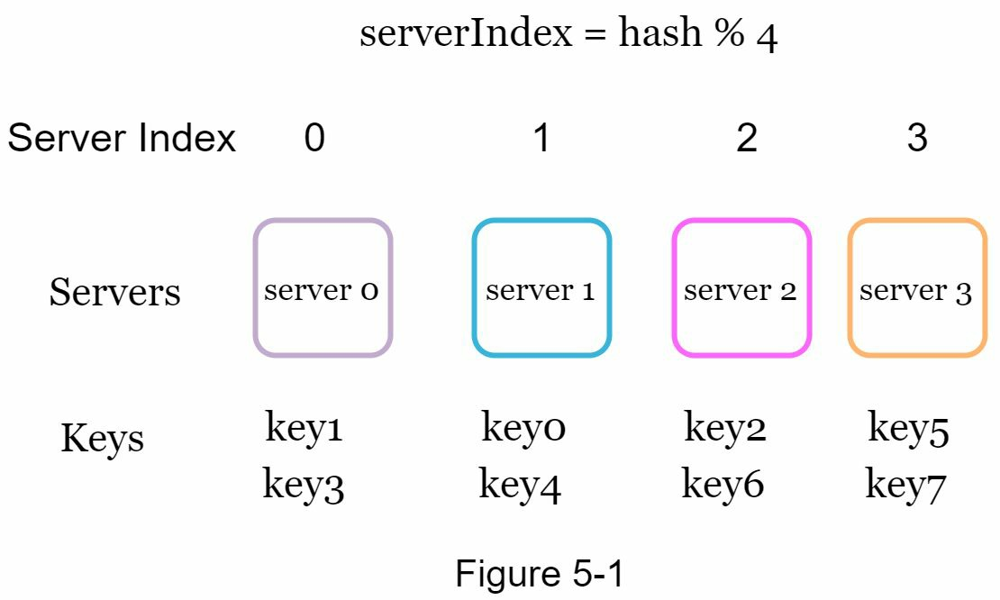

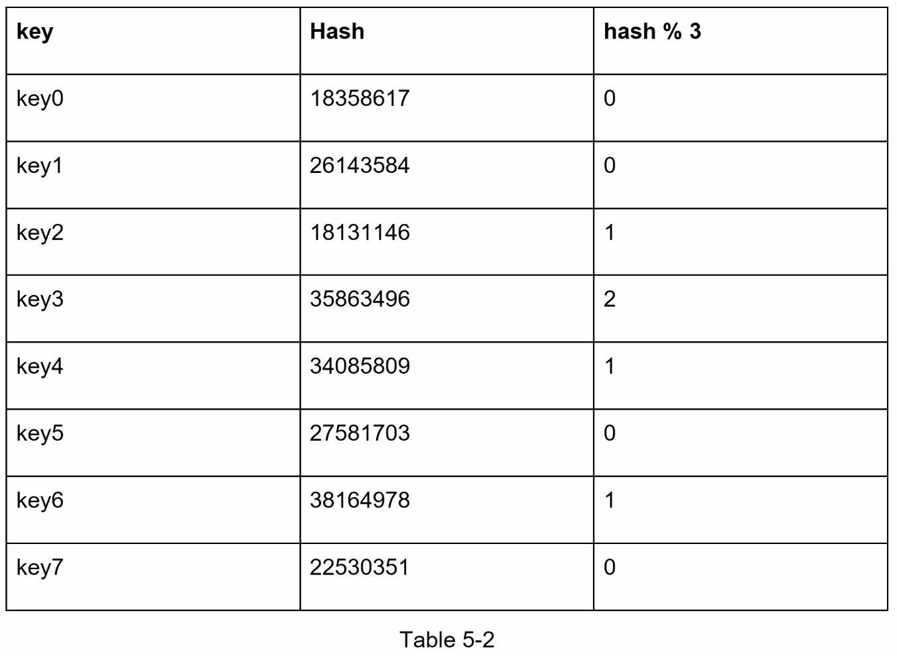

*Hình 5-2 hiển thị sự phân phối mới của các khóa dựa trên Bảng 5-2.*

---

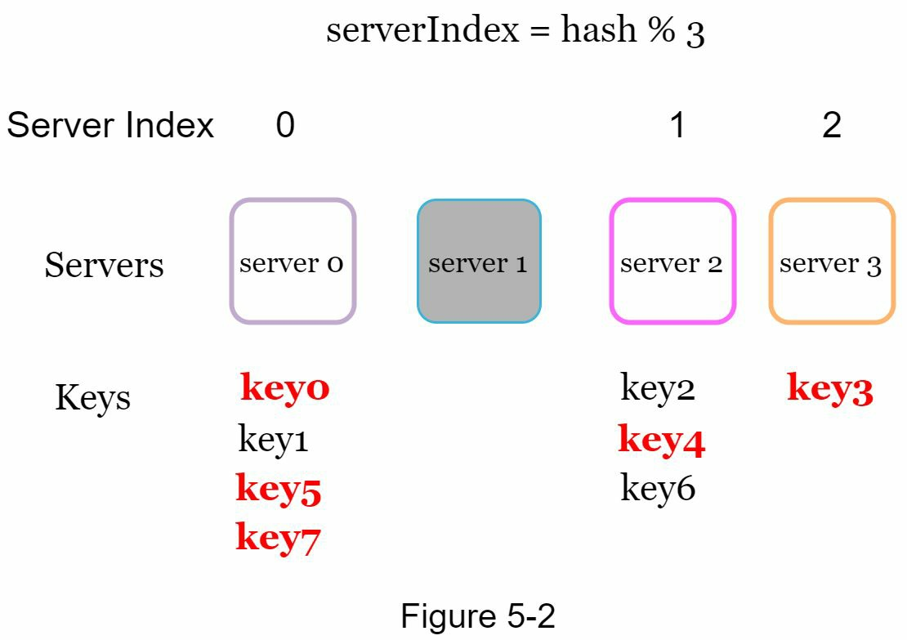

Như thể hiện trong Hình 5-2, hầu hết các khóa đều bị phân phối lại (redistributed), chứ không riêng gì những khóa ban đầu được lưu trữ trên máy chủ bị offline (server 1). Điều này đồng nghĩa với việc khi **server 1** ngừng hoạt động, hầu hết các cache client sẽ kết nối đến nhầm máy chủ để truy xuất dữ liệu. 

Hiện tượng này gây ra một **cơn bão trượt bộ nhớ đệm (storm of cache misses)**. **Băm nhất quán (Consistent Hashing)** chính là kỹ thuật hiệu quả để giải quyết và giảm thiểu vấn đề nghiêm trọng này.

---

## Băm nhất quán (Consistent hashing)

Trích dẫn định nghĩa từ Wikipedia: 

> *"Băm nhất quán (Consistent hashing) là một dạng băm đặc biệt, sao cho khi bảng băm được thay đổi kích thước và kỹ thuật băm nhất quán được sử dụng, thì tính trung bình chỉ có $k/n$ khóa cần phải ánh xạ lại (remapped), trong đó $k$ là số lượng khóa và $n$ là số lượng vị trí/khe (slots). Ngược lại, trong hầu hết các bảng băm truyền thống, việc thay đổi số lượng khe trong mảng khiến cho gần như toàn bộ các khóa đều phải bị ánh xạ lại [1]".*

### Không gian băm và vòng băm (Hash space and hash ring)

Bây giờ chúng ta đã hiểu định nghĩa về băm nhất quán, hãy cùng tìm hiểu cách thức hoạt động của nó. 

Giả sử thuật toán **SHA-1** được sử dụng làm hàm băm $f$, và phạm vi đầu ra (output range) của hàm băm là: $x_0, x_1, x_2, x_3, \dots, x_n$. 

Trong mật mã học, không gian băm (hash space) của SHA-1 trải dài từ $0$ đến $2^{160} - 1$. Điều đó có nghĩa là $x_0$ tương ứng với $0$, $x_n$ tương ứng với $2^{160} - 1$, và tất cả các giá trị băm còn lại ở giữa sẽ nằm trong khoảng từ $0$ đến $2^{160} - 1$.

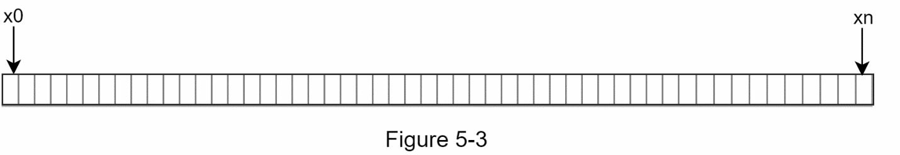

*Hình 5-3 biểu diễn không gian băm.*

Bằng cách nối liền hai đầu của dải giá trị lại với nhau, chúng ta thu được một **vòng băm (hash ring)** như được minh họa trong Hình 5-4:

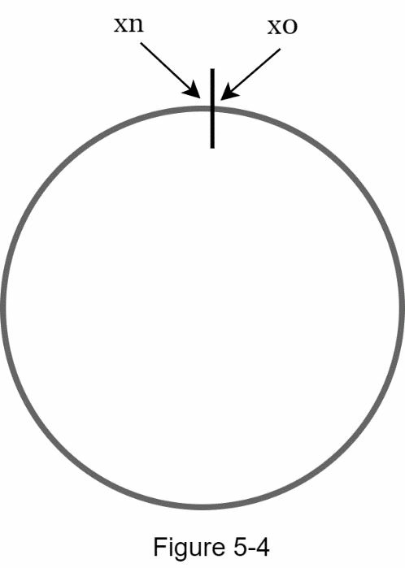

### Băm các máy chủ (Hash servers)

Sử dụng cùng hàm băm $f$, chúng ta ánh xạ các máy chủ dựa trên địa chỉ IP hoặc tên máy chủ (server name) lên trên vòng băm. 

Hình 5-5 cho thấy 4 máy chủ đã được ánh xạ thành công lên vòng băm:

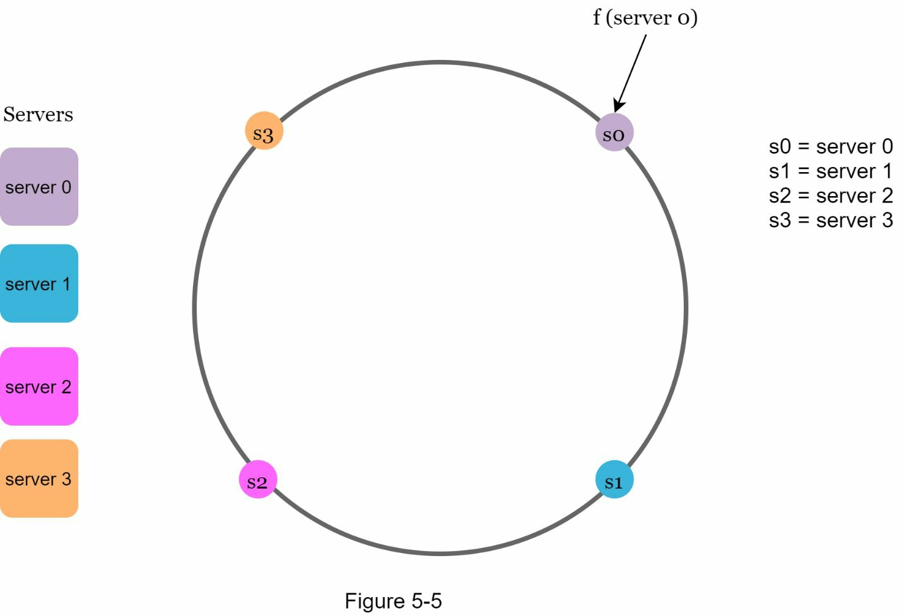

---

### Băm các khóa (Hash keys)

Một điều đáng lưu ý là hàm băm được sử dụng ở đây hoàn toàn khác với hàm băm trong "vấn đề tái băm" (the rehashing problem), và ở đây **không có phép toán chia lấy số dư (modular operation)**. 

Như được hiển thị trong Hình 5-6, 4 khóa bộ nhớ đệm (`key0`, `key1`, `key2`, và `key3`) được băm trực tiếp lên trên vòng băm:

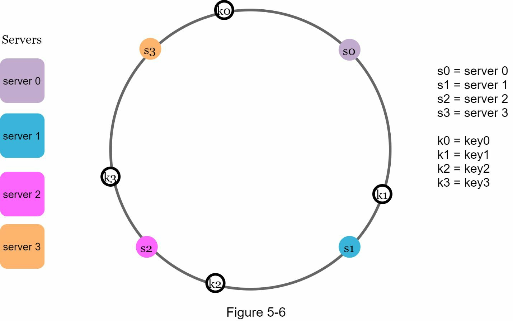

### Tra cứu máy chủ (Server lookup)

---

### Xác định vị trí lưu trữ của Key (Key Lookup)

Để xác định một key được lưu trữ trên server nào, chúng ta di chuyển theo chiều kim đồng hồ (clockwise) từ vị trí của key trên vòng băm (hash ring) cho đến khi gặp một server đầu tiên. Hình 5-7 giải thích quy trình này. 

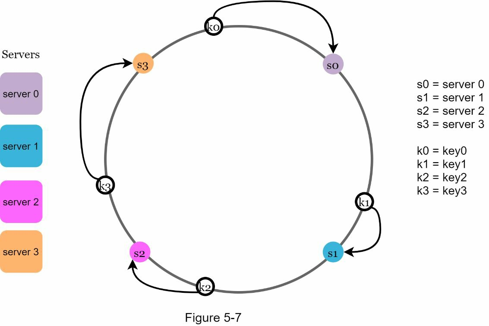

Đi theo chiều kim đồng hồ:
* `key0` được lưu trữ trên `server 0`
* `key1` được lưu trữ trên `server 1`
* `key2` được lưu trữ trên `server 2`
* `key3` được lưu trữ trên `server 3`

---

### Thêm một Server mới (Add a server)

Sử dụng logic được mô tả ở trên, việc thêm một server mới sẽ chỉ yêu cầu phân phối lại (redistribution) một phần nhỏ các key.

Trong Hình 5-8, sau khi `server 4` mới được thêm vào, chỉ có `key0` cần phải được phân phối lại. Các key `k1`, `k2` và `k3` vẫn được giữ nguyên trên các server hiện tại của chúng. 

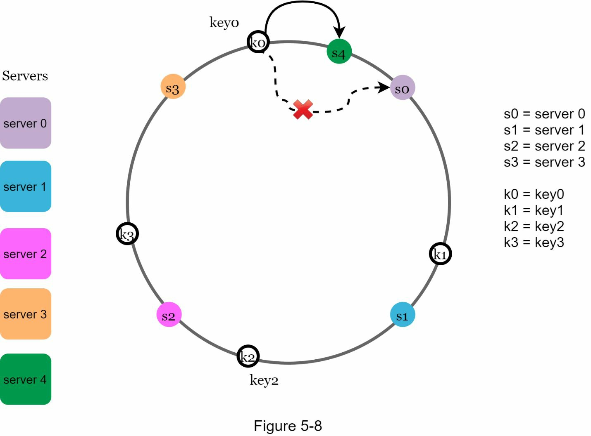

Hãy cùng xem xét kỹ logic này:
* Trước khi `server 4` được thêm vào, `key0` được lưu trên `server 0`.
* Hiện tại, `key0` sẽ được lưu trữ trên `server 4` bởi vì `server 4` là server đầu tiên nó bắt gặp khi đi theo chiều kim đồng hồ từ vị trí của `key0` trên vòng ring.
* Các key còn lại không bị phân phối lại dựa trên thuật toán băm nhất quán (*Consistent Hashing*).

---

### Xóa bỏ một Server (Remove a server)

Khi một server bị xóa bỏ khỏi hệ thống, chỉ một phần nhỏ các key cần phải phân phối lại với thuật toán băm nhất quán (*Consistent Hashing*). 

Trong Hình 5-9, khi `server 1` bị xóa, chỉ có `key1` phải được ánh xạ lại (remapped) sang `server 2`. Toàn bộ các key còn lại đều không bị ảnh hưởng.

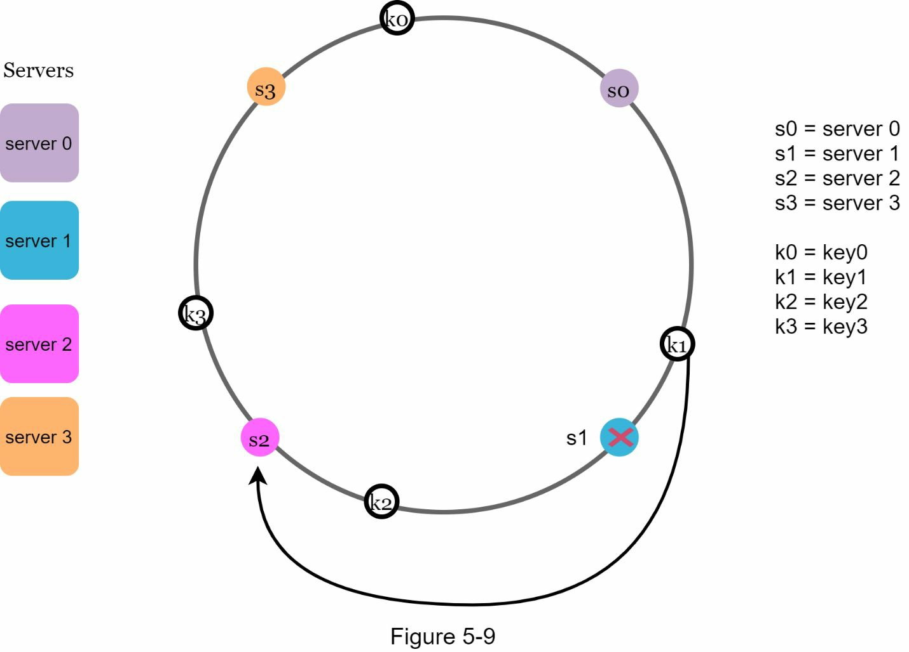

---

### Hai vấn đề trong cách tiếp cận cơ bản (Two issues in the basic approach)

Thuật toán băm nhất quán (*Consistent Hashing*) được giới thiệu bởi Karger và các cộng sự tại MIT [1]. Các bước cơ bản gồm:
1. Ánh xạ các server và các key lên vòng ring bằng cách sử dụng một hàm băm phân phối đều (uniformly distributed hash function).
2. Để tìm ra server mà một key được ánh xạ tới, di chuyển theo chiều kim đồng hồ từ vị trí của key cho đến khi tìm thấy server đầu tiên trên vòng ring.

Có hai vấn đề được xác định với cách tiếp cận này:

#### 1. Kích thước phân vùng không đồng đều (Non-uniform partition size)
Không thể duy trì kích thước của các phân vùng (partitions) trên vòng ring như nhau cho tất cả các server khi xét đến việc một server có thể được thêm vào hoặc xóa bỏ. Một phân vùng (*partition*) là không gian băm (hash space) nằm giữa các server liền kề. Hoàn toàn có khả năng kích thước của các phân vùng trên vòng ring được gán cho mỗi server là rất nhỏ hoặc khá lớn. 

Trong Hình 5-10, nếu `s1` bị xóa, phân vùng của `s2` (được đánh dấu bằng các mũi tên hai chiều) sẽ lớn gấp đôi phân vùng của `s0` và `s3`.

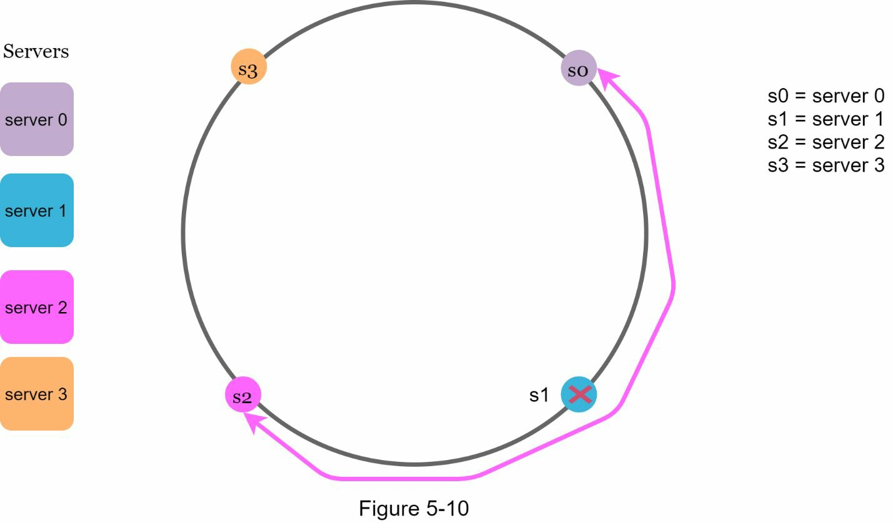

#### 2. Phân phối Key không đồng đều (Non-uniform key distribution)
Hoàn toàn có thể xảy ra tình trạng phân phối key không đồng đều trên vòng ring. Ví dụ: nếu các server được ánh xạ vào các vị trí như trong Hình 5-11, phần lớn các key sẽ được lưu trữ trên `server 2`. Trong khi đó, `server 1` và `server 3` lại không chứa dữ liệu nào.

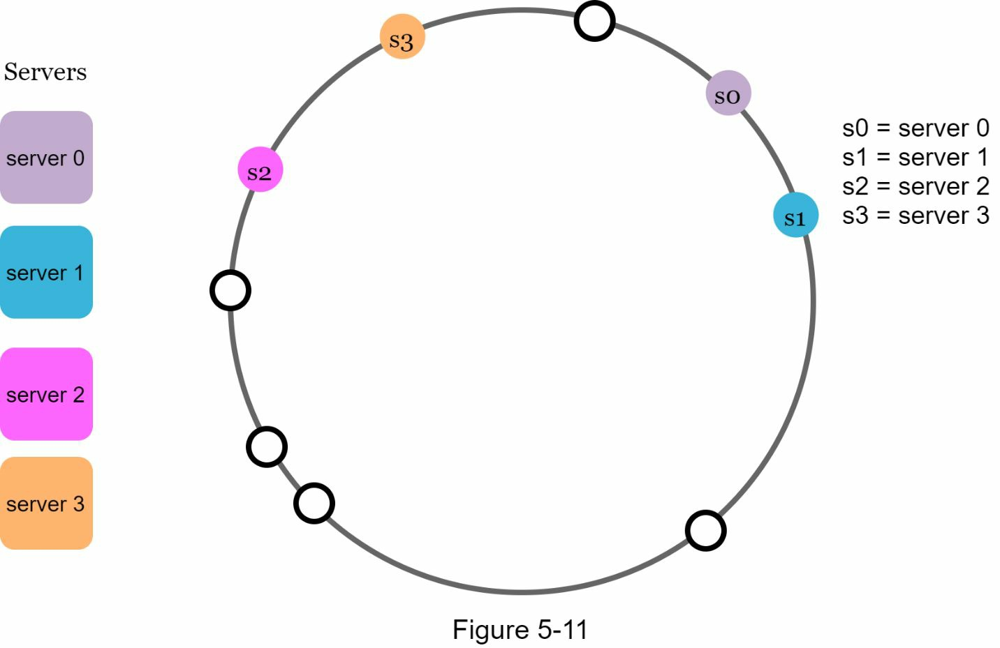

Một kỹ thuật được gọi là **Virtual Nodes** (nút ảo) hoặc **Replicas** (bản sao) được sử dụng để giải quyết các vấn đề này.

---

### Nút ảo (Virtual nodes)

Một nút ảo (*virtual node*) đại diện cho một nút thực (*real node*), và mỗi server được đại diện bởi nhiều nút ảo trên vòng ring. 

Trong Hình 5-12, cả `server 0` và `server 1` đều có 3 nút ảo. Con số 3 được chọn ngẫu nhiên để minh họa; trên thực tế trong các hệ thống production, số lượng nút ảo lớn hơn rất nhiều.

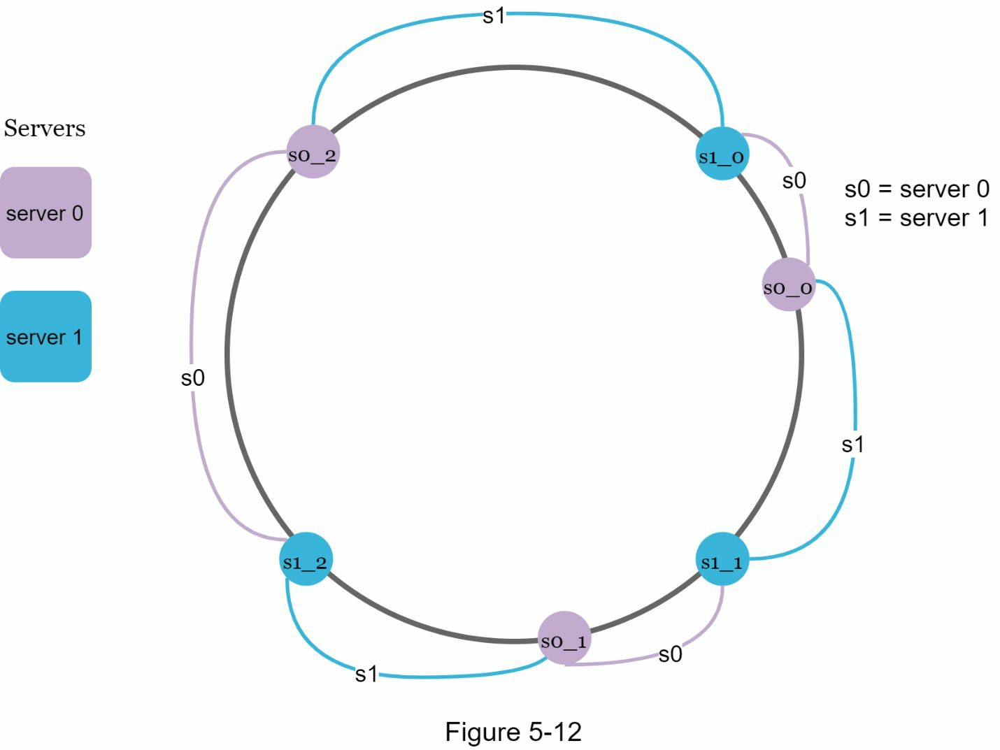

Thay vì chỉ sử dụng `s0`, chúng ta có `s0_0`, `s0_1` và `s0_2` để đại diện cho `server 0` trên vòng ring. Tương tự, `s1_0`, `s1_1` và `s1_2` đại diện cho `server 1` trên vòng ring. 

Với các nút ảo, mỗi server chịu trách nhiệm cho nhiều phân vùng:
* Các phân vùng (cung/cạnh) mang nhãn `s0` được quản lý bởi `server 0`.
* Mặt khác, các phân vùng mang nhãn `s1` được quản lý bởi `server 1`.

Để tìm ra server lưu trữ một key, chúng ta di chuyển theo chiều kim đồng hồ từ vị trí của key và tìm nút ảo đầu tiên bắt gặp trên vòng ring. 

Trong Hình 5-13, để biết `k0` được lưu trữ trên server nào, chúng ta đi theo chiều kim đồng hồ từ vị trí của `k0` và gặp nút ảo `s1_1`, tương ứng trỏ tới `server 1`.

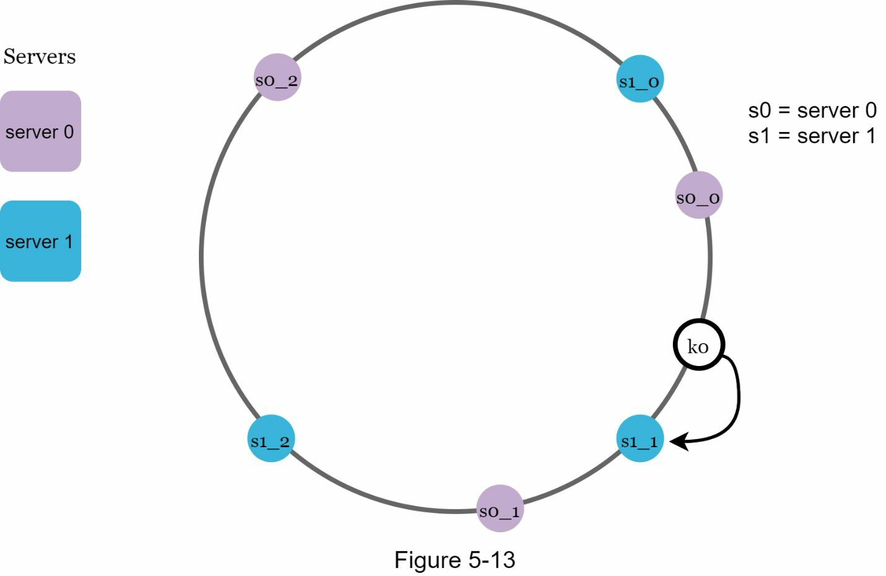

---

### Cân bằng tải và Đánh đổi (Tradeoff)

Khi số lượng nút ảo tăng lên, sự phân phối của các key trở nên cân bằng hơn. Điều này là do độ lệch chuẩn (*standard deviation*) trở nên nhỏ hơn khi có nhiều nút ảo, dẫn đến việc phân phối dữ liệu đồng đều hơn. Độ lệch chuẩn đo lường mức độ phân tán của dữ liệu. 

Kết quả của một thử nghiệm được thực hiện bởi nghiên cứu trực tuyến [2] cho thấy:
* Với 100 nút ảo, độ lệch chuẩn nằm trong khoảng $10\%$ của giá trị trung bình (mean).
* Với 200 nút ảo, độ lệch chuẩn giảm xuống còn khoảng $5\%$ của giá trị trung bình.

Độ lệch chuẩn sẽ nhỏ hơn khi chúng ta tăng số lượng nút ảo. Tuy nhiên, hệ thống sẽ cần nhiều không gian bộ nhớ hơn để lưu trữ dữ liệu về các nút ảo. Đây là một sự đánh đổi (*tradeoff*), và chúng ta có thể tinh chỉnh số lượng nút ảo sao cho phù hợp nhất với các yêu cầu kỹ thuật của hệ thống.

---

### Xác định các Key bị ảnh hưởng (Find affected keys)

Khi một server được thêm vào hoặc xóa bỏ, một phần dữ liệu cần phải được phân phối lại. Làm thế nào để chúng ta xác định được phạm vi bị ảnh hưởng để phân phối lại các key?

Trong Hình 5-14, `server 4` được thêm vào vòng ring. Phạm vi bị ảnh hưởng bắt đầu từ `s4` (nút mới được thêm vào) và di chuyển ngược chiều kim đồng hồ (anticlockwise) quanh vòng ring cho đến khi tìm thấy một server liền kề (`s3`). 

Do đó, các key nằm giữa `s3` và `s4` cần phải được phân phối lại sang `s4`.

---

### Trang 83

Khi một máy chủ ($s1$) bị loại bỏ như minh họa trong **Hình 5-15**, phạm vi bị ảnh hưởng bắt đầu từ $s1$ (node bị xóa) và di chuyển ngược chiều kim đồng hồ quanh vòng băm (ring) cho đến khi gặp một máy chủ ($s0$). Do đó, các khóa (keys) nằm giữa $s0$ và $s1$ bắt buộc phải được tái phân phối lại cho $s2$.

---

### Trang 84

---

### Trang 85

### Tổng kết (Wrap up)

Trong chương này, chúng ta đã thảo luận chuyên sâu về **băm nhất quán (Consistent Hashing)**, bao gồm lý do tại sao nó lại cần thiết và cơ chế hoạt động của nó. Các lợi ích của Consistent Hashing bao gồm:

* **Tối thiểu hóa số lượng khóa bị phân phối lại** khi các máy chủ được thêm vào hoặc loại bỏ.
* **Dễ dàng mở rộng quy mô theo chiều ngang (scale horizontally)** vì dữ liệu được phân phối đồng đều hơn.
* **Giảm thiểu vấn đề điểm nóng truy cập (hotspot key problem).** Việc truy cập quá mức vào một phân vùng (shard) cụ thể có thể gây quá tải máy chủ. Hãy tưởng tượng dữ liệu của Katy Perry, Justin Bieber và Lady Gaga đều nằm trên cùng một shard. Consistent Hashing giúp giảm thiểu vấn đề này bằng cách phân phối dữ liệu đồng đều hơn.

Consistent Hashing được ứng dụng rộng rãi trong các hệ thống thực tế quy mô lớn, bao gồm một số trường hợp nổi bật:

* Thành phần phân vùng dữ liệu (partitioning component) của cơ sở dữ liệu **Amazon Dynamo** [3]
* Cơ chế phân vùng dữ liệu trên toàn cluster trong **Apache Cassandra** [4]
* Ứng dụng trò chuyện trực tuyến **Discord** [5]
* Mạng phân phối nội dung **Akamai CDN** (Content Delivery Network) [6]
* Bộ cân bằng tải mạng phần mềm **Maglev Network Load Balancer** của Google [7]

Xin chúc mừng bạn đã đi được một chặng đường dài đến đây! Hãy tự thưởng cho mình một tràng pháo tay. Bạn đã làm rất tốt!

---

### Trang 86

### Tài liệu tham khảo (Reference materials)

* **[1] Consistent hashing:**  
  https://en.wikipedia.org/wiki/Consistent_hashing
* **[2] Consistent Hashing:**  
  https://tom-e-white.com/2007/11/consistent-hashing.html
* **[3] Dynamo: Amazon’s Highly Available Key-value Store:**  
  https://www.allthingsdistributed.com/files/amazon-dynamo-sosp2007.pdf
* **[4] Cassandra - A Decentralized Structured Storage System:**  
  http://www.cs.cornell.edu/Projects/ladis2009/papers/Lakshman-ladis2009.PDF
* **[5] How Discord Scaled Elixir to 5,000,000 Concurrent Users:**  
  https://blog.discord.com/scaling-elixir-f9b8e1e7c29b
* **[6] CS168: The Modern Algorithmic Toolbox Lecture #1: Introduction and Consistent Hashing:**  
  http://theory.stanford.edu/~tim/s16/l/l1.pdf
* **[7] Maglev: A Fast and Reliable Software Network Load Balancer:**  
  https://static.googleusercontent.com/media/research.google.com/en//pubs/archive/44824.pdf

---

[← Chương trước](chuong-04-thiet-ke-rate-limiter.md) | [Mục lục](README.md) | [Chương tiếp theo →](chuong-06-thiet-ke-key-value-store.md)
