# Chương 06: Thiết kế Kho lưu trữ Key-Value (Design A Key-Value Store)

[← Chương trước](chuong-05-thiet-ke-consistent-hashing.md) | [Mục lục](README.md) | [Chương tiếp theo →](chuong-07-thiet-ke-unique-id-generator-phan-tan.md)

---

# CHƯƠNG 6: THIẾT KẾ MỘT KHO LƯU TRỮ KEY-VALUE (KEY-VALUE STORE)

Kho lưu trữ key-value (**Key-Value Store**), còn được gọi là cơ sở dữ liệu key-value (**Key-Value Database**), là một hệ quản trị cơ sở dữ liệu phi quan hệ (non-relational database). Mỗi định danh duy nhất (unique identifier) được lưu dưới dạng một khóa (**key**) đi kèm với giá trị (**value**) tương ứng của nó. Cặp dữ liệu này được gọi là một cặp “**key-value**”.

Trong một cặp key-value, key bắt buộc phải là duy nhất, và value liên kết với key đó có thể được truy xuất thông qua key. Key có thể là chuỗi văn bản thuần túy (plain text) hoặc các giá trị đã qua băm (hashed values). Vì lý do hiệu năng, một key ngắn sẽ hoạt động tối ưu hơn. Key trông như thế nào? Dưới đây là một vài ví dụ:

- **Key dạng văn bản thuần (Plain text key):** `"last_logged_in_at"`
- **Key dạng băm (Hashed key):** `253DDEC4`

Value trong cặp key-value có thể là chuỗi ký tự (strings), danh sách (lists), đối tượng (objects), v.v. Value thường được xử lý như một đối tượng mờ/không phân tích cấu trúc bên trong (opaque object) trong các kho lưu trữ key-value, chẳng hạn như Amazon Dynamo [1], Memcached [2], Redis [3], v.v.

Dưới đây là một đoạn trích dữ liệu minh họa trong kho lưu trữ key-value:

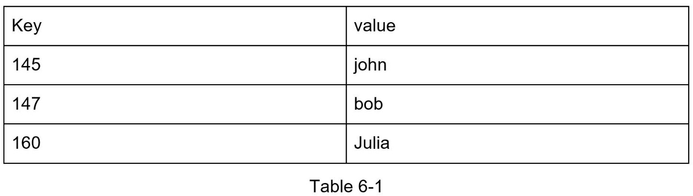

Trong chương này, bạn được yêu cầu thiết kế một kho lưu trữ key-value hỗ trợ các thao tác (operations) sau:
- `put(key, value)` // chèn “value” liên kết với “key”
- `get(key)` // lấy ra “value” liên kết với “key”

---

## Hiểu rõ bài toán và xác định phạm vi thiết kế (Understand the problem and establish design scope)

Không có một thiết kế nào là hoàn hảo tuyệt đối. Mỗi thiết kế đều phải đạt được một sự cân bằng cụ thể liên quan đến các đánh đổi (**trade-offs**) giữa hiệu năng đọc (read), ghi (write), và mức độ sử dụng bộ nhớ (memory usage). Một sự đánh đổi quan trọng khác cần phải thực hiện là giữa tính nhất quán (**consistency**) và tính sẵn sàng (**availability**). Trong chương này, chúng ta sẽ thiết kế một kho lưu trữ key-value bao gồm các đặc điểm sau:

- Kích thước của mỗi cặp key-value là nhỏ: nhỏ hơn 10 KB.
- Khả năng lưu trữ dữ liệu lớn (big data).
- Tính sẵn sàng cao (**High availability**): Hệ thống phản hồi nhanh chóng ngay cả khi xảy ra sự cố lỗi (failures).
- Khả năng mở rộng cao (**High scalability**): Hệ thống có thể mở rộng quy mô để hỗ trợ các tập dữ liệu khổng lồ.
- Tự động mở rộng quy mô (**Automatic scaling**): Việc thêm/bớt các máy chủ phải được thực hiện hoàn toàn tự động dựa trên lưu lượng truy cập (traffic).
- Tính nhất quán có thể tinh chỉnh linh hoạt (**Tunable consistency**).
- Độ trễ thấp (**Low latency**).

---

## Kho lưu trữ Key-Value trên một máy chủ đơn lẻ (Single server key-value store)

Việc phát triển một kho lưu trữ key-value chỉ nằm trên một máy chủ đơn lẻ là tương đối dễ dàng. Một cách tiếp cận trực quan là lưu các cặp key-value vào một bảng băm (**hash table**), giữ toàn bộ dữ liệu trong bộ nhớ (memory). Mặc dù tốc độ truy cập bộ nhớ là rất nhanh, nhưng việc nhồi nhét tất cả dữ liệu vào bộ nhớ có thể là bất khả thi do giới hạn về dung lượng không gian lưu trữ (space constraint). Hai kỹ thuật tối ưu hóa có thể được áp dụng để chứa được nhiều dữ liệu hơn trên một máy chủ đơn lẻ:

- Nén dữ liệu (**Data compression**).
- Chỉ lưu trữ dữ liệu thường xuyên được truy cập (frequently used data) trong bộ nhớ, phần còn lại được lưu trữ trên đĩa cứng (disk).

Ngay cả khi áp dụng các kỹ thuật tối ưu hóa này, một máy chủ đơn lẻ vẫn có thể chạm tới ngưỡng giới hạn dung lượng rất nhanh chóng. Vì vậy, một kho lưu trữ key-value phân tán (**Distributed key-value store**) là bắt buộc để có thể hỗ trợ dữ liệu lớn (big data).

---

## Kho lưu trữ Key-Value phân tán (Distributed key-value store)

Một kho lưu trữ key-value phân tán còn được gọi là bảng băm phân tán (**Distributed Hash Table**), có nhiệm vụ phân phối các cặp key-value trải rộng trên nhiều máy chủ. Khi thiết kế một hệ thống phân tán, việc hiểu rõ định lý **CAP** (**Consistency**, **Availability**, **Partition Tolerance**) là vô cùng quan trọng.

### Định lý CAP (CAP theorem)

Định lý CAP phát biểu rằng: **một hệ thống phân tán không thể đồng thời cung cấp nhiều hơn hai trong ba bảo đảm sau: tính nhất quán (Consistency), tính sẵn sàng (Availability), và khả năng chịu lỗi phân vùng mạng (Partition Tolerance).** Hãy cùng thiết lập một vài định nghĩa cơ bản:

- **Tính nhất quán (Consistency):** Tính nhất quán nghĩa là tất cả các client đều nhìn thấy cùng một dữ liệu tại cùng một thời điểm, bất kể họ kết nối tới node (nút) nào.
- **Tính sẵn sàng (Availability):** Tính sẵn sàng nghĩa là bất kỳ client nào gửi yêu cầu truy xuất dữ liệu đều nhận được phản hồi, ngay cả khi một số node trong hệ thống bị ngừng hoạt động (down).
- **Khả năng chịu lỗi phân vùng mạng (Partition Tolerance):** Phân vùng mạng (partition) ám chỉ sự cố đứt gãy kết nối truyền thông giữa hai node. Khả năng chịu lỗi phân vùng mạng nghĩa là hệ thống vẫn tiếp tục vận hành bình thường bất chấp việc phân vùng mạng xảy ra.

Định lý CAP chỉ ra rằng bắt buộc phải hy sinh một trong ba thuộc tính để hỗ trợ 2 thuộc tính còn lại, như được minh họa trong **Hình 6-1**.

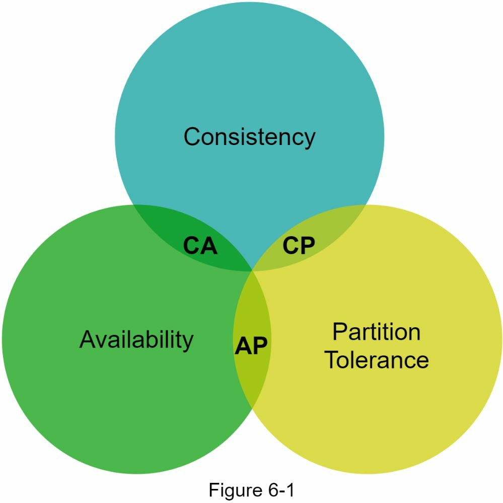

*Hình 6-1: Định lý CAP (CAP Theorem)*

Ngày nay, các kho lưu trữ key-value thường được phân loại dựa trên hai đặc tính CAP mà chúng hỗ trợ:

- **Hệ thống CP (Consistency and Partition Tolerance):** Kho lưu trữ key-value chuẩn CP hỗ trợ tính nhất quán và khả năng chịu lỗi phân vùng mạng, đồng thời chấp nhận hy sinh tính sẵn sàng.
- **Hệ thống AP (Availability and Partition Tolerance):** Kho lưu trữ key-value chuẩn AP hỗ trợ tính sẵn sàng và khả năng chịu lỗi phân vùng mạng, đồng thời chấp nhận hy sinh tính nhất quán.
- **Hệ thống CA (Consistency and Availability):** Kho lưu trữ key-value chuẩn CA hỗ trợ tính nhất quán và tính sẵn sàng, đồng thời chấp nhận hy sinh khả năng chịu lỗi phân vùng mạng. Tuy nhiên, vì sự cố lỗi mạng là điều không thể tránh khỏi trong thực tế, nên một hệ thống phân tán bắt buộc phải có khả năng chịu lỗi phân vùng mạng. Do đó, **một hệ thống CA không thể tồn tại trong các ứng dụng thế giới thực.**

Những nội dung bạn vừa đọc ở trên chủ yếu là phần định nghĩa. Để dễ hiểu hơn, chúng ta hãy cùng xem xét một số ví dụ cụ thể. Trong các hệ thống phân tán, dữ liệu thường được nhân bản (replicated) nhiều lần. Giả sử dữ liệu được nhân bản trên ba node bản sao: $n_1$, $n_2$ và $n_3$ như minh họa trong **Hình 6-2**.

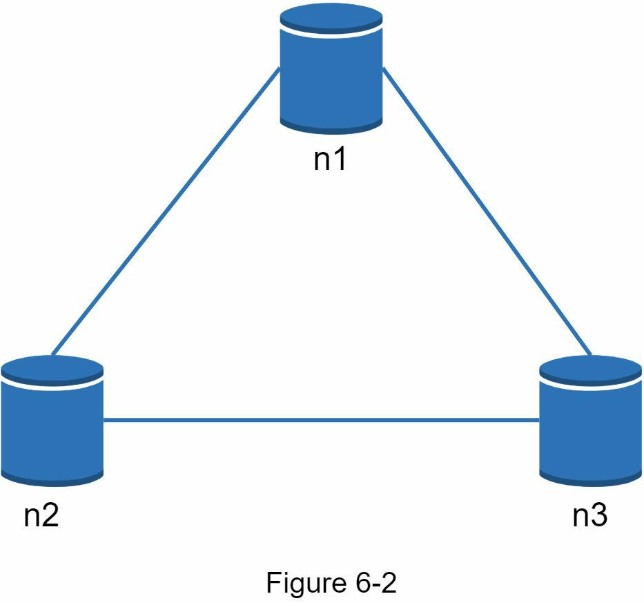

*Hình 6-2: Tình huống lý tưởng (Ideal situation)*

#### Tình huống lý tưởng (Ideal situation)
Trong một thế giới lý tưởng, phân vùng mạng không bao giờ xảy ra. Dữ liệu khi được ghi vào $n_1$ sẽ tự động được nhân bản sang $n_2$ và $n_3$. Cả tính nhất quán (Consistency) và tính sẵn sàng (Availability) đều đạt được một cách hoàn hảo.

#### Các hệ thống phân tán trong thế giới thực (Real-world distributed systems)
Trong một hệ thống phân tán thực tế, hiện tượng phân vùng mạng là không thể tránh khỏi; và khi phân vùng mạng xảy ra, chúng ta bắt buộc phải lựa chọn giữa tính nhất quán hoặc tính sẵn sàng. Trong **Hình 6-3**, node $n_3$ gặp sự cố ngừng hoạt động và không thể giao tiếp với $n_1$ và $n_2$. Nếu các client ghi dữ liệu vào $n_1$ hoặc $n_2$, dữ liệu không thể lan truyền tới $n_3$. Ngược lại, nếu dữ liệu được ghi vào $n_3$ nhưng chưa kịp lan truyền sang $n_1$ và $n_2$, thì $n_1$ và $n_2$ sẽ chứa dữ liệu cũ/lỗi thời (stale data).

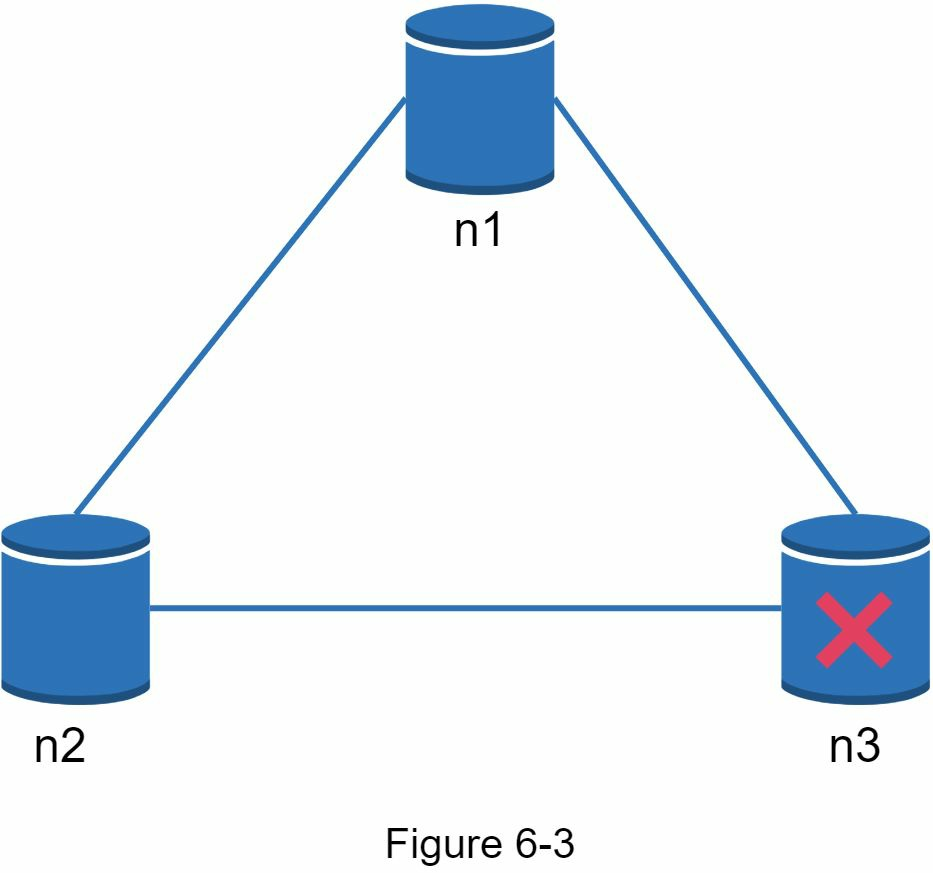

*Hình 6-3: Hệ thống phân tán trong thế giới thực (Real-world distributed systems)*

Nếu chúng ta lựa chọn **tính nhất quán thay vì tính sẵn sàng (hệ thống CP)**, chúng ta buộc phải chặn toàn bộ các thao tác ghi tới $n_1$ và $n_2$ nhằm tránh tình trạng bất đồng bộ dữ liệu giữa ba máy chủ này, điều này làm cho hệ thống mất đi tính sẵn sàng (unavailable). Các hệ thống ngân hàng thường có các yêu cầu cực kỳ khắt khe về tính nhất quán. Ví dụ: đối với một hệ thống ngân hàng, việc hiển thị thông tin số dư tài khoản mới nhất và chính xác nhất là yếu tố sống còn. Nếu tình trạng không nhất quán xảy ra do sự cố phân vùng mạng, hệ thống ngân hàng sẽ lập tức trả về lỗi cho đến khi vấn đề không nhất quán được giải quyết triệt để.

Tuy nhiên, nếu chúng ta lựa chọn **tính sẵn sàng thay vì tính nhất quán (hệ thống AP)**, hệ thống sẽ tiếp tục chấp nhận các yêu cầu đọc, mặc dù nó có thể trả về dữ liệu cũ (stale data). Đối với các yêu cầu ghi, $n_1$ và $n_2$ vẫn sẽ tiếp tục chấp nhận ghi dữ liệu, và dữ liệu sẽ được đồng bộ hóa ngược lại cho $n_3$ ngay khi sự cố phân vùng mạng được khắc phục hoàn toàn.

Việc lựa chọn các bảo đảm CAP phù hợp với từng trường hợp sử dụng cụ thể (use case) là một bước vô cùng quan trọng khi xây dựng một kho lưu trữ key-value phân tán. Bạn có thể thảo luận điều này với người phỏng vấn của mình và tiến hành thiết kế hệ thống tương ứng.

---

## Các thành phần của hệ thống (System components)

Trong phần này, chúng ta sẽ đi sâu thảo luận về các thành phần cốt lõi và các kỹ thuật kỹ thuật then chốt được sử dụng để xây dựng một kho lưu trữ key-value:

- Phân vùng dữ liệu (**Data partition**)
- Nhân bản dữ liệu (**Data replication**)
- Tính nhất quán (**Consistency**)
- Giải quyết xung đột/không nhất quán dữ liệu (**Inconsistency resolution**)
- Xử lý sự cố lỗi (**Handling failures**)
- Sơ đồ kiến trúc hệ thống (**System architecture diagram**)
- Luồng ghi dữ liệu (**Write path**)
- Luồng đọc dữ liệu (**Read path**)

---

Nội dung dưới đây phần lớn dựa trên ba hệ thống lưu trữ khóa - giá trị (Key-Value Store) phổ biến: Dynamo [4], Cassandra [5], và BigTable [6].

### Phân vùng dữ liệu (Data partition)

Đối với các ứng dụng quy mô lớn, việc đặt toàn bộ tập dữ liệu (dataset) vào trong một máy chủ duy nhất là bất khả thi. Cách đơn giản nhất để thực hiện điều này là chia nhỏ dữ liệu thành các phân vùng (partition) nhỏ hơn và lưu trữ chúng trên nhiều máy chủ. Có hai thách thức lớn khi phân vùng dữ liệu:

*   Phân phối dữ liệu đồng đều trên nhiều máy chủ.
*   Tối thiểu hóa sự dịch chuyển dữ liệu khi các node (nút) được thêm vào hoặc loại bỏ.

Kỹ thuật băm nhất quán (Consistent Hashing) đã được thảo luận ở Chương 5 là một giải pháp tuyệt vời để giải quyết các vấn đề này. Hãy cùng điểm lại cách thức hoạt động ở mức tổng quan (high-level) của Consistent Hashing:

*   Đầu tiên, các máy chủ được đặt trên một vòng băm (hash ring). Trong **Hình 6-4**, tám máy chủ được đại diện bởi $s_0, s_1, \dots, s_7$ được đặt trên vòng băm.
*   Tiếp theo, một khóa (key) được băm vào cùng vòng tròn đó, và nó sẽ được lưu trữ trên máy chủ đầu tiên bắt gặp khi di chuyển theo chiều kim đồng hồ. Ví dụ, `key0` được lưu trữ tại $s_1$ theo logic này.

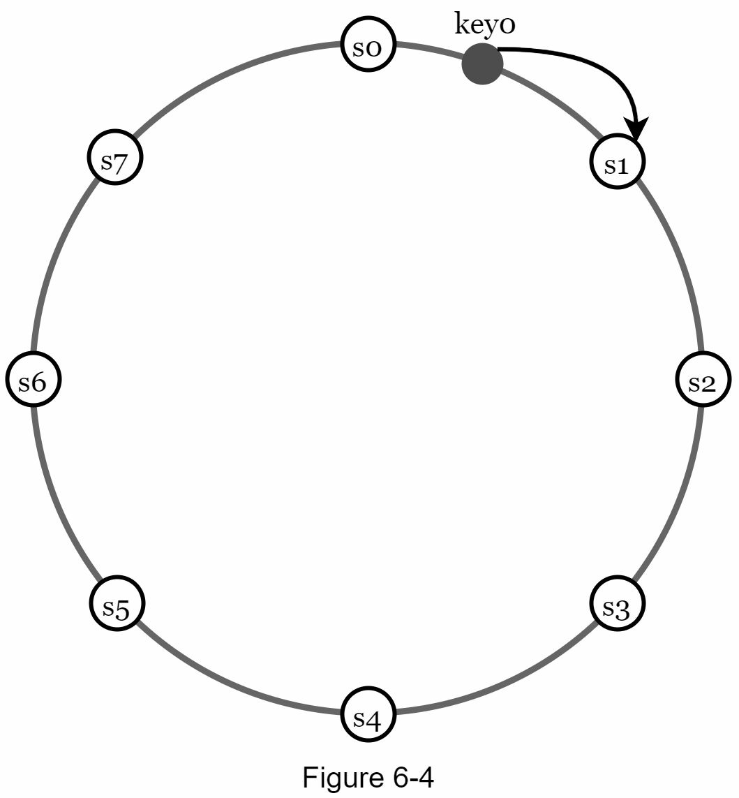
*Hình 6-4: Phân vùng dữ liệu (Data partition)*

Sử dụng Consistent Hashing để phân vùng dữ liệu mang lại những ưu điểm sau:

*   **Tự động mở rộng (Automatic scaling):** Các máy chủ có thể được thêm vào và loại bỏ tự động tùy thuộc vào tải hệ thống (load).
*   **Tính không đồng nhất (Heterogeneity):** Số lượng nút ảo (Virtual Nodes) cho một máy chủ tỷ lệ thuận với năng lực xử lý (capacity) của máy chủ đó. Ví dụ, các máy chủ có năng lực cao hơn sẽ được phân bổ nhiều nút ảo hơn.

---

### Sao chép dữ liệu (Data replication)

Để đạt được tính sẵn sàng cao (High Availability) và độ tin cậy (Reliability), dữ liệu phải được sao chép bất đồng bộ (asynchronously) trên $N$ máy chủ, trong đó $N$ là một tham số có thể cấu hình được. $N$ máy chủ này được chọn theo logic sau: sau khi một khóa (key) được ánh xạ tới một vị trí trên vòng băm, duyệt theo chiều kim đồng hồ từ vị trí đó và chọn ra $N$ máy chủ đầu tiên trên vòng để lưu trữ các bản sao dữ liệu. Trong **Hình 6-5** ($N = 3$), `key0` được nhân bản tại $s_1$, $s_2$ và $s_3$.

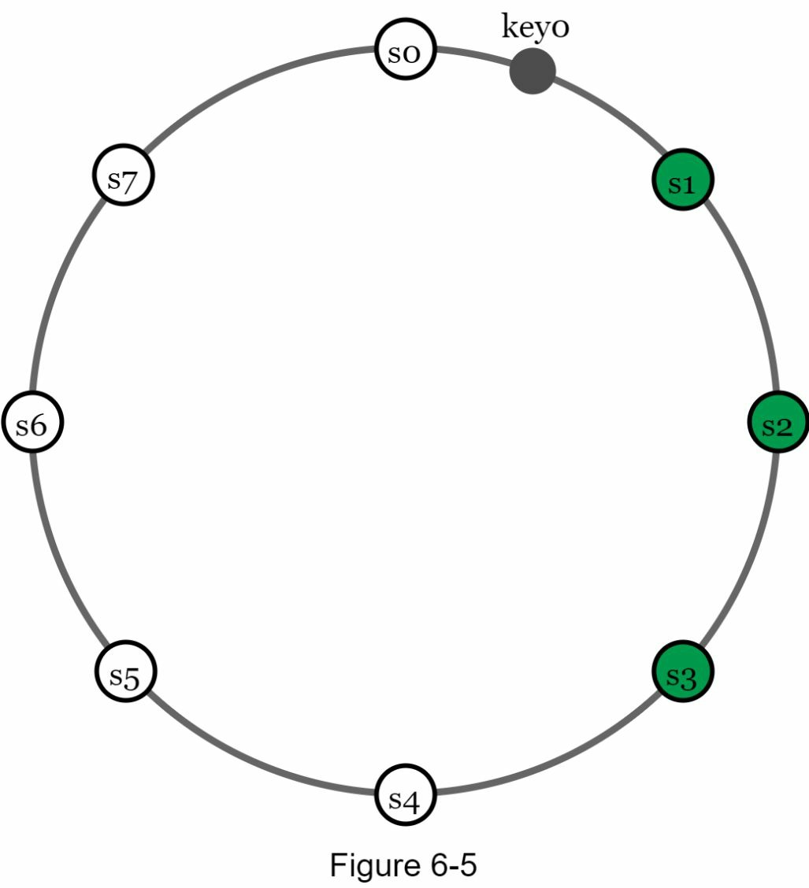
*Hình 6-5: Sao chép dữ liệu (Data replication)*

Với các nút ảo (Virtual Nodes), $N$ nút đầu tiên trên vòng băm có thể chỉ thuộc về số lượng máy chủ vật lý ít hơn $N$. Để tránh vấn đề này, chúng ta chỉ chọn các máy chủ duy nhất (unique servers) khi thực hiện logic duyệt theo chiều kim đồng hồ.

Các nút trong cùng một trung tâm dữ liệu (Data Center) thường có nguy cơ gặp sự cố cùng một lúc do mất điện, sự cố mạng, thiên tai, v.v. Để có độ tin cậy tốt hơn, các bản sao (replicas) được đặt ở các trung tâm dữ liệu riêng biệt, và các trung tâm dữ liệu này được kết nối thông qua mạng tốc độ cao.

---

### Tính nhất quán (Consistency)

Vì dữ liệu được sao chép tại nhiều nút, nó phải được đồng bộ hóa giữa các bản sao. Đồng thuận biểu quyết (Quorum Consensus) có thể đảm bảo tính nhất quán cho cả thao tác đọc (read) và ghi (write). Trước tiên, hãy cùng thiết lập một vài định nghĩa:

*   **$N$** = Số lượng bản sao (The number of replicas).
*   **$W$** = Kích thước biểu quyết ghi (A write quorum of size $W$). Để một thao tác ghi được coi là thành công, thao tác ghi đó phải nhận được xác nhận (acknowledged) từ ít nhất $W$ bản sao.
*   **$R$** = Kích thước biểu quyết đọc (A read quorum of size $R$). Để một thao tác đọc được coi là thành công, thao tác đọc đó phải đợi phản hồi từ ít nhất $R$ bản sao.

Hãy xem xét ví dụ sau đây được thể hiện trong **Hình 6-6** với $N = 3$.

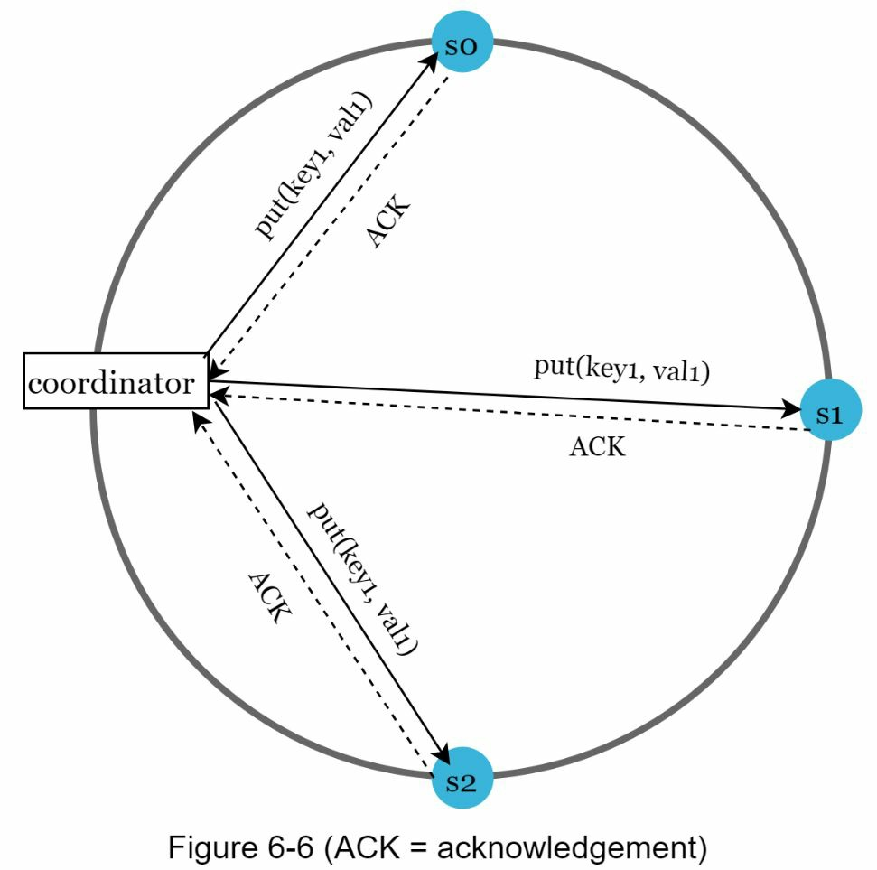
*Hình 6-6: Cơ chế Quorum Consensus*

$W = 1$ không có nghĩa là dữ liệu chỉ được ghi trên một máy chủ. Ví dụ, với cấu hình trong **Hình 6-6**, dữ liệu được sao chép tại $s_0$, $s_1$ và $s_2$. $W = 1$ có nghĩa là điều phối viên (Coordinator) phải nhận được ít nhất một xác nhận trước khi thao tác ghi được coi là thành công. Ví dụ, nếu chúng ta nhận được xác nhận từ $s_1$, chúng ta không cần phải đợi thêm các xác nhận từ $s_0$ và $s_2$ nữa. Một Coordinator đóng vai trò như một proxy giữa client và các nút.

Cấu hình của $W$, $R$ và $N$ là sự đánh đổi (tradeoff) điển hình giữa độ trễ (latency) và tính nhất quán (consistency):
*   Nếu $W = 1$ hoặc $R = 1$, một thao tác được trả về rất nhanh vì Coordinator chỉ cần đợi phản hồi từ bất kỳ một bản sao nào.
*   Nếu $W$ hoặc $R > 1$, hệ thống mang lại tính nhất quán tốt hơn; tuy nhiên, truy vấn sẽ chậm hơn vì Coordinator phải đợi phản hồi từ bản sao chậm nhất.
*   Nếu $W + R > N$, tính nhất quán mạnh (Strong Consistency) được đảm bảo vì chắc chắn phải có ít nhất một nút chồng lấn (overlapping node) chứa dữ liệu mới nhất để đảm bảo tính nhất quán.

---

Làm thế nào để cấu hình $N$, $W$ và $R$ phù hợp với từng trường hợp sử dụng (use cases) của chúng ta? Dưới đây là một số thiết lập khả thi:

*   Nếu $R = 1$ và $W = N$: Hệ thống được tối ưu hóa cho thao tác đọc nhanh (fast read).
*   Nếu $W = 1$ và $R = N$: Hệ thống được tối ưu hóa cho thao tác ghi nhanh (fast write).
*   Nếu $W + R > N$: Đảm bảo tính nhất quán mạnh (Strong Consistency) (Thường là $N = 3, W = R = 2$).
*   Nếu $W + R \le N$: Không đảm bảo tính nhất quán mạnh.

Tùy thuộc vào yêu cầu nghiệp vụ, chúng ta có thể tinh chỉnh các giá trị của $W$, $R$, $N$ để đạt được mức độ nhất quán mong muốn.

#### Các mô hình nhất quán (Consistency models)

Mô hình nhất quán (Consistency model) là một yếu tố quan trọng khác cần cân nhắc khi thiết kế một Key-Value Store. Mô hình nhất quán định nghĩa mức độ nhất quán của dữ liệu, và tồn tại một phổ rộng các mô hình nhất quán khả dĩ:

*   **Tính nhất quán mạnh (Strong consistency):** Bất kỳ thao tác đọc nào cũng trả về giá trị tương ứng với kết quả của mục dữ liệu được ghi mới nhất. Client không bao giờ nhìn thấy dữ liệu lỗi thời (out-of-date).
*   **Tính nhất quán yếu (Weak consistency):** Các thao tác đọc tiếp theo có thể không nhìn thấy giá trị mới nhất vừa được cập nhật.
*   **Tính nhất quán cuối cùng (Eventual consistency):** Đây là một dạng cụ thể của tính nhất quán yếu. Với đủ thời gian, tất cả các cập nhật sẽ được truyền đi (propagated) và tất cả các bản sao sẽ đạt trạng thái nhất quán.

Tính nhất quán mạnh thường đạt được bằng cách buộc một bản sao không chấp nhận các lượt đọc/ghi mới cho đến khi mọi bản sao đã đồng thuận về thao tác ghi hiện tại. Cách tiếp cận này không lý tưởng cho các hệ thống yêu cầu tính sẵn sàng cao (High Availability) vì nó có thể chặn (block) các thao tác mới. Dynamo và Cassandra áp dụng mô hình **Eventual Consistency**, đây cũng là mô hình nhất quán được khuyến nghị cho hệ thống Key-Value Store của chúng ta. Khi có các thao tác ghi đồng thời (concurrent writes), Eventual Consistency cho phép các giá trị không nhất quán đi vào hệ thống và buộc client phải đọc các giá trị đó để thực hiện đối soát/hòa giải (reconciliation). Phần tiếp theo sẽ giải thích cách thức reconciliation hoạt động cùng với cơ chế phiên bản (versioning).

---

### Giải quyết xung đột dữ liệu: Quản lý phiên bản (Inconsistency resolution: versioning)

Cơ chế sao chép (Replication) mang lại tính sẵn sàng cao nhưng lại gây ra tình trạng không nhất quán giữa các bản sao. Quản lý phiên bản (Versioning) và đồng hồ vector (Vector Clock) được sử dụng để giải quyết các vấn đề không nhất quán này. Versioning có nghĩa là xem mỗi lần sửa đổi dữ liệu như một phiên bản bất biến (immutable version) mới của dữ liệu đó. Trước khi nói về versioning, hãy cùng sử dụng một ví dụ để giải thích sự không nhất quán xảy ra như thế nào:

Như thể hiện trong **Hình 6-7**, cả hai nút bản sao $n_1$ và $n_2$ đều có cùng một giá trị. Hãy gọi giá trị này là giá trị ban đầu (original value). Cả Server 1 và Server 2 đều nhận được cùng một giá trị cho thao tác `get("name")`.

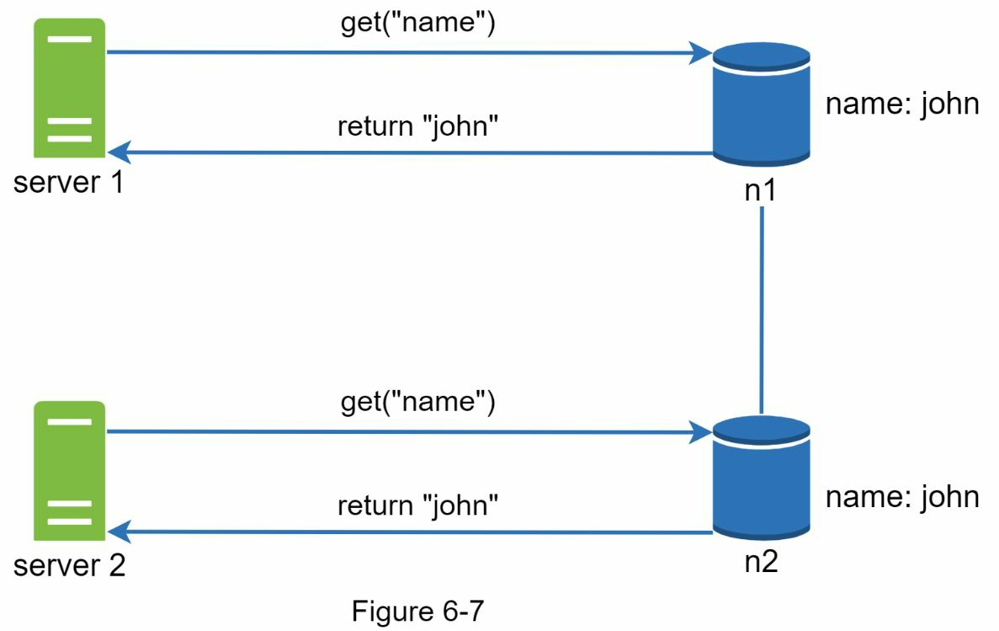
*Hình 6-7: Hai máy chủ đọc cùng giá trị ban đầu*

Tiếp theo, Server 1 thay đổi tên thành “johnSanFrancisco”, và Server 2 thay đổi tên thành “johnNewYork” như thể hiện trong **Hình 6-8**. Hai thay đổi này được thực hiện đồng thời. Giờ đây, chúng ta có các giá trị xung đột nhau, được gọi là phiên bản $v_1$ và $v_2$.

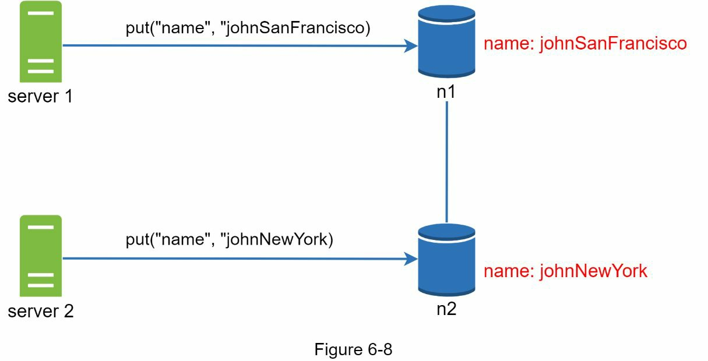
*Hình 6-8: Ghi đồng thời tạo ra xung đột phiên bản*

Trong ví dụ này, giá trị ban đầu có thể được bỏ qua vì các sửa đổi đều dựa trên nó. Tuy nhiên, không có cách nào rõ ràng để tự động giải quyết xung đột giữa hai phiên bản cuối cùng. Để giải quyết vấn đề này, chúng ta cần một hệ thống quản lý phiên bản có khả năng phát hiện xung đột và hòa giải/dung hòa xung đột (reconcile conflicts). **Vector Clock** là một kỹ thuật phổ biến để giải quyết vấn đề này. Hãy cùng kiểm tra cách Vector Clock hoạt động.

---

Một Vector Clock là một cặp `[server, version]` gắn liền với một mục dữ liệu. Nó có thể được sử dụng để kiểm tra xem một phiên bản xảy ra trước (precedes), xảy ra sau (succeeds), hay đang xung đột (in conflict) với các phiên bản khác.

Giả sử một Vector Clock được biểu diễn bằng:
$$D([S_1, v_1], [S_2, v_2], \dots, [S_n, v_n])$$

Trong đó:
*   $D$ là một mục dữ liệu (data item).
*   $v_i$ là một bộ đếm phiên bản (version counter).
*   $S_i$ là mã định danh máy chủ (server number), v.v.

Nếu mục dữ liệu $D$ được ghi vào máy chủ $S_i$, hệ thống phải thực hiện một trong các tác vụ sau:
*   Tăng $v_i$ lên 1 đơn vị nếu tồn tại $[S_i, v_i]$.
*   Nếu chưa có, tạo một mục mới $[S_i, 1]$.

Logic trừu tượng ở trên được giải thích bằng một ví dụ cụ thể như minh họa trong **Hình 6-9**:

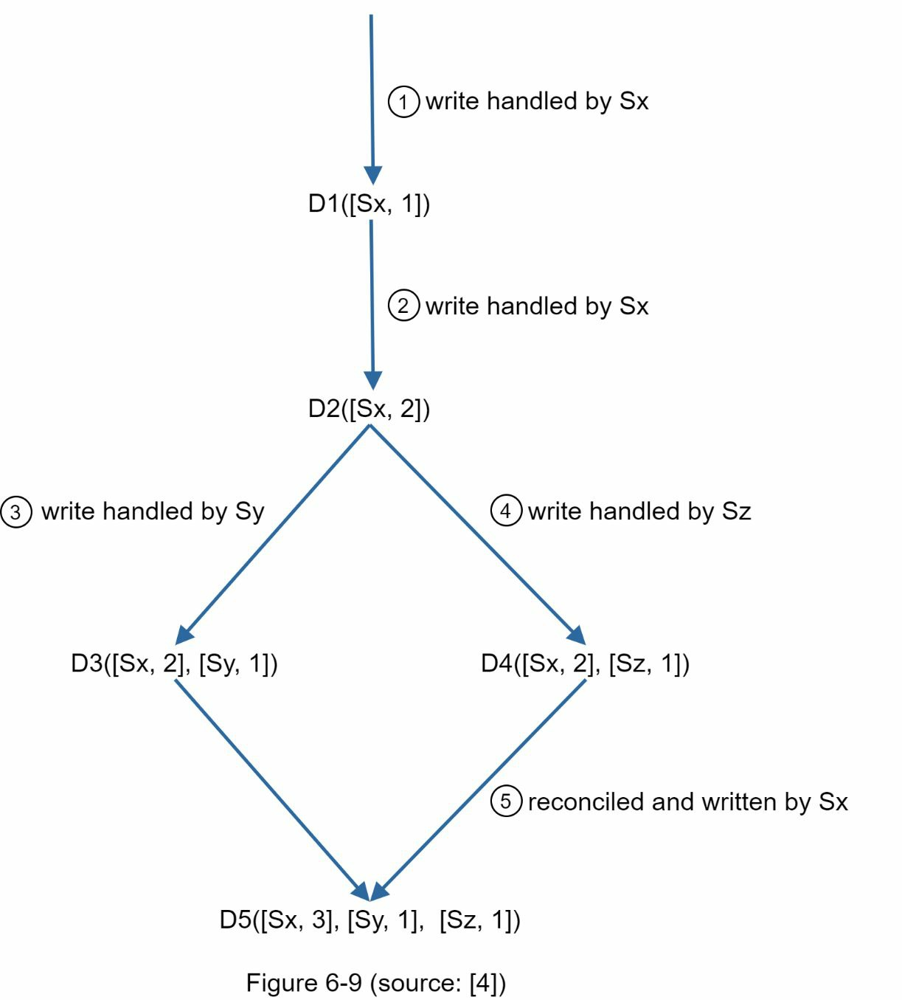
*Hình 6-9: Quy trình quản lý phiên bản với Vector Clock*

1.  Một client ghi mục dữ liệu $D_1$ vào hệ thống, và thao tác ghi được xử lý bởi máy chủ $S_x$, lúc này có Vector Clock là $D_1[(S_x, 1)]$.
2.  Một client khác đọc $D_1$ mới nhất, cập nhật nó thành $D_2$, và ghi ngược lại vào hệ thống. $D_2$ kế thừa từ $D_1$ nên nó sẽ ghi đè lên $D_1$. Giả sử thao tác ghi này được xử lý bởi cùng máy chủ $S_x$, lúc này có Vector Clock là $D_2([S_x, 2])$.
3.  Một client khác đọc $D_2$ mới nhất, cập nhật nó thành $D_3$, và ghi ngược lại. Giả sử thao tác ghi này được xử lý bởi máy chủ $S_y$, lúc này có Vector Clock là $D_3([S_x, 2], [S_y, 1])$.
4.  Một client khác đọc $D_2$ mới nhất, cập nhật nó thành $D_4$, và ghi ngược lại. Giả sử thao tác ghi...

---

được xử lý bởi server $S_z$, lúc này $S_z$ lưu giữ $D_4([S_x, 2], [S_z, 1])$.

5. Khi một client khác đọc $D_3$ và $D_4$, nó phát hiện ra xung đột (conflict). Xung đột này xảy ra do mục dữ liệu $D_2$ đã bị chỉnh sửa đồng thời bởi cả $S_y$ và $S_z$. Xung đột này được giải quyết bởi client và dữ liệu sau khi cập nhật được gửi trở lại server. Giả sử thao tác ghi này được xử lý bởi $S_x$, lúc này $S_x$ sẽ lưu giữ $D_5([S_x, 3], [S_y, 1], [S_z, 1])$. Chúng ta sẽ giải thích cách phát hiện xung đột ngay dưới đây.

Sử dụng **Vector Clock**, rất dễ để xác định một phiên bản $X$ có phải là tổ tiên (ancestor - tức không có xung đột) của phiên bản $Y$ hay không: nếu các bộ đếm phiên bản (version counters) cho từng bên tham gia trong vector clock của $Y$ đều lớn hơn hoặc bằng các bộ đếm tương ứng trong phiên bản $X$. Ví dụ: vector clock $D([s_0, 1], [s_1, 1])$ là tổ tiên của $D([s_0, 1], [s_1, 2])$. Do đó, không có xung đột nào được ghi nhận.

Tương tự, bạn có thể biết một phiên bản $X$ là phiên bản ngang hàng / nhánh song song (sibling - tức tồn tại xung đột) với $Y$ nếu có bất kỳ bên tham gia nào trong vector clock của $Y$ có bộ đếm nhỏ hơn bộ đếm tương ứng của nó trong $X$. Ví dụ, hai vector clock sau biểu thị sự tồn tại của xung đột: $D([s_0, 1], [s_1, 2])$ và $D([s_0, 2], [s_1, 1])$.

Mặc dù vector clock có thể giải quyết các xung đột, nhưng có hai nhược điểm đáng lưu ý:
1. **Thứ nhất**, vector clock làm tăng độ phức tạp cho phía client vì client cần phải tự triển khai logic giải quyết xung đột (conflict resolution logic).
2. **Thứ hai**, các cặp `[server: version]` trong vector clock có thể tăng trưởng rất nhanh. Để khắc phục vấn đề này, chúng ta đặt ra một ngưỡng giới hạn độ dài (threshold), và nếu vượt quá giới hạn, các cặp cũ nhất sẽ bị loại bỏ. Điều này có thể dẫn đến việc đối soát / dung hòa dữ liệu (reconciliation) kém hiệu quả vì mối quan hệ hậu duệ (descendant relationship) không thể xác định một cách chính xác tuyệt đối. Tuy nhiên, theo bài báo khoa học về Dynamo [4], Amazon vẫn chưa gặp phải vấn đề này trong môi trường production; do đó, đây có thể là một giải pháp chấp nhận được đối với hầu hết các công ty.

---

### Xử lý sự cố (Handling failures)

Như đối với bất kỳ hệ thống quy mô lớn (large system at scale) nào, sự cố không chỉ là điều không thể tránh khỏi mà còn diễn ra thường xuyên. Việc xử lý các kịch bản sự cố là vô cùng quan trọng. Trong phần này, trước tiên chúng tôi giới thiệu các kỹ thuật phát hiện sự cố (failure detection). Sau đó, chúng tôi sẽ điểm qua các chiến lược xử lý sự cố phổ biến.

#### Phát hiện sự cố (Failure detection)

Trong một hệ thống phân tán (distributed system), việc chỉ dựa vào lời của một server khẳng định rằng một server khác bị sập (down) là chưa đủ. Thông thường, cần có ít nhất hai nguồn thông tin độc lập để đánh dấu một server là bị down.

Như được minh họa trong **Hình 6-10**, phương pháp gửi đa hướng toàn thể (all-to-all multicasting) là một giải pháp trực diện. Tuy nhiên, giải pháp này không hiệu quả khi có nhiều server trong hệ thống.

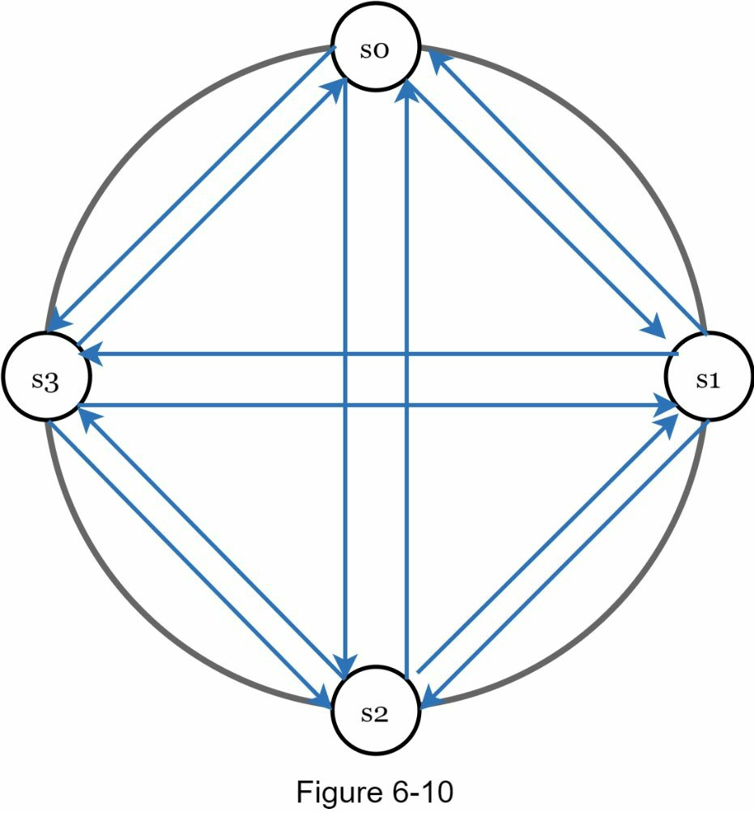
*Hình 6-10: All-to-all multicasting*

Một giải pháp tốt hơn là sử dụng các phương pháp phát hiện sự cố phi tập trung (decentralized failure detection) như **Gossip Protocol**.

Gossip Protocol hoạt động như sau:
* Mỗi node duy trì một danh sách thành viên (node membership list), bao gồm ID thành viên (member IDs) và bộ đếm nhịp tim (heartbeat counters).
* Mỗi node định kỳ tăng bộ đếm nhịp tim của chính mình.
* Mỗi node định kỳ gửi nhịp tim (heartbeats) tới một tập hợp các node ngẫu nhiên, các node này sau đó lại tiếp tục lan truyền tới một tập hợp các node khác.
* Ngay khi các node nhận được heartbeats, danh sách thành viên sẽ được cập nhật thông tin mới nhất.
* Nếu heartbeat của một thành viên không tăng trong khoảng thời gian vượt quá ngưỡng xác định trước (predefined periods), thành viên đó được coi là offline.

Như được minh họa trong **Hình 6-11**:

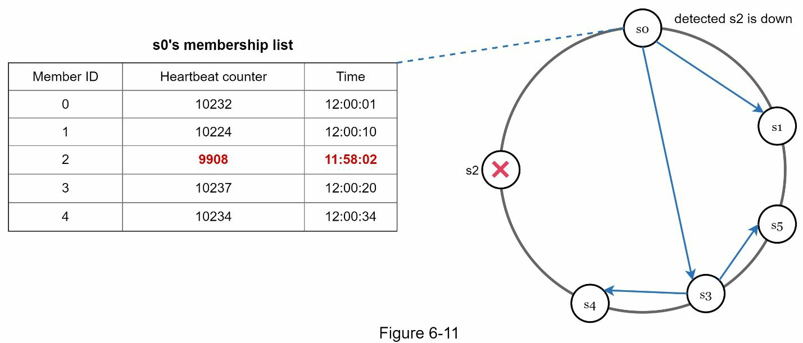
*Hình 6-11: Cơ chế hoạt động của Gossip Protocol*

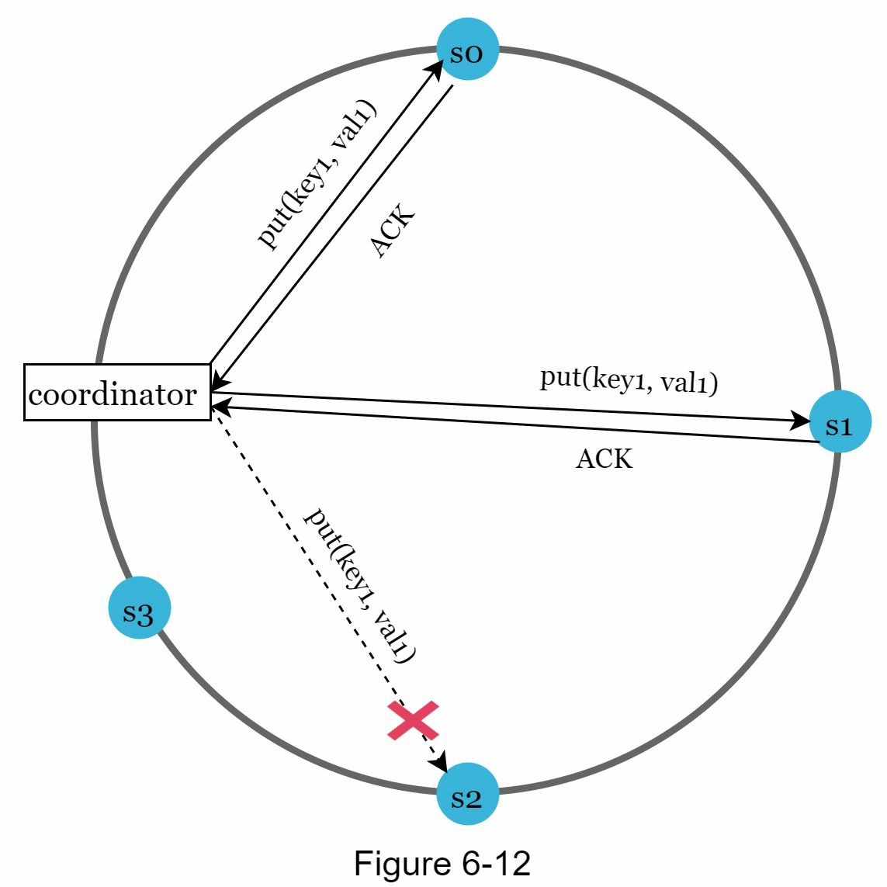

* Node $s_0$ duy trì một danh sách thành viên của node được hiển thị ở phía bên trái.
* Node $s_0$ nhận thấy rằng bộ đếm nhịp tim của node $s_2$ (member ID = 2) đã không tăng trong một khoảng thời gian dài.
* Node $s_0$ gửi các nhịp tim có bao gồm thông tin của $s_2$ tới một tập hợp các node ngẫu nhiên. Khi các node khác xác nhận rằng bộ đếm nhịp tim của $s_2$ đã lâu không được cập nhật, node $s_2$ sẽ được đánh dấu là down (ngừng hoạt động), và thông tin này được lan truyền rộng rãi tới các node khác.

---

#### Xử lý sự cố tạm thời (Handling temporary failures)

Sau khi các sự cố được phát hiện thông qua Gossip Protocol, hệ thống cần triển khai các cơ chế nhất định để đảm bảo tính sẵn sàng (availability). Trong phương pháp quorum nghiêm ngặt (strict quorum), các thao tác đọc và ghi có thể bị chặn (blocked) như đã được mô tả trong phần đồng thuận số đông (quorum consensus).

Một kỹ thuật có tên là **"Sloppy Quorum"** [4] được sử dụng để cải thiện tính sẵn sàng. Thay vì thực thi nghiêm ngặt yêu cầu quorum, hệ thống chọn $W$ server khỏe mạnh đầu tiên cho các thao tác ghi và $R$ server khỏe mạnh đầu tiên cho các thao tác đọc trên vòng băm (**Hash Ring**). Các server đang offline sẽ bị bỏ qua.

Nếu một server không khả dụng do sự cố mạng hoặc lỗi phần cứng server, một server khác sẽ tạm thời xử lý các yêu cầu thay thế. Khi server bị down hoạt động trở lại, các thay đổi sẽ được đẩy ngược trở lại để đạt được tính nhất quán dữ liệu (data consistency). Quy trình này được gọi là **Hinted Handoff**. Vì $s_2$ không khả dụng trong **Hình 6-12**, các thao tác đọc và ghi sẽ tạm thời được xử lý bởi $s_3$. Khi $s_2$ trực tuyến (online) trở lại, $s_3$ sẽ bàn giao dữ liệu trả lại cho $s_2$.

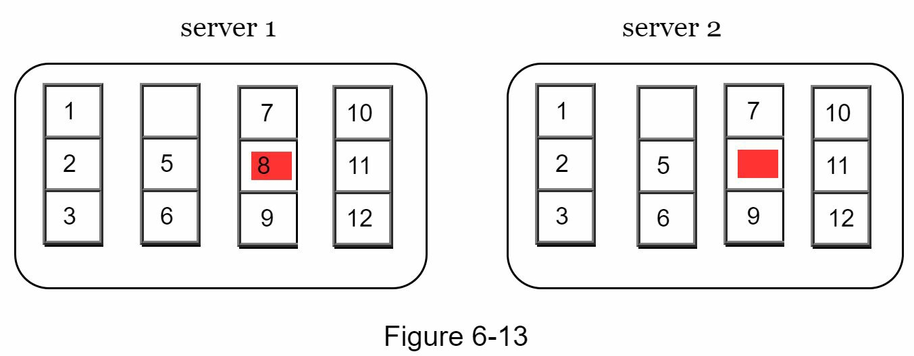
*Hình 6-12: Hinted Handoff xử lý sự cố tạm thời*

---

#### Xử lý sự cố vĩnh viễn (Handling permanent failures)

Hinted handoff được dùng để xử lý các sự cố tạm thời. Vậy điều gì sẽ xảy ra nếu một bản sao (replica) bị mất khả năng hoạt động vĩnh viễn? Để xử lý tình huống như vậy, chúng tôi triển khai giao thức chống suy giảm tính toàn vẹn (**Anti-entropy Protocol**) để giữ cho các bản sao luôn đồng bộ. Anti-entropy bao gồm việc so sánh từng phần dữ liệu trên các bản sao và cập nhật từng bản sao lên phiên bản mới nhất. Một **Merkle Tree** được sử dụng để phát hiện sự không nhất quán và giảm thiểu tối đa lượng dữ liệu cần truyền tải.

Trích dẫn từ Wikipedia [7]: *"Cây băm hay cây Merkle (Hash tree / Merkle tree) là một cây trong đó mỗi node không phải lá (non-leaf node) được gán nhãn bằng mã băm (hash) của các nhãn hoặc giá trị (trong trường hợp node lá) của các node con của nó. Cây băm cho phép xác minh nội dung của các cấu trúc dữ liệu lớn một cách hiệu quả và an toàn."*

Giả sử không gian khóa (key space) có giá trị từ 1 đến 12, các bước sau đây minh họa cách xây dựng một Merkle tree. Các ô được tô nổi bật biểu thị sự không nhất quán (inconsistency).

* **Bước 1**: Chia không gian khóa thành các bucket (4 bucket trong ví dụ của chúng ta) như minh họa trong **Hình 6-13**. Một bucket được sử dụng làm node cấp gốc để duy trì độ sâu giới hạn của cây.

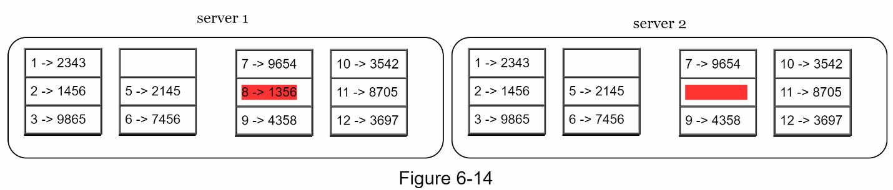
*Hình 6-13: Chia không gian khóa vào các bucket*

* **Bước 2**: Sau khi các bucket được tạo, băm từng khóa trong một bucket bằng phương pháp băm đồng nhất (uniform hashing method) (**Hình 6-14**).

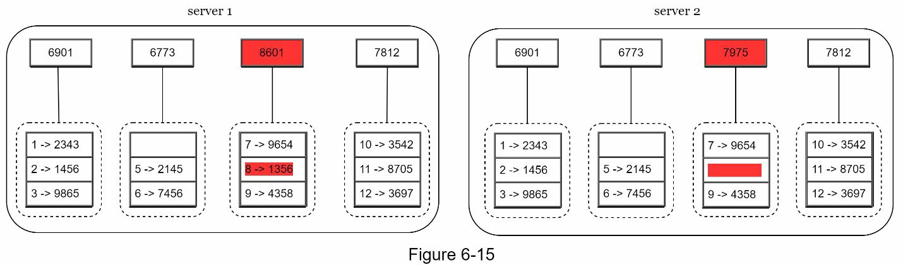
*Hình 6-14: Băm các khóa trong bucket*

* **Bước 3**: Tạo một node băm duy nhất cho mỗi bucket (**Hình 6-15**).

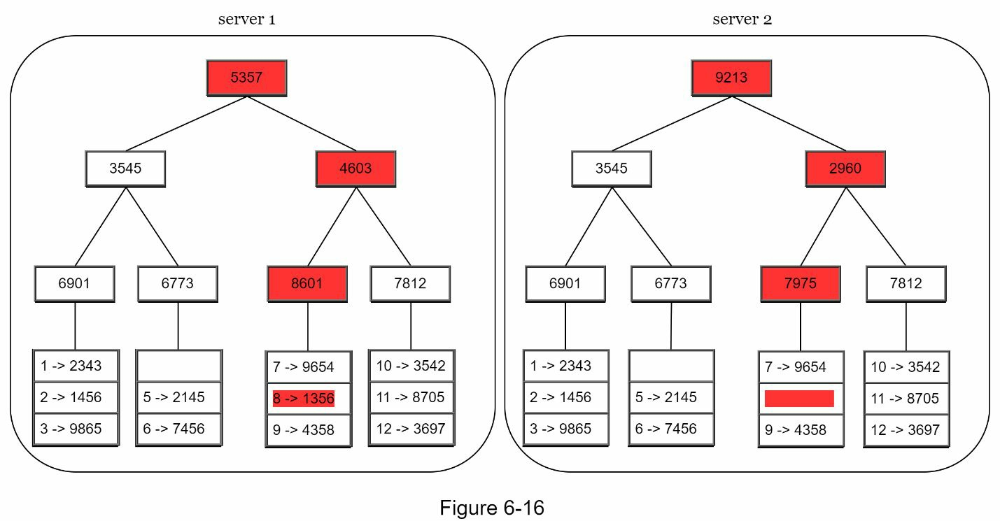
*Hình 6-15: Node băm đại diện cho mỗi bucket*

* **Bước 4**: Xây dựng cây ngược lên trên cho đến node gốc (root) bằng cách tính toán giá trị băm từ các node con (**Hình 6-16**).

---

Để so sánh hai Merkle tree, hãy bắt đầu bằng việc so sánh giá trị băm tại gốc (root hashes). Nếu các root hash trùng khớp, cả hai server đều có dữ liệu giống hệt nhau. Nếu các root hash khác nhau, tiếp tục so sánh giá trị băm của các node con bên trái, sau đó đến các node con bên phải. Bạn có thể duyệt cây để tìm ra chính xác những bucket nào không được đồng bộ hóa và chỉ tiến hành đồng bộ hóa duy nhất các bucket đó.

Bằng cách sử dụng Merkle tree, lượng dữ liệu cần đồng bộ hóa sẽ tỷ lệ thuận với những điểm khác biệt giữa hai bản sao, chứ không phụ thuộc vào tổng lượng dữ liệu mà chúng đang chứa. Trong các hệ thống thực tế, kích thước bucket là khá lớn. Chẳng hạn, một cấu hình khả thi là 1 triệu bucket cho 1 tỷ khóa, như vậy mỗi bucket sẽ chỉ chứa 1.000 khóa.

---

#### Xử lý sự cố mất trung tâm dữ liệu (Handling data center outage)

Sự cố ngừng hoạt động của trung tâm dữ liệu (data center outage) có thể xảy ra do mất điện, mất kết nối mạng diện rộng, thiên tai, v.v. Để xây dựng một hệ thống có khả năng chống chịu sự cố mất trung tâm dữ liệu, việc sao chép dữ liệu đa trung tâm dữ liệu (**Cross-datacenter Replication**) là vô cùng quan trọng. Ngay cả khi một trung tâm dữ liệu ngoại tuyến hoàn toàn, người dùng vẫn có thể tiếp tục truy cập dữ liệu thông qua các trung tâm dữ liệu khác.

---

### Sơ đồ kiến trúc hệ thống (System architecture diagram)

Sau khi đã thảo luận về các khía cạnh kỹ thuật khác nhau trong việc thiết kế một kho lưu trữ khóa-giá trị (**Key-Value Store**), bây giờ chúng ta có thể chuyển trọng tâm sang sơ đồ kiến trúc tổng thể, được thể hiện trong **Hình 6-17**.

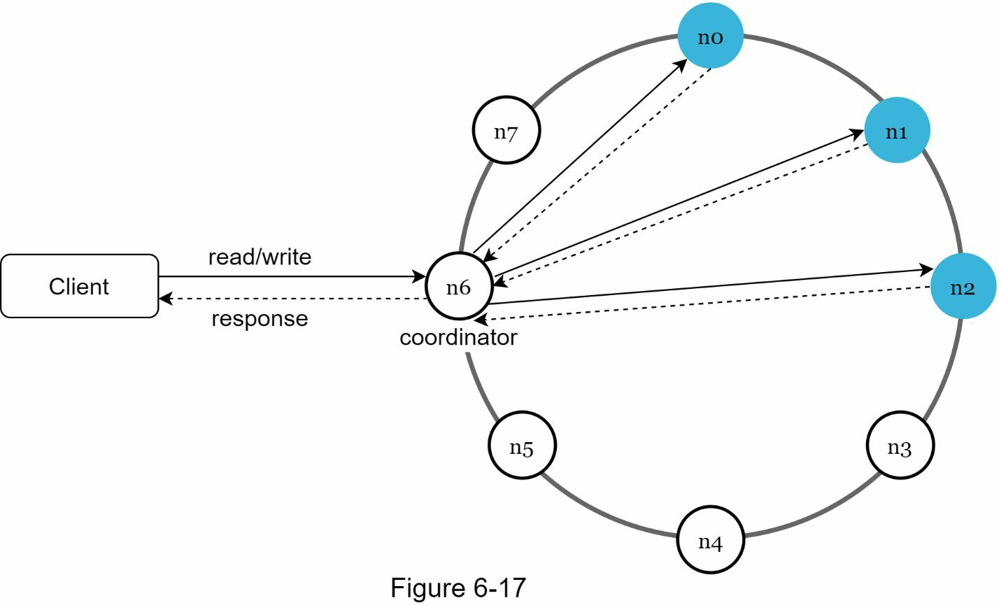
*Hình 6-17: Kiến trúc tổng quan của Key-Value Store*

Các đặc điểm chính của kiến trúc được liệt kê như sau:
* **Client** giao tiếp với kho lưu trữ khóa-giá trị thông qua các API đơn giản: `get(key)` và `put(key, value)`.
* Một **Coordinator** (node điều phối) là một node đóng vai trò như một proxy trung gian giữa client và kho lưu trữ khóa-giá trị.
* Các **Node** được phân bổ trên một vòng băm bằng kỹ thuật băm nhất quán (**Consistent Hashing**).
* Hệ thống hoàn toàn phi tập trung (**Decentralized**), do đó việc thêm mới hoặc di chuyển các node có thể diễn ra tự động.
* Dữ liệu được sao chép dự phòng tại nhiều node khác nhau.
* Không có điểm nghẽn chịu lỗi đơn độc (**No Single Point of Failure - SPOF**) vì tất cả các node đều gánh vác tập hợp các trách nhiệm giống hệt nhau.

Vì thiết kế mang tính phi tập trung, mỗi node sẽ thực hiện rất nhiều nhiệm vụ như được trình bày trong **Hình 6-18**.

---

### Tuyến ghi dữ liệu (Write path)

**Hình 6-19** giải thích những gì diễn ra sau khi một yêu cầu ghi (write request) được định tuyến đến một node cụ thể. Lưu ý rằng thiết kế được đề xuất cho các tuyến ghi/đọc (write/read paths) này chủ yếu dựa trên kiến trúc của Apache Cassandra [8].

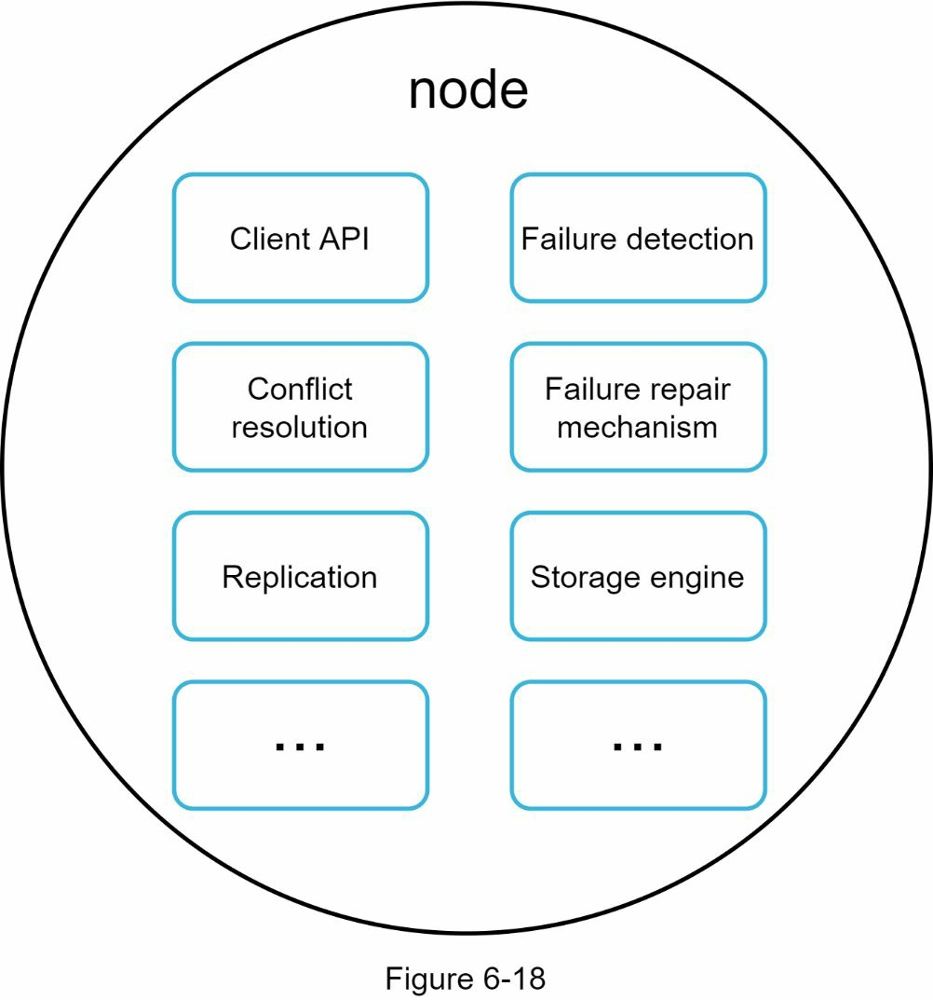
*Hình 6-19: Tuyến ghi dữ liệu (Write path)*

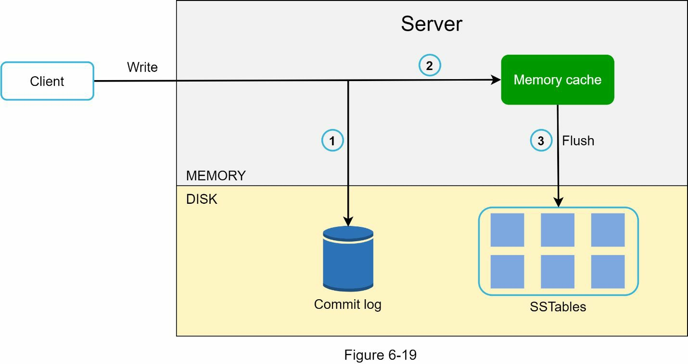

1. Yêu cầu ghi được lưu bền vững (persisted) vào một tệp nhật ký cam kết (**commit log file**).
2. Dữ liệu được lưu vào bộ nhớ đệm trên RAM (**memory cache** / Memtable).
3. Khi bộ nhớ đệm đầy hoặc đạt đến một ngưỡng định trước (predefined threshold), dữ liệu sẽ được đẩy (flush) xuống **SSTable** [9] trên đĩa cứng (disk). 
   > **Lưu ý:** Bảng chuỗi có thứ tự (**SSTable - Sorted-String Table**) là một danh sách có thứ tự gồm các cặp `<key, value>`. Dành cho bạn đọc quan tâm tìm hiểu sâu hơn về SSTable, vui lòng tham khảo tài liệu tham khảo [9].

---

### Tuyến đọc dữ liệu (Read path)

Sau khi một yêu cầu đọc (read request) được chuyển tiếp đến một node cụ thể, trước tiên nó sẽ kiểm tra xem dữ liệu có nằm trong bộ nhớ đệm (memory cache) hay không. Nếu có, dữ liệu sẽ được trả ngay về cho client như minh họa trong **Hình 6-20**.

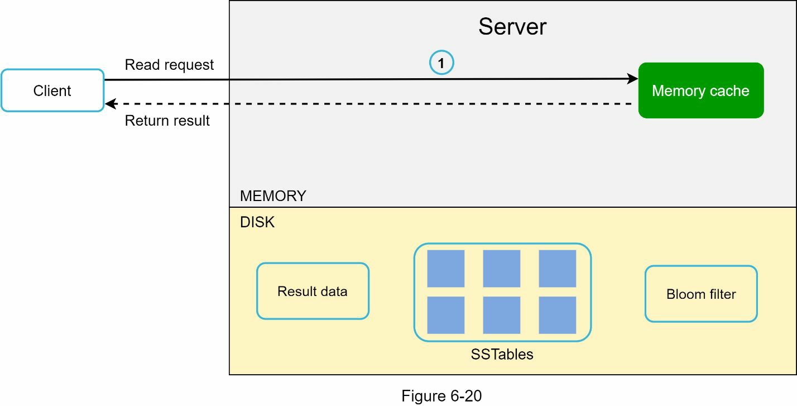
*Hình 6-20: Dữ liệu có sẵn trong bộ nhớ đệm*

Nếu dữ liệu không có trong bộ nhớ, nó sẽ được truy xuất từ đĩa cứng. Chúng ta cần một phương pháp hiệu quả để tìm ra SSTable nào đang chứa khóa (key) cần đọc. Bộ lọc Bloom (**Bloom filter**) [10] là giải pháp phổ biến được sử dụng để giải quyết bài toán này.

Tuyến đọc dữ liệu khi dữ liệu không có trong bộ nhớ được mô tả trong **Hình 6-21**.

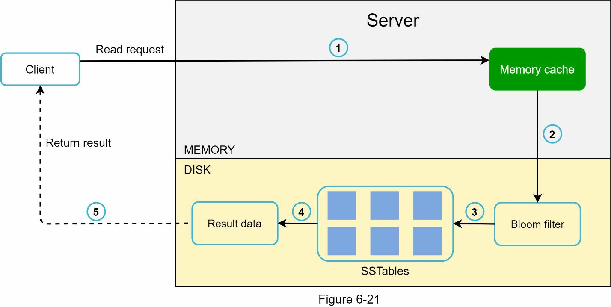
*Hình 6-21: Tuyến đọc dữ liệu khi dữ liệu không có trong bộ nhớ*

1. Hệ thống trước tiên kiểm tra xem dữ liệu có trong bộ nhớ hay không. Nếu không, chuyển sang bước 2.
2. Nếu dữ liệu không có trong bộ nhớ, hệ thống sẽ kiểm tra bộ lọc Bloom (**Bloom filter**).
3. Bộ lọc Bloom được sử dụng để xác định những SSTable nào có thể chứa khóa cần tìm.
4. Các SSTable tương ứng sẽ trích xuất và trả về tập dữ liệu kết quả.
5. Kết quả của tập dữ liệu được trả về cho client.

---

### Tổng kết (Summary)

Chương này đã bao quát nhiều khái niệm và kỹ thuật quan trọng. Nhằm giúp bạn hệ thống và củng cố lại kiến thức, bảng dưới đây sẽ tổng kết các tính năng cùng những kỹ thuật tương ứng được sử dụng cho một hệ thống lưu trữ khóa - giá trị phân tán (**distributed key-value store**).

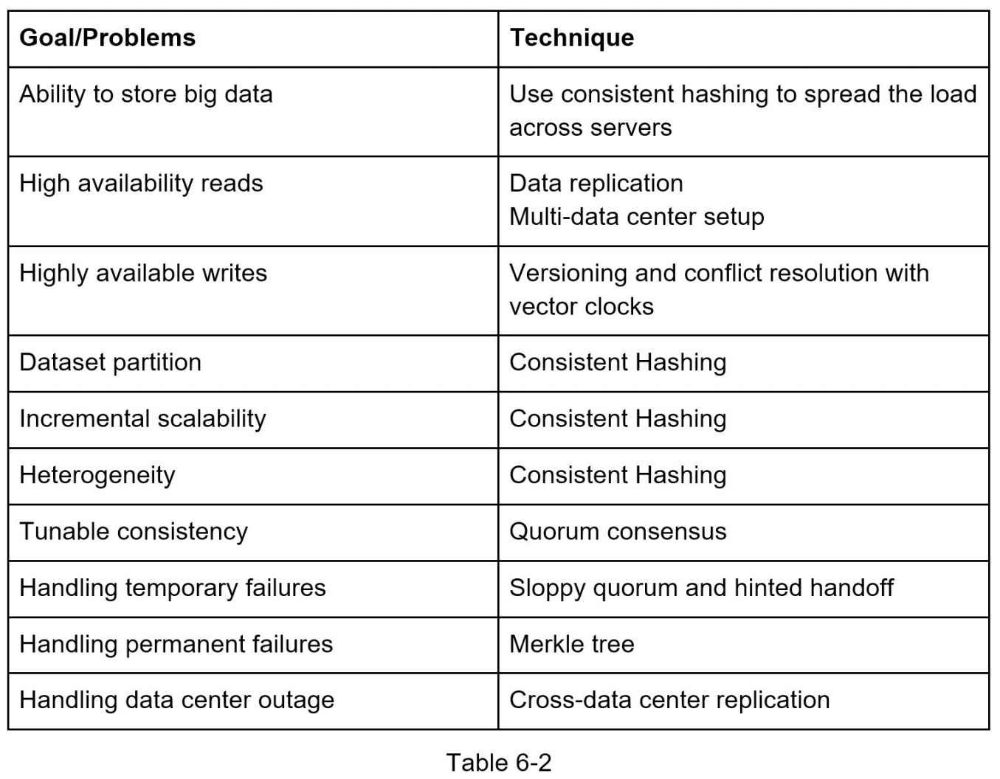

| Mục tiêu / Tính năng (Feature) | Kỹ thuật giải quyết (Technique) |
| :--- | :--- |
| **Phân vùng dữ liệu (Data partition)** | Băm nhất quán (**Consistent Hashing**) kết hợp các Node ảo (**Virtual Nodes**) |
| **Độ sẵn sàng cao cho việc đọc (Data Read High Availability)** | Sao chép dữ liệu (**Replication**) đa trung tâm dữ liệu |
| **Độ sẵn sàng cao cho việc ghi (Data Write High Availability)** | Đánh dấu phiên bản bằng Đồng hồ Vector (**Vector Clocks**) |
| **Giải quyết xung đột (Conflict resolution)** | Đồng hồ Vector (**Vector Clocks**) |
| **Phát hiện lỗi node (Failure detection)** | Giao thức đồn thổi (**Gossip Protocol**) |
| **Khắc phục lỗi tạm thời (Handling temporary failures)** | Hỗ trợ ghi tạm thời (**Sloppy Quorum**) & Gợi ý chuyển tiếp (**Hinted Handoff**) |
| **Khắc phục lỗi vĩnh viễn (Handling permanent failures)** | Cây Merkle (**Merkle Tree**) để đồng bộ hóa dữ liệu chống phân kỳ |
| **Khắc phục sự cố ngừng hoạt động trung tâm dữ liệu (Data center outage)** | Sao chép đa trung tâm dữ liệu (**Multi-datacenter replication**) |

---

### Tài liệu tham khảo (Reference materials)

* [1] **Amazon DynamoDB**: https://aws.amazon.com/dynamodb/
* [2] **memcached**: https://memcached.org/
* [3] **Redis**: https://redis.io/
* [4] **Dynamo: Amazon’s Highly Available Key-value Store**:  
  https://www.allthingsdistributed.com/files/amazon-dynamo-sosp2007.pdf
* [5] **Cassandra**: https://cassandra.apache.org/
* [6] **Bigtable: A Distributed Storage System for Structured Data**:  
  https://static.googleusercontent.com/media/research.google.com/en//archive/bigtable-osdi06.pdf
* [7] **Merkle tree**: https://en.wikipedia.org/wiki/Merkle_tree
* [8] **Cassandra architecture**: https://cassandra.apache.org/doc/latest/architecture/
* [9] **SStable**: https://www.igvita.com/2012/02/06/sstable-and-log-structured-storage-leveldb/
* [10] **Bloom filter**: https://en.wikipedia.org/wiki/Bloom_filter

---

[← Chương trước](chuong-05-thiet-ke-consistent-hashing.md) | [Mục lục](README.md) | [Chương tiếp theo →](chuong-07-thiet-ke-unique-id-generator-phan-tan.md)
