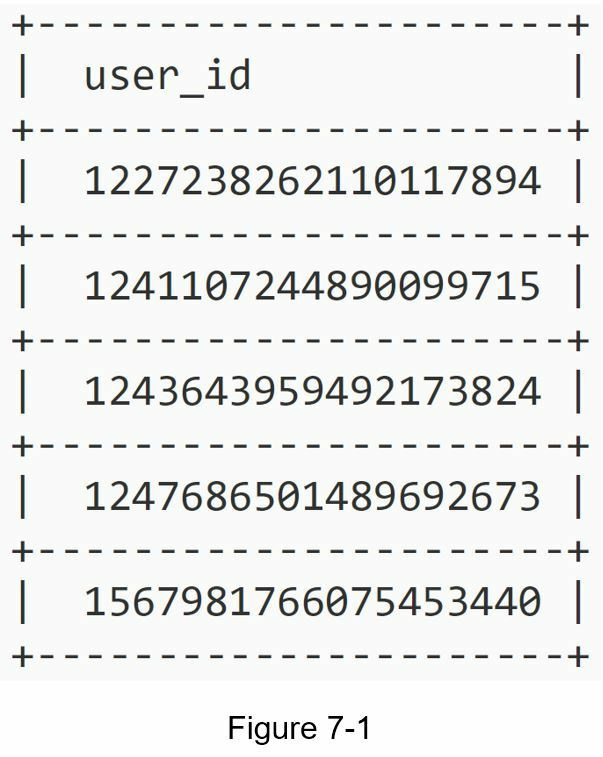
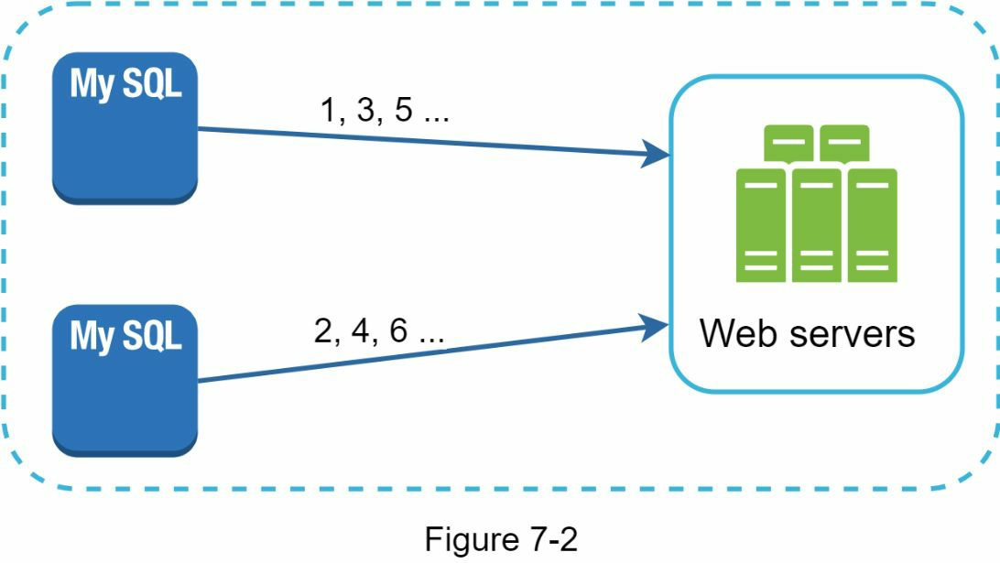
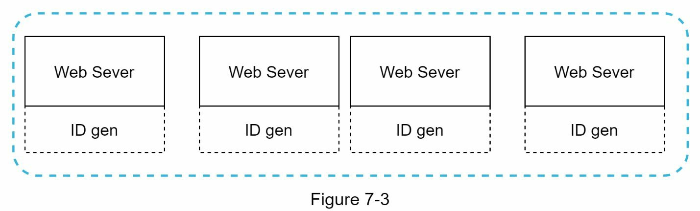
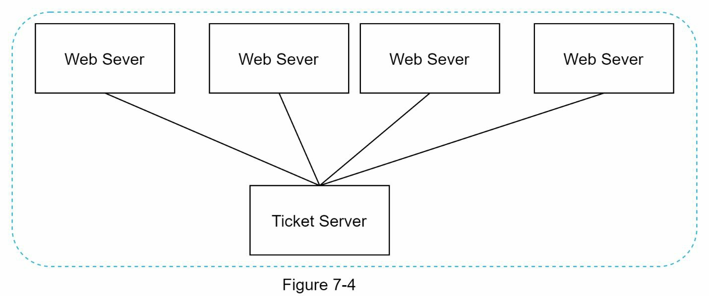
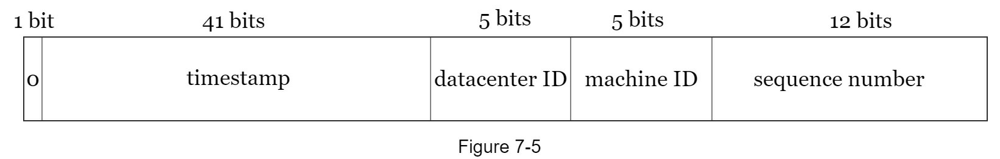
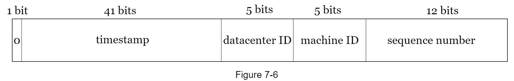
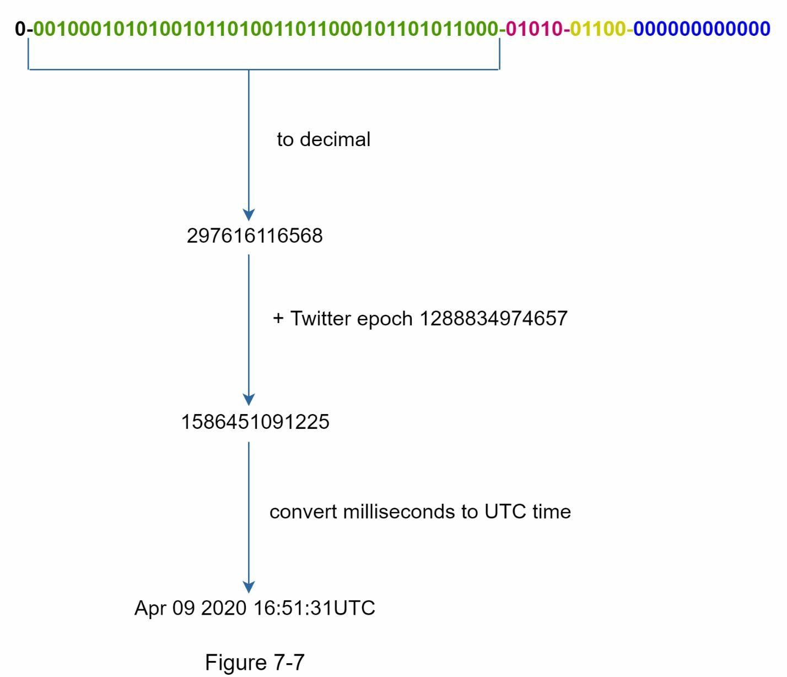

# Chương 07: Thiết kế Trình tạo ID duy nhất trong hệ thống phân tán (Design Unique ID Generator)

[← Chương trước](chuong-06-thiet-ke-key-value-store.md) | [Mục lục](README.md) | [Chương tiếp theo →](chuong-08-thiet-ke-url-shortener.md)

---

# CHƯƠNG 7: THIẾT KẾ BỘ TẠO MÃ ĐỊNH DANH DUY NHẤT (UNIQUE ID GENERATOR) TRONG HỆ THỐNG PHÂN TÁN

Trong chương này, bạn được yêu cầu thiết kế một bộ tạo mã định danh duy nhất (unique ID generator) trong hệ thống phân tán. Suy nghĩ đầu tiên của bạn có thể là sử dụng khóa chính (primary key) với thuộc tính `auto_increment` trong một cơ sở dữ liệu truyền thống. Tuy nhiên, `auto_increment` không hoạt động hiệu quả trong môi trường phân tán bởi vì một máy chủ cơ sở dữ liệu đơn lẻ không đủ lớn, đồng thời việc tạo các ID duy nhất trên nhiều cơ sở dữ liệu với độ trễ tối thiểu là một thách thức rất lớn.

Dưới đây là một vài ví dụ về các ID duy nhất:

---

## Bước 1 - Hiểu rõ bài toán và xác định phạm vi thiết kế

Đặt các câu hỏi làm rõ là bước đầu tiên để giải quyết bất kỳ câu hỏi phỏng vấn thiết kế hệ thống (system design) nào. Dưới đây là ví dụ về cuộc trao đổi giữa ứng viên và người phỏng vấn:

**Ứng viên:** Các đặc tính của ID duy nhất là gì?  
**Người phỏng vấn:** ID phải là duy nhất và có thể sắp xếp được (sortable).  

**Ứng viên:** Với mỗi bản ghi mới, ID có tăng dần lên 1 đơn vị không?  
**Người phỏng vấn:** ID tăng dần theo thời gian nhưng không nhất thiết chỉ tăng thêm 1 đơn vị. Các ID được tạo vào buổi tối sẽ lớn hơn các ID được tạo vào buổi sáng trong cùng một ngày.  

**Ứng viên:** ID có chỉ chứa các giá trị số hay không?  
**Người phỏng vấn:** Vâng, đúng như vậy.  

**Ứng viên:** Yêu cầu về độ dài của ID là gì?  
**Người phỏng vấn:** ID phải vừa vặn trong 64-bit.  

**Ứng viên:** Quy mô của hệ thống là bao nhiêu?  
**Người phỏng vấn:** Hệ thống phải có khả năng tạo ra 10.000 ID mỗi giây.  

Trên đây là một số câu hỏi mẫu mà bạn có thể hỏi người phỏng vấn của mình. Việc hiểu rõ các yêu cầu và làm sáng tỏ những điểm chưa rõ ràng là vô cùng quan trọng. Đối với câu hỏi phỏng vấn này, các yêu cầu được liệt kê cụ thể như sau:
- ID phải là duy nhất.
- ID chỉ bao gồm các giá trị dạng số.
- ID vừa vặn trong 64-bit.
- ID được sắp xếp theo thời gian (ngày tháng).
- Khả năng tạo ra hơn 10.000 ID duy nhất mỗi giây.

---

## Bước 2 - Đề xuất thiết kế cấp cao và đạt được sự đồng thuận

Có nhiều phương án có thể được sử dụng để tạo ID duy nhất trong hệ thống phân tán. Các lựa chọn mà chúng tôi xem xét bao gồm:
- Sao chép đa máy chủ chính (Multi-master replication)
- Mã định danh duy nhất toàn cầu (Universally unique identifier - UUID)
- Máy chủ phát số (Ticket server)
- Cách tiếp cận Twitter snowflake

Chúng ta hãy cùng xem xét từng phương án, cách thức hoạt động cũng như ưu/nhược điểm của từng lựa chọn.

### Sao chép đa máy chủ chính (Multi-master replication)

Như minh họa trong **Hình 7-2**, cách tiếp cận đầu tiên là sao chép đa máy chủ chính (*multi-master replication*).

Phương pháp này sử dụng tính năng `auto_increment` của cơ sở dữ liệu. Thay vì tăng ID tiếp theo lên 1 đơn vị, chúng ta tăng nó lên $k$ đơn vị, trong đó $k$ là số lượng máy chủ cơ sở dữ liệu đang được sử dụng. Như được minh họa trong **Hình 7-2**, ID tiếp theo được tạo ra bằng ID trước đó trên cùng một máy chủ cộng thêm 2. Cách này giải quyết được một số vấn đề về khả năng mở rộng (scalability) vì số lượng ID có thể mở rộng theo số lượng máy chủ cơ sở dữ liệu.

Tuy nhiên, chiến lược này có một số nhược điểm lớn:
- Khó mở rộng trên nhiều trung tâm dữ liệu (data centers).
- ID không tăng dần theo thời gian trên nhiều máy chủ.
- Hệ thống không mở rộng tốt khi một máy chủ được thêm vào hoặc loại bỏ.

---

### UUID

UUID là một cách đơn giản khác để có được các ID duy nhất. UUID là một số 128-bit được sử dụng để định danh thông tin trong các hệ thống máy tính. UUID có xác suất trùng lặp (collision) cực kỳ thấp. Trích dẫn từ Wikipedia: *“sau khi tạo ra 1 tỷ UUID mỗi giây liên tục trong khoảng 100 năm, xác suất tạo ra một bản trùng lặp duy nhất mới đạt tới 50%”* [1].

Dưới đây là một ví dụ về UUID: `09c93e62-50b4-468d-bf8a-c07e1040bfb2`. Các UUID có thể được tạo độc lập mà không cần sự điều phối giữa các máy chủ. **Hình 7-3** trình bày thiết kế sử dụng UUID.

Trong thiết kế này, mỗi máy chủ web (web server) chứa một bộ tạo ID, và máy chủ web chịu trách nhiệm tạo ID một cách độc lập.

**Ưu điểm:**
- Việc tạo UUID rất đơn giản. Không cần sự điều phối giữa các máy chủ, do đó sẽ không phát sinh bất kỳ vấn đề đồng bộ nào.
- Hệ thống dễ dàng mở rộng vì mỗi máy chủ web tự chịu trách nhiệm tạo ID mà chúng tiêu thụ. Bộ tạo ID có thể dễ dàng mở rộng quy mô theo số lượng máy chủ web.

**Nhược điểm:**
- ID có độ dài 128-bit, nhưng yêu cầu của chúng ta chỉ là 64-bit.
- ID không tăng dần theo thời gian.
- ID có thể chứa ký tự không phải dạng số (non-numeric).

---

### Máy chủ phát số (Ticket Server)

Ticket server là một phương pháp thú vị khác để tạo các ID duy nhất. Flickr đã phát triển các ticket server để tạo các khóa chính phân tán (distributed primary keys) [2]. Rất đáng để đề cập đến cách thức hệ thống này hoạt động.

Ý tưởng ở đây là sử dụng tính năng `auto_increment` tập trung trên một máy chủ cơ sở dữ liệu đơn lẻ (Ticket Server). Để tìm hiểu thêm về điều này, hãy tham khảo bài viết trên blog kỹ thuật của Flickr [2].

**Ưu điểm:**
- ID hoàn toàn ở dạng số.
- Dễ triển khai và phù hợp với các ứng dụng quy mô vừa và nhỏ.

**Nhược điểm:**
- Điểm lỗi đơn lẻ (Single Point of Failure - SPOF). Chỉ có một ticket server đồng nghĩa với việc nếu máy chủ này gặp sự cố, tất cả các hệ thống phụ thuộc vào nó sẽ gặp trục trặc. Để tránh điểm lỗi đơn lẻ, chúng ta có thể thiết lập nhiều ticket server. Tuy nhiên, điều này sẽ tạo ra các thách thức mới như việc đồng bộ hóa dữ liệu.

---

### Cách tiếp cận Twitter snowflake

Các phương pháp được đề cập ở trên đã cho chúng ta một số ý tưởng về cách các hệ thống tạo ID khác nhau hoạt động. Tuy nhiên, không có phương án nào đáp ứng đầy đủ các yêu cầu cụ thể của chúng ta; do đó, chúng ta cần một cách tiếp cận khác. Hệ thống tạo ID duy nhất của Twitter có tên gọi **“snowflake”** [3] mang lại nhiều cảm hứng và có thể thỏa mãn các yêu cầu đã đặt ra.

Chia để trị (Divide and conquer) chính là chìa khóa. Thay vì tạo trực tiếp một ID, chúng ta chia ID thành các phần khác nhau. **Hình 7-5** thể hiện cấu trúc bố cục của một ID 64-bit.

Mỗi phần được giải thích chi tiết dưới đây:
- **Bit dấu (Sign bit):** 1 bit. Bit này luôn luôn là 0. Nó được dành riêng cho các mục đích sử dụng trong tương lai. Bit này có thể được dùng để phân biệt giữa số có dấu (signed) và số không dấu (unsigned).
- **Dấu thời gian (Timestamp):** 41 bits. Số mili-giây tính từ mốc thời gian gốc (epoch) hoặc mốc epoch tùy chỉnh. Chúng tôi sử dụng epoch mặc định của Twitter snowflake là `1288834974657`, tương đương với ngày 04 tháng 11 năm 2010, 01:42:54 UTC.
- **ID Trung tâm dữ liệu (Datacenter ID):** 5 bits, cung cấp cho chúng ta $2^5 = 32$ trung tâm dữ liệu.
- **ID Máy (Machine ID):** 5 bits, cung cấp cho chúng ta $2^5 = 32$ máy trên mỗi trung tâm dữ liệu.
- **Số thứ tự (Sequence number):** 12 bits. Đối với mỗi ID được tạo ra trên máy/tiến trình đó, số thứ tự sẽ được tăng thêm 1 đơn vị. Giá trị này được đặt lại về 0 sau mỗi mili-giây.

---

## Bước 3 - Đi sâu vào chi tiết thiết kế

Trong phần thiết kế cấp cao, chúng ta đã thảo luận về các phương án khác nhau để thiết kế bộ tạo ID duy nhất trong hệ thống phân tán. Chúng ta quyết định chọn giải pháp dựa trên bộ tạo ID Twitter snowflake. Hãy cùng đi sâu vào chi tiết thiết kế. Để tiện ghi nhớ, sơ đồ thiết kế được liệt kê lại dưới đây.

Các Datacenter ID và Machine ID được chọn vào thời điểm khởi động hệ thống (startup time), nhìn chung sẽ cố định khi hệ thống đã đi vào hoạt động. Bất kỳ thay đổi nào đối với Datacenter ID và Machine ID đều đòi hỏi phải được xem xét cẩn trọng vì việc thay đổi vô ý các giá trị này có thể dẫn đến xung đột ID. Timestamp và Sequence number được tạo ra trong quá trình bộ tạo ID đang chạy.

### Dấu thời gian (Timestamp)

41 bit quan trọng nhất tạo nên phần dấu thời gian (*timestamp*). Vì timestamp tăng dần theo thời gian, các ID có thể sắp xếp được theo thời gian. **Hình 7-7** minh họa một ví dụ về cách biểu diễn nhị phân được chuyển đổi sang định dạng UTC. Bạn cũng có thể chuyển đổi ngược lại từ UTC về biểu diễn nhị phân bằng phương pháp tương tự.

---

### --- Trang 116 ---

Giá trị nhãn thời gian (*timestamp*) lớn nhất có thể biểu diễn được trong 41 bit là:

$$2^{41} - 1 = 2.199.023.255.551\text{ mili-giây (ms)}$$

Điều này mang lại cho chúng ta:

$$\sim 69\text{ năm} = \frac{2.199.023.255.551\text{ ms}}{1.000\text{ giây} \times 365\text{ ngày} \times 24\text{ giờ} \times 3.600\text{ giây}}$$

Điều này có nghĩa là bộ sinh ID (*ID generator*) sẽ hoạt động tốt trong vòng 69 năm, và việc thiết lập một mốc thời gian tùy chỉnh (*custom epoch time*) gần với ngày hiện tại sẽ trì hoãn thời điểm bị tràn số (*overflow*). Sau 69 năm, chúng ta sẽ cần một mốc epoch mới hoặc phải áp dụng các kỹ thuật khác để di chuyển/chuyển đổi ID (*migrate IDs*).

#### Số thứ tự (Sequence number)
Trường số thứ tự (*sequence number*) có độ dài 12 bit, tương đương với $2^{12} = 4096$ tổ hợp giá trị. Trường này có giá trị mặc định là 0, trừ khi có nhiều hơn một ID được tạo ra trong cùng một mili-giây trên cùng một máy chủ (*server*). Về mặt lý thuyết, một máy chủ có thể hỗ trợ tối đa **4096 ID mới mỗi mili-giây**.

---

### --- Trang 117 ---

### Bước 4 - Tổng kết (Wrap up)

Trong chương này, chúng ta đã thảo luận về các cách tiếp cận khác nhau để thiết kế một hệ thống sinh ID duy nhất (*unique ID generator*):
- Sao chép đa máy chủ chính (*multi-master replication*)
- Định danh duy nhất toàn cầu (*UUID - Universally Unique Identifier*)
- Máy chủ phát vé (*ticket server*)
- Bộ sinh ID duy nhất tương tự như Twitter Snowflake (*Twitter snowflake-like unique ID generator*)

Chúng ta quyết định chọn giải pháp **Snowflake** vì nó đáp ứng toàn bộ các ca sử dụng (*use cases*) của chúng ta, đồng thời có khả năng mở rộng quy mô (*scalable*) linh hoạt trong môi trường phân tán (*distributed environment*).

Nếu còn thời gian vào cuối buổi phỏng vấn, dưới đây là một vài chủ đề thảo luận mở rộng bổ sung:

* **Đồng bộ hóa đồng hồ (Clock synchronization):** Trong thiết kế của chúng ta, chúng ta giả định rằng các máy chủ sinh ID đều có cùng một đồng hồ thời gian (*clock*). Giả định này có thể không đúng khi một máy chủ chạy trên nhiều nhân/lõi (*multiple cores*). Thách thức tương tự cũng xuất hiện trong các kịch bản triển khai trên nhiều máy vật lý (*multi-machine scenarios*). Các giải pháp để giải quyết việc đồng bộ hóa đồng hồ nằm ngoài phạm vi của cuốn sách này; tuy nhiên, điều quan trọng là bạn phải nhận thức được vấn đề này có tồn tại. Giao thức thời gian mạng (**Network Time Protocol - NTP**) là giải pháp phổ biến nhất cho vấn đề này. Dành cho các độc giả quan tâm, vui lòng tham khảo tài liệu [4].
* **Tinh chỉnh độ dài từng phần (Section length tuning):** Ví dụ, việc giảm bớt số bit dành cho số thứ tự (*sequence numbers*) nhưng tăng thêm số bit dành cho nhãn thời gian (*timestamp bits*) sẽ rất hiệu quả đối với các ứng dụng có mức độ đồng thời thấp (*low concurrency*) và yêu cầu vận hành dài hạn (*long-term applications*).
* **Độ sẵn sàng cao (High availability):** Do bộ sinh ID là một hệ thống mang tính chất sống còn (*mission-critical system*), nó bắt buộc phải đạt độ sẵn sàng cao (*highly available*).

Xin chúc mừng bạn đã đi được một chặng đường dài đến đây! Hãy tự vỗ vai khen ngợi chính mình. Làm tốt lắm!

---

### --- Trang 118 ---

### Tài liệu tham khảo (Reference materials)

* **[1]** Universally unique identifier:  
  [https://en.wikipedia.org/wiki/Universally_unique_identifier](https://en.wikipedia.org/wiki/Universally_unique_identifier)
* **[2]** Ticket Servers: Distributed Unique Primary Keys on the Cheap:  
  [https://code.flickr.net/2010/02/08/ticket-servers-distributed-unique-primary-keys-on-the-cheap/](https://code.flickr.net/2010/02/08/ticket-servers-distributed-unique-primary-keys-on-the-cheap/)
* **[3]** Announcing Snowflake:  
  [https://blog.twitter.com/engineering/en_us/a/2010/announcing-snowflake.html](https://blog.twitter.com/engineering/en_us/a/2010/announcing-snowflake.html)
* **[4]** Network time protocol:  
  [https://en.wikipedia.org/wiki/Network_Time_Protocol](https://en.wikipedia.org/wiki/Network_Time_Protocol)

---

[← Chương trước](chuong-06-thiet-ke-key-value-store.md) | [Mục lục](README.md) | [Chương tiếp theo →](chuong-08-thiet-ke-url-shortener.md)
