# Chương 08: Thiết kế Hệ thống rút gọn URL (Design A URL Shortener)

[← Chương trước](chuong-07-thiet-ke-unique-id-generator-phan-tan.md) | [Mục lục](README.md) | [Chương tiếp theo →](chuong-09-thiet-ke-web-crawler.md)

---

# CHƯƠNG 8: THIẾT KẾ DỊCH VỤ RÚT GỌN URL (DESIGN A URL SHORTENER)

Trong chương này, chúng ta sẽ giải quyết một câu hỏi phỏng vấn thiết kế hệ thống (system design) kinh điển và rất thú vị: **thiết kế một dịch vụ rút gọn URL (URL shortening service)** tương tự như TinyURL.

---

## Bước 1 - Hiểu rõ bài toán và xác định phạm vi thiết kế (Understand the problem and establish design scope)

Các câu hỏi phỏng vấn thiết kế hệ thống thường được cố tình để ở dạng mở (open-ended). Để xây dựng một hệ thống hoàn chỉnh và chuẩn xác, việc đặt các câu hỏi làm rõ (clarification questions) là cực kỳ quan trọng.

* **Ứng viên:** Người phỏng vấn có thể đưa ra một ví dụ về cách thức hoạt động của dịch vụ rút gọn URL không?
* **Người phỏng vấn:** Giả sử URL `https://www.systeminterview.com/q=chatsystem&c=loggedin&v=v3&l=long` là URL gốc. Dịch vụ của bạn sẽ tạo ra một bí danh (alias) có độ dài ngắn hơn: `https://tinyurl.com/y7keocwj`. Nếu bạn nhấp vào liên kết rút gọn này, nó sẽ chuyển hướng (redirect) bạn đến URL gốc.
* **Ứng viên:** Lượng truy cập (traffic volume) của hệ thống là bao nhiêu?
* **Người phỏng vấn:** 100 triệu URL được tạo ra mỗi ngày.
* **Ứng viên:** URL rút gọn dài bao nhiêu ký tự?
* **Người phỏng vấn:** Càng ngắn càng tốt.
* **Ứng viên:** Những ký tự nào được phép xuất hiện trong URL rút gọn?
* **Người phỏng vấn:** URL rút gọn có thể là sự kết hợp của các chữ số (`0-9`) và các chữ cái (`a-z`, `A-Z`).
* **Ứng viên:** Các URL rút gọn có thể bị xóa hoặc cập nhật không?
* **Người phỏng vấn:** Để đơn giản hóa, chúng ta giả định rằng các URL rút gọn không thể bị xóa hoặc cập nhật.

Dưới đây là các trường hợp sử dụng cơ bản (use cases):
1. **Rút gọn URL (URL shortening):** nhận vào một URL dài $\Rightarrow$ trả về một URL ngắn hơn nhiều.
2. **Chuyển hướng URL (URL redirecting):** nhận vào một URL ngắn $\Rightarrow$ chuyển hướng đến URL gốc ban đầu.
3. **Các yêu cầu về tính sẵn sàng cao (high availability), khả năng mở rộng (scalability) và khả năng chịu lỗi (fault tolerance).**

### Ước tính sơ bộ (Back of the envelope estimation)

* **Thao tác ghi (Write operation):** 100 triệu URL được tạo ra mỗi ngày.
* **Số thao tác ghi mỗi giây (Write operation per second):**
  $$100\text{ triệu} / 24 / 3600 \approx 1160\text{ write/giây}$$
* **Thao tác đọc (Read operation):** Giả sử tỉ lệ giữa thao tác đọc và thao tác ghi là $10:1$, số thao tác đọc mỗi giây sẽ là:
  $$1160 \times 10 = 11.600\text{ read/giây}$$
* **Giả sử dịch vụ rút gọn URL sẽ hoạt động trong vòng 10 năm:** điều này đồng nghĩa với việc chúng ta phải lưu trữ và hỗ trợ:
  $$100\text{ triệu} \times 365 \times 10 = 365\text{ tỷ bản ghi (billion records)}$$
* **Giả sử độ dài trung bình của một URL là 100 ký tự (100 bytes).**
* **Nhu cầu dung lượng lưu trữ (storage requirement) trong vòng 10 năm:**
  $$365\text{ tỷ} \times 100\text{ bytes} \times 10\text{ năm} = 365\text{ TB}$$

> [!IMPORTANT]
> Việc cùng người phỏng vấn rà soát lại các giả định và phép tính toán là rất quan trọng để đảm bảo cả hai bên đều thống nhất trên cùng một góc nhìn.

---

## Bước 2 - Đề xuất thiết kế cấp cao và đạt được sự đồng thuận (Propose high-level design and get buy-in)

Trong phần này, chúng ta sẽ thảo luận về các API endpoints, luồng chuyển hướng URL (URL redirecting) và luồng rút gọn URL (URL shortening).

### Các API Endpoints (API Endpoints)

Các API endpoints đóng vai trò làm cầu nối giao tiếp giữa client và server. Chúng ta sẽ thiết kế các API theo chuẩn RESTful. Nếu bạn chưa quen thuộc với RESTful API, bạn có thể tham khảo các tài liệu bên ngoài, chẳng hạn như tài liệu được liệt kê trong phần tham khảo [1]. Một dịch vụ rút gọn URL chủ yếu cần hai API endpoints:

1. **Rút gọn URL (URL shortening):** Để tạo một URL ngắn mới, client sẽ gửi một yêu cầu `POST`, chứa một tham số duy nhất: URL dài ban đầu. API có cấu trúc như sau:
   * **Endpoint:** `POST api/v1/data/shorten`
   * **Request parameter:** `{longUrl: longURLString}`
   * **Return:** `shortURL`

2. **Chuyển hướng URL (URL redirecting):** Để chuyển hướng từ một URL ngắn về URL dài tương ứng, client sẽ gửi một yêu cầu `GET`. API có cấu trúc như sau:
   * **Endpoint:** `GET api/v1/shortUrl`
   * **Return:** `longURL` dùng cho cơ chế chuyển hướng HTTP (HTTP redirection).

---

### Chuyển hướng URL (URL redirecting)

Hình 8-1 minh họa những gì diễn ra khi bạn nhập một URL rút gọn vào trình duyệt. Ngay khi server nhận được yêu cầu truy cập tinyurl, nó sẽ chuyển đổi URL ngắn thành URL dài thông qua mã phản hồi chuyển hướng **301 redirect**.

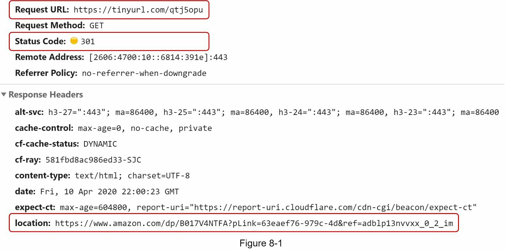

Chi tiết quy trình giao tiếp giữa client và server được thể hiện trong Hình 8-2.

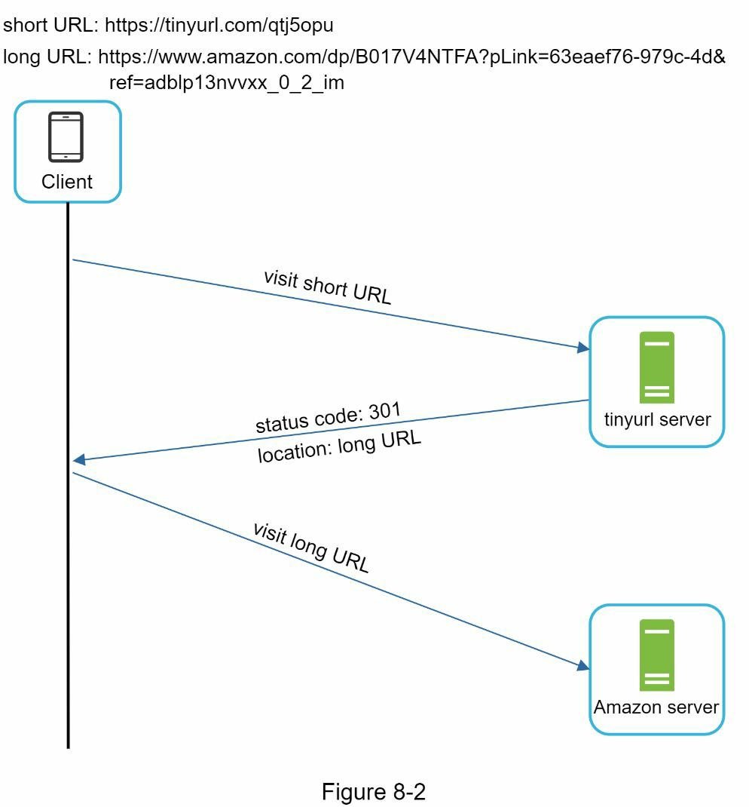

Một điểm đáng thảo luận ở đây là sự khác biệt giữa **301 redirect** và **302 redirect**:

* **301 redirect:** Mã chuyển hướng 301 chỉ ra rằng URL được yêu cầu đã được di chuyển "vĩnh viễn" (**permanently**) sang URL dài. Vì nó được chuyển hướng vĩnh viễn, trình duyệt sẽ lưu phản hồi vào bộ nhớ đệm (cache), và các yêu cầu tiếp theo gửi tới cùng một URL đó sẽ không được gửi đến dịch vụ rút gọn URL nữa. Thay vào đó, các yêu cầu sẽ được chuyển hướng trực tiếp đến máy chủ chứa URL dài ban đầu.
* **302 redirect:** Mã chuyển hướng 302 biểu thị rằng URL chỉ được di chuyển "tạm thời" (**temporarily**) sang URL dài, nghĩa là các yêu cầu tiếp theo đối với cùng URL đó vẫn sẽ được gửi đến dịch vụ rút gọn URL trước tiên. Sau đó, chúng mới được chuyển hướng tới máy chủ của URL dài.

Mỗi phương pháp chuyển hướng đều có ưu và nhược điểm riêng:
* Nếu ưu tiên hàng đầu là **giảm tải cho máy chủ (reduce server load)**, việc sử dụng **301 redirect** là hợp lý vì chỉ có yêu cầu đầu tiên của cùng một URL mới được gửi đến các máy chủ rút gọn URL.
* Tuy nhiên, nếu khía cạnh **phân tích dữ liệu (analytics)** được coi trọng, **302 redirect** lại là sự lựa chọn tốt hơn vì nó giúp theo dõi tỷ lệ nhấp chuột (click rate) và nguồn gốc của lượt nhấp (source of the click) một cách dễ dàng hơn.

Cách trực quan nhất để hiện thực hóa tính năng chuyển hướng URL là sử dụng bảng băm (hash table). Giả sử bảng băm lưu trữ các cặp `<shortURL, longURL>`, quá trình chuyển hướng URL có thể được thực hiện như sau:
* Lấy URL dài: `longURL = hashTable.get(shortURL)`
* Ngay khi lấy được `longURL`, thực hiện chuyển hướng URL (URL redirect).

---

### Rút gọn URL (URL shortening)

Giả sử URL ngắn có dạng như sau: `www.tinyurl.com/{hashValue}`. Để đáp ứng trường hợp sử dụng rút gọn URL, chúng ta phải tìm ra một hàm băm (hash function) $f(x)$ ánh xạ một URL dài thành một `hashValue`, như minh họa trong Hình 8-3.

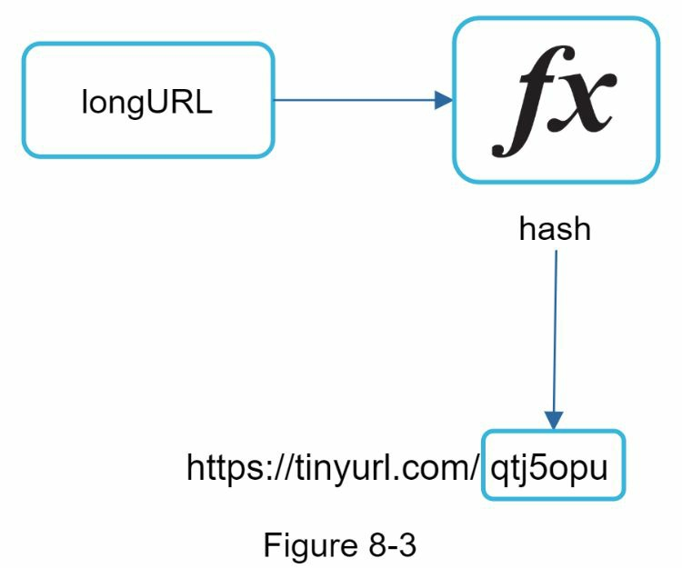

Hàm băm phải thỏa mãn các yêu cầu sau:
* Mỗi `longURL` phải được băm thành duy nhất một `hashValue`.
* Mỗi `hashValue` có thể được ánh xạ ngược trở lại `longURL` ban đầu.

Chi tiết thiết kế của hàm băm sẽ được thảo luận kỹ hơn trong phần đi sâu vào chi tiết kỹ thuật (deep dive).

---

## Bước 3 - Đi sâu vào thiết kế chi tiết (Design deep dive)

Cho đến thời điểm này, chúng ta đã thảo luận về thiết kế cấp cao của tính năng rút gọn URL và chuyển hướng URL. Trong phần này, chúng ta sẽ đi sâu vào các khía cạnh: **mô hình dữ liệu (data model)**, **hàm băm (hash function)**, **quy trình rút gọn URL** và **quy trình chuyển hướng URL**.

### Mô hình dữ liệu (Data model)

Trong bản thiết kế cấp cao, mọi thứ đều được lưu trữ trong một bảng băm (hash table). Đây là một điểm khởi đầu tốt; tuy nhiên, phương pháp này không khả thi đối với các hệ thống trong thực tế vì tài nguyên bộ nhớ RAM là hữu hạn và đắt đỏ. 

Một giải pháp tốt hơn là lưu trữ thông tin ánh xạ `<shortURL, longURL>` trong một cơ sở dữ liệu quan hệ (relational database). Hình 8-4 minh họa một thiết kế bảng cơ sở dữ liệu đơn giản. Phiên bản rút gọn của bảng này bao gồm 3 cột: `id`, `shortURL`, `longURL`.

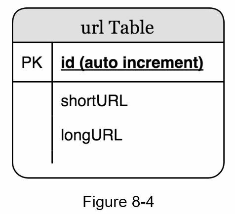

### Hàm băm (Hash function)

Hàm băm được sử dụng để băm một URL dài thành một URL ngắn, giá trị này còn được gọi là `hashValue`.

#### Độ dài của giá trị băm (Hash value length)

Giá trị `hashValue` bao gồm các ký tự nằm trong tập hợp `[0-9, a-z, A-Z]`, chứa tổng cộng:
$$10 + 26 + 26 = 62\text{ ký tự khả dụng}$$

Để tìm ra độ dài phù hợp của `hashValue`, ta cần tìm số nguyên dương $n$ nhỏ nhất sao cho:
$$62^n \ge 365\text{ tỷ}$$

Hệ thống phải hỗ trợ tới 365 tỷ URL dựa trên kết quả tính toán ước tính sơ bộ (back of the envelope estimation). 

Bảng 8-1 hiển thị mối tương quan giữa độ dài của `hashValue` và số lượng URL tối đa tương ứng mà nó có thể hỗ trợ:

| Độ dài $n$ (Length $n$) | Số lượng URL tối đa có thể hỗ trợ (Maximal number of URLs) |
| :---: | :--- |
| **1** | $62^1 = 62$ |
| **2** | $62^2 = 3.844$ |
| **3** | $62^3 = 238.328$ |
| **4** | $62^4 = 14.776.336$ |
| **5** | $62^5 = 916.132.832$ |
| **6** | $62^6 = 56.800.235.584$ |
| **7** | $62^7 = 3.521.614.606.208$ ($\approx 3,5\text{ nghìn tỷ}$) |
| **8** | $62^8 = 218.340.105.584.896$ |

*(Bảng 8-1)*

---

Khi $n = 7$, $62^n \approx 3,5\text{ nghìn tỷ}$ (3.5 trillion), 3,5 nghìn tỷ là quá đủ để lưu trữ 365 tỷ URL, vì vậy độ dài của `hashValue` là 7.

Chúng ta sẽ khám phá hai loại hàm băm (hash functions) cho một dịch vụ rút gọn URL (URL shortener). Loại thứ nhất là **“băm + xử lý xung đột” (hash + collision resolution)**, và loại thứ hai là **“chuyển đổi cơ số 62” (base 62 conversion)**. Hãy cùng xem xét từng phương pháp một.

### Băm + xử lý xung đột (Hash + collision resolution)

Để rút gọn một URL dài, chúng ta nên triển khai một hàm băm có khả năng băm một URL dài thành một chuỗi gồm 7 ký tự. Một giải pháp trực quan, dễ hiểu là sử dụng các hàm băm nổi tiếng như CRC32, MD5, hoặc SHA-1. Bảng dưới đây so sánh các kết quả băm sau khi áp dụng các hàm băm khác nhau lên URL này: `https://en.wikipedia.org/wiki/Systems_design`.

*(Bảng 8-2: Kết quả băm của các hàm băm khác nhau)*
| Hàm băm (Hash function) | Giá trị băm (Hash value) (Hexadecimal) |
| :--- | :--- |
| **CRC32** | `5cb54fac` |
| **MD5** | `5a6242277ef670fa3702f94e1ee0ff2a` |
| **SHA-1** | `0ac4b182848f4f43c9354516932434b0038a3bed` |

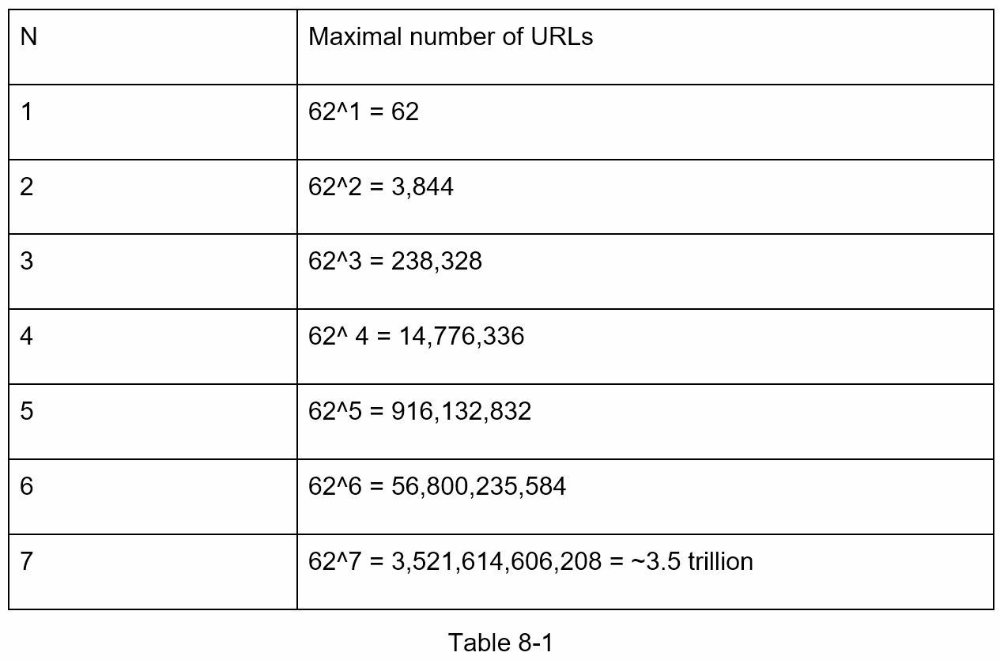

Như được thể hiện trong Bảng 8-2, ngay cả giá trị băm ngắn nhất (từ CRC32) cũng vẫn quá dài (nhiều hơn 7 ký tự). Làm thế nào chúng ta có thể làm cho nó ngắn hơn?

Cách tiếp cận đầu tiên là lấy 7 ký tự đầu tiên của một giá trị băm; tuy nhiên, phương pháp này có thể dẫn đến hiện tượng xung đột băm (hash collisions). Để giải quyết xung đột băm, chúng ta có thể nối thêm (append) đệ quy một chuỗi được định nghĩa trước mới cho đến khi không còn phát hiện xung đột nào nữa. Quy trình này được giải thích trong Hình 8-5.

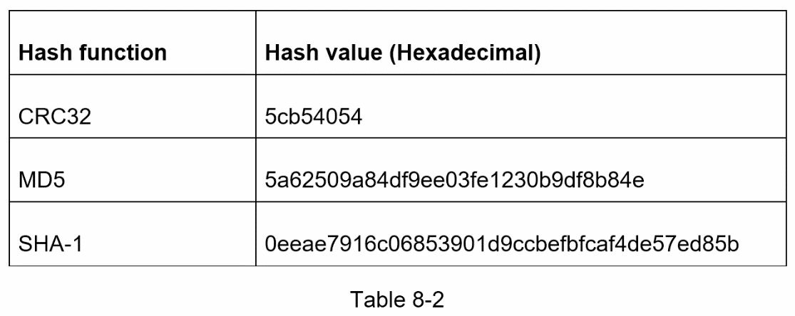

---

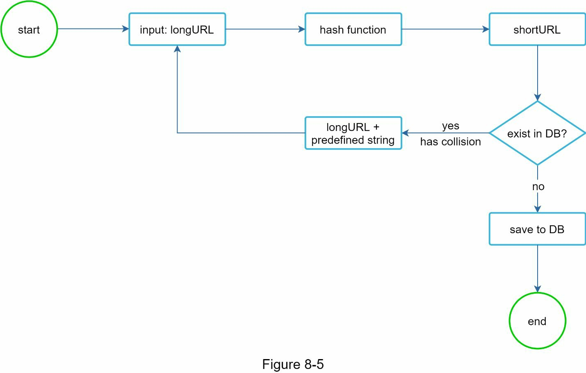

Phương pháp này có thể loại bỏ xung đột; tuy nhiên, việc truy vấn cơ sở dữ liệu để kiểm tra xem một `shortURL` có tồn tại hay không cho mỗi yêu cầu là rất tốn kém chi phí (expensive). Một kỹ thuật gọi là **Bloom filter** [2] có thể cải thiện hiệu năng. Bloom filter là một cấu trúc dữ liệu xác suất tiết kiệm không gian bộ nhớ (space-efficient probabilistic technique) dùng để kiểm tra xem một phần tử có phải là thành viên của một tập hợp hay không. Tham khảo tài liệu tham khảo [2] để biết thêm chi tiết.

### Chuyển đổi cơ số 62 (Base 62 conversion)

Chuyển đổi cơ số là một cách tiếp cận khác thường được sử dụng cho các hệ thống rút gọn URL. Chuyển đổi cơ số giúp chuyển đổi cùng một số giữa các hệ thống biểu diễn số khác nhau. Chuyển đổi cơ số 62 (Base 62 conversion) được sử dụng vì có 62 ký tự khả dĩ cho `hashValue`. Hãy sử dụng một ví dụ để giải thích cách thức hoạt động của quá trình chuyển đổi: chuyển đổi $11157_{10}$ sang dạng biểu diễn cơ số 62 ($11157_{10}$ đại diện cho 11157 trong hệ thập phân - base 10).

• Đúng như tên gọi của nó, cơ số 62 là một cách sử dụng 62 ký tự để mã hóa. Các ánh xạ tương ứng là:
$0 \rightarrow 0, \dots, 9 \rightarrow 9, 10 \rightarrow a, 11 \rightarrow b, \dots, 35 \rightarrow z, 36 \rightarrow A, \dots, 61 \rightarrow Z$, trong đó 'a' đại diện cho 10, 'Z' đại diện cho 61, v.v.

• $11157_{10} = 2 \times 62^2 + 55 \times 62^1 + 59 \times 62^0 = [2, 55, 59] \rightarrow [2, T, X]$ trong biểu diễn cơ số 62. Hình 8-6 thể hiện quy trình chuyển đổi.

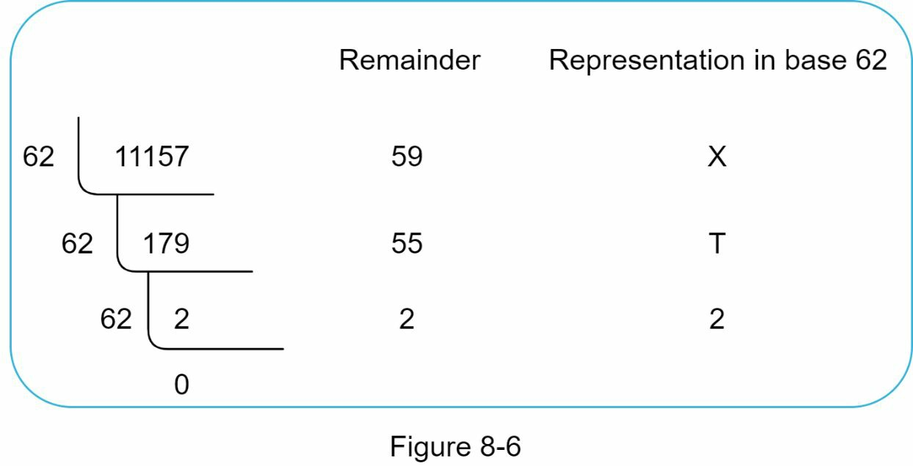

---

• Do đó, URL rút gọn là `https://tinyurl.com/2TX`

### So sánh hai cách tiếp cận (Comparison of the two approaches)

Bảng 8-3 chỉ ra sự khác biệt của hai cách tiếp cận.

*(Bảng 8-3: So sánh giữa Băm + xử lý xung đột và Chuyển đổi cơ số 62)*
| Băm + giải quyết xung đột (Hash + collision resolution) | Chuyển đổi cơ số 62 (Base 62 conversion) |
| :--- | :--- |
| Độ dài URL rút gọn cố định (Fixed short URL length). | Độ dài URL rút gọn không cố định. Nó tăng lên cùng với giá trị ID. |
| Không yêu cầu một bộ sinh ID duy nhất (Does not need a unique ID generator). | Phụ thuộc vào một bộ sinh ID duy nhất (unique ID generator). |
| Có khả năng xảy ra xung đột và phải giải quyết (Collision is possible and needs to be resolved). | Xung đột là không thể xảy ra vì ID là duy nhất (Collision is impossible because ID is unique). |
| Không thể tìm ra URL rút gọn tiếp theo khả dĩ vì không phụ thuộc vào ID tăng dần. | Dễ dàng tìm ra URL rút gọn tiếp theo nếu ID tăng thêm 1 đơn vị, điều này có thể là một mối lo ngại về mặt bảo mật (security concern). |

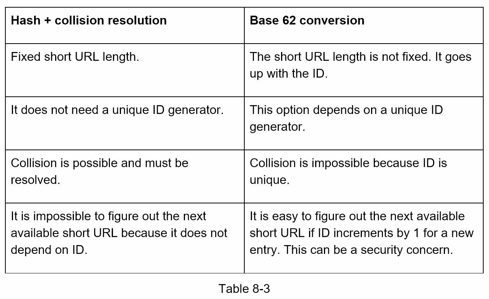

### Đi sâu vào thiết kế luồng rút gọn URL (URL shortening deep dive)

Là một trong những thành phần cốt lõi của hệ thống, chúng ta muốn luồng rút gọn URL phải đơn giản về mặt logic và có tính ứng dụng cao. Kỹ thuật chuyển đổi cơ số 62 được sử dụng trong thiết kế của chúng ta. Chúng tôi xây dựng sơ đồ sau (Hình 8-7) để minh họa cho luồng này.

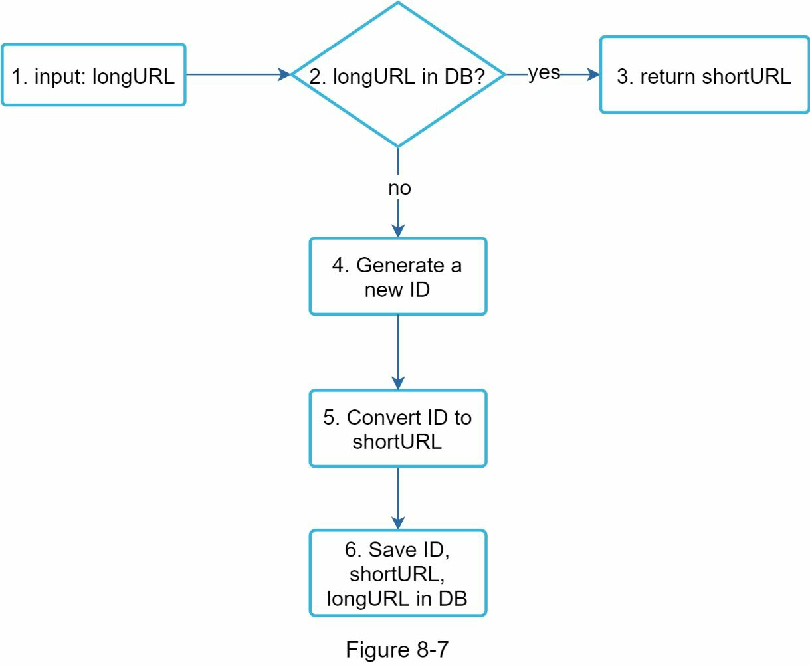

---

1. `longURL` là dữ liệu đầu vào (input).
2. Hệ thống kiểm tra xem `longURL` đã có trong cơ sở dữ liệu hay chưa.
3. Nếu đã có, điều đó có nghĩa là `longURL` này đã được chuyển đổi thành `shortURL` từ trước. Trong trường hợp này, lấy `shortURL` từ cơ sở dữ liệu và trả về cho client.
4. Nếu chưa có, `longURL` này là mới. Một ID duy nhất mới (khóa chính - primary key) sẽ được tạo bởi bộ sinh ID duy nhất (**Unique ID Generator**).
5. Chuyển đổi ID đó thành `shortURL` bằng phương pháp chuyển đổi cơ số 62 (base 62 conversion).
6. Tạo một hàng mới trong cơ sở dữ liệu với ID, `shortURL`, và `longURL`.

Để làm cho luồng hoạt động dễ hiểu hơn, hãy xem xét một ví dụ cụ thể.
• Giả sử `longURL` đầu vào là: `https://en.wikipedia.org/wiki/Systems_design`
• Bộ sinh ID duy nhất trả về ID: `2009215674938`.
• Chuyển đổi ID này sang `shortURL` bằng cách sử dụng chuyển đổi cơ số 62. ID (`2009215674938`) được chuyển đổi thành `"zn9edcu"`.
• Lưu ID, `shortURL`, và `longURL` vào cơ sở dữ liệu như được hiển thị trong Bảng 8-4.

*(Bảng 8-4: Dữ liệu mẫu lưu vào DB)*
| id | shortURL | longURL |
| :--- | :--- | :--- |
| 2009215674938 | zn9edcu | `https://en.wikipedia.org/wiki/Systems_design` |

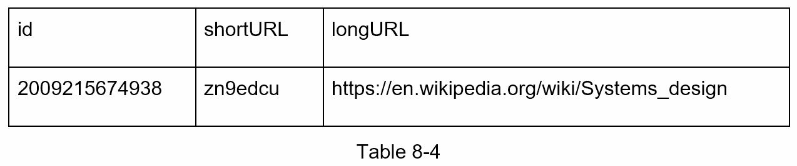

Bộ sinh ID duy nhất phân tán (Distributed Unique ID Generator) rất đáng được nhắc đến. Chức năng chính của nó là tạo ra các ID duy nhất trên quy mô toàn cầu (globally unique IDs), được sử dụng để tạo ra các `shortURL`. Trong một môi trường phân tán cao độ, 

---

việc triển khai một bộ sinh ID duy nhất là đầy thách thức. May mắn thay, chúng ta đã thảo luận về một vài giải pháp trong **“Chương 7: Thiết kế bộ sinh ID duy nhất trong các hệ thống phân tán” (Chapter 7: Design A Unique ID Generator in Distributed Systems)**. Bạn có thể tham khảo lại chương đó để gợi nhớ lại kiến thức.

### Đi sâu vào thiết kế luồng chuyển hướng URL (URL redirecting deep dive)

Hình 8-8 thể hiện thiết kế chi tiết của luồng chuyển hướng URL. Do số lượng thao tác đọc nhiều hơn ghi (more reads than writes), cặp ánh xạ `<shortURL, longURL>` được lưu trữ trong bộ nhớ đệm (cache) để cải thiện hiệu năng.

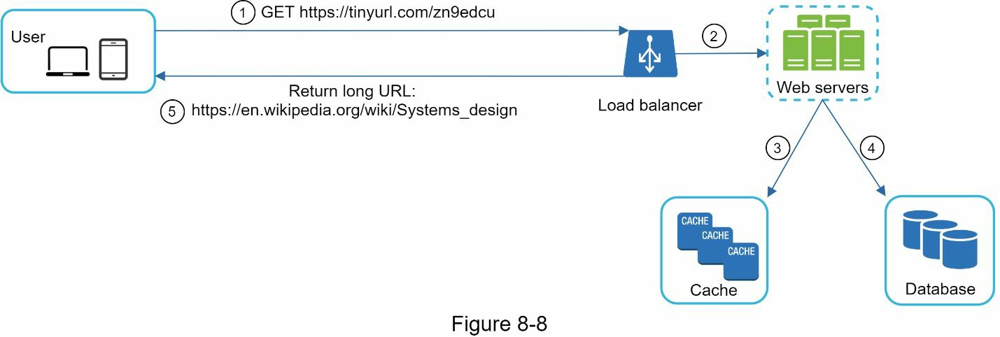

Luồng chuyển hướng URL được tóm tắt như sau:
1. Người dùng nhấp vào một liên kết URL rút gọn: `https://tinyurl.com/zn9edcu`
2. Bộ cân bằng tải (Load Balancer) chuyển tiếp yêu cầu đến các máy chủ web (Web Servers).
3. Nếu `shortURL` đã có sẵn trong bộ nhớ đệm (cache), trả về trực tiếp `longURL`.
4. Nếu `shortURL` không có trong bộ nhớ đệm, tiến hành lấy `longURL` từ cơ sở dữ liệu. Nếu nó cũng không tồn tại trong cơ sở dữ liệu, khả năng cao là người dùng đã nhập một `shortURL` không hợp lệ.
5. `longURL` được trả về cho người dùng.

---

### Bước 4 - Tổng kết (Step 4 - Wrap up)

Trong chương này, chúng ta đã thảo luận về thiết kế API, mô hình dữ liệu (data model), hàm băm (hash function), luồng rút gọn URL, và luồng chuyển hướng URL.

Nếu còn thời gian ở cuối buổi phỏng vấn, dưới đây là một số chủ đề thảo luận mở rộng bổ sung:

• **Rate limiter (Bộ điều tiết tốc độ):** Một vấn đề bảo mật tiềm ẩn mà chúng ta có thể phải đối mặt là việc những người dùng độc hại gửi một lượng lớn áp đảo các yêu cầu rút gọn URL. Rate limiter giúp lọc bỏ các yêu cầu dựa trên địa chỉ IP hoặc các quy tắc lọc khác. Nếu bạn muốn gợi nhớ lại kiến thức về rate limiting, hãy tham khảo **“Chương 4: Thiết kế Rate Limiter” (Chapter 4: Design a rate limiter)**.

• **Mở rộng máy chủ web (Web server scaling):** Vì tầng web là phi trạng thái (stateless), nên rất dễ dàng để mở rộng quy mô tầng web bằng cách thêm hoặc bớt các máy chủ web.

• **Mở rộng cơ sở dữ liệu (Database scaling):** Nhân bản cơ sở dữ liệu (Database replication) và phân mảnh cơ sở dữ liệu (Database sharding) là những kỹ thuật phổ biến.

• **Phân tích dữ liệu (Analytics):** Dữ liệu ngày càng trở nên quan trọng đối với sự thành công của doanh nghiệp. Việc tích hợp một giải pháp phân tích dữ liệu vào hệ thống rút gọn URL có thể giúp trả lời các câu hỏi quan trọng như: có bao nhiêu người nhấp vào một liên kết? Họ nhấp vào liên kết khi nào? v.v.

• **Tính khả dụng, tính nhất quán và độ tin cậy (Availability, consistency, and reliability):** Những khái niệm này là cốt lõi cho sự thành công của bất kỳ hệ thống quy mô lớn nào. Chúng ta đã thảo luận chi tiết về chúng trong Chương 1, vui lòng ôn lại kiến thức về các chủ đề này.

Chúc mừng bạn đã hoàn thành đến chặng này! Hãy tự thưởng cho mình một lời khen ngợi. Làm tốt lắm!

---

--- Trang 131 ---

### Tài liệu tham khảo (Reference materials)

[1] Hướng dẫn thực hành RESTful (A RESTful Tutorial): https://www.restapitutorial.com/index.html  
[2] Bộ lọc Bloom (Bloom filter): https://en.wikipedia.org/wiki/Bloom_filter

---

[← Chương trước](chuong-07-thiet-ke-unique-id-generator-phan-tan.md) | [Mục lục](README.md) | [Chương tiếp theo →](chuong-09-thiet-ke-web-crawler.md)
