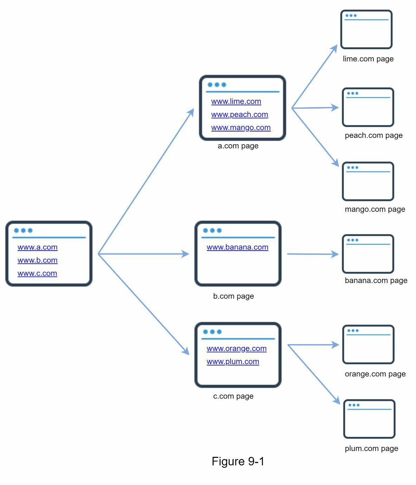
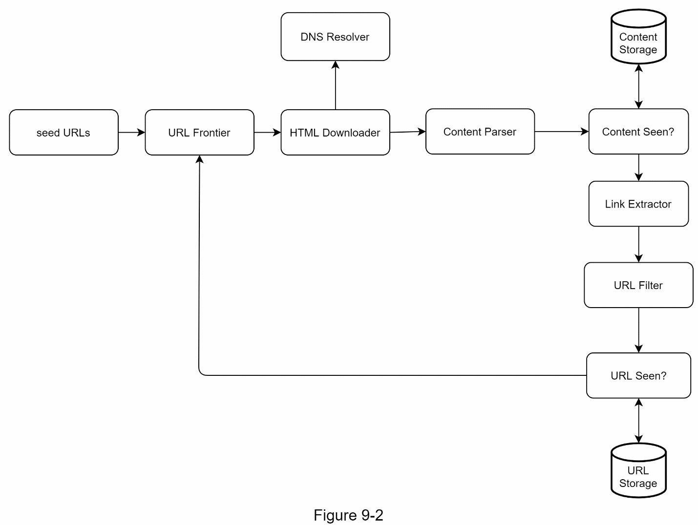
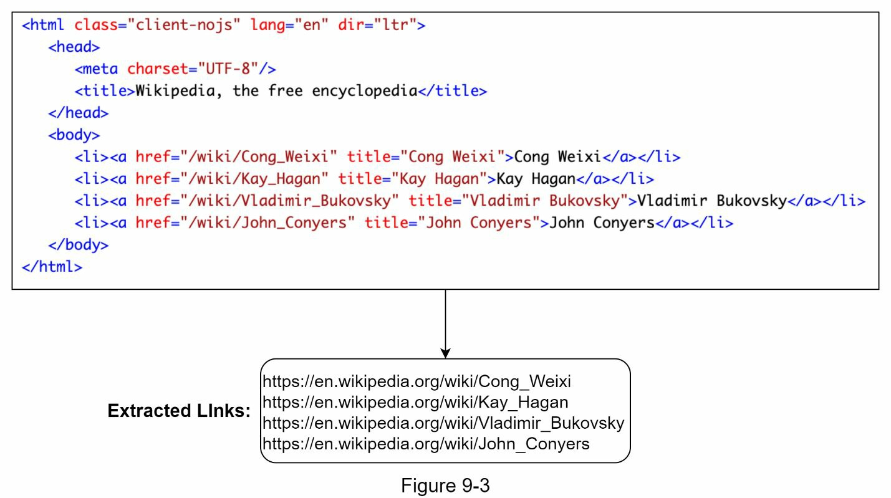
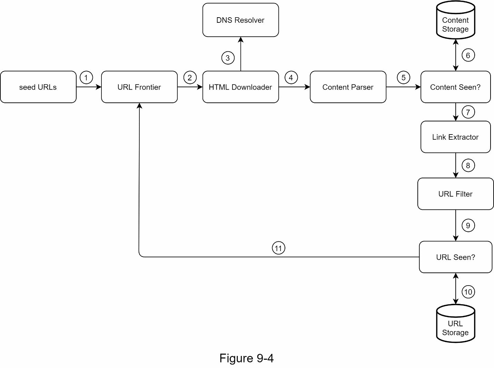
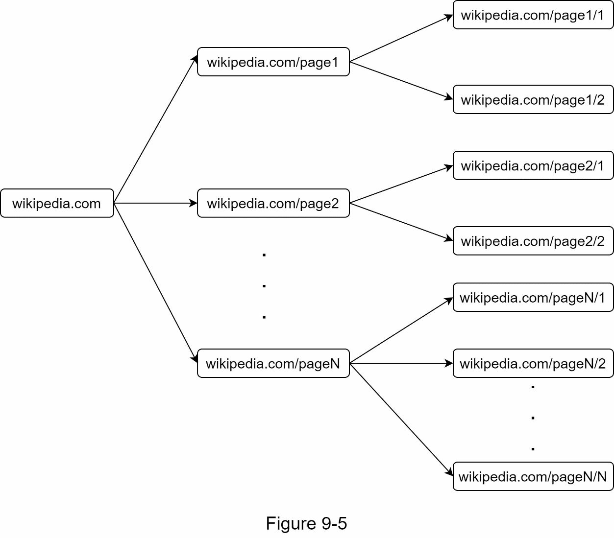
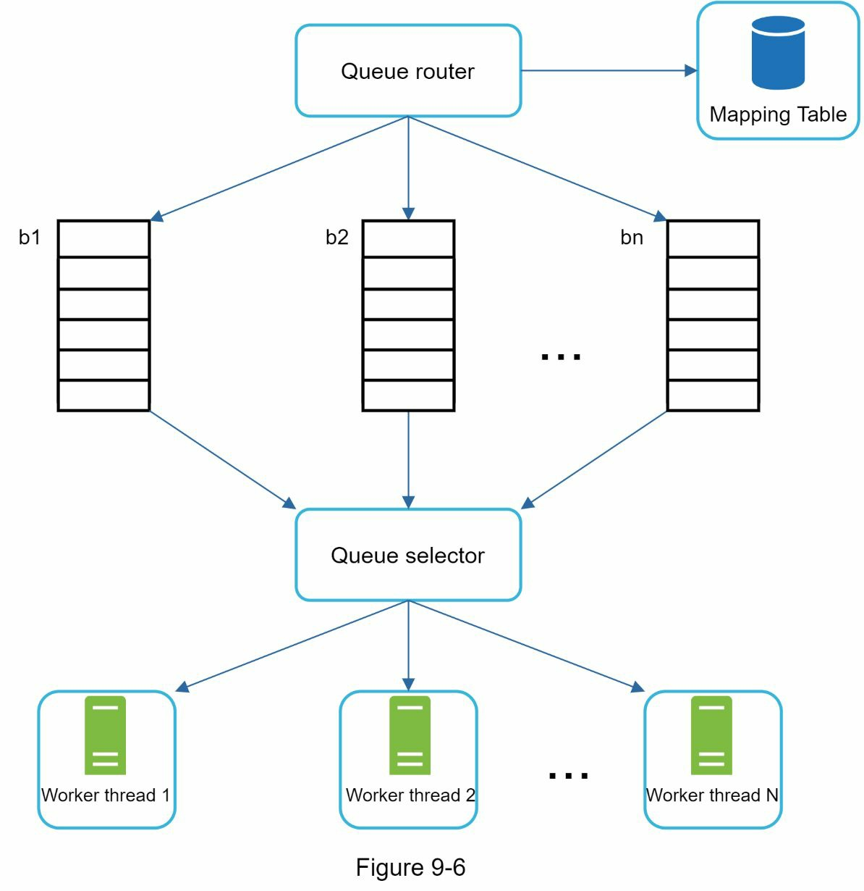
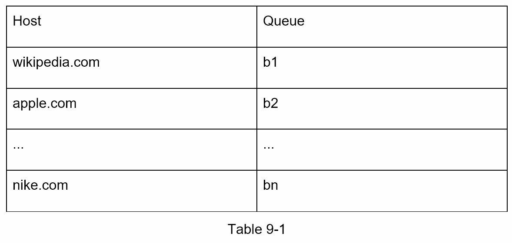
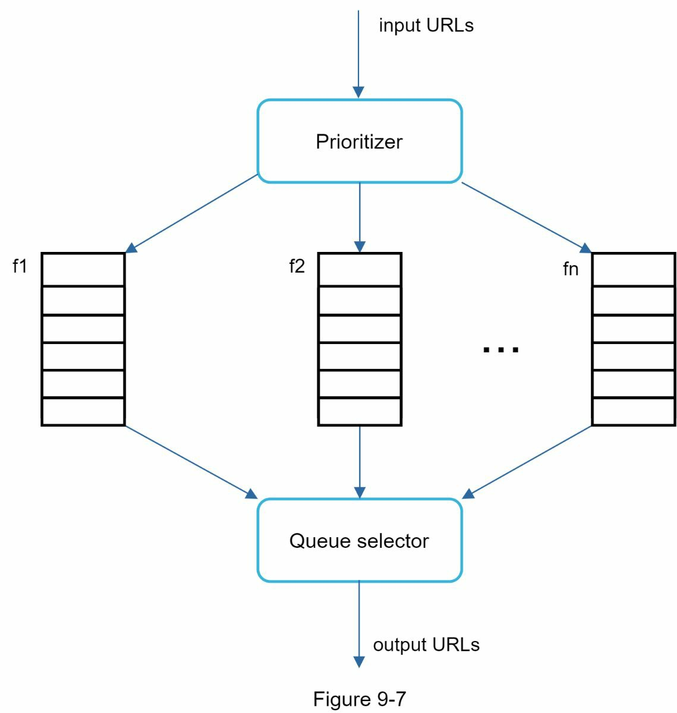
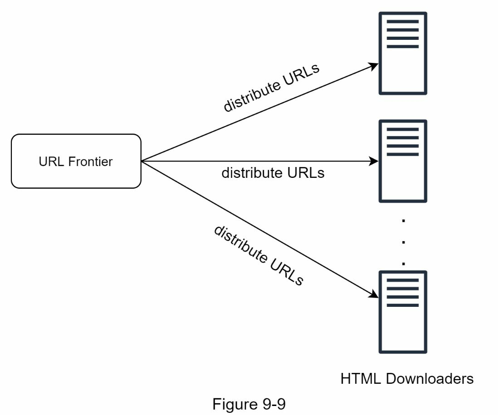
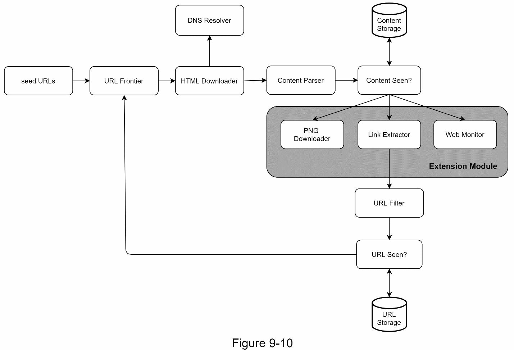

# Chương 09: Thiết kế Trình thu thập dữ liệu Web (Design A Web Crawler)

[← Chương trước](chuong-08-thiet-ke-url-shortener.md) | [Mục lục](README.md) | [Chương tiếp theo →](chuong-10-thiet-ke-he-thong-thong-bao.md)

---


# CHƯƠNG 9: THIẾT KẾ MỘT HỆ THỐNG WEB CRAWLER

Trong chương này, chúng ta sẽ tập trung vào việc thiết kế một **Web Crawler** (trình thu thập dữ liệu web): một câu hỏi phỏng vấn thiết kế hệ thống (*system design interview*) kinh điển và vô cùng thú vị.

Một web crawler còn được gọi là một robot hoặc spider. Nó được các công cụ tìm kiếm (*search engines*) sử dụng rộng rãi để khám phá nội dung mới hoặc nội dung được cập nhật trên web. Nội dung có thể là một trang web, một hình ảnh, một video, một tệp PDF, v.v. Một web crawler bắt đầu bằng cách thu thập một vài trang web và sau đó đi theo các liên kết (*links*) trên những trang đó để thu thập nội dung mới. **Hình 9-1** minh họa một ví dụ trực quan về quy trình thu thập dữ liệu (*crawl process*).



*Hình 9-1*

Một crawler được sử dụng cho nhiều mục đích:

* **Đánh chỉ mục cho công cụ tìm kiếm (Search engine indexing):** Đây là trường hợp sử dụng phổ biến nhất. Một crawler thu thập các trang web để tạo chỉ mục cục bộ (*local index*) cho các công cụ tìm kiếm. Ví dụ: **Googlebot** là web crawler đứng sau công cụ tìm kiếm Google.
* **Lưu trữ web (Web archiving):** Đây là quá trình thu thập thông tin từ web để bảo tồn dữ liệu cho các mục đích sử dụng trong tương lai. Chẳng hạn, nhiều thư viện quốc gia vận hành các crawler để lưu trữ các trang web. Các ví dụ đáng chú ý là Thư viện Quốc hội Hoa Kỳ (US Library of Congress) [1] và kho lưu trữ web của EU [2].
* **Khai phá dữ liệu web (Web mining):** Sự phát triển bùng nổ của web mở ra một cơ hội chưa từng có cho việc khai phá dữ liệu (*data mining*). Khai phá dữ liệu web giúp phát hiện tri thức hữu ích từ internet. Ví dụ: các công ty tài chính hàng đầu sử dụng crawler để tải xuống nội dung các cuộc họp cổ đông và báo cáo thường niên nhằm nắm bắt các sáng kiến trọng điểm của doanh nghiệp.
* **Giám sát web (Web monitoring):** Các crawler giúp giám sát các hành vi vi phạm bản quyền và nhãn hiệu trên Internet. Ví dụ: Digimarc [3] sử dụng crawler để phát hiện các tác phẩm và báo cáo bị vi phạm bản quyền.

Độ phức tạp của việc phát triển một web crawler phụ thuộc vào quy mô (*scale*) mà chúng ta dự định hỗ trợ. Nó có thể là một dự án nhỏ ở trường học chỉ mất vài giờ để hoàn thành, hoặc có thể là một dự án khổng lồ đòi hỏi sự cải tiến liên tục từ một đội ngũ kỹ sư chuyên trách. Do đó, chúng ta sẽ khám phá quy mô và các tính năng cần hỗ trợ ở phần dưới đây.

---

## Bước 1 - Hiểu rõ bài toán và xác định phạm vi thiết kế

Thuật toán cơ bản của một web crawler rất đơn giản:

1. Cho trước một tập hợp các URL, tải xuống tất cả các trang web được trỏ bởi các URL đó.
2. Trích xuất các URL từ những trang web này.
3. Thêm các URL mới vào danh sách các URL cần được tải xuống. Lặp lại 3 bước này.

Liệu một web crawler có thực sự hoạt động đơn giản như thuật toán cơ bản này không? Không hẳn như vậy. Thiết kế một web crawler có khả năng mở rộng quy mô lớn (*vastly scalable*) là một tác vụ cực kỳ phức tạp. Rất khó có khả năng một ai đó có thể thiết kế một web crawler quy mô khổng lồ chỉ trong thời lượng của một buổi phỏng vấn. Trước khi bắt tay vào thiết kế, chúng ta phải đặt các câu hỏi để hiểu rõ các yêu cầu và xác định phạm vi thiết kế (*design scope*):

> **Ứng viên:** Mục đích chính của crawler là gì? Nó được sử dụng để đánh chỉ mục cho công cụ tìm kiếm (*search engine indexing*), khai phá dữ liệu (*data mining*), hay cho mục đích nào khác?  
> **Người phỏng vấn:** Đánh chỉ mục cho công cụ tìm kiếm (*Search engine indexing*).
> 
> **Ứng viên:** Web crawler thu thập bao nhiêu trang web mỗi tháng?  
> **Người phỏng vấn:** 1 tỷ trang ($1\text{ billion pages}$).
> 
> **Ứng viên:** Các loại định dạng nội dung nào được bao gồm? Chỉ HTML hay bao gồm cả các loại nội dung khác như PDF và hình ảnh?  
> **Người phỏng vấn:** Chỉ HTML.
> 
> **Ứng viên:** Chúng ta có cần xem xét các trang web mới được thêm vào hoặc được chỉnh sửa không?  
> **Người phỏng vấn:** Có, chúng ta nên xem xét các trang web mới được thêm vào hoặc được chỉnh sửa.
> 
> **Ứng viên:** Chúng ta có cần lưu trữ các trang HTML đã thu thập từ web không?  
> **Người phỏng vấn:** Có, thời gian lưu trữ lên đến 5 năm.
> 
> **Ứng viên:** Chúng ta xử lý các trang web có nội dung trùng lặp (*duplicate content*) như thế nào?  
> **Người phỏng vấn:** Các trang có nội dung trùng lặp cần được bỏ qua.

Trên đây là một số câu hỏi mẫu mà bạn có thể hỏi người phỏng vấn của mình. Việc hiểu rõ các yêu cầu và làm sáng tỏ những điểm chưa rõ ràng là rất quan trọng. Ngay cả khi bạn được yêu cầu thiết kế một sản phẩm có vẻ trực quan như web crawler, bạn và người phỏng vấn có thể không có cùng các giả định ban đầu.

Bên cạnh các yêu cầu chức năng (*functionalities*) cần làm rõ với người phỏng vấn, việc ghi nhận các đặc tính sau của một web crawler tốt cũng rất quan trọng:

* **Khả năng mở rộng (Scalability):** Web vô cùng rộng lớn. Có hàng tỷ trang web ngoài kia. Việc thu thập dữ liệu web phải cực kỳ hiệu quả bằng cách sử dụng kỹ thuật song song hóa (*parallelization*).
* **Độ mạnh mẽ / Khả năng chống chịu lỗi (Robustness):** Web có đầy rẫy những cạm bẫy. Mã HTML lỗi, các máy chủ không phản hồi, sự cố sập hệ thống (*crashes*), các liên kết độc hại (*malicious links*), v.v. đều rất phổ biến. Crawler phải xử lý được tất cả các trường hợp biên (*edge cases*) đó.
* **Tính lịch sự (Politeness):** Crawler không được thực hiện quá nhiều yêu cầu đến một trang web trong một khoảng thời gian ngắn.
* **Khả năng mở rộng tính năng (Extensibility):** Hệ thống phải linh hoạt để chỉ cần những thay đổi tối thiểu khi hỗ trợ các loại nội dung mới. Ví dụ: nếu muốn thu thập các tệp hình ảnh trong tương lai, chúng ta không cần phải thiết kế lại toàn bộ hệ thống.

### Ước tính sơ bộ (Back of the envelope estimation)

Các ước tính sau đây dựa trên nhiều giả định, và việc trao đổi với người phỏng vấn để đạt được sự thống nhất là rất quan trọng:

* Giả sử có 1 tỷ trang web được tải xuống mỗi tháng.
* **QPS (Queries Per Second):**
  $$\text{QPS} = \frac{1.000.000.000}{30\text{ ngày} \times 24\text{ giờ} \times 3600\text{ giây}} \approx 400\text{ trang/giây}$$
* **Peak QPS (QPS đỉnh):**
  $$\text{Peak QPS} = 2 \times \text{QPS} = 800\text{ trang/giây}$$
* Giả sử kích thước trung bình của một trang web là $500\text{ KB}$.
* Dung lượng lưu trữ mỗi tháng:
  $$1\text{ tỷ trang} \times 500\text{ KB} = 500\text{ TB lưu trữ mỗi tháng}$$
  *(Nếu bạn chưa rõ về các đơn vị lưu trữ kỹ thuật số, hãy xem lại phần "Power of 2" ở Chương 2).*
* Giả sử dữ liệu được lưu trữ trong 5 năm:
  $$500\text{ TB} \times 12\text{ tháng} \times 5\text{ năm} = 30\text{ PB}$$
  Cần một hệ thống lưu trữ dung lượng $30\text{ PB}$ để lưu trữ nội dung trong vòng 5 năm.

---

## Bước 2 - Đề xuất thiết kế cấp cao và đạt được sự đồng thuận

Khi các yêu cầu đã rõ ràng, chúng ta chuyển sang phần thiết kế cấp cao (*high-level design*). Lấy cảm hứng từ các nghiên cứu trước đây về web crawling [4] [5], chúng tôi đề xuất một thiết kế cấp cao như được hiển thị trong **Hình 9-2**.



*Hình 9-2*

Trước tiên, chúng ta cùng khám phá từng thành phần trong thiết kế để hiểu rõ chức năng của chúng. Sau đó, chúng ta sẽ xem xét quy trình làm việc (*workflow*) của crawler từng bước một.

### Seed URLs
Một web crawler sử dụng các **Seed URLs** (URL hạt giống) làm điểm khởi đầu cho quá trình thu thập dữ liệu. Ví dụ: để thu thập tất cả các trang web từ trang web của một trường đại học, một cách trực quan để chọn Seed URLs là sử dụng tên miền của trường đại học đó.

Để thu thập toàn bộ không gian web, chúng ta cần sáng tạo trong việc chọn Seed URLs. Một Seed URL tốt đóng vai trò là một điểm khởi đầu lý tưởng mà từ đó crawler có thể tận dụng để duyệt qua càng nhiều liên kết càng tốt. Chiến lược chung là chia toàn bộ không gian URL thành các không gian nhỏ hơn. Cách tiếp cận đầu tiên được đề xuất là dựa trên vị trí địa lý (*locality*), vì các quốc gia khác nhau có thể có các trang web phổ biến khác nhau. Một cách khác là chọn Seed URLs dựa trên chủ đề; ví dụ, chúng ta có thể chia không gian URL thành mua sắm, thể thao, chăm sóc sức khỏe, v.v. Việc lựa chọn Seed URL là một câu hỏi mở (*open-ended question*). Bạn không nhất thiết phải đưa ra một câu trả lời hoàn hảo. Hãy cứ thoải mái tư duy thành lời (*think out loud*).

### URL Frontier
Hầu hết các web crawler hiện đại chia trạng thái thu thập (*crawl state*) thành hai loại: **cần được tải xuống** (*to be downloaded*) và **đã được tải xuống** (*already downloaded*). Thành phần lưu trữ các URL cần được tải xuống được gọi là **URL Frontier**. Bạn có thể xem thành phần này như một hàng đợi vào trước - ra trước (First-in-First-out - FIFO queue). Để biết thông tin chi tiết về URL Frontier, vui lòng tham khảo phần phân tích chuyên sâu (*deep dive*).

### HTML Downloader
**HTML Downloader** có nhiệm vụ tải xuống các trang web từ internet. Các URL này được cung cấp bởi URL Frontier.

### DNS Resolver
Để tải xuống một trang web, một URL phải được chuyển đổi thành một địa chỉ IP. HTML Downloader gọi **DNS Resolver** để lấy địa chỉ IP tương ứng cho URL đó. Chẳng hạn, URL `www.wikipedia.org` được chuyển đổi thành địa chỉ IP `198.35.26.96` tính đến ngày 05/03/2019.

### Content Parser
Sau khi một trang web được tải xuống, nó phải được phân tích cú pháp (*parse*) và xác thực tính hợp lệ (*validate*), bởi vì các trang web có định dạng lỗi (*malformed web pages*) có thể gây ra sự cố và làm lãng phí không gian lưu trữ. Việc triển khai một content parser trực tiếp ngay trên máy chủ thu thập dữ liệu (*crawl server*) sẽ làm chậm tiến trình thu thập. Do đó, **Content Parser** được tách thành một thành phần độc lập.

### Content Seen?
Nghiên cứu trực tuyến [6] tiết lộ rằng $29\%$ các trang web có nội dung trùng lặp, điều này có thể khiến cùng một nội dung bị lưu trữ nhiều lần. Chúng tôi đưa vào cấu trúc dữ liệu **"Content Seen?"** (Đã xem nội dung?) để loại bỏ sự dư thừa dữ liệu và rút ngắn thời gian xử lý. Nó giúp phát hiện nội dung mới so với nội dung đã được lưu trữ trước đó trong hệ thống. Để so sánh hai tài liệu HTML, chúng ta có thể so sánh từng ký tự một. Tuy nhiên, phương pháp này rất chậm và tốn thời gian, đặc biệt là khi liên quan đến hàng tỷ trang web. Một cách hiệu quả để thực hiện tác vụ này là so sánh các giá trị băm (*hash values*) của hai trang web [7].

### Content Storage
Đây là hệ thống lưu trữ dùng để lưu nội dung HTML. Việc lựa chọn hệ thống lưu trữ phụ thuộc vào các yếu tố như loại dữ liệu, kích thước dữ liệu, tần suất truy cập, vòng đời lưu trữ, v.v. Cả đĩa cứng (*disk*) và bộ nhớ (*memory*) đều được sử dụng:
* Phần lớn nội dung được lưu trữ trên đĩa cứng vì tập dữ liệu quá lớn, không thể chứa vừa trong bộ nhớ.
* Các nội dung phổ biến (*popular content*) được giữ trong bộ nhớ để giảm độ trễ (*latency*).

### URL Extractor
**URL Extractor** phân tích cú pháp và trích xuất các liên kết từ các trang HTML. **Hình 9-3** minh họa một ví dụ về quy trình trích xuất liên kết. Các đường dẫn tương đối (*relative paths*) được chuyển đổi thành các URL tuyệt đối (*absolute URLs*) bằng cách thêm tiền tố `"https://en.wikipedia.org"`.

---

### Bộ lọc URL (URL Filter)
**Bộ lọc URL (URL Filter)** loại trừ một số loại nội dung, phần mở rộng tệp (file extensions), liên kết lỗi và các URL nằm trong danh sách đen ("blacklisted" sites).

### Đã thấy URL? (URL Seen?)
**“URL Seen?”** là một cấu trúc dữ liệu theo dõi các URL đã được truy cập trước đó hoặc đã nằm trong URL Frontier. “URL Seen?” giúp tránh việc thêm cùng một URL nhiều lần, vì điều này có thể làm tăng tải máy chủ và gây ra các vòng lặp vô hạn tiềm ẩn.

**Bloom Filter** và **Hash Table** (bảng băm) là các kỹ thuật phổ biến để hiện thực hóa thành phần “URL Seen?”. Chúng tôi sẽ không đi sâu vào chi tiết triển khai của Bloom Filter và Hash Table ở đây. Để biết thêm thông tin, vui lòng tham khảo các tài liệu tham khảo [4] [8].

### Bộ lưu trữ URL (URL Storage)
**Bộ lưu trữ URL (URL Storage)** lưu trữ các URL đã được truy cập.

Cho đến thời điểm này, chúng ta đã thảo luận qua từng thành phần của hệ thống. Tiếp theo, chúng ta sẽ kết hợp chúng lại với nhau để giải thích luồng hoạt động (workflow).

### Luồng hoạt động của Web Crawler (Web crawler workflow)
Để giải thích rõ hơn quy trình làm việc theo từng bước, các số thứ tự trình tự đã được thêm vào sơ đồ thiết kế như hiển thị trong **Hình 9-4**.



---



* **Bước 1:** Thêm các URL hạt giống (seed URLs) vào **URL Frontier**.
* **Bước 2:** **HTML Downloader** lấy danh sách các URL từ **URL Frontier**.
* **Bước 3:** **HTML Downloader** lấy địa chỉ IP của các URL từ bộ phân giải tên miền (**DNS resolver**) và bắt đầu tải xuống.
* **Bước 4:** **Content Parser** phân tích cú pháp các trang HTML và kiểm tra xem các trang có bị lỗi định dạng (malformed) hay không.
* **Bước 5:** Sau khi nội dung được phân tích cú pháp và xác thực hợp lệ, nó được chuyển đến thành phần **“Content Seen?”**.
* **Bước 6:** Thành phần **“Content Seen”** kiểm tra xem trang HTML đã tồn tại trong bộ lưu trữ hay chưa.
  * Nếu nó đã có trong bộ lưu trữ, điều này có nghĩa là nội dung tương tự ở một URL khác đã được xử lý trước đó. Trong trường hợp này, trang HTML sẽ bị loại bỏ.
  * Nếu nó chưa có trong bộ lưu trữ, hệ thống chưa từng xử lý nội dung tương tự này. Nội dung được chuyển tiếp đến **Bộ trích xuất liên kết (Link Extractor)**.
* **Bước 7:** **Link Extractor** trích xuất các liên kết từ các trang HTML.
* **Bước 8:** Các liên kết được trích xuất được chuyển đến **Bộ lọc URL (URL Filter)**.
* **Bước 9:** Sau khi các liên kết được lọc, chúng được chuyển đến thành phần **“URL Seen?”**.
* **Bước 10:** Thành phần **“URL Seen”** kiểm tra xem một URL đã có trong bộ lưu trữ hay chưa; nếu có, nghĩa là nó đã được xử lý trước đó và không cần làm gì thêm.
* **Bước 11:** Nếu một URL chưa từng được xử lý trước đây, nó sẽ được thêm vào **URL Frontier**.

---

### Bước 3 - Đi sâu vào thiết kế chi tiết (Design deep dive)

Cho đến thời điểm hiện tại, chúng ta đã thảo luận về thiết kế cấp cao (high-level design). Tiếp theo, chúng ta sẽ đi sâu vào thảo luận các thành phần kiến trúc và kỹ thuật quan trọng nhất:
* Tìm kiếm theo chiều sâu (**DFS**) so với Tìm kiếm theo chiều rộng (**BFS**)
* **URL Frontier**
* **HTML Downloader**
* Độ bền bỉ (**Robustness**)
* Khả năng mở rộng (**Extensibility**)
* Phát hiện và tránh nội dung có vấn đề

#### DFS so với BFS (DFS vs BFS)
Bạn có thể xem World Wide Web như một đồ thị có hướng (directed graph), trong đó các trang web đóng vai trò là các nút (nodes) và các siêu liên kết (hyperlinks / URLs) đóng vai trò là các cạnh (edges). Quá trình thu thập dữ liệu (crawl) có thể được coi là việc duyệt qua một đồ thị có hướng từ một trang web này sang các trang web khác. Hai thuật toán duyệt đồ thị phổ biến là **DFS** và **BFS**. Tuy nhiên, DFS thường không phải là một lựa chọn tốt vì độ sâu của DFS có thể rất lớn.

BFS thường được sử dụng bởi các web crawler và được hiện thực hóa bằng một hàng đợi nhập trước - xuất trước (**FIFO queue**). Trong một hàng đợi FIFO, các URL được lấy ra theo đúng thứ tự mà chúng được đưa vào hàng đợi. Tuy nhiên, cách triển khai này gặp phải hai vấn đề:

* Hầu hết các liên kết từ cùng một trang web đều dẫn ngược lại cùng một máy chủ lưu trữ (host). Trong **Hình 9-5**, tất cả các liên kết trong `wikipedia.com` đều là các liên kết nội bộ, khiến crawler bận rộn xử lý các URL từ cùng một máy chủ lưu trữ (`wikipedia.com`). Khi crawler cố gắng tải các trang web song song, các máy chủ của Wikipedia sẽ bị tràn ngập yêu cầu (flooded with requests). Điều này bị coi là "bất lịch sự" (**impolite**).



---

* BFS tiêu chuẩn không tính đến độ ưu tiên của một URL. Web là một không gian khổng lồ và không phải trang nào cũng có cùng mức chất lượng và tầm quan trọng như nhau. Do đó, chúng ta có thể muốn ưu tiên các URL dựa trên thứ hạng trang (page ranks), lưu lượng truy cập web (web traffic), tần suất cập nhật (update frequency), v.v.

#### URL Frontier
**URL Frontier** giúp giải quyết những vấn đề này. Một URL Frontier là một cấu trúc dữ liệu lưu trữ các URL chuẩn bị được tải xuống. URL Frontier là một thành phần quan trọng để đảm bảo tính lịch sự (**politeness**), sự ưu tiên URL (**URL prioritization**), và độ tươi mới của dữ liệu (**freshness**). Một số bài báo đáng chú ý về URL Frontier được đề cập trong các tài liệu tham khảo [5] [9]. Các phát hiện từ những tài liệu này như sau:

#### Tính lịch sự (Politeness)
Nói chung, một web crawler nên tránh gửi quá nhiều yêu cầu đến cùng một máy chủ lưu trữ (hosting server) trong một khoảng thời gian ngắn. Việc gửi quá nhiều yêu cầu bị coi là "bất lịch sự" hoặc thậm chí bị xem là một cuộc tấn công từ chối dịch vụ (**DOS - Denial of Service**). Ví dụ, nếu không có bất kỳ ràng buộc nào, crawler có thể gửi hàng nghìn yêu cầu mỗi giây đến cùng một trang web. Điều này có thể làm tê liệt các máy chủ web.

Ý tưởng chung để thực thi tính lịch sự là tải xuống từng trang một tại một thời điểm từ cùng một host. Có thể thêm một khoảng thời gian trễ (delay) giữa hai tác vụ tải xuống. Ràng buộc về tính lịch sự được triển khai bằng cách duy trì một ánh xạ từ tên máy chủ lưu trữ của trang web (website hostnames) đến các luồng tải xuống / luồng thực thi (worker threads). Mỗi luồng downloader có một hàng đợi FIFO riêng biệt và chỉ tải xuống các URL lấy được từ hàng đợi đó. **Hình 9-6** minh họa thiết kế quản lý tính lịch sự.



---

* **Queue router (Bộ định tuyến hàng đợi):** Đảm bảo rằng mỗi hàng đợi ($b_1, b_2, \dots, b_n$) chỉ chứa các URL đến từ cùng một host.
* **Mapping table (Bảng ánh xạ):** Ánh xạ mỗi host vào một hàng đợi tương ứng.
* **FIFO queues $b_1, b_2$ đến $b_n$:** Mỗi hàng đợi chỉ chứa các URL từ cùng một host.
* **Queue selector (Bộ chọn hàng đợi):** Mỗi worker thread được ánh xạ tới một hàng đợi FIFO, và nó chỉ tải xuống các URL từ hàng đợi đó. Logic lựa chọn hàng đợi được thực hiện bởi Queue selector.
* **Worker thread 1 đến N:** Một worker thread tải xuống các trang web lần lượt từng trang một từ cùng một host. Một khoảng trễ (delay) có thể được thêm vào giữa hai tác vụ tải xuống.

#### Độ ưu tiên (Priority)
Một bài đăng ngẫu nhiên từ một diễn đàn thảo luận về các sản phẩm của Apple mang trọng số rất khác so với các bài đăng trên trang chủ của Apple. Mặc dù cả hai đều chứa từ khóa "Apple", nhưng việc crawler ưu tiên thu thập dữ liệu trang chủ Apple trước là điều hoàn toàn hợp lý.

Chúng ta ưu tiên các URL dựa trên mức độ hữu ích, có thể được đo lường bằng **PageRank** [10], lưu lượng truy cập trang web (website traffic), tần suất cập nhật, v.v. **“Prioritizer” (Bộ xác định ưu tiên)** là thành phần xử lý việc xếp thứ tự ưu tiên cho URL. Tham khảo tài liệu tham khảo [5] [10] để biết thông tin chuyên sâu về khái niệm này.

**Hình 9-7** minh họa thiết kế quản lý mức độ ưu tiên của URL.



---

* **Prioritizer (Bộ xác định ưu tiên):** Nhận các URL đầu vào và tính toán mức độ ưu tiên.
* **Queue $f_1$ đến $f_n$:** Mỗi hàng đợi được gán một mức độ ưu tiên cụ thể. Các hàng đợi có độ ưu tiên cao được chọn với xác suất cao hơn.
* **Queue selector (Bộ chọn hàng đợi):** Chọn ngẫu nhiên một hàng đợi với xu hướng thiên vị (ưu tiên xác suất cao hơn) đối với các hàng đợi có mức ưu tiên cao hơn.

**Hình 9-8** trình bày thiết kế tổng thể của URL Frontier, bao gồm hai mô-đun chính:
* **Front queues (Các hàng đợi phía trước):** Quản lý mức độ ưu tiên (prioritization).
* **Back queues (Các hàng đợi phía sau):** Quản lý tính lịch sự (politeness).



---

### Độ tươi mới của dữ liệu (Freshness)

Các trang web liên tục được thêm mới, xóa bỏ và chỉnh sửa. Một trình thu thập dữ liệu web (web crawler) phải định kỳ thu thập lại (recrawl) các trang đã tải xuống nhằm giữ cho tập dữ liệu của chúng ta luôn tươi mới (fresh). Việc thu thập lại toàn bộ các URL rất tốn thời gian và tiêu tốn nhiều tài nguyên. Dưới đây liệt kê một số chiến lược để tối ưu hóa độ tươi mới:

*   Thu thập lại dựa trên lịch sử cập nhật của các trang web.
*   Thiết lập mức độ ưu tiên cho các URL, đồng thời thu thập lại các trang quan trọng trước tiên và với tần suất thường xuyên hơn.

### Lưu trữ cho URL Frontier (Storage for URL Frontier)

Trong các tác vụ thu thập dữ liệu thực tế phục vụ công cụ tìm kiếm, số lượng URL trong frontier có thể lên tới hàng trăm triệu [4]. Việc lưu trữ toàn bộ dữ liệu trong bộ nhớ (in-memory) vừa không đảm bảo tính bền vững (durable), vừa không có khả năng mở rộng (scalable). Việc lưu trữ toàn bộ trên đĩa cứng cũng không khả thi vì đĩa cứng có tốc độ truy xuất chậm; và nó có thể dễ dàng trở thành điểm nghẽn cổ chai (bottleneck) cho toàn bộ quá trình thu thập dữ liệu.

Chúng tôi đã áp dụng một phương pháp tiếp cận lai (hybrid approach). Phần lớn các URL được lưu trữ trên đĩa cứng, nhờ đó không gian lưu trữ không còn là vấn đề nan giải. Để giảm chi phí của các thao tác đọc và ghi vào đĩa cứng, chúng tôi duy trì các bộ đệm (buffers) trong bộ nhớ phục vụ cho các thao tác đưa vào hàng đợi/lấy ra khỏi hàng đợi (enqueue/dequeue operations). Dữ liệu trong bộ đệm sẽ được ghi định kỳ xuống đĩa cứng.

---

### Trình tải xuống HTML (HTML Downloader)

Trình tải xuống HTML (HTML Downloader) tải về các trang web từ internet bằng giao thức HTTP. Trước khi đi sâu thảo luận về HTML Downloader, trước tiên chúng ta cùng xem xét Giao thức loại trừ robot (Robots Exclusion Protocol).

#### Robots.txt

Robots.txt, hay còn gọi là Robots Exclusion Protocol (Giao thức loại trừ robot), là một tiêu chuẩn được các website sử dụng để giao tiếp với các trình thu thập dữ liệu. Nó chỉ định rõ những trang nào mà crawler được phép tải về. Trước khi cố gắng thu thập dữ liệu từ một trang web, crawler trước hết phải kiểm tra tệp `robots.txt` tương ứng của trang đó và tuân thủ nghiêm ngặt các quy tắc bên trong.

Nhằm tránh việc phải tải lặp đi lặp lại tệp `robots.txt`, chúng tôi lưu vào bộ nhớ đệm (cache) kết quả của tệp này. Tệp sẽ được tải về và lưu vào cache theo định kỳ. Dưới đây là một đoạn trích từ tệp `robots.txt` của https://www.amazon.com/robots.txt. Một số thư mục như `creatorhub` bị cấm truy cập đối với Googlebot.

```http
User-agent: Googlebot
Disallow: /creatorhub/*
Disallow: /rss/people/*/reviews
Disallow: /gp/pdp/rss/*/reviews
Disallow: /gp/cdp/member-reviews/
Disallow: /gp/aw/cr/
```

Bên cạnh `robots.txt`, tối ưu hóa hiệu năng (performance optimization) là một khái niệm quan trọng khác mà chúng tôi sẽ đề cập đối với HTML downloader.

---

### Tối ưu hóa hiệu năng (Performance optimization)

Dưới đây là danh sách các kỹ thuật tối ưu hóa hiệu năng cho HTML downloader:

#### 1. Thu thập dữ liệu phân tán (Distributed crawl)
Để đạt được hiệu năng cao, các tác vụ thu thập dữ liệu được phân tán tới nhiều máy chủ, và mỗi máy chủ chạy đa luồng (multiple threads). Không gian URL được phân vùng (partitioned) thành các phần nhỏ hơn; vì vậy, mỗi downloader chịu trách nhiệm xử lý một tập con các URL. **Hình 9-9** minh họa một ví dụ về thu thập dữ liệu phân tán.



#### 2. Bộ đệm phân giải DNS (Cache DNS Resolver)
DNS Resolver là một điểm nghẽn cổ chai đối với các crawler do các yêu cầu DNS có thể tốn nhiều thời gian bởi tính chất đồng bộ (synchronous nature) của nhiều giao diện DNS. Thời gian phản hồi của DNS dao động trong khoảng từ 10ms đến 200ms. Một khi yêu cầu tới DNS được thực hiện bởi một luồng của crawler, các luồng khác sẽ bị chặn (blocked) cho đến khi yêu cầu đầu tiên hoàn tất. Việc duy trì bộ đệm DNS (DNS cache) riêng để tránh gọi tới DNS quá thường xuyên là một kỹ thuật hiệu quả nhằm tối ưu tốc độ. DNS cache của chúng tôi lưu giữ ánh xạ giữa tên miền sang địa chỉ IP và được cập nhật định kỳ bằng các cron job.

#### 3. Tính cục bộ theo vị trí địa lý (Locality)
Phân tán các máy chủ thu thập dữ liệu theo vị trí địa lý. Khi các máy chủ crawler ở gần các máy chủ lưu trữ website (website hosts) hơn, crawler sẽ có thời gian tải xuống nhanh hơn. Thiết kế tính cục bộ (design locality) áp dụng cho hầu hết các thành phần của hệ thống: máy chủ crawl, bộ đệm (cache), hàng đợi (queue), hệ thống lưu trữ (storage), v.v.

#### 4. Thời gian chờ ngắn (Short timeout)
Một số máy chủ web phản hồi chậm hoặc có thể hoàn toàn không phản hồi. Để tránh thời gian chờ đợi kéo dài, một khoảng thời gian chờ tối đa (maximal wait time) được thiết lập sẵn. Nếu một máy chủ không phản hồi trong khoảng thời gian đã định trước, crawler sẽ dừng tác vụ đó và chuyển sang thu thập các trang khác.

---

### Tính mạnh mẽ và khả năng chịu lỗi (Robustness)

Bên cạnh việc tối ưu hóa hiệu năng, tính mạnh mẽ (robustness) cũng là một yếu tố cân nhắc quan trọng. Chúng tôi đề xuất một vài phương pháp tiếp cận nhằm nâng cao tính mạnh mẽ của hệ thống:

*   **Consistent hashing (Băm nhất quán):** Kỹ thuật này giúp phân phối tải đồng đều giữa các downloader. Một máy chủ downloader mới có thể được thêm vào hoặc loại bỏ dễ dàng thông qua consistent hashing. Tham khảo *Chương 5: Thiết kế Consistent Hashing* để biết thêm chi tiết.
*   **Lưu trạng thái và dữ liệu thu thập (Save crawl states and data):** Nhằm đề phòng các sự cố lỗi (failures), trạng thái và dữ liệu thu thập sẽ được ghi vào một hệ thống lưu trữ. Một tiến trình thu thập bị gián đoạn có thể dễ dàng khởi động lại bằng cách tải lại các trạng thái và dữ liệu đã được lưu trữ.
*   **Xử lý ngoại lệ (Exception handling):** Lỗi là điều không thể tránh khỏi và xảy ra phổ biến trong một hệ thống quy mô lớn. Crawler bắt buộc phải xử lý các ngoại lệ một cách mềm dẻo (gracefully) mà không làm sập (crash) hệ thống.
*   **Kiểm tra tính hợp lệ của dữ liệu (Data validation):** Đây là một biện pháp quan trọng để ngăn chặn các lỗi hệ thống.

---

### Khả năng mở rộng (Extensibility)

Bởi hầu như mọi hệ thống đều phát triển và tiến hóa theo thời gian, một trong những mục tiêu thiết kế là làm cho hệ thống đủ linh hoạt để hỗ trợ các loại nội dung mới. Crawler có thể được mở rộng bằng cách cắm thêm các mô-đun mới (plugging in new modules). **Hình 9-10** minh họa cách bổ sung các mô-đun mới.



*   Mô-đun **PNG Downloader** được cắm vào để tải các tệp định dạng PNG.
*   Mô-đun **Web Monitor** được bổ sung để giám sát web và ngăn chặn các hành vi xâm phạm bản quyền và thương hiệu.

---

### Phát hiện và phòng tránh nội dung có vấn đề (Detect and avoid problematic content)

Phần này thảo luận về việc phát hiện và ngăn chặn các nội dung dư thừa, vô nghĩa hoặc độc hại.

#### 1. Nội dung dư thừa, trùng lặp (Redundant content)
Như đã thảo luận trước đó, gần 30% các trang web là trùng lặp. Các hàm băm (hashes) hoặc mã tổng kiểm (checksums) giúp phát hiện sự trùng lặp này [11].

#### 2. Bẫy nhện (Spider traps)
Bẫy nhện (spider trap) là một trang web khiến cho crawler rơi vào một vòng lặp vô tận. Ví dụ, một cấu trúc thư mục sâu vô hạn được liệt kê như sau:

`www.spidertrapexample.com/foo/bar/foo/bar/foo/bar/…`

Những bẫy nhện như vậy có thể được phòng tránh bằng cách đặt độ dài tối đa cho URL. Tuy nhiên, không có một giải pháp vạn năng duy nhất nào tồn tại để phát hiện mọi bẫy nhện. Các trang web chứa bẫy nhện thường dễ nhận diện do có số lượng trang web được phát hiện nhiều bất thường trên các trang web đó. Rất khó để phát triển các thuật toán tự động nhằm phòng tránh bẫy nhện; tuy nhiên, người dùng có thể xác minh và nhận diện thủ công một bẫy nhện, sau đó loại trừ các trang web đó khỏi crawler hoặc áp dụng một số bộ lọc URL tùy chỉnh (customized URL filters).

#### 3. Nhiễu dữ liệu (Data noise)
Một số nội dung có rất ít hoặc không có giá trị, chẳng hạn như quảng cáo, các đoạn mã lệnh (code snippets), URL rác (spam URLs), v.v. Những nội dung này không hữu ích đối với các crawler và nên được loại trừ nếu có thể.

---

### Bước 4 - Tổng kết (Step 4 - Wrap up)

Trong chương này, đầu tiên chúng ta đã thảo luận về các đặc tính của một crawler tốt: khả năng mở rộng (scalability), tính lịch sự (politeness), khả năng mở rộng tính năng (extensibility) và tính mạnh mẽ (robustness). Sau đó, chúng tôi đã đề xuất một thiết kế và thảo luận về các thành phần cốt lõi.

Việc xây dựng một web crawler có khả năng mở rộng cao không phải là một nhiệm vụ đơn giản vì thế giới web vô cùng rộng lớn và đầy rẫy cạm bẫy. Mặc dù chúng ta đã đề cập đến rất nhiều chủ đề, chúng ta vẫn còn bỏ lỡ nhiều điểm thảo luận liên quan:

*   **Server-side rendering (Kết xuất phía máy chủ):** Rất nhiều trang web sử dụng các tập lệnh như JavaScript, AJAX, v.v. để tạo liên kết động ngay trong lúc chạy (on the fly). Nếu chúng ta tải về và phân tích cú pháp (parse) trang web trực tiếp, chúng ta sẽ không thể lấy được các liên kết được sinh động này. Để giải quyết vấn đề này, chúng ta thực hiện server-side rendering (còn được gọi là dynamic rendering) trước khi phân tích cú pháp một trang [12].
*   **Lọc bỏ các trang không mong muốn (Filter out unwanted pages):** Với dung lượng lưu trữ và tài nguyên thu thập dữ liệu có hạn, một thành phần chống thư rác (anti-spam) sẽ rất có ích trong việc lọc bỏ các trang chất lượng thấp và trang rác [13] [14].
*   **Nhân bản và phân mảnh cơ sở dữ liệu (Database replication and sharding):** Các kỹ thuật như replication và sharding được sử dụng để cải thiện tính sẵn sàng (availability), khả năng mở rộng (scalability) và độ tin cậy (reliability) của tầng dữ liệu.
*   **Mở rộng theo chiều ngang (Horizontal scaling):** Đối với các tác vụ thu thập quy mô lớn, hàng trăm hoặc thậm chí hàng nghìn máy chủ là cần thiết để thực hiện các tác vụ tải xuống. Chìa khóa quan trọng là phải giữ cho các máy chủ không lưu trạng thái (stateless).
*   **Tính sẵn sàng, tính nhất quán và độ tin cậy (Availability, consistency, and reliability):** Những khái niệm này là cốt lõi cho sự thành công của bất kỳ hệ thống quy mô lớn nào. Chúng ta đã thảo luận chi tiết các khái niệm này trong Chương 1. Hãy ôn lại kiến thức về các chủ đề này.
*   **Phân tích dữ liệu (Analytics):** Thu thập và phân tích dữ liệu là những phần quan trọng của bất kỳ hệ thống nào bởi vì dữ liệu chính là thành phần then chốt để tinh chỉnh hệ thống (fine-tuning).

Xin chúc mừng bạn đã đi được một chặng đường dài đến đây! Giờ hãy tự khen ngợi bản thân một chút. Bạn đã làm rất tốt!

---

### Tài liệu tham khảo (Reference materials)

* **[1] Thư viện Quốc hội Hoa Kỳ (US Library of Congress):** [https://www.loc.gov/websites/](https://www.loc.gov/websites/)
* **[2] Kho lưu trữ Web Châu Âu (EU Web Archive):** [http://data.europa.eu/webarchive](http://data.europa.eu/webarchive)
* **[3] Digimarc:** [https://www.digimarc.com/products/digimarc-services/piracy-intelligence](https://www.digimarc.com/products/digimarc-services/piracy-intelligence)
* **[4] Heydon A., Najork M.** *Mercator: A scalable, extensible web crawler* (Mercator: Trình thu thập dữ liệu web có khả năng mở rộng và mở rộng tính năng), Tạp chí World Wide Web, Tập 2 (Số 4) (Năm 1999), các trang 219–229.
* **[5] Christopher Olston, Marc Najork:** *Web Crawling* (Thu thập dữ liệu web).  
  [http://infolab.stanford.edu/~olston/publications/crawling_survey.pdf](http://infolab.stanford.edu/~olston/publications/crawling_survey.pdf)
* **[6] 29% Of Sites Face Duplicate Content Issues** (29% số website gặp sự cố trùng lặp nội dung): [https://tinyurl.com/y6tmh55y](https://tinyurl.com/y6tmh55y)
* **[7] Rabin M.O., và cộng sự.** *Fingerprinting by random polynomials* (Tạo dấu vân tay dữ liệu bằng đa thức ngẫu nhiên), Trung tâm Nghiên cứu Công nghệ Điện toán, Phòng thí nghiệm Tính toán Aiken, Đại học Harvard (Năm 1981).
* **[8] B. H. Bloom,** “*Space/time trade-offs in hash coding with allowable errors*” (Sự đánh đổi không gian/thời gian trong mã hóa băm với sai số cho phép), Tạp chí Communications of the ACM, Tập 13, Số 7, các trang 422–426, Năm 1970.
* **[9] Donald J. Patterson,** *Web Crawling* (Thu thập dữ liệu web):  
  [https://www.ics.uci.edu/~lopes/teaching/cs221W12/slides/Lecture05.pdf](https://www.ics.uci.edu/~lopes/teaching/cs221W12/slides/Lecture05.pdf)
* **[10] L. Page, S. Brin, R. Motwani, và T. Winograd,** “*The PageRank citation ranking: Bringing order to the web*” (Xếp hạng trích dẫn PageRank: Mang lại trật tự cho trang web), Báo cáo Kỹ thuật, Đại học Stanford, Năm 1998.
* **[11] Burton Bloom.** *Space/time trade-offs in hash coding with allowable errors* (Sự đánh đổi không gian/thời gian trong mã hóa băm với sai số cho phép). Tạp chí Communications of the ACM, Tập 13 (Số 7), các trang 422--426, Tháng 7 năm 1970.
* **[12] Google Dynamic Rendering (Kết xuất động của Google):**  
  [https://developers.google.com/search/docs/guides/dynamic-rendering](https://developers.google.com/search/docs/guides/dynamic-rendering)
* **[13] T. Urvoy, T. Lavergne, và P. Filoche,** “*Tracking web spam with hidden style similarity*” (Theo dấu web spam bằng sự tương đồng phong cách ẩn), trong Kỷ yếu Hội thảo Quốc tế lần thứ 2 về Truy xuất Thông tin Đối kháng trên Web (Adversarial Information Retrieval on the Web), Năm 2006.
* **[14] H.-T. Lee, D. Leonard, X. Wang, và D. Loguinov,** “*IRLbot: Scaling to 6 billion pages and beyond*” (IRLbot: Mở rộng quy mô lên 6 tỷ trang và hơn thế nữa), trong Kỷ yếu Hội nghị Quốc tế lần thứ 17 về World Wide Web (International World Wide Web Conference), Năm 2008.


---

[← Chương trước](chuong-08-thiet-ke-url-shortener.md) | [Mục lục](README.md) | [Chương tiếp theo →](chuong-10-thiet-ke-he-thong-thong-bao.md)
