# Chương 10: Thiết kế Hệ thống thông báo (Design A Notification System)

[← Chương trước](chuong-09-thiet-ke-web-crawler.md) | [Mục lục](README.md) | [Chương tiếp theo →](chuong-11-thiet-ke-news-feed-system.md)

---


# CHƯƠNG 10: THIẾT KẾ HỆ THỐNG THÔNG BÁO (DESIGN A NOTIFICATION SYSTEM)

Hệ thống thông báo đã trở thành một tính năng vô cùng phổ biến đối với nhiều ứng dụng trong những năm gần đây. Một thông báo sẽ cảnh báo người dùng những thông tin quan trọng như tin nóng (breaking news), cập nhật sản phẩm, sự kiện, chương trình ưu đãi, v.v. Nó đã trở thành một phần không thể thiếu trong cuộc sống hàng ngày của chúng ta. Trong chương này, bạn được yêu cầu thiết kế một hệ thống thông báo.

Thông báo không chỉ đơn thuần là thông báo đẩy trên thiết bị di động (mobile push notification). Ba định dạng thông báo phổ biến gồm: thông báo đẩy di động (mobile push notification), tin nhắn SMS và Email. Hình 10-1 minh họa một ví dụ về từng loại thông báo này.

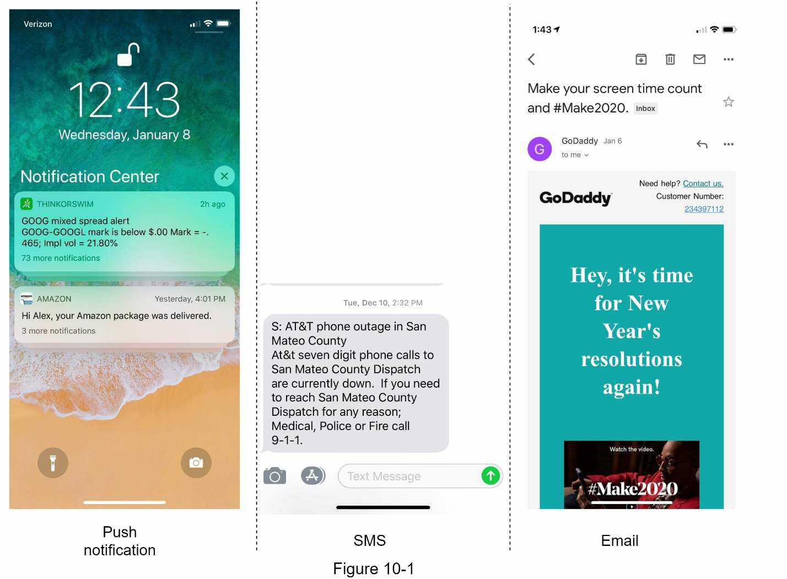

---

## Bước 1 - Hiểu rõ bài toán và xác định phạm vi thiết kế (Understand the problem and establish design scope)

Xây dựng một hệ thống có khả năng mở rộng (scalable system) để gửi đi hàng triệu thông báo mỗi ngày không phải là một nhiệm vụ dễ dàng. Nó đòi hỏi sự am hiểu sâu sắc về hệ sinh thái thông báo (notification ecosystem). Câu hỏi phỏng vấn được cố tình thiết kế theo hướng mở và mơ hồ, và trách nhiệm của bạn là đặt các câu hỏi để làm rõ các yêu cầu.

* **Ứng viên:** Hệ thống hỗ trợ những loại thông báo nào?
* **Người phỏng vấn:** Thông báo đẩy (push notification), tin nhắn SMS và email.
* **Ứng viên:** Đây có phải là một hệ thống thời gian thực (real-time system) không?
* **Người phỏng vấn:** Hãy coi đây là một hệ thống thời gian thực mềm (soft real-time system). Chúng tôi muốn người dùng nhận được thông báo càng sớm càng tốt. Tuy nhiên, nếu hệ thống đang chịu tải cao (high workload), một độ trễ nhẹ có thể chấp nhận được.
* **Ứng viên:** Những thiết bị nào được hỗ trợ?
* **Người phỏng vấn:** Các thiết bị iOS, thiết bị Android và máy tính xách tay/máy tính để bàn (laptop/desktop).
* **Ứng viên:** Điều gì kích hoạt các thông báo?
* **Người phỏng vấn:** Thông báo có thể được kích hoạt bởi các ứng dụng máy khách (client applications). Chúng cũng có thể được lên lịch từ phía máy chủ (server-side).
* **Ứng viên:** Người dùng có thể chọn không nhận thông báo (opt-out) hay không?
* **Người phỏng vấn:** Có, những người dùng chọn opt-out sẽ không còn nhận được thông báo nữa.
* **Ứng viên:** Có bao nhiêu thông báo được gửi đi mỗi ngày?
* **Người phỏng vấn:** 10 triệu thông báo đẩy di động, 1 triệu tin nhắn SMS và 5 triệu email.

---

## Bước 2 - Đề xuất thiết kế cấp cao và đạt được sự đồng thuận (Propose high-level design and get buy-in)

Phần này trình bày thiết kế cấp cao (high-level design) hỗ trợ nhiều loại thông báo khác nhau: thông báo đẩy iOS, thông báo đẩy Android, tin nhắn SMS và Email. Cấu trúc nội dung bao gồm:
* Các loại thông báo khác nhau (Different types of notifications)
* Luồng thu thập thông tin liên hệ (Contact info gathering flow)
* Luồng gửi/nhận thông báo (Notification sending/receiving flow)

### Các loại thông báo khác nhau (Different types of notifications)

Chúng ta bắt đầu bằng việc tìm hiểu cách thức hoạt động ở mức tổng quan của từng loại thông báo.

#### Thông báo đẩy iOS (iOS push notification)

Về cơ bản, chúng ta cần ba thành phần để gửi một thông báo đẩy iOS:

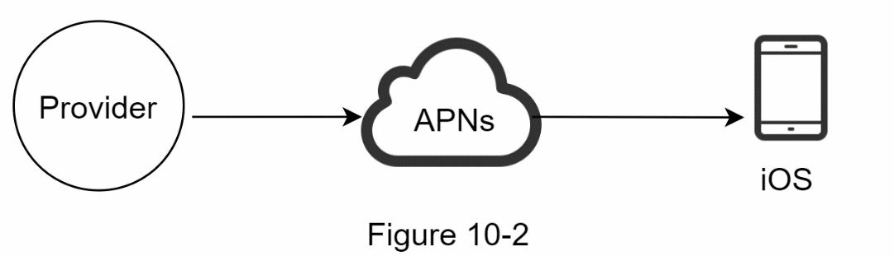

* **Nhà cung cấp (Provider):** Provider xây dựng và gửi các yêu cầu thông báo tới Dịch vụ Thông báo Đẩy của Apple (Apple Push Notification Service - APNS). Để tạo một thông báo đẩy, provider cung cấp các dữ liệu sau:
  * **Device token:** Đây là một định danh duy nhất (unique identifier) được dùng để gửi các thông báo đẩy.
  * **Payload:** Đây là một từ điển JSON (JSON dictionary) chứa tải dữ liệu của thông báo. Dưới đây là một ví dụ:

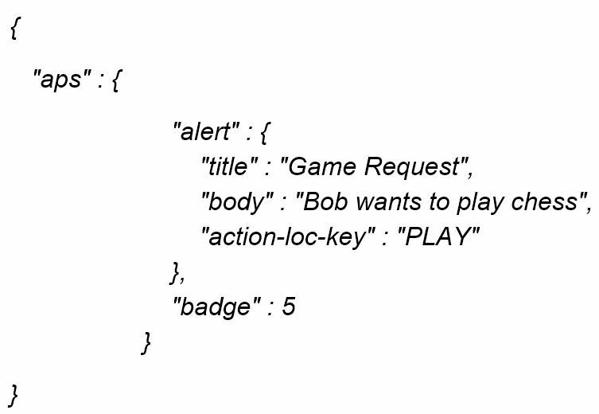

* **APNS:** Đây là dịch vụ từ xa (remote service) do Apple cung cấp nhằm lan truyền các thông báo đẩy đến các thiết bị iOS.
* **Thiết bị iOS (iOS Device):** Là máy khách đầu cuối (end client), nơi tiếp nhận các thông báo đẩy.

#### Thông báo đẩy Android (Android push notification)

Android áp dụng một luồng thông báo tương tự. Thay vì sử dụng APNs, Firebase Cloud Messaging (FCM) thường được sử dụng phổ biến để gửi thông báo đẩy đến các thiết bị Android.

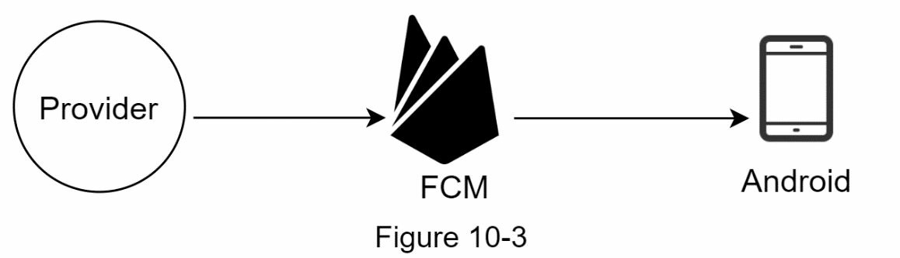

---

#### Tin nhắn SMS (SMS message)

Đối với tin nhắn SMS, các dịch vụ SMS của bên thứ ba như Twilio [1], Nexmo [2] cùng nhiều dịch vụ khác thường được sử dụng phổ biến. Hầu hết trong số đó đều là các dịch vụ thương mại.

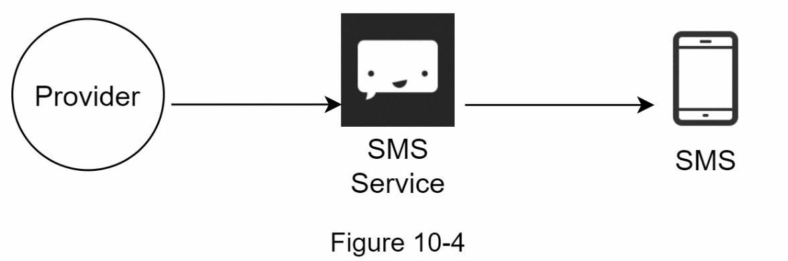

#### Email

Mặc dù các công ty có thể tự thiết lập máy chủ email (email server) riêng, nhiều đơn vị vẫn lựa chọn các dịch vụ email thương mại. Sendgrid [3] và Mailchimp [4] nằm trong số những dịch vụ email phổ biến nhất, cung cấp tỷ lệ gửi thành công (delivery rate) tốt hơn cùng khả năng phân tích dữ liệu (data analytics).

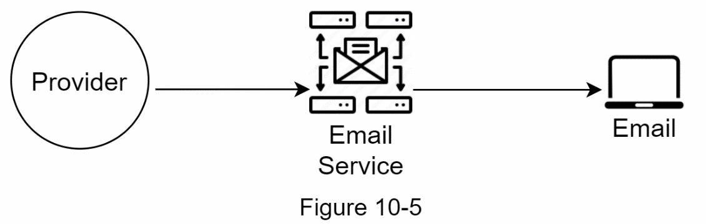

Hình 10-6 thể hiện thiết kế sau khi đã tích hợp tất cả các dịch vụ của bên thứ ba.

---

### Luồng thu thập thông tin liên hệ (Contact info gathering flow)

Để gửi thông báo, chúng ta cần thu thập device token của thiết bị di động, số điện thoại hoặc địa chỉ email. Như minh họa trong Hình 10-7, khi người dùng cài đặt ứng dụng hoặc đăng ký lần đầu tiên, các máy chủ API (API servers) sẽ thu thập thông tin liên hệ của người dùng và lưu trữ vào cơ sở dữ liệu.

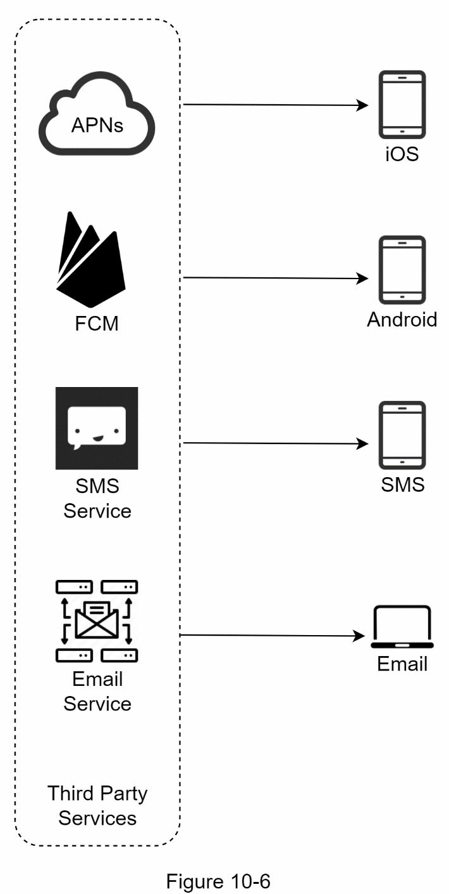

Hình 10-8 minh họa các bảng cơ sở dữ liệu được đơn giản hóa để lưu trữ thông tin liên hệ. Địa chỉ email và số điện thoại được lưu trong bảng `user`, trong khi các device token được lưu trong bảng `device`. Một

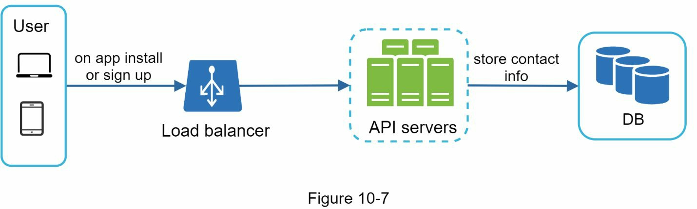

---

người dùng có thể sở hữu nhiều thiết bị, điều này đồng nghĩa với việc một thông báo đẩy có thể được gửi đến tất cả các thiết bị của người dùng đó.

### Luồng gửi/nhận thông báo (Notification sending/receiving flow)

Trước tiên, chúng ta sẽ trình bày thiết kế ban đầu; sau đó, đề xuất một số giải pháp tối ưu hóa.

#### Thiết kế cấp cao (High-level design)

Hình 10-9 minh họa thiết kế, và từng thành phần hệ thống sẽ được giải thích chi tiết bên dưới.

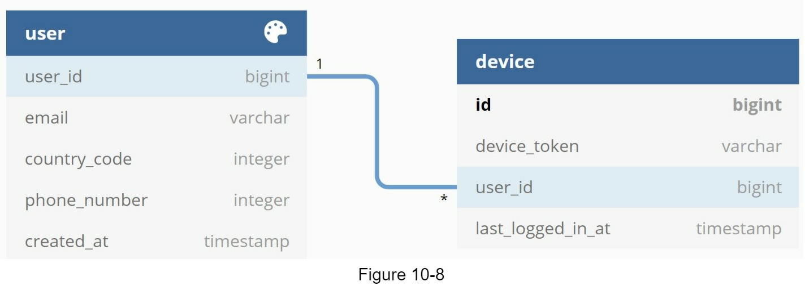

* **Service 1 đến N (Service 1 to N):** Một service có thể là một micro-service, một cron job, hoặc một hệ thống phân tán (distributed system) có nhiệm vụ kích hoạt các sự kiện gửi thông báo. Ví dụ, một dịch vụ thanh toán (billing service) gửi email để nhắc nhở khách hàng về khoản thanh toán đến hạn, hoặc một trang web mua sắm thông báo cho khách hàng qua tin nhắn SMS rằng các kiện hàng của họ sẽ được giao vào ngày mai.

---

### Hệ thống thông báo (Notification system)
Hệ thống thông báo là thành phần trung tâm của việc gửi và nhận thông báo. Bắt đầu với một mô hình đơn giản, ta chỉ sử dụng một máy chủ thông báo (*notification server*). Máy chủ này cung cấp API cho các dịch vụ từ 1 đến N, đồng thời đóng gói dữ liệu thông báo (*notification payloads*) cho các dịch vụ bên thứ ba (*third-party services*).

### Các dịch vụ bên thứ ba (Third-party services)
Các dịch vụ bên thứ ba chịu trách nhiệm phân phối thông báo đến người dùng. Khi tích hợp với các dịch vụ bên thứ ba, chúng ta cần đặc biệt chú ý đến khả năng mở rộng (*extensibility*). Khả năng mở rộng tốt đồng nghĩa với một hệ thống linh hoạt, có thể dễ dàng gắn vào (*plugging*) hoặc tháo ra (*unplugging*) một dịch vụ bên thứ ba. Một yếu tố quan trọng khác cần cân nhắc là dịch vụ bên thứ ba có thể không khả dụng ở các thị trường mới hoặc trong tương lai. Ví dụ, FCM (Firebase Cloud Messaging) không khả dụng tại Trung Quốc. Do đó, các dịch vụ bên thứ ba thay thế như Jpush, PushY, v.v., được sử dụng tại đây.

### iOS, Android, SMS, Email
Người dùng nhận thông báo trên thiết bị của họ.

---

Ba vấn đề lớn được xác định trong thiết kế này bao gồm:

*   **Điểm lỗi đơn lẻ (Single Point of Failure - SPOF):** Việc chỉ có duy nhất một máy chủ thông báo đồng nghĩa với việc tồn tại SPOF.
*   **Khó mở rộng (Hard to scale):** Hệ thống thông báo xử lý toàn bộ các tác vụ liên quan đến push notification trên một máy chủ duy nhất. Việc mở rộng quy mô cơ sở dữ liệu (*databases*), bộ nhớ đệm (*caches*) và các thành phần xử lý thông báo khác nhau một cách độc lập là vô cùng khó khăn.
*   **Nghẽn cổ chai hiệu năng (Performance bottleneck):** Xử lý và gửi thông báo có thể tiêu tốn nhiều tài nguyên. Ví dụ, việc tạo các trang HTML và chờ phản hồi từ các dịch vụ bên thứ ba có thể tốn thời gian. Xử lý mọi thứ trên cùng một hệ thống có thể dẫn đến tình trạng quá tải, đặc biệt là trong các khung giờ cao điểm.

---

### Thiết kế mức cao (được cải tiến) — High-level design (improved)

Sau khi liệt kê các thách thức trong thiết kế ban đầu, chúng tôi cải tiến thiết kế như sau:

*   Tách cơ sở dữ liệu và bộ nhớ đệm (*cache*) ra khỏi máy chủ thông báo.
*   Bổ sung thêm các máy chủ thông báo và thiết lập cơ chế tự động mở rộng theo chiều ngang (*horizontal scaling*).
*   Đưa vào hàng đợi thông điệp (*message queues*) để phân tách rời rạc (*decouple*) các thành phần của hệ thống.

**Hình 10-10** thể hiện thiết kế mức cao đã được cải tiến:

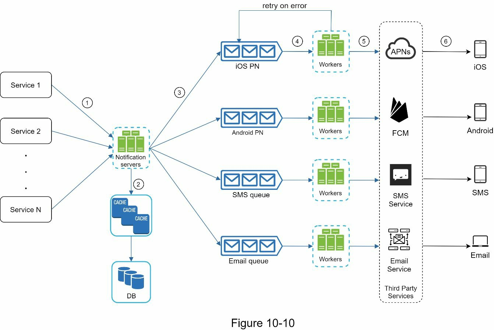

---

Cách tốt nhất để đi qua sơ đồ trên là từ trái sang phải:

*   **Dịch vụ 1 đến N (Service 1 to N):** Đại diện cho các dịch vụ khác nhau thực hiện gửi thông báo thông qua các API do máy chủ thông báo cung cấp.
*   **Các máy chủ thông báo (Notification servers):** Cung cấp các chức năng sau:
    *   Cung cấp API cho các dịch vụ để gửi thông báo. Các API này chỉ có thể truy cập được từ nội bộ hoặc bởi các client đã được xác thực nhằm ngăn chặn thư rác (*spam*).
    *   Thực hiện các bước xác thực cơ bản (*basic validations*) để kiểm tra email, số điện thoại, v.v.
    *   Truy vấn cơ sở dữ liệu hoặc bộ nhớ đệm để lấy dữ liệu cần thiết cho việc kết xuất (*render*) thông báo.
    *   Đẩy dữ liệu thông báo vào các hàng đợi thông điệp (*message queues*) để xử lý song song.

Dưới đây là một ví dụ về API gửi email:

```http
POST https://api.example.com/v/sms/send
```

**Thân yêu cầu (Request body):**

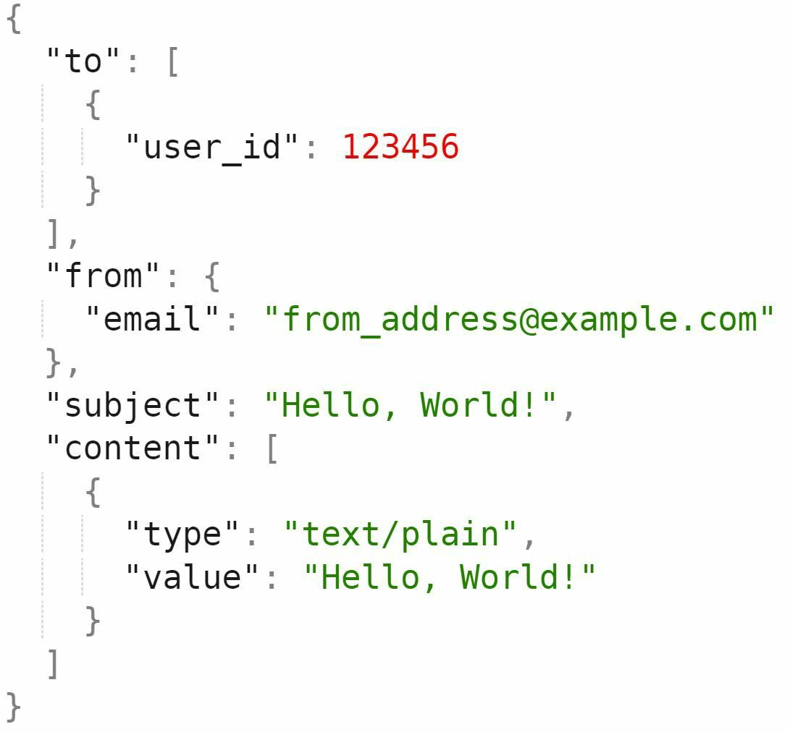

*   **Bộ nhớ đệm (Cache):** Thông tin người dùng, thông tin thiết bị và các mẫu thông báo (*notification templates*) được lưu trữ đệm tại đây.
*   **Cơ sở dữ liệu (DB):** Lưu trữ dữ liệu về người dùng, thông báo, cài đặt thiết lập, v.v.
*   **Hàng đợi thông điệp (Message queues):** Loại bỏ các phụ thuộc trực tiếp giữa các thành phần. Hàng đợi thông điệp đóng vai trò như các bộ đệm (*buffers*) khi có lưu lượng lớn thông báo cần được gửi đi. Mỗi loại thông báo được chỉ định một hàng đợi thông điệp riêng biệt, nhờ đó sự cố gián đoạn ở một dịch vụ bên thứ ba sẽ không ảnh hưởng đến các loại thông báo khác.
*   **Các tiến trình xử lý (Workers):** Workers là danh sách các máy chủ thực hiện việc lấy (*pull*) các sự kiện thông báo từ hàng đợi thông điệp và gửi chúng đến các dịch vụ bên thứ ba tương ứng.
*   **Các dịch vụ bên thứ ba (Third-party services):** Đã được giải thích trong thiết kế ban đầu.
*   **iOS, Android, SMS, Email:** Đã được giải thích trong thiết kế ban đầu.

---

Tiếp theo, hãy cùng xem xét cách tất cả các thành phần phối hợp hoạt động để gửi một thông báo:

1.  Một dịch vụ gọi API do các máy chủ thông báo cung cấp để gửi thông báo.
2.  Các máy chủ thông báo truy xuất siêu dữ liệu (*metadata*) như thông tin người dùng, token thiết bị (*device token*) và cài đặt thông báo từ bộ nhớ đệm hoặc cơ sở dữ liệu.
3.  Một sự kiện thông báo được gửi đến hàng đợi tương ứng để xử lý. Ví dụ, sự kiện thông báo đẩy iOS (*iOS push notification event*) sẽ được gửi đến hàng đợi iOS PN queue.
4.  Các worker lấy các sự kiện thông báo từ các hàng đợi thông điệp.
5.  Các worker gửi thông báo đến các dịch vụ bên thứ ba.
6.  Các dịch vụ bên thứ ba chuyển tiếp thông báo đến thiết bị của người dùng.

---

### Bước 3 - Thiết kế chi tiết chuyên sâu (Design deep dive)

Trong phần thiết kế mức cao, chúng ta đã thảo luận về các loại thông báo khác nhau, luồng thu thập thông tin liên hệ và luồng gửi/nhận thông báo. Ở phần phân tích chuyên sâu này, chúng ta sẽ khám phá các khía cạnh sau:

*   Độ tin cậy (*Reliability*).
*   Các thành phần bổ sung và các cân nhắc thiết kế: mẫu thông báo (*notification template*), cài đặt thông báo (*notification settings*), giới hạn tốc độ (*rate limiting*), cơ chế thử lại (*retry mechanism*), bảo mật trong thông báo đẩy (*security in push notifications*), giám sát các thông báo trong hàng đợi (*monitor queued notifications*) và theo dõi sự kiện (*event tracking*).
*   Thiết kế cập nhật (*Updated design*).

---

#### Độ tin cậy (Reliability)

Chúng ta phải trả lời một vài câu hỏi quan trọng về độ tin cậy khi thiết kế hệ thống thông báo trong môi trường phân tán (*distributed environments*).

##### Làm thế nào để ngăn ngừa mất dữ liệu? (How to prevent data loss?)
Một trong những yêu cầu quan trọng nhất trong một hệ thống thông báo là **không được phép làm mất dữ liệu**. Các thông báo thông thường có thể bị trễ hoặc bị đảo lộn thứ tự, nhưng tuyệt đối không bao giờ được mất. Để đáp ứng yêu cầu này, hệ thống thông báo sẽ lưu trữ bền vững (*persist*) dữ liệu thông báo vào cơ sở dữ liệu và triển khai một cơ chế thử lại (*retry mechanism*). Cơ sở dữ liệu nhật ký thông báo (*notification log database*) được tích hợp vào để lưu trữ dữ liệu bền vững, như thể hiện trong **Hình 10-11**.

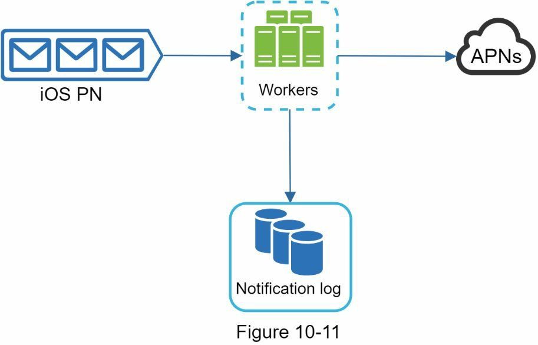

##### Người nhận có nhận được thông báo chính xác một lần duy nhất không? (Will recipients receive a notification exactly once?)
Câu trả lời ngắn gọn là **không**. Mặc dù thông báo được phân phối chính xác một lần (*exactly once*) trong phần lớn thời gian, bản chất phân tán của hệ thống có thể dẫn đến các thông báo bị trùng lặp (*duplicate notifications*). Để giảm thiểu tần suất xảy ra trùng lặp, chúng ta giới thiệu một cơ chế khử trùng lặp (*dedupe mechanism*) và xử lý cẩn thận từng trường hợp lỗi. Dưới đây là logic khử trùng lặp đơn giản:

> Khi một sự kiện thông báo vừa đến, chúng ta kiểm tra xem nó đã từng xuất hiện trước đó hay chưa bằng cách đối chiếu mã định danh sự kiện (*event ID*). Nếu nó đã từng xuất hiện, sự kiện sẽ bị loại bỏ (*discarded*). Nếu chưa, chúng ta sẽ tiến hành gửi thông báo.

Đối với những độc giả quan tâm muốn tìm hiểu lý do tại sao chúng ta không thể đạt được phân phối chính xác một lần (*exactly once delivery*), vui lòng tham khảo tài liệu tham khảo [5].

---

#### Các thành phần bổ sung và các cân nhắc thiết kế (Additional components and considerations)

Chúng ta đã thảo luận về cách thu thập thông tin liên hệ của người dùng, gửi và nhận thông báo. Một hệ thống thông báo thực tế còn nhiều thành phần phức tạp hơn thế. Dưới đây chúng ta thảo luận về các thành phần bổ sung bao gồm tái sử dụng mẫu thông báo, cài đặt thông báo, theo dõi sự kiện, giám sát hệ thống, giới hạn tốc độ, v.v.

##### Mẫu thông báo (Notification template)
Một hệ thống thông báo quy mô lớn gửi đi hàng triệu thông báo mỗi ngày và rất nhiều thông báo trong số đó tuân theo một định dạng tương tự nhau. Các mẫu thông báo (*notification templates*) được đưa vào để tránh việc phải xây dựng từng thông báo từ đầu. Mẫu thông báo là một thông báo được định dạng sẵn nhằm tạo ra thông báo riêng biệt của bạn bằng cách tùy chỉnh các tham số (*parameters*), định kiểu giao diện (*styling*), các liên kết theo dõi (*tracking links*), v.v. Dưới đây là một ví dụ về mẫu thông báo đẩy:

```text
BODY:
You dreamed of it. We dared it. [ITEM NAME] is back — only until [DATE].

CTA:
Order Now. Or, Save My [ITEM NAME]
```

Lợi ích của việc sử dụng mẫu thông báo bao gồm duy trì định dạng nhất quán, giảm thiểu biên độ sai sót (*margin error*) và tiết kiệm thời gian.

##### Cài đặt thông báo (Notification setting)
Người dùng thường nhận quá nhiều thông báo mỗi ngày và họ có thể dễ dàng cảm thấy bị quá tải. Do đó, nhiều trang web và ứng dụng cung cấp cho người dùng khả năng kiểm soát chi tiết (*fine-grained control*) đối với các cài đặt thông báo. Thông tin này được lưu trữ trong bảng cài đặt thông báo (`notification setting table`), với các trường như sau:

| Trường (*Field*) | Kiểu dữ liệu (*Data type*) | Mô tả (*Description*) |
| :--- | :--- | :--- |
| `user_id` | `bigInt` | Mã định danh người dùng |
| `channel` | `varchar` | Kênh nhận: push notification, email hoặc SMS |
| `opt_in` | `boolean` | Đồng ý tiếp nhận thông báo (*opt-in*) |

Trước khi bất kỳ thông báo nào được gửi tới người dùng, trước tiên chúng ta phải kiểm tra xem người dùng đó đã kích hoạt tùy chọn nhận (*opted-in*) loại thông báo này hay chưa.

##### Giới hạn tốc độ (Rate limiting)
Để tránh làm người dùng choáng ngợp với quá nhiều thông báo, chúng ta có thể giới hạn số lượng thông báo mà một người dùng có thể nhận. Điều này rất quan trọng vì người nhận có thể tắt hoàn toàn tính năng thông báo nếu chúng ta gửi với tần suất quá dày.

##### Cơ chế thử lại (Retry mechanism)
Khi một dịch vụ bên thứ ba thất bại trong việc gửi thông báo, thông báo đó sẽ được thêm trở lại vào hàng đợi thông điệp (*message queue*) để thử lại (*retry*). Nếu sự cố vẫn tiếp diễn, một cảnh báo (*alert*) sẽ được kích hoạt gửi tới các kỹ sư phát triển.

##### Bảo mật trong thông báo đẩy (Security in push notifications)
Đối với các ứng dụng iOS hoặc Android, `appKey` và `appSecret` được sử dụng để bảo vệ các API thông báo đẩy [6]. Chỉ những client đã được xác thực (*authenticated*) hoặc kiểm chứng (*verified*) mới được phép gửi thông báo đẩy thông qua các API của chúng ta. Độc giả quan tâm vui lòng tham khảo tài liệu tham khảo [6].

##### Giám sát các thông báo trong hàng đợi (Monitor queued notifications)
Một chỉ số (*metric*) quan trọng cần theo dõi là tổng số lượng thông báo đang chờ xử lý trong hàng đợi (*queued notifications*). Nếu con số này quá lớn, điều đó chứng tỏ các sự kiện thông báo đang không được xử lý đủ nhanh bởi các worker. Để tránh hiện tượng trễ trong việc phân phối thông báo, cần bổ sung thêm nhiều worker hơn.

**Hình 10-12** (nguồn trích dẫn từ [7]) hiển thị một ví dụ về các thông điệp xếp hàng đợi đang chờ được xử lý:

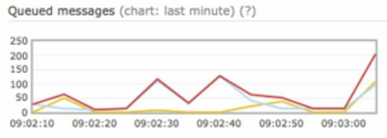

##### Theo dõi sự kiện (Events tracking)
Các chỉ số thông báo như tỷ lệ mở (*open rate*), tỷ lệ nhấp chuột (*click rate*) và mức độ tương tác (*engagement*) có vai trò rất quan trọng trong việc thấu hiểu hành vi khách hàng. Dịch vụ phân tích dữ liệu (*Analytics service*) triển khai cơ chế theo dõi sự kiện (*events tracking*). Quá trình tích hợp giữa hệ thống thông báo và dịch vụ phân tích dữ liệu thường là bắt buộc. 

**Hình 10-13** hiển thị ví dụ về các sự kiện có thể được theo dõi cho mục đích phân tích:

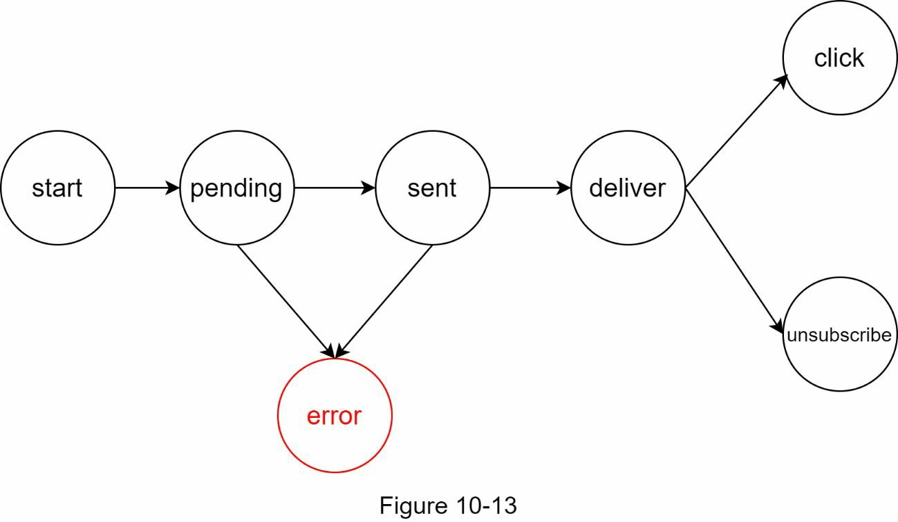

---

### Thiết kế cập nhật (Updated design)

Tổng hợp tất cả các thành phần lại với nhau, **Hình 10-14** thể hiện kiến trúc thiết kế hệ thống thông báo đã được cập nhật toàn diện.

---

### --- Trang 163 ---

Trong thiết kế này, nhiều thành phần mới đã được bổ sung so với thiết kế trước đó.

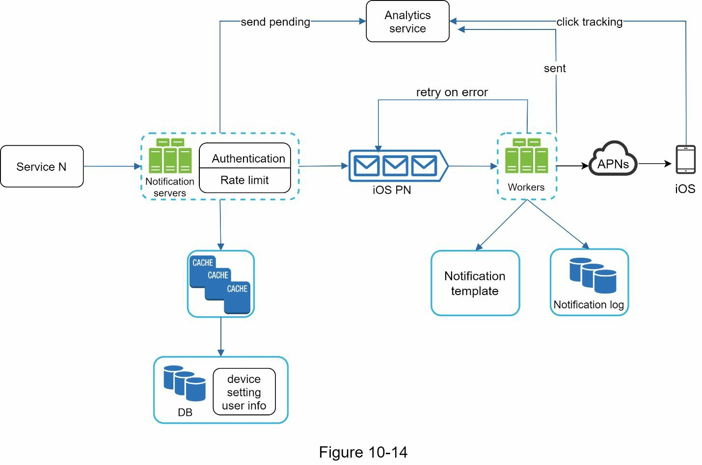

* **Các máy chủ thông báo (Notification servers)** được trang bị thêm hai tính năng tối quan trọng: **xác thực (authentication)** và **giới hạn tốc độ (rate-limiting)**.
* Chúng tôi cũng bổ sung một **cơ chế thử lại (retry mechanism)** để xử lý các sự cố gửi thông báo thất bại. Nếu hệ thống không gửi được thông báo, chúng sẽ được đưa trở lại hàng đợi tin nhắn (messaging queue) và các tiến trình worker sẽ thử lại theo một số lần được xác định trước.
* Hơn nữa, **các mẫu thông báo (notification templates)** cung cấp một quy trình tạo thông báo nhất quán và hiệu quả.
* Cuối cùng, **hệ thống giám sát và theo dõi (monitoring and tracking systems)** được tích hợp nhằm phục vụ việc kiểm tra tình trạng hệ thống (health checks) cũng như cải tiến trong tương lai.

---

### --- Trang 164 ---

#### Bước 4 - Tổng kết (Step 4 - Wrap up)

Thông báo là thành phần không thể thiếu vì chúng giúp cập nhật cho chúng ta những thông tin quan trọng. Đó có thể là một thông báo đẩy (push notification) về bộ phim yêu thích của bạn trên Netflix, một email về các chương trình giảm giá cho sản phẩm mới, hay một tin nhắn xác nhận thanh toán mua sắm trực tuyến.

Trong chương này, chúng tôi đã trình bày thiết kế của một hệ thống thông báo có khả năng mở rộng quy mô (scalable notification system), hỗ trợ nhiều định dạng thông báo khác nhau: **thông báo đẩy (push notification)**, **tin nhắn SMS** và **email**. Chúng tôi đã áp dụng **hàng đợi tin nhắn (message queues)** nhằm tách rời (decouple) các thành phần trong hệ thống.

Bên cạnh thiết kế tổng thể (high-level design), chúng tôi đã đi sâu vào nhiều thành phần chi tiết và các kỹ thuật tối ưu hóa:

* **Độ tin cậy (Reliability):** Chúng tôi đề xuất một cơ chế thử lại (retry mechanism) mạnh mẽ nhằm giảm thiểu tỷ lệ thất bại.
* **Bảo mật (Security):** Cặp khóa `appKey`/`appSecret` được sử dụng để đảm bảo chỉ những client đã được xác minh mới có thể gửi thông báo.
* **Theo dõi và giám sát (Tracking and monitoring):** Các cơ chế này được triển khai ở bất kỳ giai đoạn nào của luồng thông báo để thu thập các chỉ số thống kê quan trọng.
* **Tôn trọng cài đặt của người dùng (Respect user settings):** Người dùng có thể chọn từ chối nhận thông báo (opt-out). Hệ thống của chúng tôi luôn kiểm tra cài đặt của người dùng trước khi gửi thông báo.
* **Giới hạn tốc độ (Rate limiting):** Người dùng sẽ đánh giá cao việc áp dụng giới hạn tần suất (frequency capping) đối với số lượng thông báo mà họ nhận được.

Xin chúc mừng bạn đã đi được một chặng đường dài đến đây! Hãy tự thưởng cho mình một cái vỗ vai khích lệ. Làm tốt lắm!

---

### --- Trang 165 ---

#### Tài liệu tham khảo (Reference materials)

* **[1] Twilio SMS:** https://www.twilio.com/sms
* **[2] Nexmo SMS:** https://www.nexmo.com/products/sms
* **[3] Sendgrid:** https://sendgrid.com/
* **[4] Mailchimp:** https://mailchimp.com/
* **[5] You Cannot Have Exactly-Once Delivery:** https://bravenewgeek.com/you-cannot-have-exactly-once-delivery/
* **[6] Security in Push Notifications:** https://cloud.ibm.com/docs/services/mobilepush?topic=mobile-pushnotification-security-in-push-notifications
* **[7] RabbitMQ:** https://bit.ly/2sotIa6


---

[← Chương trước](chuong-09-thiet-ke-web-crawler.md) | [Mục lục](README.md) | [Chương tiếp theo →](chuong-11-thiet-ke-news-feed-system.md)
