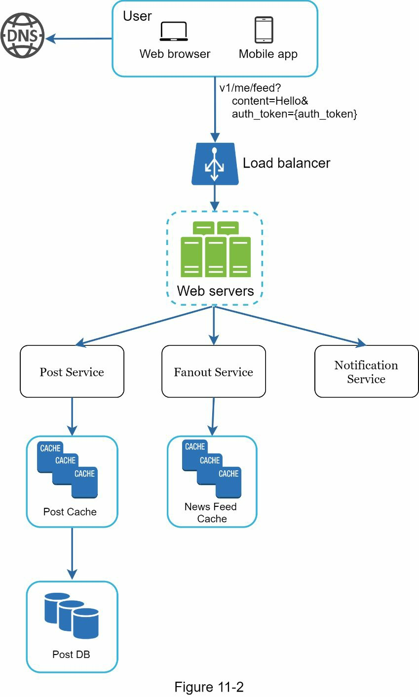
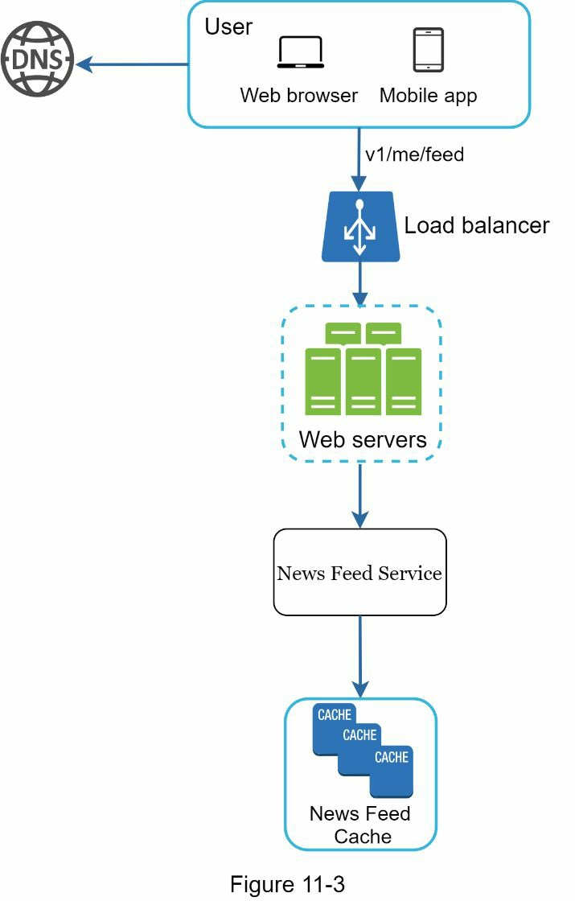
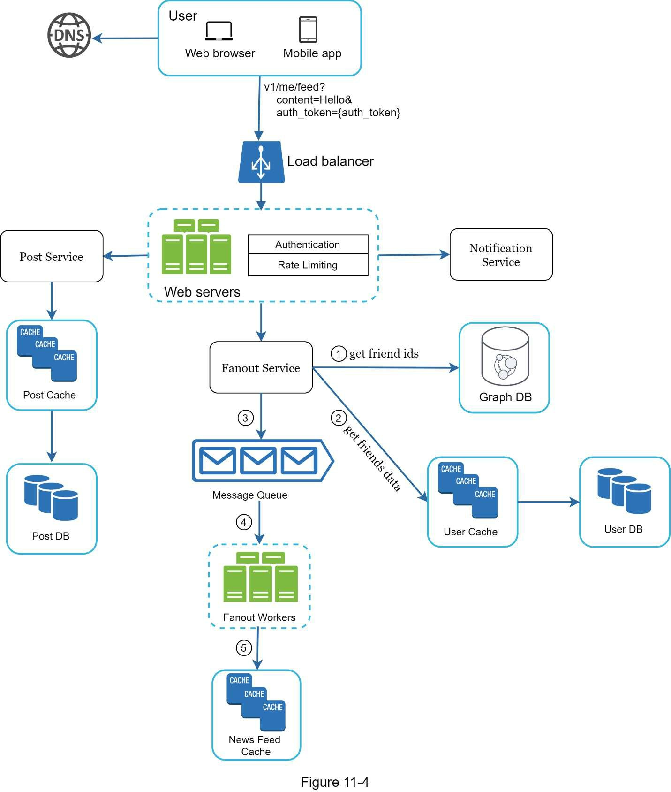
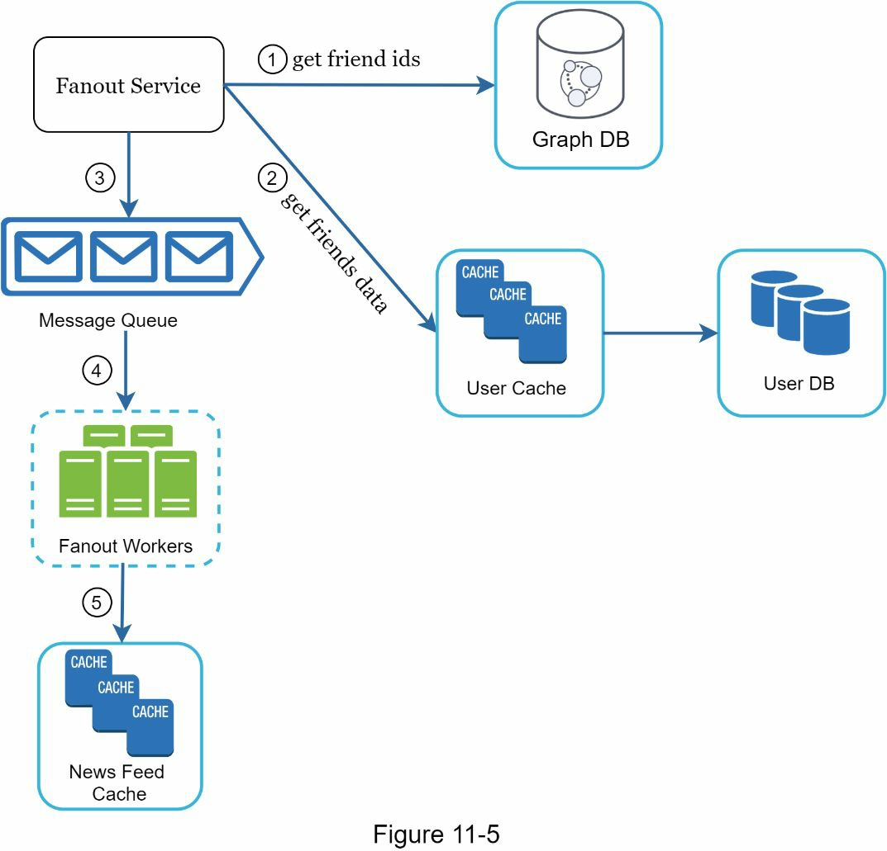
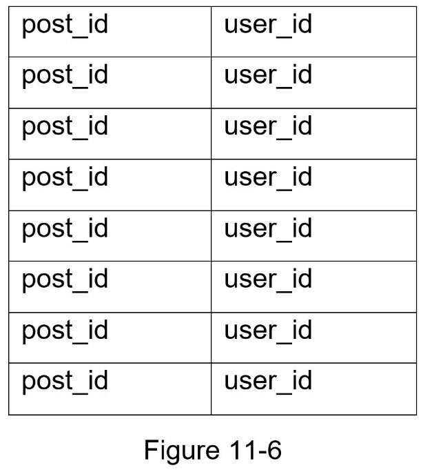
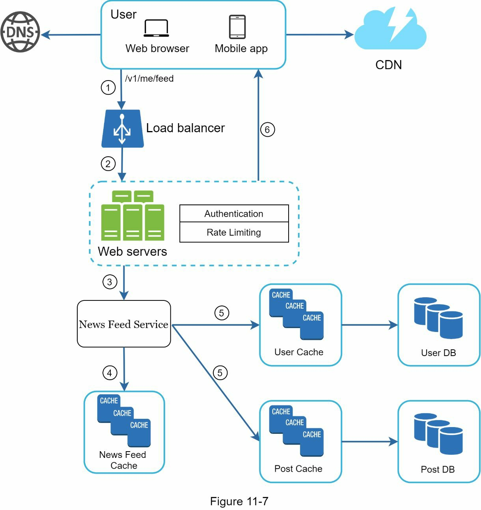
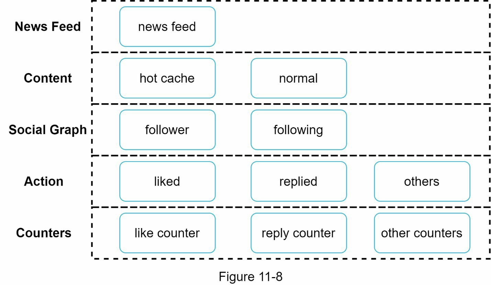

# Chương 11: Thiết kế Hệ thống Bảng tin (Design A News Feed System)

[← Chương trước](chuong-10-thiet-ke-he-thong-thong-bao.md) | [Mục lục](README.md) | [Chương tiếp theo →](chuong-12-thiet-ke-chat-system.md)

---

# CHƯƠNG 11: THIẾT KẾ MỘT HỆ THỐNG BẢNG TIN (NEWS FEED SYSTEM)

Trong chương này, bạn được yêu cầu thiết kế một hệ thống bảng tin (News Feed System). Bảng tin (News Feed) là gì? Theo trang trợ giúp của Facebook: *“Bảng tin (News Feed) là danh sách các mẩu tin (stories) được cập nhật liên tục ở giữa trang chủ của bạn. Bảng tin bao gồm các cập nhật trạng thái, ảnh, video, liên kết, hoạt động của ứng dụng, và các lượt thích (likes) từ những người, trang (pages) và nhóm (groups) mà bạn theo dõi trên Facebook”* [1]. Đây là một câu hỏi phỏng vấn rất phổ biến. Các câu hỏi tương tự thường được hỏi là: thiết kế Facebook News Feed, Instagram Feed, Twitter Timeline, v.v.

---

### Bước 1 - Hiểu rõ bài toán và xác định phạm vi thiết kế (Scope)

Tập hợp các câu hỏi làm rõ đầu tiên nhằm mục đích hiểu được người phỏng vấn đang nghĩ gì khi yêu cầu bạn thiết kế một hệ thống bảng tin. Ít nhất, bạn nên xác định được hệ thống cần hỗ trợ những tính năng gì. Dưới đây là một ví dụ về tương tác giữa ứng viên và người phỏng vấn:

**Ứng viên:** Đây là ứng dụng di động (mobile app)? Hay ứng dụng web (web app)? Hay cả hai?  
**Người phỏng vấn:** Cả hai.  
**Ứng viên:** Các tính năng quan trọng là gì?  
**Người phỏng vấn:** Người dùng có thể đăng bài viết (publish a post) và xem các bài viết của bạn bè trên trang bảng tin.  
**Ứng viên:** Bảng tin được sắp xếp theo thứ tự thời gian đảo ngược (reverse chronological order - bài mới nhất lên đầu) hay theo bất kỳ thứ tự đặc biệt nào như điểm số chủ đề (topic scores)? Chẳng hạn, các bài viết từ bạn bè thân thiết sẽ có điểm số cao hơn.  
**Người phỏng vấn:** Để giữ mọi thứ đơn giản, hãy giả định rằng bảng tin được sắp xếp theo thứ tự thời gian đảo ngược.  
**Ứng viên:** Một người dùng có thể có tối đa bao nhiêu bạn bè?  
**Người phỏng vấn:** 5.000 bạn bè.  
**Ứng viên:** Lưu lượng truy cập (traffic volume) của hệ thống là bao nhiêu?  
**Người phỏng vấn:** 10 triệu người dùng hoạt động hàng ngày (10 million DAU - Daily Active Users).  
**Ứng viên:** Bảng tin có thể chứa hình ảnh, video hay chỉ có văn bản thuần túy (plain text)?  
**Người phỏng vấn:** Nó có thể chứa các tệp đa phương tiện (media files), bao gồm cả hình ảnh và video.  

Bây giờ bạn đã thu thập đầy đủ các yêu cầu, chúng ta sẽ tập trung vào việc thiết kế hệ thống.

---

### Bước 2 - Đề xuất thiết kế cấp cao (High-level Design) và đạt được sự đồng thuận

Thiết kế được chia thành hai luồng chính (flows): **Đăng tin (Feed publishing)** và **Xây dựng bảng tin (News feed building)**.

* **Đăng tin (Feed publishing):** Khi người dùng đăng một bài viết, dữ liệu tương ứng sẽ được ghi vào bộ nhớ đệm (cache) và cơ sở dữ liệu (database). Bài viết sẽ được phân phối/lan tỏa (populated) tới bảng tin của bạn bè người đó.
* **Xây dựng bảng tin (News feed building):** Để đơn giản hóa, hãy giả định bảng tin được xây dựng bằng cách tổng hợp các bài viết của bạn bè theo thứ tự thời gian đảo ngược (reverse chronological order).

#### Các API của Bảng tin (Newsfeed APIs)

Các API của bảng tin là phương thức giao tiếp chính để các ứng dụng máy khách (clients) tương tác với máy chủ (servers). Các API này dựa trên giao thức HTTP, cho phép clients thực hiện các hành động bao gồm đăng trạng thái (posting a status), lấy bảng tin (retrieving news feed), kết bạn (adding friends), v.v. Chúng ta thảo luận về hai API quan trọng nhất: **Feed publishing API** và **News feed retrieval API**.

##### Feed publishing API (API đăng tin)
Để đăng một bài viết, một yêu cầu HTTP POST sẽ được gửi đến máy chủ. API được mô tả bên dưới:

`POST /v1/me/feed`

**Tham số (Params):**
* `content`: nội dung văn bản của bài viết.
* `auth_token`: dùng để xác thực (authenticate) các yêu cầu API.

##### Newsfeed retrieval API (API lấy bảng tin)
API dùng để truy xuất bảng tin được mô tả bên dưới:

`GET /v1/me/feed`

**Tham số (Params):**
* `auth_token`: dùng để xác thực (authenticate) các yêu cầu API.

---

#### Đăng tin (Feed publishing)

Hình 11-2 thể hiện thiết kế cấp cao (high-level design) của luồng đăng tin.

* **User (Người dùng):** người dùng có thể xem bảng tin trên trình duyệt hoặc ứng dụng di động. Người dùng tạo một bài viết với nội dung “Hello” thông qua API:  
  `/v1/me/feed?content=Hello&auth_token={auth_token}`
* **Load balancer (Bộ cân bằng tải):** phân phối lưu lượng truy cập (traffic) đến các máy chủ web (web servers).
* **Web servers:** các máy chủ web điều hướng lưu lượng truy cập đến các dịch vụ nội bộ (internal services) khác nhau.
* **Post service (Dịch vụ bài viết):** lưu trữ bài viết vào cơ sở dữ liệu (database) và bộ nhớ đệm (cache).
* **Fanout service (Dịch vụ lan tỏa):** đẩy (push) nội dung mới đến bảng tin của bạn bè. Dữ liệu bảng tin được lưu trữ trong cache để truy xuất nhanh chóng.
* **Notification service (Dịch vụ thông báo):** thông báo cho bạn bè biết rằng có nội dung mới và gửi các thông báo đẩy (push notifications).

---

#### Xây dựng bảng tin (Newsfeed building)

Trong phần này, chúng ta thảo luận về cách bảng tin được xây dựng ở phía sau hậu trường (behind the scenes). Hình 11-3 thể hiện thiết kế cấp cao:

* **User (Người dùng):** người dùng gửi một yêu cầu để truy xuất bảng tin của mình. Yêu cầu có định dạng như sau:  
  `/v1/me/feed`.
* **Load balancer (Bộ cân bằng tải):** bộ cân bằng tải điều hướng lưu lượng truy cập đến các máy chủ web (web servers).
* **Web servers:** các máy chủ web định tuyến (route) các yêu cầu đến dịch vụ bảng tin (newsfeed service).
* **Newsfeed service (Dịch vụ bảng tin):** dịch vụ bảng tin lấy dữ liệu bảng tin từ bộ nhớ đệm (cache).
* **Newsfeed cache (Bộ nhớ đệm bảng tin):** lưu trữ các mã định danh (News Feed IDs) cần thiết để hiển thị (render) bảng tin.

---

### Bước 3 - Đi sâu vào thiết kế chi tiết (Design deep dive)

Thiết kế cấp cao đã đề cập ngắn gọn về hai luồng: **Đăng tin (feed publishing)** và **Xây dựng bảng tin (news feed building)**. Tại đây, chúng ta sẽ thảo luận chi tiết hơn về các chủ đề đó.

#### Đi sâu vào luồng Đăng tin (Feed publishing deep dive)

Hình 11-4 phác thảo thiết kế chi tiết cho luồng đăng tin. Chúng ta đã thảo luận về hầu hết các thành phần trong phần thiết kế cấp cao, và chúng ta sẽ tập trung vào hai thành phần: **Web servers** và **Fanout service**.

##### Web servers
Bên cạnh việc giao tiếp với clients, các web servers còn thực thi xác thực (Authentication) và giới hạn tốc độ truy cập (Rate Limiting).

---

Chỉ những người dùng đã đăng nhập với `auth_token` hợp lệ mới được phép đăng bài. Hệ thống giới hạn số lượng bài đăng mà một người dùng có thể tạo trong một khoảng thời gian nhất định (Rate Limiter), điều này mang tính sống còn nhằm ngăn chặn thư rác (spam) và các nội dung lạm dụng.

### Dịch vụ phân phối tin (Fanout service)

**Fanout** là quá trình phân phối (chuyển giao) một bài đăng tới tất cả bạn bè. Hai mô hình fanout phổ biến là: **fanout on write** (còn gọi là mô hình đẩy - *push model*) và **fanout on read** (còn gọi là mô hình kéo - *pull model*). Cả hai mô hình đều có những ưu và nhược điểm riêng. Chúng ta sẽ giải thích quy trình hoạt động của từng mô hình và khám phá hướng tiếp cận tối ưu nhất để hỗ trợ hệ thống của chúng ta.

#### Fanout on write (Đẩy khi ghi)
Với hướng tiếp cận này, bảng tin (news feed) được tính toán trước ngay trong thời điểm ghi dữ liệu (*write time*). Một bài đăng mới sẽ được đưa ngay vào bộ nhớ đệm (cache) của bạn bè ngay sau khi bài viết được xuất bản.

* **Ưu điểm (Pros):**
  * Bảng tin được tạo theo thời gian thực (real-time) và có thể được đẩy tới bạn bè ngay lập tức.
  * Tốc độ truy xuất (fetch) bảng tin rất nhanh vì news feed đã được tính toán sẵn từ trước trong lúc ghi.
* **Nhược điểm (Cons):**
  * Nếu một người dùng có rất nhiều bạn bè, việc lấy danh sách bạn bè và tạo bảng tin cho toàn bộ số người đó sẽ rất chậm và tốn nhiều thời gian. Hiện tượng này được gọi là **vấn đề tài khoản quá tải / điểm nóng (hotkey problem)**.
  * Đối với những người dùng không hoạt động (inactive) hoặc hiếm khi đăng nhập, việc tính toán trước bảng tin sẽ gây lãng phí tài nguyên tính toán.

#### Fanout on read (Kéo khi đọc)
Bảng tin được tạo ra ngay trong thời điểm đọc dữ liệu (*read time*). Đây là một mô hình theo yêu cầu (*on-demand model*). Các bài đăng gần đây chỉ được kéo về khi người dùng tải trang chủ của họ.

* **Ưu điểm (Pros):**
  * Đối với những người dùng không hoạt động hoặc hiếm khi đăng nhập, fanout on read hoạt động hiệu quả hơn vì không lãng phí tài nguyên tính toán cho họ.
  * Dữ liệu không bị đẩy ồ ạt tới bạn bè, do đó không gặp phải vấn đề hotkey.
* **Nhược điểm (Cons):**
  * Tốc độ truy xuất bảng tin bị chậm do bảng tin không được tính toán sẵn từ trước.

---

Chúng ta áp dụng **hướng tiếp cận lai (hybrid approach)** để tận dụng các lợi ích của cả hai mô hình và tránh được các cạm bẫy của chúng. Vì việc truy xuất bảng tin với tốc độ nhanh là cực kỳ quan trọng, chúng ta sử dụng mô hình đẩy (*push model*) cho đại đa số người dùng thông thường. Đối với những người nổi tiếng (celebrities) hoặc người dùng có lượng bạn bè/người theo dõi khổng lồ, chúng ta cho phép người theo dõi chủ động kéo nội dung tin tức theo yêu cầu (*on-demand pull*) nhằm tránh gây quá tải hệ thống. **Băm nhất quán (Consistent hashing)** là một kỹ thuật hữu ích để giảm thiểu vấn đề hotkey, vì nó giúp phân bổ các yêu cầu và dữ liệu một cách đồng đều hơn.

Hãy cùng xem xét kỹ lưỡng dịch vụ fanout như minh họa trong **Hình 11-5**.

*Dịch vụ fanout hoạt động như sau:*

1. **Lấy danh sách ID bạn bè (friend IDs) từ cơ sở dữ liệu đồ thị (graph database).** Các cơ sở dữ liệu đồ thị rất thích hợp cho việc quản lý mối quan hệ bạn bè và gợi ý kết bạn. Độc giả quan tâm muốn tìm hiểu sâu hơn về khái niệm này có thể tham khảo tài liệu [2].
2. **Lấy thông tin bạn bè từ bộ nhớ đệm người dùng (user cache).** Sau đó, hệ thống sẽ lọc bỏ bớt bạn bè dựa trên cài đặt của người dùng. Ví dụ: nếu bạn tắt tiếng (mute) ai đó, các bài đăng của họ sẽ không xuất hiện trên bảng tin của bạn cho dù hai người vẫn là bạn bè. Một lý do khác khiến bài đăng không hiển thị là người dùng có thể chủ động chọn chia sẻ thông tin cho các nhóm bạn bè cụ thể hoặc ẩn nó với những người khác.
3. **Gửi danh sách bạn bè và ID bài đăng mới (`post_id`) tới hàng đợi thông điệp (message queue).**
4. **Các tiến trình xử lý phân phối (Fanout workers) lấy dữ liệu từ hàng đợi thông điệp và lưu dữ liệu bảng tin vào bộ nhớ đệm bảng tin (news feed cache).** Bạn có thể hình dung news feed cache như một bảng ánh xạ `<post_id, user_id>`. Bất cứ khi nào có bài đăng mới, nó sẽ được nối thêm (append) vào bảng tin như thể hiện trong **Hình 11-6**. Dung lượng bộ nhớ tiêu thụ có thể trở nên cực kỳ lớn nếu chúng ta lưu trữ toàn bộ đối tượng người dùng (*user object*) và bài đăng (*post object*) vào trong cache. Do đó, hệ thống chỉ lưu trữ các định danh (IDs). Để giữ cho kích thước bộ nhớ ở mức nhỏ gọn, chúng ta thiết lập một giới hạn có thể cấu hình được. Khả năng một người dùng cuộn xem qua hàng nghìn bài đăng trên bảng tin là rất thấp. Hầu hết người dùng chỉ quan tâm đến các nội dung mới nhất, vì vậy tỷ lệ trượt bộ nhớ đệm (cache miss rate) là rất thấp.
5. **Lưu trữ `<post_id, user_id>` vào bộ nhớ đệm bảng tin (news feed cache).** **Hình 11-6** minh họa một ví dụ về cấu trúc bảng tin trông như thế nào trong cache.

---

### Đi sâu vào thiết kế truy xuất bảng tin (Newsfeed retrieval deep dive)

**Hình 11-7** minh họa thiết kế chi tiết cho luồng truy xuất bảng tin.

Như thể hiện trong **Hình 11-7**, nội dung đa phương tiện (hình ảnh, video, v.v.) được lưu trữ trong CDN để truy xuất nhanh chóng. Hãy cùng xem xét cách một ứng dụng máy khách (client) truy xuất bảng tin:

1. Người dùng gửi một yêu cầu để lấy bảng tin của mình. Yêu cầu có định dạng như sau: `/v1/me/feed`
2. Bộ cân bằng tải (Load Balancer) điều phối lại các yêu cầu tới các máy chủ web (web servers).
3. Các web server gọi dịch vụ bảng tin (news feed service) để lấy bảng tin.
4. News feed service lấy danh sách các ID bài đăng (`post_id`) từ bộ nhớ đệm bảng tin (news feed cache).
5. Bảng tin của người dùng không chỉ đơn thuần là một danh sách các ID bài viết. Nó còn bao gồm tên người dùng (username), ảnh đại diện (profile picture), nội dung bài đăng, hình ảnh bài đăng, v.v. Vì vậy, news feed service sẽ truy xuất toàn bộ đối tượng người dùng và đối tượng bài đăng từ các bộ nhớ đệm tương ứng (*user cache* và *post cache*) để cấu thành nên bảng tin hoàn chỉnh được bổ sung đầy đủ dữ liệu (fully hydrated news feed).
6. Bảng tin đầy đủ dữ liệu (*fully hydrated news feed*) sau đó được trả về dưới định dạng JSON cho client để hiển thị giao diện (render).

---

### Kiến trúc bộ nhớ đệm (Cache architecture)

Bộ nhớ đệm (Cache) đóng vai trò cực kỳ quan trọng đối với hệ thống bảng tin. Chúng ta phân chia tầng cache thành 5 lớp như thể hiện trong **Hình 11-8**:

* **News Feed (Bảng tin):** Lưu trữ các ID của bảng tin.
* **Content (Nội dung):** Lưu trữ dữ liệu của từng bài đăng. Các nội dung phổ biến/nổi bật được lưu trữ trong bộ nhớ đệm nóng (hot cache).
* **Social Graph (Đồ thị mạng xã hội):** Lưu trữ dữ liệu về các mối quan hệ của người dùng.
* **Action (Hành động):** Lưu trữ thông tin về việc liệu người dùng đã thích (like) một bài đăng, phản hồi (reply) bài đăng, hay thực hiện các hành động khác trên bài đăng đó hay chưa.
* **Counters (Bộ đếm):** Lưu trữ các bộ đếm cho lượt thích, phản hồi, số người theo dõi (follower), số người đang theo dõi (following), v.v.

---

### Bước 4 - Tổng kết (Wrap up)

Trong chương này, chúng ta đã cùng nhau thiết kế một hệ thống bảng tin (news feed system). Thiết kế của chúng ta bao gồm hai luồng nghiệp vụ chính: **xuất bản tin (feed publishing)** và **truy xuất bảng tin (news feed retrieval)**.

Tương tự như bất kỳ câu hỏi phỏng vấn thiết kế hệ thống nào, không có một cách tiếp cận nào là hoàn hảo tuyệt đối để thiết kế một hệ thống. Mỗi công ty đều có những ràng buộc đặc thù riêng, và bạn bắt buộc phải thiết kế hệ thống sao cho phù hợp với các ràng buộc đó. Hiểu rõ các thỏa hiệp đánh đổi (trade-offs) trong thiết kế và việc lựa chọn công nghệ của bạn là điều tối quan trọng. Nếu buổi phỏng vấn còn dư vài phút, bạn có thể trao đổi thêm về các vấn đề mở rộng quy mô (scalability). Để tránh việc thảo luận trùng lặp, chỉ các chủ đề thảo luận cấp cao (high-level) được liệt kê dưới đây:

#### Mở rộng cơ sở dữ liệu (Scaling the database):
* Mở rộng theo chiều dọc (Vertical scaling) so với Mở rộng theo chiều ngang (Horizontal scaling)
* SQL so với NoSQL
* Sao chép Chủ - Thợ (Master-slave replication)
* Bản sao chỉ đọc (Read replicas)
* Các mô hình nhất quán dữ liệu (Consistency models)
* Phân mảnh cơ sở dữ liệu (Database sharding)

#### Các chủ đề thảo luận khác:
* Giữ cho tầng web không lưu trạng thái (Keep web tier stateless)
* Đưa dữ liệu vào bộ nhớ đệm (cache) nhiều nhất có thể
* Hỗ trợ triển khai đa trung tâm dữ liệu (multi-datacenter)
* Giảm bớt sự phụ thuộc chặt chẽ giữa các thành phần (loose coupling) bằng hàng đợi thông điệp (message queues)
* Giám sát các chỉ số quan trọng (Key metrics). Chẳng hạn, theo dõi lượng truy vấn mỗi giây (QPS) trong các khung giờ cao điểm và độ trễ (latency) khi người dùng làm mới bảng tin của họ là những khía cạnh rất đáng quan tâm.

Xin chúc mừng bạn đã đi được một chặng đường dài đến đây! Hãy tự thưởng cho mình một tràng pháo tay khích lệ. Bạn đã làm rất tốt!

---

### Tài liệu tham khảo (Reference materials)

* **[1] How News Feed Works:**  
  https://www.facebook.com/help/327131014036297/
* **[2] Friend of Friend recommendations Neo4j and SQL Server:**  
  http://geekswithblogs.net/brendonpage/archive/2015/10/26/friend-of-friend-recommendations-with-neo4j.aspx

---

[← Chương trước](chuong-10-thiet-ke-he-thong-thong-bao.md) | [Mục lục](README.md) | [Chương tiếp theo →](chuong-12-thiet-ke-chat-system.md)
