# Chương 12: Thiết kế Hệ thống Chat (Design A Chat System)

[← Chương trước](chuong-11-thiet-ke-news-feed-system.md) | [Mục lục](README.md) | [Chương tiếp theo →](chuong-13-thiet-ke-search-autocomplete.md)

---

# CHƯƠNG 12: THIẾT KẾ MỘT HỆ THỐNG CHAT (DESIGN A CHAT SYSTEM)

Trong chương này, chúng ta cùng tìm hiểu cách thiết kế một hệ thống trò chuyện (chat system). Hầu như tất cả mọi người đều sử dụng một ứng dụng chat. Hình 12-1 minh họa một số ứng dụng phổ biến nhất trên thị trường hiện nay.

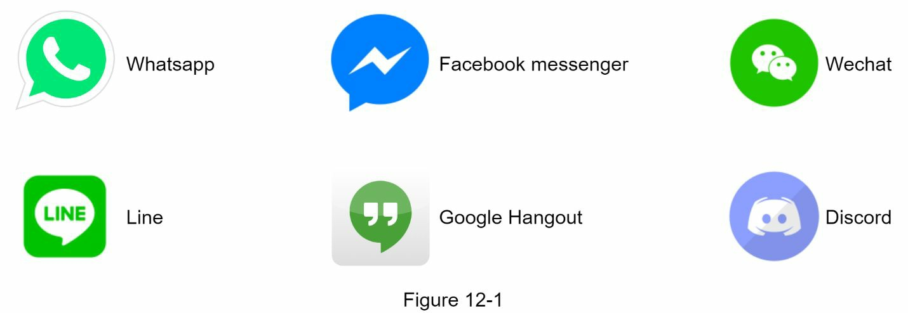
*Hình 12-1*

Một ứng dụng chat đảm nhận các chức năng khác nhau đối với từng đối tượng người dùng khác nhau. Việc chốt rõ và chính xác các yêu cầu đặt ra là cực kỳ quan trọng. Chẳng hạn, bạn chắc chắn không muốn thiết kế một hệ thống chuyên về chat nhóm (group chat) trong khi người phỏng vấn lại đang nghĩ đến một ứng dụng trò chuyện 1-1 (one-on-one chat). Do đó, việc khai thác sâu các yêu cầu về tính năng là điều tối quan trọng.

---

## Bước 1 - Hiểu bài toán và xác định phạm vi thiết kế (Step 1 - Understand the problem and establish design scope)

Việc thống nhất về loại ứng dụng chat cần thiết kế là điều cốt yếu. Trên thị trường hiện có các ứng dụng chat 1-1 như Facebook Messenger, WeChat, và WhatsApp; các ứng dụng chat văn phòng tập trung vào chat nhóm như Slack; hoặc các ứng dụng chat dành cho game thủ như Discord với trọng tâm là tương tác nhóm quy mô lớn và độ trễ thoại (voice chat latency) cực thấp.

Nhóm câu hỏi làm rõ đầu tiên phải chốt được chính xác những gì người phỏng vấn mong muốn khi họ yêu cầu bạn thiết kế một hệ thống chat. Tối thiểu nhất, bạn phải xác định xem mình nên tập trung vào ứng dụng chat 1-1 hay chat nhóm. Dưới đây là một số câu hỏi bạn có thể đưa ra:

> **Ứng viên:** Chúng ta cần thiết kế loại ứng dụng chat nào? Dạng 1-1 hay dựa trên nhóm?  
> **Người phỏng vấn:** Hệ thống cần hỗ trợ cả chat 1-1 và chat nhóm.  
> 
> **Ứng viên:** Đây là ứng dụng di động (mobile app), ứng dụng web (web app) hay cả hai?  
> **Người phỏng vấn:** Cả hai.  
> 
> **Ứng viên:** Quy mô của ứng dụng này như thế nào? Quy mô cho một công ty khởi nghiệp (startup) hay quy mô khổng lồ (massive scale)?  
> **Người phỏng vấn:** Hệ thống cần hỗ trợ 50 triệu người dùng hoạt động hàng ngày (50 million DAU - Daily Active Users).  
> 
> **Ứng viên:** Đối với chat nhóm, giới hạn số lượng thành viên trong một nhóm là bao nhiêu?  
> **Người phỏng vấn:** Tối đa 100 người.  
> 
> **Ứng viên:** Những tính năng nào là quan trọng đối với ứng dụng chat này? Ứng dụng có cần hỗ trợ tệp đính kèm (attachment) không?  
> **Người phỏng vấn:** Chat 1-1, chat nhóm, hiển thị trạng thái trực tuyến (online indicator). Hệ thống hiện chỉ hỗ trợ tin nhắn văn bản (text messages).  
> 
> **Ứng viên:** Có giới hạn kích thước tin nhắn không?  
> **Người phỏng vấn:** Có, độ dài văn bản phải ít hơn 100.000 ký tự.  
> 
> **Ứng viên:** Có yêu cầu mã hóa đầu cuối (end-to-end encryption) không?  
> **Người phỏng vấn:** Hiện tại chưa bắt buộc, nhưng chúng ta sẽ thảo luận về nó nếu thời gian cho phép.  
> 
> **Ứng viên:** Chúng ta cần lưu trữ lịch sử chat trong bao lâu?  
> **Người phỏng vấn:** Vĩnh viễn (Forever).  

Trong chương này, chúng ta sẽ tập trung vào việc thiết kế một ứng dụng chat tương tự như Facebook Messenger, nhấn mạnh vào các tính năng sau:

* **Chat 1-1** với độ trễ truyền tải tin nhắn thấp (low delivery latency).
* **Chat nhóm nhỏ** (tối đa 100 người).
* **Trạng thái trực tuyến** (Online presence).
* **Hỗ trợ đa thiết bị** (Multiple device support): Một tài khoản có thể đăng nhập đồng thời trên nhiều thiết bị.
* **Thông báo đẩy** (Push notifications).

Bên cạnh đó, việc thống nhất về quy mô thiết kế cũng rất quan trọng. Chúng ta sẽ thiết kế một hệ thống hỗ trợ **50 triệu DAU**.

---

## Bước 2 - Đề xuất thiết kế cấp cao và đạt được sự đồng thuận (Step 2 - Propose high-level design and get buy-in)

Để xây dựng một thiết kế chất lượng cao, chúng ta cần nắm vững kiến thức cơ bản về cách các máy khách (clients) và máy chủ (servers) giao tiếp với nhau. Trong một hệ thống chat, client có thể là ứng dụng di động hoặc ứng dụng web. Các client **không** giao tiếp trực tiếp với nhau. Thay vào đó, mỗi client kết nối tới một dịch vụ chat (chat service), nơi hỗ trợ tất cả các tính năng đã nêu ở trên. Hãy cùng tập trung vào các hoạt động cơ bản nhất. Dịch vụ chat phải hỗ trợ các chức năng sau:

* Tiếp nhận tin nhắn từ các client khác gửi đến.
* Tìm đúng người nhận cho từng tin nhắn và chuyển tiếp (relay) tin nhắn tới những người nhận đó.
* Nếu người nhận hiện không trực tuyến (offline), giữ các tin nhắn cho người nhận đó trên máy chủ cho đến khi họ trực tuyến trở lại.

Hình 12-2 minh họa mối quan hệ giữa các client (người gửi và người nhận) và dịch vụ chat.

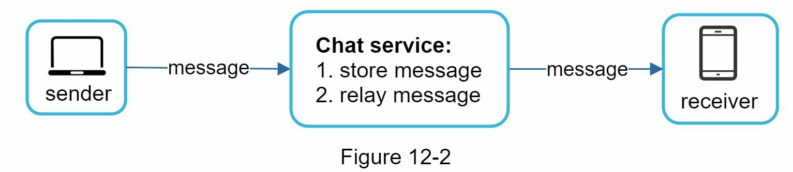
*Hình 12-2*

Khi một client có ý định bắt đầu một cuộc trò chuyện, nó sẽ kết nối tới dịch vụ chat bằng một hoặc nhiều giao thức mạng. Đối với một dịch vụ chat, việc lựa chọn giao thức mạng là vô cùng quan trọng. Hãy cùng thảo luận điều này với người phỏng vấn.

Trong hầu hết các ứng dụng client/server, các yêu cầu (requests) đều do phía client khởi tạo. Điều này cũng đúng đối với phía người gửi (sender side) của một ứng dụng chat. Trong Hình 12-2, khi người gửi gửi một tin nhắn tới người nhận thông qua dịch vụ chat, nó sử dụng giao thức **HTTP** đã được kiểm chứng qua thời gian — vốn là giao thức web phổ biến nhất. Trong kịch bản này, client mở một kết nối HTTP với dịch vụ chat và gửi tin nhắn, báo cho dịch vụ biết để gửi tin nhắn đó tới người nhận. Cơ chế **keep-alive** hoạt động rất hiệu quả ở đây vì header `keep-alive` cho phép client duy trì một kết nối bền vững (persistent connection) với dịch vụ chat. Nó cũng giúp giảm số lượng bắt tay TCP (TCP handshakes). HTTP là một lựa chọn tốt ở phía người gửi, và nhiều ứng dụng chat phổ biến như Facebook [1] ban đầu cũng sử dụng HTTP để gửi tin nhắn.

Tuy nhiên, phía người nhận (receiver side) lại phức tạp hơn một chút. Vì HTTP là giao thức do client khởi tạo, việc máy chủ chủ động gửi tin nhắn xuống client là điều không hề đơn giản. Qua nhiều năm, nhiều kỹ thuật đã được sử dụng để mô phỏng một kết nối do máy chủ khởi tạo (server-initiated connection): **Polling**, **Long polling**, và **WebSocket**. Đây là những kỹ thuật quan trọng thường xuyên xuất hiện trong các buổi phỏng vấn thiết kế hệ thống, vì vậy chúng ta hãy lần lượt xem xét từng kỹ thuật một.

### Polling (Thăm dò định kỳ)

Như được minh họa trong Hình 12-3, polling là kỹ thuật mà client sẽ định kỳ hỏi máy chủ xem có tin nhắn mới nào hay không.

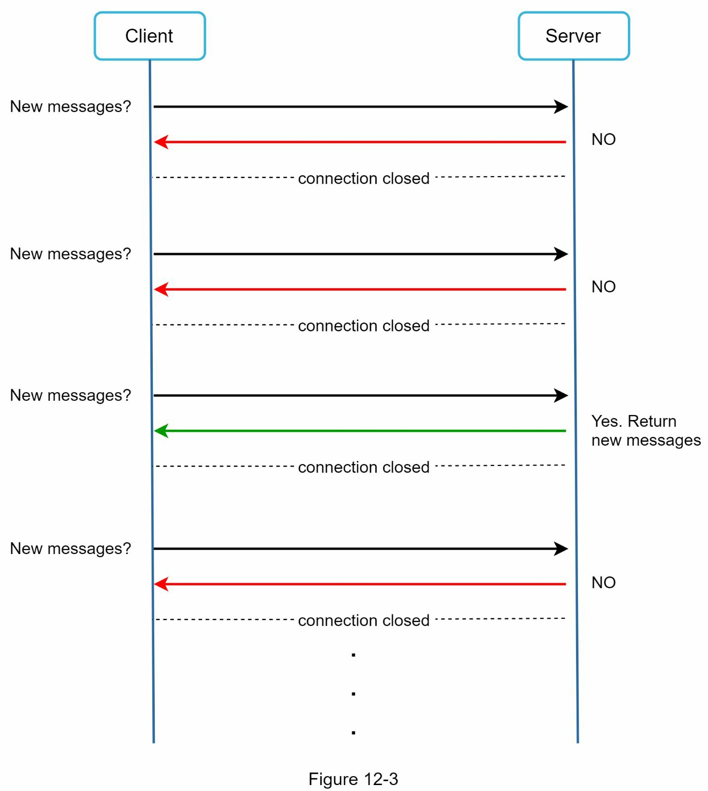
*Hình 12-3*

Tùy thuộc vào tần suất thăm dò (polling frequency), polling có thể rất tốn kém chi phí tài nguyên. Nó có thể làm tiêu hao nguồn tài nguyên máy chủ quý giá chỉ để trả lời một câu hỏi mà phần lớn thời gian câu trả lời nhận được chỉ là "không có" (no).

---

### Long polling (Thăm dò kéo dài)

Vì polling có thể kém hiệu quả, bước phát triển tiếp theo là **long polling** (Hình 12-4).

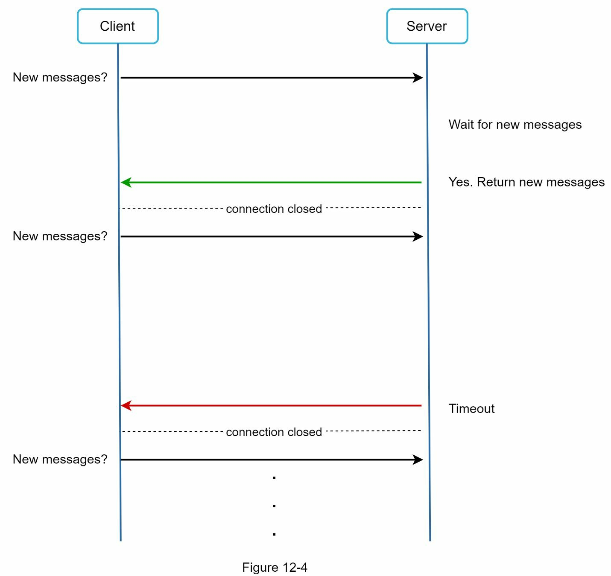
*Hình 12-4*

Trong long polling, client giữ kết nối mở cho đến khi thực sự có tin nhắn mới xuất hiện hoặc đạt tới một ngưỡng thời gian chờ (timeout threshold). Ngay khi client nhận được tin nhắn mới, nó sẽ ngay lập tức gửi một yêu cầu khác tới máy chủ, tái khởi động lại toàn bộ quy trình. Long polling tồn tại một vài nhược điểm:

* **Người gửi và người nhận có thể không kết nối tới cùng một máy chủ chat:** Các máy chủ dựa trên nền tảng HTTP thường là phi trạng thái (stateless). Nếu bạn sử dụng thuật toán vòng tròn (Round Robin) để cân bằng tải (load balancing), máy chủ tiếp nhận tin nhắn có thể không có kết nối long-polling đang mở với client nhận tin nhắn đó.
* Máy chủ không có phương thức tin cậy nào để biết được liệu client đã ngắt kết nối (disconnected) hay chưa.
* Kỹ thuật này vẫn chưa tối ưu về mặt hiệu năng. Nếu một người dùng ít khi trò chuyện, long polling vẫn liên tục thực hiện các kết nối định kỳ sau mỗi lần hết thời gian chờ (timeout).

---

### WebSocket

**WebSocket** là giải pháp phổ biến nhất để gửi các bản cập nhật bất đồng bộ (asynchronous updates) từ máy chủ về phía client. Hình 12-5 mô tả cách thức hoạt động của giao thức này.

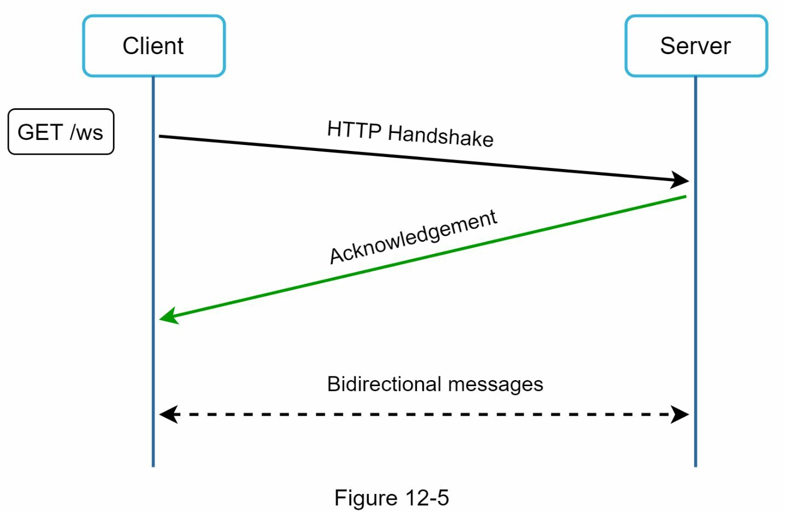
*Hình 12-5*

Kết nối WebSocket được khởi tạo bởi client. Đây là kết nối hai chiều (bi-directional) và bền vững (persistent). Ban đầu, nó bắt đầu vòng đời như một kết nối HTTP, sau đó có thể được "nâng cấp" (upgraded) thông qua một quy trình bắt tay (handshake) được định nghĩa rõ ràng để chuyển thành kết nối WebSocket. Thông qua kết nối bền vững này, máy chủ có thể chủ động đẩy các bản cập nhật tới client. 

Các kết nối WebSocket nhìn chung vẫn hoạt động bình thường ngay cả khi có tường lửa (firewall). Điều này là do chúng sử dụng cổng 80 hoặc cổng 443 — các cổng vốn cũng được sử dụng bởi các kết nối HTTP/HTTPS thông thường.

Ở phần trước, chúng ta đã nói rằng ở phía người gửi, HTTP là một giao thức đủ tốt để sử dụng. Tuy nhiên, vì WebSocket có tính chất hai chiều (bidirectional), không có lý do kỹ thuật thuyết phục nào ngăn cản việc sử dụng luôn WebSocket cho cả chiều gửi tin nhắn. Hình 12-6 minh họa cách thức WebSocket (`ws`) được áp dụng cho cả hai phía người gửi và người nhận.

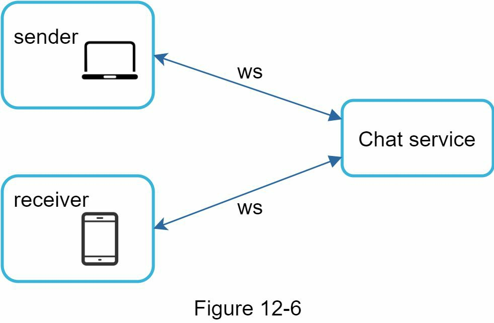
*Hình 12-6*

Bằng cách sử dụng WebSocket cho cả hai tác vụ gửi và nhận, thiết kế hệ thống trở nên tinh gọn hơn và việc triển khai trên cả client lẫn server cũng trực quan, mạch lạc hơn rất nhiều. Tuy nhiên, do các kết nối WebSocket là kết nối bền vững (persistent), việc quản lý kết nối hiệu quả (efficient connection management) ở phía máy chủ trở thành một yếu tố mang tính sống còn.

---

# Thiết kế mức cao (High-level design)

Vừa rồi chúng ta đã đề cập rằng **WebSocket** được chọn làm giao thức truyền thông chính giữa client và server nhờ khả năng giao tiếp hai chiều (bidirectional communication) của nó, tuy nhiên cần lưu ý quan trọng rằng mọi thành phần khác không nhất thiết phải dùng WebSocket. Trên thực tế, hầu hết các tính năng (đăng ký - sign up, đăng nhập - login, hồ sơ người dùng - user profile, v.v.) của một ứng dụng chat đều có thể sử dụng phương thức yêu cầu/phản hồi (request/response) truyền thống qua **HTTP**. Hãy cùng đi sâu hơn một chút và xem xét các thành phần mức cao của hệ thống.

Như được minh họa trong **Hình 12-7**, hệ thống chat được chia thành ba nhóm thành phần chính: **dịch vụ phi trạng thái (stateless services)**, **dịch vụ có trạng thái (stateful services)**, và **tích hợp bên thứ ba (third-party integration)**.

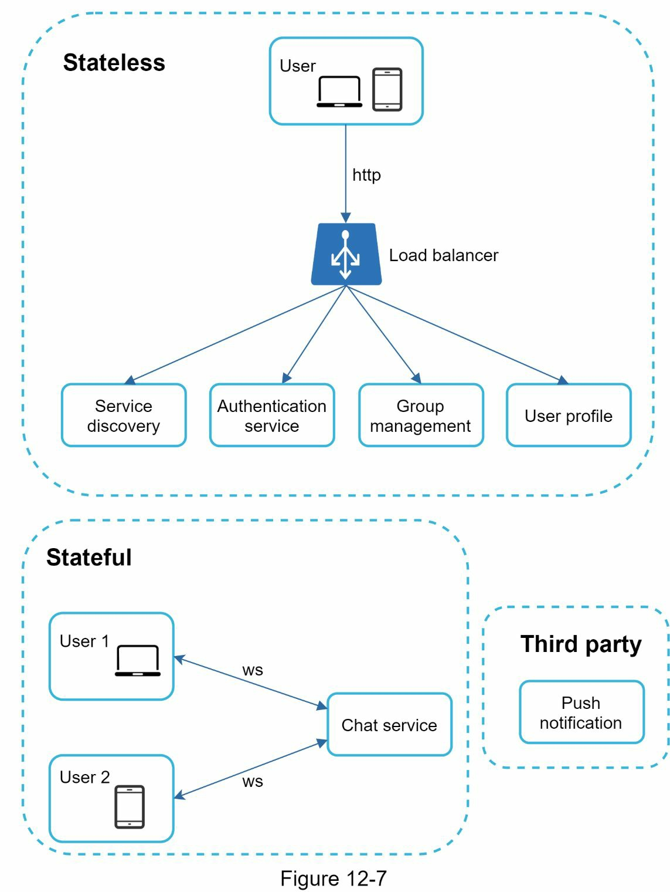

*Hình 12-7: Thiết kế mức cao ban đầu của hệ thống chat*

### Dịch vụ phi trạng thái (Stateless Services)

Các dịch vụ phi trạng thái là những dịch vụ request/response hướng ngoại (public-facing) truyền thống, được sử dụng để quản lý đăng nhập, đăng ký, hồ sơ người dùng, v.v. Đây là những tính năng phổ biến trên nhiều trang web và ứng dụng.

Các stateless service nằm phía sau một bộ cân bằng tải (**Load Balancer**), có nhiệm vụ định tuyến các request đến đúng dịch vụ dựa trên đường dẫn request (request paths). Các dịch vụ này có thể ở dạng kiến trúc nguyên khối (**monolithic**) hoặc từng **microservice** riêng lẻ. Chúng ta không cần phải tự xây dựng nhiều dịch vụ phi trạng thái này vì trên thị trường đã có sẵn các dịch vụ có thể tích hợp dễ dàng. Một dịch vụ mà chúng ta sẽ thảo luận kỹ hơn trong phần đi sâu chi tiết (deep dive) là **Service Discovery**. Nhiệm vụ chính của nó là cung cấp cho client danh sách các tên miền máy chủ (**DNS host names**) của các chat server mà client có thể kết nối tới.

### Dịch vụ có trạng thái (Stateful Service)

Dịch vụ có trạng thái duy nhất là dịch vụ chat (**chat service**). Dịch vụ này có trạng thái vì mỗi client duy trì một kết nối mạng liên tục (**persistent network connection**) tới một chat server. Trong dịch vụ này, thông thường client sẽ không chuyển sang chat server khác chừng nào server hiện tại vẫn còn khả dụng. Service discovery phối hợp chặt chẽ với chat service để tránh tình trạng quá tải server. Chúng ta sẽ đi sâu vào chi tiết ở phần sau.

### Tích hợp bên thứ ba (Third-party integration)

Đối với một ứng dụng chat, thông báo đẩy (**Push Notification**) là tích hợp bên thứ ba quan trọng nhất. Đây là phương thức thông báo cho người dùng khi có tin nhắn mới đến, ngay cả khi ứng dụng không chạy. Việc tích hợp push notification đúng cách là cực kỳ quan trọng. Tham khảo *Chương 10: Thiết kế hệ thống thông báo (Design a notification system)* để biết thêm thông tin.

### Khả năng mở rộng (Scalability)

Ở quy mô nhỏ, tất cả các dịch vụ liệt kê ở trên đều có thể nằm gọn trong một server duy nhất. Ngay cả ở quy mô chúng ta đang thiết kế, về mặt lý thuyết hoàn toàn có thể chứa toàn bộ kết nối người dùng trên một server đám mây hiện đại. Số lượng kết nối đồng thời (**concurrent connections**) mà một server có thể xử lý rất có thể sẽ là yếu tố giới hạn. Trong kịch bản của chúng ta, với **1 triệu người dùng đồng thời (1M concurrent users)**, giả định mỗi kết nối người dùng cần **10KB** bộ nhớ trên server (đây là một con số ước lượng thô và phụ thuộc rất nhiều vào ngôn ngữ lập trình được chọn), hệ thống chỉ cần khoảng **10GB** bộ nhớ để lưu giữ tất cả các kết nối trên một máy vật lý/máy chủ duy nhất.

Tuy nhiên, nếu chúng ta đề xuất một thiết kế mà mọi thứ nằm gọn trong một server, điều này có thể dấy lên một dấu hiệu cảnh báo lớn (red flag) trong tâm trí của người phỏng vấn. Không một chuyên gia công nghệ nào lại đi thiết kế một quy mô như vậy trên một server đơn lẻ. Thiết kế single server là một phương án không thể chấp nhận được do nhiều yếu tố. Điểm lỗi đơn lẻ (**Single Point of Failure - SPOF**) là yếu tố rủi ro lớn nhất trong số đó.

Dẫu vậy, việc bắt đầu bằng thiết kế single server là hoàn toàn bình thường. Chỉ cần đảm bảo rằng người phỏng vấn hiểu đây chỉ là điểm khởi đầu. Kết hợp tất cả những gì chúng ta đã đề cập lại với nhau, **Hình 12-8** thể hiện thiết kế mức cao đã được điều chỉnh.

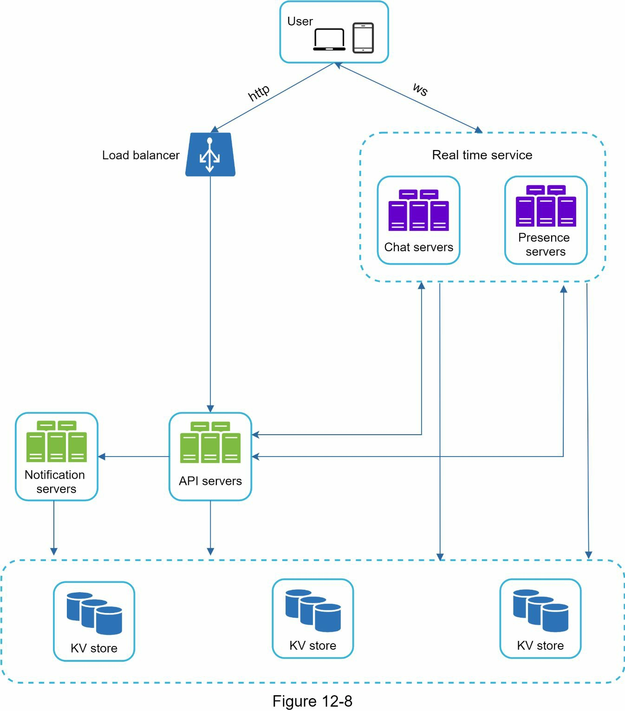

*Hình 12-8: Thiết kế mức cao của hệ thống chat sau khi phân tách*

Trong **Hình 12-8**, client duy trì một kết nối WebSocket liên tục tới một chat server để nhắn tin theo thời gian thực (real-time messaging).
* **Chat servers**: Hỗ trợ việc gửi và nhận tin nhắn.
* **Presence servers**: Quản lý trạng thái trực tuyến / ngoại tuyến (online/offline status).
* **API servers**: Xử lý tất cả mọi thứ bao gồm đăng nhập, đăng ký, thay đổi thông tin hồ sơ, v.v.
* **Notification servers**: Gửi thông báo đẩy (push notifications).
* **Key-Value Store**: Cuối cùng, kho lưu trữ khóa-giá trị được sử dụng để lưu trữ lịch sử chat. Khi một người dùng ngoại tuyến chuyển sang trực tuyến, cô ấy sẽ thấy toàn bộ lịch sử chat trước đó của mình.

---

## Lưu trữ (Storage)

Đến thời điểm này, chúng ta đã có các server sẵn sàng, các dịch vụ đang chạy và các tích hợp bên thứ ba đã hoàn tất. Nằm sâu bên dưới hạ tầng kỹ thuật là tầng dữ liệu (**data layer**). Tầng dữ liệu thường đòi hỏi nhiều nỗ lực để thiết kế cho chính xác. Một quyết định quan trọng chúng ta phải đưa ra là quyết định đúng loại cơ sở dữ liệu để sử dụng: cơ sở dữ liệu quan hệ (**Relational Databases - RDBMS**) hay cơ sở dữ liệu **NoSQL**? Để đưa ra một quyết định sáng suốt, chúng ta sẽ xem xét các loại dữ liệu và các mẫu đọc/ghi (**read/write patterns**).

Hai loại dữ liệu tồn tại trong một hệ thống chat điển hình:

1. **Dữ liệu thông thường (Generic data)**: chẳng hạn như hồ sơ người dùng (user profile), cài đặt (settings), danh sách bạn bè (user friends list). Những dữ liệu này được lưu trữ trong các cơ sở dữ liệu quan hệ mạnh mẽ và đáng tin cậy. Sao chép (**Replication**) và phân mảnh (**Sharding**) là các kỹ thuật phổ biến để đáp ứng các yêu cầu về tính sẵn sàng cao (**Availability**) và khả năng mở rộng (**Scalability**).
2. **Dữ liệu đặc thù của hệ thống chat (Chat history data)**: Đây là dữ liệu lịch sử chat. Việc hiểu rõ mẫu truy cập đọc/ghi (read/write pattern) của loại dữ liệu này là vô cùng quan trọng:
   * **Khối lượng dữ liệu cực lớn**: Đối với các hệ thống chat, lượng dữ liệu là khổng lồ. Một nghiên cứu trước đây [2] tiết lộ rằng Facebook Messenger và WhatsApp xử lý 60 tỷ tin nhắn mỗi ngày.
   * **Chỉ các đoạn chat gần đây mới được truy cập thường xuyên**: Người dùng thường không tìm kiếm lại các đoạn chat cũ.
   * **Yêu cầu truy cập ngẫu nhiên**: Mặc dù lịch sử chat rất gần đây được xem trong phần lớn các trường hợp, người dùng vẫn có thể sử dụng các tính năng đòi hỏi truy cập dữ liệu ngẫu nhiên (random access), chẳng hạn như tìm kiếm (search), xem các tin nhắn nhắc đến bạn (view your mentions), nhảy tới một tin nhắn cụ thể (jump to specific messages), v.v. Các trường hợp này phải được hỗ trợ bởi tầng truy cập dữ liệu.
   * **Tỷ lệ đọc/ghi xấp xỉ $1:1$** đối với các ứng dụng chat 1-1 (1 on 1 chat apps).

Việc lựa chọn hệ thống lưu trữ chính xác hỗ trợ tất cả các ca sử dụng (use cases) của chúng ta là tối quan trọng. Chúng tôi đề xuất sử dụng **Key-Value Stores** vì các lý do sau:
* **Key-Value Stores** cho phép mở rộng quy mô theo chiều ngang (**horizontal scaling**) một cách dễ dàng.
* **Key-Value Stores** cung cấp độ trễ truy cập dữ liệu rất thấp (**very low latency**).
* Các cơ sở dữ liệu quan hệ không xử lý tốt phần "đuôi dài" dữ liệu (**long tail** [3]). Khi các chỉ mục (**indexes**) phình to, việc truy cập ngẫu nhiên trở nên vô cùng tốn kém.
* **Key-Value Stores** đã được áp dụng và chứng minh độ tin cậy bởi các ứng dụng chat hàng đầu khác. Ví dụ: cả Facebook Messenger và Discord đều sử dụng Key-Value Store. Facebook Messenger sử dụng **HBase** [4], còn Discord sử dụng **Cassandra** [5].

---

## Mô hình dữ liệu (Data models)

Vừa rồi, chúng ta đã nói về việc sử dụng Key-Value Store làm tầng lưu trữ của hệ thống. Dữ liệu quan trọng nhất là dữ liệu tin nhắn. Hãy cùng xem xét kỹ hơn.

### Bảng tin nhắn cho chat 1-1 (Message table for 1 on 1 chat)

**Hình 12-9** minh họa bảng tin nhắn cho cuộc trò chuyện 1-1. Khóa chính (**Primary Key**) là `message_id`, giúp xác định thứ tự tin nhắn. Chúng ta không thể dựa vào `created_at` để quyết định thứ tự tin nhắn vì hai tin nhắn hoàn toàn có thể được tạo ra tại cùng một thời điểm.

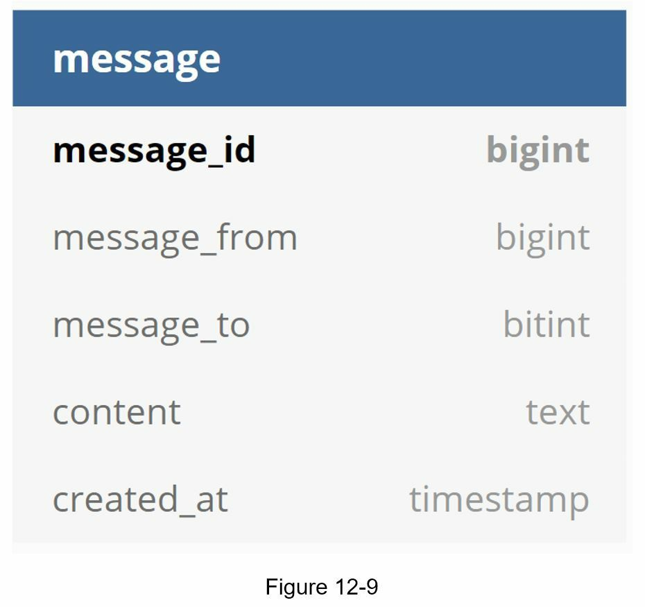

*Hình 12-9: Bảng tin nhắn cho cuộc trò chuyện 1-1*

### Bảng tin nhắn cho chat nhóm (Message table for group chat)

**Hình 12-10** minh họa bảng tin nhắn cho chat nhóm. Khóa chính kết hợp (**Composite Primary Key**) là `(channel_id, message_id)`. Kênh (`channel`) và nhóm (`group`) mang cùng một ý nghĩa ở đây. `channel_id` đóng vai trò là khóa phân vùng (**Partition Key**) vì tất cả các truy vấn trong một nhóm chat đều thao tác trong một kênh duy nhất.

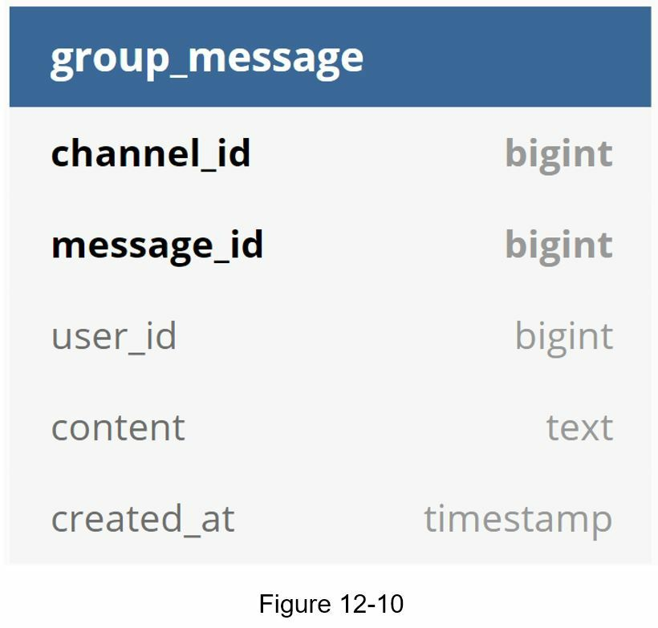

*Hình 12-10: Bảng tin nhắn cho chat nhóm*

---

## Định danh tin nhắn (Message ID)

Cách tạo `message_id` là một chủ đề thú vị rất đáng để khám phá. `message_id` gánh vác trách nhiệm đảm bảo thứ tự của các tin nhắn. Để xác định chắc chắn thứ tự tin nhắn, `message_id` phải thỏa mãn hai yêu cầu sau:
* Các ID phải là **duy nhất (unique)**.
* Các ID phải **có thể sắp xếp được theo thời gian (sortable by time)**, nghĩa là các hàng dữ liệu mới hơn phải có ID lớn hơn các hàng cũ hơn.

Làm thế nào chúng ta có thể đạt được hai đảm bảo này? Ý tưởng đầu tiên xuất hiện trong đầu là từ khóa `auto_increment` trong **MySQL**. Tuy nhiên, các cơ sở dữ liệu **NoSQL** thông thường không cung cấp tính năng như vậy.

Cách tiếp cận thứ hai là sử dụng một bộ tạo số thứ tự 64-bit toàn cục (**global 64-bit sequence number generator**) như **Snowflake** [6]. Điều này đã được thảo luận trong *"Chương 7: Thiết kế bộ tạo ID duy nhất trong hệ thống phân tán (Design a unique ID generator in a distributed system)"*.

Cách tiếp cận cuối cùng là sử dụng **bộ tạo số thứ tự cục bộ (local sequence number generator)**. Cục bộ ở đây có nghĩa là các ID chỉ cần là duy nhất bên trong một nhóm (group). Lý do ID cục bộ hoạt động hiệu quả là vì việc duy trì thứ tự tin nhắn trong phạm vi một kênh 1-1 hoặc một kênh nhóm đã là đủ. Cách tiếp cận này dễ triển khai hơn nhiều so với việc triển khai ID toàn cục (**global ID**).

---

# Bước 3 - Đi sâu vào thiết kế chi tiết (Design deep dive)

Trong một buổi phỏng vấn thiết kế hệ thống (system design interview), bạn thường được kỳ vọng sẽ đào sâu vào một số thành phần trọng yếu trong bản thiết kế tổng thể cấp cao (high-level design). Đối với hệ thống chat, các thành phần như: **khám phá dịch vụ (Service Discovery)**, **luồng truyền thông điệp (Messaging flows)**, và **chỉ báo trạng thái trực tuyến/ngoại tuyến (Online/Offline indicators)** là những phần rất đáng để nghiên cứu sâu hơn.

---

## Khám phá dịch vụ (Service discovery)

Vai trò chính của Service Discovery là gợi ý máy chủ chat (chat server) tối ưu nhất cho một máy khách (client) dựa trên các tiêu chí như vị trí địa lý, tải dung lượng của máy chủ, v.v. Apache ZooKeeper [7] là một giải pháp mã nguồn mở phổ biến cho Service Discovery. Nó đăng ký toàn bộ các chat server khả dụng và chọn ra chat server phù hợp nhất cho client dựa trên các tiêu chí đã được định nghĩa trước.

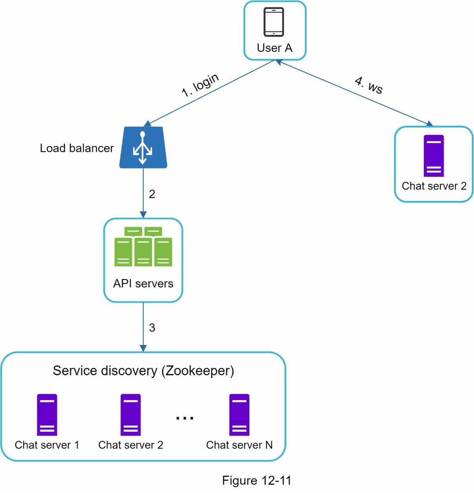
*Hình 12-11 thể hiện cách thức hoạt động của Service Discovery (ZooKeeper).*

1. **Người dùng A (User A)** cố gắng đăng nhập vào ứng dụng.
2. **Bộ cân bằng tải (Load Balancer)** chuyển tiếp yêu cầu đăng nhập (login request) đến các **API server**.
3. Sau khi hệ thống backend xác thực thành công người dùng, **Service Discovery** sẽ tìm chat server tối ưu nhất cho User A. Trong ví dụ này, server 2 được chọn và thông tin máy chủ sẽ được trả về cho User A.
4. **User A** thiết lập kết nối tới **Chat server 2** thông qua giao thức **WebSocket**.

---

## Luồng truyền thông điệp (Message flows)

Việc thấu hiểu luồng dữ liệu đầu-cuối (end-to-end flow) của một hệ thống chat là rất thú vị. Trong phần này, chúng ta sẽ tìm hiểu:
* Luồng chat 1-1 (1 on 1 chat flow)
* Đồng bộ hóa tin nhắn trên nhiều thiết bị (Message synchronization across multiple devices)
* Luồng chat nhóm (Group chat flow)

### Luồng chat 1-1 (1 on 1 chat flow)

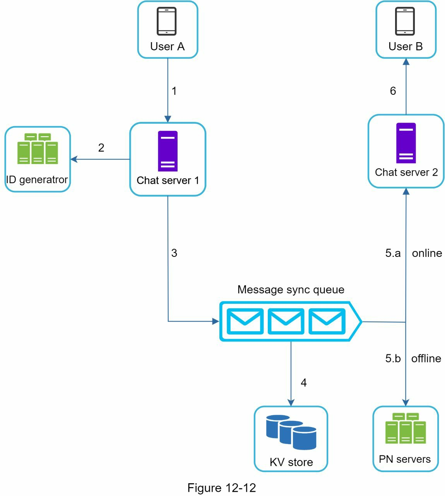
*Hình 12-12 giải thích những gì diễn ra khi User A gửi tin nhắn cho User B.*

1. **User A** gửi một tin nhắn chat tới **Chat server 1**.
2. **Chat server 1** nhận một định danh tin nhắn (**Message ID**) từ bộ sinh ID (**ID generator**).
3. **Chat server 1** gửi tin nhắn vào hàng đợi đồng bộ tin nhắn (**Message sync queue**).
4. Tin nhắn được lưu trữ vào cơ sở dữ liệu khóa-giá trị (**Key-Value Store**).
5. **Kiểm tra trạng thái User B:**
   * **5.a.** Nếu **User B đang trực tuyến (online)**, tin nhắn sẽ được chuyển tiếp tới **Chat server 2** - nơi User B đang kết nối.
   * **5.b.** Nếu **User B đang ngoại tuyến (offline)**, một thông báo đẩy (**Push Notification**) sẽ được gửi đi từ các máy chủ thông báo đẩy (**Push Notification - PN servers**).
6. **Chat server 2** chuyển tiếp tin nhắn tới **User B**. Giữa User B và Chat server 2 luôn duy trì một kết nối WebSocket liên tục (**persistent WebSocket connection**).

---

### Đồng bộ hóa tin nhắn trên nhiều thiết bị (Message synchronization across multiple devices)

Nhiều người dùng sở hữu đồng thời nhiều thiết bị. Chúng ta sẽ giải thích cách thức đồng bộ hóa tin nhắn qua lại giữa các thiết bị này. 

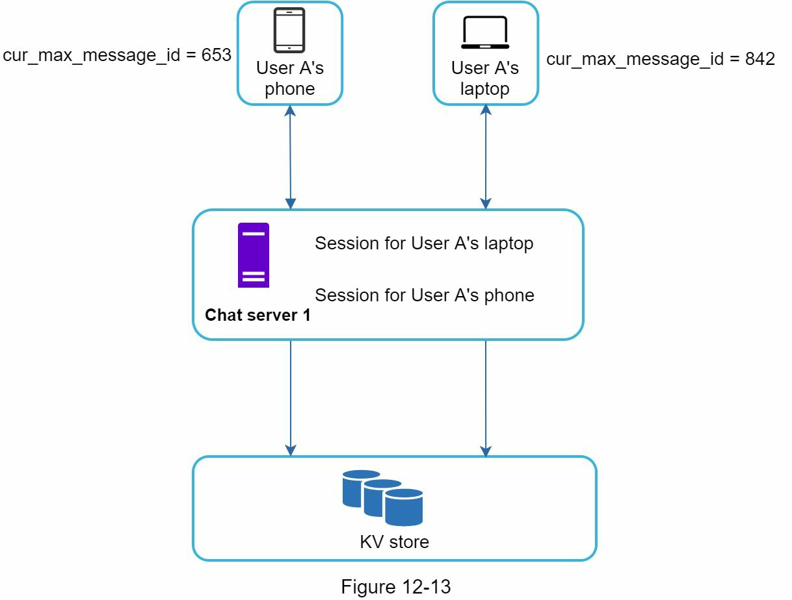
*Hình 12-13 minh họa một ví dụ về việc đồng bộ hóa tin nhắn.*

Trong Hình 12-13, User A sở hữu hai thiết bị: một điện thoại và một máy tính xách tay (laptop). Khi User A đăng nhập vào ứng dụng chat bằng điện thoại, nó sẽ thiết lập một kết nối WebSocket với **Chat server 1**. Tương tự, cũng có một kết nối được duy trì giữa laptop và **Chat server 1**.

Mỗi thiết bị duy trì một biến có tên là `cur_max_message_id`, dùng để theo dõi ID của tin nhắn mới nhất hiện diện trên thiết bị đó. Những tin nhắn thỏa mãn hai điều kiện sau sẽ được coi là **tin nhắn mới**:

* ID của người nhận trùng khớp với ID của người dùng hiện đang đăng nhập (`recipient_id == current_user_id`).
* `message_id` trong Key-Value Store lớn hơn `cur_max_message_id` trên thiết bị đó (`message_id > cur_max_message_id`).

Nhờ việc duy trì một giá trị `cur_max_message_id` riêng biệt trên từng thiết bị, việc đồng bộ hóa tin nhắn trở nên rất đơn giản vì mỗi thiết bị đều có thể chủ động lấy các tin nhắn mới từ KV Store.

---

### Luồng chat nhóm quy mô nhỏ (Small group chat flow)

So với chat 1-1, logic xử lý của chat nhóm phức tạp hơn đáng kể. Hình 12-14 và 12-15 sẽ làm rõ luồng xử lý này.

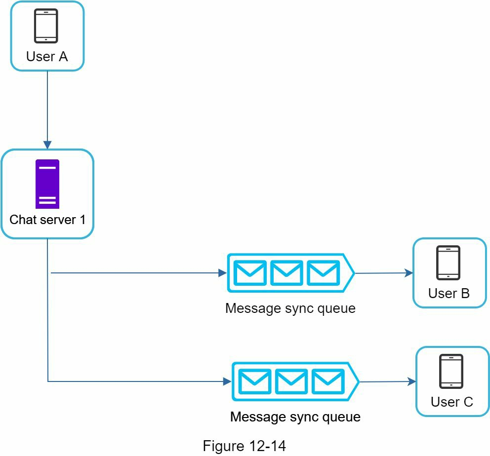
*Hình 12-14 giải thích những gì xảy ra khi User A gửi một tin nhắn vào nhóm chat.*

Giả sử nhóm có 3 thành viên (**User A, User B và User C**). Đầu tiên, tin nhắn từ User A sẽ được sao chép (copy) vào hàng đợi đồng bộ tin nhắn (**Message sync queue**) của từng thành viên trong nhóm: một bản sao cho User B và bản sao thứ hai cho User C. Bạn có thể hình dung hàng đợi đồng bộ tin nhắn như một hộp thư đến (**inbox**) dành riêng cho mỗi người nhận. Lựa chọn thiết kế này rất tối ưu cho các nhóm chat quy mô nhỏ vì:

* **Đơn giản hóa luồng đồng bộ tin nhắn:** Mỗi client chỉ cần kiểm tra hộp thư đến (inbox) của chính mình để nhận các tin nhắn mới.
* **Chi phí lưu trữ thấp:** Khi số lượng thành viên trong nhóm nhỏ, việc lưu trữ một bản sao trong hộp thư đến của từng người nhận không quá tốn kém tài nguyên.

**WeChat** áp dụng một phương pháp tiếp cận tương tự và họ giới hạn quy mô mỗi nhóm ở mức **500 thành viên** [8]. Tuy nhiên, đối với các nhóm có lượng người dùng rất lớn, việc lưu một bản sao tin nhắn cho mọi thành viên là điều không thể chấp nhận được (không khả thi về mặt tài nguyên).

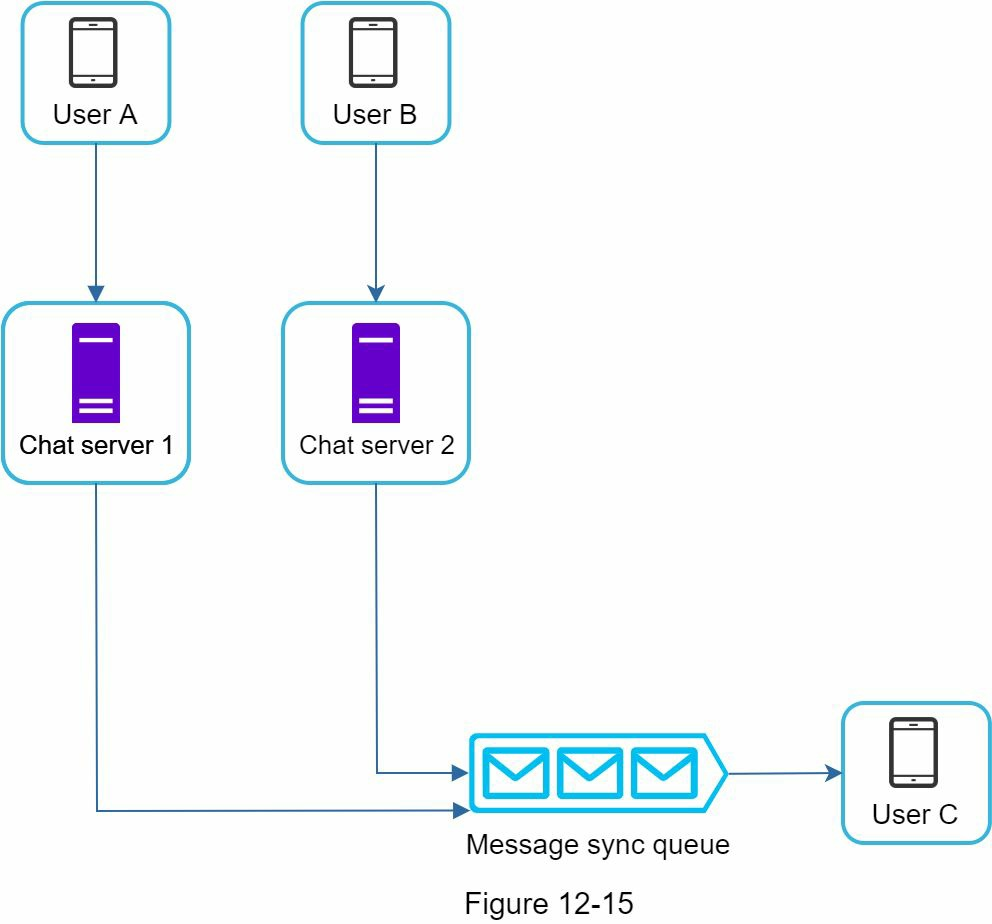
*Hình 12-15 minh họa thiết kế ở phía người nhận.*

Ở phía người nhận, một người có thể nhận tin nhắn từ nhiều người dùng khác nhau. Mỗi người nhận sở hữu một hộp thư đến (**Message sync queue**) chứa các tin nhắn đến từ nhiều người gửi khác nhau như minh họa trong Hình 12-15.

---

## Chỉ báo trạng thái trực tuyến (Online presence)

Chỉ báo trạng thái trực tuyến (**Online Presence Indicator**) là một tính năng thiết yếu của nhiều ứng dụng chat. Thông thường, bạn sẽ thấy một chấm tròn màu xanh lá cây xuất hiện bên cạnh ảnh đại diện hoặc tên người dùng. Phần này sẽ giải thích những gì diễn ra ở tầng hệ thống phía sau (behind the scenes).

Trong thiết kế tổng thể cấp cao, các **Presence Server** chịu trách nhiệm quản lý trạng thái online và giao tiếp với client thông qua kết nối WebSocket. Có một số luồng sự kiện sẽ kích hoạt việc thay đổi trạng thái online. Chúng ta hãy cùng kiểm tra từng luồng một.

### Người dùng đăng nhập (User login)

Luồng đăng nhập của người dùng đã được giải thích trong phần "Khám phá dịch vụ (Service Discovery)". Sau khi kết nối WebSocket được thiết lập giữa client và dịch vụ thời gian thực (real-time service), trạng thái trực tuyến của User A cùng mốc thời gian `last_active_at` sẽ được lưu vào **KV Store**. Chỉ báo trạng thái sẽ hiển thị người dùng là **Online** sau khi đăng nhập thành công.

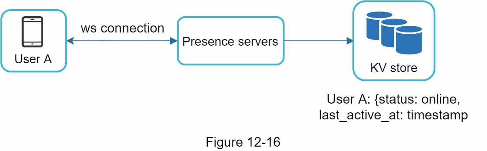

---

### Người dùng đăng xuất (User logout)

Khi người dùng thực hiện thao tác đăng xuất, hệ thống sẽ đi qua luồng đăng xuất như hiển thị trong Hình 12-17. Trạng thái trực tuyến được cập nhật thành **Offline** trong **KV Store**. Khi đó, chỉ báo trạng thái sẽ hiển thị người dùng là ngoại tuyến.

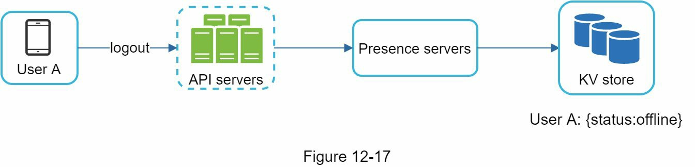
*Hình 12-17: Luồng người dùng đăng xuất.*

---

### Mất kết nối đột ngột (User disconnection)

Tất cả chúng ta đều mong muốn kết nối internet của mình luôn ổn định và đáng tin cậy. Tuy nhiên, thực tế không phải lúc nào cũng lý tưởng như vậy; do đó, chúng ta bắt buộc phải xử lý bài toán này trong thiết kế hệ thống. 

Khi một người dùng bị ngắt kết nối internet, kết nối liên tục (**persistent connection**) giữa client và server sẽ bị đứt. Một cách tiếp cận ngây thơ (naive approach) để xử lý việc ngắt kết nối là đánh dấu ngay người dùng là **Offline**, và chuyển trạng thái thành **Online** khi kết nối được tái thiết lập. Tuy nhiên, cách tiếp cận này tồn tại một lỗ hổng nghiêm trọng: Người dùng rất hay gặp phải tình trạng rớt mạng và kết nối lại mạng liên tục trong khoảng thời gian ngắn (ví dụ: sóng mạng chập chờn bật/tắt liên tục khi người dùng đi xuyên qua đường hầm). Việc cập nhật trạng thái trực tuyến sau mỗi lần ngắt/kết nối lại như vậy sẽ khiến chấm trạng thái nhấp nháy, đổi trạng thái quá thường xuyên, dẫn đến trải nghiệm người dùng rất tồi tệ.

Để giải quyết bài toán này, chúng tôi đưa ra **cơ chế nhịp tim (Heartbeat Mechanism)**:

* Theo định kỳ, một client đang online sẽ gửi một **sự kiện nhịp tim (Heartbeat Event)** đến các **Presence Server**.
* Nếu các Presence Server nhận được sự kiện nhịp tim trong một khoảng thời gian nhất định (giả sử $x$ giây) gửi từ client, người dùng được coi là **Online**.
* Ngược lại, nếu quá thời gian trên mà không nhận được tín hiệu nhịp tim, hệ thống sẽ coi người dùng là **Offline**.

Trong **Hình 12-18**, client gửi một sự kiện nhịp tim đến server sau mỗi **5 giây**. Sau khi gửi được 3 sự kiện nhịp tim, client bị ngắt kết nối và không kết nối lại trong khoảng thời gian $x = 30$ giây *(con số 30 giây này được chọn tùy ý nhằm mục đích minh họa logic xử lý)*. Khi đó, trạng thái trực tuyến của người dùng sẽ chính thức được chuyển sang **Offline**.

---

### Lan tỏa trạng thái trực tuyến (Online status fanout)

Làm thế nào để bạn bè của người dùng A biết được các thay đổi trạng thái? **Hình 12-19** giải thích cơ chế hoạt động của quá trình này.

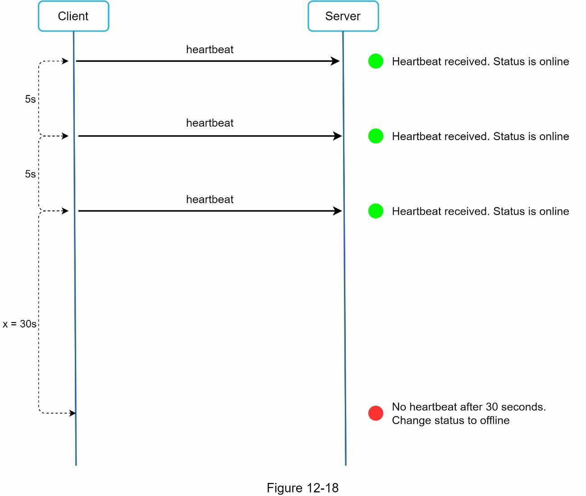

Các máy chủ quản lý trạng thái hiện diện (*presence servers*) sử dụng mô hình xuất bản - đăng ký (*publish-subscribe model*), trong đó mỗi cặp bạn bè duy trì một kênh (*channel*). Khi trạng thái trực tuyến (*online status*) của Người dùng A thay đổi, máy chủ sẽ xuất bản sự kiện này tới ba kênh: kênh A-B, A-C và A-D. Ba kênh này lần lượt được đăng ký nhận tin bởi Người dùng B, C và D. Nhờ đó, bạn bè có thể dễ dàng nhận được các cập nhật trạng thái trực tuyến. Quá trình giao tiếp giữa máy khách (*client*) và máy chủ (*server*) được thực hiện thông qua kết nối **WebSocket** thời gian thực.

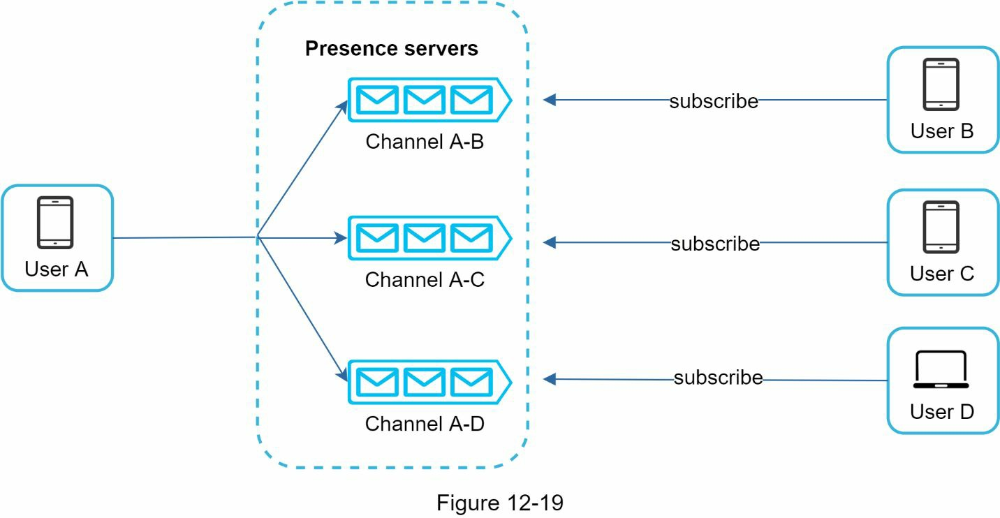

---

Thiết kế trên rất hiệu quả đối với các nhóm người dùng nhỏ. Chẳng hạn, WeChat áp dụng phương pháp tương tự vì quy mô nhóm người dùng của họ bị giới hạn tối đa ở mức 500 thành viên. Đối với các nhóm lớn hơn, việc thông báo trạng thái trực tuyến tới tất cả các thành viên là một thao tác vô cùng tốn kém tài nguyên và mất thời gian. Giả sử một nhóm có 100.000 thành viên, mỗi lần thay đổi trạng thái sẽ phát sinh tới 100.000 sự kiện. Để giải quyết nút thắt cổ chai về mặt hiệu năng (*performance bottleneck*) này, một giải pháp khả thi là chỉ thực hiện lấy (*fetch*) trạng thái trực tuyến khi người dùng truy cập vào một nhóm hoặc chủ động làm mới danh sách bạn bè theo cách thủ công.

---

### Bước 4 - Tổng kết (Wrap up)

Trong chương này, chúng ta đã trình bày kiến trúc của một hệ thống trò chuyện (*chat system architecture*) hỗ trợ cả tính năng nhắn tin 1-1 (*1-to-1 chat*) lẫn trò chuyện nhóm nhỏ (*small group chat*). **WebSocket** được sử dụng để phục vụ giao tiếp thời gian thực giữa máy khách và máy chủ. Hệ thống trò chuyện bao gồm các thành phần cốt lõi sau:
- **Máy chủ trò chuyện (Chat servers):** Phục vụ nhắn tin thời gian thực.
- **Máy chủ quản lý trạng thái hiện diện (Presence servers):** Quản lý trạng thái trực tuyến/ngoại tuyến.
- **Máy chủ thông báo đẩy (Push notification servers):** Gửi các thông báo đẩy.
- **Kho lưu trữ Key-Value (Key-value stores):** Đảm nhiệm việc lưu trữ bền vững (*persistence*) lịch sử trò chuyện.
- **Máy chủ API (API servers):** Xử lý các chức năng nghiệp vụ khác.

Nếu bạn còn dư thời gian vào cuối buổi phỏng vấn, dưới đây là một số chủ đề thảo luận mở rộng hữu ích:
* **Mở rộng ứng dụng trò chuyện để hỗ trợ các tệp đa phương tiện (media files)** như hình ảnh và video: Các tệp phương tiện có kích thước lớn hơn đáng kể so với văn bản thuần. Nén dữ liệu (*compression*), lưu trữ đám mây (*cloud storage*), và tạo ảnh thu nhỏ (*thumbnails*) là những chủ đề rất thú vị để thảo luận.
* **Mã hóa đầu cuối (End-to-end encryption):** WhatsApp hỗ trợ mã hóa đầu cuối cho các tin nhắn. Chỉ người gửi và người nhận mới có thể giải mã và đọc được nội dung tin nhắn. Độc giả quan tâm có thể tham khảo thêm bài viết trong phần tài liệu tham khảo [9].
* **Bộ nhớ đệm tin nhắn phía máy khách (Caching messages on the client-side):** Giải pháp hiệu quả để giảm thiểu lưu lượng truyền tải dữ liệu giữa máy khách và máy chủ.
* **Cải thiện thời gian tải (Improve load time):** Slack đã xây dựng một mạng lưới phân tán theo vị trí địa lý (*geographically distributed network*) để lưu đệm dữ liệu, các kênh (*channels*), v.v. của người dùng nhằm tối ưu hóa thời gian tải tốt hơn [10].
* **Xử lý lỗi (Error handling):**
  * **Lỗi máy chủ trò chuyện (The chat server error):** Có thể có hàng trăm nghìn hoặc thậm chí nhiều hơn nữa các kết nối duy trì liên tục (*persistent connections*) kết nối tới một máy chủ chat. Nếu một máy chủ chat ngoại tuyến (bị sập), thành phần phát hiện dịch vụ (*service discovery* - ví dụ: **ZooKeeper**) sẽ cung cấp một máy chủ chat mới để các máy khách thiết lập lại kết nối mới.
  * **Cơ chế gửi lại tin nhắn (Message resent mechanism):** Cơ chế thử lại (*retry*) và hàng đợi tin nhắn (*queueing*) là các kỹ thuật phổ biến được sử dụng để gửi lại các tin nhắn bị lỗi.

Xin chúc mừng bạn đã đi được tới đây! Hãy tự thưởng cho mình một lời khen ngợi. Bạn đã làm rất tốt!

---

### Tài liệu tham khảo (Reference materials)

* **[1] Erlang at Facebook:**  
  https://www.erlang-factory.com/upload/presentations/31/EugeneLetuchy-ErlangatFacebook.pdf
* **[2] Messenger and WhatsApp process 60 billion messages a day:**  
  https://www.theverge.com/2016/4/12/11415198/facebook-messenger-whatsapp-number-messages-vs-sms-f8-2016
* **[3] Long tail:**  
  https://en.wikipedia.org/wiki/Long_tail
* **[4] The Underlying Technology of Messages:**  
  https://www.facebook.com/notes/facebook-engineering/the-underlying-technology-of-messages/454991608919/
* **[5] How Discord Stores Billions of Messages:**  
  https://blog.discordapp.com/how-discord-stores-billions-of-messages-7fa6ec7ee4c7
* **[6] Announcing Snowflake:**  
  https://blog.twitter.com/engineering/en_us/a/2010/announcing-snowflake.html
* **[7] Apache ZooKeeper:**  
  https://zookeeper.apache.org/
* **[8] From nothing: the evolution of WeChat background system (Bài viết tiếng Trung):**  
  https://www.infoq.cn/article/the-road-of-the-growth-weixin-background
* **[9] End-to-end encryption:**  
  https://faq.whatsapp.com/en/android/28030015/
* **[10] Flannel: An Application-Level Edge Cache to Make Slack Scale:**  
  https://slack.engineering/flannel-an-application-level-edge-cache-to-make-slack-scale-b8a6400e2f6b

---

[← Chương trước](chuong-11-thiet-ke-news-feed-system.md) | [Mục lục](README.md) | [Chương tiếp theo →](chuong-13-thiet-ke-search-autocomplete.md)
