# Chương 13: Thiết kế Hệ thống gợi ý tìm kiếm (Design Search Autocomplete)

[← Chương trước](chuong-12-thiet-ke-chat-system.md) | [Mục lục](README.md) | [Chương tiếp theo →](chuong-14-thiet-ke-youtube.md)

---


# CHƯƠNG 13: THIẾT KẾ HỆ THỐNG TỰ ĐỘNG HOÀN THÀNH TÌM KIẾM (SEARCH AUTOCOMPLETE SYSTEM)

Khi tìm kiếm trên Google hoặc mua sắm trên Amazon, khi bạn gõ vào ô tìm kiếm, một hoặc nhiều kết quả khớp với cụm từ tìm kiếm sẽ được hiển thị cho bạn. Tính năng này được gọi là **autocomplete** (tự động hoàn thành), **typeahead** (gợi ý khi nhập), **search-as-you-type** (tìm kiếm ngay khi gõ), hoặc **incremental search** (tìm kiếm tăng dần). Hình 13-1 minh họa một ví dụ về tìm kiếm trên Google hiển thị danh sách các kết quả tự động hoàn thành khi từ khóa "dinner" được nhập vào ô tìm kiếm. Tự động hoàn thành tìm kiếm là một tính năng quan trọng của nhiều sản phẩm. Điều này dẫn chúng ta đến câu hỏi phỏng vấn: thiết kế một hệ thống search autocomplete, còn được gọi là “thiết kế top k” (*design top k*) hoặc “thiết kế top k truy vấn được tìm kiếm nhiều nhất” (*design top k most searched queries*).


*Hình 13-1*

---

## Bước 1 - Hiểu rõ bài toán và xác lập phạm vi thiết kế (Step 1 - Understand the problem and establish design scope)

Bước đầu tiên để giải quyết bất kỳ câu hỏi phỏng vấn thiết kế hệ thống nào là đặt đủ các câu hỏi để làm rõ các yêu cầu. Dưới đây là một ví dụ về cuộc trao đổi giữa ứng viên và người phỏng vấn:

**Ứng viên:** Việc khớp từ khóa chỉ được hỗ trợ ở phần đầu của một truy vấn tìm kiếm (*prefix*) hay hỗ trợ cả ở phần giữa?  
**Người phỏng vấn:** Chỉ hỗ trợ ở phần đầu của một truy vấn tìm kiếm.  
**Ứng viên:** Hệ thống nên trả về bao nhiêu gợi ý autocomplete?  
**Người phỏng vấn:** 5 gợi ý.  
**Ứng viên:** Làm thế nào hệ thống biết được 5 gợi ý nào cần trả về?  
**Người phỏng vấn:** Điều này được xác định bởi mức độ phổ biến (*popularity*), dựa trên tần suất truy vấn trong lịch sử (*historical query frequency*).  
**Ứng viên:** Hệ thống có hỗ trợ kiểm tra chính tả (*spell check*) không?  
**Người phỏng vấn:** Không, kiểm tra chính tả hoặc tự động sửa lỗi (*autocorrect*) không được hỗ trợ.  
**Ứng viên:** Các truy vấn tìm kiếm có phải bằng tiếng Anh không?  
**Người phỏng vấn:** Đúng vậy. Nếu còn thời gian ở phần cuối, chúng ta có thể thảo luận về việc hỗ trợ đa ngôn ngữ (*multi-language support*).  
**Ứng viên:** Chúng ta có cho phép chữ hoa và các ký tự đặc biệt không?  
**Người phỏng vấn:** Không, chúng ta giả định tất cả các truy vấn tìm kiếm đều là các ký tự chữ cái viết thường.  
**Ứng viên:** Có bao nhiêu người dùng sử dụng sản phẩm?  
**Người phỏng vấn:** 10 triệu người dùng hoạt động hàng ngày (10 million DAU - Daily Active Users).  

### Yêu cầu (Requirements)

Dưới đây là bản tóm tắt các yêu cầu:

* **Thời gian phản hồi nhanh (Fast response time):** Khi người dùng nhập một truy vấn tìm kiếm, các gợi ý autocomplete phải xuất hiện đủ nhanh. Một bài viết về hệ thống autocomplete của Facebook [1] tiết lộ rằng hệ thống cần trả về kết quả trong vòng 100 mili-giây (100 ms). Nếu không, nó sẽ gây ra hiện tượng giật/khựng (*stuttering*).
* **Mức độ liên quan (Relevant):** Các gợi ý autocomplete phải liên quan đến cụm từ tìm kiếm.
* **Được sắp xếp (Sorted):** Các kết quả được hệ thống trả về phải được sắp xếp theo mức độ phổ biến hoặc các mô hình xếp hạng (*ranking models*) khác.
* **Khả năng mở rộng (Scalable):** Hệ thống có thể xử lý lưu lượng truy cập lớn (*high traffic volume*).
* **Tính sẵn sàng cao (Highly available):** Hệ thống phải duy trì trạng thái sẵn sàng và có thể truy cập được ngay cả khi một phần của hệ thống bị ngoại tuyến (*offline*), chạy chậm, hoặc gặp lỗi mạng không lường trước.

### Ước tính sơ bộ (Back of the envelope estimation)

* Giả sử có 10 triệu người dùng hoạt động hàng ngày (10 million DAU).
* Trung bình một người thực hiện 10 lượt tìm kiếm mỗi ngày.
* 20 bytes dữ liệu cho mỗi chuỗi truy vấn:
  * Giả sử chúng ta sử dụng mã hóa ký tự ASCII. 1 ký tự = 1 byte.
  * Giả sử một truy vấn chứa 4 từ, và mỗi từ chứa trung bình 5 ký tự.
  * Tức là: $4 \times 5 = 20\text{ bytes}$ cho mỗi truy vấn.
* Đối với mỗi ký tự được nhập vào ô tìm kiếm, client sẽ gửi một yêu cầu (request) đến backend để lấy các gợi ý autocomplete. Trung bình có 20 requests được gửi đi cho mỗi truy vấn tìm kiếm. Ví dụ, 6 requests sau đây được gửi đến backend tính đến thời điểm bạn gõ xong từ “dinner”:
  * `search?q=d`
  * `search?q=di`
  * `search?q=din`
  * `search?q=dinn`
  * `search?q=dinne`
  * `search?q=dinner`
* $\sim 24{,}000$ truy vấn mỗi giây ($\text{QPS} - \text{Queries Per Second}$) = $\frac{10{,}000{,}000\text{ users} \times 10\text{ queries/day} \times 20\text{ characters}}{24\text{ hours} \times 3600\text{ seconds}}$.
* $\text{Peak QPS} = \text{QPS} \times 2 \approx 48{,}000$.
* Giả sử 20% các truy vấn hàng ngày là mới. $10\text{ triệu} \times 10\text{ queries/day} \times 20\text{ bytes/query} \times 20\% = 0.4\text{ GB}$. Điều này có nghĩa là có 0.4 GB dữ liệu mới được thêm vào bộ lưu trữ mỗi ngày.

---

## Bước 2 - Đề xuất thiết kế cấp cao và đạt được sự đồng thuận (Step 2 - Propose high-level design and get buy-in)

Ở mức độ cấp cao (*high-level*), hệ thống được chia làm hai phần:

* **Dịch vụ thu thập dữ liệu (Data gathering service):** Thu thập các truy vấn đầu vào của người dùng và tổng hợp chúng theo thời gian thực (*real-time*). Xử lý thời gian thực là không thực tế đối với các tập dữ liệu lớn; tuy nhiên, đây là một điểm khởi đầu tốt. Chúng ta sẽ khám phá một giải pháp thực tế hơn trong phần đào sâu chi tiết (*deep dive*).
* **Dịch vụ truy vấn (Query service):** Cho trước một truy vấn tìm kiếm hoặc tiền tố (*prefix*), trả về 5 cụm từ được tìm kiếm thường xuyên nhất.

### Dịch vụ thu thập dữ liệu (Data gathering service)

Hãy sử dụng một ví dụ đơn giản hóa để xem dịch vụ thu thập dữ liệu hoạt động như thế nào. Giả sử chúng ta có một bảng tần suất (*frequency table*) lưu trữ chuỗi truy vấn và tần suất của nó như được hiển thị trong Hình 13-2. Ban đầu, bảng tần suất trống. Sau đó, người dùng nhập tuần tự các truy vấn “twitch”, “twitter”, “twitter,” và “twillo”. Hình 13-2 cho thấy cách bảng tần suất được cập nhật.

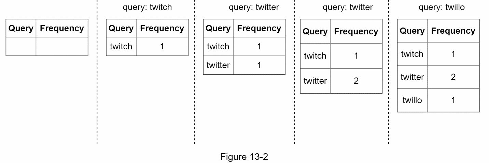
*Hình 13-2*

### Dịch vụ truy vấn (Query service)

Giả sử chúng ta có một bảng tần suất như trong Bảng 13-1. Nó có hai trường (*fields*):
* **Query:** lưu trữ chuỗi truy vấn.
* **Frequency:** đại diện cho số lần một truy vấn đã được tìm kiếm.

| Query | Frequency |
| :--- | :--- |
| twitter | 35 |
| twitch | 29 |
| twilight | 25 |
| twin | 21 |
| twitch prime | 18 |
| twitter search | 14 |
| twillo | 10 |
| twin peaks | 8 |

*Bảng 13-1: Bảng tần suất (Frequency table)*

Khi người dùng nhập “tw” vào ô tìm kiếm, top 5 truy vấn được tìm kiếm nhiều nhất sau đây sẽ được hiển thị (Hình 13-3), giả định bảng tần suất dựa trên Bảng 13-1.

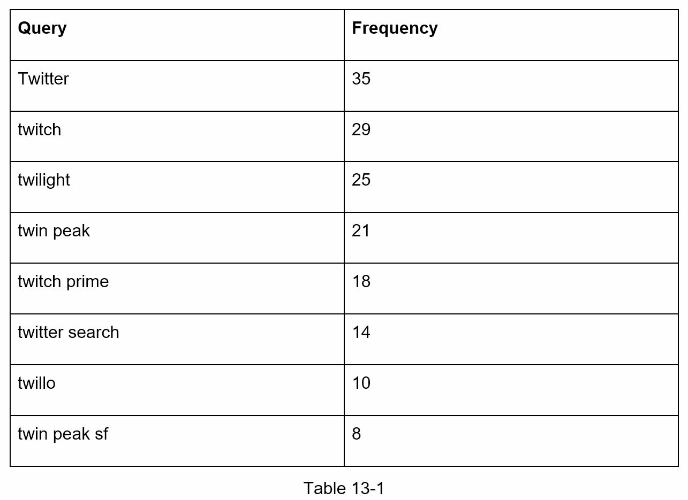
*Hình 13-3*

Để lấy ra top 5 truy vấn được tìm kiếm thường xuyên nhất, thực thi câu lệnh SQL sau:

```sql
SELECT * FROM frequency_table
WHERE query Like 'prefix%'
ORDER BY frequency DESC
LIMIT 5
```

Đây là một giải pháp chấp nhận được khi tập dữ liệu còn nhỏ. Khi tập dữ liệu lớn, việc truy cập vào cơ sở dữ liệu (*database*) sẽ trở thành điểm nghẽn cổ chai (*bottleneck*). Chúng ta sẽ khám phá các tối ưu hóa trong phần đào sâu chi tiết (*deep dive*).

---

# Bước 3 - Đi sâu vào thiết kế (Design deep dive)

Trong phần thiết kế tổng quan (high-level design), chúng ta đã thảo luận về dịch vụ thu thập dữ liệu (**data gathering service**) và dịch vụ truy vấn (**query service**). Thiết kế tổng quan đó chưa phải là tối ưu, nhưng nó đóng vai trò là một điểm khởi đầu tốt. Trong phần này, chúng ta sẽ đi sâu vào một vài thành phần và khám phá các tối ưu hóa như sau:

* Cấu trúc dữ liệu Trie (**Trie data structure**)
* Dịch vụ thu thập dữ liệu (**Data gathering service**)
* Dịch vụ truy vấn (**Query service**)
* Mở rộng quy mô lưu trữ (**Scale the storage**)
* Các thao tác trên Trie (**Trie operations**)

---

## Cấu trúc dữ liệu Trie (Trie data structure)

Cơ sở dữ liệu quan hệ (relational databases) được sử dụng để lưu trữ trong thiết kế tổng quan. Tuy nhiên, việc lấy ra top 5 truy vấn tìm kiếm từ một cơ sở dữ liệu quan hệ là không hiệu quả. Cấu trúc dữ liệu trie (cây tiền tố - prefix tree) được sử dụng để khắc phục vấn đề này. Vì cấu trúc dữ liệu trie đóng vai trò tối quan trọng đối với hệ thống, chúng ta sẽ dành nhiều thời gian để thiết kế một trie tùy biến. Xin lưu ý rằng một số ý tưởng được tham khảo từ các bài viết [2] và [3].

Hiểu rõ cấu trúc dữ liệu trie cơ bản là điều cần thiết cho câu hỏi phỏng vấn này. Tuy nhiên, đây là một câu hỏi về cấu trúc dữ liệu nhiều hơn là một câu hỏi thiết kế hệ thống. Ngoài ra, nhiều tài liệu trực tuyến cũng đã giải thích khái niệm này. Trong chương này, chúng ta sẽ chỉ thảo luận tổng quan về cấu trúc dữ liệu trie và tập trung vào cách tối ưu hóa trie cơ bản để cải thiện thời gian phản hồi (response time).

Trie (phát âm là “try”) là một cấu trúc dữ liệu dạng cây có thể lưu trữ các chuỗi ký tự một cách gọn gàng, cô đọng. Tên gọi này bắt nguồn từ từ "retrieval" (truy xuất), cho thấy nó được thiết kế cho các thao tác truy xuất chuỗi. Ý tưởng chính của trie bao gồm:

* Trie là một cấu trúc dữ liệu dạng cây.
* Nút gốc (root) đại diện cho một chuỗi rỗng.
* Mỗi nút lưu trữ một ký tự và có 26 nút con (children), mỗi nút đại diện cho một ký tự có thể có. Để tiết kiệm không gian, chúng ta không vẽ các liên kết rỗng.
* Mỗi nút trên cây đại diện cho một từ đơn lẻ hoặc một chuỗi tiền tố (prefix string).

**Hình 13-5** minh họa một trie với các truy vấn tìm kiếm: "tree", "try", "true", "toy", "wish", "win". Các truy vấn tìm kiếm được làm nổi bật với đường viền dày hơn.

---

Cấu trúc dữ liệu trie cơ bản lưu trữ các ký tự trong các nút. Để hỗ trợ việc sắp xếp theo tần suất, thông tin tần suất cần được đưa vào các nút. Giả sử chúng ta có bảng tần suất sau:

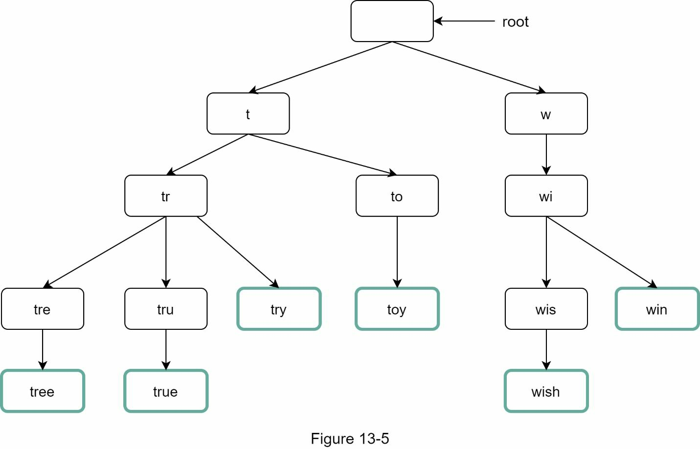

Sau khi thêm thông tin tần suất vào các nút, cấu trúc dữ liệu trie được cập nhật như thể hiện trong **Hình 13-6**.

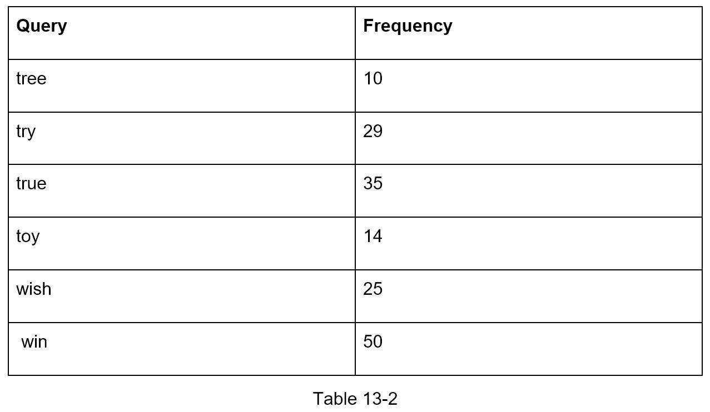

---

Tính năng tự động hoàn thành (autocomplete) hoạt động với trie như thế nào? Trước khi đi sâu vào thuật toán, chúng ta hãy cùng định nghĩa một số thuật ngữ:

* $p$: độ dài của một tiền tố (prefix)
* $n$: tổng số nút trong một trie
* $c$: số nút con của một nút nhất định

Các bước để lấy ra top $k$ truy vấn được tìm kiếm nhiều nhất được liệt kê dưới đây:

1. **Tìm tiền tố**: Độ phức tạp thời gian: $O(p)$.
2. **Duyệt qua cây con** từ nút tiền tố để lấy tất cả các nút con hợp lệ. Một nút con được coi là hợp lệ nếu nó có thể tạo thành một chuỗi truy vấn hợp lệ. Độ phức tạp thời gian: $O(c)$.
3. **Sắp xếp các nút con** và lấy top $k$. Độ phức tạp thời gian: $O(c \log c)$.

Hãy sử dụng một ví dụ như minh họa trong **Hình 13-7** để giải thích thuật toán. Giả sử $k = 2$ và người dùng gõ "tr" vào ô tìm kiếm. Thuật toán hoạt động như sau:

* **Bước 1**: Tìm nút tiền tố "tr".
* **Bước 2**: Duyệt cây con để lấy tất cả các nút con hợp lệ. Trong trường hợp này, các nút `[tree: 10]`, `[true: 35]`, `[try: 29]` là hợp lệ.
* **Bước 3**: Sắp xếp các nút con và lấy top 2. `[true: 35]` và `[try: 29]` là 2 truy vấn hàng đầu với tiền tố "tr".

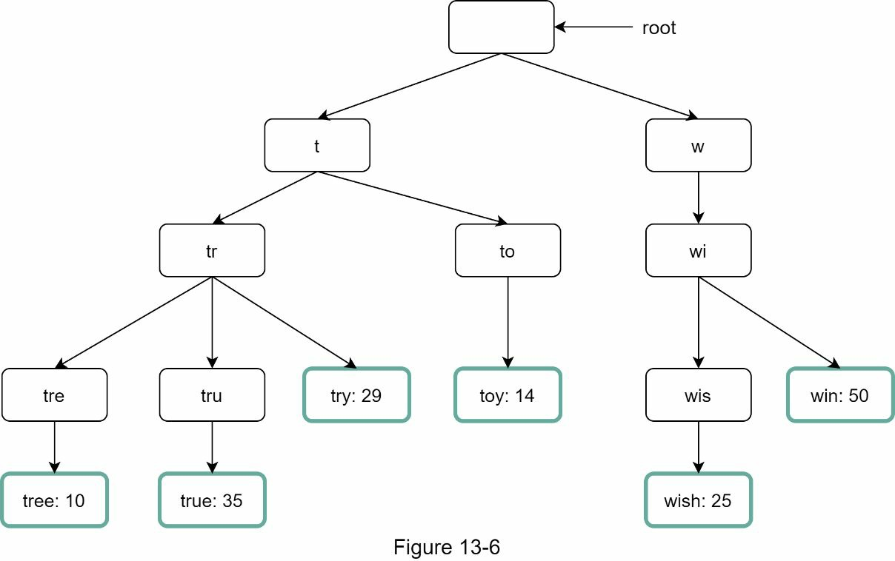

---

Độ phức tạp thời gian của thuật toán này là tổng thời gian dành cho mỗi bước được đề cập ở trên:

$$O(p) + O(c) + O(c \log c)$$

Thuật toán trên rất trực quan và dễ hiểu. Tuy nhiên, nó quá chậm vì trong trường hợp xấu nhất (worst-case scenario), chúng ta cần phải duyệt qua toàn bộ trie để lấy được top $k$ kết quả. Dưới đây là hai phương pháp tối ưu hóa:

1. Giới hạn độ dài tối đa của một tiền tố (**Limit the max length of a prefix**).
2. Lưu cache top truy vấn tìm kiếm tại mỗi nút (**Cache top search queries at each node**).

Chúng ta hãy cùng xem xét từng tối ưu hóa này.

### Giới hạn độ dài tối đa của một tiền tố (Limit the max length of a prefix)
Người dùng hiếm khi nhập một truy vấn tìm kiếm quá dài vào ô tìm kiếm. Do đó, có thể an tâm giả định rằng $p$ là một số nguyên nhỏ, chẳng hạn như 50. Nếu chúng ta giới hạn độ dài của tiền tố, độ phức tạp thời gian cho bước "Tìm tiền tố" có thể giảm từ $O(p)$ xuống $O(\text{hằng số nhỏ})$, tức là $O(1)$.

### Lưu cache top truy vấn tìm kiếm tại mỗi nút (Cache top search queries at each node)
Để tránh việc phải duyệt toàn bộ trie, chúng ta lưu trữ top $k$ truy vấn được sử dụng thường xuyên nhất tại mỗi nút. Vì 5 đến 10 gợi ý autocomplete là đủ cho người dùng, $k$ là một số tương đối nhỏ. Trong trường hợp cụ thể của chúng ta, chỉ có top 5 truy vấn tìm kiếm được lưu vào bộ nhớ cache.

Bằng cách cache top các truy vấn tìm kiếm tại mỗi nút, chúng ta giảm đáng kể độ phức tạp thời gian để lấy ra top 5 truy vấn. Tuy nhiên, thiết kế này đòi hỏi rất nhiều không gian bộ nhớ để lưu trữ các truy vấn hàng đầu tại mỗi nút. Việc đánh đổi không gian lấy thời gian (trading space for time) là hoàn toàn xứng đáng vì thời gian phản hồi nhanh là yếu tố vô cùng quan trọng.

**Hình 13-8** thể hiện cấu trúc dữ liệu trie đã được cập nhật. Top 5 truy vấn được lưu trữ trên mỗi nút. Ví dụ, nút có tiền tố "be" lưu trữ các thông tin sau: `[best: 35, bet: 29, bee: 20, be: 15, beer: 10]`.

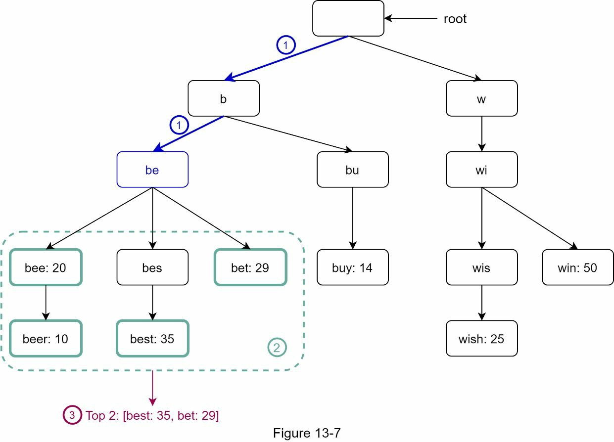

---

Chúng ta hãy xem lại độ phức tạp thời gian của thuật toán sau khi áp dụng hai tối ưu hóa trên:

1. **Tìm nút tiền tố**: Độ phức tạp thời gian: $O(1)$.
2. **Trả về top $k$**: Vì top $k$ truy vấn đã được cache, độ phức tạp thời gian cho bước này là $O(1)$.

Vì độ phức tạp thời gian cho mỗi bước đều giảm xuống $O(1)$, thuật toán của chúng ta chỉ mất $O(1)$ để lấy về top $k$ truy vấn.

---

## Dịch vụ thu thập dữ liệu (Data gathering service)

Trong thiết kế trước đây của chúng ta, bất cứ khi nào người dùng gõ một truy vấn tìm kiếm, dữ liệu đều được cập nhật theo thời gian thực (real-time). Cách tiếp cận này không thực tế vì hai lý do sau:

* Người dùng có thể nhập hàng tỷ truy vấn mỗi ngày. Việc cập nhật trie trên mỗi truy vấn sẽ làm chậm đáng kể dịch vụ truy vấn (query service).
* Các gợi ý hàng đầu (top suggestions) có thể không thay đổi nhiều sau khi trie đã được xây dựng. Do đó, việc cập nhật trie thường xuyên là không cần thiết.

Để thiết kế một dịch vụ thu thập dữ liệu có khả năng mở rộng (scalable data gathering service), chúng ta cần kiểm tra xem dữ liệu đến từ đâu và dữ liệu được sử dụng như thế nào. Các ứng dụng thời gian thực như Twitter yêu cầu các gợi ý autocomplete luôn được cập nhật mới nhất. Tuy nhiên, các gợi ý autocomplete cho nhiều từ khóa của Google có thể không thay đổi nhiều trên cơ sở hàng ngày.

Mặc dù có sự khác biệt về các use case, nền tảng cốt lõi cho dịch vụ thu thập dữ liệu vẫn giữ nguyên vì dữ liệu dùng để xây dựng trie thường đến từ các dịch vụ phân tích (analytics services) hoặc dịch vụ ghi log (logging services).

**Hình 13-9** thể hiện dịch vụ thu thập dữ liệu đã được tái thiết kế. Từng thành phần sẽ được kiểm tra chi tiết lần lượt.

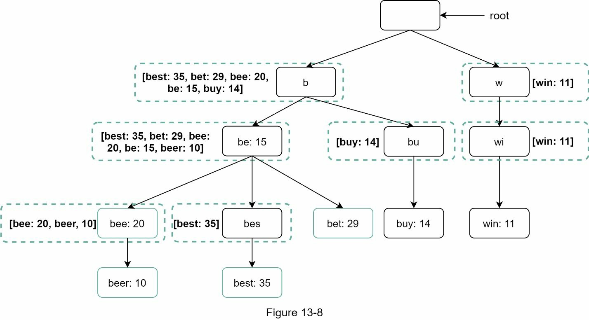

---

### Nhật ký phân tích (Analytics Logs)
Thành phần này lưu trữ dữ liệu thô về các truy vấn tìm kiếm. Các file log hoạt động theo cơ chế chỉ ghi nối thêm (**append-only**) và không được đánh chỉ mục (**not indexed**). **Bảng 13-3** thể hiện một ví dụ về tệp nhật ký:

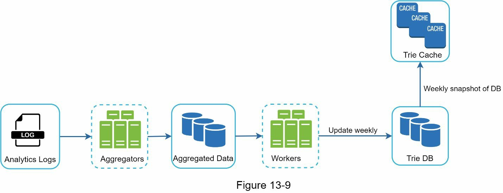

### Bộ tổng hợp (Aggregators)
Kích thước của nhật ký phân tích thường rất lớn và dữ liệu không ở đúng định dạng chuẩn. Chúng ta cần tổng hợp (aggregate) dữ liệu để hệ thống của chúng ta có thể xử lý dễ dàng.

Tùy thuộc vào trường hợp sử dụng, chúng ta có thể tổng hợp dữ liệu theo các cách khác nhau. Đối với các ứng dụng thời gian thực như Twitter, chúng ta tổng hợp dữ liệu trong một khoảng thời gian ngắn hơn vì kết quả thời gian thực là rất quan trọng. Mặt khác, việc tổng hợp dữ liệu ít thường xuyên hơn, chẳng hạn như mỗi tuần một lần, có thể là đủ tốt cho nhiều trường hợp sử dụng. Trong một buổi phỏng vấn, hãy xác nhận xem kết quả thời gian thực có quan trọng hay không. Chúng ta giả định rằng trie được xây dựng lại hàng tuần.

### Dữ liệu đã tổng hợp (Aggregated Data)
**Bảng 13-4** thể hiện một ví dụ về dữ liệu được tổng hợp hàng tuần. Trường "time" đại diện cho thời gian bắt đầu của một tuần. Trường "frequency" là tổng số lần xuất hiện của truy vấn tương ứng trong tuần đó.

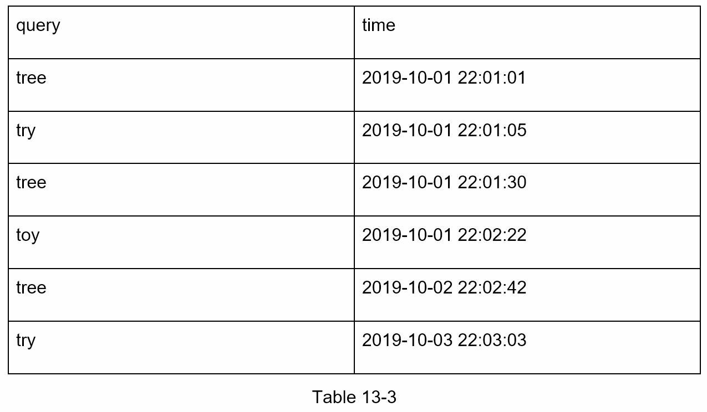

---

**Workers (Các tiến trình xử lý ngầm).** Workers là một tập hợp các máy chủ thực hiện các tác vụ bất đồng bộ (*asynchronous jobs*) theo các khoảng thời gian định kỳ. Chúng xây dựng cấu trúc dữ liệu trie và lưu trữ nó vào Trie DB.

**Trie Cache (Bộ nhớ đệm Trie).** Trie Cache là một hệ thống bộ nhớ đệm phân tán (*distributed cache system*) lưu giữ cây trie trong bộ nhớ (*in-memory*) để phục vụ thao tác đọc nhanh. Hệ thống này định kỳ chụp bản sao (*snapshot*) của cơ sở dữ liệu hàng tuần.

**Trie DB.** Trie DB là tầng lưu trữ bền vững (*persistent storage*). Có hai lựa chọn khả thi để lưu trữ dữ liệu:
1. **Document store (Cơ sở dữ liệu dạng tài liệu):** Vì một cây trie mới được xây dựng hàng tuần, chúng ta có thể định kỳ chụp bản sao (*snapshot*) của nó, tuần tự hóa (*serialize*) và lưu trữ dữ liệu đã tuần tự hóa vào cơ sở dữ liệu. Các cơ sở dữ liệu dạng tài liệu (*document stores*) như MongoDB [4] rất phù hợp cho loại dữ liệu được tuần tự hóa này.
2. **Key-value store (Cơ sở dữ liệu khóa - giá trị):** Một cây trie có thể được biểu diễn dưới dạng bảng băm (*hash table*) [4] bằng cách áp dụng logic sau:
   - Mỗi tiền tố (*prefix*) trong cây trie được ánh xạ tới một khóa (*key*) trong bảng băm.
   - Dữ liệu trên mỗi nút trie (*trie node*) được ánh xạ tới một giá trị (*value*) trong bảng băm.

Hình 13-10 minh họa mối quan hệ ánh xạ giữa cây trie và bảng băm.

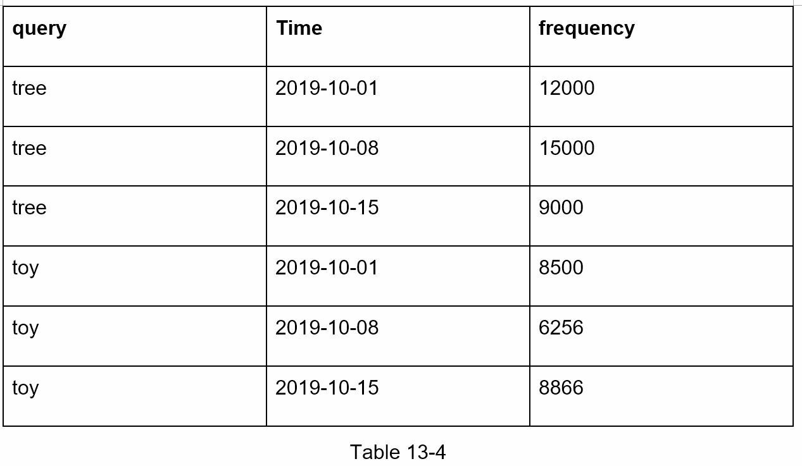

Trong Hình 13-10, mỗi nút trie ở phía bên trái được ánh xạ tới cặp `<key, value>` tương ứng ở phía bên phải. Nếu bạn chưa nắm rõ cách thức hoạt động của các hệ thống lưu trữ khóa - giá trị (*key-value stores*), vui lòng tham khảo Chương 6: Thiết kế một hệ thống lưu trữ khóa - giá trị (*Design a key-value store*).

### Query service (Dịch vụ truy vấn)

Trong thiết kế mức cao (*high-level design*), dịch vụ truy vấn gọi trực tiếp vào cơ sở dữ liệu để lấy ra 5 kết quả hàng đầu (*top 5 results*). Hình 13-11 minh họa thiết kế cải tiến do thiết kế ban đầu hoạt động kém hiệu quả.

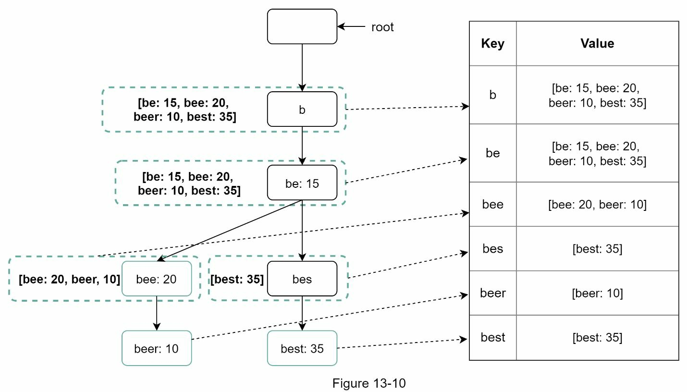

1. Một truy vấn tìm kiếm (*search query*) được gửi tới bộ cân bằng tải (*load balancer*).
2. Bộ cân bằng tải điều phối yêu cầu (*routes the request*) tới các máy chủ API (*API servers*).
3. Các máy chủ API lấy dữ liệu trie từ Trie Cache và cấu trúc nên các gợi ý tự động hoàn thành (*autocomplete suggestions*) cho phía máy khách (*client*).
4. Trong trường hợp dữ liệu không tồn tại trong Trie Cache (*cache miss*), chúng ta sẽ nạp bổ sung dữ liệu ngược trở lại bộ nhớ đệm (*replenish data back to the cache*). Bằng cách này, tất cả các yêu cầu tiếp theo cho cùng một tiền tố (*prefix*) sẽ được trả về trực tiếp từ bộ nhớ đệm. Hiện tượng trượt bộ nhớ đệm (*cache miss*) có thể xảy ra khi một máy chủ cache bị cạn kiệt bộ nhớ (*out of memory*) hoặc ngoại tuyến (*offline*).

Dịch vụ truy vấn đòi hỏi tốc độ phản hồi nhanh như chớp (*lightning-fast speed*). Chúng tôi đề xuất các phương án tối ưu hóa sau:
- **AJAX request (Yêu cầu AJAX):** Đối với các ứng dụng web, trình duyệt thường gửi các yêu cầu AJAX để lấy về kết quả tự động hoàn thành. Lợi ích chính của AJAX là việc gửi/nhận một yêu cầu/phản hồi (*request/response*) không làm tải lại toàn bộ trang web.
- **Browser caching (Bộ nhớ đệm trình duyệt):** Đối với nhiều ứng dụng, các gợi ý tìm kiếm tự động hoàn thành có thể không thay đổi nhiều trong một khoảng thời gian ngắn. Do đó, các gợi ý tự động hoàn thành có thể được lưu trữ trong bộ nhớ đệm của trình duyệt để cho phép các yêu cầu tiếp theo lấy kết quả trực tiếp từ bộ nhớ đệm. Công cụ tìm kiếm Google sử dụng cùng cơ chế lưu vào bộ nhớ đệm này. Hình 13-12 hiển thị tiêu đề phản hồi (*response header*) khi bạn gõ cụm từ “system design interview” trên công cụ tìm kiếm Google. Như bạn có thể thấy, Google lưu trữ kết quả trong trình duyệt trong vòng 1 giờ.

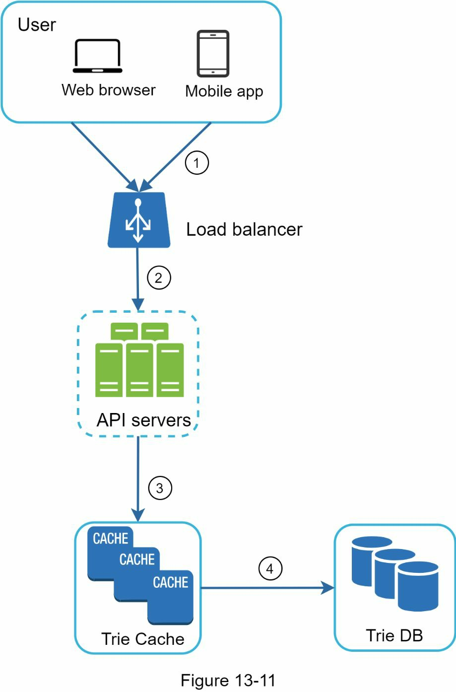

*Xin lưu ý:* giá trị “private” trong `cache-control` có nghĩa là các kết quả chỉ dành riêng cho một người dùng duy nhất và không được phép lưu trữ bởi các bộ nhớ đệm dùng chung (*shared cache*). “max-age=3600” có nghĩa là bộ nhớ đệm có hiệu lực trong vòng 3600 giây, tương đương với một giờ.
- **Data sampling (Lấy mẫu dữ liệu):** Đối với một hệ thống quy mô lớn, việc ghi nhận nhật ký (*logging*) cho mọi truy vấn tìm kiếm đòi hỏi năng lực xử lý và dung lượng lưu trữ cực kỳ lớn. Kỹ thuật lấy mẫu dữ liệu là rất quan trọng. Ví dụ: hệ thống chỉ ghi nhận nhật ký cho 1 trong mỗi $N$ yêu cầu.

---

### Trie operations (Các thao tác trên cây Trie)

Trie là thành phần cốt lõi của hệ thống tự động hoàn thành (*autocomplete system*). Hãy cùng xem xét cách thức hoạt động của các thao tác trên cây trie (tạo mới, cập nhật và xóa).

#### Create (Tạo mới)
Cây trie được tạo bởi các workers sử dụng dữ liệu đã tổng hợp (*aggregated data*). Nguồn dữ liệu được lấy từ Nhật ký/Cơ sở dữ liệu phân tích (*Analytics Log/DB*).

#### Update (Cập nhật)
Có hai cách để cập nhật cây trie:
- **Phương án 1: Cập nhật cây trie hàng tuần (Update the trie weekly).** Khi một cây trie mới được tạo xong, cây trie mới sẽ thay thế hoàn toàn cho cây trie cũ.
- **Phương án 2: Cập nhật trực tiếp từng nút trie riêng lẻ (Update individual trie node directly).** Chúng ta cố gắng tránh thao tác này vì tốc độ xử lý chậm. Tuy nhiên, nếu kích thước của cây trie nhỏ, đây là một giải pháp có thể chấp nhận được. Khi chúng ta cập nhật một nút trie, toàn bộ các nút tổ tiên (*ancestors*) của nó ngược lên đến nút gốc (*root*) đều phải được cập nhật, bởi vì các nút tổ tiên lưu giữ các truy vấn hàng đầu (*top queries*) của các nút con. 

Hình 13-13 minh họa một ví dụ về cách thức hoạt động của thao tác cập nhật. Ở phía bên trái, truy vấn tìm kiếm “beer” có giá trị ban đầu là 10. Ở phía bên phải, nó được cập nhật thành 30. Như bạn thấy, nút đó và các nút tổ tiên của nó đều có giá trị của “beer” được cập nhật thành 30.

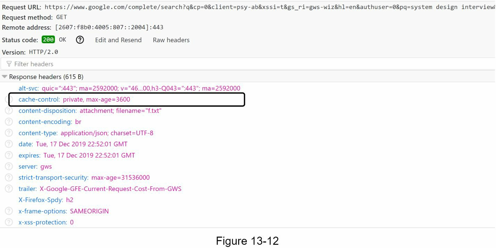

---

#### Delete (Xóa)
Chúng ta phải loại bỏ các gợi ý tự động hoàn thành mang tính kích động thù địch, bạo lực, khiêu dâm hoặc nguy hiểm. Chúng ta thêm một tầng lọc (*filter layer*) (Hình 13-14) phía trước Trie Cache để lọc bỏ các gợi ý không mong muốn. 

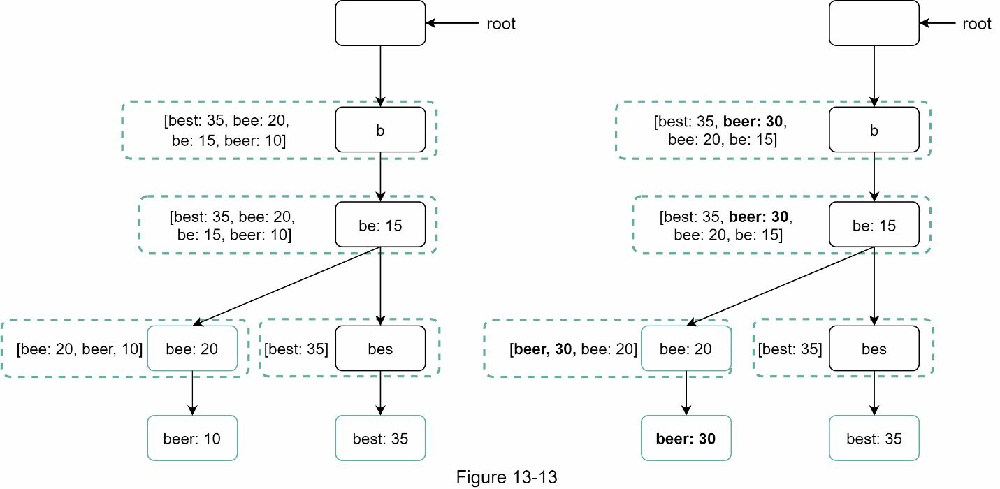

Việc có một tầng lọc mang lại cho chúng ta sự linh hoạt trong việc loại bỏ kết quả dựa trên các quy tắc lọc (*filter rules*) khác nhau. Các gợi ý không mong muốn sẽ được xóa vật lý (*physically removed*) khỏi cơ sở dữ liệu một cách bất đồng bộ (*asynchronously*), nhờ đó tập dữ liệu chính xác sẽ được sử dụng để xây dựng lại cây trie trong chu kỳ cập nhật tiếp theo.

---

### Scale the storage (Mở rộng quy mô tầng lưu trữ)

Sau khi đã phát triển một hệ thống cung cấp các truy vấn tự động hoàn thành cho người dùng, giờ là lúc giải quyết bài toán khả năng mở rộng (*scalability*) khi cây trie phát triển quá lớn, không thể chứa vừa trên một máy chủ đơn lẻ.

Vì tiếng Anh là ngôn ngữ duy nhất được hỗ trợ, một phương pháp phân mảnh (*sharding*) trực quan, đơn giản (*naive*) là dựa trên ký tự đầu tiên. Dưới đây là một số ví dụ:
- Nếu chúng ta cần hai máy chủ để lưu trữ, chúng ta có thể lưu các truy vấn bắt đầu bằng ký tự từ ‘a’ đến ‘m’ trên máy chủ thứ nhất, và từ ‘n’ đến ‘z’ trên máy chủ thứ hai.
- Nếu chúng ta cần ba máy chủ, chúng ta có thể chia các truy vấn thành ‘a’ đến ‘i’, ‘j’ đến ‘r’, và ‘s’ đến ‘z’.

Theo logic này, chúng ta có thể chia các truy vấn lên tới tối đa 26 máy chủ vì có 26 ký tự chữ cái trong bảng chữ cái tiếng Anh. Hãy định nghĩa việc phân mảnh dựa trên ký tự đầu tiên này là **phân mảnh cấp độ một (first level sharding)**. Để lưu trữ dữ liệu vượt quá 26 máy chủ, chúng ta có thể phân mảnh ở cấp độ thứ hai hoặc thậm chí là cấp độ thứ ba. Ví dụ: các truy vấn dữ liệu bắt đầu bằng chữ ‘a’ có thể được chia thành 4 máy chủ: ‘aa-ag’, ‘ah-an’, ‘ao-au’, và ‘av-az’.

Thoạt nhìn, cách tiếp cận này có vẻ hợp lý, cho đến khi bạn nhận ra rằng số lượng từ bắt đầu bằng chữ ‘c’ nhiều hơn rất nhiều so với chữ ‘x’. Điều này tạo ra sự phân bổ dữ liệu không đồng đều (*uneven distribution*).

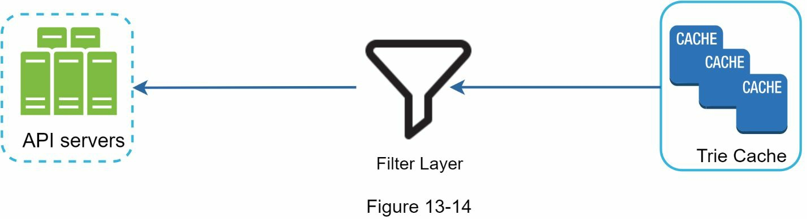

Để giảm thiểu vấn đề mất cân bằng dữ liệu, chúng ta phân tích mô hình phân phối dữ liệu trong lịch sử (*historical data distribution pattern*) và áp dụng logic phân mảnh thông minh hơn như được minh họa trong Hình 13-15. Trình quản lý bản đồ phân mảnh (*shard map manager*) duy trì một cơ sở dữ liệu tra cứu (*lookup database*) để xác định vị trí các hàng (*rows*) nên được lưu trữ ở đâu. Ví dụ: nếu số lượng truy vấn lịch sử cho chữ cái ‘s’ xấp xỉ bằng tổng số lượng truy vấn cho các chữ cái ‘u’, ‘v’, ‘w’, ‘x’, ‘y’ và ‘z’ cộng lại, chúng ta có thể duy trì hai phân mảnh (*shards*): một phân mảnh dành cho chữ ‘s’ và một phân mảnh dành cho các chữ từ ‘u’ đến ‘z’.

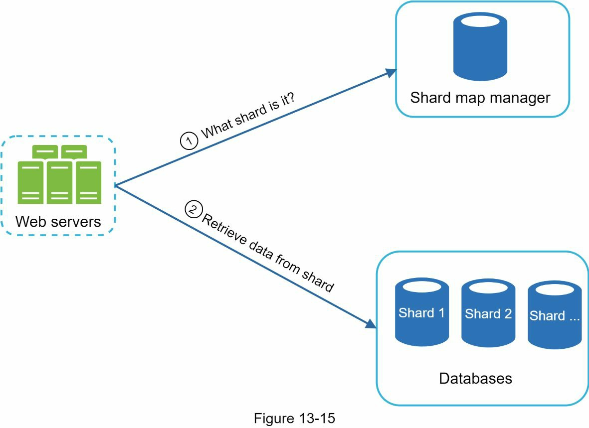

---

### Bước 4 - Tổng kết (Wrap up)

Sau khi bạn hoàn thành phần đào sâu thiết kế (deep dive), người phỏng vấn có thể đặt thêm một số câu hỏi tiếp nối (follow-up questions).

**Người phỏng vấn (Interviewer):** Làm thế nào để bạn mở rộng thiết kế của mình nhằm hỗ trợ đa ngôn ngữ (multiple languages)?

Để hỗ trợ các truy vấn không phải tiếng Anh (non-English queries), chúng ta lưu trữ các ký tự Unicode trong các nút của cây tiền tố (trie nodes). Nếu bạn chưa quen thuộc với Unicode, đây là định nghĩa: *“một chuẩn mã hóa bao gồm tất cả các ký tự cho toàn bộ hệ thống chữ viết trên thế giới, cả hiện đại lẫn cổ đại”* [5].

**Người phỏng vấn:** Điều gì sẽ xảy ra nếu các truy vấn tìm kiếm hàng đầu (top search queries) ở một quốc gia khác biệt so với các quốc gia khác?

Trong trường hợp này, chúng ta có thể xây dựng các cây trie riêng biệt cho từng quốc gia khác nhau. Để cải thiện thời gian phản hồi (response time), chúng ta có thể lưu trữ các cây trie này tại các CDN (Mạng phân phối nội dung - Content Delivery Networks).

**Người phỏng vấn:** Làm thế nào để chúng ta có thể hỗ trợ các truy vấn tìm kiếm thịnh hành theo thời gian thực (trending / real-time search queries)?

Giả sử một sự kiện tin tức bùng nổ, một truy vấn tìm kiếm đột ngột trở nên phổ biến. Thiết kế ban đầu của chúng ta sẽ không hoạt động hiệu quả vì:
* Các tiến trình xử lý ngoại tuyến (offline workers) chưa được lên lịch để cập nhật trie, do tác vụ này được lên lịch chạy theo định kỳ hàng tuần (weekly basis).
* Ngay cả khi được lên lịch, việc xây dựng lại cây trie cũng mất quá nhiều thời gian.

Việc xây dựng một hệ thống gợi ý tự động tìm kiếm theo thời gian thực (real-time search autocomplete) rất phức tạp và vượt ra ngoài phạm vi của cuốn sách này, vì vậy chúng tôi chỉ đưa ra một vài ý tưởng:
* Giảm kích thước tập dữ liệu làm việc (working data set) bằng kỹ thuật phân mảnh dữ liệu (sharding).
* Thay đổi mô hình xếp hạng (ranking model) và gán trọng số cao hơn cho các truy vấn tìm kiếm gần đây.
* Dữ liệu có thể đến dưới dạng các luồng (streams), do đó chúng ta không có quyền truy cập vào toàn bộ dữ liệu cùng một lúc. Dữ liệu dạng luồng (streaming data) đồng nghĩa với việc dữ liệu được tạo ra liên tục. Xử lý luồng (stream processing) đòi hỏi một bộ hệ thống khác biệt: Apache Hadoop MapReduce [6], Apache Spark Streaming [7], Apache Storm [8], Apache Kafka [9], v.v. Vì tất cả các chủ đề này đều yêu cầu kiến thức chuyên ngành đặc thù, chúng tôi sẽ không đi sâu vào chi tiết tại đây.

Chúc mừng bạn đã đi được một chặng đường dài đến mức này! Giờ hãy tự vỗ vai khích lệ bản thân. Bạn đã làm rất tốt!

---

### Tài liệu tham khảo (Reference materials)

* **[1]** *The Life of a Typeahead Query*: https://www.facebook.com/notes/facebook-engineering/the-life-of-a-typeahead-query/389105248919/
* **[2]** *How We Built Prefixy: A Scalable Prefix Search Service for Powering Autocomplete*: https://medium.com/@prefixyteam/how-we-built-prefixy-a-scalable-prefix-search-service-for-powering-autocomplete-c20f98e2eff1
* **[3]** *Prefix Hash Tree An Indexing Data Structure over Distributed Hash Tables*: https://people.eecs.berkeley.edu/~sylvia/papers/pht.pdf
* **[4]** *MongoDB wikipedia*: https://en.wikipedia.org/wiki/MongoDB
* **[5]** *Unicode frequently asked questions*: https://www.unicode.org/faq/basic_q.html
* **[6]** *Apache hadoop*: https://hadoop.apache.org/
* **[7]** *Spark streaming*: https://spark.apache.org/streaming/
* **[8]** *Apache storm*: https://storm.apache.org/
* **[9]** *Apache kafka*: https://kafka.apache.org/documentation/


---

[← Chương trước](chuong-12-thiet-ke-chat-system.md) | [Mục lục](README.md) | [Chương tiếp theo →](chuong-14-thiet-ke-youtube.md)
