# Chương 14: Thiết kế YouTube (Design YouTube)

[← Chương trước](chuong-13-thiet-ke-search-autocomplete.md) | [Mục lục](README.md) | [Chương tiếp theo →](chuong-15-thiet-ke-google-drive.md)

---

# CHƯƠNG 14: THIẾT KẾ YOUTUBE (DESIGN YOUTUBE)

Trong chương này, bạn được yêu cầu thiết kế YouTube. Lời giải cho câu hỏi này có thể được áp dụng cho các câu hỏi phỏng vấn khác như thiết kế một nền tảng chia sẻ video tương tự như Netflix và Hulu.

**Hình 14-1** thể hiện trang chủ của YouTube.

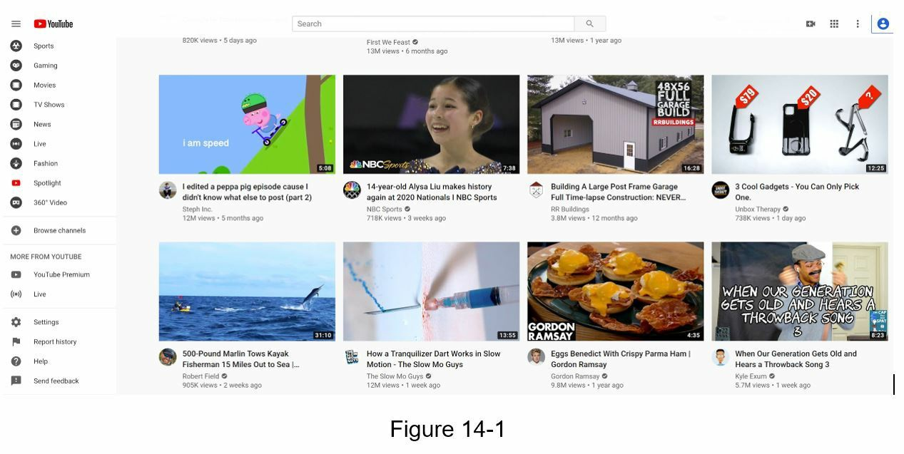

YouTube thoạt nhìn có vẻ đơn giản: người sáng tạo nội dung tải lên video và người xem nhấn nút phát (play). Liệu nó có thực sự đơn giản như vậy không? Thực tế không phải vậy. Đằng sau sự đơn giản đó là rất nhiều công nghệ phức tạp. Chúng ta hãy cùng xem qua một số thống kê ấn tượng, nhân khẩu học và số liệu thú vị về YouTube vào năm 2020 [1] [2]:

* **Tổng số người dùng hoạt động hàng tháng (Monthly Active Users - MAU):** 2 tỷ.
* **Số lượng video được xem mỗi ngày:** 5 tỷ.
* **73% người trưởng thành tại Hoa Kỳ** sử dụng YouTube.
* **50 triệu nhà sáng tạo nội dung (creators)** trên YouTube.
* **Doanh thu quảng cáo của YouTube** là 15,1 tỷ USD cho cả năm 2019, tăng 36% so với năm 2018.
* **YouTube chịu trách nhiệm cho 37%** tổng lưu lượng Internet di động (mobile internet traffic).
* **YouTube hỗ trợ 80 ngôn ngữ** khác nhau.

Từ những số liệu thống kê này, chúng ta có thể thấy YouTube là một nền tảng khổng lồ, mang tính toàn cầu và tạo ra rất nhiều doanh thu.

---

## Bước 1 - Hiểu bài toán và xác định phạm vi thiết kế (Understand the problem and establish design scope)

Như được thể hiện trong **Hình 14-1**, bên cạnh việc xem video, bạn có thể làm nhiều việc khác trên YouTube. Ví dụ: bình luận (comment), chia sẻ (share), hoặc thích (like) video, lưu video vào danh sách phát (playlist), đăng ký kênh (subscribe), v.v. Việc thiết kế toàn bộ mọi thứ trong một buổi phỏng vấn kéo dài 45 hoặc 60 phút là bất khả thi. Do đó, việc đặt câu hỏi để thu hẹp phạm vi là vô cùng quan trọng.

* **Ứng viên:** Những tính năng nào là quan trọng nhất?
* **Người phỏng vấn:** Khả năng tải lên một video (upload a video) và xem video (watch a video).
* **Ứng viên:** Chúng ta cần hỗ trợ những loại máy khách (client) nào?
* **Người phỏng vấn:** Ứng dụng di động (mobile apps), trình duyệt web (web browsers) và Smart TV.
* **Ứng viên:** Hệ thống có bao nhiêu người dùng hoạt động hàng ngày (Daily Active Users - DAU)?
* **Người phỏng vấn:** 5 triệu người.
* **Ứng viên:** Thời gian trung bình mỗi ngày người dùng dành cho sản phẩm là bao lâu?
* **Người phỏng vấn:** 30 phút.
* **Ứng viên:** Chúng ta có cần hỗ trợ người dùng quốc tế không?
* **Người phỏng vấn:** Có, phần lớn người dùng là người dùng quốc tế.
* **Ứng viên:** Các độ phân giải video được hỗ trợ là gì?
* **Người phỏng vấn:** Hệ thống chấp nhận hầu hết các độ phân giải và định dạng video.
* **Ứng viên:** Có yêu cầu mã hóa (encryption) không?
* **Người phỏng vấn:** Có.
* **Ứng viên:** Có yêu cầu gì về dung lượng tệp cho video không?
* **Người phỏng vấn:** Nền tảng của chúng ta tập trung vào các video có kích thước vừa và nhỏ. Dung lượng video tối đa cho phép là 1GB.
* **Ứng viên:** Chúng ta có thể tận dụng một số hạ tầng đám mây hiện có được cung cấp bởi Amazon, Google hoặc Microsoft không?
* **Người phỏng vấn:** Đó là một câu hỏi tuyệt vời. Xây dựng mọi thứ từ con số không (from scratch) là điều không thực tế đối với hầu hết các công ty, chúng tôi khuyến khích việc tận dụng một số dịch vụ đám mây có sẵn.

Trong chương này, chúng ta tập trung vào việc thiết kế một dịch vụ phát trực tuyến video (video streaming service) với các tính năng sau:

* Khả năng tải video lên nhanh chóng (Ability to upload videos fast).
* Phát trực tuyến video mượt mà (Smooth video streaming).
* Khả năng thay đổi chất lượng video (Ability to change video quality).
* Chi phí cơ sở hạ tầng thấp (Low infrastructure cost).
* Các yêu cầu cao về tính sẵn sàng (High availability), khả năng mở rộng (Scalability) và độ tin cậy (Reliability).
* Các máy khách được hỗ trợ: ứng dụng di động, trình duyệt web và Smart TV.

### Ước tính sơ bộ (Back of the envelope estimation)

Các ước tính sau đây dựa trên nhiều giả định, vì vậy việc trao đổi với người phỏng vấn để đảm bảo cả hai có cùng cách hiểu là rất quan trọng:

* Giả sử sản phẩm có 5 triệu người dùng hoạt động hàng ngày (DAU).
* Người dùng xem trung bình 5 video mỗi ngày.
* 10% người dùng tải lên 1 video mỗi ngày.
* Giả sử kích thước trung bình của một video là 300 MB.
* **Tổng dung lượng lưu trữ cần thiết mỗi ngày:**
  $$5\text{ triệu} \times 10\% \times 300\text{ MB} = 150\text{ TB}$$

---

* **Chi phí Mạng phân phối nội dung (CDN cost):**
  * Khi Cloud CDN phân phối một video, bạn sẽ bị tính phí dựa trên lượng dữ liệu truyền ra ngoài (data transferred out) từ CDN.
  * Hãy sử dụng dịch vụ CDN CloudFront của Amazon để ước tính chi phí (**Hình 14-2**) [3]. Giả sử 100% lưu lượng truy cập được phục vụ từ Hoa Kỳ. Chi phí trung bình cho mỗi GB là $0.02. Để đơn giản hóa, chúng ta chỉ tính toán chi phí cho việc phát trực tuyến video.

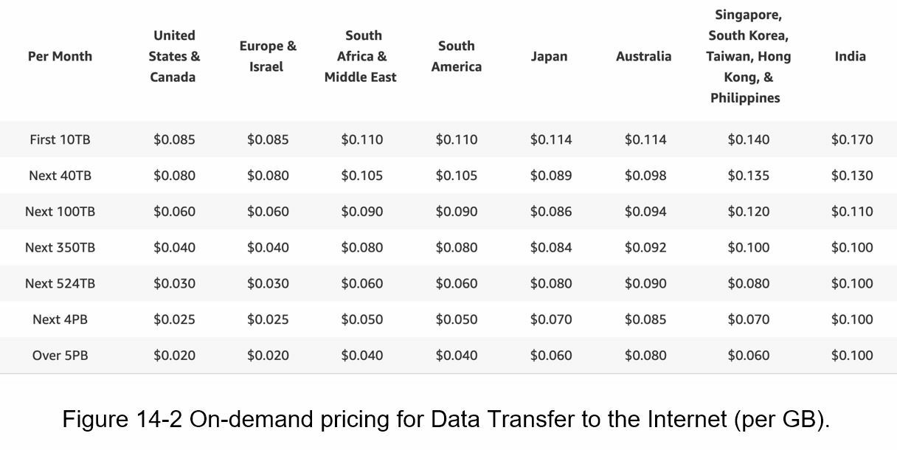

* **Ước tính chi phí CDN hàng ngày:**
  $$5\text{ triệu} \times 5\text{ video} \times 0.3\text{ GB} \times \$0.02 = \$150,000\text{ / ngày}$$

Từ ước tính chi phí sơ bộ, chúng ta thấy rằng việc phân phối video từ CDN tốn rất nhiều tiền. Mặc dù các nhà cung cấp dịch vụ đám mây sẵn sàng giảm giá thành CDN đáng kể cho các khách hàng lớn, nhưng chi phí nhìn chung vẫn là một con số khổng lồ. Chúng ta sẽ thảo luận về các phương pháp giảm thiểu chi phí CDN trong phần đi sâu vào chi tiết (deep dive).

---

## Bước 2 - Đề xuất thiết kế mức cao và thống nhất phương án (Propose high-level design and get buy-in)

Như đã thảo luận trước đó, người phỏng vấn khuyến nghị tận dụng các dịch vụ đám mây hiện có thay vì xây dựng mọi thứ từ đầu. **CDN** và **Blob Storage** (lưu trữ đối tượng nhị phân lớn) là các dịch vụ đám mây mà chúng ta sẽ tận dụng. Một số độc giả có thể đặt câu hỏi: tại sao không tự xây dựng mọi thứ? Các lý do được liệt kê dưới đây:

* Các cuộc phỏng vấn thiết kế hệ thống không yêu cầu phải xây dựng mọi thứ từ con số không. Trong khung thời gian có hạn, việc lựa chọn đúng công nghệ để hoàn thành tốt công việc quan trọng hơn nhiều so với việc giải thích chi tiết cách thức công nghệ đó hoạt động bên dưới. Ví dụ, việc đề cập đến Blob Storage để lưu trữ các video gốc là đã đủ cho buổi phỏng vấn. Đi sâu vào thiết kế chi tiết cho một hệ thống Blob Storage có thể là một sự dư thừa không cần thiết (overkill).
* Xây dựng một hệ thống Blob Storage hoặc CDN có khả năng mở rộng quy mô là cực kỳ phức tạp và tốn kém. Ngay cả các công ty công nghệ lớn như Netflix hay Facebook cũng không tự xây dựng tất cả. Netflix tận dụng các dịch vụ đám mây của Amazon [4], và Facebook sử dụng CDN của Akamai [5].

Ở mức tổng quan cấp cao (high-level), hệ thống bao gồm ba thành phần chính (**Hình 14-3**):

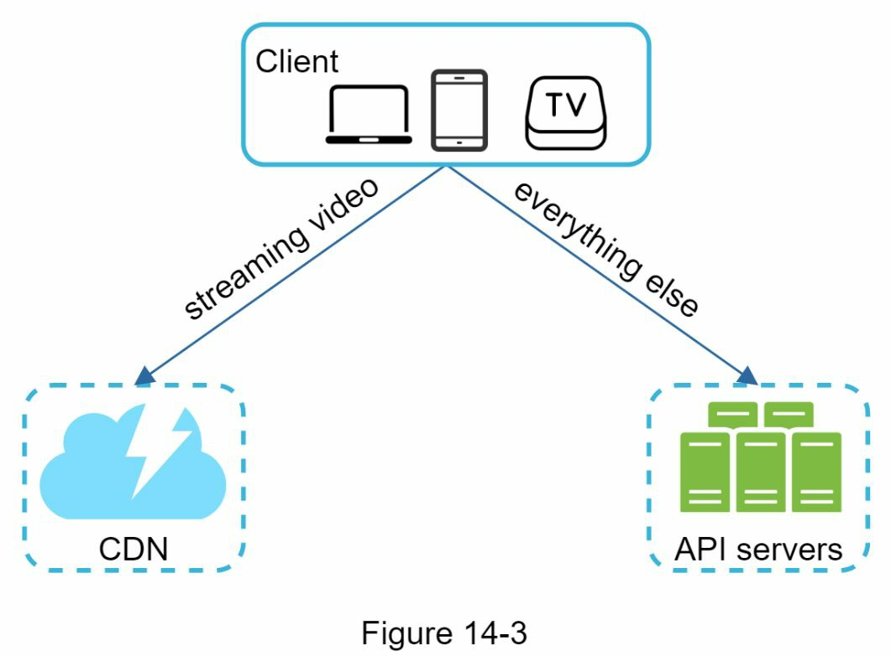

* **Client (Máy khách):** Bạn có thể xem YouTube trên máy tính, điện thoại di động và Smart TV.
* **CDN:** Video được lưu trữ tại CDN. Khi bạn nhấn phát (play), video sẽ được truyền phát trực tiếp (streamed) từ CDN.
* **API servers (Máy chủ API):** Mọi tác vụ khác ngoại trừ việc truyền phát video đều đi qua các máy chủ API. Điều này bao gồm: đề xuất bảng tin (feed recommendation), tạo URL tải lên video (generating video upload URL), cập nhật cơ sở dữ liệu siêu dữ liệu (metadata database) và bộ nhớ đệm (cache), đăng ký người dùng (user signup), v.v.

Trong phiên hỏi đáp, người phỏng vấn bày tỏ sự quan tâm đến hai luồng xử lý chính:
* **Luồng tải lên video (Video uploading flow)**
* **Luồng phát trực tuyến video (Video streaming flow)**

Chúng ta sẽ khám phá thiết kế mức cao cho từng luồng này.

### Luồng tải lên video (Video uploading flow)

**Hình 14-4** thể hiện thiết kế mức cao cho quy trình tải lên video.

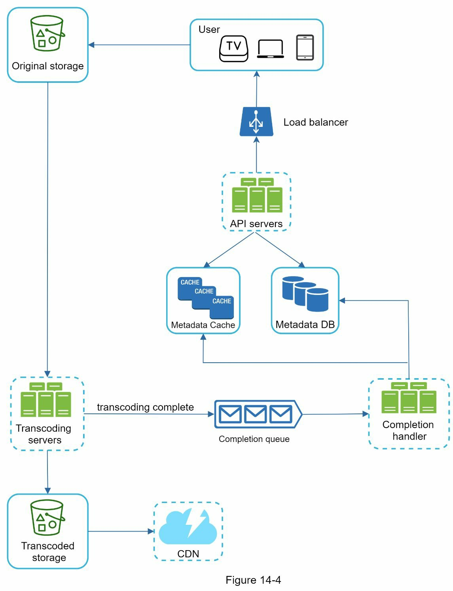

Hệ thống bao gồm các thành phần sau:

* **User (Người dùng):** Người dùng xem YouTube trên các thiết bị như máy tính, điện thoại di động hoặc Smart TV.
* **Load balancer (Bộ cân bằng tải):** Một bộ cân bằng tải phân phối đồng đều các yêu cầu giữa các máy chủ API.
* **API servers (Máy chủ API):** Tất cả các yêu cầu của người dùng đều đi qua máy chủ API, ngoại trừ việc truyền phát video.
* **Metadata DB (Cơ sở dữ liệu siêu dữ liệu):** Siêu dữ liệu của video được lưu trữ trong Metadata DB. Nó được phân mảnh (sharded) và sao chép (replicated) để đáp ứng các yêu cầu về hiệu năng và tính sẵn sàng cao (high availability).
* **Metadata cache (Bộ nhớ đệm siêu dữ liệu):** Để đạt hiệu năng tốt hơn, siêu dữ liệu video và các đối tượng người dùng (user objects) được lưu vào bộ nhớ đệm (cache).
* **Original storage (Hệ thống lưu trữ gốc):** Một hệ thống Blob Storage được sử dụng để lưu trữ các video gốc. Một trích dẫn trên Wikipedia liên quan đến Blob Storage cho thấy rằng: *"Binary Large Object (BLOB) là một tập hợp dữ liệu nhị phân được lưu trữ như một thực thể đơn lẻ trong một hệ thống quản lý cơ sở dữ liệu"* [6].
* **Transcoding servers (Máy chủ chuyển mã video):** Quá trình chuyển mã video (video transcoding) còn được gọi là mã hóa video (video encoding). Đây là quá trình chuyển đổi một định dạng video sang các định dạng khác (MPEG, HLS, v.v.), nhằm cung cấp các luồng video tốt nhất có thể cho các thiết bị và điều kiện băng thông mạng khác nhau.
* **Transcoded storage (Hệ thống lưu trữ video đã chuyển mã):** Đây là một Blob Storage lưu trữ các tệp video đã được chuyển mã xong.
* **CDN:** Các video được lưu tạm (cached) trong CDN. Khi bạn nhấp vào nút phát, video sẽ được truyền phát trực tiếp từ CDN.
* **Completion queue (Hàng đợi hoàn tất):** Đây là một hàng đợi tin nhắn (message queue) lưu trữ thông tin về các sự kiện hoàn thành việc chuyển mã video.
* **Completion handler (Bộ xử lý hoàn tất):** Bao gồm một danh sách các tiến trình xử lý (workers) làm nhiệm vụ kéo (pull) dữ liệu sự kiện từ hàng đợi hoàn tất và cập nhật bộ nhớ đệm cũng như cơ sở dữ liệu siêu dữ liệu.

Khi chúng ta đã hiểu riêng rẽ từng thành phần, hãy cùng kiểm tra cách thức hoạt động của luồng tải lên video. Luồng này được chia thành hai tiến trình chạy song song:

a. **Tải lên video thực tế (Upload the actual video).**  
b. **Cập nhật siêu dữ liệu video (Update video metadata).** Siêu dữ liệu chứa thông tin về URL của video, kích thước, độ phân giải, định dạng, thông tin người dùng, v.v.

#### Luồng a: Tải lên video thực tế (Flow a: upload the actual video)

---

### **Luồng tải lên video thực tế (Upload Flow)**

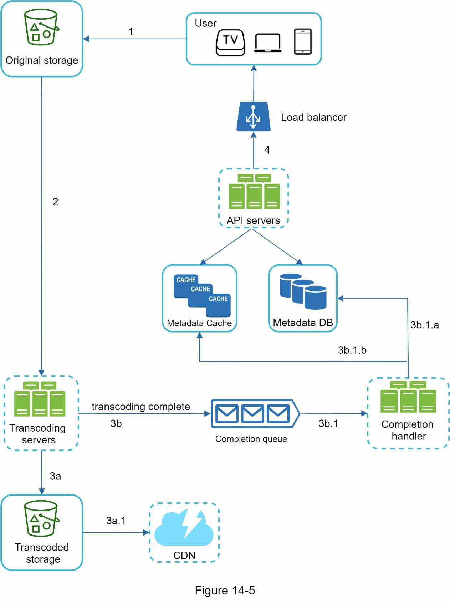

**Hình 14-5** minh họa quy trình tải lên video thực tế. Các bước chi tiết được mô tả như sau:

1. Video được tải trực tiếp lên kho lưu trữ gốc (**Original Storage**).
2. Các máy chủ chuyển mã (**Transcoding Servers**) lấy video từ kho lưu trữ gốc và tiến hành quá trình chuyển mã (*transcoding*).
3. Sau khi quá trình chuyển mã hoàn tất, hai luồng sau được thực thi song song:
   - **3a.** Video đã chuyển mã được chuyển tới kho lưu trữ video đã xử lý (**Transcoded Storage**).
   - **3b.** Sự kiện hoàn tất chuyển mã được đẩy vào hàng đợi hoàn tất (**Completion Queue**).
   - **3a.1.** Video đã chuyển mã từ kho lưu trữ được phân phối tới mạng lưới phân phối nội dung (**CDN**).
   - **3b.1.** Bộ xử lý hoàn tất (**Completion Handler**) gồm một nhóm các tác vụ nền (*workers*) liên tục lấy dữ liệu sự kiện từ hàng đợi ra để xử lý.
   - **3b.1.a & 3b.1.b.** Bộ xử lý hoàn tất cập nhật thông tin vào cơ sở dữ liệu siêu dữ liệu (**Metadata Database**) và bộ nhớ đệm (**Metadata Cache**) khi quá trình chuyển mã video kết thúc.
4. Các máy chủ API (**API Servers**) thông báo cho máy khách (*client*) biết rằng video đã được tải lên thành công và sẵn sàng để phát trực tuyến (*streaming*).

---

### **Luồng b: Cập nhật siêu dữ liệu (Update Metadata Flow)**

Trong khi tệp video đang được tải lên kho lưu trữ gốc, phía máy khách sẽ đồng thời gửi một yêu cầu cập nhật siêu dữ liệu (*metadata*) của video như thể hiện trong **Hình 14-6**.

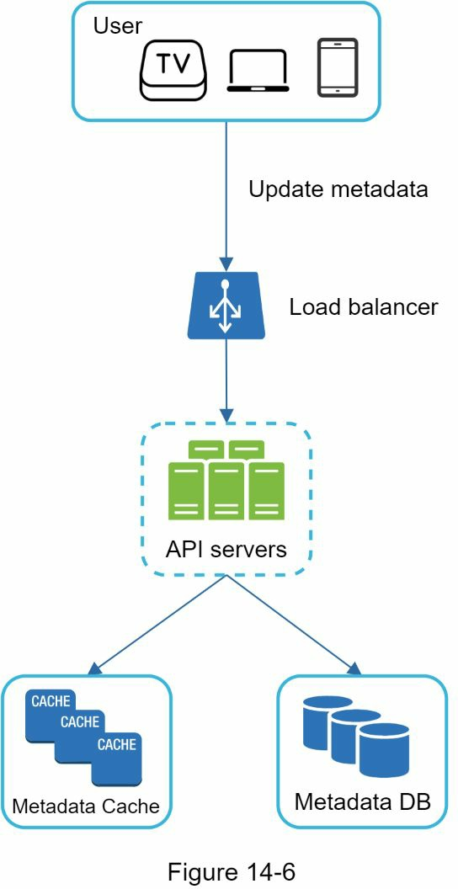

Yêu cầu này chứa các siêu dữ liệu của video bao gồm tên tệp, kích thước, định dạng, v.v. Các máy chủ API sẽ tiến hành cập nhật dữ liệu này vào bộ nhớ đệm và cơ sở dữ liệu siêu dữ liệu.

---

### **Luồng phát trực tuyến video (Video Streaming Flow)**

Khi xem một video trên YouTube, quá trình phát trực tuyến (*streaming*) thường diễn ra gần như tức thì mà bạn không cần phải đợi toàn bộ video được tải xuống:
- **Tải xuống (Downloading):** Toàn bộ tệp video được sao chép và lưu trữ trực tiếp trên thiết bị của bạn.
- **Phát trực tuyến (Streaming):** Thiết bị liên tục nhận các luồng dữ liệu video từ các nguồn phát từ xa. Ứng dụng/trình duyệt chỉ nạp một lượng nhỏ dữ liệu tại mỗi thời điểm, cho phép người dùng xem video liên tục và không bị gián đoạn.

Trước khi đi sâu vào chi tiết luồng phát trực tuyến, cần nắm rõ khái niệm cốt lõi: **Giao thức phát trực tuyến (Streaming Protocol)**. Đây là phương thức chuẩn hóa nhằm kiểm soát việc truyền dữ liệu cho quá trình phát video. Các giao thức phổ biến gồm có:

- **MPEG–DASH**: Viết tắt của *Moving Picture Experts Group – Dynamic Adaptive Streaming over HTTP*.
- **Apple HLS**: Viết tắt của *HTTP Live Streaming*.
- **Microsoft Smooth Streaming**.
- **Adobe HTTP Dynamic Streaming (HDS)**.

Các giao thức này là những chi tiết kỹ thuật tầng thấp đòi hỏi kiến thức chuyên môn sâu. Điều quan trọng cần nắm là mỗi giao thức sẽ tương thích với các định dạng mã hóa video (*video encoding*) và các trình phát (*playback players*) khác nhau. Khi thiết kế hệ thống phát trực tuyến, việc lựa chọn giao thức thích hợp phải dựa trên nhu cầu sử dụng thực tế.

Video được truyền phát trực tiếp từ hệ thống CDN. Máy chủ biên (*Edge Server*) đặt ở vị trí gần bạn nhất sẽ chịu trách nhiệm phân phối dữ liệu, từ đó giảm độ trễ xuống mức tối thiểu.

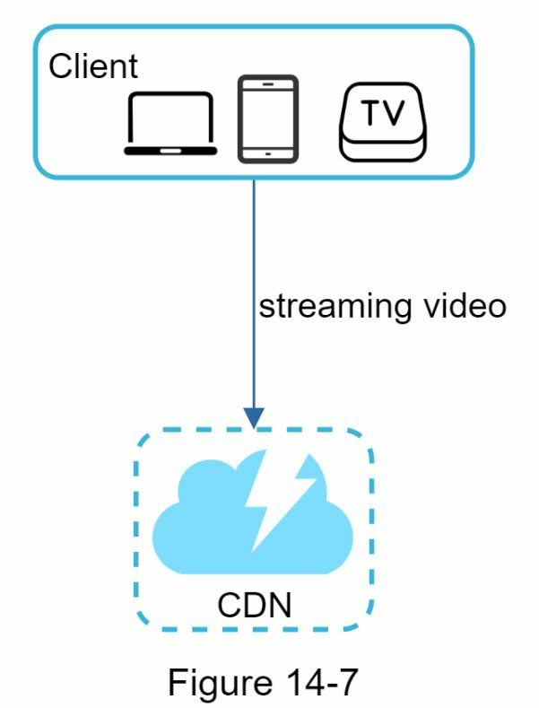

**Hình 14-7** phác thảo thiết kế mức cao (*high-level design*) cho luồng phát trực tuyến video.

---

### **Bước 3 - Thiết kế chi tiết chuyên sâu (Design Deep Dive)**

Trong thiết kế mức cao, toàn bộ hệ thống được phân tách thành hai luồng chính: luồng tải lên video và luồng phát trực tuyến video. Phần này sẽ đi sâu tối ưu hóa hai luồng nói trên và thiết lập các cơ chế xử lý lỗi cần thiết.

#### **Chuyển mã video (Video Transcoding)**

Khi một video được ghi lại bằng thiết bị di động hoặc máy quay, tệp video sẽ mang một định dạng cụ thể. Để video có thể phát mượt mà trên đa dạng thiết bị khác nhau, nó phải được chuyển đổi và mã hóa sang các định dạng và tốc độ bit (**bitrate**) tương thích. 

> **Bitrate** là tốc độ xử lý các bit dữ liệu trong một đơn vị thời gian. Bitrate càng cao thường đi kèm với chất lượng hình ảnh/âm thanh càng tốt, đồng thời đòi hỏi năng lực xử lý mạnh hơn và tốc độ mạng nhanh hơn.

Chuyển mã video là khâu tối quan trọng vì các lý do sau:
- **Tiết kiệm dung lượng:** Video thô (*raw video*) tiêu tốn dung lượng lưu trữ khổng lồ. Một video độ nét cao dài một giờ quay ở 60 khung hình/giây (*fps*) có thể ngốn hàng trăm gigabyte dung lượng.
- **Tính tương thích:** Nhiều thiết bị và trình duyệt chỉ hỗ trợ một số định dạng nhất định, do đó cần chuyển mã video sang nhiều định dạng khác nhau.
- **Tối ưu trải nghiệm phát lại:** Để người dùng luôn theo dõi được video mượt mà với chất lượng cao nhất tương ứng với đường truyền, hệ thống cần cung cấp độ phân giải cao cho người dùng có băng thông mạnh và hạ độ phân giải cho người dùng có kết nối chậm hơn.
- **Thích ứng với biến động mạng:** Điều kiện mạng thường xuyên thay đổi (đặc biệt trên thiết bị di động). Việc tự động hoặc thủ công chuyển đổi chất lượng video theo tình trạng mạng là yếu tố then chốt để đảm bảo video không bị gián đoạn.

Định dạng mã hóa thông thường bao gồm hai thành phần chính:
1. **Container (Vỏ chứa):** Đóng vai trò như một gói chứa tệp video, tệp âm thanh và siêu dữ liệu. Bạn có thể nhận biết định dạng container qua phần mở rộng của tệp (ví dụ: `.avi`, `.mov`, `.mp4`).
2. **Codecs (Bộ mã hóa/giải mã):** Các thuật toán nén và giải nén nhằm tối ưu kích thước video trong khi vẫn bảo toàn chất lượng hình ảnh tốt nhất có thể (các codec phổ biến gồm có `H.264`, `VP9`, `HEVC`).

---

#### **Mô hình đồ thị có hướng không chu trình (DAG - Directed Acyclic Graph)**

Chuyển mã video là công việc tiêu tốn nhiều tài nguyên tính toán và thời gian. Ngoài ra, mỗi người sáng tạo nội dung lại có những yêu cầu xử lý khác nhau: một số cần gắn hình mờ (*watermark*), một số tự cung cấp hình thu nhỏ (*thumbnail*), một số tải lên video chất lượng cao trong khi những người khác thì không.

Để hỗ trợ linh hoạt nhiều quy trình xử lý video (*video processing pipelines*) khác nhau và duy trì khả năng xử lý song song ở mức cao, việc trừu tượng hóa hệ thống là cần thiết, cho phép lập trình viên định nghĩa các tác vụ cần thực thi. Chẳng hạn, công cụ phát video trực tuyến của Facebook áp dụng mô hình lập trình DAG để định nghĩa các tác vụ theo từng giai đoạn thực thi tuần tự hoặc song song. Trong thiết kế này, mô hình DAG tương tự được sử dụng nhằm đạt được độ linh hoạt và tính song song tối đa.

**Hình 14-8** mô tả một mô hình DAG ứng dụng trong quá trình chuyển mã video.

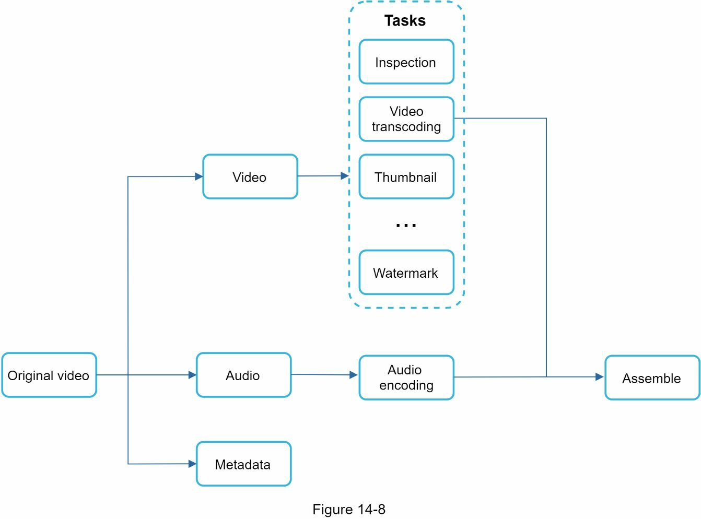

Trong mô hình này, video gốc được bóc tách thành 3 phần: luồng hình ảnh (*video*), luồng âm thanh (*audio*) và siêu dữ liệu (*metadata*). Các tác vụ xử lý có thể áp dụng cho tệp video gồm:

- **Kiểm định (Inspection):** Đảm bảo chất lượng video đạt chuẩn và tệp không bị lỗi/hỏng (*malformed*).
- **Mã hóa video (Video Encodings):** Video được chuyển đổi để đáp ứng các mức độ phân giải, chuẩn codec và mức bitrate khác nhau.

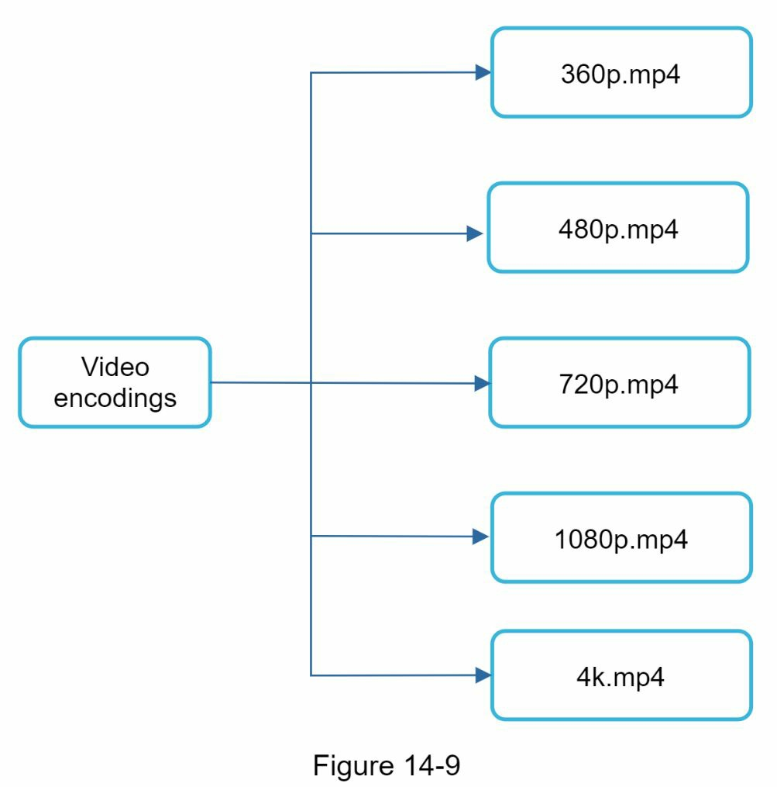
*Hình 14-9: Ví dụ về các tệp video sau khi mã hóa.*

- **Hình thu nhỏ (Thumbnail):** Ảnh thu nhỏ có thể do người dùng chủ động tải lên hoặc do hệ thống tự động trích xuất, tạo ra.
- **Hình mờ (Watermark):** Một lớp hình ảnh phủ đè lên bề mặt video chứa thông tin nhận diện bản quyền/thương hiệu của video.

---

#### **Kiến trúc chuyển mã video (Video Transcoding Architecture)**

Kiến trúc chuyển mã video đề xuất tận dụng các dịch vụ đám mây (*cloud services*) được mô tả chi tiết tại **Hình 14-10**.

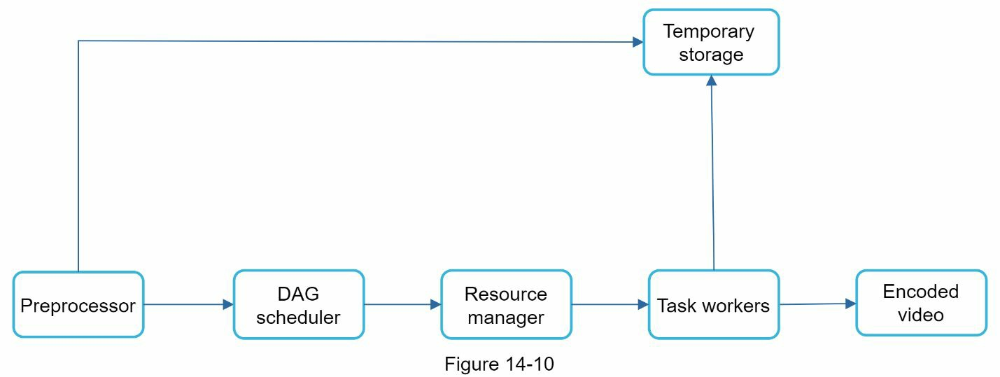

Kiến trúc này bao gồm 6 thành phần cốt lõi:
1. **Bộ tiền xử lý (Preprocessor)**
2. **Bộ lập lịch DAG (DAG Scheduler)**
3. **Bộ quản lý tài nguyên (Resource Manager)**
4. **Các tác vụ công nhân (Task Workers)**
5. **Kho lưu trữ tạm thời (Temporary Storage)**
6. **Video sau khi mã hóa hoàn tất (Encoded Video Output)**

##### **Bộ tiền xử lý (Preprocessor)**
*(Tiếp tục phần chi tiết kỹ thuật ở các nội dung tiếp theo...)*

---

Bạn có muốn tiếp tục bản dịch cho các phần/trang kế tiếp của tài liệu này không?

---

Bộ tiền xử lý (**Preprocessor**) có 4 trách nhiệm chính:

1. **Phân tách video (Video splitting):** Luồng video được chia nhỏ hoặc tiếp tục chia tách thành các nhóm hình ảnh nhỏ hơn theo chuẩn căn chỉnh **GOP** (*Group of Pictures alignment*). GOP là một nhóm/phân đoạn (chunk) gồm các khung hình (*frames*) được sắp xếp theo một thứ tự cụ thể. Mỗi chunk là một đơn vị có thể phát độc lập, thường có độ dài vài giây.
2. Một số thiết bị di động hoặc trình duyệt cũ có thể không hỗ trợ việc tự phân tách video. Bộ tiền xử lý sẽ phân tách video dựa trên căn chỉnh GOP cho các máy khách (*clients*) đời cũ này.
3. **Khởi tạo DAG (DAG generation):** Bộ xử lý tạo ra đồ thị có hướng không chu trình (**DAG** - *Directed Acyclic Graph*) dựa trên các tệp cấu hình do lập trình viên phía client thiết lập. **Hình 14-12** là biểu diễn DAG đơn giản hóa gồm 2 nút (*nodes*) và 1 cạnh (*edge*):

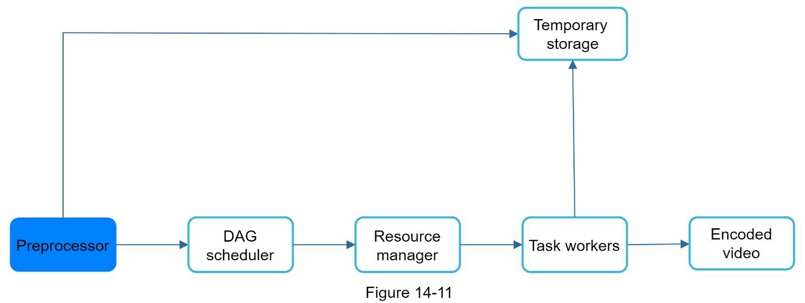

Biểu diễn DAG này được tạo ra từ hai tệp cấu hình bên dưới (**Hình 14-13**):

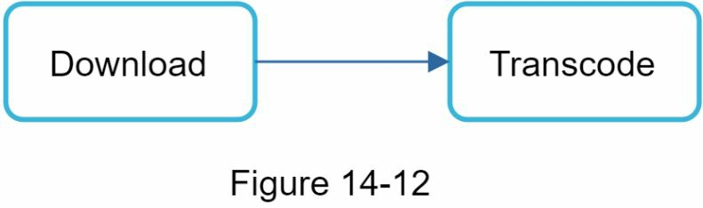

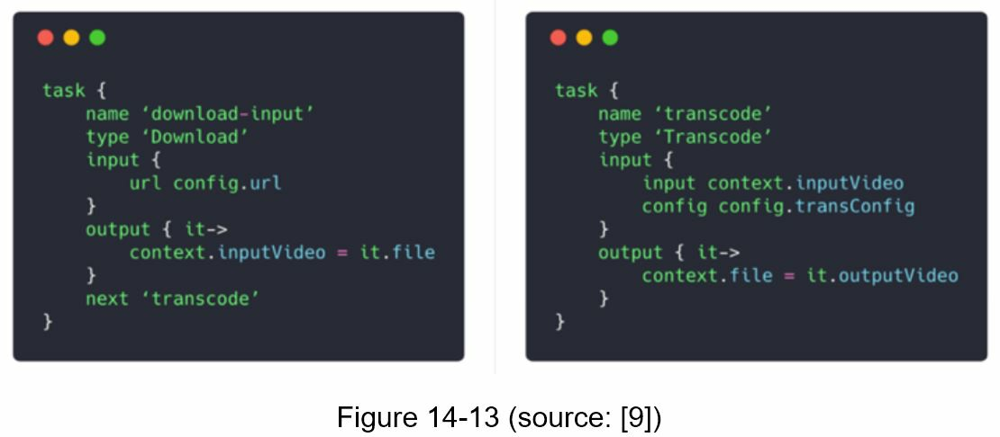

4. **Bộ nhớ đệm dữ liệu (Cache data):** Bộ tiền xử lý đóng vai trò như một bộ nhớ đệm (*cache*) cho các video đã được phân đoạn. Để tăng cường độ tin cậy (*reliability*), bộ tiền xử lý lưu trữ các GOP và siêu dữ liệu (*metadata*) vào bộ lưu trữ tạm thời (*temporary storage*). Nếu quá trình mã hóa video (*video encoding*) gặp lỗi, hệ thống có thể sử dụng dữ liệu đã được lưu trữ bền vững (*persisted data*) này cho các thao tác thử lại (*retry operations*).

---

### Bộ lập lịch DAG (DAG scheduler)

Bộ lập lịch DAG (**DAG scheduler**) chia nhỏ một đồ thị DAG thành các giai đoạn tác vụ (*stages of tasks*) và đưa chúng vào hàng đợi tác vụ (*task queue*) trong bộ quản lý tài nguyên (**Resource Manager**). **Hình 14-15** minh họa một ví dụ về cách thức hoạt động của bộ lập lịch DAG.

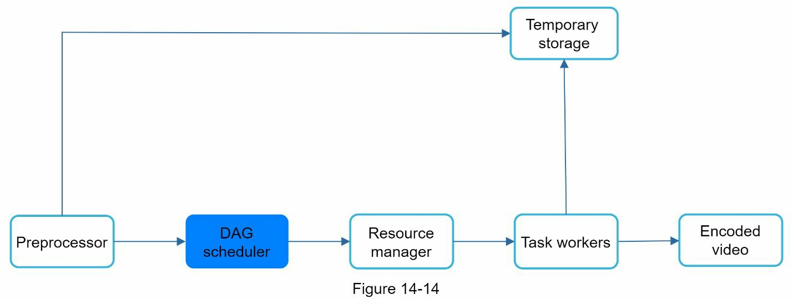

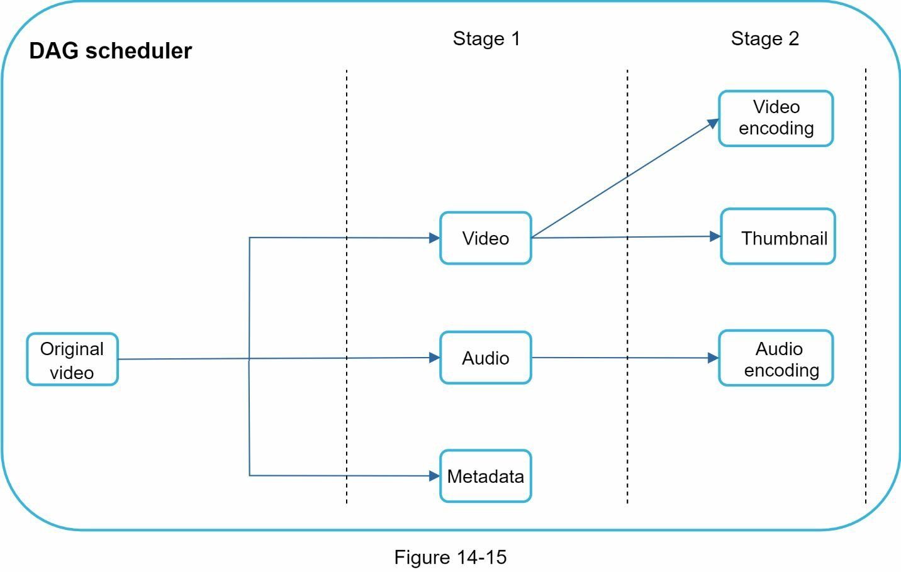

Như được hiển thị trong **Hình 14-15**, video gốc được chia thành ba giai đoạn:
* **Giai đoạn 1 (Stage 1):** Video, âm thanh (*audio*), và siêu dữ liệu (*metadata*).
* **Giai đoạn 2 (Stage 2):** Tệp video tiếp tục được chia thành hai tác vụ trong giai đoạn 2: mã hóa video (*video encoding*) và tạo ảnh thu nhỏ (*thumbnail*). Tệp âm thanh yêu cầu tác vụ mã hóa âm thanh (*audio encoding*) như một phần của các tác vụ trong giai đoạn 2.

---

### Bộ quản lý tài nguyên (Resource manager)

Bộ quản lý tài nguyên (**Resource Manager**) chịu trách nhiệm quản lý hiệu quả việc phân bổ tài nguyên. Nó bao gồm 3 hàng đợi (*queues*) và một bộ lập lịch tác vụ (*task scheduler*) như minh họa trong **Hình 14-17**.

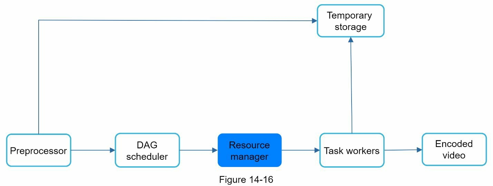

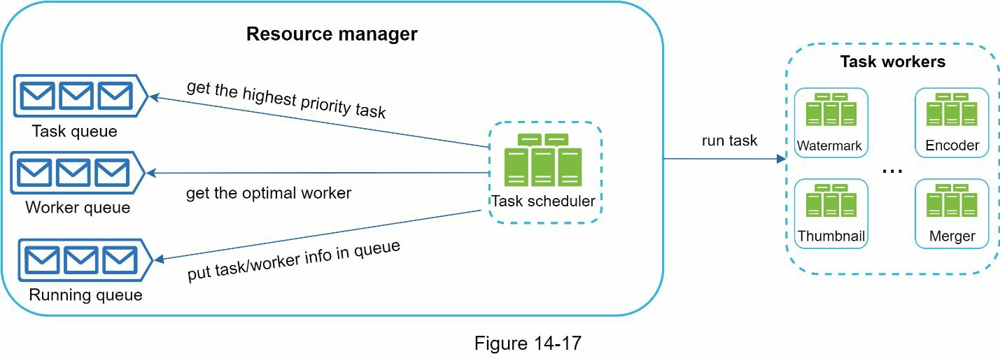

* **Hàng đợi tác vụ (Task queue):** Là một hàng đợi ưu tiên (*priority queue*) chứa các tác vụ đang chờ được thực thi.
* **Hàng đợi worker (Worker queue):** Là một hàng đợi ưu tiên chứa thông tin mức độ sử dụng tài nguyên của worker (*worker utilization info*).
* **Hàng đợi đang chạy (Running queue):** Chứa thông tin về các tác vụ hiện đang thực thi và các worker đang chạy các tác vụ đó.
* **Bộ lập lịch tác vụ (Task scheduler):** Lựa chọn tác vụ/worker tối ưu nhất và chỉ định task worker được chọn để thực thi công việc.

Quy trình hoạt động của bộ quản lý tài nguyên như sau:
* Bộ lập lịch tác vụ lấy tác vụ có mức ưu tiên cao nhất từ hàng đợi tác vụ (*task queue*).
* Bộ lập lịch tác vụ lấy task worker tối ưu nhất để chạy tác vụ từ hàng đợi worker (*worker queue*).
* Bộ lập lịch tác vụ chỉ định task worker đã chọn tiến hành chạy tác vụ.
* Bộ lập lịch tác vụ liên kết thông tin tác vụ/worker và đưa vào hàng đợi đang chạy (*running queue*).
* Bộ lập lịch tác vụ xóa bỏ công việc khỏi hàng đợi đang chạy sau khi công việc đã hoàn thành.

---

### Các tiến trình xử lý tác vụ (Task workers)

Các task worker thực thi các tác vụ đã được định nghĩa trong đồ thị DAG. Các task worker khác nhau có thể thực thi các tác vụ khác nhau như minh họa trong **Hình 14-19**.

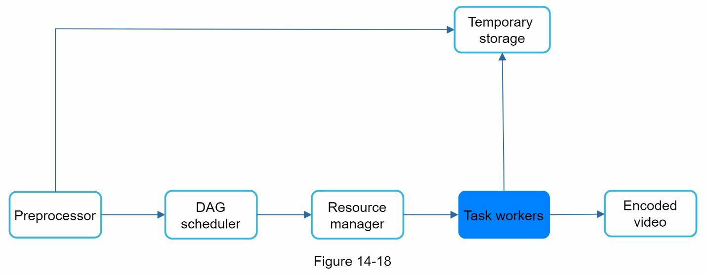

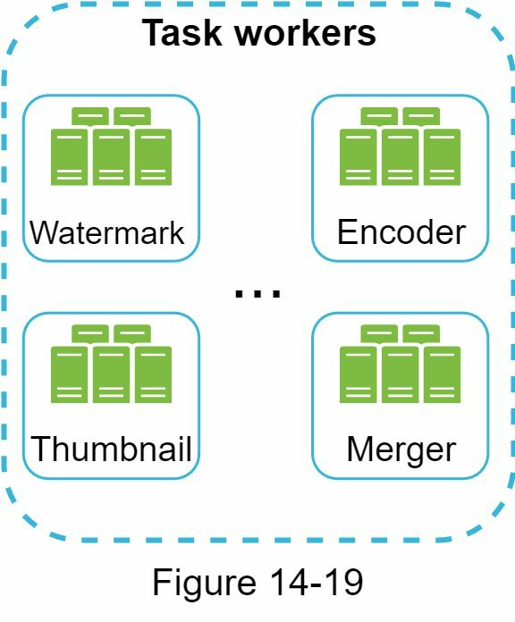

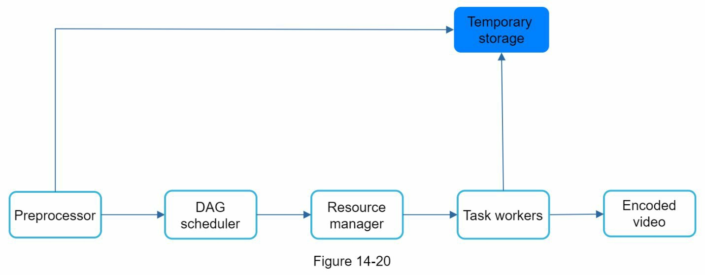

---

### Bộ lưu trữ tạm thời (Temporary storage)

Nhiều hệ thống lưu trữ khác nhau được sử dụng tại đây. Việc lựa chọn hệ thống lưu trữ phụ thuộc vào các yếu tố như loại dữ liệu, kích thước dữ liệu, tần suất truy cập, vòng đời của dữ liệu (*data life span*), v.v.

Ví dụ: siêu dữ liệu (*metadata*) được các worker truy cập thường xuyên và kích thước dữ liệu thường nhỏ. Do đó, việc lưu tạm metadata vào bộ nhớ (*in-memory cache*) là một giải pháp tốt. Đối với dữ liệu video hoặc âm thanh, chúng tôi đặt chúng vào kho lưu trữ blob (**Blob Storage**). Dữ liệu trong bộ lưu trữ tạm thời sẽ được giải phóng sau khi quá trình xử lý video tương ứng hoàn tất.

---

### Video đã mã hóa (Encoded video)

Video đã mã hóa (**Encoded video**) là đầu ra cuối cùng của đường ống mã hóa (*encoding pipeline*). Dưới đây là một ví dụ về kết quả đầu ra: `funny_720p.mp4`.

---

## Tối ưu hóa hệ thống (System optimizations)

Đến thời điểm này, bạn chắc hẳn đã nắm vững quy trình tải lên video (*video uploading flow*), quy trình phát trực tuyến video (*video streaming flow*) và chuyển mã video (*video transcoding*). Tiếp theo, chúng tôi sẽ tinh chỉnh hệ thống bằng các biện pháp tối ưu hóa, bao gồm tốc độ (*speed*), độ an toàn (*safety*), và tiết kiệm chi phí (*cost-saving*).

### Tối ưu hóa tốc độ: Song song hóa việc tải lên video (Speed optimization: parallelize video uploading)

Tải lên một video dưới dạng một khối toàn vẹn (*whole unit*) là không hiệu quả. Chúng ta có thể chia nhỏ một video thành các chunk nhỏ hơn dựa theo căn chỉnh GOP (*GOP alignment*) như được hiển thị trong **Hình 14-22**.

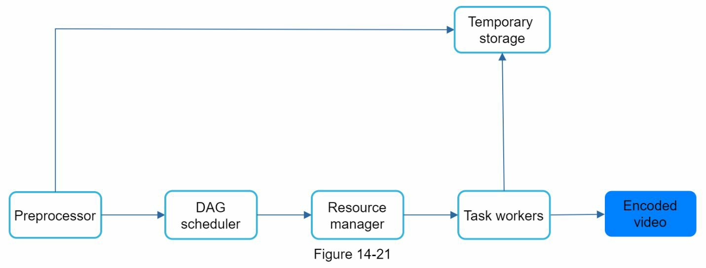

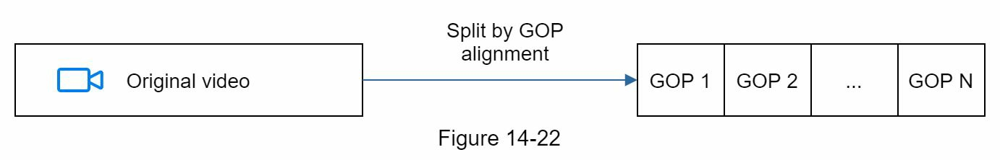

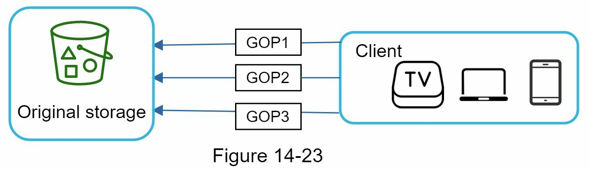

Điều này cho phép tiếp tục tải lên nhanh chóng khi lượt tải trước đó bị lỗi (*resumable uploads*). Tác vụ phân tách tệp video theo GOP có thể được thực thi ngay phía client để cải thiện tốc độ tải lên như hiển thị trong **Hình 14-23**.

### Tối ưu hóa tốc độ: Đặt các trung tâm tải lên gần người dùng (Speed optimization: place upload centers close to users)

Một cách khác để cải thiện tốc độ tải lên là thiết lập nhiều trung tâm tải lên (*upload centers*) trên toàn cầu (**Hình 14-24**). Người dùng ở Hoa Kỳ có thể tải video lên trung tâm tải lên khu vực Bắc Mỹ, và người dùng ở Trung Quốc có thể tải video lên trung tâm tải lên khu vực Châu Á. Để đạt được điều này, chúng tôi sử dụng mạng phân phối nội dung (**CDN** - *Content Delivery Network*) làm các trung tâm tải lên.

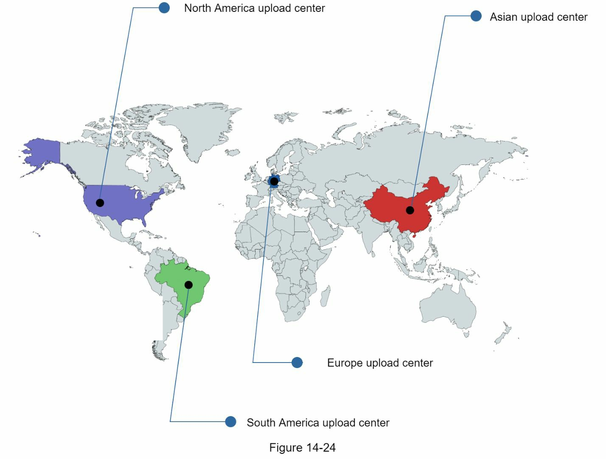

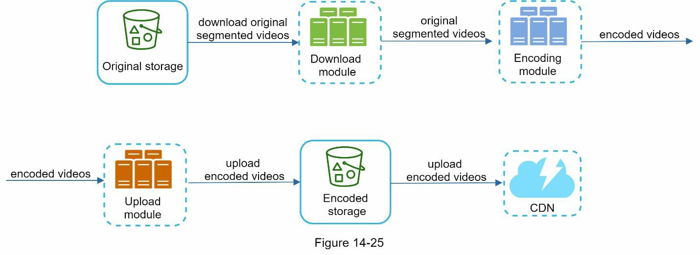

### Tối ưu hóa tốc độ: Song song hóa mọi nơi (Speed optimization: parallelism everywhere)

Để đạt được độ trễ thấp (*low latency*) đòi hỏi những nỗ lực nghiêm túc. Một tối ưu hóa khác là xây dựng một hệ thống ghép nối lỏng lẻo (**loosely coupled system**) và kích hoạt khả năng xử lý song song mức độ cao (*high parallelism*).

Thiết kế của chúng ta cần một số điều chỉnh để đạt được mức độ song song hóa cao. Hãy đi sâu vào luồng chuyển giao video từ bộ lưu trữ gốc (*original storage*) sang CDN. Luồng này được thể hiện trong **Hình 14-25**, cho thấy rằng đầu ra của bước sau phụ thuộc trực tiếp vào đầu vào của bước trước đó. Sự phụ thuộc tuần tự này khiến cho việc xử lý song song trở nên khó khăn.

Để giúp hệ thống trở nên ghép nối lỏng lẻo hơn, chúng tôi đã đưa vào các hàng đợi tin nhắn (**Message Queues**) như hiển thị trong Hình...

---

14-26. Hãy cùng xem xét một ví dụ để giải thích cách hàng đợi thông điệp (*message queue*) giúp hệ thống đạt mức độ liên kết lỏng (*loosely coupled*) hơn như thế nào.
* **Trước khi đưa hàng đợi thông điệp vào:** Module mã hóa (*encoding module*) bắt buộc phải chờ đợi đầu ra của module tải xuống (*download module*).
* **Sau khi đưa hàng đợi thông điệp vào:** Module mã hóa không còn cần phải chờ đợi đầu ra của module tải xuống nữa. Nếu có các sự kiện (*events*) tồn tại trong hàng đợi thông điệp, module mã hóa có thể thực thi các tác vụ (*jobs*) đó một cách song song (*in parallel*).

### Tối ưu hóa an toàn: URL tải lên được ký trước (*Pre-signed upload URL*)
An toàn (*safety*) là một trong những khía cạnh quan trọng nhất của bất kỳ sản phẩm nào. Nhằm đảm bảo chỉ những người dùng được cấp quyền (*authorized users*) mới có thể tải video lên đúng vị trí, chúng tôi đưa vào cơ chế URL được ký trước (*pre-signed URLs*) như được minh họa trong **Hình 14-27**.

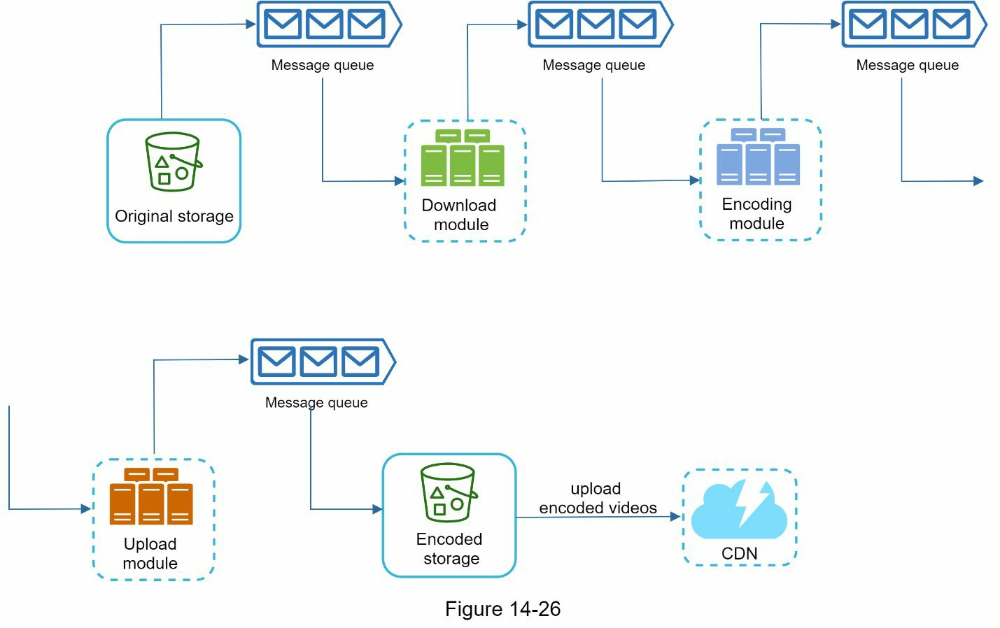

---

Luồng tải lên (*upload flow*) được cập nhật lại như sau:
1. Máy khách (*client*) gửi một yêu cầu HTTP đến các máy chủ API (*API servers*) để lấy URL được ký trước (*pre-signed URL*), URL này cung cấp quyền truy cập vào đối tượng (*object*) được xác định trong chính URL đó. Thuật ngữ *pre-signed URL* được sử dụng khi tải tệp lên Amazon S3. Các nhà cung cấp dịch vụ đám mây khác có thể sử dụng tên gọi khác. Chẳng hạn, dịch vụ lưu trữ blob của Microsoft Azure hỗ trợ cùng tính năng này, nhưng gọi nó là “Shared Access Signature” (Chữ ký truy cập dùng chung) [10].
2. Các máy chủ API phản hồi lại kèm theo một URL được ký trước.
3. Ngay khi máy khách nhận được phản hồi, nó sẽ tiến hành tải video lên bằng cách sử dụng URL được ký trước đó.

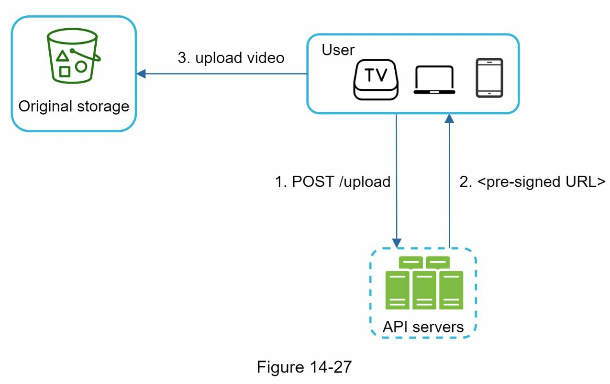

### Tối ưu hóa an toàn: Bảo vệ video của bạn (*Protect your videos*)
Nhiều nhà sáng tạo nội dung e ngại việc đăng video trực tuyến vì họ sợ rằng video gốc của mình sẽ bị đánh cắp. Để bảo vệ các video có bản quyền, chúng ta có thể áp dụng một trong ba tùy chọn an toàn sau:
* **Các hệ thống quản lý bản quyền kỹ thuật số (*Digital Rights Management - DRM*):** Ba hệ thống DRM lớn là Apple FairPlay, Google Widevine và Microsoft PlayReady.
* **Mã hóa AES (*AES encryption*):** Bạn có thể mã hóa video và cấu hình một chính sách ủy quyền (*authorization policy*). Video được mã hóa sẽ chỉ được giải mã khi phát lại (*playback*). Điều này đảm bảo rằng chỉ những người dùng được ủy quyền mới có thể xem được video đã mã hóa.
* **Đóng dấu bản quyền hình ảnh (*Visual watermarking*):** Đây là một lớp phủ hình ảnh đè lên trên video của bạn, chứa thông tin nhận dạng cho video. Nó có thể là logo công ty hoặc tên công ty của bạn.

### Tối ưu hóa tiết kiệm chi phí (*Cost-saving optimization*)
Mạng phân phối nội dung (*Content Delivery Network - CDN*) là một thành phần trọng yếu trong hệ thống của chúng ta. Nó đảm bảo việc phân phối video nhanh chóng trên quy mô toàn cầu. Tuy nhiên, từ phép tính ước lượng nhanh (*back of the envelope calculation*), chúng ta biết rằng CDN rất đắt đỏ, đặc biệt là khi kích thước dữ liệu lớn. Làm thế nào để chúng ta có thể cắt giảm chi phí này?

Các nghiên cứu trước đây chỉ ra rằng các luồng phát video (*video streams*) trên YouTube tuân theo phân phối đuôi dài (*long-tail distribution*) [11] [12]. Điều đó có nghĩa là một số ít video phổ biến được truy cập rất thường xuyên, nhưng rất nhiều video khác lại có rất ít hoặc không có người xem. Dựa trên quan sát này, chúng tôi triển khai một vài tối ưu hóa:
1. Chỉ phục vụ các video phổ biến nhất từ CDN, còn các video khác sẽ được phục vụ từ các máy chủ video lưu trữ dung lượng cao (*high capacity storage video servers*) của chính chúng ta (**Hình 14-28**).

---

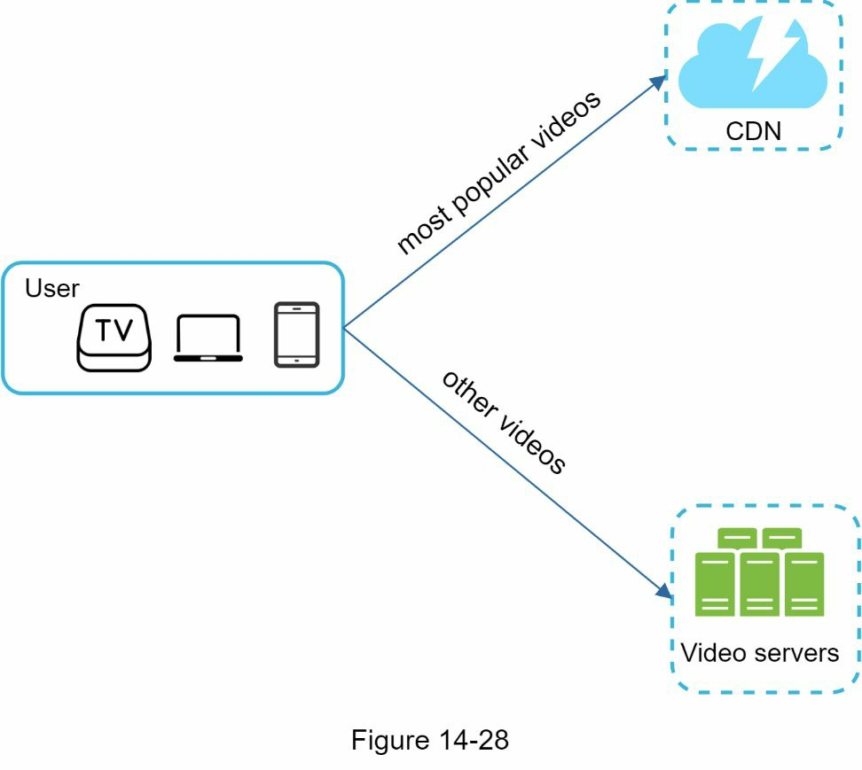

2. Đối với nội dung ít phổ biến hơn, chúng ta có thể không cần phải lưu trữ quá nhiều phiên bản video đã mã hóa. Các video ngắn có thể được mã hóa theo yêu cầu (*encoded on-demand*).
3. Một số video chỉ phổ biến ở một số khu vực nhất định. Không cần thiết phải phân phối các video này đến các khu vực khác.
4. Tự xây dựng CDN của riêng bạn tương tự như Netflix và hợp tác với các Nhà cung cấp dịch vụ Internet (*Internet Service Providers - ISPs*). Việc tự xây dựng CDN là một dự án khổng lồ; tuy nhiên, điều này có thể rất hợp lý đối với các công ty phát trực tuyến quy mô lớn. Một ISP có thể là Comcast, AT&T, Verizon, hoặc các nhà cung cấp dịch vụ internet khác. Các ISP được đặt trên khắp thế giới và ở rất gần người dùng. Bằng cách hợp tác với các ISP, bạn có thể cải thiện trải nghiệm xem của người dùng và giảm thiểu chi phí băng thông (*bandwidth charges*).

Tất cả các tối ưu hóa này đều dựa trên mức độ phổ biến của nội dung, mô hình truy cập của người dùng, kích thước video, v.v. Việc phân tích các mô hình xem trong lịch sử (*historical viewing patterns*) trước khi thực hiện bất kỳ tối ưu hóa nào là rất quan trọng. Dưới đây là một số bài viết thú vị về chủ đề này: [12] [13].

### Xử lý lỗi (*Error handling*)
Đối với một hệ thống quy mô lớn, các lỗi hệ thống là không thể tránh khỏi. Để xây dựng một hệ thống có khả năng chịu lỗi cao (*highly fault-tolerant system*), chúng ta phải xử lý các lỗi một cách khéo léo (*gracefully*) và phục hồi từ chúng thật nhanh chóng. Tồn tại hai loại lỗi:
* **Lỗi có thể phục hồi (*Recoverable error*):** Đối với các lỗi có thể phục hồi chẳng hạn như một phân đoạn video (*video segment*) bị lỗi khi chuyển mã mã (*transcode*), ý tưởng chung là thử lại (*retry*) thao tác đó một vài lần. Nếu tác vụ tiếp tục thất bại và hệ thống nhận thấy lỗi này không thể khắc phục được nữa, nó sẽ trả về mã lỗi thích hợp cho máy khách.
* **Lỗi không thể phục hồi (*Non-recoverable error*):** Đối với các lỗi không thể phục hồi như định dạng video bị lỗi cấu trúc (*malformed video format*), hệ thống sẽ dừng các tác vụ đang chạy liên kết với video đó và trả về mã lỗi thích hợp cho máy khách.

Các lỗi điển hình đối với từng thành phần hệ thống được xử lý theo quy trình kịch bản (*playbook*) sau:
* **Lỗi tải lên (*Upload error*):** Thử lại (*retry*) một vài lần.

---

* **Lỗi chia tách video (*Split video error*):** Nếu các phiên bản máy khách cũ hơn không thể chia tách video theo căn chỉnh GOP (*GOP alignment*), toàn bộ video sẽ được chuyển lên máy chủ. Công việc chia tách video sẽ được thực hiện ở phía máy chủ (*server-side*).
* **Lỗi chuyển mã (*Transcoding error*):** Thử lại (*retry*).
* **Lỗi bộ tiền xử lý (*Preprocessor error*):** Tạo lại sơ đồ DAG (*regenerate DAG diagram*).
* **Lỗi bộ lập lịch DAG (*DAG scheduler error*):** Lập lịch lại cho tác vụ (*reschedule a task*).
* **Hàng đợi của bộ quản lý tài nguyên bị sập (*Resource manager queue down*):** Sử dụng một bản sao dự phòng (*replica*).
* **Tiến trình xử lý tác vụ bị sập (*Task worker down*):** Thử lại tác vụ trên một worker mới.
* **Máy chủ API bị sập (*API server down*):** Các máy chủ API là phi trạng thái (*stateless*), do đó các yêu cầu sẽ được chuyển hướng tới một máy chủ API khác.
* **Máy chủ bộ nhớ đệm siêu dữ liệu bị sập (*Metadata cache server down*):** Dữ liệu được nhân bản nhiều lần (*replicated multiple times*). Nếu một node bị sập, bạn vẫn có thể truy cập các node khác để lấy dữ liệu. Chúng ta có thể khởi tạo một máy chủ bộ nhớ đệm mới để thay thế cho máy chủ đã chết.
* **Máy chủ cơ sở dữ liệu siêu dữ liệu bị sập (*Metadata DB server down*):**
  * **Master bị sập:** Nếu node Master bị sập, hãy nâng cấp (*promote*) một trong các node Slave lên làm Master mới.
  * **Slave bị sập:** Nếu một node Slave bị sập, bạn có thể sử dụng một node Slave khác để phục vụ các thao tác đọc (*reads*) và khởi chạy một máy chủ cơ sở dữ liệu khác để thay thế cho máy chủ đã chết.

---

### Bước 4 - Tổng kết (*Wrap up*)
Trong chương này, chúng tôi đã trình bày thiết kế kiến trúc cho các dịch vụ phát video trực tuyến (*video streaming services*) như YouTube. Nếu còn thời gian thừa ở cuối buổi phỏng vấn, dưới đây là một vài điểm bổ sung bạn có thể đề cập:
* **Mở rộng tầng API (*Scale the API tier*):** Vì các máy chủ API là phi trạng thái (*stateless*), nên rất dễ dàng để mở rộng tầng API theo chiều ngang (*horizontally*).
* **Mở rộng cơ sở dữ liệu (*Scale the database*):** Bạn có thể nói về việc nhân bản cơ sở dữ liệu (*database replication*) và phân mảnh (*sharding*).
* **Phát trực tiếp (*Live streaming*):** Đề cập đến quá trình một video được ghi lại và phát sóng trong thời gian thực (*real time*). Mặc dù hệ thống của chúng ta không được thiết kế chuyên biệt cho phát trực tiếp, nhưng phát trực tiếp (*live streaming*) và phát không trực tiếp (*non-live streaming*) vẫn có một số điểm tương đồng: cả hai đều yêu cầu tải lên (*uploading*), mã hóa (*encoding*) và phát trực tuyến (*streaming*). Các điểm khác biệt đáng chú ý là:
  * Phát trực tiếp có yêu cầu độ trễ thấp hơn nhiều (yêu cầu khắt khe hơn về độ trễ), do đó nó có thể cần một giao thức truyền phát (*streaming protocol*) khác.
  * Phát trực tiếp có yêu cầu về tính song song thấp hơn vì các khối dữ liệu nhỏ đã được xử lý theo thời gian thực.
  * Phát trực tiếp đòi hỏi một tập hợp các cơ chế xử lý lỗi khác biệt. Bất kỳ quy trình xử lý lỗi nào tiêu tốn quá nhiều thời gian đều không thể chấp nhận được.
* **Gỡ bỏ video (*Video takedowns*):** Các video vi phạm bản quyền, nội dung khiêu dâm hoặc các hành vi bất hợp pháp khác phải bị gỡ bỏ. Một số vi phạm có thể được hệ thống phát hiện trong quá trình tải lên, trong khi những vi phạm khác có thể được phát hiện thông qua báo cáo gắn cờ của người dùng (*user flagging*).

Chúc mừng bạn đã đi được xa đến mức này! Bây giờ hãy tự vỗ vai khen ngợi chính mình. Làm tốt lắm!

---

### Tài liệu tham khảo (*Reference materials*)
* **[1]** YouTube by the numbers: https://www.omnicoreagency.com/youtube-statistics/
* **[2]** 2019 YouTube Demographics: https://blog.hubspot.com/marketing/youtube-demographics
* **[3]** Cloudfront Pricing: https://aws.amazon.com/cloudfront/pricing/
* **[4]** Netflix on AWS: https://aws.amazon.com/solutions/case-studies/netflix/
* **[5]** Akamai homepage: https://www.akamai.com/
* **[6]** Binary large object: https://en.wikipedia.org/wiki/Binary_large_object
* **[7]** Here’s What You Need to Know About Streaming Protocols: https://www.dacast.com/blog/streaming-protocols/
* **[8]** SVE: Distributed Video Processing at Facebook Scale: https://www.cs.princeton.edu/~wlloyd/papers/sve-sosp17.pdf
* **[9]** Weibo video processing architecture (bằng tiếng Trung): https://www.upyun.com/opentalk/399.html
* **[10]** Delegate access with a shared access signature: https://docs.microsoft.com/en-us/rest/api/storageservices/delegate-access-with-shared-access-signature
* **[11]** YouTube scalability talk by early YouTube employee: https://www.youtube.com/watch?v=w5WVu624fY8
* **[12]** Understanding the characteristics of internet short video sharing: A youtube-based measurement study: https://arxiv.org/pdf/0707.3670.pdf
* **[13]** Content Popularity for Open Connect: https://netflixtechblog.com/content-popularity-for-open-connect-b86d56f613b

---

[← Chương trước](chuong-13-thiet-ke-search-autocomplete.md) | [Mục lục](README.md) | [Chương tiếp theo →](chuong-15-thiet-ke-google-drive.md)
