# Chương 15: Thiết kế Google Drive (Design Google Drive)

[← Chương trước](chuong-14-thiet-ke-youtube.md) | [Mục lục](README.md) | [Chương tiếp theo →](chuong-16-hanh-trinh-hoc-tap-tiep-dien.md)

---


# CHƯƠNG 15: THIẾT KẾ GOOGLE DRIVE (DESIGN GOOGLE DRIVE)

Trong những năm gần đây, các dịch vụ lưu trữ đám mây (cloud storage) như Google Drive, Dropbox, Microsoft OneDrive và Apple iCloud đã trở nên rất phổ biến. Trong chương này, bạn được yêu cầu thiết kế Google Drive.

Hãy dành một chút thời gian để hiểu về Google Drive trước khi đi sâu vào thiết kế. Google Drive là một dịch vụ lưu trữ và đồng bộ hóa tệp tin (file storage and synchronization service) giúp bạn lưu trữ tài liệu, hình ảnh, video và các tệp tin khác trên đám mây. Bạn có thể truy cập các tệp của mình từ bất kỳ máy tính, điện thoại thông minh (smartphone) hay máy tính bảng (tablet) nào. Bạn cũng có thể dễ dàng chia sẻ các tệp đó với bạn bè, gia đình và đồng nghiệp [1]. Hình 15-1 và 15-2 lần lượt minh họa giao diện của Google Drive trên trình duyệt web và ứng dụng di động.

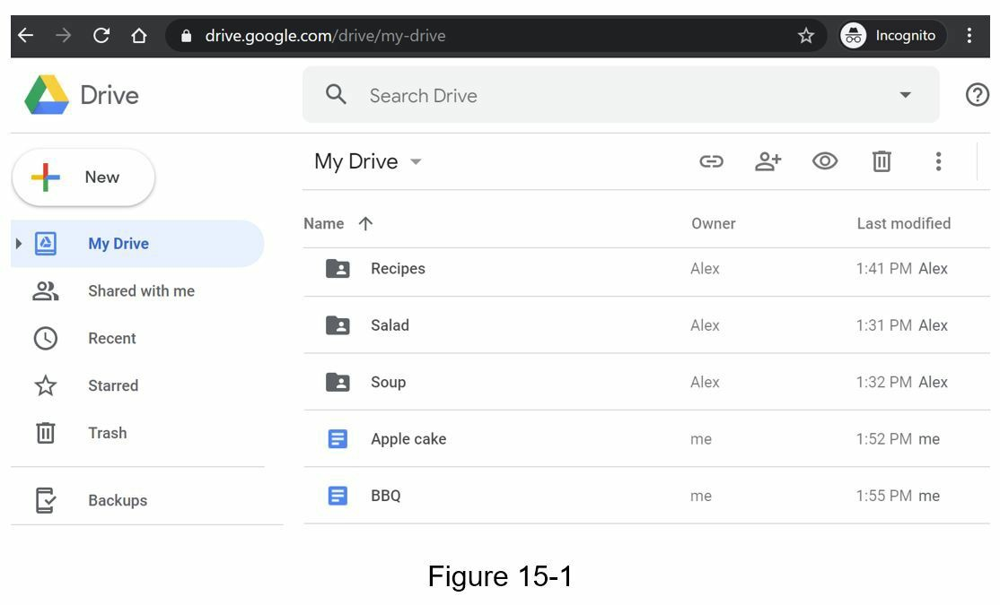

*Hình 15-1: Giao diện Google Drive trên trình duyệt web*

---

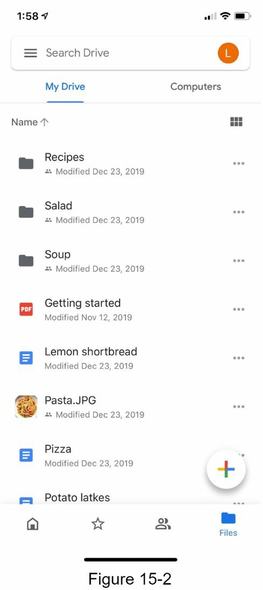

*Hình 15-2: Giao diện Google Drive trên ứng dụng di động*

---

## Bước 1 - Hiểu rõ bài toán và xác định phạm vi thiết kế (Step 1 - Understand the problem and establish design scope)

Thiết kế một hệ thống như Google Drive là một dự án lớn, vì vậy điều quan trọng là phải đặt các câu hỏi để thu hẹp phạm vi thiết kế.

> **Ứng viên:** Những tính năng quan trọng nhất là gì?  
> **Người phỏng vấn:** Tải lên và tải xuống tệp (upload and download files), đồng bộ hóa tệp (file sync), và gửi thông báo (notifications).  
> 
> **Ứng viên:** Đây là ứng dụng di động (mobile app), ứng dụng web (web app) hay cả hai?  
> **Người phỏng vấn:** Cả hai.  
> 
> **Ứng viên:** Các định dạng tệp nào được hỗ trợ?  
> **Người phỏng vấn:** Bất kỳ loại tệp nào.  
> 
> **Ứng viên:** Các tệp có cần được mã hóa không?  
> **Người phỏng vấn:** Có, các tệp trong hệ thống lưu trữ phải được mã hóa (encrypted).  
> 
> **Ứng viên:** Có giới hạn kích thước tệp không?  
> **Người phỏng vấn:** Có, các tệp phải có dung lượng từ 10 GB trở xuống.  
> 
> **Ứng viên:** Sản phẩm có bao nhiêu người dùng?  
> **Người phỏng vấn:** 10 triệu DAU (Daily Active Users - Người dùng hoạt động hàng ngày).  

Trong chương này, chúng ta tập trung vào các tính năng sau:
* **Thêm tệp (Add files):** Cách dễ nhất để thêm một tệp là kéo và thả (drag and drop) tệp vào Google Drive.
* **Tải xuống tệp (Download files).**
* **Đồng bộ hóa tệp trên nhiều thiết bị (Sync files across multiple devices):** Khi một tệp được thêm vào một thiết bị, nó sẽ tự động được đồng bộ hóa tới các thiết bị khác.
* **Xem các bản sửa đổi của tệp (See file revisions).**
* **Chia sẻ tệp với bạn bè, gia đình và đồng nghiệp (Share files with your friends, family, and coworkers).**
* **Gửi thông báo khi một tệp được chỉnh sửa, bị xóa hoặc được chia sẻ với bạn (Send a notification when a file is edited, deleted, or shared with you).**

Các tính năng không được thảo luận trong chương này bao gồm:
* **Chỉnh sửa và cộng tác trên Google Docs (Google doc editing and collaboration):** Google Docs cho phép nhiều người chỉnh sửa cùng một tài liệu đồng thời. Tính năng này nằm ngoài phạm vi thiết kế của chúng ta.

Bên cạnh việc làm rõ các yêu cầu chức năng, điều quan trọng là phải hiểu các yêu cầu phi chức năng (non-functional requirements):
* **Độ tin cậy (Reliability):** Độ tin cậy là cực kỳ quan trọng đối với một hệ sinh thái lưu trữ. Mất mát dữ liệu (data loss) là điều hoàn toàn không thể chấp nhận được.
* **Tốc độ đồng bộ nhanh (Fast sync speed):** Nếu việc đồng bộ hóa tệp mất quá nhiều thời gian, người dùng sẽ mất kiên nhẫn và từ bỏ sản phẩm.
* **Mức sử dụng băng thông (Bandwidth usage):** Nếu một sản phẩm tiêu tốn nhiều băng thông mạng không cần thiết, người dùng sẽ không hài lòng, đặc biệt là khi họ đang sử dụng các gói cước dữ liệu di động.
* **Khả năng mở rộng (Scalability):** Hệ thống phải có khả năng xử lý lượng lưu lượng truy cập lớn (high volumes of traffic).
* **Tính sẵn sàng cao (High availability):** Người dùng vẫn có thể sử dụng hệ thống khi một số máy chủ bị ngoại tuyến (offline), chạy chậm hoặc gặp lỗi mạng đột xuất.

### Ước tính sơ bộ (Back of the envelope estimation)
* Giả định ứng dụng có 50 triệu người dùng đăng ký (signed up users) và 10 triệu người dùng hoạt động hàng ngày (DAU).
* Người dùng nhận được 10 GB dung lượng miễn phí.
* Giả định người dùng tải lên 2 tệp mỗi ngày. Kích thước tệp trung bình là 500 KB.
* Tỷ lệ đọc trên ghi (read-to-write ratio) là 1:1.

---

* **Tổng dung lượng được cấp phát (Total space allocated):**  
  $$\text{50 triệu} \times 10\text{ GB} = 500\text{ Petabyte}$$
* **QPS cho Upload API (Queries Per Second):**  
  $$\frac{\text{10 triệu} \times 2\text{ uploads}}{24\text{ giờ} \times 3600\text{ giây}} \approx 240$$
* **QPS lúc cao điểm (Peak QPS):**  
  $$\text{Peak QPS} = \text{QPS} \times 2 = 480$$

---

## Bước 2 - Đề xuất thiết kế cấp cao và đạt được sự đồng thuận (Step 2 - Propose high-level design and get buy-in)

Thay vì đưa ra sơ đồ thiết kế cấp cao ngay từ đầu, chúng ta sẽ sử dụng một cách tiếp cận hơi khác một chút. Chúng ta sẽ bắt đầu với một mô hình đơn giản: xây dựng toàn bộ mọi thứ trên một máy chủ duy nhất (single server). Sau đó, dần dần mở rộng quy mô (scale up) để hỗ trợ hàng triệu người dùng. Bằng cách thực hiện bài tập này, bạn sẽ được gợi nhớ lại một số chủ đề quan trọng đã được đề cập trong cuốn sách.

Hãy bắt đầu với thiết lập một máy chủ duy nhất như được liệt kê dưới đây:
* Một **Web server** để tải lên và tải xuống các tệp tin.
* Một **Cơ sở dữ liệu (Database)** để theo dõi siêu dữ liệu (metadata) như dữ liệu người dùng, thông tin đăng nhập, thông tin tệp, v.v.
* Một **Hệ thống lưu trữ (Storage system)** để lưu trữ các tệp. Chúng ta phân bổ 1 TB không gian lưu trữ để chứa các tệp.

Chúng ta dành một vài giờ để thiết lập một Apache web server, một cơ sở dữ liệu MySQL, và một thư mục có tên là `drive/` đóng vai trò là thư mục gốc (root directory) để lưu trữ các tệp đã tải lên. Dưới thư mục `drive/`, có một danh sách các thư mục con, được gọi là các không gian tên (namespaces). Mỗi namespace chứa tất cả các tệp đã tải lên của người dùng đó. Tên tệp trên máy chủ được giữ nguyên như tên tệp gốc ban đầu. Mỗi tệp hoặc thư mục có thể được định danh duy nhất bằng cách nối namespace với đường dẫn tương đối (relative path).

Hình 15-3 minh họa một ví dụ về cấu trúc của thư mục `/drive` ở phía bên trái và chế độ xem mở rộng chi tiết của nó ở phía bên phải.

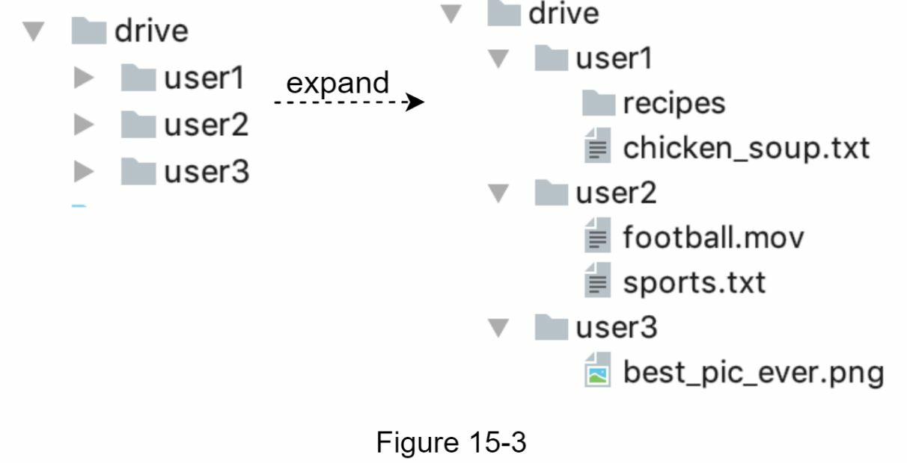

*Hình 15-3: Cấu trúc thư mục /drive trên máy chủ lưu trữ*

### Các API (APIs)
Các API sẽ trông như thế nào? Về cơ bản, chúng ta chủ yếu cần 3 API: tải tệp lên (upload a file), tải tệp xuống (download a file), và lấy các bản sửa đổi của tệp (get file revisions).

#### 1. Tải một tệp lên Google Drive (Upload a file to Google Drive)
Hỗ trợ hai loại hình tải lên:
* **Tải lên đơn giản (Simple upload):** Sử dụng loại tải lên này khi kích thước tệp nhỏ.
* **Tải lên có thể tiếp tục lại (Resumable upload):** Sử dụng loại tải lên này khi kích thước tệp lớn và có khả năng cao xảy ra gián đoạn mạng.

Dưới đây là một ví dụ về API tải lên có thể tiếp tục lại:
```http
POST https://api.example.com/files/upload?uploadType=resumable
```
**Tham số (Params):**
* `uploadType=resumable`
* `data`: Tệp cục bộ cần được tải lên.

---

Một quy trình tải lên có thể tiếp tục lại (resumable upload) được thực hiện qua 3 bước sau [2]:
* Gửi yêu cầu ban đầu để lấy URL có thể tiếp tục lại (resumable URL).
* Tải dữ liệu lên và theo dõi trạng thái tải lên (upload state).
* Nếu quá trình tải lên bị gián đoạn, hãy tiếp tục lại quá trình tải lên từ điểm dừng đó.

#### 2. Tải một tệp xuống từ Google Drive (Download a file from Google Drive)
**API ví dụ:**
```http
POST https://api.example.com/files/download
```
**Tham số (Params):**
* `path`: Đường dẫn tệp cần tải xuống.

**Ví dụ tham số (Example params):**
```json
{
  "path": "/recipes/soup/best_soup.txt"
}
```

#### 3. Lấy lịch sử sửa đổi của tệp (Get file revisions)
**API ví dụ:**
```http
GET https://api.example.com/files/list_revisions
```
**Tham số (Params):**
* `path`: Đường dẫn tới tệp mà bạn muốn lấy lịch sử sửa đổi.
* `limit`: Số lượng bản sửa đổi tối đa cần trả về.

**Ví dụ tham số (Example params):**
```json
{
  "path": "/recipes/soup/best_soup.txt",
  "limit": 20
}
```

Tất cả các API đều yêu cầu xác thực người dùng (user authentication) và sử dụng HTTPS. Giao thức Tầng cổng bảo mật (Secure Sockets Layer - SSL) bảo vệ việc truyền dữ liệu giữa client và các máy chủ backend.

### Thoát khỏi mô hình một máy chủ (Move away from single server)
Khi có nhiều tệp được tải lên hơn, cuối cùng bạn sẽ nhận được cảnh báo hết dung lượng lưu trữ (space full alert) như minh họa trong Hình 15-4.

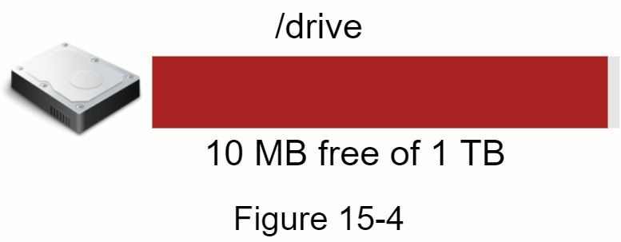

*Hình 15-4: Cảnh báo hết dung lượng lưu trữ*

Chỉ còn lại 10 MB không gian lưu trữ! Đây là một tình huống khẩn cấp vì người dùng không thể tải tệp lên được nữa. Giải pháp đầu tiên nảy ra trong đầu là phân mảnh dữ liệu (shard the data), để dữ liệu được lưu trữ trên nhiều máy chủ lưu trữ khác nhau. Hình 15-5 minh họa một ví dụ về việc phân mảnh dữ liệu dựa trên `user_id`.

---

### Trang 250

Bạn thức trắng đêm để thiết lập kỹ thuật phân mảnh cơ sở dữ liệu (**Database Sharding**) và theo dõi nó một cách sát sao. Mọi thứ lại hoạt động trơn tru trở lại. Bạn đã dập tắt được "đám cháy", nhưng bạn vẫn lo lắng về nguy cơ mất mát dữ liệu tiềm ẩn trong trường hợp máy chủ lưu trữ (**storage server**) gặp sự cố ngừng hoạt động (**outage**). Bạn đi hỏi xung quanh và Frank — một người bạn là chuyên gia phụ trách backend (**backend guru**) — nói với bạn rằng nhiều công ty hàng đầu như Netflix và Airbnb đều sử dụng **Amazon S3** để lưu trữ.

> *"Amazon Simple Storage Service (Amazon S3) là một dịch vụ lưu trữ đối tượng (object storage service) cung cấp khả năng mở rộng (scalability), tính sẵn sàng của dữ liệu (data availability), tính bảo mật (security) và hiệu năng (performance) hàng đầu trong ngành"* [3].

Bạn quyết định tìm hiểu thêm để xem liệu giải pháp này có phù hợp hay không.

Sau khi đọc rất nhiều tài liệu, bạn nắm vững được hệ thống lưu trữ S3 và quyết định lưu trữ các tệp trên S3. Amazon S3 hỗ trợ nhân bản cùng khu vực (**same-region replication**) và nhân bản xuyên khu vực (**cross-region replication**). Một khu vực (**region**) là một vùng địa lý nơi Amazon Web Services (AWS) đặt các trung tâm dữ liệu (**data centers**). Như được minh họa trong **Hình 15-6**, dữ liệu có thể được sao chép/nhân bản trong cùng một khu vực (phía bên trái) và xuyên khu vực (phía bên phải). Các tệp dư thừa dự phòng (**redundant files**) được lưu trữ ở nhiều khu vực khác nhau để chống mất mát dữ liệu và đảm bảo tính sẵn sàng (**availability**). Một **bucket** tương tự như một thư mục trong hệ thống tệp tin (**file systems**).

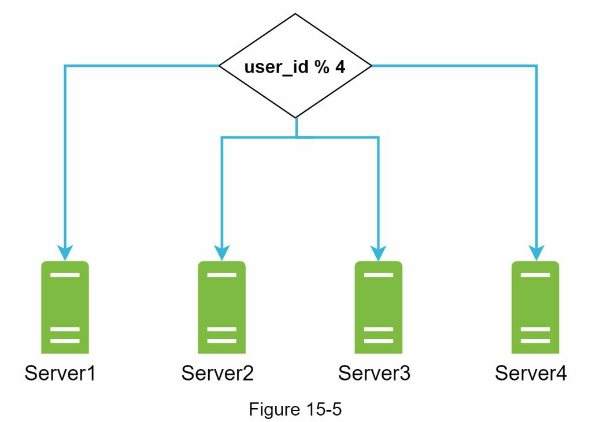

Sau khi đưa các tệp lên S3, cuối cùng bạn cũng có thể ngủ một giấc thật ngon mà không phải lo lắng về việc mất mát dữ liệu. Để ngăn chặn các vấn đề tương tự xảy ra trong tương lai, bạn quyết định nghiên cứu sâu hơn về các khía cạnh có thể cải thiện. Dưới đây là một vài khía cạnh bạn tìm thấy:

*   **Bộ cân bằng tải (Load balancer):** Thêm một bộ cân bằng tải để phân phối lưu lượng mạng (**network traffic**). Bộ cân bằng tải đảm bảo

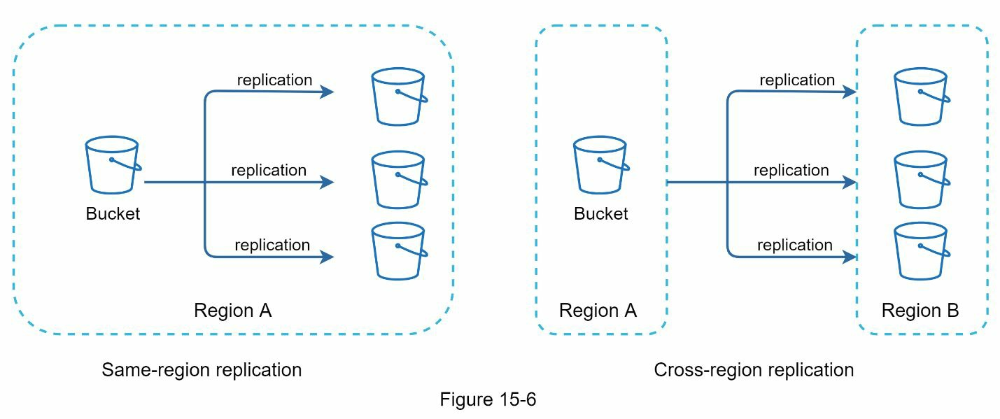

---

### Trang 251

lưu lượng truy cập được phân phối đồng đều, và nếu một máy chủ web (**web server**) bị sập, nó sẽ phân phối lại lưu lượng truy cập.
*   **Các máy chủ web (Web servers):** Sau khi bổ sung bộ cân bằng tải, các máy chủ web có thể được thêm vào/loại bỏ một cách dễ dàng, tùy thuộc vào tải lưu lượng truy cập (**traffic load**).
*   **Cơ sở dữ liệu siêu dữ liệu (Metadata database):** Chuyển cơ sở dữ liệu ra khỏi máy chủ web để tránh điểm lỗi duy nhất (**Single Point of Failure - SPOF**). Đồng thời, thiết lập cơ chế nhân bản dữ liệu (**data replication**) và phân mảnh cơ sở dữ liệu (**sharding**) nhằm đáp ứng các yêu cầu về tính sẵn sàng (**availability**) và khả năng mở rộng (**scalability**).
*   **Lưu trữ tệp (File storage):** Amazon S3 được sử dụng cho việc lưu trữ tệp. Để đảm bảo tính sẵn sàng và độ bền vững (**durability**), các tệp được nhân bản ở hai khu vực địa lý riêng biệt.

Sau khi áp dụng những cải tiến trên, bạn đã tách rời (**decoupled**) thành công các máy chủ web, cơ sở dữ liệu siêu dữ liệu và bộ lưu trữ tệp từ một máy chủ đơn lẻ. Thiết kế cập nhật được minh họa trong **Hình 15-7**.

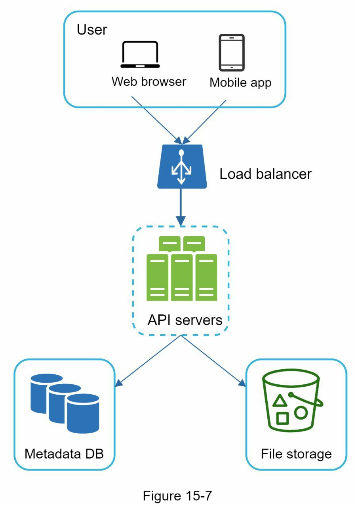

#### Xung đột đồng bộ (Sync conflicts)
Đối với một hệ thống lưu trữ quy mô lớn như Google Drive, xung đột đồng bộ (**sync conflicts**) xảy ra thường xuyên. Khi hai người dùng cùng chỉnh sửa một tệp hoặc một thư mục tại cùng một thời điểm, xung đột sẽ xuất hiện. Làm thế nào chúng ta có thể giải quyết xung đột này? Dưới đây là chiến lược của chúng tôi: phiên bản nào được xử lý trước sẽ thắng (**first version that gets processed wins**), và phiên bản được xử lý sau sẽ nhận thông báo xung đột. **Hình 15-8** minh họa một ví dụ về xung đột đồng bộ.

---

### Trang 252

Trong **Hình 15-8**, người dùng 1 (User 1) và người dùng 2 (User 2) cùng cố gắng cập nhật một tệp tại cùng một thời điểm, nhưng tệp của người dùng 1 được hệ thống của chúng tôi xử lý trước. Thao tác cập nhật của người dùng 1 thành công, nhưng người dùng 2 gặp phải lỗi xung đột đồng bộ. 

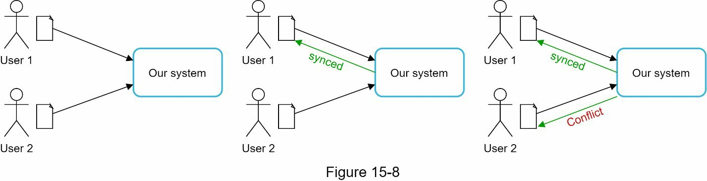

Làm cách nào chúng ta có thể giải quyết xung đột cho người dùng 2? Hệ thống của chúng tôi hiển thị cả hai bản sao của cùng một tệp: bản sao cục bộ (**local copy**) của người dùng 2 và phiên bản mới nhất từ máy chủ (**server**) (như minh họa trong **Hình 15-9**). Người dùng 2 có các tùy chọn: hợp nhất (**merge**) cả hai tệp hoặc ghi đè (**override**) phiên bản này lên phiên bản kia.

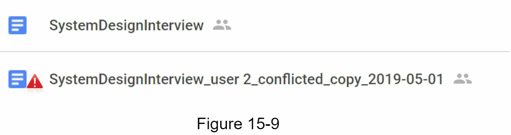

Khi nhiều người dùng cùng chỉnh sửa một tài liệu tại cùng một thời điểm, việc giữ cho tài liệu luôn được đồng bộ là một thách thức lớn. Độc giả quan tâm nên tham khảo các tài liệu tham khảo [4] [5].

#### Thiết kế mức cao (High-level design)
**Hình 15-10** minh họa kiến trúc thiết kế mức cao được đề xuất. Hãy cùng chúng tôi kiểm tra từng thành phần của hệ thống.

---

### Trang 253

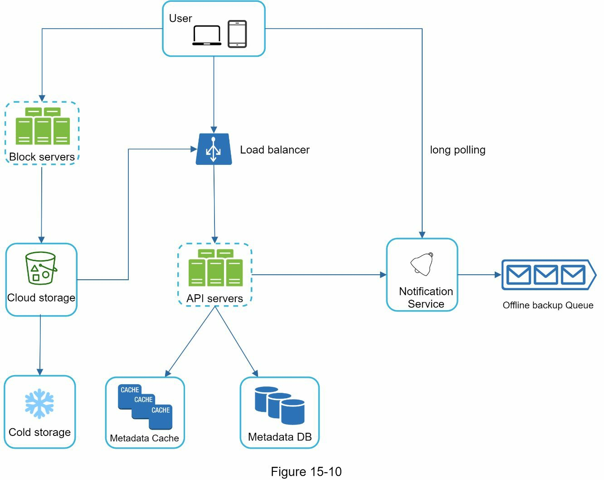

*   **Người dùng (User):** Người dùng sử dụng ứng dụng thông qua trình duyệt web (**browser**) hoặc ứng dụng di động (**mobile app**).
*   **Máy chủ xử lý khối (Block servers):** Các Block server thực hiện tải các khối dữ liệu (**blocks**) lên bộ lưu trữ đám mây (**cloud storage**). Lưu trữ khối (**Block storage**), hay còn gọi là lưu trữ cấp độ khối (**block-level storage**), là một công nghệ lưu trữ các tệp dữ liệu trên môi trường nền tảng đám mây. Một tệp có thể được chia thành nhiều khối nhỏ, mỗi khối có một giá trị băm (**hash value**) duy nhất, được lưu trữ trong cơ sở dữ liệu siêu dữ liệu (**metadata database**) của chúng ta. Mỗi khối được xử lý như một đối tượng độc lập và được lưu trữ trong hệ thống lưu trữ của chúng ta (S3). Để tái tạo lại một tệp, các khối được ghép nối lại theo một thứ tự cụ thể. Về kích thước khối (**block size**), chúng ta lấy Dropbox làm tài liệu tham khảo: Dropbox đặt kích thước tối đa của một khối là 4MB [6].
*   **Lưu trữ đám mây (Cloud storage):** Một tệp được chia thành các khối nhỏ hơn và lưu trữ trong bộ lưu trữ đám mây.
*   **Lưu trữ lạnh (Cold storage):** Lưu trữ lạnh là một hệ thống máy tính được thiết kế để lưu trữ dữ liệu không hoạt động (**inactive data**), nghĩa là các tệp không được truy cập trong một khoảng thời gian dài.
*   **Bộ cân bằng tải (Load balancer):** Một bộ cân bằng tải phân phối đồng đều các yêu cầu giữa các máy chủ API (**API servers**).
*   **Các máy chủ API (API servers):** Các máy chủ này chịu trách nhiệm cho hầu hết mọi tác vụ ngoại trừ luồng tải lên (**uploading flow**). Máy chủ API được sử dụng để xác thực người dùng (**user authentication**), quản lý hồ sơ người dùng (**user profile**), cập nhật siêu dữ liệu của tệp (**file metadata**), v.v.
*   **Cơ sở dữ liệu siêu dữ liệu (Metadata database):** Lưu trữ siêu dữ liệu của người dùng, tệp, khối, phiên bản, v.v. Xin lưu ý rằng các tệp được lưu trữ trên đám mây và cơ sở dữ liệu siêu dữ liệu chỉ chứa siêu dữ liệu.
*   **Bộ nhớ đệm siêu dữ liệu (Metadata cache):** Một số siêu dữ liệu được lưu vào bộ nhớ đệm (**cache**) để phục vụ cho việc truy xuất nhanh chóng.
*   **Dịch vụ thông báo (Notification service):** Đây là một hệ thống xuất bản/đăng ký (**publisher/subscriber system**) cho phép dữ liệu được truyền từ dịch vụ thông báo tới các máy khách (**clients**) khi có các sự kiện nhất định xảy ra. Trong trường hợp cụ thể của chúng ta, dịch vụ thông báo sẽ thông báo cho các máy khách liên quan khi một tệp được thêm/chỉnh sửa/xóa ở nơi khác để họ có thể kéo (**pull**) các thay đổi mới nhất về.
*   **Hàng đợi sao lưu ngoại tuyến (Offline backup queue):** Nếu một máy khách đang ở trạng thái ngoại tuyến (**offline**) và không thể kéo các thay đổi tệp mới nhất, hàng đợi

---

### Trang 254

sao lưu ngoại tuyến sẽ lưu trữ thông tin đó để các thay đổi sẽ được đồng bộ hóa khi máy khách trực tuyến trở lại (**online**).

Chúng ta đã thảo luận về thiết kế của Google Drive ở mức cao. Một số thành phần rất phức tạp và đáng để kiểm tra kỹ lưỡng; chúng ta sẽ thảo luận chi tiết về những thành phần này trong phần phân tích chuyên sâu.

---

### Trang 255

### Bước 3 - Phân tích chi tiết thiết kế (Design deep dive)
Trong phần này, chúng ta sẽ xem xét kỹ lưỡng các thành phần sau: máy chủ xử lý khối (**block servers**), cơ sở dữ liệu siêu dữ liệu (**metadata database**), luồng tải lên (**upload flow**), luồng tải xuống (**download flow**), dịch vụ thông báo (**notification service**), tiết kiệm không gian lưu trữ và xử lý lỗi (**failure handling**).

#### Máy chủ xử lý khối (Block servers)
Đối với các tệp lớn được cập nhật thường xuyên, việc gửi toàn bộ tệp trong mỗi lần cập nhật sẽ tiêu tốn rất nhiều băng thông (**bandwidth**). Hai giải pháp tối ưu hóa được đề xuất để giảm thiểu lưu lượng mạng được truyền tải:
*   **Đồng bộ vi sai (Delta sync):** Khi một tệp được sửa đổi, chỉ các khối bị sửa đổi mới được đồng bộ hóa thay vì toàn bộ tệp bằng cách sử dụng thuật toán đồng bộ (**sync algorithm**) [7] [8].
*   **Nén dữ liệu (Compression):** Việc áp dụng nén lên các khối có thể làm giảm đáng kể kích thước dữ liệu. Do đó, các khối được nén bằng các thuật toán nén tùy thuộc vào loại tệp. Ví dụ: `gzip` và `bzip2` được sử dụng để nén các tệp văn bản. Các thuật toán nén khác nhau sẽ cần thiết để nén hình ảnh và video.

Trong hệ thống của chúng ta, các máy chủ xử lý khối thực hiện các công việc nặng nhọc (**heavy lifting work**) cho việc tải tệp lên. Máy chủ xử lý khối xử lý các tệp được truyền từ máy khách bằng cách chia nhỏ tệp thành các khối, nén từng khối và mã hóa chúng. Thay vì tải toàn bộ tệp lên hệ thống lưu trữ, chỉ các khối đã sửa đổi mới được truyền tải.

**Hình 15-11** minh họa cách thức một máy chủ xử lý khối hoạt động khi một tệp mới được thêm vào.
*   Một tệp được chia nhỏ thành các khối nhỏ hơn.
*   Mỗi khối được nén bằng các thuật toán nén.
*   Để đảm bảo tính bảo mật, mỗi khối được mã hóa trước khi gửi đến bộ lưu trữ đám mây.
*   Các khối được tải lên bộ lưu trữ đám mây.

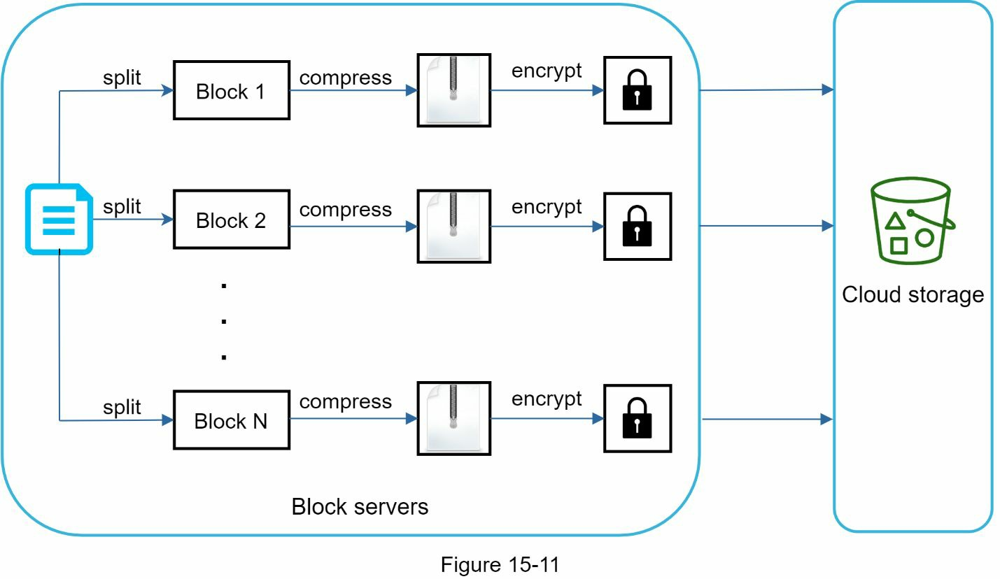

**Hình 15-12** minh họa cơ chế đồng bộ vi sai (**delta sync**), nghĩa là chỉ các khối bị sửa đổi mới được truyền đến bộ lưu trữ đám mây. Các khối được đánh dấu nổi bật "block 2" và "block 5" đại diện cho các khối đã thay đổi. Bằng cách sử dụng đồng bộ vi sai, chỉ có hai khối đó được tải lên bộ lưu trữ đám mây.

---

# Thiết Kế Hệ Thống Lưu Trữ Tệp (File Storage System)

Các máy chủ khối (Block servers) cho phép chúng ta tiết kiệm lưu lượng mạng (network traffic) bằng cách cung cấp cơ chế đồng bộ hóa phần chênh lệch (delta sync) và nén dữ liệu (compression).

### Yêu Cầu Về Tính Nhất Quán Cao (High Consistency Requirement)

Hệ thống của chúng ta mặc định yêu cầu **tính nhất quán mạnh (strong consistency)**. Việc một tệp tin hiển thị khác nhau giữa các client khác nhau tại cùng một thời điểm là hoàn toàn không thể chấp nhận được. Hệ thống cần phải cung cấp tính nhất quán mạnh cho cả tầng bộ nhớ đệm siêu dữ liệu (metadata cache) và tầng cơ sở dữ liệu (database layers).

Các bộ nhớ đệm (memory caches) mặc định áp dụng mô hình **tính nhất quán cuối cùng (eventual consistency)**, đồng nghĩa với việc các bản sao (replicas) khác nhau có thể chứa dữ liệu khác nhau. Để đạt được tính nhất quán mạnh, chúng ta phải đảm bảo các điều sau:
* Dữ liệu trong các bản sao bộ nhớ đệm (cache replicas) và nút chính (master) phải nhất quán.
* Hủy hiệu lực bộ nhớ đệm (invalidate caches) khi có thao tác ghi vào cơ sở dữ liệu để đảm bảo cache và database luôn lưu giữ cùng một giá trị.

Việc đạt được tính nhất quán mạnh trong cơ sở dữ liệu quan hệ (relational database) là rất dễ dàng vì nó duy trì các thuộc tính **ACID (Atomicity - Tính nguyên tử, Consistency - Tính nhất quán, Isolation - Tính cô lập, Durability - Tính bền vững)** [9]. Tuy nhiên, các cơ sở dữ liệu NoSQL mặc định không hỗ trợ các thuộc tính ACID. Các thuộc tính ACID phải được tích hợp vào logic đồng bộ hóa thông qua mã nguồn chương trình. Trong thiết kế của chúng ta, chúng ta lựa chọn cơ sở dữ liệu quan hệ vì ACID được hỗ trợ nguyên bản (natively supported).

### Cơ Sở Dữ Liệu Siêu Dữ Liệu (Metadata Database)

**Hình 15-13** thể hiện thiết kế lược đồ cơ sở dữ liệu (database schema design). Xin lưu ý rằng đây là phiên bản đã được tinh giản cao độ vì nó chỉ bao gồm các bảng quan trọng nhất và các trường thông tin đáng quan tâm.

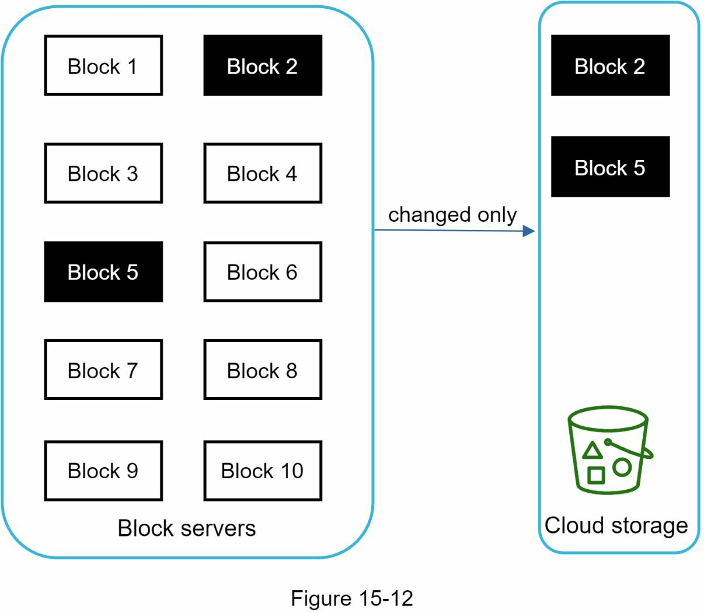

* **User (Người dùng):** Bảng `User` chứa thông tin cơ bản về người dùng như `username` (tên người dùng), `email`, `profile photo` (ảnh đại diện), v.v.
* **Device (Thiết bị):** Bảng `Device` lưu trữ thông tin thiết bị. Trường `Push_id` được sử dụng để gửi và nhận thông báo đẩy (mobile push notifications). Xin lưu ý rằng một người dùng có thể sở hữu nhiều thiết bị.
* **Namespace (Không gian tên):** Một namespace là thư mục gốc (root directory) của người dùng.
* **File (Tệp):** Bảng `File` lưu trữ mọi thông tin liên quan đến tệp tin mới nhất.
* **File_version (Phiên bản tệp):** Lưu trữ lịch sử phiên bản của một tệp. Các hàng dữ liệu hiện có đều ở chế độ chỉ đọc (read-only) để giữ tính toàn vẹn cho lịch sử sửa đổi của tệp.
* **Block (Khối):** Lưu trữ mọi thông tin liên quan đến một khối tệp (file block). Một tệp ở bất kỳ phiên bản nào cũng có thể được tái tạo lại bằng cách ghép tất cả các khối theo đúng thứ tự.

---

### Luồng Tải Lên (Upload Flow)

Hãy cùng thảo luận điều gì sẽ xảy ra khi một client tải lên một tệp tin. Để hiểu rõ hơn về luồng này, chúng tôi vẽ biểu đồ tuần tự (sequence diagram) như minh họa trong **Hình 15-14**.

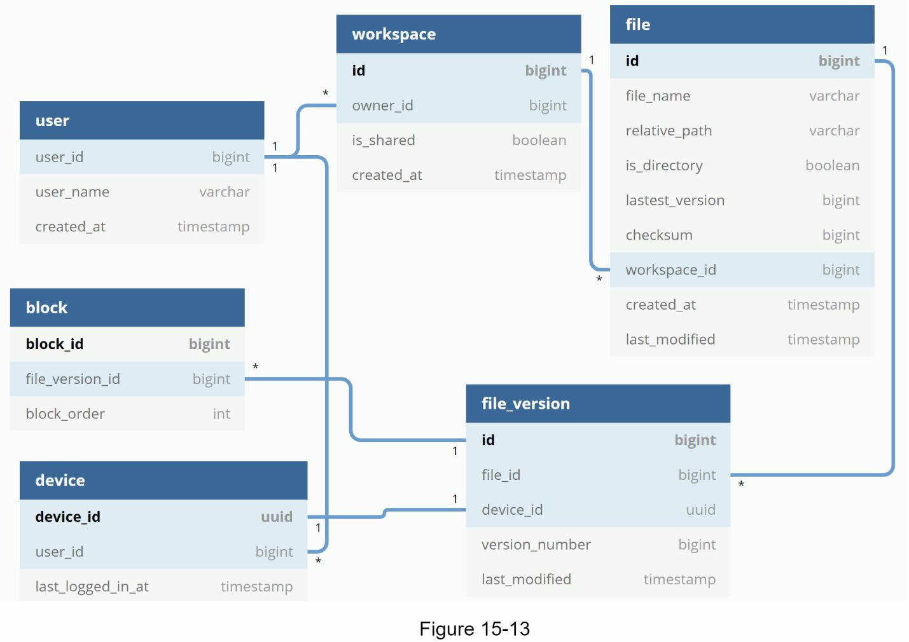

Trong **Hình 15-14**, hai yêu cầu được gửi song song: thêm siêu dữ liệu của tệp (add file metadata) và tải tệp lên bộ lưu trữ đám mây (upload the file to cloud storage). Cả hai yêu cầu đều bắt nguồn từ **Client 1**.

* **Thêm siêu dữ liệu của tệp (Add file metadata):**
  1. Client 1 gửi một yêu cầu để thêm siêu dữ liệu của tệp mới.
  2. Lưu siêu dữ liệu tệp mới vào cơ sở dữ liệu siêu dữ liệu (Metadata DB) và chuyển trạng thái tải lên của tệp thành "đang chờ xử lý" (“pending”).
  3. Thông báo cho dịch vụ thông báo (Notification service) biết rằng một tệp mới đang được thêm vào.
  4. Notification service thông báo cho các client liên quan (Client 2) rằng một tệp đang được tải lên.

* **Tải tệp lên bộ lưu trữ đám mây (Upload files to cloud storage):**
  * **2.1** Client 1 tải nội dung của tệp lên các máy chủ khối (Block servers).
  * **2.2** Các Block servers phân tách (chunk) tệp thành các khối, nén dữ liệu (compress), mã hóa (encrypt) các khối và tải chúng lên bộ lưu trữ đám mây (Cloud storage).
  * **2.3** Khi tệp đã được tải lên xong, Cloud storage sẽ kích hoạt hàm gọi lại hoàn tất tải lên (upload completion callback). Yêu cầu này được gửi đến các API servers.
  * **2.4** Trạng thái tệp được đổi thành "đã tải lên" (“uploaded”) trong Metadata DB.
  * **2.5** Thông báo cho Notification service rằng trạng thái của tệp đã đổi sang “uploaded”.
  * **2.6** Notification service thông báo cho các client liên quan (Client 2) rằng tệp đã được tải lên hoàn tất.

Khi một tệp được chỉnh sửa, luồng xử lý diễn ra tương tự, vì vậy chúng tôi sẽ không lặp lại ở đây.

---

### Luồng Tải Xuống (Download Flow)

Luồng tải xuống (Download flow) được kích hoạt khi một tệp được thêm mới hoặc chỉnh sửa ở một nơi khác. Làm thế nào một client biết được một tệp đã được thêm hoặc chỉnh sửa bởi một client khác? Có hai cách để client nhận biết:
* Nếu **Client A đang trực tuyến (online)** trong khi tệp bị thay đổi bởi một client khác, Notification service sẽ thông báo cho Client A rằng có các thay đổi vừa diễn ra ở đâu đó, vì vậy nó cần phải kéo dữ liệu mới nhất về (pull the latest data).
* Nếu **Client A đang ngoại tuyến (offline)** trong khi tệp bị thay đổi bởi một client khác, dữ liệu sẽ được lưu vào bộ nhớ đệm (cache). Khi client offline trực tuyến trở lại, nó sẽ kéo các thay đổi mới nhất về.

Khi một client biết được một tệp đã bị thay đổi, đầu tiên nó sẽ yêu cầu lấy siêu dữ liệu thông qua API servers, sau đó tải về các khối dữ liệu để cấu thành tệp. **Hình 15-15** thể hiện luồng chi tiết. Lưu ý rằng do giới hạn không gian, chỉ những thành phần quan trọng nhất mới được thể hiện trên sơ đồ.

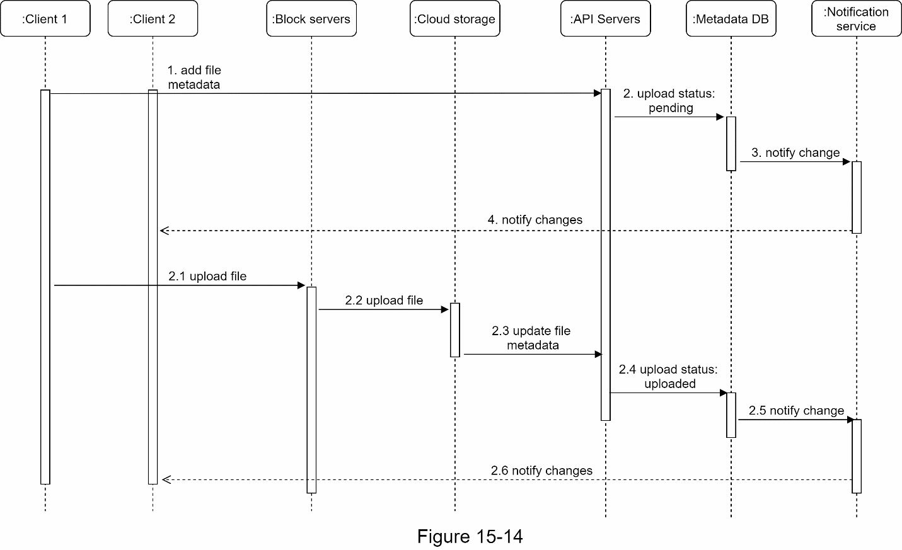

1. Dịch vụ thông báo (Notification service) thông báo cho Client 2 biết rằng một tệp đã bị thay đổi ở nơi khác.
2. Khi Client 2 biết có các bản cập nhật mới, nó gửi một yêu cầu để lấy siêu dữ liệu (metadata).
3. API servers gọi Metadata DB để lấy siêu dữ liệu của các thay đổi.
4. Siêu dữ liệu được trả về cho API servers.
5. Client 2 nhận được siêu dữ liệu.
6. Sau khi nhận được siêu dữ liệu, client gửi các yêu cầu đến Block servers để tải về các khối dữ liệu.
7. Block servers trước hết sẽ tải các khối dữ liệu về từ Cloud storage.
8. Cloud storage trả các khối dữ liệu về cho Block servers.
9. Client 2 tải về tất cả các khối dữ liệu mới để tái tạo lại tệp tin.

---

### Dịch Vụ Thông Báo (Notification Service)

Để duy trì tính nhất quán của tệp tin, bất kỳ sự biến đổi (mutation) nào của tệp được thực hiện cục bộ đều cần phải được thông báo tới các client khác nhằm giảm thiểu xung đột. Dịch vụ thông báo (Notification service) được xây dựng để phục vụ mục đích này. Ở góc nhìn mức cao (high-level), Notification service cho phép truyền dữ liệu tới các client ngay khi các sự kiện xảy ra. Dưới đây là một số lựa chọn:
* **Long polling:** Dropbox sử dụng long polling [10].
* **WebSocket:** WebSocket cung cấp một kết nối liên tục (persistent connection) giữa client và server. Giao tiếp là hai chiều (bi-directional).

Mặc dù cả hai tùy chọn đều hoạt động tốt, chúng tôi chọn **Long polling** vì hai lý do sau:
* Giao tiếp cho Notification service không phải là hai chiều. Server chỉ gửi thông tin về các thay đổi tệp tin tới client, chứ không có chiều ngược lại.
* WebSocket phù hợp cho giao tiếp hai chiều theo thời gian thực như ứng dụng trò chuyện (chat app). Đối với Google Drive, các thông báo được gửi không thường xuyên và không có hiện tượng bùng nổ dữ liệu (burst of data).

Với Long polling, mỗi client thiết lập một kết nối long poll tới Notification service. Nếu phát hiện thấy các thay đổi đối với một tệp, client sẽ đóng kết nối long poll lại. Việc đóng kết nối đồng nghĩa với việc client phải kết nối tới máy chủ siêu dữ liệu để tải về các thay đổi mới nhất. Sau khi nhận được phản hồi hoặc đạt tới giới hạn thời gian chờ kết nối (connection timeout), client sẽ ngay lập tức gửi một yêu cầu mới để duy trì kết nối luôn mở.

---

### Tiết Kiệm Không Gian Lưu Trữ (Save Storage Space)

Để hỗ trợ lịch sử phiên bản tệp và đảm bảo độ tin cậy (reliability), nhiều phiên bản của cùng một tệp được lưu trữ trên nhiều trung tâm dữ liệu (data centers). Không gian lưu trữ có thể bị lấp đầy nhanh chóng do việc sao lưu thường xuyên tất cả các bản sửa đổi của tệp. Ba kỹ thuật sau được đề xuất để giảm chi phí lưu trữ:

* **Khử trùng lặp các khối dữ liệu (De-duplicate data blocks):** Loại bỏ các khối dư thừa ở cấp độ tài khoản là một cách dễ dàng để tiết kiệm dung lượng. Hai khối là giống hệt nhau nếu chúng có cùng một giá trị băm (hash value).
* **Áp dụng chiến lược sao lưu dữ liệu thông minh (Adopt an intelligent data backup strategy):** Có thể áp dụng hai chiến lược tối ưu hóa:
  * **Thiết lập giới hạn (Set a limit):** Chúng ta có thể đặt giới hạn cho số lượng phiên bản được lưu trữ. Nếu đạt đến giới hạn, phiên bản cũ nhất sẽ được thay thế bằng phiên bản mới.
  * **Chỉ giữ lại các phiên bản có giá trị (Keep valuable versions only):** Một số tệp có thể được chỉnh sửa rất thường xuyên. Ví dụ: việc lưu mọi phiên bản chỉnh sửa cho một tài liệu bị biến đổi liên tục có thể khiến tệp được lưu hơn 1000 lần trong một khoảng thời gian ngắn. Để tránh các bản sao không cần thiết, chúng ta có thể giới hạn số lượng phiên bản được lưu. Chúng ta ưu tiên trọng số lớn hơn cho các phiên bản gần đây. Việc thử nghiệm thực tế (experimentation) rất hữu ích để tìm ra số lượng phiên bản tối ưu cần lưu.
* **Chuyển dữ liệu ít sử dụng sang kho lưu trữ lạnh (Moving infrequently used data to cold storage):** Dữ liệu lạnh (cold data) là dữ liệu đã không còn hoạt động trong nhiều tháng hoặc nhiều năm. Kho lưu trữ lạnh như Amazon S3 Glacier [11] rẻ hơn rất nhiều so với S3.

---

### Xử Lý Sự Cố (Failure Handling)

Các sự cố có thể xảy ra trong một hệ thống quy mô lớn và chúng ta phải áp dụng các chiến lược thiết kế để giải quyết những sự cố này. Người phỏng vấn của bạn có thể sẽ quan tâm muốn nghe về cách bạn xử lý các sự cố hệ thống sau đây:

* **Sự cố bộ cân bằng tải (Load balancer failure):** Nếu một bộ cân bằng tải gặp sự cố, bộ cân bằng tải thứ cấp (secondary) sẽ trở thành hoạt động (active) và tiếp nhận lưu lượng truy cập. Các bộ cân bằng tải thường giám sát lẫn nhau bằng cách sử dụng nhịp tim (heartbeat) — một tín hiệu định kỳ được gửi giữa các bộ cân bằng tải. Một bộ cân bằng tải được coi là gặp sự cố nếu nó không gửi nhịp tim trong một khoảng thời gian nhất định.
* **Sự cố máy chủ khối (Block server failure):** Nếu một Block server gặp sự cố, các máy chủ khác sẽ tiếp nhận các tác vụ còn dở dang hoặc đang chờ xử lý.
* **Sự cố bộ lưu trữ đám mây (Cloud storage failure):** Các thùng chứa S3 (S3 buckets) được sao chép (replicated) nhiều lần trên các vùng (regions) khác nhau. Nếu các tệp không khả dụng ở một vùng, chúng có thể được truy xuất từ các vùng khác.
* **Sự cố máy chủ API (API server failure):** Đây là một dịch vụ phi trạng thái (stateless service). Nếu một API server gặp sự cố, lưu lượng truy cập sẽ được bộ cân bằng tải chuyển hướng sang các API servers khác.
* **Sự cố bộ nhớ đệm siêu dữ liệu (Metadata cache failure):** Các máy chủ Metadata cache được nhân bản nhiều lần. Nếu một nút (node) bị sập, bạn vẫn có thể truy cập các nút khác để lấy dữ liệu. Chúng ta sẽ khởi tạo một máy chủ cache mới để thay thế máy chủ đã bị lỗi.
* **Sự cố cơ sở dữ liệu siêu dữ liệu (Metadata DB failure):**
  * **Master bị sập (Master down):** Nếu nút master bị sập, hãy thăng cấp một trong các nút phụ (slaves) lên làm master mới và khởi tạo một nút slave mới.
  * **Slave bị sập (Slave down):** Nếu một nút slave bị sập, bạn có thể sử dụng một slave khác cho các thao tác đọc (read operations) và đưa một máy chủ cơ sở dữ liệu khác vào để thay thế máy chủ đã bị hỏng.
* **Sự cố dịch vụ thông báo (Notification service failure):** Mỗi người dùng trực tuyến đều duy trì một kết nối long poll với máy chủ thông báo. Do đó, mỗi máy chủ thông báo được kết nối với rất nhiều người dùng. Theo bài chia sẻ của Dropbox vào năm 2012 [6], có hơn 1 triệu kết nối được mở trên mỗi máy. Nếu một máy chủ bị sập, tất cả các kết nối long poll sẽ bị mất, buộc các client phải kết nối lại với một máy chủ khác. Mặc dù một máy chủ có thể duy trì nhiều kết nối mở cùng lúc, nhưng nó không thể kết nối lại tất cả các kết nối bị mất cùng một lúc. Việc kết nối lại với toàn bộ các client bị mất là một quá trình tương đối chậm.
* **Sự cố hàng đợi sao lưu ngoại tuyến (Offline backup queue failure):** Các hàng đợi (queues) được sao chép nhiều lần. Nếu một hàng đợi gặp sự cố, các tiến trình tiêu thụ (consumers) của hàng đợi đó có thể cần phải đăng ký lại (re-subscribe) vào hàng đợi sao lưu (backup queue).

---

### Bước 4 - Tổng kết (Wrap up)

Trong chương này, chúng ta đã đề xuất một thiết kế hệ thống hỗ trợ dịch vụ tương tự như Google Drive. Sự kết hợp giữa **tính nhất quán mạnh** (*strong consistency*), **băng thông mạng thấp** (*low network bandwidth*) và **tốc độ đồng bộ nhanh** (*fast sync*) đã làm cho thiết kế này trở nên rất thú vị. Thiết kế của chúng ta bao gồm hai luồng chính (*two flows*): **quản lý siêu dữ liệu tập tin** (*manage file metadata*) và **đồng bộ tập tin** (*file sync*). **Dịch vụ thông báo** (*Notification service*) cũng là một thành phần quan trọng khác của hệ thống; dịch vụ này sử dụng kỹ thuật **long polling** để giúp các máy khách (*clients*) luôn cập nhật kịp thời các thay đổi của tập tin.

Giống như bất kỳ câu hỏi phỏng vấn thiết kế hệ thống nào, không có giải pháp nào là hoàn hảo tuyệt đối. Mỗi công ty đều có những ràng buộc (*constraints*) đặc thù riêng và bạn phải thiết kế một hệ thống phù hợp với các ràng buộc đó. Việc thấu hiểu các **sự đánh đổi** (*trade-offs*) trong thiết kế và các lựa chọn công nghệ của bạn là vô cùng quan trọng. Nếu còn dư vài phút cuối buổi phỏng vấn, bạn có thể trao đổi thêm về các phương án thiết kế khác nhau.

**Ví dụ:** chúng ta có thể tải tập tin trực tiếp lên bộ lưu trữ đám mây (*cloud storage*) từ phía máy khách (*client*) thay vì phải đi qua các máy chủ khối (*block servers*). Ưu điểm của cách tiếp cận này là giúp quá trình tải tập tin lên diễn ra nhanh hơn, bởi vì tập tin chỉ cần truyền tải một lần duy nhất lên bộ lưu trữ đám mây. Trong thiết kế hiện tại của chúng ta, tập tin trước hết được chuyển tới các máy chủ khối (*block servers*), sau đó mới chuyển tiếp lên bộ lưu trữ đám mây. Tuy nhiên, cách tiếp cận mới này lại có một vài nhược điểm (*drawbacks*):
* **Thứ nhất**, logic phân mảnh (*chunking*), nén dữ liệu (*compression*) và mã hóa (*encryption*) tương tự phải được triển khai đồng thời trên nhiều nền tảng khác nhau (iOS, Android, Web). Điều này rất dễ phát sinh lỗi (*error-prone*) và đòi hỏi khối lượng công sức kỹ thuật (*engineering effort*) rất lớn. Trong thiết kế của chúng ta, toàn bộ các logic đó đều được tập trung triển khai tại một nơi duy nhất: các máy chủ khối (*block servers*).
* **Thứ hai**, do máy khách (*client*) có thể dễ dàng bị tấn công (*hacked*) hoặc can thiệp/thao túng (*manipulated*), việc triển khai logic mã hóa ở phía máy khách (*client-side*) là điều không hề lý tưởng.

Một hướng cải tiến tiến hóa thú vị khác của hệ thống là tách biệt logic kiểm tra trạng thái trực tuyến/ngoại tuyến (*online/offline logic*) thành một dịch vụ độc lập riêng biệt. Chúng ta có thể gọi nó là **dịch vụ hiện diện** (*presence service*). Bằng cách tách dịch vụ hiện diện ra khỏi các máy chủ thông báo (*notification servers*), chức năng xác định trạng thái online/offline có thể dễ dàng được tích hợp và tái sử dụng bởi các dịch vụ khác.

Chúc mừng bạn đã hoàn thành chặng đường dài đến đây! Hãy tự thưởng cho mình một cái vỗ vai khích lệ. Làm tốt lắm!

---

### Tài liệu tham khảo (Reference materials)

* **[1] Google Drive:** https://www.google.com/drive/  
* **[2] Upload file data:** https://developers.google.com/drive/api/v2/manage-uploads  
* **[3] Amazon S3:** https://aws.amazon.com/s3  
* **[4] Differential Synchronization:** https://neil.fraser.name/writing/sync/  
* **[5] Differential Synchronization youtube talk:** https://www.youtube.com/watch?v=S2Hp_1jqpY8  
* **[6] How We’ve Scaled Dropbox:** https://youtu.be/PE4gwstWhmc  
* **[7] Tridgell, A., & Mackerras, P. (1996).** *The rsync algorithm.*  
* **[8] Librsync. (n.d.).** Truy cập ngày 18 tháng 4 năm 2015, từ https://github.com/librsync/librsync  
* **[9] ACID:** https://en.wikipedia.org/wiki/ACID  
* **[10] Dropbox security white paper:** https://www.dropbox.com/static/business/resources/Security_Whitepaper.pdf  
* **[11] Amazon S3 Glacier:** https://aws.amazon.com/glacier/faqs/


---

[← Chương trước](chuong-14-thiet-ke-youtube.md) | [Mục lục](README.md) | [Chương tiếp theo →](chuong-16-hanh-trinh-hoc-tap-tiep-dien.md)
