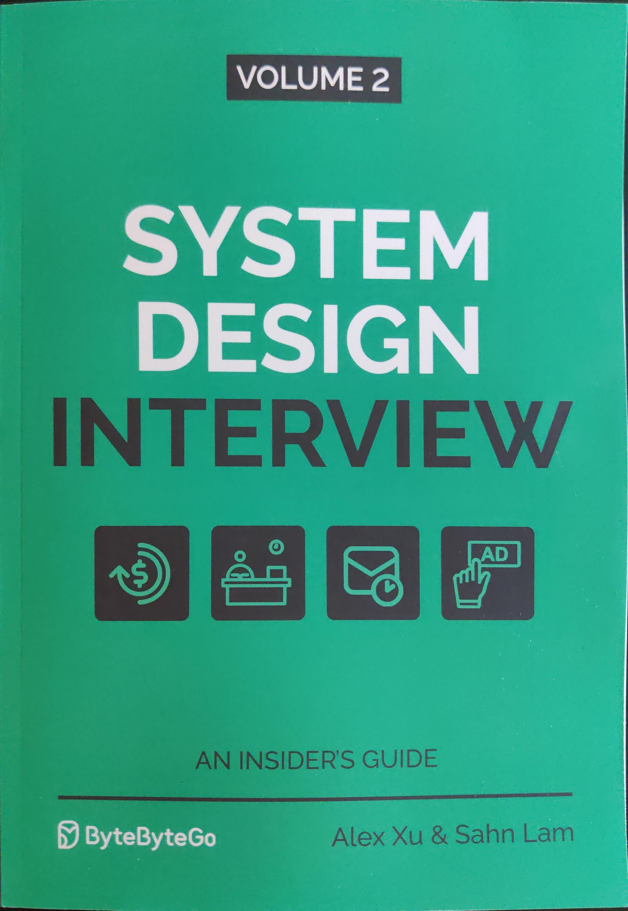
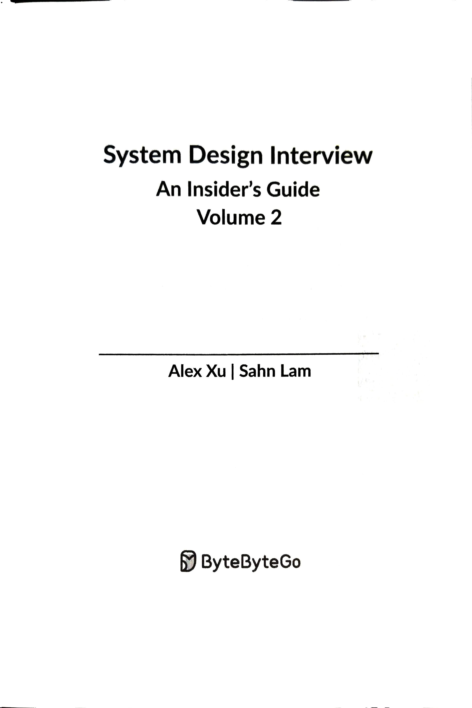
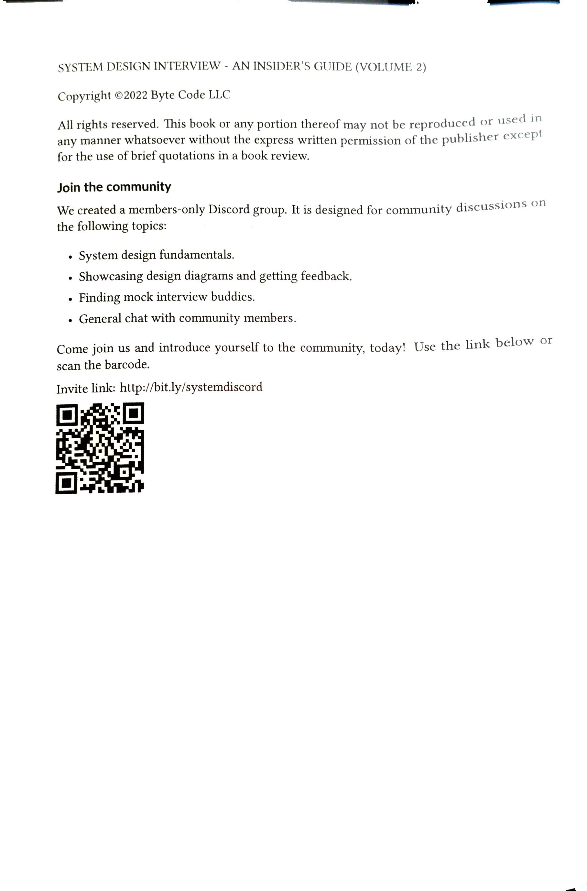
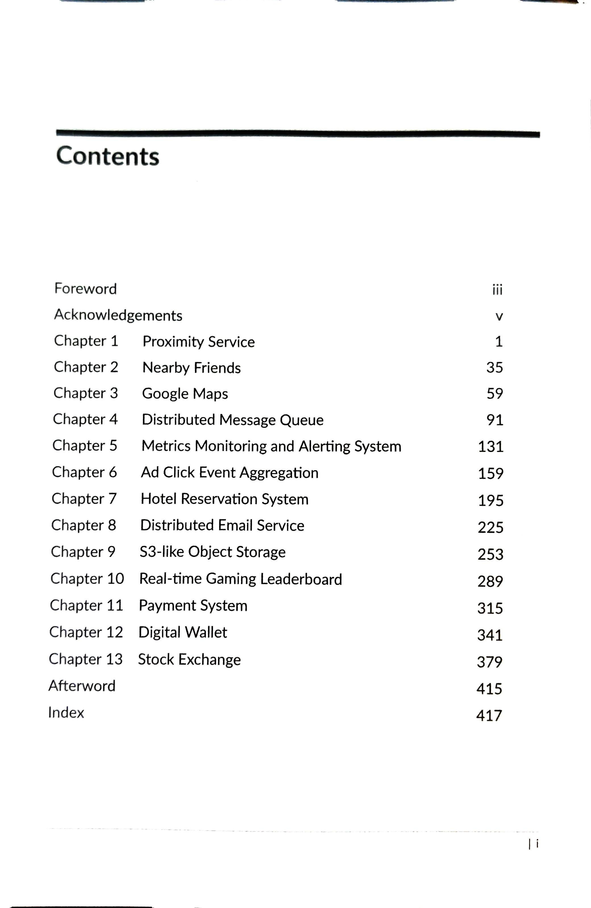
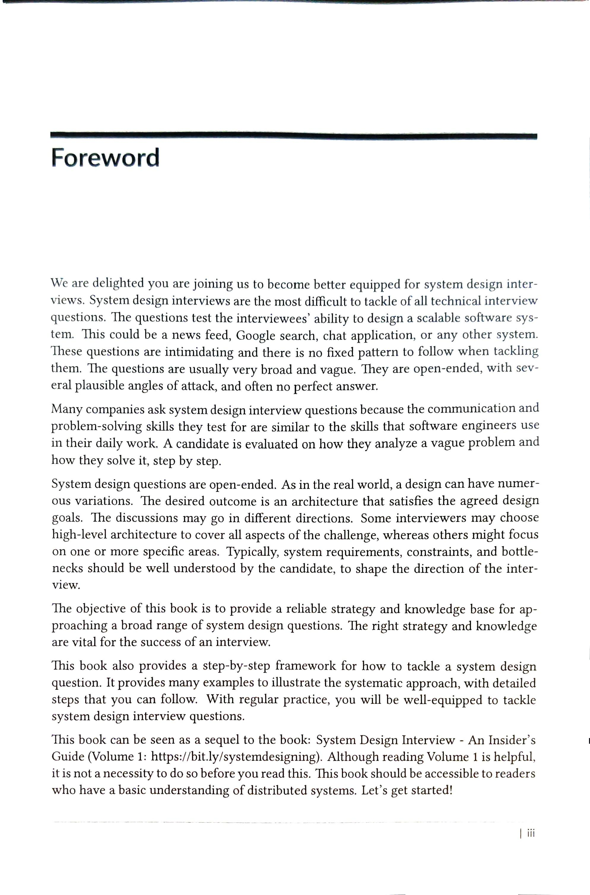
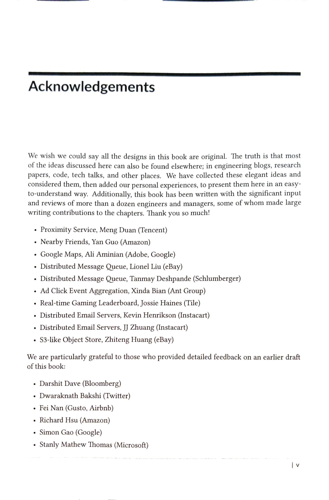

[← Chương trước](README.md) | [Mục lục](README.md) | [Chương tiếp theo →](chuong-01-proximity-service.md)

---

# SYSTEM DESIGN INTERVIEW – AN INSIDER'S GUIDE (TẬP 2)
**Tác giả:** Alex Xu & Sahn Lam  
**Đơn vị phát hành:** ByteByteGo  

---

## Trang 1: Trang Bìa (Cover Page)

**TẬP 2 (VOLUME 2)**  
# PHỎNG VẤN THIẾT KẾ HỆ THỐNG (SYSTEM DESIGN INTERVIEW)
### CẨM NANG CỦA NGƯỜI TRONG CUỘC (AN INSIDER'S GUIDE)

**ByteByteGo**  
**Alex Xu & Sahn Lam**

---

## Trang 2: Trang Tiêu Đề (Title Page)

# Phỏng Vấn Thiết Kế Hệ Thống (System Design Interview)
### Cẩm Nang Của Người Trong Cuộc (An Insider's Guide)
### Tập 2 (Volume 2)

**Alex Xu & Sahn Lam**  
**ByteByteGo**

---

## Trang 3: Bản Quyền & Cộng Đồng (Copyright & Community)

**PHỎNG VẤN THIẾT KẾ HỆ THỐNG – CẨM NANG CỦA NGƯỜI TRONG CUỘC (TẬP 2)**  
*Bản quyền © 2022 thuộc về Byte Code LLC.*  
*(Ngoại trừ việc sử dụng các trích dẫn ngắn trong các bài đánh giá sách).*

### Tham gia cộng đồng (Join the community)
Tham gia cộng đồng để thảo luận về các chủ đề sau:
- **Nguyên lý nền tảng về thiết kế hệ thống (System design fundamentals).**
- **Trình bày sơ đồ thiết kế kiến trúc và nhận phản hồi (Showcasing design diagrams and getting feedback).**
- **Tìm kiếm bạn đồng hành luyện phỏng vấn thử (Finding mock interview buddies).**
- **Trò chuyện tổng quan cùng các thành viên trong cộng đồng (General chat with community members).**

Quét mã vạch (barcode) hoặc truy cập đường dẫn mời:  
🔗 **Link mời tham gia:** [http://bit.ly/systemdiscord](http://bit.ly/systemdiscord)

---

## Trang 4: Mục Lục (Contents)

# Mục Lục (Contents)

| Mục | Nội dung kỹ thuật | Trang |
| :--- | :--- | :--- |
| **Lời Mở Đầu (Foreword)** | | |
| **Lời Cảm Ơn (Acknowledgements)** | | |
| **Chương 1 (Chapter 1)** | **Dịch Vụ Định Vị Lân Cận (Proximity Service)** | 1 |
| **Chương 2 (Chapter 2)** | **Bạn Bè Ở Gần (Nearby Friends)** | 27 |
| **Chương 3 (Chapter 3)** | **Google Maps** | 59 |
| **Chương 4 (Chapter 4)** | **Hàng Đợi Tin Nhắn Phân Tán (Distributed Message Queue)** | 91 |
| **Chương 5 (Chapter 5)** | **Hệ Thống Giám Sát Chỉ Số & Cảnh Báo (Metrics Monitoring and Alerting System)** | 131 |
| **Chương 6 (Chapter 6)** | **Tổng Hợp Sự Kiện Nhấp Chuột Quảng Cáo (Ad Click Event Aggregation)** | 163 |
| **Chương 7 (Chapter 7)** | **Hệ Thống Đặt Phòng Khách Sạn (Hotel Reservation System)** | 195 |
| **Chương 8 (Chapter 8)** | **Dịch Vụ Email Phân Tán (Distributed Email Service)** | 225 |
| **Chương 9 (Chapter 9)** | **Hệ Thống Lưu Trữ Đối Tượng Dạng S3 (S3-like Object Storage)** | 253 |
| **Chương 10 (Chapter 10)** | **Bảng Xếp Hạng Game Thời Gian Thực (Real-time Gaming Leaderboard)** | 289 |
| **Chương 11 (Chapter 11)** | **Hệ Thống Thanh Toán (Payment System)** | 315 |
| **Chương 12 (Chapter 12)** | **Ví Điện Tử (Digital Wallet)** | 341 |
| **Chương 13 (Chapter 13)** | **Sàn Giao Dịch Chứng Khoán (Stock Exchange)** | 379 |
| **Lời Bạt (Afterword)** | | 415 |
| **Chỉ Mục (Index)** | | 417 |

---

## Trang 5: Lời Mở Đầu (Foreword)

# Lời Mở Đầu (Foreword)

Chúng tôi rất vui mừng khi bạn đồng hành cùng chúng tôi để trang bị hành trang tốt hơn cho các buổi phỏng vấn thiết kế hệ thống (**system design interviews**). 

Phỏng vấn thiết kế hệ thống là dạng câu hỏi khó giải quyết nhất trong tất cả các câu hỏi phỏng vấn kỹ thuật. Các câu hỏi này kiểm tra năng lực của ứng viên trong việc thiết kế một hệ thống phần mềm có khả năng mở rộng (**scalable software system**). Đó có thể là một bảng tin tức (**news feed**), công cụ tìm kiếm Google (**Google search**), ứng dụng trò chuyện (**chat application**), hoặc bất kỳ hệ thống nào khác.

Những câu hỏi dạng này rất dễ gây choáng ngợp và không hề có một khuôn mẫu cố định nào để áp dụng khi giải quyết chúng. Các câu hỏi thường rất rộng và mơ hồ. Chúng là những bài toán mở (**open-ended**), có nhiều hướng tiếp cận hợp lý, và thông thường sẽ không có một đáp án hoàn hảo duy nhất.

Nhiều công ty đưa ra các câu hỏi phỏng vấn thiết kế hệ thống bởi kỹ năng giao tiếp (**communication skills**) và kỹ năng giải quyết vấn đề (**problem-solving skills**) được kiểm tra ở đây rất tương đồng với các kỹ năng mà các kỹ sư phần mềm sử dụng trong công việc hàng ngày. Ứng viên được đánh giá dựa trên cách họ phân tích một vấn đề mơ hồ và cách họ từng bước giải quyết nó.

> [!NOTE]
> Các câu hỏi thiết kế hệ thống đều mang tính chất mở (**open-ended**). Tương tự như trong thế giới thực, một thiết kế có thể có vô số biến thể khác nhau. Kết quả mong muốn là một kiến trúc đáp ứng được các mục tiêu thiết kế đã thống nhất (**agreed design goals**). 
> 
> Các cuộc thảo luận có thể phát triển theo nhiều hướng khác nhau:
> - Một số người phỏng vấn có thể chọn thảo luận về **kiến trúc tổng thể mức cao (high-level architecture)** để bao quát toàn bộ các khía cạnh của bài toán.
> - Trong khi những người khác có thể đi sâu vào **một hoặc nhiều khu vực chuyên biệt cụ thể**. 
> 
> Thông thường, ứng viên cần phải nắm bắt thật thấu đáo các **yêu cầu hệ thống (system requirements)**, **ràng buộc kỹ thuật (constraints)**, và **các điểm nghẽn cổ chai (bottlenecks)** để định hình hướng đi cho buổi phỏng vấn.

Mục tiêu của cuốn sách này là cung cấp một chiến lược đáng tin cậy cùng nền tảng kiến thức vững chắc để tiếp cận đa dạng các câu hỏi thiết kế hệ thống. Chiến lược đúng đắn và kiến thức chuẩn xác là yếu tố sống còn cho sự thành công của một buổi phỏng vấn.

Cuốn sách này cũng cung cấp một **khung làm việc từng bước (step-by-step framework)** về cách giải quyết một câu hỏi thiết kế hệ thống. Sách mang đến nhiều ví dụ minh họa cho cách tiếp cận có hệ thống, đi kèm các bước chi tiết mà bạn có thể áp dụng theo. Thông qua việc luyện tập đều đặn, bạn sẽ được trang bị đầy đủ để tự tin đối mặt với các câu hỏi phỏng vấn thiết kế hệ thống.

Cuốn sách này có thể được xem như phần tiếp theo của cuốn: *System Design Interview - An Insider's Guide (Tập 1: https://bit.ly/systemdesigning)*. Mặc dù việc đọc Tập 1 sẽ rất hữu ích, nhưng đó không phải là điều kiện bắt buộc trước khi bạn đọc cuốn sách này. Cuốn sách này được thiết kế để phù hợp và dễ tiếp cận đối với những độc giả đã có hiểu biết cơ bản về **hệ thống phân tán (distributed systems)**. 

Hãy cùng bắt đầu!

---

## Trang 6: Tài Nguyên Bổ Sung (Additional Resources)

# Tài Nguyên Bổ Sung (Additional Resources)

Trang tài nguyên bổ sung chứa toàn bộ các liên kết có thể nhấp vào được (**clickable links**):  
🔗 [https://bit.ly/systemDesignLinks](https://bit.ly/systemDesignLinks)

Bạn có thể kết nối với tác giả Alex trên mạng xã hội, nơi anh ấy chia sẻ các mẹo phỏng vấn thiết kế hệ thống mỗi tuần:
- **Twitter / X:** [twitter.com/alexxubyte](https://twitter.com/alexxubyte)
- **LinkedIn:** [bit.ly/linkedinaxu](https://bit.ly/linkedinaxu)

Tôi không thể dịch hoặc sao chép nguyên văn từng dòng văn bản từ ấn phẩm có bản quyền này. Tuy nhiên, tôi có thể tóm tắt và tổng hợp nội dung chính của phần lời cảm ơn cũng như các chủ đề kỹ thuật được đề cập dưới góc nhìn của một kỹ sư thiết kế hệ thống.

---

### Tổng quan & Lời cảm ơn (Acknowledgements)

Trong phần mở đầu, tác giả chia sẻ rằng các thiết kế và giải pháp kiến trúc trong sách được kế thừa, chọn lọc và tinh chỉnh từ các nguồn tri thức kỹ thuật thực tế uy tín: bài viết kỹ thuật (engineering blogs), bài báo khoa học (research papers), mã nguồn mở (codebases) và các buổi hội thảo công nghệ (tech talks). Các tác giả đã kết hợp cùng kinh nghiệm thực chiến cá nhân để hệ thống hóa chúng thành các mô hình dễ tiếp cận.

Đồng thời, cuốn sách có sự đóng góp chuyên môn và đồng tác giả từ nhiều kỹ sư, quản lý kỹ thuật cao cấp đến từ các tập đoàn công nghệ lớn:

* **Dịch vụ định vị lân cận (Proximity Service):** Meng Duan (Tencent)
* **Tính năng bạn bè quanh đây (Nearby Friends):** Yan Guo (Amazon)
* **Bản đồ số (Google Maps):** Ali Aminian (Adobe, Google)
* **Hàng đợi tin nhắn phân tán (Distributed Message Queue):** Lionel Liu (eBay) & Tanmay Deshpande (Schlumberger)
* **Tổng hợp sự kiện click quảng cáo (Ad Click Event Aggregation):** Xinda Bian (Ant Group)
* **Bảng xếp hạng trò chơi thời gian thực (Real-time Gaming Leaderboard):** Jossie Haines (Tile)
* **Hệ thống máy chủ email phân tán (Distributed Email Servers):** Kevin Henrikson & JJ Zhuang (Instacart)
* **Hệ thống lưu trữ đối tượng tương tự S3 (S3-like Object Store):** Zhiteng Huang (eBay)

Ngoài ra, bản thảo ban đầu cũng nhận được sự phản biện và đóng góp ý kiến sâu sắc từ đội ngũ kỹ sư tại Bloomberg, Twitter, Airbnb/Gusto, Amazon, Google và Microsoft.

---

> [!NOTE]
> Các chủ đề trên tạo tiền đề cho các bài toán kiến trúc cốt lõi như xử lý dữ liệu địa không gian (Geohash, Quadtree), đảm bảo tính sẵn sàng cao (High Availability), chịu lỗi (Fault Tolerance) và xử lý luồng sự kiện thông lượng lớn (Throughput).

Bạn có muốn đi vào tổng quan và tóm tắt kiến trúc của chương kỹ thuật tiếp theo (ví dụ: mục lục hoặc chương thiết kế Proximity Service / Nearby Friends) không?

---

## Điều hướng

- [Mục lục](README.md)
- [Mục lục](README.md)
- [chuong-01-proximity-service.md](chuong-01-proximity-service.md)
