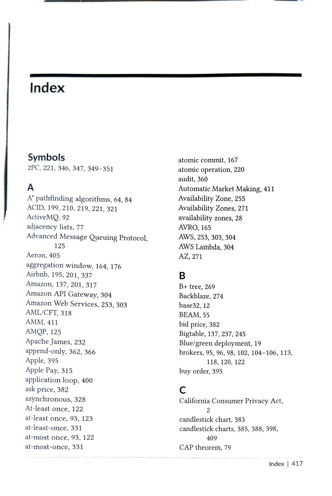
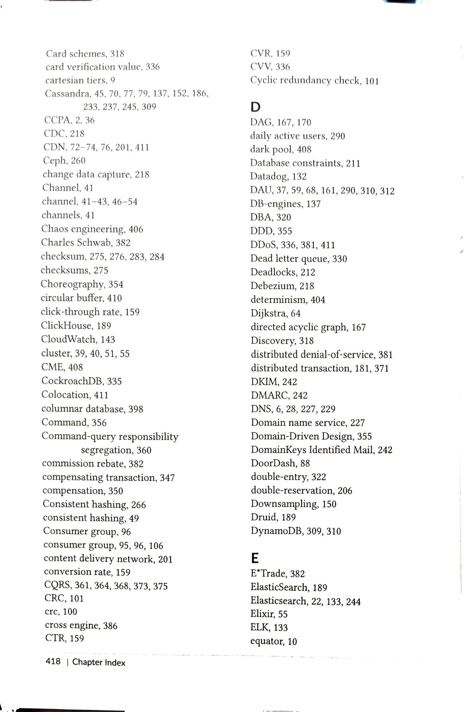
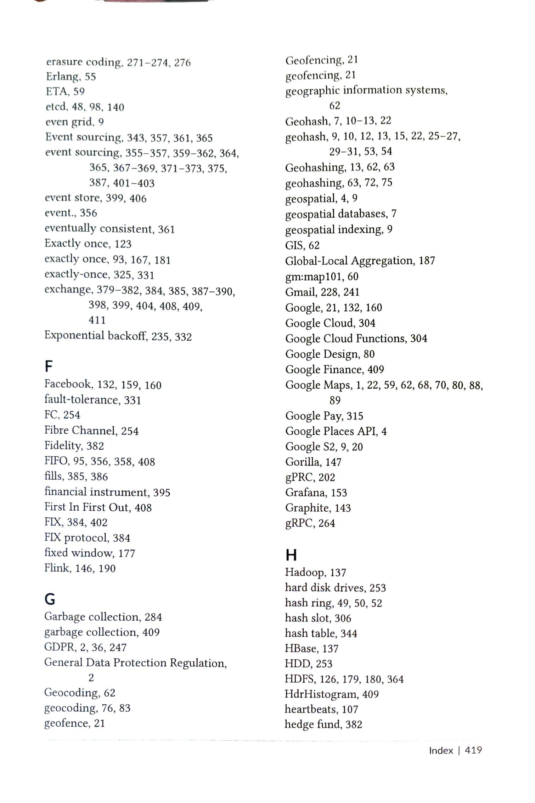
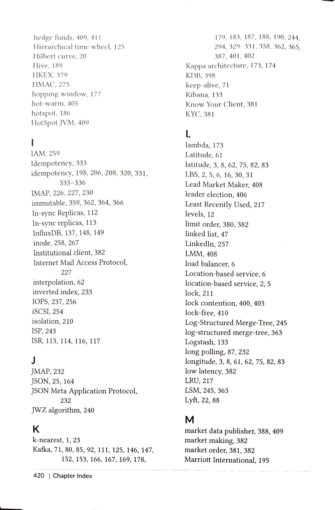
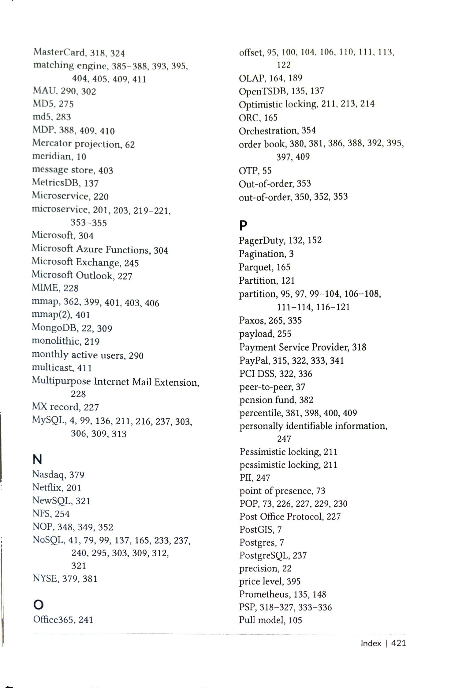
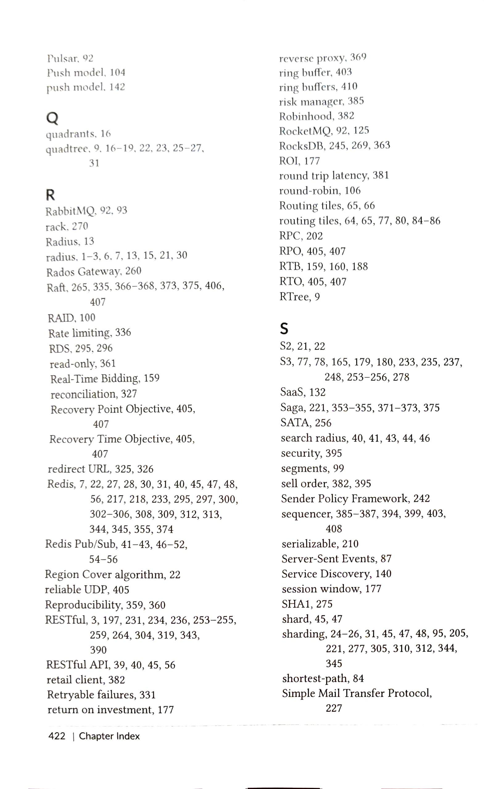
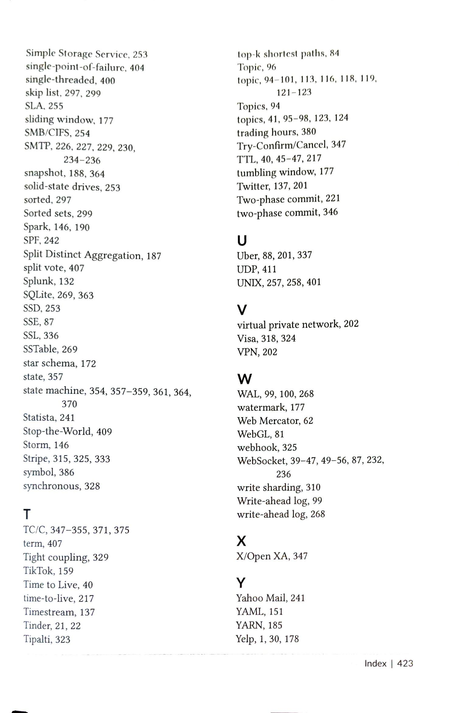
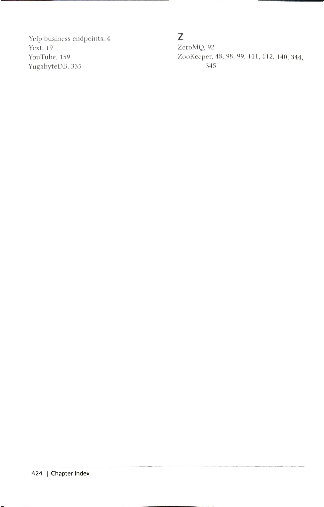

[← Chương trước](chuong-13-stock-exchange.md) | [Mục lục](README.md) | [Chương tiếp theo →](README.md)

---

# Lời Kết & Chỉ Mục (Afterword & Index)


## Lời Kết (Afterword)

Xin chúc mừng! Bạn đã hoàn thành cuốn cẩm nang phỏng vấn này. Bạn đã tích lũy được các kỹ năng và kiến thức chuyên sâu cần thiết để thiết kế các hệ thống phức tạp quy mô lớn (complex systems). Không phải ai cũng có đủ tính kỷ luật và kiên trì để hoàn thành những gì bạn vừa làm, để lĩnh hội những điều bạn vừa học. Hãy dành một chút thời gian để tự hào về bản thân. Sự nỗ lực không ngừng nghỉ của bạn chắc chắn sẽ mang lại kết quả xứng đáng.

Hành trình đạt được công việc mơ ước là một chặng đường dài, đòi hỏi nhiều thời gian và tâm huyết. Luyện tập liên tục sẽ tạo nên sự hoàn hảo (Practice makes perfect). Chúc bạn gặt hái được nhiều may mắn và thành công!

Cảm ơn bạn rất nhiều vì đã mua và đọc cuốn sách này. Không có những độc giả như bạn, tác phẩm của chúng tôi đã không thể ra đời. Chúng tôi hy vọng bạn đã có một trải nghiệm học tập bổ ích và thú vị!

Nếu bạn có bất kỳ phản hồi, ý kiến đóng góp hoặc câu hỏi nào về cuốn sách, đừng ngần ngại gửi email cho chúng tôi qua địa chỉ: `hi@bytebytego.com`. Nếu phát hiện bất kỳ sai sót nào, xin hãy thông báo để chúng tôi kịp thời chỉnh sửa và hoàn thiện trong các lần tái bản tiếp theo. Xin chân thành cảm ơn!

---

### Tham gia cộng đồng (Join the community)

Chúng tôi đã thành lập một nhóm Discord dành riêng cho các thành viên. Đây là không gian được thiết kế để thảo luận kỹ thuật chuyên sâu về các chủ đề:

* **Nền tảng thiết kế hệ thống (System design fundamentals).**
* **Trình bày sơ đồ kiến trúc và tiếp nhận phản hồi đóng góp (Showcasing design diagrams and getting feedback).**
* **Tìm kiếm bạn đồng hành để phỏng vấn thử (Finding mock interview buddies).**
* **Giao lưu, trao đổi tổng quát với các thành viên khác trong cộng đồng.**

Hãy tham gia và giới thiệu bản thân với cộng đồng ngay hôm nay! Sử dụng liên kết bên dưới hoặc quét mã QR:

🔗 [http://bit.ly/systemdiscord](http://bit.ly/systemdiscord)

*Tài liệu tham khảo (Reference Material) 415*

---


*416 | Chương 13. Sàn Giao Dịch Chứng Khoán (Stock Exchange)*

---



## Chỉ Mục Thuật Ngữ (Index)

### Ký tự & Số (Symbols & Numbers)
* **2PC (Two-Phase Commit)**, 221, 346, 347, 349-351

---

### A
* **Thuật toán tìm đường A\*** (A* pathfinding algorithms), 64, 84
* **ACID** (Atomicity, Consistency, Isolation, Durability), 199, 210, 219, 221, 321
* **ActiveMQ**, 92
* **Danh sách kề** (Adjacency lists), 77
* **Giao thức xếp hàng thông điệp nâng cao** (Advanced Message Queuing Protocol - AMQP), 125
* **Aeron**, 405
* **Cửa sổ tổng hợp** (Aggregation window), 164, 176
* **Airbnb**, 195, 201, 337
* **Amazon**, 137, 201, 317
* **Amazon API Gateway**, 304
* **Amazon Web Services (AWS)**, 253, 303
* **Chống rửa tiền / Chống tài trợ khủng bố** (AML/CFT), 318
* **Tạo lập thị trường tự động** (Automated Market Making / AMM), 411
* **AMQP**, 125
* **Apache James**, 232
* **Chỉ ghi thêm / Nối đuôi** (Append-only), 362, 366
* **Apple**, 395
* **ApplePay**, 315
* **Vòng lặp ứng dụng** (Application loop), 400
* **Giá chào bán** (Ask price), 382
* **Bất đồng bộ** (Asynchronous), 328
* **Ít nhất một lần** (At-least once / At-least-once), 93, 122, 123, 331
* **Tối đa một lần** (At-most once / At-most-once), 93, 122, 331
* **Cam kết nguyên tử** (Atomic commit), 167
* **Thao tác nguyên tử** (Atomic operation), 220
* **Kiểm toán** (Audit), 360
* **Vùng khả dụng** (Availability Zone / AZ), 28, 255, 271
* **AVRO**, 165
* **AWS**, 253, 303, 304
* **AWS Lambda**, 304
* **AZ**, 271

---

### B
* **Cây B+** (B+ tree), 269
* **Backblaze**, 274
* **Base32**, 12
* **Máy ảo BEAM** (BEAM), 55
* **Giá chào mua** (Bid price), 382
* **Bigtable**, 137, 237, 245
* **Triển khai Xanh/Xanh dương** (Blue/green deployment), 19
* **Hệ thống điều phối / Máy chủ môi giới** (Brokers), 95, 96, 98, 102, 104-106, 113, 118, 120, 122
* **Lệnh mua** (Buy order), 395

---

### C
* **Đạo luật bảo vệ quyền riêng tư người tiêu dùng California** (California Consumer Privacy Act / CCPA), 2, 36
* **Biểu đồ nến** (Candlestick chart / Candlestick charts), 383, 385, 388, 398, 409
* **Định lý CAP** (CAP theorem), 79
* **Mạng lưới thẻ** (Card schemes), 318
* **Mã xác thực thẻ** (Card verification value / CVV), 336
* **Tầng tọa độ Đề-các** (Cartesian tiers), 9
* **Cassandra**, 45, 70, 77, 79, 137, 152, 186, 233, 237, 245, 309
* **CCPA**, 2, 36
* **Bắt giữ dữ liệu thay đổi** (Change Data Capture / CDC), 218
* **Mạng phân phối nội dung** (Content Delivery Network / CDN), 72-74, 76, 201, 411
* **Ceph**, 260
* **Kênh truyền / Kênh kết nối** (Channel / Channels), 41-43, 46-54
* **Kiểm thử hỗn loạn** (Chaos engineering), 406
* **Charles Schwab**, 382
* **Mã kiểm tra tính toàn vẹn** (Checksum / Checksums), 275, 276, 283, 284
* **Biên đạo phân tán** (Choreography), 354
* **Vùng đệm vòng tròn** (Circular buffer), 410
* **Tỷ lệ nhấp chuột** (Click-through rate / CTR), 159
* **ClickHouse**, 189
* **CloudWatch**, 143
* **Cụm máy chủ** (Cluster), 39, 40, 51, 55
* **CME** (Chicago Mercantile Exchange), 408
* **CockroachDB**, 335
* **Đặt máy chủ cùng vị trí** (Colocation), 411
* **Cơ sở dữ liệu dạng cột** (Columnar database), 398
* **Lệnh** (Command), 356
* **Phân tách trách nhiệm lệnh - truy vấn** (Command-Query Responsibility Segregation / CQRS), 360, 361, 364, 368, 373, 375
* **Hoàn phí hoa hồng** (Commission rebate), 382
* **Giao dịch bù trừ** (Compensating transaction / Compensation), 347, 350
* **Băm nhất quán** (Consistent hashing), 49, 266
* **Nhóm người tiêu thụ** (Consumer group), 95, 96, 106
* **Tỷ lệ chuyển đổi** (Conversion rate / CVR), 159
* **Mã kiểm tra phần dư tuần hoàn** (Cyclic Redundancy Check / CRC / crc), 100, 101
* **Khớp chéo công cụ / động cơ** (Cross engine), 386
* **CTR**, 159
* **CVR**, 159
* **CVV**, 336

---



### D
* **Đồ thị có hướng không chu trình** (Directed Acyclic Graph / DAG), 167, 170
* **Người dùng hoạt động hàng ngày** (Daily Active Users / DAU), 37, 59, 68, 161, 290, 310, 312
* **Bể thanh khoản tối** (Dark pool), 408
* **Ràng buộc cơ sở dữ liệu** (Database constraints), 211
* **Datadog**, 132
* **DAU**, 37, 59, 68, 161, 290, 310, 312
* **Xếp hạng công cụ cơ sở dữ liệu** (DB-engines), 137
* **Quản trị viên cơ sở dữ liệu** (Database Administrator / DBA), 320
* **Thiết kế hướng miền** (Domain-Driven Design / DDD), 355
* **Tấn công từ chối dịch vụ phân tán** (Distributed Denial-of-Service / DDoS), 336, 381, 411
* **Hàng đợi thông điệp chết** (Dead-Letter Queue / DLQ), 330
* **Tắc nghẽn khóa** (Deadlocks), 212
* **Debezium**, 218
* **Tính tiền định** (Determinism), 404
* **Thuật toán Dijkstra** (Dijkstra), 64
* **Khám phá dịch vụ** (Discovery), 318
* **Giao dịch phân tán** (Distributed transaction), 181, 371
* **DKIM** (DomainKeys Identified Mail), 242
* **DMARC**, 242
* **Hệ thống phân giải tên miền** (Domain Name System / DNS), 6, 28, 227, 229
* **DoorDash**, 88
* **Kế toán ghi sổ kép** (Double-entry), 322
* **Trùng lặp đặt chỗ** (Double-reservation), 206
* **Giảm tần suất mẫu** (Downsampling), 150
* **Druid**, 189
* **DynamoDB**, 309, 310

---

### E
* **E\*Trade**, 382
* **Elasticsearch / ElasticSearch**, 22, 133, 189, 244
* **Elixir**, 55
* **ELK Stack** (Elasticsearch, Logstash, Kibana), 133
* **Đường xích đạo** (Equator), 10
* **Mã hóa xóa** (Erasure coding), 271-274, 276
* **Erlang**, 55
* **Thời gian dự kiến đến nơi** (Estimated Time of Arrival / ETA), 59
* **etcd**, 48, 98, 140
* **Lưới đồng đều** (Even grid), 9
* **Truy nguyên sự kiện** (Event Sourcing), 343, 355-357, 359-362, 364, 365, 367-369, 371-373, 375, 387, 401-403
* **Kho lưu trữ sự kiện** (Event store), 399, 406
* **Sự kiện** (Event), 356
* **Nhất quán cuối cùng** (Eventually consistent), 361
* **Chính xác một lần** (Exactly once / Exactly-once), 93, 123, 167, 181, 325, 331
* **Sàn giao dịch** (Exchange), 379-382, 384, 385, 387-390, 398, 399, 404, 408, 409, 411
* **Thoái lui hàm mũ** (Exponential backoff), 235, 332

---

### F
* **Facebook**, 132, 159, 160
* **Khả năng chịu lỗi** (Fault-tolerance), 331
* **Kênh sợi quang** (Fibre Channel / FC), 254
* **Fidelity**, 382
* **Vào trước ra trước** (First In First Out / FIFO), 95, 356, 358, 408
* **Khớp lệnh** (Fills), 385, 386
* **Công cụ tài chính** (Financial instrument), 395
* **Giao thức FIX** (Financial Information eXchange / FIX / FIX protocol), 384, 402
* **Cửa sổ cố định** (Fixed window), 177
* **Flink**, 146, 190

---



### G
* **Thu dọn rác bộ nhớ** (Garbage collection), 284, 409
* **Quy định chung về bảo vệ dữ liệu** (General Data Protection Regulation / GDPR), 2, 36, 247
* **Mã hóa địa lý** (Geocoding), 62, 76, 83
* **Hàng rào địa lý** (Geofence / Geofencing), 21
* **Hệ thống thông tin địa lý** (Geographic Information Systems / GIS), 62
* **Geohash / Geohashing**, 7, 9-13, 15, 22, 25-27, 29-31, 53, 54, 62, 63, 72, 75
* **Không gian địa lý** (Geospatial), 4, 9
* **Cơ sở dữ liệu không gian địa lý** (Geospatial databases), 7
* **Lập chỉ mục không gian địa lý** (Geospatial indexing), 9
* **Tổng hợp Cục bộ - Toàn cục** (Global-Local Aggregation), 187
* **gm:map101**, 60
* **Gmail**, 228, 241
* **Google**, 21, 132, 160
* **Google Cloud**, 304
* **Google Cloud Functions**, 304
* **Google Design**, 80
* **Google Finance**, 409
* **Google Maps**, 1, 22, 59, 62, 68, 70, 80, 88, 89
* **Google Pay**, 315
* **Google Places API**, 4
* **Google S2**, 9, 20
* **Gorilla**, 147
* **gRPC / gPRC**, 202, 264
* **Grafana**, 153
* **Graphite**, 143

---

### H
* **Hadoop**, 137
* **Ổ đĩa cứng** (Hard disk drives / HDD), 253
* **Vòng băm** (Hash ring), 49, 50, 52
* **Khe băm** (Hash slot), 306
* **Bảng băm** (Hash table), 344
* **HBase**, 137
* **HDFS** (Hadoop Distributed File System), 126, 179, 180, 364
* **HdrHistogram**, 409
* **Nhịp tim kiểm tra trạng thái sống** (Heartbeats), 107
* **Quỹ phòng hộ** (Hedge fund / Hedge funds), 382, 409, 411
* **Bánh xe thời gian phân cấp** (Hierarchical timewheel), 125
* **Đường cong Hilbert** (Hilbert curve), 20
* **Hive**, 189
* **HKEX** (Hong Kong Exchanges and Clearing), 379
* **Mã xác thực thông điệp dựa trên hàm băm** (Hash-based Message Authentication Code / HMAC), 275
* **Cửa sổ nhảy** (Hopping window), 177
* **Mô hình nóng - ấm** (Hot-warm), 405
* **Điểm nóng quá tải** (Hotspot), 186
* **HotSpot JVM**, 409

---

### I
* **Quản lý định danh và quyền truy cập** (Identity and Access Management / IAM), 259
* **Tính bất biến / Bất biến** (Idempotency / Idempotent), 198, 206, 208, 320, 331, 333-336
* **Giao thức truy cập thông điệp Internet** (Internet Mail Access Protocol / IMAP), 226, 227, 230
* **Bất biến** (Immutable), 359, 362, 364, 366
* **Bản sao đồng bộ** (In-Sync Replicas / ISR), 112, 113, 114, 116, 117
* **InfluxDB**, 137, 148, 149
* **Nút chỉ mục tệp** (Inode), 258, 267
* **Khách hàng tổ chức** (Institutional client), 382
* **Nội suy** (Interpolation), 62
* **Chỉ mục đảo ngược** (Inverted index), 233
* **Số lượng thao tác I/O trên giây** (Input/Output Operations Per Second / IOPS), 237, 256
* **iSCSI**, 254
* **Mức độ cô lập** (Isolation), 210
* **Nhà cung cấp dịch vụ Internet** (Internet Service Provider / ISP), 243

---

### J
* **JMAP** (JSON Meta Application Protocol), 232
* **JSON**, 25, 164
* **Thuật toán JWZ** (JWZ algorithm), 240

---



### K
* **K-láng giềng gần nhất** (k-nearest), 1, 23
* **Kafka**, 71, 80, 85, 92, 111, 125, 146, 147, 152, 153, 166, 167, 169, 178, 179, 183, 187, 188, 190, 244, 294, 329-331, 358, 362, 365, 387, 401, 402
* **Kiến trúc Kappa** (Kappa architecture), 173, 174
* **KDB**, 398
* **Giữ kết nối** (Keep-alive), 71
* **Kibana**, 133
* **Thấu hiểu khách hàng** (Know Your Client / KYC), 381

---

### L
* **Kiến trúc Lambda** (Lambda architecture), 173
* **Vĩ độ** (Latitude), 3, 8, 61, 62, 75, 82, 83
* **Dịch vụ dựa trên vị trí** (Location-Based Service / LBS), 2, 5, 6, 16, 30, 31
* **Nhà tạo lập thị trường chính** (Lead Market Maker / LMM), 408
* **Bầu chọn trưởng nhóm / trưởng cụm** (Leader election), 406
* **Ít sử dụng gần đây nhất** (Least Recently Used / LRU), 217
* **Các cấp độ phân giải** (Levels), 12
* **Lệnh giới hạn** (Limit order), 380, 382
* **Danh sách liên kết** (Linked list), 47
* **LinkedIn**, 257
* **LMM**, 408
* **Bộ cân bằng tải** (Load balancer), 6
* **Khóa tài nguyên** (Lock), 211
* **Tranh chấp khóa** (Lock contention), 400, 403
* **Không dùng khóa** (Lock-free), 410
* **Cây hợp nhất có cấu trúc nhật ký** (Log-Structured Merge-Tree / LSM), 245, 363
* **Logstash**, 133
* **Thăm dò kéo dài** (Long polling), 87, 232
* **Kinh độ** (Longitude), 3, 8, 61, 62, 75, 82, 83
* **Độ trễ thấp** (Low latency), 382
* **LRU**, 217
* **LSM**, 245, 363
* **Lyft**, 22, 88

---

### M
* **Bộ phát hành dữ liệu thị trường** (Market data publisher), 388, 409
* **Tạo lập thị trường** (Market making), 382
* **Lệnh thị trường** (Market order), 381, 382
* **Marriott International**, 195

---

> [!NOTE]
> Trang 420 đánh dấu phần cuối của danh mục tra cứu thuật ngữ trong tài liệu phỏng vấn thiết kế hệ thống. Các chỉ số trang đi kèm tương ứng với vị trí xuất hiện của khái niệm trong các chương chuyên sâu (từ hệ thống Geohash, Hệ thống Chat, Mail Server, Message Queue cho tới Sàn Giao Dịch Chứng Khoán).

# LỜI KẾT & CHỈ MỤC (AFTERWORD & INDEX)

---

## Trang 422



> [!NOTE]
> Phần chỉ mục thuật ngữ chuyên sâu về kiến trúc hệ thống phân tán (Distributed Systems), cơ sở dữ liệu, mạng và hạ tầng thanh toán/tài chính. Các số trang tham chiếu được giữ nguyên bản gốc để phục vụ việc tra cứu chéo.

| Thuật ngữ gốc | Thuật ngữ Tiếng Việt & Diễn giải kỹ thuật | Số trang tham chiếu |
| :--- | :--- | :--- |
| **MasterCard** | Mạng lưới thanh toán thẻ quốc tế MasterCard | 318, 324 |
| **matching engine** | Khớp lệnh / Cỗ máy khớp lệnh (trong sàn giao dịch chứng khoán/crypto) | 385–388, 393, 395, 404, 405, 409, 411 |
| **MAU** | Người dùng hoạt động hàng tháng (*Monthly Active Users*) | 290, 302 |
| **MD5** | Thuật toán băm thông điệp (*Message-Digest Algorithm 5*) | 275 |
| **md5** | Lệnh/hàm băm MD5 (*Message-Digest 5*) | 283 |
| **MDP** | Nền tảng dữ liệu thị trường (*Market Data Platform*) | 388, 409, 410 |
| **Mercator projection** | Phép chiếu bản đồ Mercator | 62 |
| **meridian** | Kinh tuyến | 10 |
| **message store** | Kho lưu trữ thông điệp / Bộ lưu trữ tin nhắn (*Message Store*) | 403 |
| **MetricsDB** | Cơ sở dữ liệu chuỗi thời gian cho số liệu (*Metrics Database*) | 137 |
| **Microservice** | Kiến trúc vi dịch vụ (*Microservice Architecture*) | 220 |
| **microservice** | Vi dịch vụ (*Microservice*) | 201, 203, 219–221, 353–355 |
| **Microsoft** | Tập đoàn Microsoft | 304 |
| **Microsoft Azure Functions** | Dịch vụ tính toán không máy chủ (*Serverless Computing*) của Microsoft Azure | 304 |
| **Microsoft Exchange** | Máy chủ thư điện tử và lịch biểu Microsoft Exchange | 245 |
| **Microsoft Outlook** | Ứng dụng khách thư điện tử Microsoft Outlook | 227 |
| **MIME** | Phần mở rộng thư tín Internet đa mục đích (*Multipurpose Internet Mail Extensions*) | 228 |
| **mmap** | Ánh xạ bộ nhớ vào không gian địa chỉ tiến trình (*Memory-mapped file I/O*) | 362, 399, 401, 403, 406 |
| **mmap(2)** | Lời gọi hệ thống ánh xạ bộ nhớ trên UNIX/Linux (*POSIX System Call*) | 401 |
| **MongoDB** | Cơ sở dữ liệu tài liệu NoSQL (*Document-oriented Database*) | 22, 309 |
| **monolithic** | Kiến trúc nguyên khối (*Monolithic Architecture*) | 219 |
| **monthly active users** | Số lượng người dùng hoạt động hàng tháng (*MAU*) | 290 |
| **multicast** | Truyền thông đa hướng (*IP Multicast*) | 411 |
| **Multipurpose Internet Mail Extension** | Chuẩn phần mở rộng định dạng email đa phương tiện (*MIME*) | 228 |
| **MX record** | Bản ghi trao đổi thư tín trong DNS (*Mail Exchange Record*) | 227 |
| **MySQL** | Hệ quản trị cơ sở dữ liệu quan hệ mã nguồn mở (*RDBMS*) | 4, 99, 136, 211, 216, 237, 303, 306, 309, 313 |
| **Nasdaq** | Sàn giao dịch chứng khoán điện tử Nasdaq | 379 |
| **Netflix** | Nền tảng phát trực tuyến quy mô toàn cầu Netflix | 201 |
| **NewSQL** | Hệ cơ sở dữ liệu quan hệ thế hệ mới có tính mở rộng phân tán cao (*Distributed ACID RDBMS*) | 321 |
| **NFS** | Hệ thống tệp mạng (*Network File System*) | 254 |
| **NOP** | Thao tác rỗng / Không hoạt động (*No Operation instruction*) | 348, 349, 352 |
| **NoSQL** | Cơ sở dữ liệu phi quan hệ (*Not Only SQL*) | 41, 79, 99, 137, 165, 233, 237, 240, 295, 303, 309, 312, 321 |
| **NYSE** | Sàn giao dịch chứng khoán New York (*New York Stock Exchange*) | 379, 381 |
| **Office365** | Bộ ứng dụng văn phòng đám mây Microsoft Office 365 | 241 |
| **offset** | Vị trí độ lệch bản ghi trong hàng đợi phân tán (*Commit Offset*) | 95, 100, 104, 106, 110, 111, 113, 122 |
| **OLAP** | Xử lý phân tích trực tuyến (*Online Analytical Processing*) | 164, 189 |
| **OpenTSDB** | Cơ sở dữ liệu chuỗi thời gian phân tán mã nguồn mở (*Open Time Series Database*) | 135, 137 |
| **Optimistic locking** | Khóa lạc quan (*Optimistic Concurrency Control*) | 211, 213, 214 |
| **ORC** | Định dạng tệp lưu trữ dữ liệu dạng cột nén cao (*Optimized Row Columnar*) | 165 |
| **Orchestration** | Điều phối tập trung (trong Saga / Workflow / Microservices) | 354 |
| **orderbook** | Sổ lệnh giao dịch (*Order Book*) | 380, 381, 386, 388, 392, 395, 397, 409 |
| **OTP** | Mật khẩu một lần (*One-Time Password*) | 55 |
| **Out-of-order** | Lệch thứ tự / Không đúng thứ tự truyền nhận | 353 |
| **out-of-order** | Xử lý lệch thứ tự (*Out-of-order execution / delivery*) | 350, 352, 353 |
| **PagerDuty** | Nền tảng quản lý sự cố và báo động vận hành (*Incident Response*) | 132, 152 |
| **Pagination** | Kỹ thuật phân trang dữ liệu (*Pagination*) | 3 |
| **Parquet** | Định dạng tệp lưu trữ dạng cột tối ưu hóa truy vấn (*Apache Parquet*) | 165 |
| **Partition** | Phân vùng dữ liệu / Phân vùng mạng (*Partitioning / Sharding*) | 121 |
| **partition** | Phân vùng chủ đề trong message broker hoặc phân đoạn bảng dữ liệu | 95, 97, 99–104, 106–108, 111–114, 116–121 |
| **Paxos** | Giao thức đồng thuận phân tán Paxos (*Distributed Consensus Protocol*) | 265, 335 |
| **payload** | Tải trọng dữ liệu hữu ích của gói tin / yêu cầu (*Data Payload*) | 255 |
| **Payment Service Provider** | Nhà cung cấp dịch vụ cổng thanh toán trung gian (*PSP*) | 318 |
| **PayPal** | Cổng thanh toán trực tuyến PayPal | 315, 322, 333, 341 |
| **PCI DSS** | Bộ tiêu chuẩn an ninh dữ liệu thẻ thanh toán (*Payment Card Industry Data Security Standard*) | 322, 336 |
| **peer-to-peer** | Mạng lưới ngang hàng (*P2P Network*) | 37 |
| **pension fund** | Quỹ hưu trí (*Tổ chức tài chính đầu tư*) | 382 |
| **percentile** | Bách phân vị (đo lường độ trễ p95, p99, p99.9) | 381, 398, 400, 409 |
| **personally identifiable information** | Thông tin nhận dạng cá nhân (*PII*) | 247 |
| **Pessimistic locking** | Khóa bi quan (*Pessimistic Concurrency Control*) | 211 |
| **pessimistic locking** | Cơ chế khóa bi quan chặn truy cập đồng thời | 211 |
| **PII** | Dữ liệu định danh cá nhân (*Personally Identifiable Information*) | 247 |
| **point of presence** | Điểm hiện diện mạng (*PoP - Point of Presence*) | 73 |
| **POP** | Giao thức nhận thư điện tử (*Post Office Protocol*) / Điểm hiện diện | 73, 226, 227, 229, 230 |
| **Post Office Protocol** | Giao thức bưu điện lấy thư điện tử (*POP3*) | 227 |
| **PostGIS** | Phần mở rộng không gian địa lý cho PostgreSQL (*Spatial Database Extender*) | 7 |
| **Postgres** | Hệ quản trị cơ sở dữ liệu quan hệ PostgreSQL | 7 |
| **PostgreSQL** | Hệ quản trị cơ sở dữ liệu quan hệ - đối tượng PostgreSQL | 237 |
| **precision** | Độ chính xác định vị địa lý / Độ phân giải số học (*Geographical Precision*) | 22 |
| **price level** | Mức giá trong sổ lệnh (*Order Book Price Level*) | 395 |
| **Prometheus** | Hệ thống giám sát và cảnh báo theo chuỗi thời gian (*Time-series Monitoring*) | 135, 148 |
| **PSP** | Nhà cung cấp dịch vụ thanh toán (*Payment Service Provider*) | 318–327, 333–336 |
| **Pull model** | Mô hình kéo dữ liệu chủ động (*Consumer Pull Architecture*) | 105 |

**Index / 421**

---

## Trang 423



| Thuật ngữ gốc | Thuật ngữ Tiếng Việt & Diễn giải kỹ thuật | Số trang tham chiếu |
| :--- | :--- | :--- |
| **Pulsar** | Nền tảng phân tán truyền thông điệp mã nguồn mở Apache Pulsar | 92 |
| **Push model** | Mô hình đẩy dữ liệu (*Push Architecture*) | 104 |
| **push model** | Cơ chế chủ động đẩy thông điệp tới máy khách (*Client Push Mechanism*) | 142 |
| **quadrants** | Các góc phần tư không gian | 16 |
| **quadtree** | Cây tứ phân lập chỉ mục không gian 2 chiều (*Quadtree Spatial Indexing*) | 9, 16–19, 22, 23, 25–27, 31 |
| **RabbitMQ** | Hệ thống hàng đợi thông điệp mã nguồn mở (*Message Broker*) RabbitMQ | 92, 93 |
| **rack** | Tủ giá đỡ máy chủ trong trung tâm dữ liệu (*Server Rack*) | 270 |
| **Radius** | Bán kính tìm kiếm địa lý | 13 |
| **radius** | Bán kính truy vấn không gian (*Geospatial Search Radius*) | 1–3, 6, 7, 13, 15, 21, 30 |
| **Rados Gateway** | Giao diện cổng đối tượng RESTful cho Ceph (*RADOS Gateway - RGW*) | 260 |
| **Raft** | Thuật toán đồng thuận phân tán Raft (*Consensus Algorithm*) | 265, 335, 366–368, 373, 375, 406, 407 |
| **RAID** | Mảng đĩa độc lập dự phòng (*Redundant Array of Independent Disks*) | 100 |
| **Rate limiting** | Kiểm soát giới hạn tốc độ yêu cầu (*Rate Limiting*) | 336 |
| **RDS** | Dịch vụ cơ sở dữ liệu quan hệ đám mây Amazon RDS | 295, 296 |
| **read-only** | Chế độ chỉ đọc (*Read-only replica / state*) | 361 |
| **Real-Time Bidding** | Cơ chế đấu thầu quảng cáo thời gian thực (*RTB*) | 159 |
| **reconciliation** | Quá trình đối soát / Khớp nối dữ liệu thanh toán (*Reconciliation Process*) | 327 |
| **Recovery Point Objective** | Mục tiêu điểm phục hồi dữ liệu tối đa chấp nhận mất mát (*RPO*) | 405, 407 |
| **Recovery Time Objective** | Mục tiêu thời gian phục hồi hệ thống sau sự cố (*RTO*) | 405, 407 |
| **redirect URL** | Địa chỉ liên kết chuyển hướng trình duyệt (*HTTP Redirect URL*) | 325, 326 |
| **Redis** | Kho cấu trúc dữ liệu lưu trên bộ nhớ RAM tốc độ cao (*In-Memory Data Store*) | 7, 22, 27, 28, 30, 31, 40, 45, 47, 48, 56, 217, 218, 233, 295, 297, 300, 302–306, 308, 309, 312, 313, 344, 345, 355, 374 |
| **Redis Pub/Sub** | Mô hình xuất bản/đăng ký thông điệp trên Redis (*Publish/Subscribe*) | 41–43, 46–52, 54–56 |
| **Region Cover algorithm** | Thuật toán phủ vùng địa lý (trong thư viện Google S2) | 22 |
| **reliable UDP** | Giao thức truyền tải UDP đáng tin cậy có bù trừ mất gói | 405 |
| **Reproducibility** | Khả năng tái lập kết quả / Tính tất định trạng thái (*Determinism & Reproducibility*) | 359, 360 |
| **RESTful** | Phong cách kiến trúc dịch vụ web hướng trạng thái truyền tải (*RESTful API*) | 3, 197, 231, 234, 236, 253–255, 259, 264, 304, 319, 343, 390 |
| **RESTful API** | Giao diện lập trình ứng dụng tuân thủ chuẩn REST | 39, 40, 45, 56 |
| **retail client** | Khách hàng cá nhân / Nhà đầu tư bán lẻ | 382 |
| **Retryable failures** | Các lỗi có thể tự động thử lại an toàn (*Transient / Retryable Errors*) | 331 |
| **return on investment** | Tỷ suất hoàn vốn đầu tư (*ROI*) | 177 |
| **reverse proxy** | Máy chủ ủy quyền ngược cân bằng tải và bảo mật (*Reverse Proxy*) | 369 |
| **ring buffer** | Bộ đệm vòng tròn không khóa tốc độ cao (*Ring Buffer / Circular Buffer*) | 403 |
| **ring buffers** | Các cấu trúc bộ đệm vòng (như LMAX Disruptor) | 410 |
| **risk manager** | Mô-đun kiểm soát rủi ro giao dịch tài chính (*Risk Management Module*) | 385 |
| **Robinhood** | Nền tảng giao dịch tài chính Robinhood | 382 |
| **RocketMQ** | Hệ thống phân tán truyền thông điệp hiệu năng cao Apache RocketMQ | 92, 125 |
| **RocksDB** | Động cơ lưu trữ cặp khóa-giá trị nhúng hiệu năng cao dựa trên LSM-Tree | 245, 269, 363 |
| **ROI** | Lợi tức đầu tư (*Return on Investment*) | 177 |
| **round trip latency** | Độ trễ khứ hồi toàn trình gói tin (*RTT - Round Trip Time*) | 381 |
| **round-robin** | Thuật toán định tuyến luân phiên vòng tròn (*Round-Robin Scheduling*) | 106 |
| **Routing tiles** | Các mảnh ngói định tuyến giao thông bản đồ | 65, 66 |
| **routing tiles** | Dữ liệu đồ thị dạng mảnh ngói để tính toán đường đi ngắn nhất | 64, 65, 77, 80, 84–86 |
| **RPC** | Lời gọi thủ tục từ xa (*Remote Procedure Call*) | 202 |
| **RPO** | Điểm phục hồi mục tiêu (*Recovery Point Objective*) | 405, 407 |
| **RTB** | Đấu thầu theo thời gian thực (*Real-Time Bidding*) | 159, 160, 188 |
| **RTO** | Thời gian phục hồi mục tiêu (*Recovery Time Objective*) | 405, 407 |
| **RTree** | Cấu trúc cây chỉ mục không gian đa chiều R-Tree | 9 |
| **S2** | Thư viện hình học cầu và chỉ mục không gian của Google (*Google S2 Geometry*) | 21, 22 |
| **S3** | Dịch vụ lưu trữ đối tượng đơn giản của Amazon (*Amazon Simple Storage Service*) | 77, 78, 165, 179, 180, 233, 235, 237, 248, 253–256, 278 |
| **SaaS** | Phần mềm dưới dạng dịch vụ (*Software as a Service*) | 132 |
| **Saga** | Mẫu hình điều phối giao dịch phân tán Saga (*Saga Distributed Transaction Pattern*) | 221, 353–355, 371–373, 375 |
| **SATA** | Chuẩn giao tiếp kết nối ổ đĩa cứng tiếp liên (*Serial ATA Interface*) | 256 |
| **search radius** | Bán kính tìm kiếm không gian xung quanh tọa độ | 40, 41, 43, 44, 46 |
| **security** | Bảo mật hệ thống / Mã chứng khoán giao dịch | 395 |
| **segments** | Các phân đoạn tệp nhật ký ghi liên tiếp (*Log Segments*) | 99 |
| **sell order** | Lệnh bán tài sản / chứng khoán | 382, 395 |
| **Sender Policy Framework** | Khung chính sách người gửi xác thực nguồn email (*SPF*) | 242 |
| **sequencer** | Bộ định tuần tự / Cỗ máy cấp số thứ tự đơn điệu cho thông điệp | 385–387, 394, 399, 403, 408 |
| **serializable** | Cấp độ cô lập giao dịch tuần tự hóa cao nhất (*Serializable Isolation Level*) | 210 |
| **Server-Sent Events** | Luồng sự kiện đẩy một chiều từ máy chủ tới máy khách (*SSE*) | 87 |
| **Service Discovery** | Cơ chế khám phá dịch vụ tự động trong hệ thống phân tán | 140 |
| **session window** | Cửa sổ phiên trong xử lý luồng dữ liệu (*Stream Processing Session Window*) | 177 |
| **SHA1** | Thuật toán băm an toàn 160-bit (*Secure Hash Algorithm 1*) | 275 |
| **shard** | Mảnh phân vùng dữ liệu vật lý (*Database Shard*) | 45, 47 |
| **sharding** | Kỹ thuật phân mảnh cơ sở dữ liệu theo chiều ngang (*Horizontal Sharding*) | 24–26, 31, 45, 47, 48, 95, 205, 221, 277, 305, 310, 312, 344, 345 |
| **shortest-path** | Thuật toán tìm đường đi ngắn nhất trên đồ thị | 84 |
| **Simple Mail Transfer Protocol** | Giao thức truyền tải thư tín điện tử đơn giản (*SMTP*) | 227 |

**422 | Chapter Index**

---

## Trang 424



| Thuật ngữ gốc | Thuật ngữ Tiếng Việt & Diễn giải kỹ thuật | Số trang tham chiếu |
| :--- | :--- | :--- |
| **Simple Storage Service** | Dịch vụ lưu trữ đối tượng đám mây có độ bền cực cao (*AWS S3*) | 253 |
| **single-point-of-failure** | Điểm chết đơn lẻ làm sập toàn bộ hệ thống (*SPOF*) | 404 |
| **single-threaded** | Kiến trúc đơn luồng xử lý tuần tự loại bỏ xung đột khóa | 400 |
| **skip list** | Cấu trúc dữ liệu danh sách nhảy phân lớp (*Probabilistic Data Structure*) | 297, 299 |
| **SLA** | Thỏa thuận mức cam kết chất lượng dịch vụ (*Service Level Agreement*) | 255 |
| **sliding window** | Cửa sổ trượt tính toán số liệu thống kê luồng | 177 |
| **SMB/CIFS** | Giao thức chia sẻ tệp mạng cục bộ (*Server Message Block / Common Internet File System*) | 254 |
| **SMTP** | Giao thức gửi thư điện tử chuẩn Internet (*Simple Mail Transfer Protocol*) | 226, 227, 229, 230, 234–236 |
| **snapshot** | Bản chụp nhanh trạng thái dữ liệu tại một thời điểm (*Point-in-Time Snapshot*) | 188, 364 |
| **solid-state drives** | Ổ cứng lưu trữ thể rắn thể bán dẫn tốc độ cao (*SSD*) | 253 |
| **sorted** | Đã được sắp xếp theo trật tự khóa/điểm | 297 |
| **Sorted sets** | Kiểu dữ liệu tập hợp có sắp xếp theo trọng số (*ZSET trong Redis*) | 299 |
| **Spark** | Công cụ tính toán phân tán bộ nhớ quy mô lớn (*Apache Spark*) | 146, 190 |
| **SPF** | Tiêu chuẩn xác thực địa chỉ máy chủ gửi thư (*Sender Policy Framework*) | 242 |
| **Split Distinct Aggregation** | Kỹ thuật tách biệt phép gộp phần tử duy nhất giảm thiểu điểm nghẽn dữ liệu | 187 |
| **split vote** | Hiện tượng phân tán phiếu bầu lãnh đạo trong thuật toán đồng thuận Raft/Paxos | 407 |
| **Splunk** | Nền tảng phân tích nhật ký và giám sát tập trung Splunk | 132 |
| **SQLite** | Động cơ cơ sở dữ liệu quan hệ nhúng cục bộ siêu nhẹ | 269, 363 |
| **SSD** | Ổ lưu trữ thể rắn bán dẫn (*Solid-State Drive*) | 253 |
| **SSE** | Sự kiện phát từ máy chủ (*Server-Sent Events*) | 87 |
| **SSL** | Lớp cổng bảo mật mã hóa đường truyền (*Secure Sockets Layer*) | 336 |
| **SSTable** | Bảng chuỗi có thứ tự bất biến trên đĩa (*Sorted String Table trong LSM-Tree*) | 269 |
| **star schema** | Lược đồ hình sao trong thiết kế kho dữ liệu phân tích (*Data Warehouse Schema*) | 172 |
| **state** | Trạng thái hệ thống tại một thời điểm | 357 |
| **state machine** | Máy trạng thái hữu hạn xác định (*Deterministic Finite State Machine*) | 354, 357–359, 361, 364, 370 |
| **Statista** | Cổng dữ liệu nghiên cứu thị trường và thống kê Statista | 241 |
| **Stop-the-World** | Hiện tượng dừng toàn bộ tiến trình để dọn rác bộ nhớ (*GC Stop-the-World Pause*) | 409 |
| **Storm** | Hệ thống tính toán xử lý luồng thời gian thực phân tán (*Apache Storm*) | 146 |
| **Stripe** | Nền tảng hạ tầng xử lý thanh toán trực tuyến Stripe | 315, 325, 333 |
| **symbol** | Mã giao dịch chứng khoán / cặp tiền tệ (TICKER) | 386 |
| **synchronous** | Giao tiếp đồng bộ blocking (*Synchronous Communication*) | 328 |
| **TC/C** | Mẫu hình giao dịch phân tán Thử nghiệm-Xác nhận/Hủy bỏ (*Try-Confirm/Cancel*) | 347–355, 371, 375 |
| **term** | Nhiệm kỳ bầu chọn lãnh đạo trong giao thức Raft (*Raft Election Term*) | 407 |
| **Tight coupling** | Sự phụ thuộc chặt chẽ giữa các thành phần phần mềm (*Tight Coupling Anti-Pattern*) | 329 |
| **TikTok** | Mạng xã hội video ngắn đa phương tiện quy mô lớn TikTok | 159 |
| **Time to Live** | Thời gian sống tối đa của bản ghi hoặc gói tin (*TTL*) | 40 |
| **time-to-live** | Thời gian tự hủy của khóa/bộ nhớ đệm (*TTL*) | 217 |
| **Timestream** | Dịch vụ cơ sở dữ liệu chuỗi thời gian của AWS (*Amazon Timestream*) | 137 |
| **Tinder** | Ứng dụng hẹn hò định vị vị trí không gian địa lý quy mô lớn | 21, 22 |
| **Tipalti** | Nền tảng tự động hóa thanh toán toàn cầu cho doanh nghiệp | 323 |
| **top-k shortest paths** | Giải thuật tìm $K$ lộ trình ngắn nhất trên đồ thị mạng lưới đường đi | 84 |
| **Topic** | Kênh phân loại luồng thông điệp logic trong kiến trúc Pub/Sub | 96 |
| **topic** | Chủ đề thông điệp phân vùng (*Message Topic trong Kafka/Pulsar*) | 94–101, 113, 116, 118, 119, 121–123 |
| **Topics** | Danh mục các chủ đề thông điệp logic | 94 |
| **topics** | Các chủ đề phân phối dữ liệu phân tán | 41, 95–98, 123, 124 |
| **trading hours** | Giờ giao dịch mở cửa của thị trường tài chính | 380 |
| **Try-Confirm/Cancel** | Mẫu hình điều phối giao dịch hai pha cấp ứng dụng (*TCC*) | 347 |
| **TTL** | Thời gian sống còn hiệu lực (*Time To Live*) | 40, 45–47, 217 |
| **tumbling window** | Cửa sổ lật không chồng lấn trong xử lý luồng dữ liệu (*Tumbling Window*) | 177 |
| **Twitter** | Nền tảng mạng xã hội tiểu blog và truyền thông điệp tức thời Twitter | 137, 201 |
| **Two-phase commit** | Giao thức cam kết hai pha đảm bảo tính nguyên tử phân tán (*2PC*) | 221 |
| **two-phase commit** | Giao thức đồng thuận giao dịch phân tán 2PC | 346 |
| **Uber** | Nền tảng công nghệ gọi xe và điều phối chuyến đi thời gian thực Uber | 88, 201, 337 |
| **UDP** | Giao thức dữ liệu người dùng không kết nối (*User Datagram Protocol*) | 411 |
| **UNIX** | Hệ điều hành tiêu chuẩn cho máy chủ và hạ tầng mạng UNIX | 257, 258, 401 |
| **virtual private network** | Mạng riêng ảo bảo mật kết nối nội bộ (*VPN*) | 202 |
| **Visa** | Mạng lưới thanh toán tài chính và chuyển mạch thẻ Visa | 318, 324 |
| **VPN** | Mạng riêng ảo (*Virtual Private Network*) | 202 |
| **WAL** | Nhật ký ghi trước thay đổi đảm bảo tính bền vững (*Write-Ahead Log*) | 99, 100, 268 |
| **watermark** | Mốc điểm thời gian sự kiện đánh dấu độ trễ dữ liệu đến sau (*Event-Time Watermark*) | 177 |
| **Web Mercator** | Chuẩn phép chiếu bản đồ phẳng ứng dụng trên nền tảng Web | 62 |
| **WebGL** | Chuẩn đồ họa 3D tăng tốc phần cứng trực tiếp trên trình duyệt Web | 81 |
| **webhook** | Cơ chế gọi ngược HTTP hướng sự kiện (*Event-driven HTTP Callback / Webhook*) | 325 |
| **WebSocket** | Giao thức truyền thông hai chiều song công toàn phần duy trì kết nối (*Full-duplex Protocol*) | 39–47, 49–56, 87, 232, 236 |
| **write sharding** | Kỹ thuật phân mảnh ghi giảm điểm nóng tắc nghẽn (*Hotspot Write Sharding*) | 310 |
| **Write-ahead log** | Nhật ký ghi trước khi cập nhật dữ liệu bộ nhớ đệm (*Write-Ahead Log - WAL*) | 99 |
| **write-ahead log** | Cơ chế WAL bảo vệ tính toàn vẹn của động cơ cơ sở dữ liệu | 268 |
| **X/Open XA** | Tiêu chuẩn kiến trúc giao dịch phân tán mở (*XA Standard*) | 347 |
| **Yahoo Mail** | Dịch vụ thư điện tử Yahoo Mail | 241 |
| **YAML** | Ngôn ngữ tuần tự hóa dữ liệu cấu hình có cấu trúc (*YAML Ain't Markup Language*) | 151 |
| **YARN** | Bộ quản lý tài nguyên cụm phân tán của Apache Hadoop (*Yet Another Resource Negotiator*) | 185 |
| **Yelp** | Nền tảng đánh giá doanh nghiệp và tìm kiếm địa điểm Yelp | 1, 30, 178 |

**Index | 423**

---

## Trang 425



| Thuật ngữ gốc | Thuật ngữ Tiếng Việt & Diễn giải kỹ thuật | Số trang tham chiếu |
| :--- | :--- | :--- |
| **Yelp business endpoints** | Các điểm cuối giao diện lập trình ứng dụng doanh nghiệp Yelp (*API Endpoints*) | 4 |
| **Yext** | Nền tảng quản lý danh mục thương hiệu và dữ liệu vị trí trực tuyến Yext | 19 |
| **YouTube** | Nền tảng lưu trữ, xử lý chuyển mã và phát trực tuyến video YouTube | 159 |
| **YugabyteDB** | Cơ sở dữ liệu phân tán chuẩn quan hệ thế hệ mới có tính nhất quán cao (*Distributed SQL Database*) | 335 |
| **ZeroMQ** | Thư viện hàng đợi thông điệp mạng nhúng không broker hiệu năng cao (*ZeroMQ Library*) | 92 |
| **ZooKeeper** | Dịch vụ điều phối cụm và quản lý cấu hình phân tán đồng thuận cao (*Apache ZooKeeper*) | 48, 98, 99, 111, 112, 140, 344, 345 |

**424 | Chapter Index**

---

## Trang 426


```text
Made in United States
North Haven, CT
20 September 2022
24375513R00239
```

> [!NOTE]
> **Thông tin xuất bản và kiểm định xuất xưởng ấn bản:**
> * Xuất xứ: Sản xuất và in ấn tại Hợp chúng quốc Hoa Kỳ (*United States*)
> * Địa điểm xuất bản: North Haven, bang Connecticut (CT)
> * Ngày hoàn thành ấn bản: 20 Tháng 9 Năm 2022
> * Mã lô sản xuất / Định danh bản in: `24375513R00239`

---

## Trang 427


> "...đưa ra các phương án đánh đổi và giải pháp thay thế (trade-offs & alternatives), đúng chuẩn kỳ vọng ở cấp bậc Tech Lead."  
> — **Herbert Degano**, *Staff Software Engineer tại Coinbase*

---

### Cuốn sách này chứa đựng những gì? (What's inside?)

* **Góc nhìn thực chiến từ người trong cuộc (*An insider's take*):** Phân tích chính xác những gì người phỏng vấn thực sự tìm kiếm ở ứng viên và lý do tại sao.
* **303 sơ đồ kiến trúc trực quan:** Minh họa chi tiết nguyên lý hoạt động nội tại của các hệ thống phân tán quy mô lớn.

---

### Về các tác giả (About the Authors)

#### **Alex Xu**
**Alex Xu** là một kỹ sư phần mềm chuyên sâu và tác giả danh tiếng. Cuốn sách đầu tay của anh, *"System Design Interview – An Insider’s Guide (Volume 1)"*, là tác phẩm bán chạy nhất toàn cầu trên Amazon (*Amazon Bestseller*) và đã được dịch sang sáu ngôn ngữ khác nhau. Anh từng đảm nhận các vai trò kỹ thuật quan trọng tại **Twitter**, **Apple**, và **Zynga**.

#### **Sahn Lam**
**Sahn Lam** là một kỹ sư phần mềm cao cấp với hàng thập kỷ kinh nghiệm trong việc thiết kế và xây dựng các hệ thống quy mô siêu lớn (*High-Scalability Systems*) tại các tập đoàn công nghệ có tốc độ tăng trưởng phi mã như **Discord**, **Zynga**, và **NetApp**. Anh đã trực tiếp chủ trì kiến trúc, phát triển, vận hành và tối ưu hóa hàng loạt hệ thống phân tán phức tạp phục vụ hàng trăm triệu người dùng trên toàn cầu.

---

### Kết nối chuyên môn (Professional Network)

Bạn có thể kết nối trực tiếp với Alex qua các kênh mạng xã hội, nơi anh chia sẻ các mẹo phỏng vấn thiết kế hệ thống hàng tuần:

* **Mạng xã hội X (Twitter):** [twitter.com/alexxubyte](https://twitter.com/alexxubyte)
* **LinkedIn:** [bit.ly/linkedinaxu](https://bit.ly/linkedinaxu)

---

### Thông tin xuất bản & Mã vạch quốc tế (Barcode & ISBN)

```text
ISBN 978-1-7360491-1-2
Mã phân loại giá: 90000
Mã định danh quốc tế: 9781736049112
```

> [!IMPORTANT]
> **Tóm tắt giá trị kiến trúc từ toàn bộ ấn phẩm:**
> Cuốn sách tập hợp trọn vẹn tư duy thiết kế hệ thống phân tán: từ việc định lượng quy mô phần cứng, giải quyết bài toán đồng thuận dữ liệu (*Distributed Consensus - Paxos/Raft*), xử lý tính nhất quán phân tán (*Saga / TCC / 2PC*), tối ưu hóa bộ đệm và truy vấn địa lý (*Geohash / Quadtree / S2*), cho đến thiết kế cỗ máy khớp lệnh sàn giao dịch độ trễ siêu thấp (*Ultra-low Latency Matching Engine with LMAX Disruptor pattern*).

---

## Điều hướng

- [chuong-13-stock-exchange.md](chuong-13-stock-exchange.md)
- [Mục lục](README.md)
- [Mục lục](README.md)
