[← Chương trước](00-loi-mo-dau.md) | [Mục lục](README.md) | [Chương tiếp theo →](chuong-02-nearby-friends.md)

---

# Chương 1: Dịch Vụ Định Vị Lân Cận (Proximity Service)

---
### Trang 8


:Wenhan Wang (Tiktok)  
Shiwakant Bharti (Amazon)  
vô giá (invaluable).  
những đóng góp (contributions). Cuốn sách này sẽ không thể trọn vẹn nếu thiếu đi họ.

---
### Trang 9

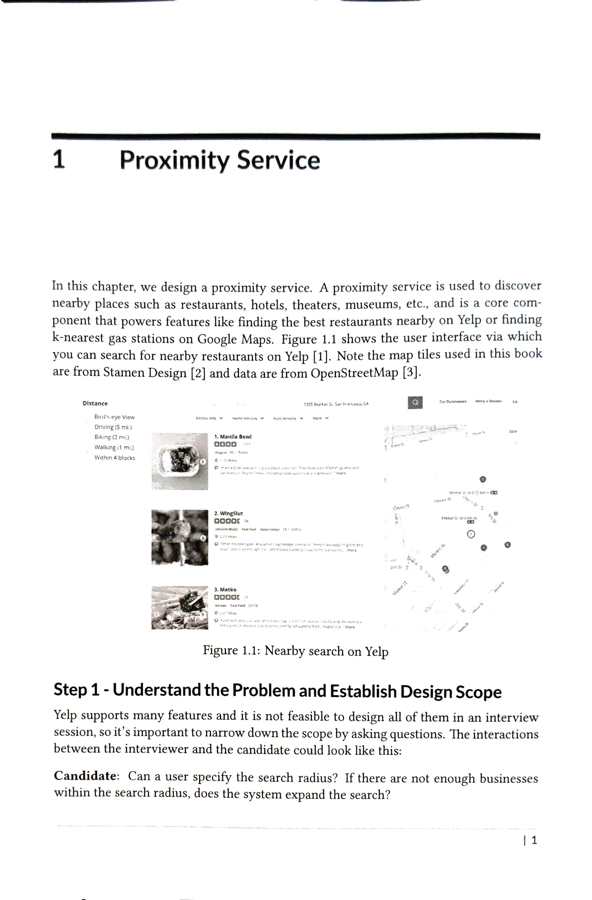

## Dịch Vụ Định Vị Lân Cận (Proximity Service)

Trong chương này, chúng ta sẽ thiết kế một dịch vụ định vị lân cận (proximity service). Một dịch vụ định vị lân cận được sử dụng để khám phá các địa điểm lân cận như nhà hàng, khách sạn, rạp chiếu phim, bảo tàng, v.v., và là thành phần cốt lõi (core component) vận hành các tính năng như tìm kiếm các nhà hàng tốt nhất ở gần trên Yelp hoặc tìm kiếm các địa điểm tương tự. Hình ảnh và dữ liệu được trích xuất từ Stamen Design [2] và dữ liệu từ OpenStreetMap [3].

```
Distance
For Businesses
Ate Review
135 S Market St, San Francisco, CA
Lo
Bird's-eye View
Pest
B Sees
Mere
Driving (5 mi.)
Biking (2 mi.)
1. Manila Bowl
Walking (1 mi.)
17*
Within 4 blocks
Pine St - South
geatdeuuiafeneeskiatrypierswh
Tigres St
Cayes St
2. Wingslut
Chicken Wings
Fel St
3. Matko
Korean Fast Food Sova
no fcf yegry feed;izaeisa"more
```
*Hình 1.1: Tìm kiếm lân cận trên Yelp (Nearby search on Yelp)*

---

## Bước 1 - Thấu Hiểu Bài Toán Và Xác Định Phạm Vi Thiết Kế (Step 1 - Understand the Problem and Establish Design Scope)

Yelp hỗ trợ rất nhiều tính năng và việc thiết kế toàn bộ chúng trong một buổi phỏng vấn là không khả thi, do đó việc thu hẹp phạm vi (scope) thông qua việc đặt câu hỏi là vô cùng quan trọng. Quá trình trao đổi giữa ứng viên và người phỏng vấn có thể diễn ra như sau:

> **Ứng viên:** Người dùng có thể chỉ định bán kính tìm kiếm (search radius) không? Nếu không có đủ địa điểm kinh doanh (businesses) trong bán kính tìm kiếm, hệ thống có mở rộng phạm vi tìm kiếm không?

---
### Trang 10

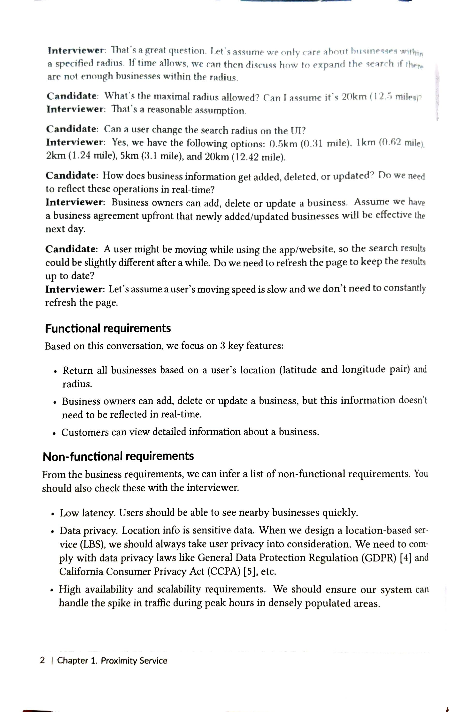

> **Người phỏng vấn:** Đó là một câu hỏi rất hay. Hãy giả định rằng chúng ta chỉ quan tâm đến các địa điểm kinh doanh nằm trong một bán kính được chỉ định. Nếu thời gian cho phép, chúng ta có thể thảo luận tiếp về cách mở rộng phạm vi tìm kiếm nếu không có đủ địa điểm kinh doanh trong bán kính đó.
>
> **Ứng viên:** Bán kính tối đa cho phép là bao nhiêu? Tôi có thể giả định con số này là 20km (12.5 dặm) không?
>
> **Người phỏng vấn:** Đó là một giả định hợp lý.
>
> **Ứng viên:** Người dùng có thể thay đổi bán kính tìm kiếm trên giao diện người dùng (UI) không?
>
> **Người phỏng vấn:** Có, chúng ta hỗ trợ các tùy chọn sau: 0.5km (0.31 dặm), 1km (0.62 dặm), 2km (1.24 dặm), 5km (3.1 dặm), và 20km (12.42 dặm).
>
> **Ứng viên:** Thông tin địa điểm kinh doanh được thêm, xóa hoặc cập nhật như thế nào? Chúng ta có cần phản ánh các thao tác này theo thời gian thực (real-time) không?
>
> **Người phỏng vấn:** Chủ doanh nghiệp có thể thêm, xóa hoặc cập nhật địa điểm kinh doanh. Giả định rằng chúng ta có thỏa thuận kinh doanh từ trước là các địa điểm mới thêm/cập nhật sẽ có hiệu lực vào ngày hôm sau.
>
> **Ứng viên:** Người dùng có thể di chuyển trong khi sử dụng ứng dụng/website, vì vậy kết quả tìm kiếm có thể hơi khác biệt sau một khoảng thời gian. Chúng ta có cần làm mới (refresh) trang để liên tục giữ kết quả cập nhật không?
>
> **Người phỏng vấn:** Hãy giả định rằng tốc độ di chuyển của người dùng là chậm và chúng ta không cần phải liên tục làm mới trang.

---

### Yêu Cầu Chức Năng (Functional Requirements)

Dựa trên cuộc trao đổi này, chúng ta tập trung vào 3 tính năng cốt lõi:

* Trả về tất cả các địa điểm kinh doanh dựa trên vị trí của người dùng (cặp kinh độ và vĩ độ - latitude and longitude pair) cùng bán kính tìm kiếm.
* Chủ doanh nghiệp có thể thêm, xóa hoặc cập nhật địa điểm kinh doanh, nhưng thông tin này không cần phải phản ánh theo thời gian thực (real-time).
* Khách hàng có thể xem thông tin chi tiết về một địa điểm kinh doanh.

---

### Yêu Cầu Phi Chức Năng (Non-functional Requirements)

Từ các yêu cầu nghiệp vụ, chúng ta có thể suy ra danh sách các yêu cầu phi chức năng. Bạn cũng nên xác nhận lại những điểm này với người phỏng vấn.

* **Độ trễ thấp (Low Latency):** Người dùng phải có thể xem các địa điểm kinh doanh lân cận một cách nhanh chóng.
* **Bảo mật dữ liệu (Data Privacy):** Thông tin vị trí là dữ liệu nhạy cảm. Khi thiết kế một dịch vụ dựa trên vị trí (LBS - Location-Based Service), chúng ta luôn phải cân nhắc đến quyền riêng tư của người dùng. Chúng ta cần tuân thủ các luật bảo vệ quyền riêng tư dữ liệu như Quy định Bảo vệ Dữ liệu Chung (GDPR - General Data Protection Regulation) [4] và Đạo luật Quyền riêng tư của Người tiêu dùng California (CCPA - California Consumer Privacy Act) [5], v.v.
* **Tính sẵn sàng cao và khả năng mở rộng (High Availability and Scalability requirements):** Chúng ta phải đảm bảo hệ thống có thể xử lý lưu lượng truy cập tăng vọt (traffic spike) trong các giờ cao điểm tại những khu vực có mật độ dân cư đông đúc.

---
### Trang 11

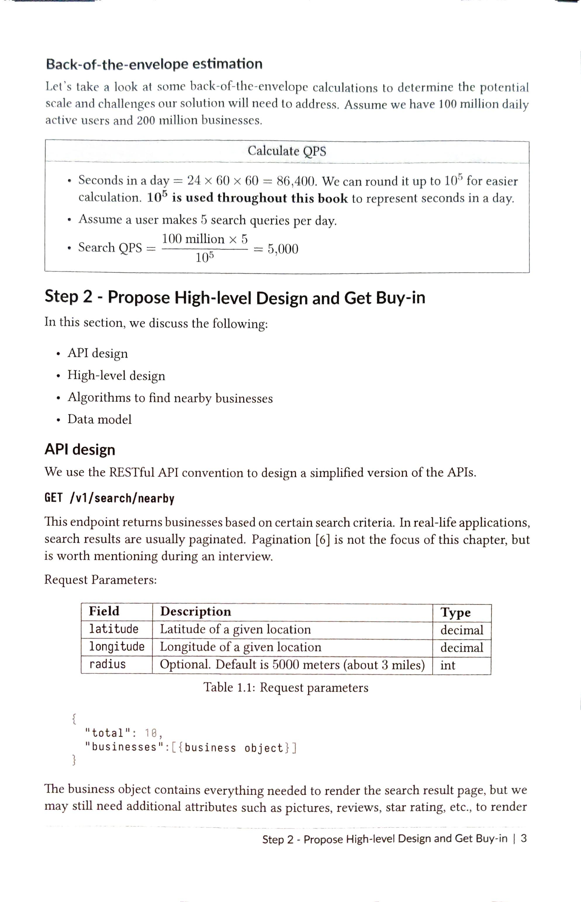

## Ước Tính Định Lượng Nhanh (Back-of-the-envelope Estimation)

Hãy cùng xem xét một số phép tính định lượng nhanh để xác định quy mô tiềm năng và các thách thức mà giải pháp của chúng ta cần giải quyết. Giả định hệ thống có 100 triệu người dùng hoạt động hàng ngày (DAU - Daily Active Users) và 200 triệu địa điểm kinh doanh.

### Tính toán QPS (Calculate QPS)

* Số giây trong một ngày = $24 \times 60 \times 60 = 86,400$. Chúng ta có thể làm tròn lên $10^5$ để thuận tiện tính toán. Con số $10^5$ được sử dụng xuyên suốt cuốn sách này để đại diện cho số giây trong một ngày.
* Giả định một người dùng thực hiện 5 truy vấn tìm kiếm mỗi ngày.
* **Search QPS** = $\frac{100\text{ triệu} \times 5}{10^5} = 5,000$

---

## Bước 2 - Đề Xuất Thiết Kế Cấp Cao Và Đạt Thỏa Thuận (Step 2 - Propose High-level Design and Get Buy-in)

Trong phần này, chúng ta thảo luận các nội dung sau:
* Thiết kế API (API design)
* Thiết kế cấp cao (High-level design)
* Các thuật toán để tìm kiếm địa điểm kinh doanh lân cận (Algorithms to find nearby businesses)
* Mô hình dữ liệu (Data model)

---

### Thiết Kế API (API Design)

Chúng ta sử dụng quy ước RESTful API để thiết kế phiên bản tinh giản của các API.

#### `GET /v1/search/nearby`

Endpoint này trả về các địa điểm kinh doanh dựa trên các tiêu chí tìm kiếm nhất định. Trong các ứng dụng thực tế, kết quả tìm kiếm thường được phân trang. Phân trang (Pagination) [6] không phải là trọng tâm của chương này, nhưng rất đáng để đề cập trong một buổi phỏng vấn.

**Tham số yêu cầu (Request Parameters):**

| Trường (Field) | Mô tả (Description) | Kiểu dữ liệu (Type) |
| :--- | :--- | :--- |
| `latitude` | Vĩ độ của một vị trí xác định | `decimal` |
| `longitude` | Kinh độ của một vị trí xác định | `decimal` |
| `radius` | Không bắt buộc (Optional). Mặc định là 5000 mét (khoảng 3 dặm) | `int` |

*Bảng 1.1: Các tham số yêu cầu (Request parameters)*

```json
{
  "total": 18,
  "businesses": [{business object}]
}
```

Đối tượng địa điểm kinh doanh (`business object`) chứa tất cả mọi thứ cần thiết để kết xuất (render) trang kết quả tìm kiếm, tuy nhiên chúng ta vẫn có thể cần thêm các thuộc tính bổ sung như hình ảnh, đánh giá (reviews), xếp hạng sao (star rating), v.v., để kết xuất...

---
### Trang 12

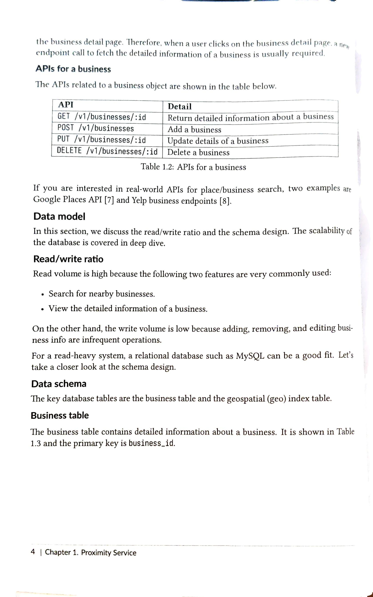

...một lệnh gọi endpoint để lấy thông tin chi tiết của một địa điểm kinh doanh thường là bắt buộc.

#### Các API cho một địa điểm kinh doanh (APIs for a business)

Các API liên quan đến đối tượng địa điểm kinh doanh (`business object`) được hiển thị trong bảng dưới đây:

| API | Chi tiết (Detail) |
| :--- | :--- |
| `GET /v1/businesses/:id` | Trả về thông tin chi tiết về một địa điểm kinh doanh |
| `POST /v1/businesses` | Thêm một địa điểm kinh doanh mới |
| `PUT /v1/businesses/:id` | Cập nhật thông tin chi tiết của một địa điểm kinh doanh |
| `DELETE /v1/businesses/:id` | Xóa một địa điểm kinh doanh |

*Bảng 1.2: Các API cho một địa điểm kinh doanh (APIs for a business)*

> [!NOTE]
> Nếu bạn quan tâm đến các API thực tế phục vụ tìm kiếm địa điểm/doanh nghiệp, hai ví dụ điển hình là **Google Places API** [7] và các endpoint doanh nghiệp của **Yelp** [8].

---

### Mô Hình Dữ Liệu (Data Model)

Trong phần này, chúng ta thảo luận về tỷ lệ đọc/ghi (Read/Write ratio) và thiết kế lược đồ (schema design). Khả năng mở rộng (Scalability) của cơ sở dữ liệu sẽ được trình bày sâu hơn ở phần phân tích chuyên sâu (deep dive).

#### Tỷ lệ Đọc/Ghi (Read/Write Ratio)

Khối lượng đọc (Read volume) rất cao vì hai tính năng sau được sử dụng rất thường xuyên:
* Tìm kiếm các địa điểm kinh doanh lân cận.
* Xem thông tin chi tiết của một địa điểm kinh doanh.

Mặt khác, khối lượng ghi (Write volume) là thấp vì các thao tác thêm, xóa và chỉnh sửa thông tin doanh nghiệp diễn ra không thường xuyên.

> [!TIP]
> Đối với một hệ thống đọc nhiều (Read-heavy system), một cơ sở dữ liệu quan hệ (Relational Database) như MySQL có thể là một sự lựa chọn rất phù hợp. Hãy cùng xem xét kỹ hơn về thiết kế lược đồ dữ liệu.

#### Lược Đồ Dữ Liệu (Data Schema)

Các bảng cơ sở dữ liệu cốt lõi là bảng doanh nghiệp (`business table`) và bảng chỉ mục không gian địa lý (`geo index table`).

##### Bảng Doanh Nghiệp (Business Table)

Bảng doanh nghiệp chứa thông tin chi tiết về một địa điểm kinh doanh. Nó được hiển thị trong Bảng 1.3 và khóa chính (Primary Key - PK) là `business_id`.

---
### Trang 13


| Tên trường (Field) | Khóa (Key) |
| :--- | :--- |
| **business_id** | **PK** |
| address | |
| city | |
| state | |
| country | |
| latitude | |
| longitude | |

*Bảng 1.3: Bảng doanh nghiệp (Business table)*

##### Bảng Chỉ Mục Không Gian Địa Lý (Geo Index Table)

Bảng chỉ mục không gian địa lý (`geo index table`) được sử dụng để xử lý hiệu quả các phép toán không gian (spatial operations). Vì bảng này yêu cầu một số kiến thức về **Geohash**, chúng ta sẽ thảo luận chi tiết về nó trong phần "Mở rộng cơ sở dữ liệu (Scale the database)" ở trang 24.

---

### Thiết Kế Cấp Cao (High-level Design)

Sơ đồ thiết kế cấp cao được minh họa trong Hình 1.2. Hệ thống bao gồm hai phần: **Dịch vụ dựa trên vị trí (Location-Based Service - LBS)** và **Dịch vụ liên quan đến doanh nghiệp (Business-related Service)**. Hãy cùng xem xét từng thành phần của hệ thống.

# CHƯƠNG 1: DỊCH VỤ ĐỊNH VỊ LÂN CẬN (PROXIMITY SERVICE)

---

### Trang 14

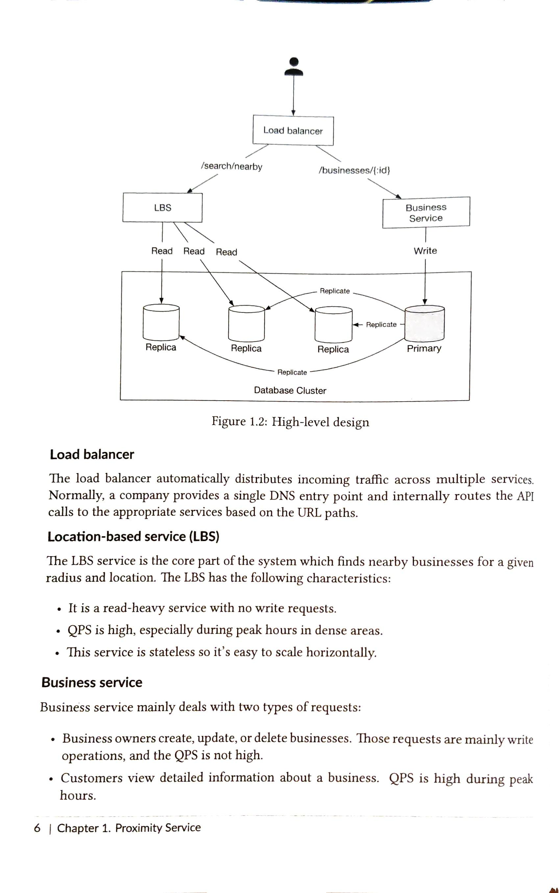

*Hình 1.2: Thiết kế mức cao (High-level design)*

#### Bộ cân bằng tải (Load Balancer)
**Bộ cân bằng tải (Load Balancer)** tự động phân phối lưu lượng truy cập mạng (incoming traffic) đến nhiều dịch vụ khác nhau. Thông thường, một doanh nghiệp sẽ cung cấp một điểm truy cập **DNS** duy nhất và thực hiện định tuyến nội bộ (internal routing) các lệnh gọi **API** đến các dịch vụ phù hợp dựa trên đường dẫn **URL** (URL paths).

#### Dịch vụ dựa trên vị trí (Location-Based Service - LBS)
**Dịch vụ LBS (Location-Based Service)** là thành phần cốt lõi của hệ thống, chịu trách nhiệm tìm kiếm các địa điểm kinh doanh lân cận theo một bán kính (radius) và vị trí địa lý (location) xác định. **LBS** sở hữu các đặc tính kỹ thuật sau:
* Đây là một dịch vụ chuyên đọc (**Read-Heavy Service**) và hoàn toàn không có yêu cầu ghi (**Write Requests**).
* **QPS (Queries Per Second)** ở mức rất cao, đặc biệt là trong các khung giờ cao điểm (peak hours) tại các khu vực mật độ dân cư đông đúc.
* Dịch vụ này là dịch vụ phi trạng thái (**Stateless Service**), do đó rất dễ dàng mở rộng quy mô theo chiều ngang (**Horizontal Scalability**).

#### Dịch vụ kinh doanh (Business Service)
**Dịch vụ kinh doanh (Business Service)** chủ yếu xử lý hai loại yêu cầu:
* Chủ doanh nghiệp tạo mới, cập nhật hoặc xóa thông tin địa điểm kinh doanh. Những yêu cầu này chủ yếu là các thao tác ghi (**Write Operations**), và **QPS** không cao.
* Khách hàng xem thông tin chi tiết về một địa điểm kinh doanh. **QPS** ở mức cao trong các khung giờ cao điểm.

---
*6 / Chương 1. Dịch Vụ Định Vị Lân Cận (Proximity Service)*

---

### Trang 15

#### Cụm cơ sở dữ liệu (Database Cluster)
**Cụm cơ sở dữ liệu (Database Cluster)** có thể áp dụng mô hình kiến trúc **Primary-Secondary (Master-Slave)**. Trong mô hình này, cơ sở dữ liệu chính (**Primary Database**) sẽ xử lý toàn bộ các thao tác ghi (**Write Operations**), trong khi nhiều bản sao (**Replicas**) được sử dụng để phục vụ các thao tác đọc (**Read Operations**). 

Dữ liệu được lưu trữ trước tiên vào cơ sở dữ liệu **Primary**, sau đó được nhân bản (**Replicated**) sang các bản sao **Replicas**. Do độ trễ nhân bản dữ liệu (**Replication Lag / Replication Delay**), có thể xảy ra tình trạng không đồng nhất dữ liệu tạm thời giữa dữ liệu được đọc bởi **LBS** và dữ liệu vừa được ghi vào cơ sở dữ liệu **Primary**. Sự không nhất quán này (**Inconsistency**) nhìn chung không phải là vấn đề nghiêm trọng, bởi vì thông tin kinh doanh không đòi hỏi phải được cập nhật theo thời gian thực tuyệt đối (**Real-time**).

#### Khả năng mở rộng của Business Service và LBS (Scalability of Business Service and LBS)
Cả **Business Service** và **LBS** đều là các dịch vụ phi trạng thái (**Stateless Services**), do đó rất dễ dàng tự động bổ sung thêm các máy chủ để đáp ứng lưu lượng truy cập vào giờ cao điểm (ví dụ: giờ ăn trưa/tối) và giảm tải máy chủ trong các khung giờ thấp điểm (ví dụ: ban đêm). Nếu hệ thống vận hành trên nền tảng điện toán đám mây (**Cloud**), chúng ta có thể thiết lập trên nhiều vùng địa lý (**Regions**) và các vùng sẵn sàng (**Availability Zones - AZ**) khác nhau nhằm nâng cao hơn nữa tính sẵn sàng cao (**High Availability**) [9]. Chúng ta sẽ thảo luận sâu hơn về vấn đề này trong phần phân tích chi tiết (**Deep Dive**).

#### Các thuật toán truy vấn địa điểm kinh doanh lân cận (Algorithms to Fetch Nearby Businesses)
... cơ sở dữ liệu không gian địa lý như [10] hoặc **PostgreSQL** với phần mở rộng **PostGIS** [11]. Bạn không bị kỳ vọng phải nắm tường tận cấu trúc nội tại (internals) của các cơ sở dữ liệu không gian địa lý này trong một buổi phỏng vấn. Thay vào đó, bạn nên thể hiện kỹ năng giải quyết vấn đề và kiến thức kỹ thuật chuyên sâu bằng cách giải thích cơ chế hoạt động của chỉ mục không gian địa lý (**Geospatial Index**), thay vì chỉ đơn thuần kể tên các hệ quản trị cơ sở dữ liệu.

Bước tiếp theo là khảo sát các phương án kỹ thuật khác nhau để truy xuất các địa điểm kinh doanh lân cận. Chúng ta sẽ liệt kê một số phương án, phân tích luồng tư duy và thảo luận về các đánh đổi kỹ thuật (**Trade-offs**).

#### Phương án 1: Tìm kiếm hai chiều (Option 1: Two-Dimensional Search)
Cách tiếp cận trực quan nhất nhưng còn ngây thơ (**Naive Approach**) để lấy danh sách các địa điểm kinh doanh lân cận là vẽ một hình tròn với bán kính định sẵn và tìm tất cả các doanh nghiệp nằm bên trong hình tròn đó, như minh họa trong Hình 1.3.

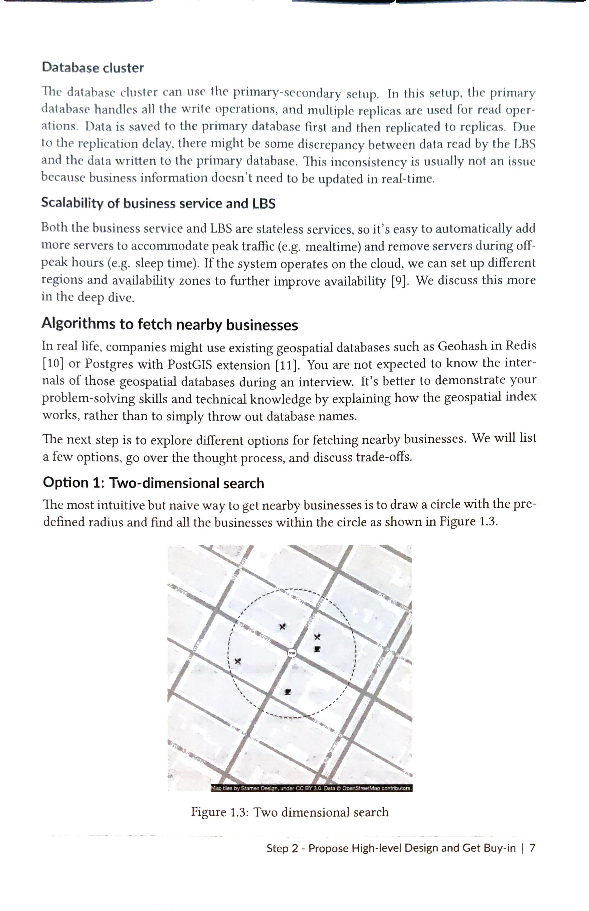

*Hình 1.3: Tìm kiếm hai chiều (Two-dimensional search)*

---
*Bước 2 - Đề Xuất Thiết Kế Mức Cao Và Thống Nhất Ý Kiến (Step 2 - Propose High-level Design and Get Buy-in) | 7*

---

### Trang 16

Quy trình này có thể được chuyển hóa thành truy vấn giả mã SQL (**Pseudo SQL Query**) như sau:

```sql
SELECT business_id, latitude, longitude
FROM business
WHERE (latitude BETWEEN {:my_lat} - radius AND {:my_lat} + radius)
  AND (longitude BETWEEN {:my_long} - radius AND {:my_long} + radius)
```

...tuy nhiên lượng dữ liệu trả về từ mỗi chiều vẫn có thể cực kỳ khổng lồ. Ví dụ, như được minh họa trong Hình 1.4, chúng ta có thể nhanh chóng truy xuất được tập dữ liệu 1 (`dataset 1`) và tập dữ liệu 2 (`dataset 2`) nhờ vào các chỉ mục (**Indexes**) trên cột kinh độ (**Longitude**) và vĩ độ (**Latitude**). Tuy nhiên, việc thực hiện phép giao (**Intersection**) giữa hai tập dữ liệu lớn này lại tốn kém tài nguyên một cách đáng kể.


*(Hình 1.4: Giao nhau giữa hai tập dữ liệu - Intersect two datasets)*

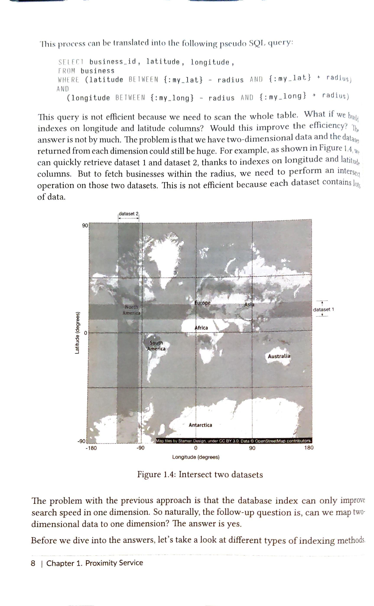

*Hình 1.4: Giao giữa hai tập dữ liệu (Intersect two datasets)*

> [!IMPORTANT]
> Vấn đề cốt lõi của cách tiếp cận nêu trên nằm ở chỗ: **Chỉ mục cơ sở dữ liệu (Database Index) chỉ có thể tối ưu hóa tốc độ tìm kiếm trên một chiều duy nhất.** 
>
> Vì vậy, một câu hỏi tất yếu được đặt ra: **Liệu chúng ta có thể ánh xạ (map) dữ liệu hai chiều về dữ liệu một chiều được không?** Câu trả lời chắc chắn là **Có**.

Trước khi đi sâu vào lời giải, hãy cùng điểm qua các phương pháp lập chỉ mục (**Indexing Methods**) khác nhau.

---
*8 / Chương 1. Dịch Vụ Định Vị Lân Cận (Proximity Service)*

---

### Trang 17

Theo nghĩa rộng, có hai trường phái tiếp cận lập chỉ mục không gian địa lý (**Geospatial Indexing Approaches**), như thể hiện trong Hình 1.5. Những thuật toán được đánh dấu nổi bật là các thuật toán chúng ta sẽ thảo luận chi tiết vì chúng được áp dụng phổ biến nhất trong ngành công nghiệp.

* **Dạng băm (Hash):** Lưới đều (**Even Grid**), **Geohash**, **Cartesian Tiers** [12], v.v.
* **Dạng cây (Tree):** **Quadtree**, **Google S2**, **RTree** [13], v.v.

```
                  Index (Chỉ mục)
                 /               \
       Hash (Băm)                 Tree (Cây)
     /      |     \             /      |     \
Even Grid Geohash Cartesian   Quadtree Google RTree
                    Tiers                S2
```

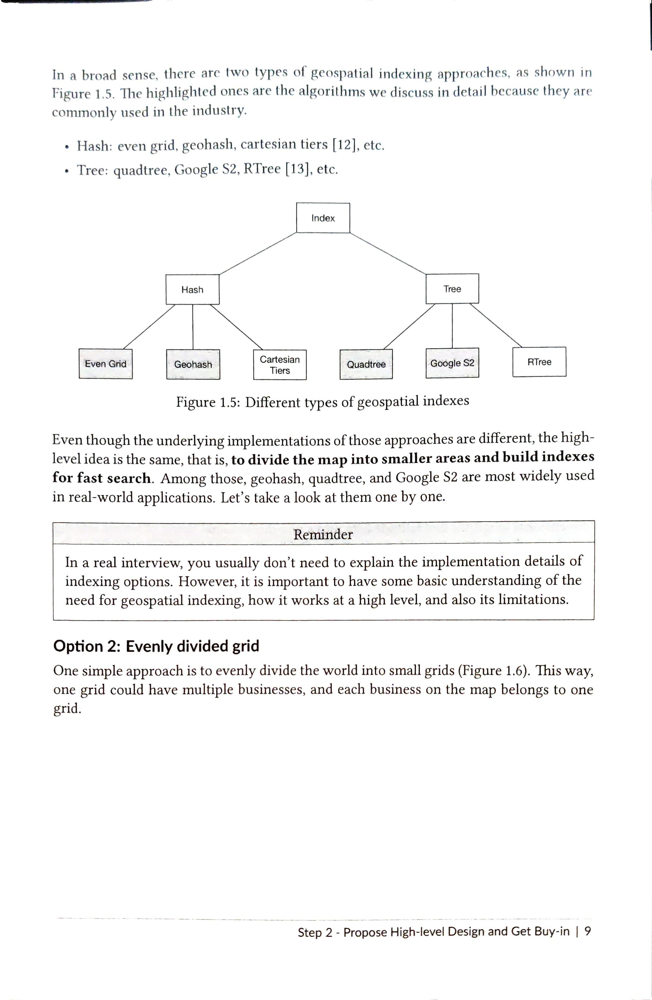

*Hình 1.5: Các loại chỉ mục không gian địa lý khác nhau (Different types of geospatial indexes)*

Mặc dù kiến trúc hiện thực bên dưới (underlying implementations) của các phương pháp này khác nhau, nhưng ý tưởng kiến trúc cấp cao (**High-Level Idea**) đều tương đồng: **Chia nhỏ bản đồ thành các khu vực nhỏ hơn và xây dựng chỉ mục để phục vụ tìm kiếm nhanh chóng.** Trong số đó, **Geohash**, **Quadtree**, và **Google S2** là những thuật toán được ứng dụng rộng rãi nhất trong các hệ thống thực tế. Chúng ta hãy lần lượt phân tích từng giải pháp.

> [!NOTE]
> **Lời nhắc nhở (Reminder):**
> Trong một buổi phỏng vấn thiết kế hệ thống thực tế, bạn thường không cần phải giải thích chi tiết mã nguồn hiện thực của từng tùy chọn chỉ mục. Tuy nhiên, việc nắm vững bản chất cốt lõi về sự cần thiết của chỉ mục không gian địa lý, cơ chế hoạt động ở mức kiến trúc cao (high level), cũng như những giới hạn kỹ thuật (**Limitations**) của chúng là vô cùng quan trọng.

#### Phương án 2: Lưới chia đều (Option 2: Evenly Divided Grid)
Một cách tiếp cận đơn giản là chia đều thế giới thành các ô lưới nhỏ có kích thước bằng nhau (Hình 1.6). Bằng cách này, một ô lưới có thể chứa nhiều địa điểm kinh doanh, và mỗi địa điểm kinh doanh trên bản đồ sẽ thuộc về duy nhất một ô lưới.

---
*Bước 2 - Đề Xuất Thiết Kế Mức Cao Và Thống Nhất Ý Kiến (Step 2 - Propose High-level Design and Get Buy-in) | 9*

---

### Trang 18

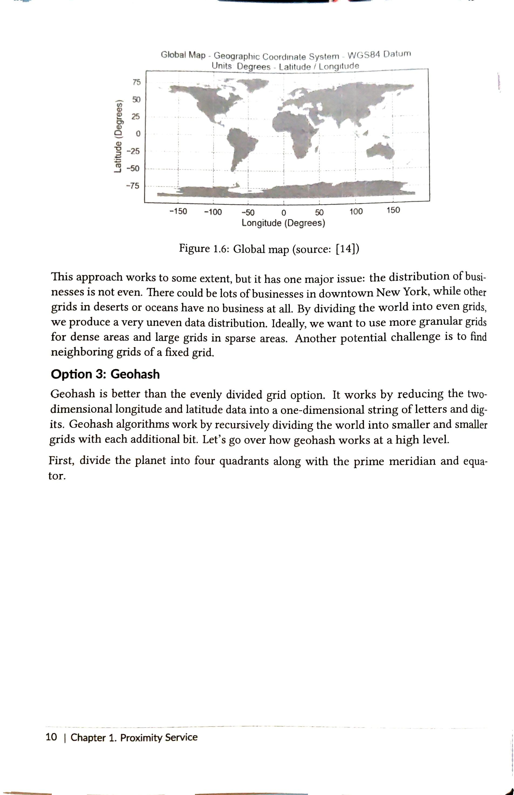

*Hình 1.6: Bản đồ toàn cầu (Nguồn: [14])*

...các ô lưới nằm ở sa mạc hoặc đại dương hoàn toàn không có bất kỳ địa điểm kinh doanh nào. Bằng cách chia thế giới thành các ô lưới đồng đều, chúng ta tạo ra một sự phân bổ dữ liệu cực kỳ mất cân bằng (**Uneven Data Distribution / Data Skew**). 

Về mặt thiết kế lý tưởng, chúng ta muốn sử dụng các ô lưới có độ chi tiết cao hơn (**Granular Grids**) cho các khu vực mật độ đông đúc, và các ô lưới có kích thước lớn hơn đối với các khu vực thưa thớt dân cư. Một thách thức kỹ thuật tiềm tàng khác của phương pháp này là việc tìm kiếm các ô lưới lân cận (**Neighboring Grids**) xung quanh một ô lưới cố định.

#### Phương án 3: Geohash (Option 3: Geohash)
**Geohash** là một giải pháp vượt trội hơn so với phương án chia lưới đều. Thuật toán hoạt động bằng cách chuyển đổi (giảm chiều) dữ liệu kinh độ và vĩ độ hai chiều thành một chuỗi một chiều gồm các chữ cái và chữ số. 

Thuật toán **Geohash** vận hành bằng cách đệ quy chia nhỏ thế giới thành các ô lưới ngày càng nhỏ hơn sau mỗi bit dữ liệu bổ sung. Hãy cùng xem xét cách thức hoạt động của Geohash ở góc nhìn tổng quan:

* **Bước 1:** Đầu tiên, chia hành tinh thành bốn góc phần tư (**Quadrants**) dọc theo kinh tuyến gốc (**Prime Meridian**) và đường xích đạo (**Equator**).

---
*10 / Chương 1. Dịch Vụ Định Vị Lân Cận (Proximity Service)*

---

### Trang 19

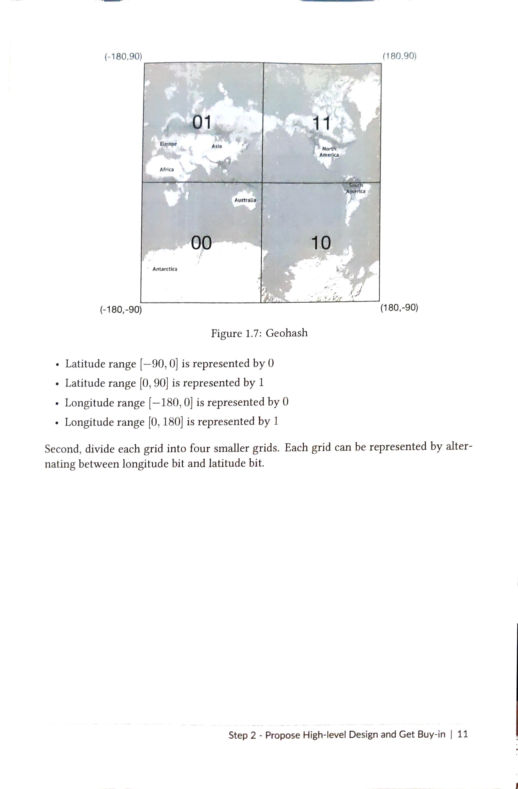

*Hình 1.7: Geohash*

* Dải vĩ độ `[-90, 0]` được biểu diễn bằng bit `0`
* Dải vĩ độ `[0, 90]` được biểu diễn bằng bit `1`
* Dải kinh độ `[-180, 0]` được biểu diễn bằng bit `0`
* Dải kinh độ `[0, 180]` được biểu diễn bằng bit `1`

* **Bước 2:** Tiếp theo, tiếp tục chia nhỏ mỗi ô lưới thành bốn ô lưới nhỏ hơn. Mỗi ô lưới con có thể được biểu diễn bằng cách xen kẽ lần lượt giữa **bit kinh độ** và **bit vĩ độ** (alternating between longitude bit and latitude bit).

---
*Bước 2 - Đề Xuất Thiết Kế Mức Cao Và Thống Nhất Ý Kiến (Step 2 - Propose High-level Design and Get Buy-in) | 11*

# Chương 1: Dịch Vụ Định Vị Lân Cận (Proximity Service)

---

### Phân chia lưới đệ quy và mã hóa Geohash

```text
00
10
01010111/11011111
0100011011001110
000100111001/1011
0000/001011000110.10
```

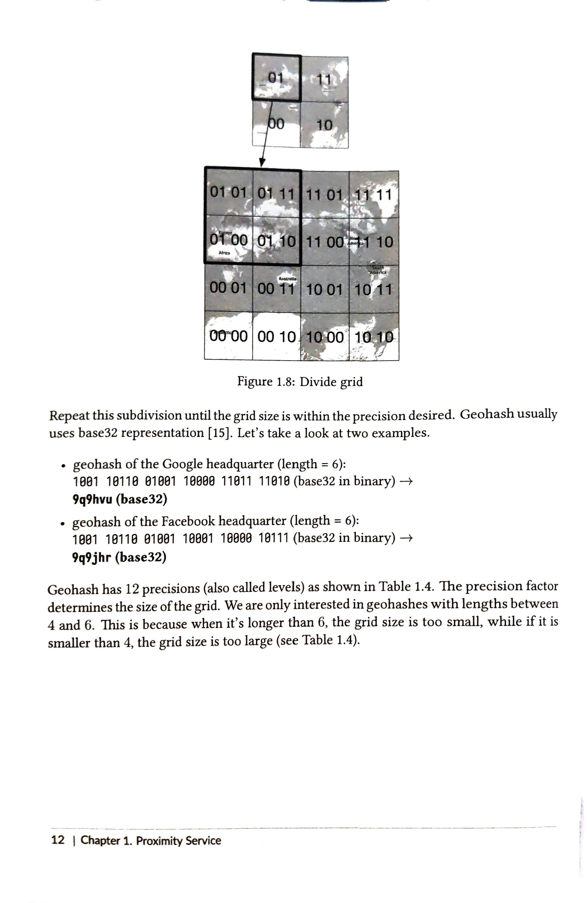
*Hình 1.8: Chia nhỏ lưới (Divide grid)*

Lặp lại việc phân chia con này cho đến khi kích thước ô lưới nằm trong phạm vi độ chính xác (precision) mong muốn. Geohash thường sử dụng biểu diễn hệ cơ số 32 (**base32**) [15]. Hãy cùng xem qua hai ví dụ:

* **Geohash của trụ sở chính Google** (độ dài / length = 6):
  * `1001 10110 01001 10000 11011 11010` (base32 ở định dạng nhị phân / binary)
  * `9q9hvu` (chuỗi base32)
* **Geohash của trụ sở chính Facebook** (độ dài / length = 6):
  * `9q9jhr` (chuỗi base32)

Geohash có 12 mức độ chính xác (còn được gọi là các cấp độ - *levels*) như được hiển thị trong **Bảng 1.4**. Hệ số độ chính xác quyết định kích thước của ô lưới. Chúng ta chỉ quan tâm đến các chuỗi geohash có độ dài từ 4 đến 6. Lý do là vì khi độ dài lớn hơn 6, kích thước ô lưới sẽ quá nhỏ; trong khi nếu nhỏ hơn 4, kích thước ô lưới lại quá lớn (xem Bảng 1.4).

---

### Bảng đối chiếu độ chính xác Geohash


| Chiều rộng × Chiều cao ô lưới (Grid width × height) | Độ dài geohash (geohash length) |
| :--- | :--- |
| 5,009.4km × 4,992.6km (kích thước hành tinh / the size of the planet) | 1 |
| 1,252.3km × 624.1km | 2 |
| 156.5km × 156km | 3 |
| 39.1km × 19.5km | 4 |
| 4.9km × 4.9km | 5 |
| 1.2km × 609.4m | 6 |
| 152.9m × 152.4m | 7 |
| 38.2m × 19m | 8 |
| 4.8m × 4.8m | 9 |
| 1.2m × 59.5cm | 10 |
| 14.9cm × 14.9cm | 11 |
| 3.7cm × 1.9cm | 12 |

*Bảng 1.4: Ánh xạ độ dài Geohash sang kích thước ô lưới (Nguồn: [16])*

Làm thế nào để chúng ta lựa chọn độ chính xác phù hợp? Chúng ta muốn tìm độ dài geohash tối thiểu có thể bao phủ toàn bộ vòng tròn bán kính do người dùng định nghĩa (*user-defined radius*). Mối quan hệ tương ứng giữa bán kính tìm kiếm và độ dài geohash được thể hiện trong bảng dưới đây:

| Bán kính (Kilometers / Dặm) | Độ dài Geohash (Geohash length) |
| :--- | :--- |
| 0.5km (0.31 mile) | 6 |
| 1km (0.62 mile) | 5 |
| 2km (1.24 mile) | 5 |
| 5km (3.1 mile) | 4 |
| 20km (12.42 mile) | 4 |

*Bảng 1.5: Ánh xạ bán kính sang độ dài geohash (Radius to geohash mapping)*

Cách tiếp cận này hoạt động hiệu quả trong phần lớn các trường hợp, tuy nhiên vẫn tồn tại một số trường hợp biên (*edge cases*) liên quan đến cách xử lý ranh giới geohash mà chúng ta cần thảo luận với người phỏng vấn.

---

### Các vấn đề ranh giới (Boundary issues)

Về nguyên lý toán học, Geohash đảm bảo rằng hai mã geohash có tiền tố chung (*shared prefix*) càng dài thì vị trí của chúng càng gần nhau. Như được minh họa trong **Hình 1.9**, tất cả các ô lưới đều chia sẻ chung một tiền tố: `9q8zn`.

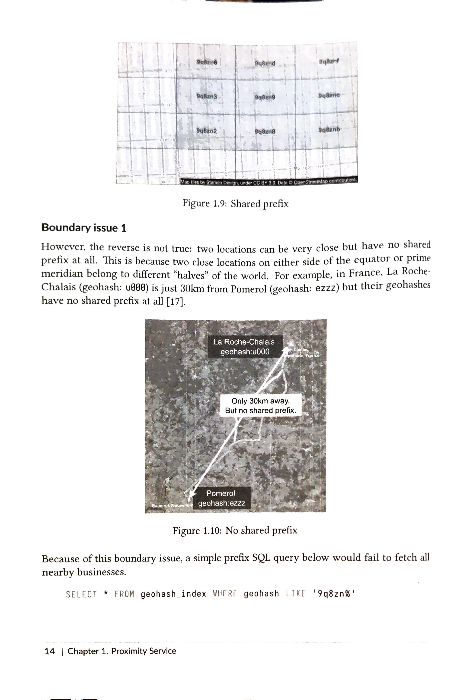
*Hình 1.9: Tiền tố chung (Shared prefix)*

#### Vấn đề ranh giới 1 (Boundary issue 1)
Hai vị trí địa lý ở rất gần nhau nhưng lại hoàn toàn không có tiền tố chung nào [17].

* Ví dụ:
  * **La Roche-Chalais**: `geohash: u000`
  * **Pomerol**: `geohash: ezzz`
  * Hai địa điểm này chỉ cách nhau **30km**, nhưng lại **không hề có tiền tố chung**.

*Hình 1.10: Không có tiền tố chung (No shared prefix)*

Chính vì vấn đề ranh giới này, một truy vấn tiền tố đơn giản bằng SQL dưới đây sẽ **thất bại** trong việc truy xuất tất cả các doanh nghiệp lân cận:

```sql
SELECT * FROM geohash_index WHERE geohash LIKE '9q8zn%'
```

---

#### Vấn đề ranh giới 2 (Boundary issue 2)

Một vấn đề ranh giới khác là hai vị trí có thể chia sẻ một tiền tố chung rất dài, nhưng chúng lại thuộc về hai ô geohash khác nhau như được hiển thị trong **Hình 1.11**.


*Hình 1.11: Vấn đề ranh giới (Boundary issue) — Map tiles bởi Stamen Design, theo chuẩn CC BY 3.0. Dữ liệu từ OpenStreetMap contributors.*

Thông tin chi tiết hơn về vấn đề này có thể tìm thấy tại tài liệu tham khảo [17].

> [!NOTE]
> Để giải quyết triệt để các vấn đề ranh giới, giải pháp tiêu chuẩn là truy vấn ô lưới geohash hiện tại cùng với **8 ô lưới lân cận bao quanh nó (8 neighboring grids)**.

---

### Trường hợp không đủ số lượng doanh nghiệp (Not enough businesses)

Bây giờ hãy giải quyết câu hỏi mở rộng (*bonus question*): Chúng ta nên làm gì nếu số lượng doanh nghiệp trả về từ ô lưới hiện tại kết hợp với tất cả các ô lân cận vẫn không đủ số lượng mong muốn?

* **Lựa chọn 1 (Option 1): Chỉ trả về các doanh nghiệp nằm trong bán kính đã chọn.**  
  Lựa chọn này rất dễ cài đặt, nhưng nhược điểm rõ ràng là không trả về đủ kết quả để đáp ứng nhu cầu trải nghiệm của người dùng.

* **Lựa chọn 2 (Option 2): Mở rộng bán kính tìm kiếm (Increase the search radius).**  
  Chúng ta có thể cắt bỏ ký tự cuối cùng của chuỗi geohash và dùng mã geohash mới (ngắn hơn, biểu thị vùng lớn hơn) để truy xuất các doanh nghiệp lân cận. Nếu vẫn chưa đủ doanh nghiệp, chúng ta tiếp tục mở rộng phạm vi bằng cách cắt bỏ thêm một ký tự nữa. Theo cách này, kích thước ô lưới sẽ dần dần được mở rộng cho đến khi số lượng kết quả lớn hơn số lượng mong muốn. **Hình 1.12** minh họa sơ đồ khái niệm của quá trình mở rộng tìm kiếm này.

*Hình 1.12: Quy trình mở rộng vùng tìm kiếm (Expand the search process)*

---

### Lựa chọn 4: Cây tứ phân (Option 4: Quadtree)


Cấu trúc dữ liệu cây tứ phân (*Quadtree*) được lưu trữ trong bộ nhớ (*in-memory*) trên mỗi máy chủ LBS (*Location-Based Service server*), và cấu trúc này được dựng sẵn tại thời điểm khởi động máy chủ (*server start-up time*).

Hãy cùng phân tích Quadtree. Giả định toàn bộ thế giới có tổng cộng **200 triệu (200m - million) doanh nghiệp**.

*Hình 1.13: Cây tứ phân (Quadtree)*  
*(Bao gồm các góc phần tư: Tây Bắc - NW (40m), Đông Bắc - NE (30m), Tây Nam - SW (70m), Đông Nam - SE (60m))*

**Hình 1.14** giải thích chi tiết hơn về quy trình xây dựng cây tứ phân (*quadtree building process*). Nút gốc (*root node*) đại diện cho bản đồ toàn thế giới. Nút gốc được chia nhỏ đệ quy thành 4 góc phần tư (*4 quadrants*) cho đến khi không còn nút nào chứa nhiều hơn 100 doanh nghiệp.

---

### Xây dựng Quadtree và Ước tính Bộ nhớ

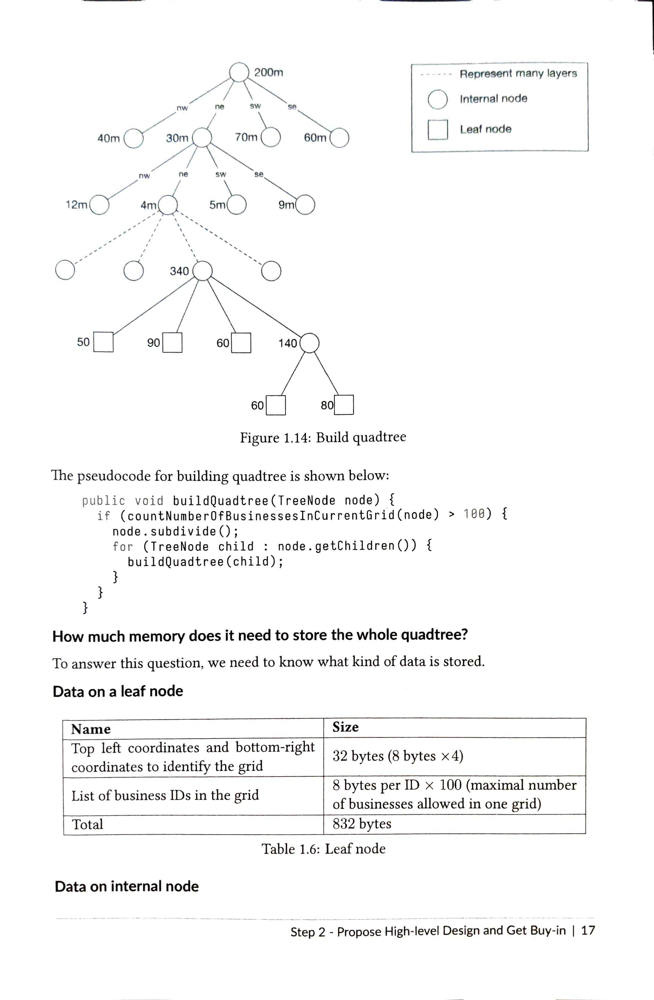
*Hình 1.14: Xây dựng cây tứ phân (Build quadtree)*

Mã giả (*pseudocode*) cho việc xây dựng cây tứ phân được trình bày như sau:

```java
public void buildQuadtree(TreeNode node) {
    if (countNumberOfBusinessesInCurrentGrid(node) > 100) {
        node.subdivide();
        for (TreeNode child : node.getChildren()) {
            buildQuadtree(child);
        }
    }
}
```

#### Cần bao nhiêu dung lượng bộ nhớ (Memory) để lưu trữ toàn bộ Quadtree?

Để trả lời câu hỏi này, chúng ta cần xác định rõ loại dữ liệu nào được lưu trữ trong mỗi nút.

##### 1. Dữ liệu trên một nút lá (Data on a leaf node):

| Tên trường (Name) | Kích thước (Size) |
| :--- | :--- |
| Tọa độ góc trên bên trái và góc dưới bên phải để xác định ranh giới ô lưới (*Top-left coordinates and bottom-right coordinates to identify the grid*) | 32 bytes (8 bytes × 4) |
| Danh sách ID của các doanh nghiệp trong ô lưới (*List of business IDs in the grid*) | 8 bytes cho mỗi ID × 100 (số lượng doanh nghiệp tối đa cho phép trong một ô lưới) |
| **Tổng cộng (Total)** | **832 bytes** |

*Bảng 1.6: Cấu trúc dữ liệu nút lá (Leaf node)*

##### 2. Dữ liệu trên nút nội bộ (Data on internal node):
*(Nội dung tiếp tục được phân tích chi tiết ở các phần tiếp theo của tài liệu...)*

# CHƯƠNG 1: DỊCH VỤ ĐỊNH VỊ LÂN CẬN (PROXIMITY SERVICE)

---

### [Trang 26]

| Thuộc tính (Name) | Kích thước (Size) |
| :--- | :--- |
| Tọa độ góc trên bên trái và tọa độ góc dưới bên phải để xác định lưới (Top left coordinates and bottom-right coordinates to identify the grid) | 32 bytes (8 bytes × 4) |
| Con trỏ trỏ tới 4 node con (Pointers to 4 children) | 32 bytes (8 bytes × 4) |
| **Tổng cộng (Total)** | **64 bytes** |

*Bảng 1.7: Node nội bộ (Internal node)*

ước tính từ các bản ghi trong cơ sở dữ liệu (database).  
Mức độ sử dụng bộ nhớ:
- Giả định mỗi ô lưới có thể lưu trữ tối đa 100 địa điểm kinh doanh (businesses).
- Số lượng node lá (Number of leaf nodes) = $\frac{200\text{ triệu}}{100} \approx 2\text{ triệu}$.
- Số lượng node nội bộ (Number of internal nodes) = $2\text{ triệu} \times \frac{1}{3} \approx 0{,}67\text{ triệu}$. Nếu bạn chưa rõ lý do tại sao số lượng node nội bộ bằng một phần ba số lượng node lá, vui lòng đọc tài liệu tham khảo [19].
- Tổng nhu cầu bộ nhớ (Total memory requirement) = $2\text{ triệu} \times 832\text{ bytes} + 0{,}67\text{ triệu} \times 64\text{ bytes} \approx 1{,}71\text{ GB}$. Ngay cả khi chúng ta tính thêm một lượng chi phí phụ trội (overhead) để xây dựng cây, nhu cầu bộ nhớ để dựng cây vẫn khá nhỏ.


Trong một buổi phỏng vấn thực tế, chúng ta không nhất thiết phải tính toán chi tiết đến mức như vậy. Điểm mấu chốt (key takeaway) rút ra ở đây là chỉ mục quadtree (quadtree index) không tiêu tốn quá nhiều bộ nhớ và hoàn toàn có thể nằm gọn trên một máy chủ duy nhất.

Liệu điều này có đồng nghĩa với việc chúng ta chỉ nên dùng duy nhất một máy chủ để lưu trữ chỉ mục quadtree? Câu trả lời là **không**. Tùy thuộc vào lưu lượng đọc (read volume), một máy chủ quadtree đơn lẻ có thể không có đủ CPU hoặc băng thông mạng (network bandwidth) để phục vụ toàn bộ các yêu cầu đọc (read requests). Nếu rơi vào trường hợp đó, việc phân tán tải đọc (spread the read load) qua nhiều máy chủ quadtree là điều hết sức cần thiết.

#### Mất bao lâu để xây dựng toàn bộ quadtree?
Mỗi node lá chứa xấp xỉ 100 mã định danh doanh nghiệp (business IDs). Độ phức tạp thời gian (time complexity) để xây dựng cây cho phép ta dựng toàn bộ quadtree với 200 triệu doanh nghiệp chỉ trong vòng vài phút.

#### Làm thế nào để lấy danh sách các doanh nghiệp lân cận bằng quadtree?
1. Xây dựng quadtree trong bộ nhớ (in-memory).
2. Sau khi quadtree được dựng xong, bắt đầu tìm kiếm từ node gốc (root) và duyệt cây (traverse the tree), cho đến khi tìm thấy node lá chứa vị trí gốc của lượt tìm kiếm (search origin). Nếu node lá đó có đủ 100 doanh nghiệp, trả về node đó. Ngược lại, tiếp tục bổ sung thêm các doanh nghiệp từ các node láng giềng lân cận của nó cho đến khi thu thập đủ số lượng doanh nghiệp yêu cầu.

---

### [Trang 27]

#### Những cân nhắc vận hành đối với Quadtree (Operational considerations for quadtree)

Như đã đề cập ở trên, có thể mất vài phút để xây dựng một quadtree với 200 triệu doanh nghiệp tại thời điểm khởi động máy chủ (server start-up time). Việc xem xét các tác động vận hành (operational implications) của khoảng thời gian khởi động máy chủ dài như vậy là cực kỳ quan trọng. 

Trong khi quadtree đang được dựng, máy chủ không thể xử lý lưu lượng truy cập (cannot serve traffic). Do đó, chúng ta nên triển khai bản phát hành mới của máy chủ theo hình thức tăng dần (roll out incrementally) cho một tập hợp máy chủ nhỏ tại một thời điểm. Điều này tránh việc đưa một mảng lớn cụm máy chủ vào trạng thái ngoại tuyến (offline) cùng lúc, gây ra tình trạng suy giảm dịch vụ (service brownout). Triển khai dạng Xanh/Xanh lục (Blue/green deployment) [20] cũng có thể được áp dụng, nhưng việc toàn bộ một cụm máy chủ mới đồng loạt kéo 200 triệu doanh nghiệp từ dịch vụ cơ sở dữ liệu (database service) tại cùng một thời điểm có thể gây áp lực cực lớn lên toàn hệ thống. Phương án này khả thi, nhưng nó có thể làm phức tạp hóa thiết kế và bạn nên đề cập đến điều này trong buổi phỏng vấn.

Một cân nhắc vận hành khác là làm thế nào để cập nhật quadtree khi các doanh nghiệp được thêm mới hoặc xóa bỏ theo thời gian. 

> [!TIP]
> **Phương pháp tiếp cận đơn giản nhất**: Tái xây dựng quadtree theo hình thức gia tăng (incrementally rebuild), xử lý tuần tự từng nhóm nhỏ máy chủ trên toàn bộ cụm. Tuy nhiên, điều này đồng nghĩa với việc một số máy chủ sẽ trả về dữ liệu cũ (stale data) trong một khoảng thời gian ngắn. Dẫu vậy, đây thường là một sự đánh đổi chấp nhận được dựa trên các yêu cầu bài toán. Vấn đề này có thể được giảm thiểu thêm bằng cách thiết lập một thỏa thuận nghiệp vụ (business agreement) quy định rằng các doanh nghiệp mới được thêm/cập nhật sẽ chỉ có hiệu lực vào ngày hôm sau. Điều đó cho phép chúng ta cập nhật bộ nhớ đệm (cache) thông qua một tác vụ chạy định kỳ ban đêm (nightly job). 
> 
> Một vấn đề tiềm ẩn của phương pháp tiếp cận này là hàng loạt khóa (keys) sẽ bị mất hiệu lực (invalidated) tại cùng một thời điểm, gây ra hiện tượng nghẽn và tải nặng lên các máy chủ bộ nhớ đệm (cache servers).

Cũng có thể cập nhật quadtree trực tiếp ngay khi đang chạy (on the fly) khi các doanh nghiệp được thêm vào và gỡ bỏ. Tuy nhiên, cấu trúc dữ liệu quadtree khi đó sẽ bị truy cập đồng thời bởi nhiều luồng (multiple threads). Điều này đòi hỏi cơ chế khóa (locking mechanism), vốn có thể làm phức tạp hóa đáng kể việc cài đặt quadtree.

#### Ví dụ thực tế về Quadtree (Real-world quadtree example)
Yext [21] đã cung cấp một hình ảnh (Hình 1.15) minh họa một quadtree đã được xây dựng gần khu vực Denver [21]. Chúng ta muốn các ô lưới nhỏ hơn, chi tiết hơn cho các khu vực đông dân cư và các ô lưới lớn hơn cho các khu vực thưa thớt dân cư.


---

### [Trang 28]

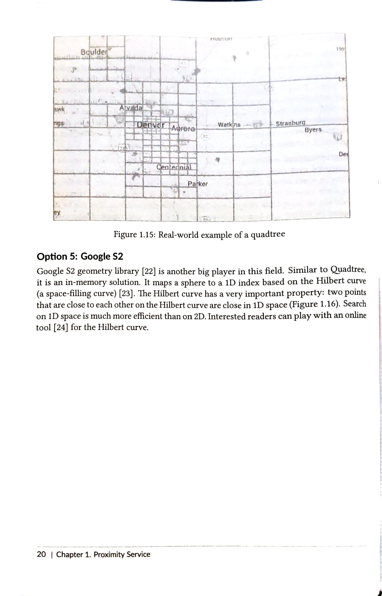
*Hình 1.15: Ví dụ thực tế về một quadtree*

---

#### Phương án 5: Google S2 (Option 5: Google S2)

Thư viện hình học Google S2 (Google S2 geometry library) [22] là một giải pháp lớn khác trong lĩnh vực này. Tương tự như Quadtree, đây là một giải pháp lưu trữ hoàn toàn trên bộ nhớ trong (in-memory solution). Nó ánh xạ một mặt cầu (sphere) thành một chỉ mục 1 chiều (1D index) dựa trên đường cong Hilbert (Hilbert curve) — một loại đường cong lấp đầy không gian (space-filling curve). 

Đặc tính toán học của đường cong Hilbert đảm bảo rằng hai điểm nằm gần nhau trên đường cong Hilbert cũng sẽ nằm gần nhau trong không gian 1 chiều (1D space) (Hình 1.16). Tìm kiếm trên không gian 1 chiều hiệu quả hơn rất nhiều so với không gian 2 chiều (2D). Những độc giả quan tâm có thể thử nghiệm trực tiếp thông qua công cụ trực tuyến [24] dành cho đường cong Hilbert.

---

### [Trang 29]


*Hình 1.16: Đường cong Hilbert (Nguồn: [24])*

S2 là một thư viện phức tạp và bạn không bị kỳ vọng phải giải thích tường tận cấu trúc nội bộ của nó trong một buổi phỏng vấn. Tuy nhiên, vì nó được sử dụng rộng rãi tại các công ty lớn như Google, Tinder, v.v., chúng ta sẽ điểm qua ngắn gọn các ưu điểm cốt lõi của nó:

- **S2 cực kỳ tối ưu cho tính năng khoanh vùng địa lý (Geofencing)**: Nó có thể bao phủ các khu vực tùy ý với nhiều cấp độ chi tiết khác nhau (Hình 1.17). Theo định nghĩa từ Wikipedia: *"Một ranh giới địa lý ảo (geofence) là một chu vi ảo cho một khu vực địa lý trong thế giới thực. Ranh giới địa lý ảo có thể được tạo động — chẳng hạn như một bán kính xung quanh một điểm vị trí, hoặc có thể là một tập hợp các ranh giới được xác định trước (chẳng hạn như khu vực trường học hoặc ranh giới khu dân cư)"* [25].
- Khoanh vùng địa lý cho phép chúng ta xác định các đường chu vi bao quanh các khu vực quan tâm, mở rộng thêm nhiều tính năng phong phú hơn thay vì chỉ đơn thuần là trả về các doanh nghiệp lân cận.

---

### [Trang 30]

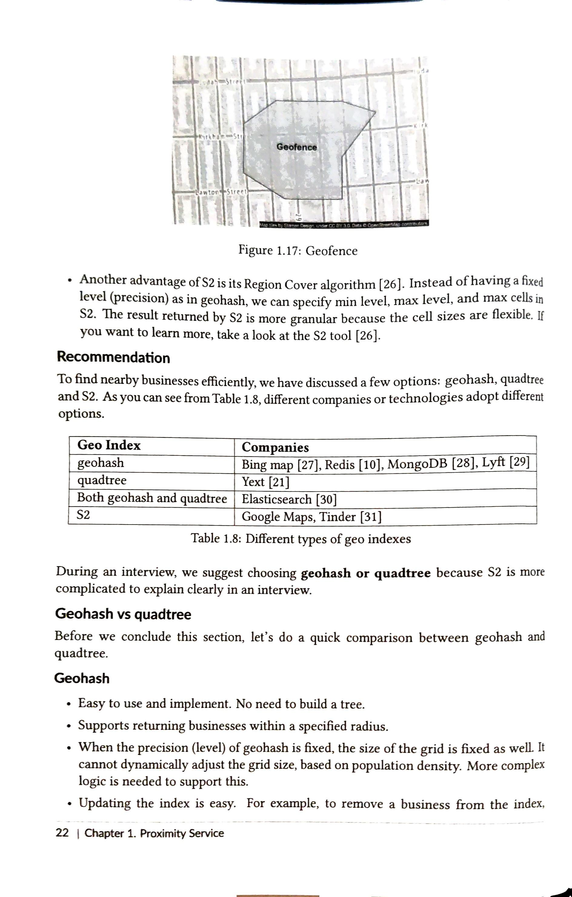
*Hình 1.17: Ranh giới địa lý ảo (Geofence)*

Nếu bạn muốn tìm hiểu sâu hơn, hãy tham khảo công cụ S2 [26].

---

#### Khuyến nghị (Recommendation)

Dưới đây là bảng tổng hợp các tùy chọn chỉ mục địa lý:

| Chỉ mục địa lý (Geo Index) | Các công ty áp dụng (Companies) |
| :--- | :--- |
| **Geohash** | Các nền tảng dịch vụ bản đồ / dữ liệu vị trí lớn |
| **Quadtree** | Yext [21] |
| **Cả Geohash và Quadtree** | Elasticsearch [30] |
| **S2** | Google Maps, Tinder [31] |

*Bảng 1.8: Các loại chỉ mục địa lý khác nhau*

> [!NOTE]
> Trong một buổi phỏng vấn thiết kế hệ thống, chúng tôi đề xuất bạn nên lựa chọn **Geohash** hoặc **Quadtree**, bởi vì thư viện S2 quá phức tạp để có thể giải thích một cách gãy gọn, rõ ràng trong thời lượng giới hạn của buổi phỏng vấn.

---

#### So sánh Geohash và Quadtree (Geohash vs Quadtree)

Trước khi kết thúc phần này, chúng ta hãy cùng thực hiện một phép so sánh nhanh giữa Geohash và Quadtree:

##### 1. Geohash
- **Dễ sử dụng và dễ cài đặt**: Không cần phải dựng cấu trúc cây (tree).
- **Hỗ trợ truy vấn theo bán kính xác định**: Dễ dàng trả về các doanh nghiệp nằm trong một bán kính cụ thể.
- **Kích thước ô lưới cố định theo độ chính xác**: Khi độ chính xác (cấp độ - level) của geohash được cố định, kích thước của ô lưới cũng cố định theo. Nó không thể tự động điều chỉnh kích thước lưới dựa trên mật độ dân số (population density). Cần có logic phức tạp hơn nếu muốn hỗ trợ tính năng này.
- **Cập nhật chỉ mục rất dễ dàng**: Ví dụ, để xóa một doanh nghiệp khỏi chỉ mục, chúng ta chỉ cần xóa hàng tương ứng có cùng `geohash` và `business_id`.

---

### [Trang 31]

...chúng ta chỉ cần xóa nó khỏi hàng tương ứng có cùng `geohash` và `business_id`. Xem Hình 1.18 để biết ví dụ cụ thể.

| geohash | business_id |
| :--- | :--- |
| 9q8zn | uzob6 |
| 9q8zn | ... |

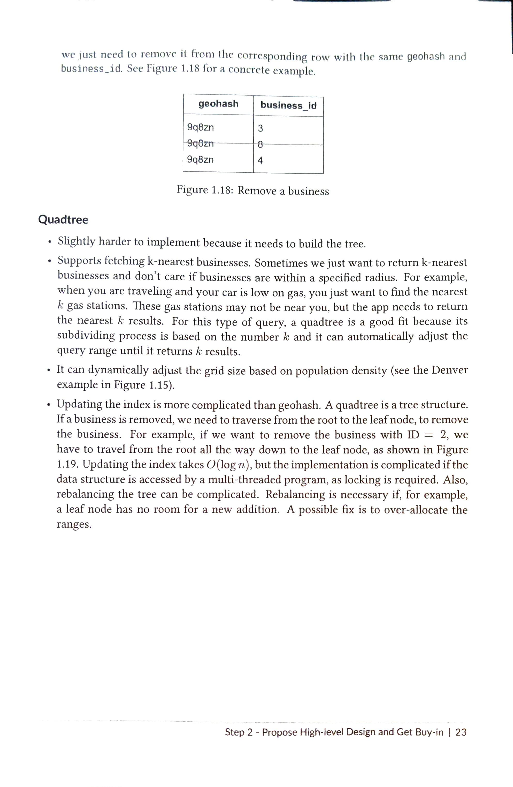
*Hình 1.18: Xóa một doanh nghiệp*

##### 2. Quadtree
- **Khó cài đặt hơn một chút**: Cần phải xây dựng cấu trúc cây hoàn chỉnh trong bộ nhớ.
- **Hỗ trợ truy vấn k-doanh nghiệp gần nhất (k-nearest businesses)**: Đôi khi chúng ta chỉ muốn lấy ra $k$ doanh nghiệp gần nhất mà không bận tâm liệu chúng có nằm trong một bán kính cố định hay không. 
  - *Ví dụ*: Khi bạn đang lái xe đi du lịch và xe sắp hết xăng, mục tiêu duy nhất của bạn là tìm ra $k$ trạm xăng gần nhất. Các trạm xăng này có thể không ở cự ly gần bạn, nhưng ứng dụng vẫn cần trả về đúng $k$ kết quả gần nhất có thể. 
  - Đối với loại truy vấn này, quadtree là một lựa chọn rất phù hợp vì tiến trình phân chia nhỏ (subdividing process) của nó dựa trên con số $k$, và nó có thể tự động nới rộng phạm vi truy vấn (query range) cho đến khi gom đủ $k$ kết quả.
- **Tự động điều chỉnh kích thước ô lưới theo mật độ dân số**: Quadtree có thể tự động điều chỉnh kích thước ô lưới dựa trên mật độ dân cư (xem ví dụ khu vực Denver ở Hình 1.15).
- **Cập nhật chỉ mục phức tạp hơn Geohash**: Quadtree là một cấu trúc dạng cây. Nếu một doanh nghiệp bị xóa, chúng ta phải duyệt từ node gốc xuống tận node lá để gỡ bỏ doanh nghiệp đó. 
  - *Ví dụ*: Nếu muốn xóa doanh nghiệp có `ID = 2`, chúng ta phải đi từ node gốc xuống tận node lá, như minh họa ở Hình 1.19.
  - Việc cập nhật chỉ mục tốn chi phí thời gian là $O(\log n)$, nhưng việc cài đặt trong thực tế rất phức tạp nếu cấu trúc dữ liệu này bị truy cập bởi một chương trình đa luồng (multi-threaded program), do bắt buộc phải dùng cơ chế khóa (locking).
  - Ngoài ra, việc tái cân bằng cây (rebalancing the tree) cũng rất phức tạp. Tái cân bằng là bắt buộc nếu, chẳng hạn, một node lá không còn khoảng trống để thêm một phần tử mới. Một giải pháp khắc phục khả dĩ là cấp phát dôi dư (over-allocate) các phạm vi ngay từ đầu.

# Phân Tích Kiến Trúc Kỹ Thuật: Dịch Vụ Định Vị Lân Cận (Proximity Service)

## 1. Mở Rộng Cơ Sở Dữ Liệu (Database Scaling)

Hệ thống tập trung tối ưu hai thực thể lưu trữ cốt lõi: bảng thông tin doanh nghiệp (`business table`) và bảng chỉ mục không gian địa lý (`geospatial index table`).


### 1.1. Bảng Thông Tin Doanh Nghiệp (Business Table)
- **Đặc điểm tải:** Do dung lượng toàn bộ dữ liệu doanh nghiệp vượt quá giới hạn của một máy chủ vật lý đơn lẻ, giải pháp tối ưu là phân mảnh (Sharding).
- **Chiến lược phân mảnh:** Sử dụng `business_id` làm Sharding Key. Cách tiếp cận này giúp phân phối tải đồng đều (Uniform Distribution) giữa các Shard, hạn chế hiện tượng Hotspot và giảm chi phí vận hành bảo trì.

### 1.2. Bảng Chỉ Mục Không Gian (Geospatial Index Table)


Đối với Geohash, có hai mô hình tổ chức schema cơ sở dữ liệu:

* **Phương án 1 (JSON Array):** Lưu danh sách các `business_id` dưới dạng một mảng JSON trong một hàng duy nhất cho mỗi mã `geohash`.
  * *Hạn chế:* Gặp trở ngại lớn khi cập nhật dữ liệu. Khi thêm hoặc sửa thông tin doanh nghiệp, hệ thống phải quét toàn bộ mảng JSON, kiểm tra trùng lặp và cần áp dụng cơ chế khóa dòng (Row-level Locking) để tránh Race Condition khi ghi đồng thời.

* **Phương án 2 (Tách hàng - Normalized Rows):** Mỗi doanh nghiệp trong cùng một vùng Geohash được lưu trữ thành một hàng riêng biệt với khóa phức hợp (Compound Primary Key): `(geohash, business_id)`.
  * *Ưu điểm:* Việc thêm (INSERT) hoặc xóa (DELETE) một bản ghi diễn ra độc lập, không đòi hỏi khóa bảng hay khóa dòng phức tạp, tối ưu hóa tốc độ ghi và tính toàn vẹn dữ liệu.

> [!NOTE]
> **Khuyến nghị kiến trúc:** Phương án 2 vượt trội hơn hẳn về khả năng mở rộng và đơn giản hóa thao tác ghi đồng thời.

---

## 2. Chiến Lược Scale Chỉ Mục & Cân Nhắc Bộ Nhớ Đệm (Caching)


### 2.1. Scale Chỉ Mục Không Gian
- **Quy mô dữ liệu:** Toàn bộ tập dữ liệu chỉ mục không gian (dù sử dụng Quadtree hay Geohash) có dung lượng tương đối nhỏ (chỉ khoảng vài GB), hoàn toàn nằm gọn trong bộ nhớ làm việc (Working Set) của các máy chủ cơ sở dữ liệu hiện đại.
- **Giải pháp:** Thay vì triển khai Sharding phức tạp ở tầng ứng dụng, hệ thống mở rộng thông qua các **Bản sao đọc (Read Replicas)**. Kiến trúc Master-Replica giải quyết triệt để vấn đề nghẽn cổ chai CPU và băng thông mạng đối với lưu lượng đọc cao (Read-Heavy).

### 2.2. Chiến Lược Caching và Thiết Kế Cache Key


- **Vấn đề với tọa độ (Latitude / Longitude):** Tọa độ GPS thu thập từ thiết bị di động liên tục dao động do sai số phần cứng và chuyển động nhỏ của người dùng, khiến Cache Hit Rate rất thấp nếu dùng trực tiếp tọa độ làm Cache Key.
- **Giải pháp Geohash Key:** Sử dụng tiền tố `geohash` làm Cache Key. Các truy vấn trong cùng một ô lưới sẽ chia sẻ chung kết quả, tối đa hóa tỷ lệ trúng bộ nhớ đệm (Cache Hit Ratio).

#### Phân loại dữ liệu Cache:
1. **Danh sách Business ID theo lưới:** Lưu trữ ánh xạ `geohash -> List<business_id>` trên Redis với các độ chính xác khác nhau (tương ứng các bán kính tìm kiếm: 500m, 1km, 2km, 5km).
   - Với 200 triệu doanh nghiệp trên 3 cấp độ chính xác, tổng dung lượng RAM ước tính chỉ khoảng ~5GB.
2. **Thông tin chi tiết doanh nghiệp (Business Objects):** Lưu ánh xạ `business_id -> Business Object` để phục vụ hydrat hóa (hydrate) dữ liệu hiển thị giao diện.

---

## 3. Triển Khai Đa Vùng (Multi-Region) & Bộ Lọc Nâng Cao


### 3.1. Phân Bố Theo Vùng (Regions & Availability Zones)
- **Giảm độ trễ (Latency Reduction):** Đặt dịch vụ dựa trên vị trí (Location-Based Service - LBS) gần người dùng nhất về mặt địa lý (ví dụ: người dùng Bắc Mỹ truy cập Data Center tại US-West, người dùng Châu Âu kết nối tới EU Region).
- **Phân bổ tải đồng đều:** Giảm tải cho các khu vực có mật độ dân số và nhu cầu dịch chuyển cao.
- **Tuân thủ quy định dữ liệu (Data Privacy / Sovereignty):** Đáp ứng các yêu cầu pháp lý (như GDPR) về việc lưu trữ và xử lý dữ liệu người dùng tại chỗ.

### 3.2. Lọc Theo Thời Gian Mở Cửa & Loại Hình Doanh Nghiệp
- Do không gian tìm kiếm đã được thu hẹp vào các lưới Geohash/Quadtree nhỏ, số lượng `business_id` trả về cho mỗi truy vấn là tương đối ít.
- **Workflow tối ưu:**
  1. Truy vấn lấy danh sách `business_id` ứng với các ô lưới.
  2. Hydrate dữ liệu chi tiết của các doanh nghiệp từ Cache / DB.
  3. Áp dụng logic lọc (Filter) theo trạng thái mở cửa hoặc danh mục kinh doanh ngay tại tầng dịch vụ (Application Layer).

---

Bạn có muốn tiếp tục thảo luận hoặc đi sâu vào phần tóm tắt và phân tích kiến trúc của các chương/phần tiếp theo không?

# Chương 1: Dịch Vụ Định Vị Lân Cận (Proximity Service)

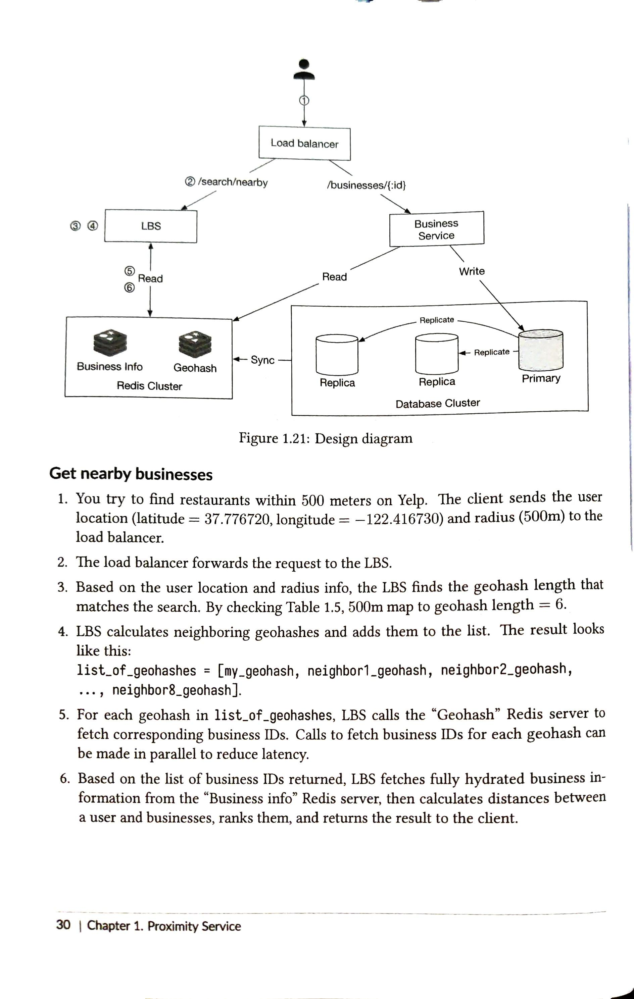

*Hình 1.21: Sơ đồ thiết kế hệ thống (Design diagram)*

---

### Quy trình lấy danh sách địa điểm doanh nghiệp lân cận (Get nearby businesses)

1. Client gửi vị trí người dùng (vĩ độ / latitude = `37.776720`, kinh độ / longitude = `-122.416730`) và bán kính tìm kiếm (radius = `500m`) đến bộ cân bằng tải (**Load Balancer**).
2. Bộ cân bằng tải điều hướng (**forward**) yêu cầu đến dịch vụ định vị (**LBS - Location-Based Service**).
3. Dựa trên thông tin vị trí và bán kính của người dùng, LBS xác định độ dài chuỗi **Geohash** phù hợp.
4. LBS tính toán các chuỗi Geohash lân cận (**neighboring geohashes**) và thêm chúng vào danh sách. Kết quả có dạng như sau:
   ```python
   list_of_geohashes = [
       my_geohash,
       neighbor1_geohash,
       neighbor2_geohash,
       ...,
       neighbor8_geohash
   ]
   ```
5. Đối với mỗi Geohash trong `list_of_geohashes`, LBS gọi đến cụm máy chủ Redis "Geohash" (**Geohash Redis cluster**) để truy xuất các mã định danh doanh nghiệp (**business IDs**) tương ứng. Các lệnh gọi truy xuất business ID cho từng geohash có thể được thực thi song song (**parallel execution**) nhằm giảm thiểu độ trễ (**latency**).
6. Dựa trên danh sách các business ID trả về, LBS truy xuất thông tin doanh nghiệp đầy đủ (**fully hydrated business information**) từ cụm máy chủ Redis "Business info" (**Business info Redis cluster**). Sau đó, hệ thống tính toán khoảng cách giữa người dùng và các doanh nghiệp, xếp hạng (**ranking**) các kết quả và trả về cho client.

---

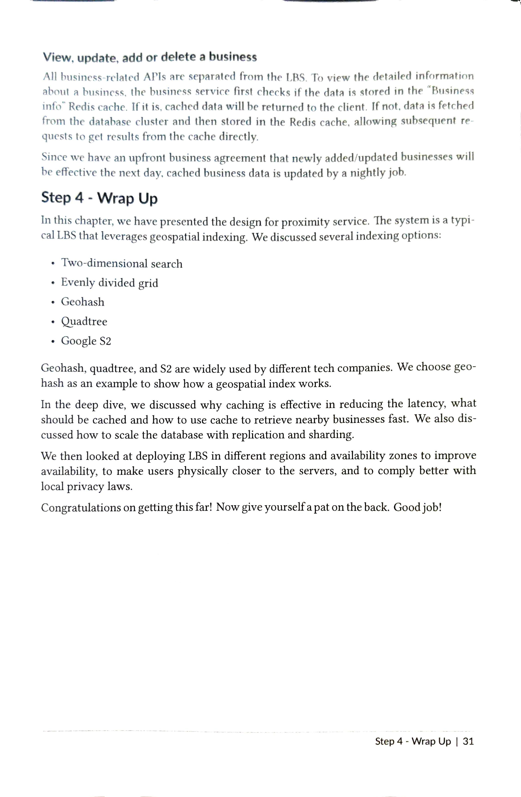

### Xem, cập nhật, thêm hoặc xóa một doanh nghiệp (View, update, add or delete a business)

Toàn bộ các API liên quan đến nghiệp vụ doanh nghiệp đều được tách biệt hoàn toàn khỏi LBS. 

* Để xem thông tin chi tiết về một doanh nghiệp, dịch vụ doanh nghiệp (**Business Service**) trước tiên kiểm tra xem dữ liệu đã được lưu trữ trong bộ nhớ đệm **Business info Redis cache** hay chưa. 
* Nếu dữ liệu đã có trong cache (**Cache Hit**), dữ liệu lưu đệm sẽ được trả ngay về cho client. 
* Nếu không có trong cache (**Cache Miss**), dữ liệu sẽ được đọc từ cụm cơ sở dữ liệu (**Database Cluster**) và sau đó ghi ngược vào bộ đệm Redis cache, giúp các yêu cầu tiếp theo có thể lấy trực tiếp từ cache.

> [!NOTE]
> Do chúng ta đã có thỏa thuận nghiệp vụ từ trước (**upfront business agreement**) rằng các doanh nghiệp mới được thêm vào hoặc cập nhật sẽ chỉ có hiệu lực vào ngày hôm sau, nên dữ liệu doanh nghiệp trong cache sẽ được cập nhật đồng loạt thông qua một tác vụ xử lý ban đêm (**nightly batch job**).

---

## Bước 4 - Tổng Kết (Step 4 - Wrap Up)

Trong chương này, chúng ta đã cùng nhau thiết kế một dịch vụ định vị lân cận (**LBS**) điển hình dựa trên chỉ mục không gian địa lý (**geospatial indexing**). Chúng ta đã phân tích nhiều giải pháp đánh chỉ mục khác nhau:
* Tìm kiếm hai chiều (**Two-dimensional search**)
* Lưới chia đều (**Evenly divided grid**)
* **Geohash**
* **Quadtree**
* **Google S2**

Geohash, Quadtree và S2 đều là những công nghệ được sử dụng rộng rãi bởi nhiều công ty công nghệ lớn.

Trong phần đào sâu kiến trúc (**deep dive**), chúng ta đã phân tích:
* Lý do tại sao việc sử dụng bộ nhớ đệm (**caching**) lại mang lại hiệu quả cao trong việc giảm độ trễ (**low latency**).
* Những loại dữ liệu nào nên được đưa vào cache và cách sử dụng cache để truy xuất nhanh chóng các doanh nghiệp lân cận.
* Cách thức mở rộng quy mô cơ sở dữ liệu (**scale the database**) thông qua kỹ thuật nhân bản (**replication**) và phân mảnh dữ liệu (**sharding**).
* Triển khai hệ thống LBS trên nhiều khu vực địa lý (**multiple regions**) và vùng khả dụng (**availability zones - AZ**) nhằm nâng cao tính sẵn sàng cao (**High Availability**), đưa người dùng đến gần các máy chủ hơn về mặt vật lý, cũng như tuân thủ tốt hơn các quy định pháp lý về quyền riêng tư dữ liệu cục bộ (**local privacy laws**).

Chúc mừng bạn đã hoàn thành chặng đường này! Hãy tự thưởng cho mình một tràng pháo tay. Làm rất tốt!

---

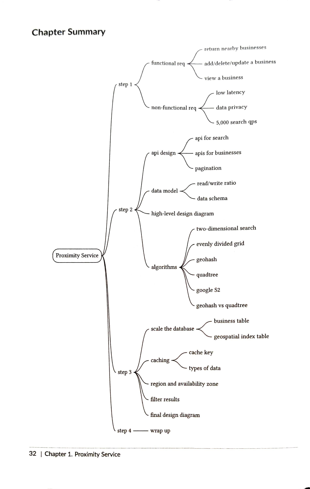

## Tóm Tắt Toàn Chương (Chapter Summary)

* **Yêu cầu chức năng (Functional Requirements):**
  * Trả về danh sách doanh nghiệp lân cận (*Return nearby businesses*).
  * Thêm / xóa / cập nhật một doanh nghiệp (*Add / delete / update a business*).
  * Xem thông tin chi tiết một doanh nghiệp (*View a business*).
* **Yêu cầu phi chức năng (Non-functional Requirements):**
  * Độ trễ thấp (*Low latency*).
  * Quyền riêng tư dữ liệu (*Data privacy*).
  * Thông lượng tìm kiếm: 5.000 QPS (*5,000 search QPS*).
* **Thiết kế mức cao (High-level Design):**
  * API cho tính năng tìm kiếm (*API for search*).
  * APIs cho nghiệp vụ doanh nghiệp (*APIs for businesses*).
  * Phân trang (*Pagination*).
  * Tỷ lệ Đọc/Ghi (*Read/Write ratio*).
  * Mô hình dữ liệu (*Data model*).
  * Lược đồ dữ liệu (*Data schema*).
  * Sơ đồ thiết kế mức cao (*High-level design diagram*).
* **Thuật toán chỉ mục địa lý (Geospatial Algorithms):**
  * Tìm kiếm hai chiều (*Two-dimensional search*).
  * Lưới chia đều (*Evenly divided grid*).
  * Geohash.
  * Quadtree.
  * Google S2.
  * So sánh Geohash với Quadtree (*Geohash vs Quadtree*).
* **Mở rộng cơ sở dữ liệu (Scale the Database):**
  * Bảng dữ liệu doanh nghiệp (*Business table*).
  * Bảng chỉ mục không gian địa lý (*Geospatial index table*).
* **Chiến lược Caching (Caching):**
  * Khóa bộ đệm (*Cache key*).
  * Các loại dữ liệu cần cache (*Types of data*).
* **Mở rộng & Tối ưu hóa (Scale & Optimization):**
  * Khu vực và vùng khả dụng (*Region and availability zone*).
  * Lọc kết quả tìm kiếm (*Filter results*).
  * Sơ đồ thiết kế hoàn thiện (*Final design diagram*).
* **Tổng kết (Wrap-up).**

---

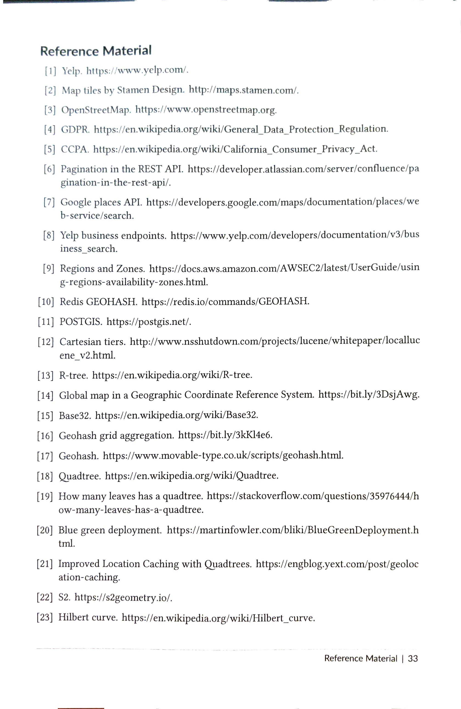

## Tài Liệu Tham Khảo (Reference Material)

* **[1]** Yelp: [https://www.yelp.com/](https://www.yelp.com/)
* **[2]** Map tiles by Stamen Design: [http://maps.stamen.com/](http://maps.stamen.com/)
* **[3]** OpenStreetMap: [https://www.openstreetmap.org](https://www.openstreetmap.org)
* **[4]** GDPR: [https://en.wikipedia.org/wiki/General_Data_Protection_Regulation](https://en.wikipedia.org/wiki/General_Data_Protection_Regulation)
* **[5]** CCPA: [https://en.wikipedia.org/wiki/California_Consumer_Privacy_Act](https://en.wikipedia.org/wiki/California_Consumer_Privacy_Act)
* **[6]** Pagination in the REST API: [https://developer.atlassian.com/server/confluence/pagination-in-the-rest-api/](https://developer.atlassian.com/server/confluence/pagination-in-the-rest-api/)
* **[7]** Google Places API: [https://developers.google.com/maps/documentation/places/web-service/search](https://developers.google.com/maps/documentation/places/web-service/search)
* **[8]** Yelp business endpoints: [https://www.yelp.com/developers/documentation/v3/business_search](https://www.yelp.com/developers/documentation/v3/business_search)
* **[9]** Regions and Zones: [https://docs.aws.amazon.com/AWSEC2/latest/UserGuide/using-regions-availability-zones.html](https://docs.aws.amazon.com/AWSEC2/latest/UserGuide/using-regions-availability-zones.html)
* **[10]** Redis GEOHASH: [https://redis.io/commands/GEOHASH](https://redis.io/commands/GEOHASH)
* **[11]** POSTGIS: [https://postgis.net/](https://postgis.net/)
* **[12]** Cartesian tiers: [http://www.nsshutdown.com/projects/lucene/whitepaper/locallucene_v2.html](http://www.nsshutdown.com/projects/lucene/whitepaper/locallucene_v2.html)
* **[13]** R-tree: [https://en.wikipedia.org/wiki/R-tree](https://en.wikipedia.org/wiki/R-tree)
* **[15]** Base32: [https://en.wikipedia.org/wiki/Base32](https://en.wikipedia.org/wiki/Base32)
* **[16]** Geohash grid aggregation: [https://bit.ly/3kKl4e6](https://bit.ly/3kKl4e6)
* **[17]** Geohash: [https://www.movable-type.co.uk/scripts/geohash.html](https://www.movable-type.co.uk/scripts/geohash.html)
* **[18]** Quadtree: [https://en.wikipedia.org/wiki/Quadtree](https://en.wikipedia.org/wiki/Quadtree)
* **[19]** How many leaves has a quadtree: [https://stackoverflow.com/questions/35976444/how-many-leaves-has-a-quadtree](https://stackoverflow.com/questions/35976444/how-many-leaves-has-a-quadtree)
* **[20]** Blue green deployment: [https://martinfowler.com/bliki/BlueGreenDeployment.html](https://martinfowler.com/bliki/BlueGreenDeployment.html)
* **[21]** Improved Location Caching with Quadtrees: [https://engblog.yext.com/post/geolocation-caching](https://engblog.yext.com/post/geolocation-caching)
* **[22]** S2: [https://s2geometry.io/](https://s2geometry.io/)
* **[23]** Hilbert curve: [https://en.wikipedia.org/wiki/Hilbert_curve](https://en.wikipedia.org/wiki/Hilbert_curve)

---

## Điều hướng

- [00-loi-mo-dau.md](00-loi-mo-dau.md)
- [Mục lục](README.md)
- [chuong-02-nearby-friends.md](chuong-02-nearby-friends.md)
