[← Chương trước](chuong-01-proximity-service.md) | [Mục lục](README.md) | [Chương tiếp theo →](chuong-03-google-maps.md)

---

### Tài liệu tham khảo (Tiếp theo từ Chương 1)

[25] Geo-fence. https://en.wikipedia.org/wiki/Geo-fence.  
[26] Region cover. https://s2.sidewalklabs.com/regioncoverer/.  
[27] Bingmap. https://bit.ly/30ytSfG  
[28] MongoDB. https://docs.mongodb.com/manual/tutorial/build-a-2d-index/.  
[29] Geospatial Indexing: The 10 Million QPS Redis Architecture Powering Lyft. https://www.youtube.com/watch?v=cSFWlF96Sds&t=2155s.  
[30] Geo Shape Type. https://www.elastic.co/guide/en/elasticsearch/reference/1.6/mapping-geo-shape-type.html.  
[31] Geosharded Recommendations Part 1: Sharding Approach. https://medium.com/tinder-engineering/geosharded-recommendations-part-1-sharding-approach-d5ds4e0ec77a.  
[32] Get the last known location. https://developer.android.com/training/location/retrieve-current#Challenges.  

*34 | Chương 1: Dịch vụ lân cận (Proximity Service)*

---

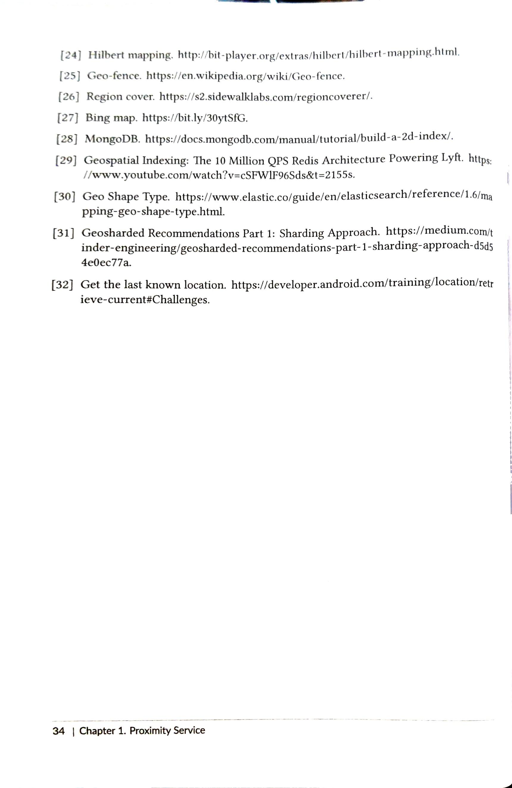

---

# Chương 2: Tìm Bạn Bè Gần Đây (Nearby Friends)

Trong chương này, chúng ta sẽ thiết kế một hệ thống backend có khả năng mở rộng quy mô lớn (scalable backend system) cho một tính năng ứng dụng di động mới mang tên **“Bạn bè gần đây” (Nearby Friends)**. Đối với một người dùng đồng thuận tham gia (opt-in user) và cấp quyền truy cập vị trí của họ, tính năng này sẽ hiển thị danh sách bạn bè đang ở gần họ về mặt địa lý. Để xem một ví dụ thực tế trong thế giới thực, vui lòng tham khảo bài viết này [1] về một tính năng tương tự trong ứng dụng Facebook.

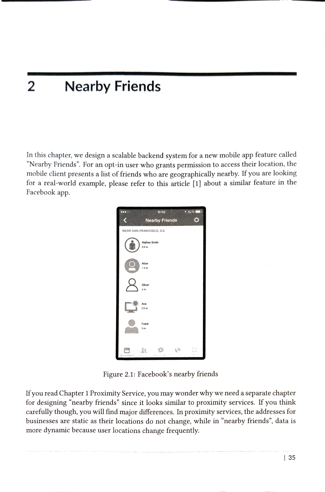  
*Hình 2.1: Tính năng Nearby Friends của Facebook*

Nếu bạn đã đọc Chương 1: Dịch vụ lân cận (*Proximity Service*), bạn có thể tự hỏi tại sao chúng ta lại cần một chương riêng để thiết kế tính năng “Bạn bè gần đây” trong khi nhìn qua nó có vẻ tương tự như các dịch vụ tìm kiếm địa điểm xung quanh. Tuy nhiên, nếu suy xét kỹ lưỡng, bạn sẽ nhận thấy những điểm khác biệt rất lớn:
* Trong các **dịch vụ lân cận (Proximity Services)**, địa chỉ của các doanh nghiệp/địa điểm là **tĩnh (static)** vì vị trí địa lý của chúng không thay đổi.
* Trong tính năng **“Bạn bè gần đây” (Nearby Friends)**, dữ liệu có tính chất **động (dynamic)** cao hơn rất nhiều do vị trí của người dùng thay đổi liên tục và thường xuyên.

*Chương 2: Tìm Bạn Bè Gần Đây | 35*

---

## Bước 1 - Hiểu Rõ Bài Toán và Xác Định Phạm Vi Thiết Kế (Understand the Problem and Establish Design Scope)

Bất kỳ hệ thống backend nào ở quy mô (scale) của Facebook đều cực kỳ phức tạp. Trước khi bắt đầu bước vào thiết kế chi tiết, chúng ta cần đặt các câu hỏi làm rõ (clarification questions) để thu hẹp phạm vi bài toán.

* **Ứng viên:** Khoảng cách địa lý bao xa thì được coi là "gần đây" (nearby)?  
  **Người phỏng vấn:** 5 dặm (khoảng 8 km). Con số này nên có khả năng cấu hình linh hoạt (configurable).

* **Ứng viên:** Tôi có thể giả định khoảng cách được tính theo đường chim bay (straight-line distance) giữa hai người dùng không? Trong thực tế, có thể có một con sông ngăn cách giữa hai người, dẫn đến khoảng cách di chuyển thực tế dài hơn.  
  **Người phỏng vấn:** Đúng, đó là một giả định hoàn toàn hợp lý.

* **Ứng viên:** Ứng dụng có bao nhiêu người dùng? Tôi có thể giả định có 1 tỷ người dùng và 10% trong số đó sử dụng tính năng "Bạn bè gần đây" không?  
  **Người phỏng vấn:** Được, đó là một giả định hợp lý.

* **Ứng viên:** Chúng ta có cần lưu trữ lịch sử vị trí (location history) không?  
  **Người phỏng vấn:** Có, dữ liệu lịch sử vị trí có thể rất có giá trị cho nhiều mục đích khác nhau, chẳng hạn như học máy (Machine Learning).

* **Ứng viên:** Chúng ta có thể giả định rằng nếu một người bạn không hoạt động (inactive) trong hơn 10 phút, người bạn đó sẽ biến mất khỏi danh sách bạn bè gần đây không? Hay chúng ta nên hiển thị vị trí được biết gần nhất (last known location)?  
  **Người phỏng vấn:** Chúng ta có thể giả định rằng những người bạn không hoạt động sẽ không còn được hiển thị nữa.

* **Ứng viên:** Chúng ta có cần phải lo lắng về quyền riêng tư và các luật bảo vệ dữ liệu như GDPR hay CCPA không?  
  **Người phỏng vấn:** Câu hỏi rất hay. Để đơn giản hóa bài toán lúc này, tạm thời chúng ta chưa cần bận tâm về vấn đề đó.

---

### Yêu cầu chức năng (Functional Requirements)
* Người dùng có thể xem danh sách bạn bè ở gần trên ứng dụng di động của họ. Mỗi mục (entry) trong danh sách bạn bè gần đây sẽ bao gồm **khoảng cách (distance)** và một **dấu thời gian (timestamp)** cho biết thời điểm khoảng cách đó được cập nhật lần cuối.
* Danh sách bạn bè gần đây phải được cập nhật sau mỗi vài giây.

### Yêu cầu phi chức năng (Non-functional Requirements)
* **Độ trễ thấp (Low Latency):** Việc nhận các bản cập nhật vị trí từ bạn bè mà không bị trễ quá nhiều là cực kỳ quan trọng.
* **Độ tin cậy (Reliability):** Hệ thống về tổng thể cần phải có độ tin cậy cao, nhưng việc thỉnh thoảng bị mất một vài điểm dữ liệu (data point loss) là có thể chấp nhận được.
* **Tính nhất quán cuối cùng (Eventual Consistency):** Kho lưu trữ dữ liệu vị trí không yêu cầu tính nhất quán mạnh (strong consistency). Độ trễ vài giây trong việc nhận dữ liệu vị trí giữa các bản sao dữ liệu khác nhau (replicas) là hoàn toàn chấp nhận được.

---

### Ước tính sơ bộ (Back-of-the-envelope Estimation)

Hãy cùng thực hiện ước tính sơ bộ để xác định quy mô tiềm năng và các thách thức kỹ thuật mà giải pháp của chúng ta cần giải quyết. Dưới đây là một số ràng buộc và giả định:

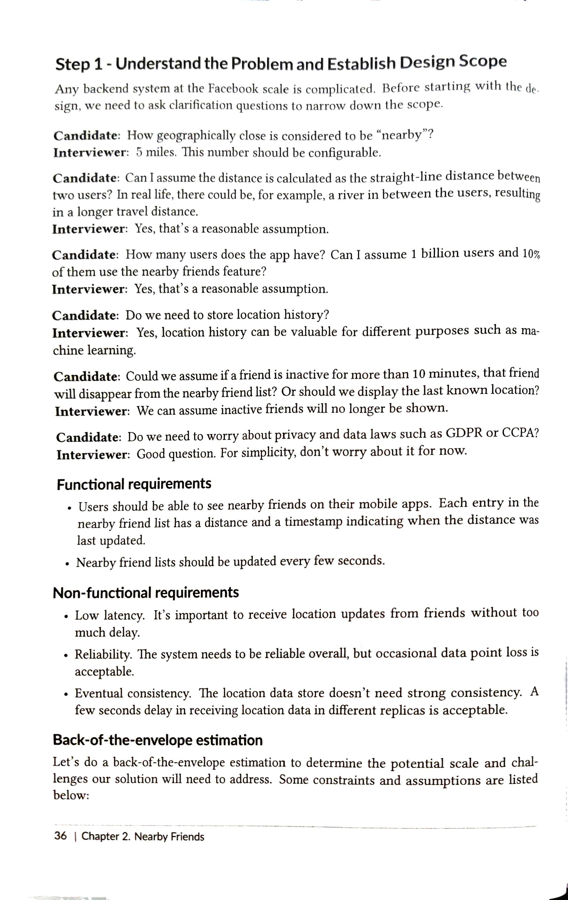

* Bạn bè gần đây được định nghĩa là những người bạn có vị trí nằm trong bán kính **5 dặm**.
* Khoảng thời gian làm mới vị trí (location refresh interval) là **30 giây**. Lý do là tốc độ đi bộ của con người khá chậm (trung bình 3 ~ 4 dặm/giờ). Quãng đường di chuyển trong 30 giây không tạo ra sự khác biệt đáng kể đối với tính năng “Bạn bè gần đây”.
* Trung bình có **100 triệu người dùng** sử dụng tính năng “Bạn bè gần đây” mỗi ngày (DAU - Daily Active Users).
* Giả sử số lượng người dùng đồng thời (concurrent users) bằng 10% của DAU, do đó số lượng người dùng đồng thời là **10 triệu**.
* Trung bình mỗi người dùng có **400 bạn bè**. Giả định toàn bộ số bạn bè này đều sử dụng tính năng “Bạn bè gần đây”.
* Ứng dụng hiển thị **20 bạn bè gần đây trên mỗi trang** và có thể tải thêm bạn bè gần đây khi có yêu cầu (pagination / infinite scroll).

#### Tính toán QPS (Queries Per Second)
* 100 triệu DAU
* Số người dùng đồng thời: $10\% \times 100\text{ triệu} = 10\text{ triệu}$ người dùng đồng thời
* Người dùng gửi báo cáo vị trí của họ sau mỗi 30 giây.
* **QPS cập nhật vị trí (Location update QPS)**:
$$\text{QPS} = \frac{10\text{ triệu}}{30\text{ giây}} \approx 334{,}000$$

---

## Bước 2 - Đề Xuất Thiết Kế Cấp Cao và Đạt Được Sự Thống Nhất (Step 2 - Propose High-level Design and Get Buy-in)

Trong phần này, chúng ta sẽ thảo luận về các nội dung sau:
* Thiết kế cấp cao (High-level design)
* Thiết kế API (API design)
* Mô hình dữ liệu (Data model)

Trong các chương khác, chúng ta thường thảo luận về thiết kế API và mô hình dữ liệu trước khi đi vào thiết kế cấp cao. Tuy nhiên, đối với bài toán này, giao thức truyền thông giữa client và server có thể không phải là giao thức HTTP thông thường (không phải là request/response một chiều), bởi vì chúng ta cần phải **đẩy (push)** dữ liệu vị trí đến tất cả bạn bè. Nếu không hiểu rõ thiết kế cấp cao, rất khó để hình dung các API sẽ trông như thế nào. Do đó, chúng ta sẽ thảo luận về thiết kế cấp cao trước.

---

### Thiết kế cấp cao (High-level Design)

Ở mức độ trừu tượng cấp cao, bài toán này đòi hỏi một thiết kế có cơ chế truyền thông điệp hiệu quả (efficient message passing). Về mặt khái niệm, một người dùng muốn nhận được cập nhật vị trí từ mọi người bạn đang hoạt động (active friends) ở gần họ.

Về mặt lý thuyết, điều này có thể được thực hiện hoàn toàn theo mô hình **ngang hàng (Peer-to-Peer - P2P)**, nghĩa là một người dùng có thể duy trì một kết nối liên tục (persistent connection) tới mọi người bạn đang hoạt động khác ở vùng lân cận (Hình 2.2).

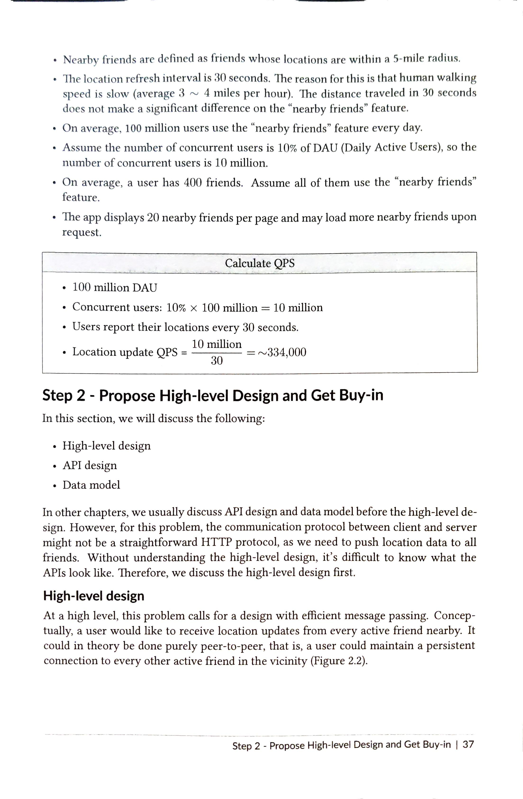

---

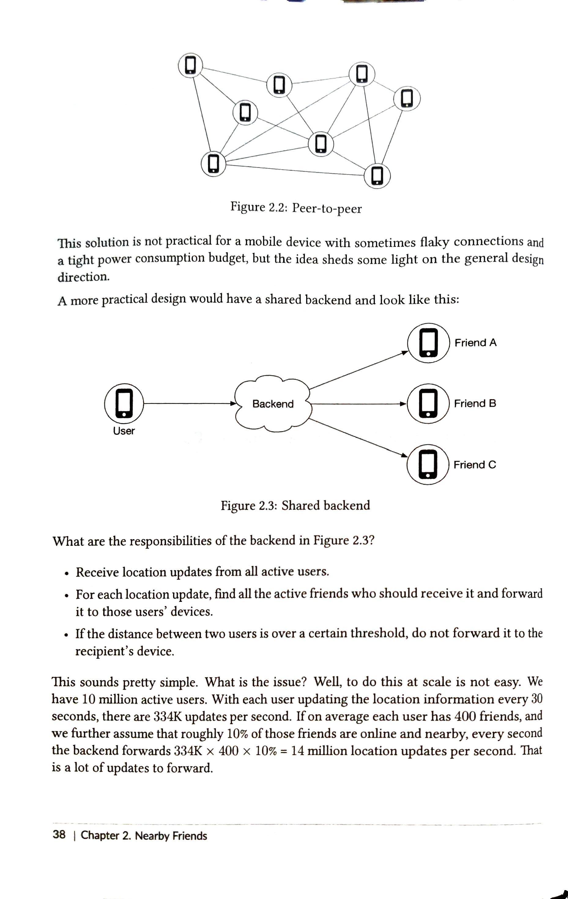  
*Hình 2.2: Mô hình ngang hàng (Peer-to-peer)*

Giải pháp P2P này **không thực tế** đối với thiết bị di động vốn thường có kết nối mạng chập chờn (flaky connections) và ngân sách tiêu thụ năng lượng (pin) rất hạn chế. Tuy nhiên, ý tưởng này gợi mở cho chúng ta hướng thiết kế chung.

Một thiết kế thực tế hơn sẽ sử dụng một hệ thống backend dùng chung (shared backend) và có cấu trúc như sau:

  
*Hình 2.3: Mô hình Backend dùng chung (Shared backend)*

Trách nhiệm của backend trong Hình 2.3 là gì?
1. Nhận các bản cập nhật vị trí từ tất cả người dùng đang hoạt động.
2. Với mỗi bản cập nhật vị trí, tìm tất cả bạn bè đang hoạt động thỏa điều kiện nhận thông báo và chuyển tiếp (forward) bản cập nhật đó tới thiết bị của những người dùng này.
3. Nếu khoảng cách giữa hai người dùng vượt quá một ngưỡng nhất định (threshold), không chuyển tiếp bản cập nhật đến thiết bị của người nhận.

Điều này nghe có vẻ khá đơn giản. Vậy vấn đề nằm ở đâu? 

Thực hiện điều này ở quy mô lớn (at scale) hoàn toàn không dễ dàng. Chúng ta có **10 triệu người dùng hoạt động đồng thời**. Với việc mỗi người dùng cập nhật thông tin vị trí sau mỗi 30 giây, sẽ có **334.000 lượt cập nhật mỗi giây**. Nếu trung bình mỗi người dùng có 400 bạn bè, và giả định thêm rằng có khoảng 10% trong số những người bạn đó đang trực tuyến (online) và ở gần, thì mỗi giây hệ thống backend phải chuyển tiếp:

$$334{,}000 \times 400 \times 10\% = 13{,}360{,}000 \approx 14\text{ triệu bản cập nhật vị trí mỗi giây}$$

Đó là một khối lượng dữ liệu khổng lồ cần phải chuyển tiếp (forward).

*38 | Chương 2: Tìm Bạn Bè Gần Đây*

---

### Thiết kế đề xuất (Proposed Design)

Ban đầu, chúng ta sẽ đưa ra một thiết kế cấp cao cho hệ thống backend ở quy mô nhỏ hơn. Sau đó, trong phần đào sâu chi tiết (Deep Dive), chúng ta sẽ tối ưu hóa thiết kế này để đáp ứng quy mô cực lớn (scale).

Hình 2.4 minh họa thiết kế cơ bản đáp ứng được các yêu cầu chức năng. Hãy cùng điểm qua từng thành phần trong thiết kế này:

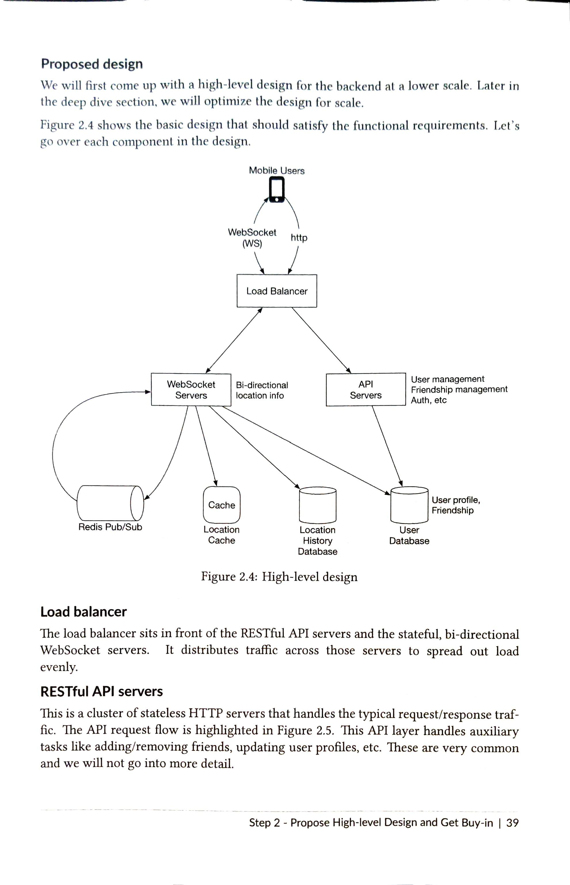  
*Hình 2.4: Thiết kế cấp cao (High-level design)*

> [!NOTE]
> **Các thành phần trong sơ đồ Hình 2.4 bao gồm:**
> * **Mobile Users (Người dùng di động):** Kết nối qua WebSocket (kết nối hai chiều) hoặc HTTP.
> * **Load Balancer (Bộ cân bằng tải):** Điều phối lưu lượng mạng đến các cụm server phù hợp.
> * **WebSocket Servers (Stateful, Bi-directional):** Cụm server duy trì kết nối WebSocket hai chiều phục vụ trao đổi thông tin vị trí theo thời gian thực.
> * **RESTful API Servers (Stateless):** Xử lý xác thực (Auth), quản lý người dùng (User management), quản lý bạn bè (Friendship management).
> * **Redis Pub/Sub:** Hạ tầng trung gian truyền thông điệp phân tán để định tuyến vị trí người dùng.
> * **Location Cache:** Bộ nhớ đệm lưu trữ vị trí hiện tại.
> * **User Database & Friendship Database / Cache:** Cơ sở dữ liệu và bộ nhớ đệm hồ sơ người dùng và quan hệ bạn bè.
> * **Location History Database:** Cơ sở dữ liệu lưu vết lịch sử di chuyển phục vụ phân tích / ML.

#### Bộ cân bằng tải (Load Balancer)
Bộ cân bằng tải (Load Balancer) đứng trước các máy chủ RESTful API và các máy chủ WebSocket hai chiều có lưu trạng thái (stateful, bi-directional WebSocket servers). Nó phân phối lưu lượng truy cập đồng đều trên toàn bộ các máy chủ để dàn trải tải trọng (load) một cách hợp lý.

#### Các máy chủ RESTful API (RESTful API Servers)
Đây là một cụm máy chủ HTTP không trạng thái (stateless HTTP servers cluster) xử lý lưu lượng yêu cầu/phản hồi (request/response) thông thường. Luồng yêu cầu API được biểu diễn trong Hình 2.4 (và được nhấn mạnh trong Hình 2.5). Tầng API này đảm nhận các tác vụ phụ trợ (auxiliary tasks) như thêm/xóa bạn bè, cập nhật hồ sơ người dùng, v.v. Đây là những tính năng rất phổ biến nên chúng ta sẽ không đi sâu vào chi tiết thêm.

---

*Bước 2 - Đề Xuất Thiết Kế Cấp Cao và Đạt Được Sự Thống Nhất | 39*

# CHƯƠNG 2: TÌM BẠN BÈ GẦN ĐÂY (NEARBY FRIENDS)

---

## BƯỚC 2 - ĐỀ XUẤT THIẾT KẾ MỨC CAO VÀ THỐNG NHẤT PHƯƠNG ÁN (PROPOSE HIGH-LEVEL DESIGN AND GET BUY-IN) *(Tiếp theo)*

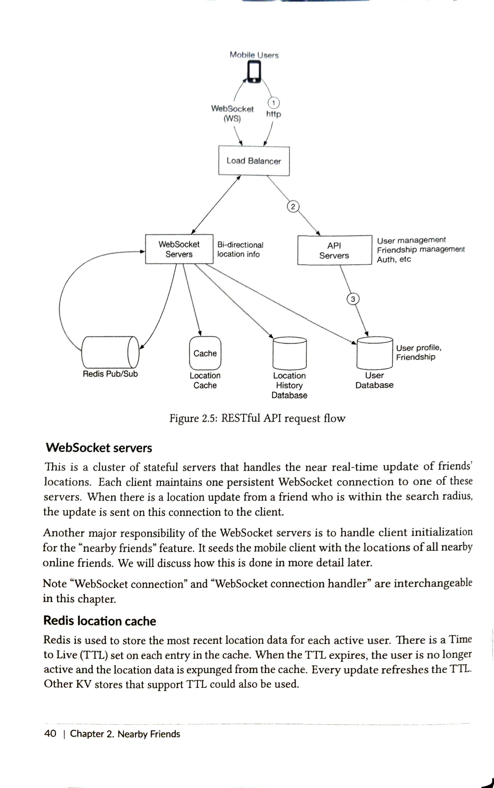
*Hình 2.5: Luồng yêu cầu RESTful API (RESTful API request flow)*

### Máy chủ WebSocket (WebSocket Servers)
Đây là một cụm các máy chủ có lưu trạng thái (**stateful servers cluster**) chịu trách nhiệm xử lý các cập nhật vị trí của bạn bè theo thời gian gần thực (**near real-time**). Mỗi ứng dụng khách (**client**) duy trì một kết nối WebSocket bền bỉ (**persistent connection**) duy nhất tới một trong các máy chủ này. Khi có cập nhật vị trí từ một người bạn nằm trong bán kính tìm kiếm (**search radius**), cập nhật đó sẽ được gửi qua kết nối này tới client.

Một trách nhiệm chính khác của các máy chủ WebSocket là xử lý quá trình khởi tạo phía client (**client initialization**) cho tính năng "tìm bạn bè gần đây" (*nearby friends*). Nó nạp trước dữ liệu khởi tạo (**seed**) cho ứng dụng di động danh sách vị trí của tất cả bạn bè đang trực tuyến (**online friends**) ở gần. Chúng ta sẽ thảo luận chi tiết hơn về cách thực hiện việc này ở phần sau.

> [!NOTE]
> Lưu ý rằng cụm từ *"kết nối WebSocket" (WebSocket connection)* và *"bộ xử lý kết nối WebSocket" (WebSocket connection handler)* có thể dùng thay thế cho nhau trong chương này.

### Bộ nhớ đệm vị trí Redis (Redis Location Cache)
Redis được sử dụng để lưu trữ dữ liệu vị trí gần đây nhất cho mỗi người dùng đang hoạt động (**active user**). Có một khoảng thời gian sống (**Time to Live - TTL**) được thiết lập trên mỗi mục dữ liệu trong bộ nhớ đệm (**cache entry**). Khi TTL hết hạn, người dùng đó được coi là không còn hoạt động nữa và dữ liệu vị trí sẽ bị xóa hoàn toàn khỏi bộ nhớ đệm (**expunged from the cache**). Mỗi lần cập nhật vị trí mới sẽ làm mới lại giá trị TTL (**refresh the TTL**). Các hệ thống lưu trữ khóa - giá trị (**Key-Value / KV stores**) khác có hỗ trợ TTL cũng có thể được sử dụng thay thế.

---

### Cơ sở dữ liệu người dùng (User Database)
Cơ sở dữ liệu người dùng lưu trữ dữ liệu thông tin người dùng và dữ liệu mối quan hệ bạn bè (**user friendship data**). Một cơ sở dữ liệu quan hệ (**relational database**) hoặc cơ sở dữ liệu phi quan hệ (**NoSQL database**) đều có thể được sử dụng cho mục đích này.

### Cơ sở dữ liệu lịch sử vị trí (Location History Database)
Cơ sở dữ liệu này lưu trữ dữ liệu vị trí trong lịch sử của người dùng. Nó không liên quan trực tiếp đến tính năng "tìm bạn bè gần đây" (*nearby friends*).

### Máy chủ Redis Pub/Sub (Redis Pub/Sub Server)
Redis Pub/Sub [2] là một trục truyền thông điệp (**message bus**) rất gọn nhẹ (**lightweight**). Các kênh (**channels**) trong Redis Pub/Sub có chi phí khởi tạo rất rẻ (**cheap to create**). Một máy chủ Redis hiện đại với dung lượng bộ nhớ hàng Gigabyte (GBs) có thể chứa hàng triệu kênh (còn được gọi là các chủ đề - **topics**). Hình 2.6 minh họa cách thức hoạt động của Redis Pub/Sub.

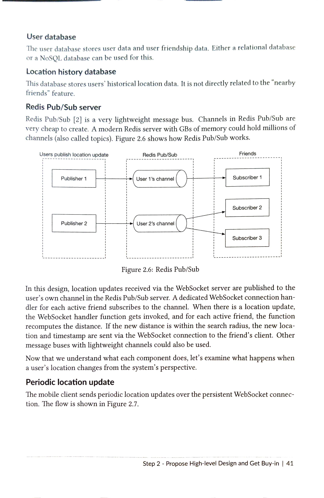
*Hình 2.6: Redis Pub/Sub*

Trong thiết kế này, các cập nhật vị trí nhận được thông qua máy chủ WebSocket sẽ được xuất bản (**published**) tới kênh riêng của chính người dùng đó trên máy chủ Redis Pub/Sub. Một bộ xử lý kết nối WebSocket (**WebSocket connection handler**) chuyên dụng cho mỗi người bạn đang hoạt động sẽ đăng ký theo dõi (**subscribes**) vào kênh này. Khi có cập nhật vị trí:
1. Hàm xử lý WebSocket (**WebSocket handler function**) được kích hoạt.
2. Đối với mỗi người bạn đang hoạt động, hàm sẽ tính toán lại khoảng cách (**recomputes the distance**).
3. Nếu khoảng cách mới nằm trong bán kính tìm kiếm (**search radius**), vị trí mới cùng dấu thời gian (**timestamp**) sẽ được gửi qua kết nối WebSocket tới client của người bạn đó. 

Các trục truyền thông điệp (**message buses**) khác hỗ trợ các kênh gọn nhẹ (**lightweight channels**) cũng có thể được sử dụng.

Bây giờ khi đã hiểu rõ chức năng của từng thành phần, chúng ta hãy xem xét điều gì xảy ra khi vị trí của một người dùng thay đổi dưới góc nhìn của toàn hệ thống.

### Cập nhật vị trí định kỳ (Periodic Location Update)
Ứng dụng di động gửi các cập nhật vị trí định kỳ thông qua kết nối WebSocket bền bỉ (**persistent WebSocket connection**). Luồng xử lý được thể hiện trong Hình 2.7.

---

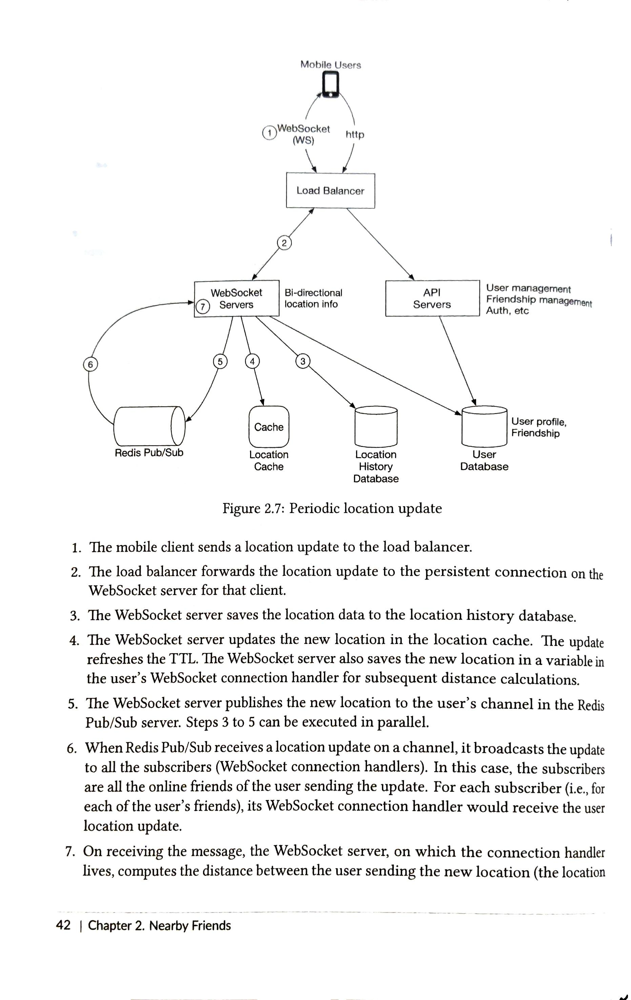
*Hình 2.7: Cập nhật vị trí định kỳ (Periodic location update)*

1. Ứng dụng di động gửi cập nhật vị trí tới bộ cân bằng tải (**Load Balancer**).
2. Bộ cân bằng tải chuyển tiếp (**forwards**) cập nhật vị trí tới kết nối bền bỉ trên máy chủ WebSocket dành riêng cho client đó.
3. Máy chủ WebSocket lưu dữ liệu vị trí vào cơ sở dữ liệu lịch sử vị trí (**location history database**).
4. Máy chủ WebSocket cập nhật vị trí mới vào bộ nhớ đệm vị trí (**location cache**). Thao tác cập nhật này làm mới lại TTL. Máy chủ WebSocket cũng lưu vị trí mới này vào một biến cục bộ bên trong bộ xử lý kết nối WebSocket (**WebSocket connection handler**) của người dùng để phục vụ các phép tính khoảng cách tiếp theo.
5. Máy chủ WebSocket xuất bản (**publishes**) vị trí mới tới kênh của người dùng trên máy chủ Redis Pub/Sub. Các bước 3, 4 và 5 có thể được thực thi song song (**parallel**).
6. Khi Redis Pub/Sub nhận được cập nhật vị trí trên một kênh, nó phát quảng bá (**broadcasts**) bản cập nhật đó tới tất cả các bên đăng ký (**subscribers - các bộ xử lý kết nối WebSocket**). Trong trường hợp này, các bên đăng ký chính là tất cả bạn bè đang trực tuyến (**online friends**) của người dùng vừa gửi cập nhật. Đối với mỗi bên đăng ký (tức là mỗi người bạn của người dùng), bộ xử lý kết nối WebSocket tương ứng sẽ nhận được cập nhật vị trí của người dùng.
7. Khi nhận được thông điệp, máy chủ WebSocket nơi bộ xử lý kết nối đang lưu trú sẽ tính toán khoảng cách giữa người dùng gửi vị trí mới (dữ liệu vị trí nằm trong thông điệp) và bên đăng ký (dữ liệu vị trí của người bạn được lưu trong một biến bên trong bộ xử lý kết nối WebSocket của chính bên đăng ký đó).

---

8. Bước này không được vẽ trên sơ đồ: Nếu khoảng cách không vượt quá bán kính tìm kiếm (**search radius**), vị trí mới cùng dấu thời gian cập nhật lần cuối (**last updated timestamp**) sẽ được gửi tới client của bên đăng ký. Ngược lại, nếu vượt quá bán kính, bản cập nhật sẽ bị loại bỏ (**dropped**).

Vì việc hiểu rõ luồng xử lý này là cực kỳ quan trọng, chúng ta hãy cùng xem xét lại thông qua một ví dụ cụ thể, như được minh họa trong Hình 2.8. Trước khi bắt đầu, hãy đưa ra một vài giả định:
* Bạn bè của User 1: User 2, User 3 và User 4.
* Bạn bè của User 5: User 4 và User 6.

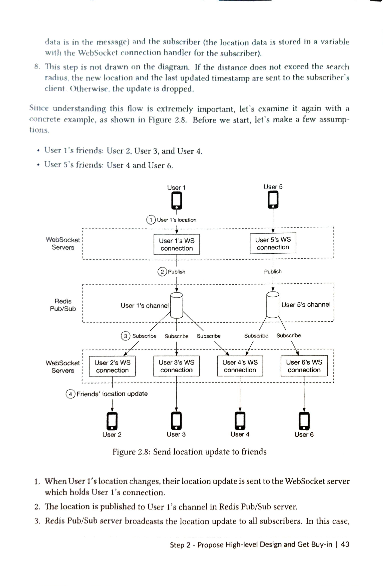
*Hình 2.8: Gửi cập nhật vị trí tới bạn bè (Send location update to friends)*

1. Khi vị trí của User 1 thay đổi, bản cập nhật vị trí của họ được gửi tới máy chủ WebSocket đang duy trì kết nối của User 1.
2. Vị trí được xuất bản (**published**) tới kênh của User 1 trên máy chủ Redis Pub/Sub.
3. Máy chủ Redis Pub/Sub phát quảng bá (**broadcasts**) bản cập nhật vị trí tới tất cả các bên đăng ký. Trong trường hợp này, các bên đăng ký là các bộ xử lý kết nối WebSocket (bạn bè của User 1).

---

Phép tính toán khoảng cách này được lặp lại cho mỗi bên đăng ký của kênh. Vì trung bình có khoảng 40 bạn bè trực tuyến, nên sẽ có khoảng 40 cập nhật vị trí được chuyển tiếp cho mỗi lần cập nhật vị trí của một người dùng.

---

### Thiết kế API (API Design)
Bây giờ khi đã xây dựng xong thiết kế mức cao (**high-level design**), hãy liệt kê các API cần thiết.

#### Giao thức WebSocket
Người dùng gửi và nhận các cập nhật vị trí thông qua giao thức WebSocket. Tối thiểu, chúng ta cần các API sau:

1. **Cập nhật vị trí định kỳ (Periodic location update)**
   * **Yêu cầu (Request):** Client gửi vĩ độ (**latitude**), kinh độ (**longitude**) và dấu thời gian (**timestamp**).
   * **Phản hồi (Response):** Không có (Nothing).
2. **Client nhận cập nhật vị trí (Client receives location updates)**
   * **Dữ liệu được gửi (Data sent):** Dữ liệu vị trí của bạn bè (**friend location data**) và dấu thời gian (**timestamp**).
3. **Khởi tạo kết nối WebSocket (WebSocket initialization)**
   * **Yêu cầu (Request):** Client gửi vĩ độ (**latitude**), kinh độ (**longitude**) và dấu thời gian (**timestamp**).
   * **Phản hồi (Response):** Client nhận dữ liệu vị trí của bạn bè (**friends' location data**).
4. **Đăng ký theo dõi một người bạn mới (Subscribe to a new friend)**
   * **Yêu cầu (Request):** Máy chủ WebSocket gửi mã định danh người bạn (**friend ID**).
   * **Phản hồi (Response):** Vĩ độ, kinh độ và dấu thời gian mới nhất của người bạn đó (**friend's latest latitude, longitude, and timestamp**).
5. **Hủy đăng ký theo dõi một người bạn (Unsubscribe a friend)**
   * **Yêu cầu (Request):** Máy chủ WebSocket gửi mã định danh người bạn (**friend ID**).
   * **Phản hồi (Response):** Không có (Nothing).

#### Yêu cầu HTTP (HTTP Requests)
Các máy chủ API xử lý các tác vụ như thêm/xóa bạn bè, cập nhật hồ sơ người dùng (**user profiles**), v.v. Đây là các nghiệp vụ rất phổ biến và chúng ta sẽ không đi sâu vào chi tiết ở đây.

---

### Mô hình dữ liệu (Data Model)
Một yếu tố quan trọng khác cần thảo luận là mô hình dữ liệu (**data model**). Chúng ta đã đề cập đến Cơ sở dữ liệu người dùng (**User DB**) trong phần thiết kế mức cao, vì vậy hãy tập trung vào bộ nhớ đệm vị trí (**location cache**) và cơ sở dữ liệu lịch sử vị trí (**location history database**).

#### Bộ nhớ đệm vị trí (Location Cache)
Bộ nhớ đệm vị trí lưu trữ vị trí mới nhất của tất cả người dùng đang hoạt động (**active users**) có bật tính năng "tìm bạn bè gần đây". Chúng ta sử dụng Redis cho bộ nhớ đệm này. Cấu trúc Khóa/Giá trị (**Key/Value**) của bộ nhớ đệm được trình bày trong Bảng 2.1.

| Khóa (Key) | Giá trị (Value) |
| :--- | :--- |
| `user_id` | `[latitude, longitude, timestamp]` |

*Bảng 2.1: Bộ nhớ đệm vị trí (Location cache)*

##### Tại sao chúng ta không dùng một cơ sở dữ liệu để lưu trữ dữ liệu vị trí?
Tính năng "tìm bạn bè gần đây" chỉ quan tâm đến vị trí hiện tại của người dùng. Do đó, chúng ta chỉ cần lưu trữ duy nhất một vị trí cho mỗi người dùng. Redis là một lựa chọn tuyệt vời vì nó cung cấp các thao tác đọc và ghi siêu nhanh (**super-fast read and write operations**). Nó hỗ trợ TTL, tính năng mà chúng ta dùng để tự động xóa sạch (**auto-purge**) khỏi bộ nhớ đệm những người dùng không còn hoạt động nữa. 

Vị trí hiện tại không nhất thiết phải được lưu trữ bền vững (**durably stored**). Nếu một thực thể (**instance**) Redis gặp sự cố dừng hoạt động (**goes down**), chúng ta có thể thay thế nó bằng một instance mới trống rỗng và để bộ nhớ đệm được lấp đầy dần khi các luồng cập nhật vị trí mới đổ về (**stream in**). Người dùng đang hoạt động có thể bị lỡ mất cập nhật vị trí từ bạn bè trong một hoặc hai chu kỳ cập nhật trong khi bộ nhớ đệm mới đang được làm ấm (**cache warms**). Đây là một sự đánh đổi chấp nhận được (**acceptable tradeoff**). Trong phần đào sâu thiết kế (**deep dive**), chúng ta sẽ thảo luận các phương pháp nhằm giảm thiểu tác động đến người dùng khi bộ nhớ đệm bị thay thế.

---

#### Cơ sở dữ liệu lịch sử vị trí (Location History Database)
Cơ sở dữ liệu lịch sử vị trí lưu trữ dữ liệu vị trí trong quá khứ của người dùng và lược đồ (**schema**) có dạng như sau:

| Tên trường |
| :--- |
| `user_id` |
| `latitude` |
| `longitude` |
| `timestamp` |

Chúng ta cần một cơ sở dữ liệu có khả năng xử lý tốt tải công việc ghi nặng (**heavy-write workload**) và có thể mở rộng theo chiều ngang (**horizontally scaled**). Cassandra là một ứng viên sáng giá. Chúng ta cũng có thể sử dụng một cơ sở dữ liệu quan hệ (**relational database**). Tuy nhiên, với một cơ sở dữ liệu quan hệ, dữ liệu lịch sử khổng lồ sẽ không thể chứa vừa trong một thực thể (**single instance**) duy nhất, do đó chúng ta cần phân mảnh dữ liệu đó (**shard that data**). Cách tiếp cận cơ bản nhất là phân mảnh theo mã định danh người dùng (**shard by user ID**). Chiến lược phân mảnh (**sharding scheme**) này đảm bảo tải được phân phối đồng đều giữa tất cả các phân mảnh (**shards**), và về mặt vận hành (**operationally**), nó rất dễ bảo trì.

---

## BƯỚC 3 - ĐÀO SÂU THIẾT KẾ (STEP 3 - DESIGN DEEP DIVE)

Thiết kế mức cao mà chúng ta đã xây dựng trong phần trước hoạt động tốt trong hầu hết các trường hợp, nhưng nó rất có thể sẽ bị quá tải và đổ vỡ ở quy mô (**scale**) mục tiêu của chúng ta. Trong phần này, chúng ta sẽ cùng nhau phát hiện các điểm nghẽn cổ chai (**bottlenecks**) khi quy mô gia tăng, và song song với đó sẽ xây dựng các giải pháp để triệt tiêu các điểm nghẽn này.

### Từng thành phần mở rộng quy mô tốt đến mức nào? (How well does each component scale?)

#### Máy chủ API (API Servers)
Các phương pháp mở rộng quy mô tầng RESTful API đã được hiểu rất rõ. Đây là các máy chủ không lưu trạng thái (**stateless servers**), và có rất nhiều cách để tự động co giãn (**auto-scale**) cụm máy chủ dựa trên mức sử dụng CPU, tải hệ thống, hoặc I/O. Chúng ta sẽ không đi sâu vào chi tiết ở đây.

#### Máy chủ WebSocket (WebSocket Servers)
Đối với cụm WebSocket, việc tự động co giãn (**auto-scale**) dựa trên mức độ sử dụng cũng không quá khó khăn. Tuy nhiên, các máy chủ WebSocket là các máy chủ có lưu trạng thái (**stateful servers**), vì vậy cần phải hết sức cẩn trọng khi loại bỏ các nút (**nodes**) hiện có. Trước khi một node có thể được gỡ bỏ, tất cả các kết nối hiện tại phải được cho phép rút cạn dần (**drained**). Để... *(còn tiếp)*

# CHƯƠNG 2: TÌM BẠN BÈ GẦN ĐÂY (NEARBY FRIENDS)

---

### [Trang 54]

cùng một mức độ cẩn trọng.
bộ cân bằng tải (load balancer). Hầu hết các bộ cân bằng tải trên nền tảng đám mây (cloud load balancers) đều xử lý rất tốt nhiệm vụ này.

#### Khởi tạo phía Client (Client initialization)
chiếm dụng dung lượng bộ nhớ nhỏ (small memory footprint).
trình xử lý kết nối (connection handler).

1. Nó cập nhật vị trí của người dùng vào bộ nhớ đệm vị trí (location cache).
2. Nó lưu vị trí đó vào một biến của trình xử lý kết nối (connection handler) để phục vụ cho các phép tính toán tiếp theo.
3. Nó tải danh sách tất cả bạn bè của người dùng từ cơ sở dữ liệu người dùng (user database).
4. Nó gửi một yêu cầu dạng gom lô (batched request) đến bộ nhớ đệm vị trí (location cache) để lấy về vị trí của toàn bộ bạn bè. Lưu ý rằng vì chúng ta đã thiết lập một giá trị TTL (Time-To-Live) cho từng bản ghi trong cache vị trí nhằm khớp với chu kỳ thời gian chờ không hoạt động (inactivity timeout period), nên nếu một người bạn không hoạt động (inactive), vị trí của họ sẽ không tồn tại trong cache vị trí.
5. Đối với mỗi vị trí do cache trả về, máy chủ sẽ tính toán khoảng cách giữa người dùng hiện tại và người bạn ở vị trí đó. Nếu khoảng cách nằm trong bán kính tìm kiếm (search radius), hồ sơ cá nhân (profile), vị trí và dấu thời gian cập nhật lần cuối (last updated timestamp) của người bạn đó sẽ được trả về cho client thông qua kết nối WebSocket.
6. Đối với mỗi người bạn, máy chủ sẽ đăng ký theo dõi (subscribe) vào kênh (channel) của người bạn đó trên máy chủ Redis Pub/Sub. Chúng tôi sẽ giải thích chi tiết về việc sử dụng Redis Pub/Sub ngay sau đây. Do việc khởi tạo một kênh mới có chi phí tài nguyên rất thấp (cheap), người dùng sẽ subscribe vào kênh của tất cả bạn bè, bất kể họ đang trực tuyến (active) hay ngoại tuyến (inactive). Những người bạn không hoạt động sẽ chỉ chiếm một lượng bộ nhớ rất nhỏ trên máy chủ Redis Pub/Sub, nhưng họ hoàn toàn không tiêu tốn chu kỳ CPU hay I/O nào (do họ không phát hành các bản cập nhật - publish updates) cho đến khi họ trực tuyến trở lại (come online).
7. Nó gửi vị trí hiện tại của người dùng vào kênh riêng của người dùng đó trên máy chủ Redis Pub/Sub.

#### Cơ sở dữ liệu người dùng (User database)
Cơ sở dữ liệu người dùng lưu trữ hai tập dữ liệu riêng biệt: hồ sơ người dùng (user ID, tên người dùng, URL hồ sơ, v.v.) và quan hệ bạn bè (friendships). Ở quy mô thiết kế của chúng ta, các tập dữ liệu này nhiều khả năng sẽ không thể chứa vừa trong một thực thể cơ sở dữ liệu quan hệ (single relational database instance) duy nhất. Tin tốt là dữ liệu này có khả năng mở rộng theo chiều ngang (horizontally scalable)...

*46 | Chương 2. Bạn bè gần đây*

---

### [Trang 55]

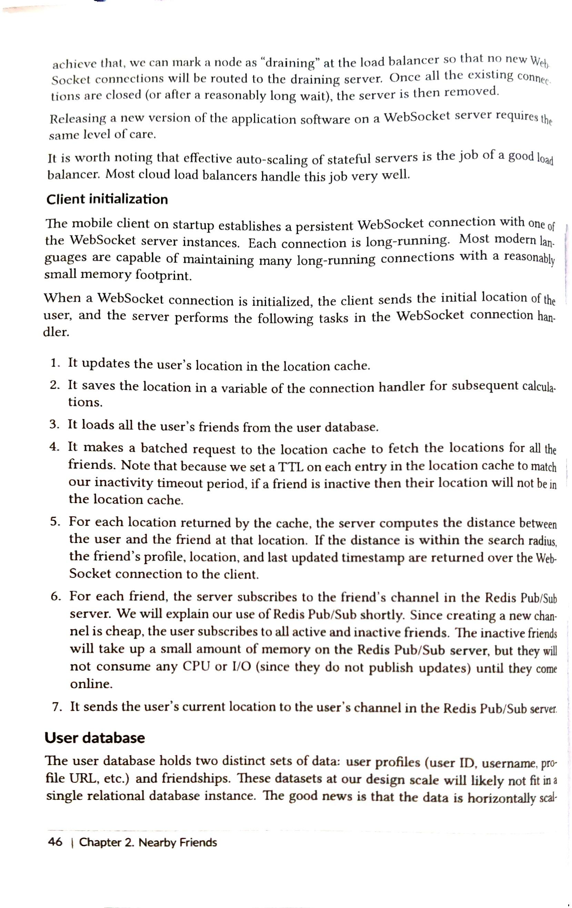
*(Hình ảnh minh họa trang 54)*

kỹ thuật (technique).

> [!NOTE]
> **Lưu ý phụ:** Ở quy mô chúng ta đang thiết kế, tập dữ liệu người dùng và quan hệ bạn bè nhiều khả năng sẽ do một đội ngũ chuyên trách quản lý và được cung cấp qua một API nội bộ (internal API). Trong kịch bản này, các máy chủ WebSocket sẽ gọi API nội bộ thay vì truy vấn trực tiếp cơ sở dữ liệu để lấy dữ liệu người dùng và bạn bè. Dù truy cập qua API hay truy vấn cơ sở dữ liệu trực tiếp thì về mặt chức năng hay hiệu năng (performance) cũng không có quá nhiều khác biệt.

#### Bộ nhớ đệm vị trí (Location cache)
Chúng ta chọn Redis để lưu trữ tạm thời (cache) các vị trí gần đây nhất của tất cả người dùng đang hoạt động (active users). Như đã đề cập trước đó, chúng ta cũng thiết lập một giá trị TTL (Time-To-Live) cho mỗi khóa (key). TTL này được làm mới sau mỗi lần cập nhật vị trí. Điều này đặt ra một giới hạn trần (cap) cho lượng bộ nhớ tối đa được sử dụng. Với 10 triệu người dùng hoạt động vào giờ cao điểm (peak), và mỗi vị trí chiếm không quá 100 bytes, một máy chủ Redis hiện đại duy nhất với dung lượng RAM nhiều GB hoàn toàn có thể lưu trữ thoải mái thông tin vị trí của toàn bộ người dùng.

máy chủ sẽ phải xử lý 334.000 lượt cập nhật mỗi giây (334K updates per second). Con số này có vẻ hơi quá cao, ngay cả đối với một máy chủ cấu hình cao hiện đại. May mắn thay, dữ liệu cache này rất dễ để phân mảnh (shard). Dữ liệu vị trí của từng người dùng là độc lập với nhau, và chúng ta có thể phân bổ đều tải giữa nhiều máy chủ Redis bằng cách phân mảnh dữ liệu vị trí dựa trên mã định danh người dùng (user ID).

Để nâng cao tính sẵn sàng cao (High Availability), chúng ta có thể sao chép (replicate) dữ liệu vị trí trên mỗi phân mảnh sang một nút dự phòng (standby node). Nếu nút chính (primary node) gặp sự cố (down), nút dự phòng có thể nhanh chóng được thăng cấp (promoted) nhằm giảm thiểu thời gian gián đoạn hệ thống (downtime).

#### Máy chủ Redis Pub/Sub (Redis Pub/Sub server)
Máy chủ Pub/Sub được sử dụng như một tầng định tuyến (routing layer) để chuyển tiếp các thông điệp (các cập nhật vị trí) từ một người dùng đến toàn bộ bạn bè đang trực tuyến của họ. Như đã đề cập ở phần trước, chúng ta lựa chọn Redis Pub/Sub vì việc tạo các kênh mới (channels) trên nền tảng này vô cùng gọn nhẹ (lightweight). Một kênh mới được tạo ra ngay khi có ai đó subscribe vào nó. Nếu một thông điệp được publish vào một kênh không có người đăng ký theo dõi (subscribers), thông điệp đó sẽ bị hủy bỏ (dropped), qua đó tạo ra rất ít tải lên máy chủ. Khi một kênh được tạo, Redis sử dụng một lượng bộ nhớ rất nhỏ để duy trì một bảng băm (hash table) và một danh sách liên kết (linked list) [3] nhằm theo dõi các subscriber. Nếu không có cập nhật nào trên kênh khi người dùng ngoại tuyến (offline), sẽ không có chu kỳ CPU nào bị tiêu tốn sau khi kênh đã được tạo. Chúng ta tận dụng ưu điểm này trong thiết kế theo các cách sau:

1. Chúng ta gán một kênh duy nhất (unique channel) cho mỗi người dùng sử dụng tính năng "bạn bè gần đây". Khi ứng dụng khởi chạy, người dùng sẽ subscribe vào kênh của từng người bạn, bất kể người bạn đó đang online hay offline. Điều này giúp đơn giản hóa thiết kế vì backend không cần phải xử lý logic subscribe vào kênh của bạn bè khi họ online, hay xử lý việc hủy đăng ký (unsubscribe) khi người bạn đó offline.
2. Điểm đánh đổi (tradeoff) ở đây là thiết kế sẽ tiêu tốn nhiều bộ nhớ hơn. Tuy nhiên, như chúng ta sẽ thấy sau này, việc sử dụng bộ nhớ khó có thể trở thành điểm nghẽn cổ chai (bottleneck). Việc đánh đổi mức sử dụng bộ nhớ cao hơn để lấy một kiến trúc đơn giản hơn là hoàn toàn xứng đáng trong trường hợp này.

*Bước 3 - Đi sâu vào thiết kế | 47*

---

### [Trang 56]

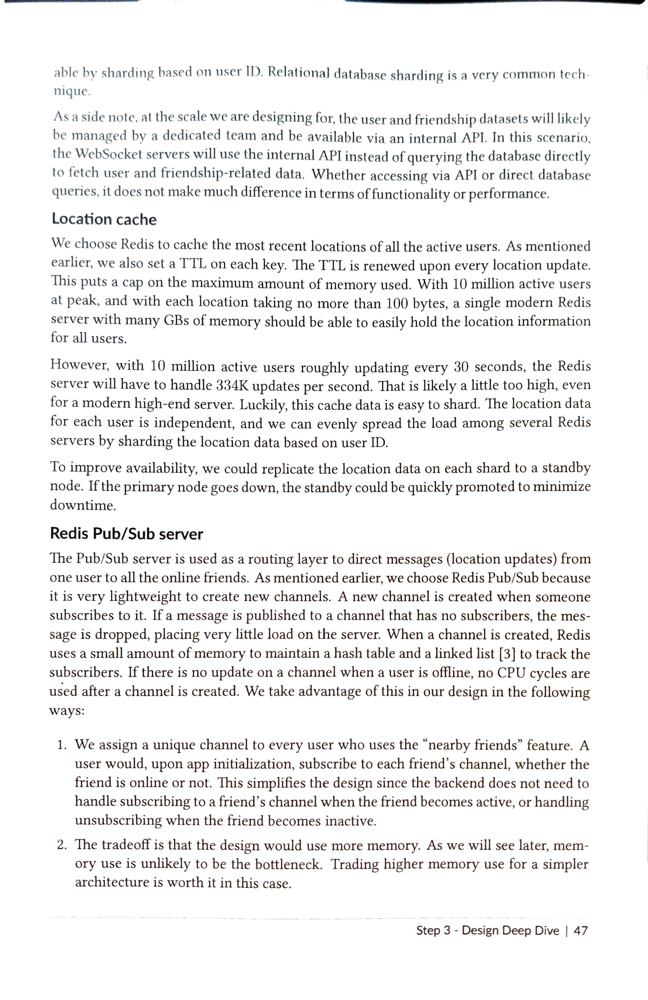
*(Hình ảnh minh họa trang 55)*

#### Chúng ta cần bao nhiêu máy chủ Redis Pub/Sub? (How many Redis Pub/Sub servers do we need?)
Hãy cùng làm một vài phép tính toán về mức độ sử dụng bộ nhớ (Memory usage) và bộ vi xử lý (CPU usage).

##### Mức độ sử dụng bộ nhớ (Memory usage)
2 máy chủ Redis Pub/Sub để chứa toàn bộ các kênh.

##### Mức độ sử dụng CPU (CPU usage)
Theo như tính toán trước đây, máy chủ Pub/Sub phải đẩy khoảng 14 triệu bản cập nhật mỗi giây (14 million updates per second)
thông điệp mà một máy chủ Redis hiện đại có thể đẩy trong một giây nếu không có đo kiểm hiệu năng thực tế (actual benchmarking), nó
chọn một con số thận trọng và giả định rằng một máy chủ hiện đại với kết nối mạng gigabit
thông điệp cập nhật là gì, con số này nhiều khả năng là rất thận trọng. Sử dụng ước tính thận trọng này, chúng ta sẽ cần phân bổ tải giữa 14 triệu / 100.000 = 140 máy chủ Redis. Nhắc lại lần nữa, con số này nhiều khả năng là quá thận trọng, và số lượng máy chủ thực tế có thể thấp hơn rất nhiều.

Từ các phép tính toán trên, chúng ta rút ra kết luận rằng:
* Điểm nghẽn cổ chai (bottleneck) của máy chủ Redis Pub/Sub nằm ở mức sử dụng CPU (CPU usage), chứ không phải mức sử dụng bộ nhớ (memory usage).
* Để đáp ứng được quy mô thiết kế, chúng ta cần một cụm phân tán các máy chủ Redis Pub/Sub (distributed Redis Pub/Sub cluster).

#### Cụm máy chủ Redis Pub/Sub phân tán (Distributed Redis Pub/Sub server cluster)
Làm thế nào để chúng ta phân bổ hàng trăm triệu kênh vào hàng trăm máy chủ Redis? Tin tốt là các kênh này hoàn toàn độc lập với nhau. Điều này giúp việc dàn trải các kênh trên nhiều máy chủ Pub/Sub thông qua cơ chế phân mảnh (sharding) dựa trên ID của người dùng phát hành (publisher's user ID) trở nên tương đối dễ dàng. Tuy nhiên trên thực tế, với hàng trăm máy chủ Pub/Sub, chúng ta cần đi sâu vào chi tiết hơn về cách thức vận hành sao cho có thể quản lý được trong thực tế, bởi vì các máy chủ chắc chắn sẽ gặp sự cố (down) theo thời gian.

Ở đây, chúng ta đưa thành phần khám phá dịch vụ (Service Discovery) vào thiết kế. Hiện có rất nhiều gói giải pháp khám phá dịch vụ phổ biến, trong đó etcd [4] và ZooKeeper [5] là những lựa chọn thông dụng nhất. Nhu cầu của chúng ta đối với thành phần Service Discovery là rất cơ bản, chỉ cần hai tính năng sau:

1. Khả năng duy trì một danh sách các máy chủ bên trong thành phần Service Discovery, cùng một giao diện người dùng (UI) hoặc API đơn giản để cập nhật danh sách đó. Về bản chất cốt lõi, Service Discovery là một kho lưu trữ dạng khóa - giá trị (Key-Value store) nhỏ gọn dùng để lưu trữ dữ liệu cấu hình. Lấy Hình 2.9 làm ví dụ, Khóa (Key) và Giá trị (Value) cho vòng băm (hash ring) có thể có cấu trúc như sau:
   - **Key**: `/config/pub_sub_ring`
   - **Value**: `["p_1", "p_2", "p_3", "p_4"]`
2. Khả năng cho phép các máy khách (trong trường hợp này là các máy chủ WebSocket) đăng ký theo dõi (subscribe) vào bất kỳ cập nhật nào đối với "Value" (danh sách các máy chủ Redis Pub/Sub).

*48 | Chương 2. Bạn bè gần đây*

---

### [Trang 57]

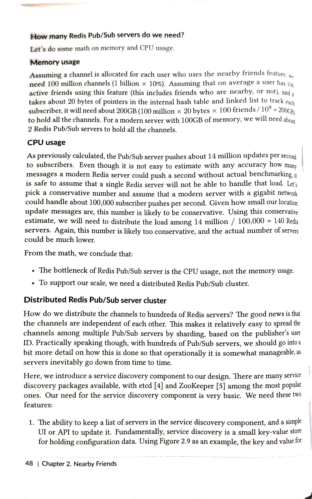
*(Hình ảnh minh họa trang 56)*

Bên dưới mục "Key" đã đề cập ở điểm 1, chúng ta lưu trữ một vòng băm (hash ring) của tất cả các máy chủ Redis Pub/Sub đang hoạt động bên trong thành phần Service Discovery (Xem chương Băm nhất quán - Consistent Hashing trong Tập 1 của cuốn sách System Design Interview hoặc tài liệu [6] để biết chi tiết về vòng băm). Vòng băm được các đơn vị phát hành (publishers) và đơn vị đăng ký theo dõi (subscribers) của các máy chủ Redis Pub/Sub sử dụng để xác định máy chủ Pub/Sub đích cần giao tiếp cho mỗi kênh. Ví dụ: Kênh 2 (channel 2) nằm trên máy chủ Redis Pub/Sub 1 trong Hình 2.9.

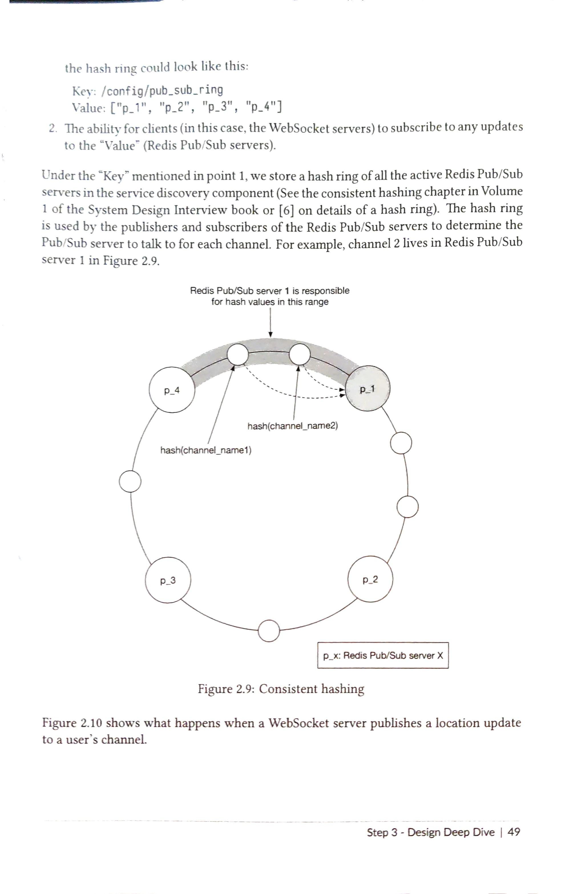
*Hình 2.9: Băm nhất quán (Consistent hashing)*

> **Mô tả chi tiết Hình 2.9:**
> Vòng băm nhất quán bao gồm các nút máy chủ: `p_1`, `p_2`, `p_3` (vị trí trên vòng băm), `p_4`, trong đó `p_x` đại diện cho máy chủ Redis Pub/Sub thứ X.
> Máy chủ Redis Pub/Sub 1 (`p_1`) chịu trách nhiệm (is responsible) cho các giá trị băm trong dải này.
> Vị trí của `hash(channel_name1)` và `hash(channel_name2)` được ánh xạ trên vòng tròn để tìm máy chủ quản lý tương ứng theo chiều kim đồng hồ.

Hình 2.10 minh họa những gì diễn ra khi một máy chủ WebSocket phát hành một bản cập nhật vị trí (location update) tới kênh của một người dùng.

*Bước 3 - Đi sâu vào thiết kế | 49*

---

### [Trang 58]

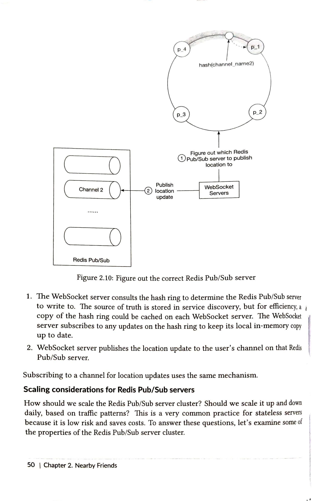
*Hình 2.10: Xác định chính xác máy chủ Redis Pub/Sub (Figure out the correct Redis Pub/Sub server)*

> **Mô tả chi tiết Hình 2.10:**
> 1. Máy chủ WebSocket (WebSocket Servers) tính toán `hash(channel_name2)` để **Xác định máy chủ Redis Pub/Sub cần phát hành vị trí tới (Figure out which Redis Pub/Sub server to publish location to)**.
> 2. Máy chủ WebSocket thực hiện thao tác **Phát hành cập nhật vị trí (Publish location update)** vào Kênh 2 (Channel 2) trên **Máy chủ Redis Pub/Sub (Redis Pub/Sub)** tương ứng.

1. để ghi vào. Nguồn chân lý dữ liệu (source of truth) được lưu trữ trong thành phần Service Discovery, nhưng để tối ưu hiệu quả và độ trễ, một bản sao của vòng băm (hash ring) có thể được lưu trữ tạm thời (cached) trên từng máy chủ WebSocket. Máy chủ WebSocket sẽ subscribe vào bất kỳ cập nhật nào trên vòng băm để giữ cho bản sao cục bộ trong bộ nhớ (in-memory copy) luôn luôn được đồng bộ mới nhất.
2. Máy chủ WebSocket phát hành bản cập nhật vị trí vào kênh của người dùng trên máy chủ Redis Pub/Sub tương ứng đó.

Việc đăng ký theo dõi (subscribing) vào một kênh để nhận các bản cập nhật vị trí cũng sử dụng chung cơ chế tương tự.

#### Các cân nhắc khi mở rộng quy mô cho cụm máy chủ Redis Pub/Sub (Scaling considerations for Redis Pub/Sub servers)
Chúng ta nên mở rộng quy mô (scale) cụm máy chủ Redis Pub/Sub như thế nào? Liệu chúng ta có nên mở rộng (scale up/out) và thu hẹp (scale down/in) hàng ngày dựa trên các mô hình lưu lượng truy cập (traffic patterns) hay không? Đây là một phương pháp rất phổ biến đối với các máy chủ phi trạng thái (stateless servers) vì nó có rủi ro thấp và tiết kiệm chi phí. Để trả lời những câu hỏi này, chúng ta hãy xem xét một số đặc tính kỹ thuật của cụm máy chủ Redis Pub/Sub.

*50 | Chương 2. Bạn bè gần đây*

---

### [Trang 59]

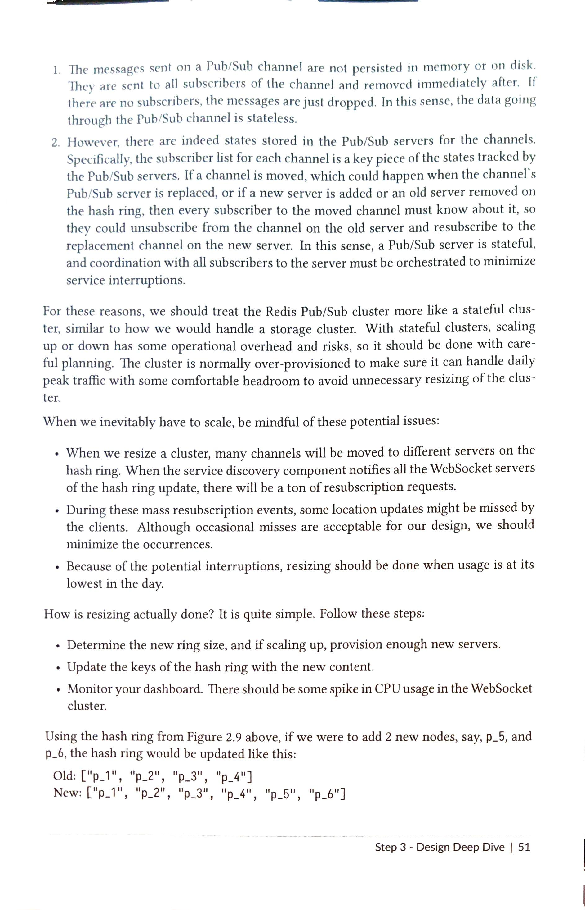
*(Hình ảnh minh họa trang 59)*

1. Chúng được gửi đến toàn bộ các subscriber của kênh và bị xóa ngay lập tức sau đó. Nếu không có subscriber nào, các thông điệp chỉ đơn giản là bị loại bỏ (dropped). Theo nghĩa này, dữ liệu đi qua kênh Pub/Sub mang tính chất phi trạng thái (stateless).
2. Tuy nhiên, trên thực tế vẫn tồn tại các trạng thái (states) được lưu trữ trong các máy chủ Pub/Sub phục vụ cho các kênh. Cụ thể, danh sách người theo dõi (subscriber list) cho từng kênh là một phần trạng thái cốt lõi được theo dõi bởi các máy chủ Pub/Sub. Nếu một kênh bị di chuyển — điều có thể xảy ra khi máy chủ Pub/Sub của kênh đó bị thay thế, hoặc khi có một máy chủ mới được thêm vào hoặc một máy chủ cũ bị xóa khỏi vòng băm (hash ring) — thì mọi subscriber của kênh bị di chuyển đó đều bắt buộc phải biết về sự thay đổi này, để họ có thể hủy đăng ký (unsubscribe) khỏi kênh trên máy chủ cũ và đăng ký lại (resubscribe) vào kênh thay thế trên máy chủ mới. Theo nghĩa này, một máy chủ Pub/Sub mang tính có trạng thái (stateful) và việc phối hợp với tất cả các subscriber kết nối đến máy chủ đó phải được điều phối chặt chẽ (orchestrated) để giảm thiểu tối đa sự gián đoạn dịch vụ (service interruptions).

> [!IMPORTANT]
> Vì những lý do này, chúng ta nên đối xử với cụm Redis Pub/Sub giống như một cụm có trạng thái (stateful cluster), tương tự như cách chúng ta quản lý một cụm lưu trữ (storage cluster). Đối với các cụm có trạng thái, việc mở rộng hoặc thu hẹp quy mô (scaling up or down) luôn đi kèm chi phí vận hành (operational overhead) và các rủi ro nhất định, do đó nó cần phải được thực hiện với một kế hoạch cẩn trọng. Cụm máy chủ thông thường sẽ được cấp phát dư thừa tài nguyên (over-provisioned) để đảm bảo nó có thể xử lý lưu lượng đỉnh điểm (peak traffic) hàng ngày với một khoảng dung sai dự phòng an toàn (comfortable headroom), tránh việc phải thay đổi kích thước cụm (resizing) không cần thiết.

Khi bắt buộc phải mở rộng quy mô, hãy đặc biệt lưu tâm đến các vấn đề tiềm ẩn sau:
* Khi chúng ta thay đổi kích thước cụm (resize), nhiều kênh sẽ bị điều chuyển sang các máy chủ khác nhau trên vòng băm (hash ring). Khi thành phần Service Discovery thông báo cho tất cả các máy chủ WebSocket về sự cập nhật của vòng băm, sẽ xuất hiện một lượng khổng lồ các yêu cầu tái đăng ký (mass resubscription requests).
* Trong quá trình diễn ra các sự kiện tái đăng ký hàng loạt này, một số bản cập nhật vị trí có thể bị các client bỏ lỡ (missed). Mặc dù việc thỉnh thoảng bị sót cập nhật là chấp nhận được đối với thiết kế của chúng ta, chúng ta vẫn nên giảm thiểu tối đa tần suất xuất hiện của các trường hợp này.
* Do các khả năng gây gián đoạn tiềm ẩn, việc thay đổi kích thước cụm chỉ nên được thực hiện vào thời điểm mức độ sử dụng trong ngày ở mức thấp nhất (lowest traffic).

##### Việc thay đổi kích thước (resizing) thực tế được thực hiện như thế nào?
Quy trình này khá đơn giản. Hãy thực hiện theo các bước sau:
1. Xác định kích thước vòng băm mới, và nếu mở rộng quy mô (scaling up), hãy cấp phát (provision) đầy đủ các máy chủ mới.
2. Cập nhật các khóa (keys) của vòng băm với nội dung mới trong hệ thống Service Discovery.
3. Giám sát bảng điều khiển (dashboard) của bạn. Chắc chắn sẽ có hiện tượng tăng đột biến (spike) về mức sử dụng CPU trong cụm máy chủ WebSocket.

Áp dụng vòng băm từ Hình 2.9 ở trên, nếu chúng ta thêm 2 nút mới, chẳng hạn như `p_5` và `p_6`, vòng băm sẽ được cập nhật như sau:
* **Cũ (Old)**: `["p_1", "p_2", "p_3", "p_4"]`
* **Mới (New)**: `["p_1", "p_2", "p_3", "p_4", "p_5", "p_6"]`

*Bước 3 - Đi sâu vào thiết kế | 51*

# CHƯƠNG 2: TÌM BẠN BÈ GẦN ĐÂY (NEARBY FRIENDS)

---

### Các Cân Nhắc Vận Hành Cho Cụm Server Redis Pub/Sub (Operational Considerations for Redis Pub/Sub Servers)

Các node server Redis Pub/Sub có thể bị sập (down) và cần được thay thế định kỳ. Khi một channel (kênh) cần được đăng ký lại (re-subscribed) trên một server mới, chúng ta cần xử lý quy trình này một cách chuẩn xác.

Sử dụng vòng băm nhất quán (hash ring) từ Hình 2.9 ở trên: nếu node `p_1` gặp sự cố (down) và chúng ta thay thế nó bằng `p_1_new`, vòng băm (hash ring) sẽ được cập nhật như sau:

* **Cũ (Old):** `["p_1", "p_2", "p_3", "p_4"]`
* **Mới (New):** `["p_1_new", "p_2", "p_3", "p_4"]`

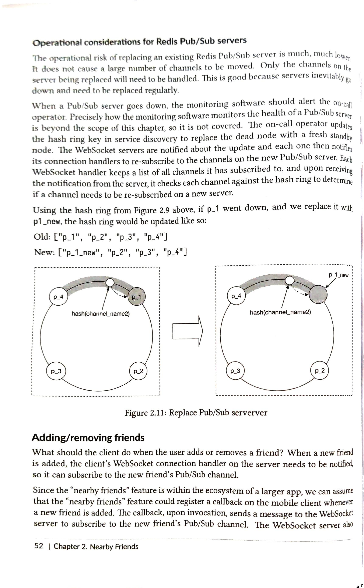
*Hình 2.11: Thay thế server Pub/Sub (Replace Pub/Sub server)*

---

### Thêm / Xóa Bạn Bè (Adding/Removing Friends)

Phía máy khách (client) nên làm gì khi người dùng thêm hoặc xóa một người bạn?

Khi một người bạn mới được thêm vào, trình xử lý kết nối WebSocket (WebSocket connection handler) của client trên server cần được thông báo để nó có thể đăng ký (subscribe) vào channel Pub/Sub của người bạn mới đó.

Vì tính năng "Tìm bạn bè gần đây" (Nearby Friends) nằm trong hệ sinh thái của một ứng dụng lớn hơn, chúng ta có thể giả định rằng tính năng "Nearby Friends" có thể đăng ký một hàm gọi lại (callback) trên mobile client bất cứ khi nào một người bạn mới được thêm. Khi được gọi, callback này sẽ gửi một thông điệp (message) đến WebSocket server để tiến hành subscribe vào channel Pub/Sub của người bạn mới. 

WebSocket server đồng thời cũng trả về một thông điệp chứa vị trí mới nhất cùng mốc thời gian (timestamp) của người bạn mới đó, nếu họ đang hoạt động (active).

Tương tự như vậy, client có thể đăng ký một callback trong ứng dụng bất cứ khi nào một người bạn bị xóa bỏ. Callback sẽ gửi một thông điệp đến WebSocket server để hủy đăng ký (unsubscribe) khỏi channel Pub/Sub của người bạn đó.

Cơ chế callback đăng ký/hủy đăng ký (subscribe/unsubscribe callback) này cũng có thể được tái sử dụng bất cứ khi nào một người bạn bật hoặc tắt tính năng chia sẻ vị trí (opt-in hoặc opt-out khỏi cập nhật vị trí).

---

### Người Dùng Có Rất Nhiều Bạn Bè (Users with Many Friends)

Chúng ta cần thảo luận xem liệu một người dùng có lượng bạn bè lớn có gây ra các điểm nóng hiệu năng (performance hotspots) trong thiết kế hệ thống hay không.

Ở đây, chúng ta giả định rằng có một giới hạn cứng (hard cap) về số lượng bạn bè tối đa (ví dụ: Facebook áp dụng mức giới hạn là 5.000 bạn bè). Mối quan hệ bạn bè là hai chiều (bi-directional). Chúng ta không thảo luận về mô hình người theo dõi (follower model), nơi một người nổi tiếng có thể sở hữu hàng triệu người theo dõi (followers).

Trong kịch bản có hàng ngàn bạn bè:
* Các subscriber (người đăng ký) Pub/Sub sẽ được phân tán rải rác giữa rất nhiều WebSocket server khác nhau trong cụm (cluster). Do đó, tải phân phối cập nhật vị trí (update load) sẽ được dàn đều giữa các server và hầu như không có khả năng gây ra bất kỳ điểm nóng hiệu năng (hotspot) nào.
* Người dùng này sẽ tạo thêm một chút tải lên server Pub/Sub lưu trữ channel riêng của họ. Tuy nhiên, các channel đã được băm phân tán (hashed and distributed) đều giữa các server Pub/Sub, vì vậy mức tải gia tăng cục bộ này hoàn toàn không đủ để làm quá tải bất kỳ server đơn lẻ nào.

---

### Người Lạ Gần Đây (Nearby Random Person)

Bạn có thể coi phần này như một phần điểm cộng bổ sung (extra credit), vì nó không nằm trong các yêu cầu chức năng (functional requirements) ban đầu. Sẽ ra sao nếu người phỏng vấn muốn mở rộng thiết kế để hiển thị những người lạ ngẫu nhiên xung quanh đã đồng ý tham gia (opted-in) chia sẻ vị trí?

Một giải pháp khả thi nhằm tận dụng kiến trúc hiện tại là bổ sung một nhóm các channel Pub/Sub được phân vùng theo mã địa lý (geohash) (Xem Chương 1: *Proximity Service* để biết chi tiết về geohash). Như minh họa trong Hình 2.12, một khu vực địa lý được chia thành bốn lưới geohash (geohash grids) và một channel riêng biệt sẽ được khởi tạo cho từng ô lưới.

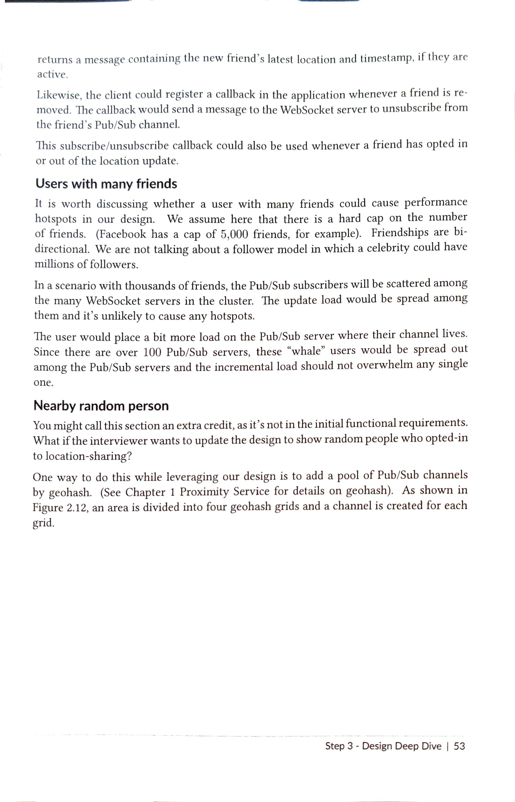

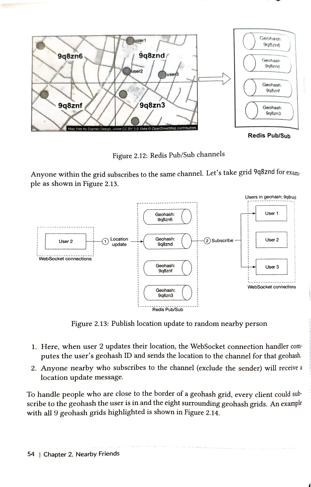
*Hình 2.12: Các kênh Redis Pub/Sub theo Geohash (Redis Pub/Sub channels)*

Bất kỳ ai nằm trong cùng một ô lưới sẽ subscribe vào cùng một channel tương ứng. Lấy ô lưới `9q8znd` làm ví dụ như thể hiện trong Hình 2.13:

*Hình 2.13: Xuất bản cập nhật vị trí tới người lạ ngẫu nhiên ở gần (Publish location update to random nearby person)*

Quy trình vận hành:
1. Tại đây, khi `User 2` cập nhật vị trí của mình, trình xử lý kết nối WebSocket (WebSocket connection handler) sẽ tính toán Geohash ID tương ứng của người dùng và gửi thông tin vị trí vào channel của geohash đó.
2. Bất kỳ ai ở gần đang subscribe vào channel đó (ngoại trừ người gửi) sẽ nhận được thông điệp cập nhật vị trí.

> [!NOTE]
> **Xử lý vùng biên giới (Boundary Handling):**  
> Để xử lý trường hợp người dùng đứng gần ranh giới giữa các ô lưới geohash, mỗi client có thể subscribe vào ô lưới geohash mà người dùng hiện đang đứng cùng với 8 ô lưới geohash bao quanh lân cận. Ví dụ về toàn bộ 9 ô lưới geohash được làm nổi bật như hiển thị trong Hình 2.14.

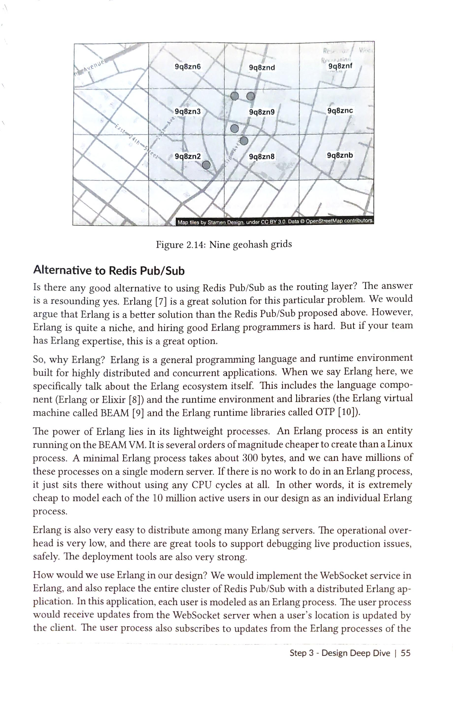
*Hình 2.14: Chín lưới Geohash liền kề (Nine geohash grids)*

---

### Giải Pháp Thay Thế Cho Redis Pub/Sub (Alternative to Redis Pub/Sub)

Liệu có giải pháp thay thế tối ưu nào cho việc sử dụng Redis Pub/Sub làm tầng định tuyến (routing layer) không? Câu trả lời dứt khoát là **CÓ**. 

**Erlang [7]** là một giải pháp xuất sắc cho bài toán đặc thù này. Chúng tôi thậm chí cho rằng Erlang còn là giải pháp vượt trội hơn so với Redis Pub/Sub đã đề xuất ở trên. Tuy nhiên, Erlang là một công nghệ khá kén người dùng (niche) và việc tuyển dụng kỹ sư Erlang giỏi là rất khó khăn. Nhưng nếu đội ngũ kỹ thuật của bạn có chuyên môn sâu về Erlang, đây chắc chắn là một lựa chọn tuyệt vời.

#### Tại sao lại là Erlang?
Erlang là một ngôn ngữ lập trình đa năng và môi trường thực thi (runtime environment) được thiết kế chuyên biệt cho các ứng dụng phân tán cao (highly distributed) và xử lý đồng thời quy mô lớn (high concurrency). Khi nhắc đến Erlang ở đây, chúng ta đang đề cập cụ thể đến toàn bộ hệ sinh thái Erlang:
* Ngôn ngữ lập trình: **Erlang** hoặc **Elixir [8]**.
* Môi trường thực thi và thư viện nền tảng: Máy ảo Erlang (gọi là **BEAM [9]**) và bộ thư viện thời gian chạy chuẩn của Erlang (gọi là **OTP [10]**).

Sức mạnh cốt lõi của Erlang nằm ở các tiến trình siêu nhẹ (**lightweight processes**):
* Một tiến trình Erlang là một thực thể độc lập chạy trên máy ảo BEAM VM. Chi phí khởi tạo và duy trì nó rẻ hơn nhiều bậc độ lớn (several orders of magnitude cheaper) so với một tiến trình Linux tiêu chuẩn (Linux OS process).
* Một tiến trình Erlang tối thiểu chỉ tiêu tốn khoảng **300 bytes** bộ nhớ, cho phép một server hiện đại duy trì hàng triệu tiến trình cùng lúc.
* Nếu không có tác vụ cần xử lý, tiến trình Erlang chỉ ở trạng thái chờ và hoàn toàn không tiêu tốn bất kỳ chu kỳ xử lý CPU (CPU cycles) nào.
* Nói cách khác, việc mô hình hóa từng người dùng trong số **10 triệu người dùng hoạt động đồng thời (active users)** thành một tiến trình Erlang riêng lẻ là cực kỳ tiết kiệm chi phí tài nguyên phần cứng.

Ngoài ra, Erlang rất dễ phân tán qua nhiều server Erlang trong cụm cluster. Chi phí vận hành (operational overhead) rất thấp, đi kèm các công cụ mạnh mẽ hỗ trợ gỡ lỗi trực tiếp trên môi trường production (live production debugging) một cách an toàn. Các công cụ triển khai (deployment tools) cũng rất mạnh mẽ và ổn định.

#### Áp dụng Erlang vào kiến trúc hệ thống như thế nào?
* Chúng ta sẽ triển khai dịch vụ **WebSocket Service** bằng Erlang.
* Thay thế toàn bộ cụm cluster **Redis Pub/Sub** bằng một ứng dụng Erlang phân tán (Distributed Erlang Application).
* Trong ứng dụng này, mỗi người dùng được mô hình hóa thành một tiến trình Erlang độc lập. Tiến trình người dùng này sẽ nhận các cập nhật từ WebSocket server khi vị trí của người dùng được client cập nhật, đồng thời nó cũng tự động đăng ký (subscribe) để nhận các bản tin cập nhật vị trí từ các tiến trình Erlang của danh sách bạn bè.

---

## BƯỚC 4 - TỔNG KẾT (STEP 4 - WRAP UP)

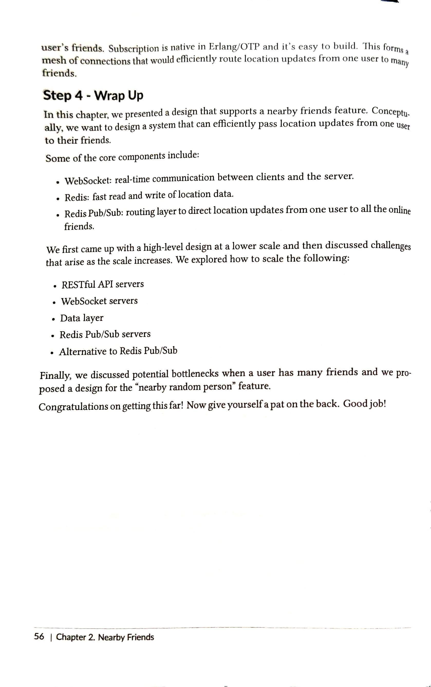

Hệ thống được thiết kế để truyền tải các bản tin cập nhật vị trí theo thời gian thực (real-time location updates) từ người dùng đến toàn bộ bạn bè trực tuyến của họ.

Các thành phần cốt lõi bao gồm:
* **WebSocket:** Đảm bảo kênh giao tiếp hai chiều thời gian thực (real-time communication) giữa client và server.
* **Redis:** Cung cấp tốc độ đọc và ghi dữ liệu vị trí cực nhanh (fast read/write of location data).
* **Redis Pub/Sub:** Đóng vai trò là tầng định tuyến thông điệp (routing layer) để điều hướng các cập nhật vị trí từ một người dùng tới tất cả bạn bè đang trực tuyến (online friends).

Ban đầu, chúng ta đưa ra một thiết kế tổng quan ở quy mô nhỏ (lower scale), sau đó phân tích các thách thức kỹ thuật phát sinh khi quy mô tăng vọt. Chúng ta đã nghiên cứu chuyên sâu phương án mở rộng quy mô (scale) cho các thành phần:
* Cụm server API chuẩn RESTful (**RESTful API servers**)
* Cụm server kết nối thời gian thực (**WebSocket servers**)
* Tầng dữ liệu (**Data layer**)
* Cụm server xuất bản/đăng ký (**Redis Pub/Sub servers**)
* Giải pháp thay thế cho Redis Pub/Sub (**Alternative to Redis Pub/Sub**)

Cuối cùng, chúng ta đã phân tích các nút thắt cổ chai tiềm ẩn (potential bottlenecks) khi một người dùng sở hữu danh sách bạn bè rất lớn, đồng thời đề xuất giải pháp kiến trúc cho tính năng mở rộng: "Tìm người lạ ngẫu nhiên ở gần" (**Nearby Random Person**).

Xin chúc mừng bạn đã hoàn thành chặng đường phân tích kiến trúc chuyên sâu này! Hãy tự hào về thành quả đạt được. Làm rất tốt!

---

## TỔNG KẾT CHƯƠNG (CHAPTER SUMMARY)

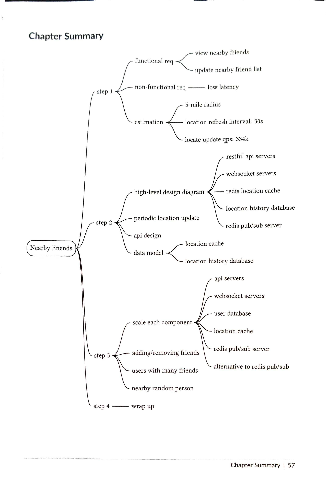

| Giai đoạn thiết kế | Hạng mục cốt lõi | Chi tiết kỹ thuật & Quyết định kiến trúc |
| :--- | :--- | :--- |
| **Bước 1: Phạm vi & Yêu cầu** | **Yêu cầu chức năng (Functional Req)** | • Xem bạn bè gần đây (View nearby friends) • Cập nhật danh sách bạn bè gần đây (Update nearby friend list) |
| | **Yêu cầu phi chức năng (Non-functional Req)** | • Độ trễ thấp (Low latency) • Bán kính tìm kiếm 5 dặm (5-mile radius) |
| | **Ước tính quy mô (Estimation)** | • Chu kỳ làm mới vị trí: 30 giây (Location refresh interval: 30s) • QPS cập nhật vị trí: 334.000 QPS (Location update QPS: 334k) |
| **Bước 2: Thiết kế tổng quan (High-Level Design)** | **Sơ đồ kiến trúc tổng quan** | • Cụm RESTful API servers • Cụm WebSocket servers • Redis Location Cache (Bộ nhớ đệm vị trí) • Location History Database (Cơ sở dữ liệu lịch sử vị trí) • Cụm Redis Pub/Sub servers |
| | **Thiết kế API** | • Cập nhật vị trí định kỳ (Periodic location update) |
| | **Mô hình dữ liệu (Data Model)** | • Location Cache (Bộ nhớ đệm vị trí hiện tại) • Location History Database (Lưu vết di chuyển) |
| **Bước 3: Đi sâu vào chi tiết thiết kế (Design Deep Dive)** | **Mở rộng quy mô từng thành phần (Scale Each Component)** | • Scale API servers (Stateless) • Scale WebSocket servers (Stateful, quản lý vòng đời kết nối) • Scale User Database & Location Cache (Sharding / Replication) • Scale Redis Pub/Sub cluster (Consistent Hashing) |
| | **Quản lý quan hệ bạn bè** | • Cơ chế Thêm/Xóa bạn bè (Adding/removing friends via callbacks) |
| | **Tối ưu hóa tải & Edge Cases** | • Người dùng có nhiều bạn bè (Users with many friends - Hotspot mitigation) • Người lạ ngẫu nhiên ở gần (Nearby random person - Geohash channels & 9-grid subscription) |
| | **Kiến trúc thay thế** | • Giải pháp thay thế Redis Pub/Sub bằng Distributed Erlang / BEAM VM processes |
| **Bước 4: Tổng kết** | **Đóng gói giải pháp (Wrap Up)** | • Rà soát toàn bộ luồng dữ liệu, đánh giá độ trễ, khả năng chịu lỗi (Fault Tolerance) và khả năng mở rộng (Scalability) của toàn hệ thống |

---

## Điều hướng

- [chuong-01-proximity-service.md](chuong-01-proximity-service.md)
- [Mục lục](README.md)
- [chuong-03-google-maps.md](chuong-03-google-maps.md)
