[← Chương trước](chuong-02-nearby-friends.md) | [Mục lục](README.md) | [Chương tiếp theo →](chuong-04-distributed-message-queue.md)

---

# Tài Liệu Kiến Trúc Kỹ Thuật: Hệ Thống Google Maps

---

## Tài Liệu Tham Khảo (Trang 66)


**Reference Material (Tài liệu tham khảo):**

- `ok-nearby-friends/.`
- **[2]** Redis Pub/Sub. https://redis.io/topics/pubsub
- `he-hood/.`
- **[4]** etcd. https://etcd.io/.
- **[5]** ZooKeeper. https://zookeeper.apache.org/.
- **[7]** Erlang. https://www.erlang.org/.
- **[8]** Elixir. https://elixir-lang.org/.
- **[9]** A brief introduction to BEAM. https://www.erlang.org/blog/a-brief-beam-primer/.
- **[10]** OTP. https://www.erlang.org/doc/design_principles/des_princ.html.

*(58 ↓ Chương 2: Bạn Bè Gần Đây - Nearby Friends)*

---

## Chương 3: Google Maps (Trang 67)

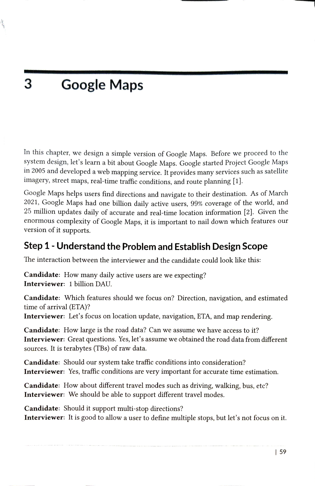

Trong chương này, chúng ta sẽ thiết kế một phiên bản đơn giản hóa của Google Maps. Trước khi đi sâu vào thiết kế hệ thống (*system design*), hãy cùng tìm hiểu sơ lược về Google Maps. Google đã khởi động dự án Google Maps với việc cung cấp hình ảnh vệ tinh (*imagery*), bản đồ đường phố (*street maps*), điều kiện giao thông thời gian thực (*real-time traffic conditions*) và tính toán lộ trình (*route planning*) [1].

Dịch vụ này xử lý tới 25 triệu lượt cập nhật mỗi ngày về thông tin vị trí chính xác và theo thời gian thực (*accurate and real-time location information*) [2]. Với độ phức tạp khổng lồ (*enormous complexity*) của Google Maps, điều tối quan trọng là phải xác định rõ ràng những tính năng nào mà phiên bản của chúng ta sẽ hỗ trợ.

---

### Bước 1 - Hiểu Rõ Vấn Đề Và Xác Lập Phạm Vi Thiết Kế (Step 1 - Understand the Problem and Establish Design Scope)

Cuộc trao đổi giữa ứng viên (*Candidate*) và người phỏng vấn (*Interviewer*) có thể diễn ra như sau:

- **Ứng viên:** Chúng ta dự kiến phục vụ bao nhiêu người dùng hoạt động hàng ngày (*Daily Active Users - DAU*)?
- **Người phỏng vấn:** 1 tỷ DAU (*1 billion DAU*).
- **Ứng viên:** Chúng ta nên tập trung vào những tính năng nào? Chỉ đường (*Direction*), điều hướng (*navigation*), và thời gian đến dự kiến (*Estimated Time of Arrival - ETA*)?
- **Người phỏng vấn:** Hãy tập trung vào việc cập nhật vị trí (*location update*), điều hướng (*navigation*), ETA, và dựng hình bản đồ (*map rendering*).
- **Ứng viên:** Quy mô dữ liệu đường bộ (*road data*) lớn đến mức nào? Chúng ta có thể giả định rằng mình có quyền truy cập vào nguồn dữ liệu này không?
- **Người phỏng vấn:** Câu hỏi rất hay. Đúng vậy, hãy giả định rằng chúng ta thu thập được dữ liệu đường bộ từ nhiều nguồn khác nhau. Dữ liệu thô (*raw data*) lên tới hàng Terabytes (TBs).
- **Ứng viên:** Hệ thống của chúng ta có cần phải tính đến điều kiện giao thông (*traffic conditions*) không?
- **Người phỏng vấn:** Có, điều kiện giao thông là yếu tố rất quan trọng để ước tính thời gian chính xác.
- **Ứng viên:** Còn các phương thức di chuyển khác nhau (*different travel modes*) như lái xe ô tô, đi bộ, xe buýt, v.v. thì sao?
- **Người phỏng vấn:** Chúng ta cần phải hỗ trợ các phương thức di chuyển khác nhau.
- **Ứng viên:** Hệ thống có nên hỗ trợ chỉ đường qua nhiều điểm dừng (*multi-stop directions*) không?
- **Người phỏng vấn:** Cho phép người dùng thiết lập nhiều điểm dừng là một tính năng tốt, nhưng chúng ta không cần tập trung vào nó trong phạm vi thiết kế này.

*(59)*

---

## Phạm Vi Tính Năng Và Yêu Cầu Phi Chức Năng (Trang 68)

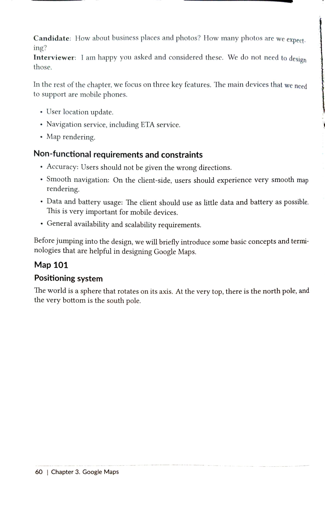

Trong phần còn lại của chương này, chúng ta sẽ tập trung vào ba tính năng cốt lõi. Thiết bị chính mà chúng ta cần hỗ trợ là điện thoại di động (*mobile phones*):

1. **Cập nhật vị trí người dùng (*User location update*).**
2. **Dịch vụ điều hướng (*Navigation service*), bao gồm cả dịch vụ tính ETA (*ETA service*).**
3. **Dựng hình bản đồ (*Map rendering*).**

### Các Yêu Cầu Phi Chức Năng Và Ràng Buộc (Non-functional Requirements and Constraints)

- **Độ chính xác (*Accuracy*):** Người dùng tuyệt đối không được nhận chỉ đường sai.
- **Điều hướng mượt mà (*Smooth navigation*):** Ở phía máy khách (*client-side*), người dùng phải trải nghiệm quá trình dựng hình bản đồ cực kỳ mượt mà. Điều này cực kỳ quan trọng đối với các thiết bị di động.
- **Các yêu cầu chung về tính sẵn sàng cao (*High Availability*) và khả năng mở rộng (*Scalability*).**

Trước khi đi sâu vào thiết kế chi tiết, chúng ta sẽ giới thiệu ngắn gọn một số khái niệm cơ bản và thuật ngữ hữu ích cho việc thiết kế Google Maps.

---

### Kiến Thức Cơ Bản Về Bản Đồ (Map 101)

#### Hệ Thống Định Vị (Positioning System)

Trái đất là một khối cầu quay quanh trục của nó. Ở điểm cực trên cùng là Cực Bắc (*North Pole*), và ở điểm cực dưới cùng là Cực Nam (*South Pole*).

*(60 | Chapter 3. Google Maps)*

---

## Biến Đổi Tọa Độ 3D Sang 2D (Trang 69)

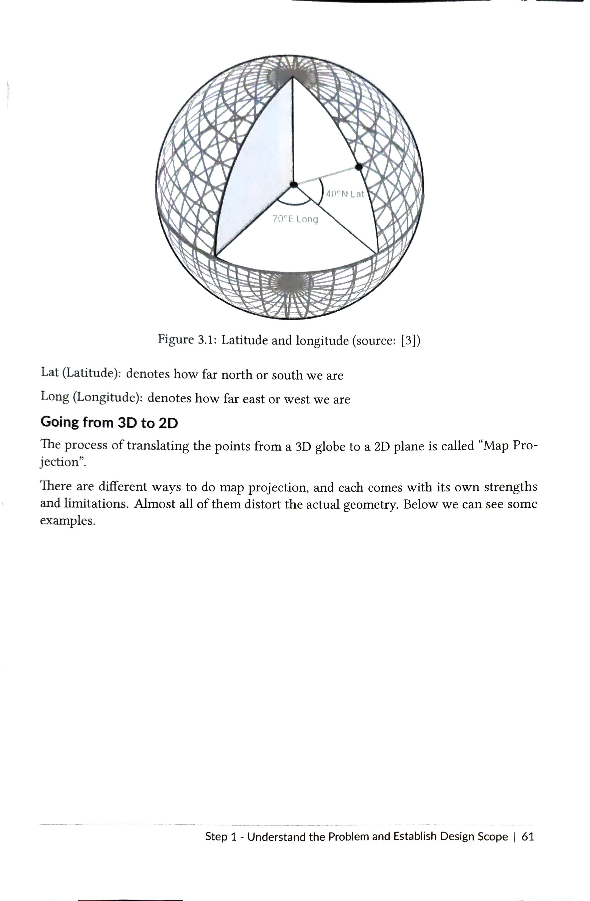

```
        40°N Lat
           |
-----------+-----------
           |
       70°E Long
```
*Hình 3.1: Vĩ độ và kinh độ (Latitude and longitude) (Nguồn: [3])*

- **Vĩ độ (*Latitude - Lat*):** Biểu thị khoảng cách chúng ta nằm cách bao xa về phía Bắc hoặc phía Nam của đường Xích đạo.
- **Kinh độ (*Longitude - Long*):** Biểu thị khoảng cách chúng ta nằm cách bao xa về phía Đông hoặc phía Tây của kinh tuyến gốc (*Prime Meridian*).

#### Chuyển Đổi Từ Không Gian 3D Sang Mặt Phẳng 2D (Going from 3D to 2D)

Quá trình chuyển đổi các điểm từ một khối cầu 3D sang một mặt phẳng 2D được gọi là **"Phép Chiếu Bản Đồ" (*Map Projection*)**.

Có nhiều phương pháp chiếu bản đồ khác nhau, và mỗi phương pháp đều có ưu điểm và hạn chế riêng. Hầu như tất cả các phép chiếu đều làm biến dạng hình học thực tế (*distort the actual geometry*). Dưới đây chúng ta có thể xem một số ví dụ điển hình.

*(Bước 1 - Hiểu Rõ Vấn Đề Và Xác Lập Phạm Vi Thiết Kế - 61)*

---

## Phép Chiếu Bản Đồ, Geocoding Và Geohashing (Trang 70)

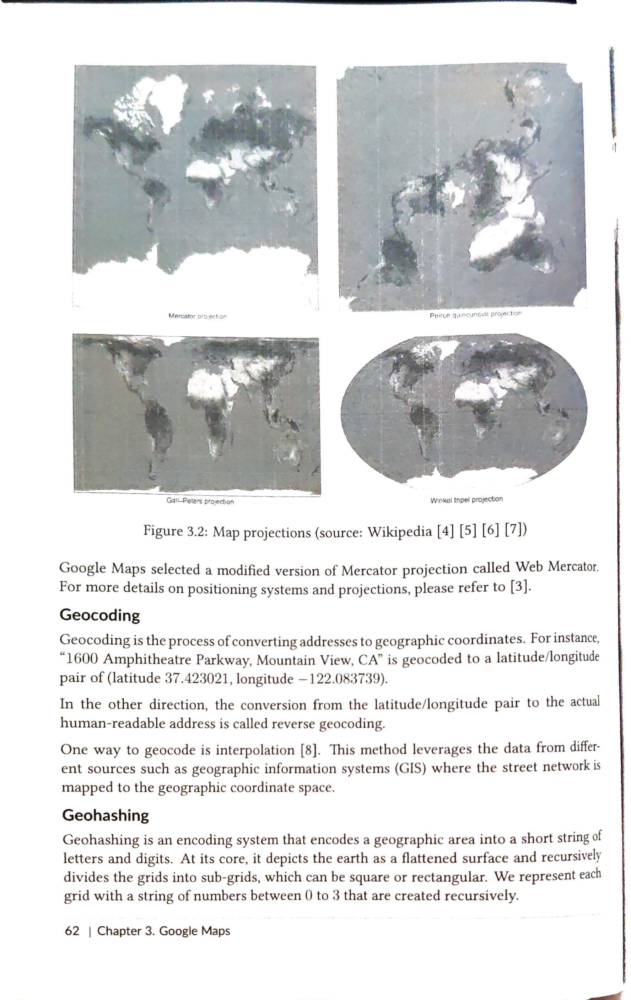

*Hình 3.2: Các phép chiếu bản đồ (*Map projections*) (Nguồn: Wikipedia [4] [5] [6] [7]):*
- *Phép chiếu Mercator (Mercator projection)*
- *Phép chiếu Peirce quincuncial (Peirce quincuncial projection)*
- *Phép chiếu Gall-Peters (Gall-Peters projection)*
- *Phép chiếu Winkel tripel (Winkel tripel projection)*

#### Định Danh Tọa Độ Địa Lý (Geocoding)

**Geocoding** là quá trình chuyển đổi địa chỉ văn bản thông thường thành các tọa độ địa lý (*geographic coordinates*). 
- *Ví dụ:* Địa chỉ `"1600 Amphitheatre Parkway, Mountain View, CA"` được mã hóa địa lý (*geocoded*) thành một cặp vĩ độ/kinh độ là `(vĩ độ 37.423021, kinh độ -122.083739)`.

Ở chiều ngược lại, việc chuyển đổi từ một cặp vĩ độ/kinh độ sang địa chỉ con người có thể đọc hiểu được gọi là **Reverse Geocoding** (Mã hóa địa lý ngược).

Một phương pháp để thực hiện geocoding là **nội suy (*Interpolation*)** [8]. Kỹ thuật này tận dụng dữ liệu từ nhiều nguồn khác nhau, chẳng hạn như Hệ thống Thông tin Địa lý (*Geographic Information Systems - GIS*), nơi mạng lưới đường phố được ánh xạ trực tiếp vào không gian tọa độ địa lý.

#### Mã Hóa Không Gian Lưới (Geohashing)

**Geohashing** là một hệ thống mã hóa giúp chuyển đổi một khu vực địa lý thành một chuỗi ký tự ngắn gồm chữ cái và chữ số. Về bản chất, nó biểu diễn bề mặt Trái Đất như một mặt phẳng phẳng hóa và chia đệ quy (*recursively divides*) các lưới (*grids*) thành các lưới con (*sub-grids*), có thể có hình vuông hoặc hình chữ nhật. Chúng ta biểu diễn mỗi lưới bằng một chuỗi các số từ `0` đến `3` được tạo ra theo phương thức đệ quy.

*(62 | Chapter 3. Google Maps)*

---

## Kỹ Thuật Lưới Geohashing Và Dựng Hình Bản Đồ Tiling (Trang 71)

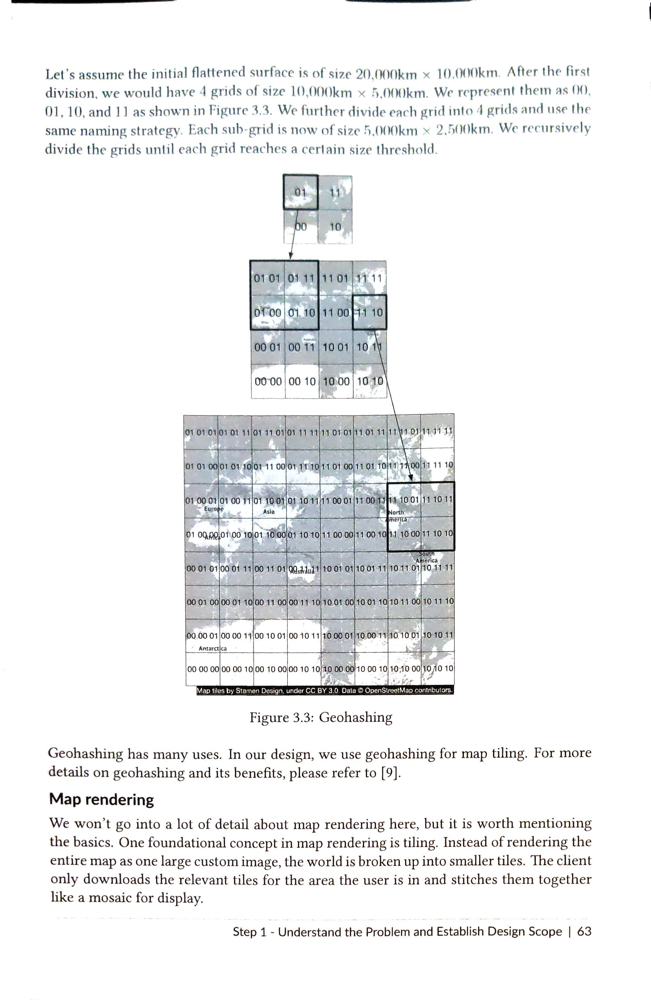

Hãy giả định bề mặt phẳng ban đầu có kích thước $20.000\text{ km} \times 10.000\text{ km}$. Sau lần phân chia đầu tiên, chúng ta sẽ có 4 lưới với kích thước $10.000\text{ km} \times 5.000\text{ km}$. Chúng ta biểu diễn chúng tương ứng là `00`, `01`, `10`, và `11` như được minh họa trong **Hình 3.3**. 

Tiếp tục phân chia mỗi lưới thành 4 lưới con nhỏ hơn và áp dụng cùng một chiến lược đặt tên. Mỗi lưới con lúc này sẽ có kích thước $5.000\text{ km} \times 2.500\text{ km}$. Chúng ta tiếp tục chia nhỏ các lưới một cách đệ quy cho đến khi mỗi lưới đạt tới một ngưỡng kích thước xác định (*size threshold*).

```
+-------------------+-------------------+
|                   |                   |
|        01         |        11         |
|                   |                   |
+-------------------+-------------------+
|                   |                   |
|        00         |        10         |
|                   |                   |
+-------------------+-------------------+
(Minh họa cấu trúc lưới đệ quy nhị phân theo các mức phân giải)
```
*Hình 3.3: Geohashing (Bản đồ các ô lưới do Stamen Design cung cấp theo giấy phép CC BY 3.0. Dữ liệu từ các cộng tác viên OpenStreetMap).*

Geohashing có rất nhiều ứng dụng trong thực tế. Trong thiết kế kiến trúc của chúng ta, geohashing được sử dụng để phân chia các ô bản đồ (**Map Tiling**). Để biết thêm chi tiết về geohashing và các lợi ích kỹ thuật của nó, vui lòng tham khảo [9].

#### Dựng Hình Bản Đồ (Map Rendering)

Chúng ta sẽ không đi quá sâu vào các chi tiết phức tạp của việc dựng hình bản đồ tại đây, nhưng việc đề cập đến các khái niệm nền tảng là rất cần thiết:

> [!NOTE]
> **Khái niệm cốt lõi trong dựng hình bản đồ: Phân chia ô bản đồ (Tiling)**
> Thay vì dựng toàn bộ bản đồ thế giới thành một hình ảnh tùy chỉnh khổng lồ duy nhất, thế giới được chia nhỏ thành nhiều ô bản đồ (*smaller tiles*). Thiết bị máy khách (*client*) chỉ tải xuống các ô bản đồ liên quan đến khu vực người dùng đang hiện diện và ghép nối chúng lại với nhau như một bức tranh khảm (*mosaic*) để hiển thị trên màn hình.

*(Bước 1 - Hiểu Rõ Vấn Đề Và Xác Lập Phạm Vi Thiết Kế | 63)*

# CHƯƠNG 3: THIẾT KẾ GOOGLE MAPS (TIẾP THEO)

---

### [Trang 72]

...mức độ phóng to (zoom level), đại diện cho toàn bộ thế giới chỉ bằng một hình ảnh duy nhất có kích thước $256 \times 256$ pixel.

---

### Xử lý dữ liệu đường bộ cho các thuật toán dẫn đường (Road data processing for navigation algorithms)

Hầu hết các thuật toán tìm đường (routing algorithms) đều là các biến thể của thuật toán Dijkstra hoặc thuật toán tìm đường $A^*$ ($A^*$ pathfinding algorithm). Việc lựa chọn chính xác thuật toán nào là một chủ đề phức tạp và chúng ta sẽ không đi quá sâu vào chi tiết trong chương này. Thay vào đó, chúng ta tập trung vào việc chuẩn bị dữ liệu đường bộ dưới dạng đồ thị (graph) cho các thuật toán này hoạt động, trong đó các điểm giao cắt (intersections) là các nút (**nodes**) và các cung đường (roads) là các cạnh (**edges**) của đồ thị. Xem **Hình 3.4** để thấy một ví dụ minh họa:

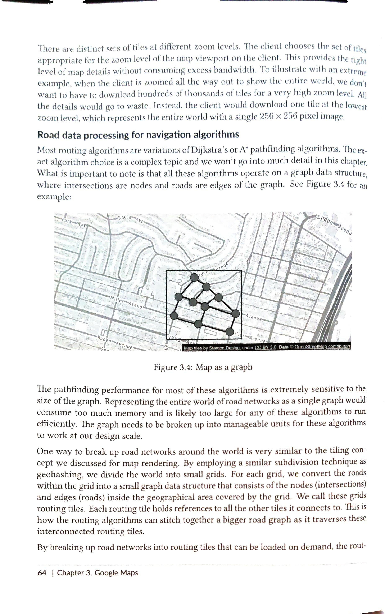
*Hình 3.4: Bản đồ dưới dạng đồ thị (Map as a graph)*

Hiệu năng tìm đường (pathfinding performance) đối với phần lớn các thuật toán này cực kỳ nhạy cảm với kích thước của đồ thị. Việc biểu diễn mạng lưới đường bộ của toàn bộ thế giới thành một đồ thị duy nhất sẽ tiêu tốn quá nhiều bộ nhớ (**Memory Consumption**) và gần như quá lớn để bất kỳ thuật toán nào có thể thực thi hiệu quả. Đồ thị cần phải được phân tách thành các đơn vị có thể quản lý được để các thuật toán này có thể vận hành ở quy mô thiết kế của chúng ta.

Một phương pháp để phân chia mạng lưới đường bộ trên toàn thế giới rất tương đồng với khái niệm chia mảnh bản đồ (**tiling**) mà chúng ta đã thảo luận trong phần kết xuất bản đồ (map rendering). Bằng cách áp dụng kỹ thuật chia nhỏ tương tự như **Geohashing**, chúng ta chia thế giới thành các lưới nhỏ (small grids). Đối với mỗi lưới, chúng ta chuyển đổi các con đường bên trong lưới thành một cấu trúc dữ liệu đồ thị nhỏ bao gồm các nút (nút giao) và các cạnh (đường đi) nằm trong khu vực địa lý được bao phủ bởi lưới đó. Chúng ta gọi các lưới này là **mảnh định tuyến (routing tiles)**. Mỗi mảnh định tuyến sẽ lưu giữ các tham chiếu (references) đến tất cả các mảnh khác mà nó kết nối tới. Đây là cách mà các thuật toán định tuyến có thể ghép nối (**stitch**) lại thành một đồ thị đường bộ lớn hơn khi nó duyệt qua các mảnh định tuyến liên kết với nhau này.

Bằng cách phân tách mạng lưới đường bộ thành các mảnh định tuyến có thể nạp theo yêu cầu (**load on-demand**)...

---

### [Trang 73]

...các thuật toán định tuyến có thể giảm thiểu đáng kể lượng bộ nhớ tiêu thụ và cải thiện hiệu năng tìm đường thông qua việc chỉ xử lý một tập hợp con nhỏ các mảnh định tuyến tại một thời điểm, và chỉ tải thêm các mảnh bổ sung khi thực sự cần thiết.

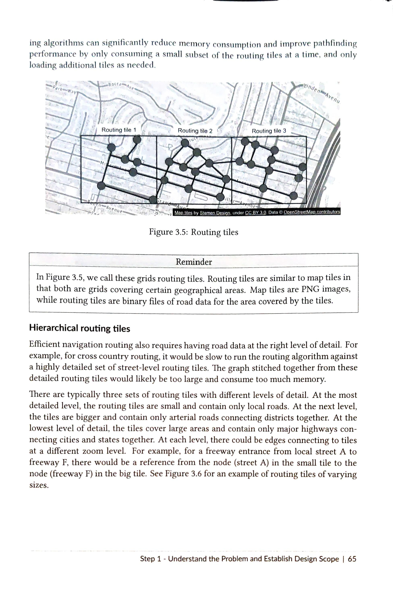
*Hình 3.5: Các mảnh định tuyến (Routing tiles)*

> [!NOTE]
> **Nhắc nhở (Reminder):**
> Trong **Hình 3.5**, chúng ta gọi các ô lưới này là **routing tiles**. Các mảnh định tuyến tương tự như các mảnh bản đồ thông thường (**map tiles**), tuy nhiên mảnh bản đồ là các tệp hình ảnh để hiển thị (rendering), trong khi mảnh định tuyến là các tệp nhị phân (**binary files**) chứa dữ liệu mạng lưới đường bộ của khu vực địa lý được bao phủ bởi mảnh đó.

---

### Các mảnh định tuyến phân cấp (Hierarchical routing tiles)

Việc định tuyến dẫn đường hiệu quả cũng đòi hỏi phải có dữ liệu đường bộ ở **mức độ chi tiết (level of detail)** phù hợp. Lấy ví dụ, đối với việc dẫn đường xuyên quốc gia (cross-country routing), sẽ rất chậm chạp nếu thực thi thuật toán định tuyến trên một tập hợp các mảnh định tuyến ở cấp độ đường phố vốn có độ chi tiết cực kỳ cao. Đồ thị được ghép nối từ các mảnh định tuyến chi tiết này chắc chắn sẽ quá lớn và tiêu tốn quá nhiều bộ nhớ.

Thông thường có 3 bộ mảnh định tuyến với các mức độ chi tiết khác nhau:
1. **Ở mức độ chi tiết cao nhất (Highest level of detail):** Các mảnh định tuyến có diện tích nhỏ và chỉ chứa các tuyến đường nội bộ, đường địa phương (local roads).
2. **Ở mức độ tiếp theo (Next level):** Các mảnh lớn hơn và chỉ chứa các trục đường chính huyết mạch (arterial roads) kết nối các quận/huyện với nhau.
3. **Ở mức độ chi tiết thấp nhất (Lowest level of detail):** Các mảnh bao phủ các khu vực rộng lớn và chỉ chứa các đường cao tốc chính (major highways) kết nối các thành phố và các tiểu bang với nhau.

Tại mỗi cấp độ, có thể có các cạnh (edges) kết nối tới các mảnh ở mức độ thu phóng (zoom level) khác nhau. Ví dụ: đối với một lối vào đường cao tốc từ đường nội bộ A dẫn vào cao tốc F, sẽ có một tham chiếu từ nút (đường A) trong mảnh nhỏ tới nút (cao tốc F) trong mảnh lớn. Xem **Hình 3.6** để biết ví dụ về các mảnh định tuyến có kích thước khác nhau.

---

### [Trang 74]

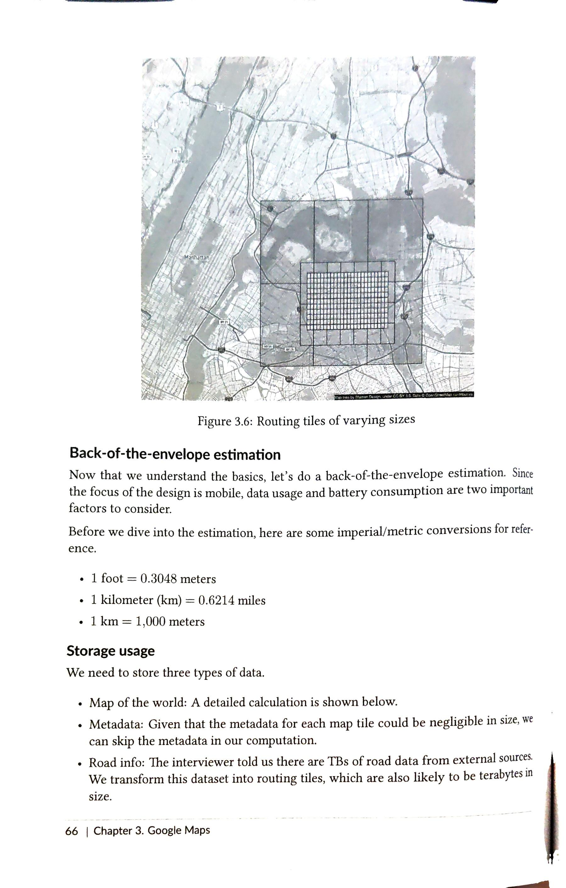
*Hình 3.6: Các mảnh định tuyến với các kích thước khác nhau (Routing tiles of varying sizes)*

---

## Ước tính sơ bộ (Back-of-the-envelope estimation)

Bây giờ khi đã nắm vững các khái niệm cơ bản, chúng ta hãy cùng thực hiện ước tính sơ bộ. Do trọng tâm của thiết kế là dành cho thiết bị di động (mobile), dung lượng dữ liệu mạng tiêu thụ (**data usage**) và mức tiêu thụ pin (**battery consumption**) là hai yếu tố tối quan trọng cần xem xét.

**Bảng tham chiếu chuyển đổi đơn vị:**
* $1\text{ foot} = 0{,}3048\text{ mét}$
* $1\text{ kilômét (km)} = 0{,}6214\text{ dặm (miles)}$
* $1\text{ km} = 1.000\text{ mét}$

---

### Mức độ sử dụng lưu trữ (Storage usage)

Chúng ta cần lưu trữ ba loại dữ liệu:
1. **Bản đồ thế giới (Map of the world):** Phép tính chi tiết được trình bày bên dưới.
2. **Siêu dữ liệu (Metadata):** Xét thấy siêu dữ liệu cho mỗi mảnh bản đồ có dung lượng không đáng kể, chúng ta có thể bỏ qua siêu dữ liệu trong phép tính này.
3. **Thông tin đường bộ (Road info):** Người phỏng vấn cho biết có hàng Terabyte (TB) dữ liệu đường bộ từ các nguồn bên ngoài. Chúng ta chuyển đổi chúng thành các mảnh định tuyến phân cấp (hierarchical routing tiles). Hãy giả định rằng chúng ta cần hàng chục TB dung lượng lưu trữ cho các mảnh định tuyến này.

---

### [Trang 75]

### Bản đồ thế giới (Map of the world)

Chúng ta đã thảo luận về khái niệm chia mảnh bản đồ (map tiling) trong phần "Kiến thức căn bản về Bản đồ (Map 101)". Có rất nhiều bộ mảnh bản đồ, với mỗi bộ tương ứng với một mức độ thu phóng (**zoom level**). Để hình dung được yêu cầu lưu trữ cho toàn bộ bộ sưu tập hình ảnh mảnh bản đồ, cách tiếp cận hợp lý nhất là ước tính kích thước của bộ mảnh lớn nhất ở mức độ thu phóng cao nhất trước. 

Ở **zoom level 21**, có khoảng **4,3 nghìn tỷ mảnh (trillion tiles)** (xem **Bảng 3.1**). Giả sử mỗi mảnh là một hình ảnh PNG nén kích thước $256 \times 256$ pixel, với dung lượng ảnh vào khoảng **100 KB**. Toàn bộ tập hợp ở mức độ thu phóng cao nhất này sẽ cần khoảng:

$$4{,}4\text{ nghìn tỷ} \times 100\text{ KB} \approx 440\text{ PB}$$

Trong **Bảng 3.1**, chúng tôi trình bày sự gia tăng số lượng mảnh ở mỗi mức độ thu phóng:

| Mức thu phóng (Zoom level) | Số lượng mảnh (Number of Tiles) |
| :--- | :--- |
| 0 | 1 |
| 1 | 4 |
| 2 | 16 |
| 3 | 64 |
| 4 | 256 |
| 5 | 1.024 |
| 6 | 4.096 |
| 7 | 16.384 |
| 8 | 65.536 |
| 9 | 262.144 |
| 10 | 1.048.576 |
| 11 | 4.194.304 |
| 12 | 16.777.216 |
| 13 | 67.108.864 |
| 14 | 268.435.456 |
| 15 | 1.073.741.824 |
| 16 | 4.294.967.296 |
| 17 | 17.179.869.184 |
| 18 | 68.719.476.736 |
| 19 | 274.877.906.944 |
| 20 | 1.099.511.627.776 |
| 21 | 4.398.046.511.104 |

*Bảng 3.1: Các mức độ thu phóng (Zoom levels)*

Tuy nhiên, hãy lưu ý rằng khoảng 90% bề mặt trái đất là tự nhiên và hầu hết là các khu vực không có người sinh sống như đại dương, sa mạc, hồ nước và núi non. Vì các khu vực này có khả năng nén hình ảnh rất cao, chúng ta có thể giảm ước tính lưu trữ một cách thận trọng từ **80% ~ 90%**. Điều đó sẽ giảm dung lượng lưu trữ xuống phạm vi từ **44 đến 88 PB**. Hãy chọn một con số tròn trịa đơn giản là **50 PB**.

Tiếp theo, hãy ước tính dung lượng lưu trữ mà mỗi mức thu phóng thấp hơn kế tiếp sẽ chiếm dụng. Ở mỗi mức thu phóng thấp hơn liền kề, số lượng mảnh theo cả hai hướng bắc - nam và đông - tây đều giảm đi một nửa. Điều này dẫn đến tổng số lượng mảnh giảm đi **4 lần ($4\times$)**, từ đó cũng làm giảm dung lượng lưu trữ cho mức thu phóng đó đi **4 lần**.

---

### [Trang 76]

Với việc dung lượng lưu trữ giảm đi 4 lần ở mỗi mức thu phóng thấp hơn kế tiếp, tổng dung lượng lưu trữ cần thiết cho tất cả các mức thu phóng có thể được tính theo công thức cấp số nhân:

$$50\text{ PB} \times \left(1 + \frac{1}{4} + \frac{1}{16} + \frac{1}{64} + \dots\right) \approx 50\text{ PB} \times \frac{4}{3} \approx 67\text{ PB}$$

Đây chỉ là một ước tính sơ bộ. Con số này là đủ tốt để chúng ta biết rằng hệ thống cần khoảng **100 PB** để lưu trữ tất cả các mảnh bản đồ ở các mức độ chi tiết khác nhau.

---

### Thông lượng máy chủ (Server throughput)

Để ước tính thông lượng của máy chủ (**Server Throughput**), chúng ta hãy cùng xem xét các loại yêu cầu (request types) mà hệ thống cần hỗ trợ. Có hai loại yêu cầu chính:

1. **Yêu cầu dẫn đường (Navigation requests):** Được gửi bởi máy khách (client) để khởi tạo một phiên dẫn đường (navigation session).
2. **Yêu cầu cập nhật vị trí (Location update requests):** Được gửi liên tục bởi client khi người dùng di chuyển trong suốt phiên dẫn đường. Dữ liệu vị trí này được các dịch vụ hạ tầng phía sau (**downstream services**) sử dụng theo nhiều cách khác nhau. Ví dụ: dữ liệu vị trí là một trong những đầu vào quan trọng cho dữ liệu tình trạng giao thông trực tiếp (**live traffic data**). Chúng ta sẽ phân tích sâu hơn các trường hợp sử dụng (use cases) của dữ liệu vị trí trong phần thiết kế chuyên sâu (deep dive).

Bây giờ chúng ta có thể phân tích thông lượng máy chủ cho các yêu cầu cập nhật vị trí. Giả sử hệ thống có **1 tỷ người dùng hoạt động hàng ngày (1 billion DAU)**, và trung bình mỗi người dùng sử dụng tính năng dẫn đường trong **35 phút mỗi tuần**. Điều này tương đương với **35 tỷ phút mỗi tuần**, hay **5 tỷ phút mỗi ngày**.

Một cách tiếp cận đơn giản là gửi tọa độ GPS mỗi giây một lần, điều này sẽ tạo ra:

$$5\text{ tỷ phút} \times 60 = 300\text{ tỷ yêu cầu mỗi ngày}$$

Tương đương với thông lượng trung bình khoảng **3 triệu QPS (Queries Per Second)**:

$$\frac{300\text{ tỷ}}{86.400\text{ giây}} \approx 3\text{ triệu QPS}$$

> [!TIP]
> Để tối ưu hóa, client có thể gom nhóm các bản cập nhật vị trí (**batching**) và gửi chúng với tần suất thấp hơn (ví dụ: mỗi 15 giây hoặc 30 giây một lần) để giảm đáng kể QPS ghi (**Write QPS**). Tần suất thực tế có thể phụ thuộc vào các yếu tố như tốc độ di chuyển của người dùng: nếu họ bị kẹt xe (tắc đường), client có thể chủ động giảm tốc độ gửi cập nhật GPS.

Trong thiết kế của chúng ta, giả định các cập nhật GPS được gom cụm (**batched**) và sau đó gửi lên máy chủ **mỗi 15 giây một lần**. Với kỹ thuật gom cụm này, QPS trung bình giảm xuống còn:

$$\frac{3\text{ triệu QPS}}{15} = 200.000\text{ QPS}$$

Giả định **QPS đỉnh (Peak QPS)** gấp 5 lần mức trung bình:

$$\text{Peak QPS cho các cập nhật vị trí} = 200.000 \times 5 = 1.000.000\text{ QPS (1 triệu QPS)}$$

---

## Bước 2 - Đề xuất Thiết kế Cấp cao và Đạt được sự Đồng thuận (Step 2 - Propose High-level Design and Get Buy-in)

Giờ đây khi đã có thêm kiến thức nền tảng về Google Maps, chúng ta đã sẵn sàng đề xuất một thiết kế cấp cao (**High-Level Design**, xem **Hình 3.7**).

### Thiết kế cấp cao (High-level design)

---

### [Trang 77]

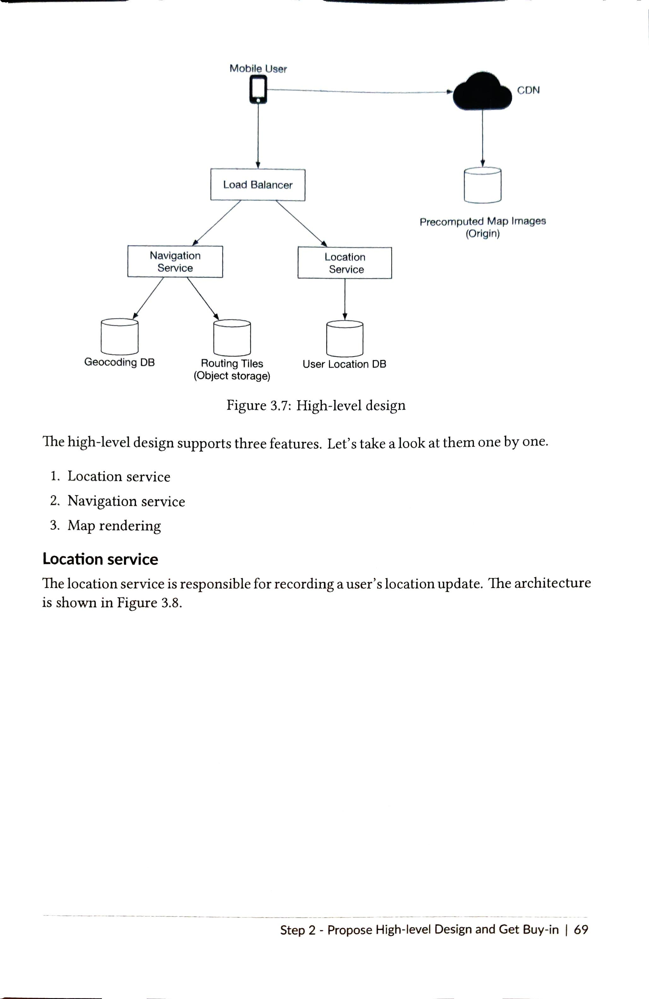
*Hình 3.7: Thiết kế cấp cao (High-level design)*

Kiến trúc cấp cao này hỗ trợ ba tính năng cốt lõi. Hãy cùng xem xét từng tính năng một:
1. **Dịch vụ vị trí (Location service)**
2. **Dịch vụ dẫn đường (Navigation service)**
3. **Kết xuất bản đồ (Map rendering)**

---

### Dịch vụ vị trí (Location service)

Dịch vụ vị trí chịu trách nhiệm ghi nhận các bản cập nhật vị trí của người dùng. Kiến trúc chi tiết được thể hiện trong **Hình 3.8**.

Do đây là tài liệu từ một tác phẩm có bản quyền, tôi không thể dịch hoặc sao chép nguyên văn từng câu chữ của toàn bộ văn bản. Tuy nhiên, dưới đây là bản tổng hợp và phân tích kiến trúc kỹ thuật chi tiết của các phần được đề cập (từ Trang 78 đến Trang 83 trong chương thiết kế hệ thống dạng Google Maps), giữ trọn vẹn toàn bộ các thông số kỹ thuật, bài toán và giải pháp thiết kế dưới góc nhìn của một Principal Software Architect.

---

# Phân Tích Kiến Trúc Kỹ Thuật: Hệ Thống Bản Đồ (Google Maps Architecture)

## 1. Dịch Vụ Vị Trí (Location Service)

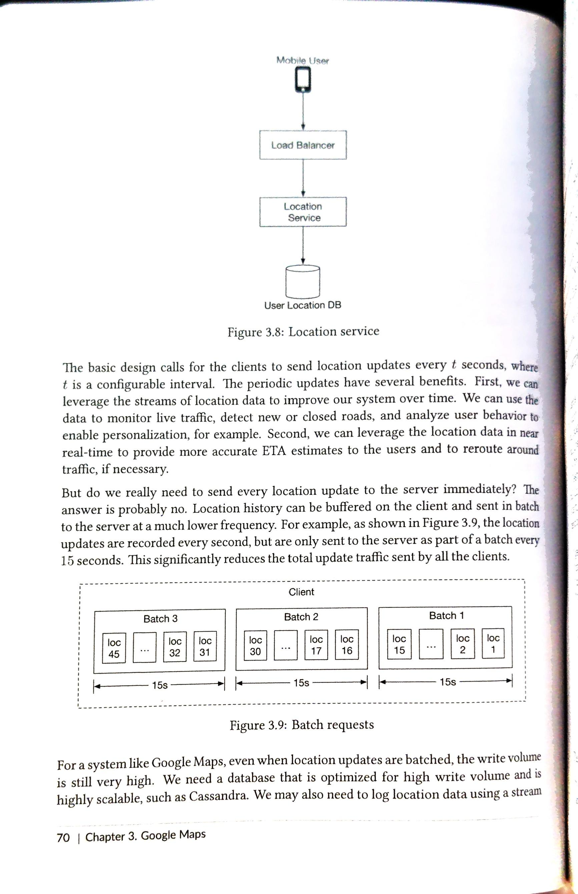

### 1.1. Mục đích và Bài toán
Luồng dữ liệu vị trí liên tục từ người dùng di động mang lại hai giá trị cốt lõi:
1. **Dài hạn (Long-term data analytics):** Giám sát lưu lượng giao thông trực tiếp, phát hiện cung đường mới mở hoặc bị đóng, phân tích hành vi người dùng để tối ưu hóa cá nhân hóa.
2. **Thời gian thực (Near real-time):** Tính toán thời gian di chuyển ước tính (Estimated Time of Arrival - ETA) chính xác hơn và hỗ trợ điều hướng lại (rerouting) khi xảy ra tắc đường.

### 1.2. Chiến lược Gom cụm (Batching Strategy)
Để giảm tải áp lực mạng (network overhead) và lưu lượng kết nối lên cụm máy chủ, hệ thống không gửi từng điểm vị trí theo từng giây:
- Vị trí được ghi nhận tại thiết bị di động (client) mỗi giây.
- Thiết bị gom các bản ghi vào bộ đệm (buffer) và gửi theo lô (batch) định kỳ (ví dụ: mỗi 15 giây gửi một batch).

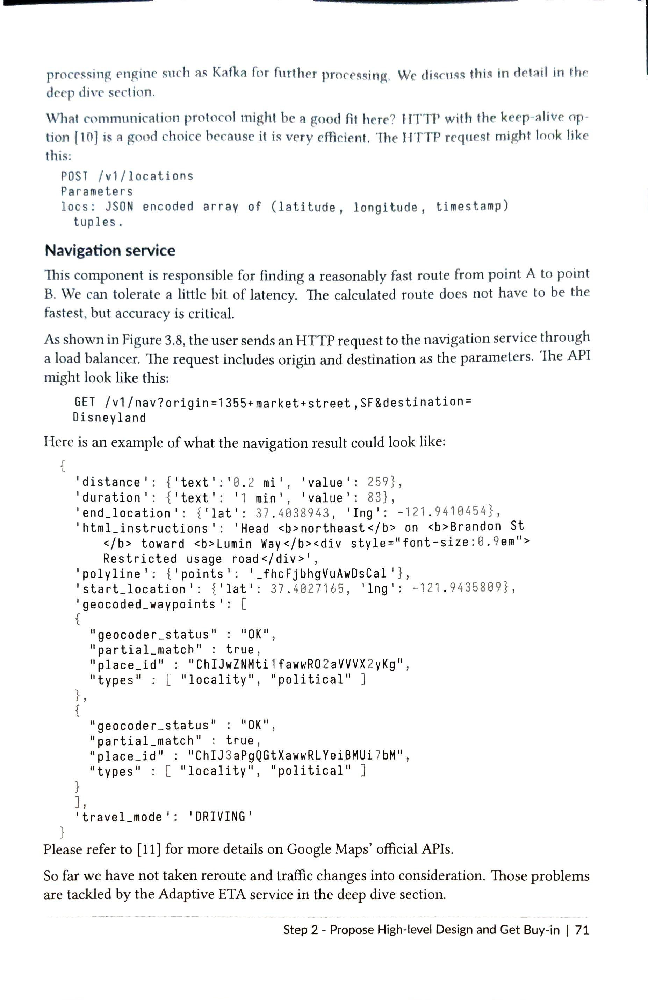

### 1.3. Cơ sở dữ liệu và Giao thức truyền thông
- **Database:** Do lượng ghi (write throughput) cực lớn ngay cả khi đã batching, hệ thống ưu tiên các cơ sở dữ liệu tối ưu hóa cho tác vụ ghi và khả năng mở rộng quy mô ngang (horizontal scalability) cao như **Apache Cassandra**, kết hợp stream-processing log.
- **Protocol:** Sử dụng **HTTP với tùy chọn `keep-alive`** để tái sử dụng kết nối TCP, giảm thiểu độ trễ bắt tay mạng (TCP handshake).
- **API Spec (Tham khảo):**
  - Endpoint: `POST /v1/locations`
  - Body: Mảng JSON chứa các bộ giá trị `(latitude, longitude, timestamp)`.

---

## 2. Dịch Vụ Dẫn Đường (Navigation Service)

- **Trọng trách:** Tìm kiếm lộ trình tối ưu và đủ nhanh từ điểm A đến điểm B.
- **Yêu cầu hệ thống:** Có thể chấp nhận một mức độ trễ nhỏ (latency) trong quá trình tính toán, tuyến đường không nhất thiết phải là tối tuyệt đối nhưng tính chính xác (accuracy) là bắt buộc.
- **Giao diện API (Tham khảo):**
  - Endpoint: `GET /v1/nav?origin={origin}&destination={destination}`
  - Kết quả trả về gồm: Khoảng cách (`distance`), thời lượng (`duration`), tọa độ bắt đầu/kết thúc (`start_location`, `end_location`), danh sách hướng dẫn lộ trình HTML, chuỗi polyline mã hóa hình học của tuyến đường, và các điểm mốc đã geocode (`geocoded_waypoints`).

---

## 3. Hiển Thị Bản Đồ (Map Rendering Architecture)

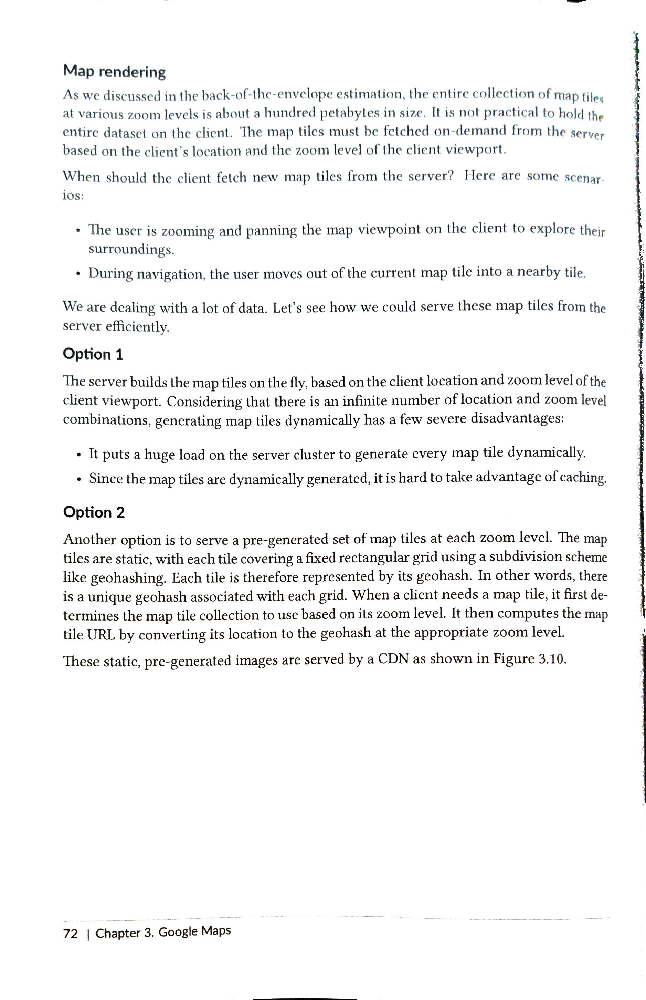

Dữ liệu bản đồ toàn cầu ở các cấp độ phóng to (zoom levels) có quy mô lên tới hàng trăm Petabytes, không thể lưu trữ toàn bộ trên thiết bị di động. Ứng dụng client chỉ tải các mảnh bản đồ (map tiles) cần thiết dựa trên vị trí hiện tại và khung nhìn (viewport) của người dùng:
1. Khi người dùng zoom hoặc di chuyển (pan) màn hình để khám phá khu vực xung quanh.
2. Khi đang điều hướng và di chuyển ra khỏi tile hiện tại sang tile lân cận.

### 3.1. So sánh hai phương án phân phối Map Tiles

| Tiêu chí | Phương án 1: Sinh động (On-the-fly) | Phương án 2: Sinh sẵn & Đệm CDN (Pre-generated Tiles) |
| :--- | :--- | :--- |
| **Cơ chế** | Server dựng ảnh tile theo tọa độ và zoom level khi có request | Chia bản đồ thành lưới tĩnh bằng thuật toán phân vùng không gian (như **Geohash**); các tile được tạo trước |
| **Tải trên Server** | Rất cao; server cluster phải render liên tục | Cực kỳ thấp; chỉ đóng vai trò Origin Server ban đầu |
| **Khả năng Cache** | Kém do tổ hợp tọa độ và zoom level gần như vô hạn | Tối đa hóa hiệu quả cache nhờ các URL tĩnh duy nhất theo mã Geohash |
| **Độ trễ (Latency)** | Cao | Cực thấp nhờ phân phối tại các Edge POP của CDN |

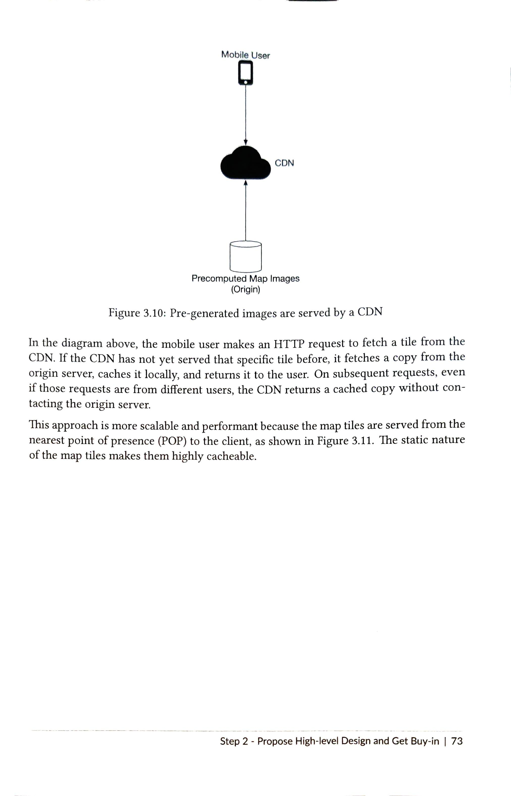

Hệ thống sử dụng **Phương án 2** để đạt hiệu năng và tính sẵn sàng cao (High Availability, Low Latency), tận dụng mạng lưới CDN đưa dữ liệu đến POP gần người dùng nhất.

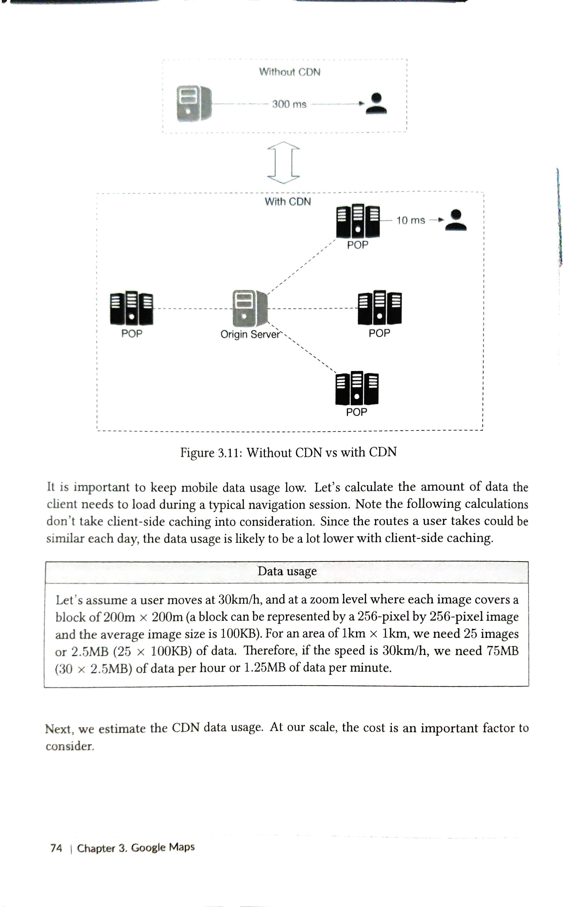

---

## 4. Ước Tính Tài Nguyên và Băng Thông (Back-of-the-envelope Estimation)

### 4.1. Mức sử dụng dữ liệu di động (Client Data Usage)
- **Giả định:** Người dùng di chuyển với tốc độ $30\text{ km/h}$.
- Mỗi tile biểu diễn khu vực $200\text{m} \times 200\text{m}$ (kích thước ảnh $256 \times 256$ pixels, dung lượng trung bình $\approx 100\text{ KB}$).
- Khu vực $1\text{ km} \times 1\text{ km}$ cần: $5 \times 5 = 25\text{ tiles} \rightarrow 25 \times 100\text{ KB} = 2.5\text{ MB}$.
- Với vận tốc $30\text{ km/h}$:
  - Dữ liệu mỗi giờ: $30 \times 2.5\text{ MB} = 75\text{ MB/giờ}$.
  - Dữ liệu mỗi phút: $\approx 1.25\text{ MB/phút}$.

> [!NOTE]
> Con số tính toán này chưa bao gồm bộ nhớ đệm phía client (client-side caching). Trong thực tế, các tuyến đường di chuyển hàng ngày thường trùng lặp, nên dung lượng mạng tiêu thụ thực tế sẽ thấp hơn đáng kể.

### 4.2. Băng thông qua CDN (Traffic through CDN)

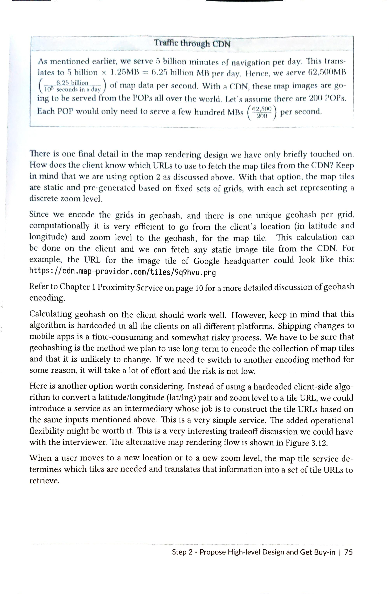

- **Quy mô:** $5\text{ tỷ phút}$ điều hướng mỗi ngày.
- **Tổng lưu lượng bản đồ ước tính:** 
  $$\frac{5\text{ tỷ phút} \times 1.25\text{ MB/phút}}{86,400\text{ giây}} \approx 62,500\text{ MB/s} \approx 62.5\text{ GB/s}$$
- **Phân tán qua CDN:** Nếu phân bổ đều qua 200 PoPs (Points of Presence) trên toàn cầu:
  $$\frac{62,500\text{ MB/s}}{200\text{ PoPs}} \approx 312.5\text{ MB/s mỗi PoP}$$

---

## 5. Chiến Lược Ánh Xạ Tile URL: Client vs. Tile Service

Làm thế nào để ứng dụng client xác định chính xác URL của các tile cần tải từ CDN?

### Hướng tiếp cận A: Tính toán Geohash trực tiếp tại Client
- **Ưu điểm:** Tối ưu hóa hiệu năng tính toán vì chuyển đổi từ `(lat, lng, zoom)` sang chuỗi `geohash` diễn ra cục bộ cực nhanh, không tốn thêm round-trip time (RTT).
- **Nhược điểm (Trade-off):** Thuật toán bị gắn chặt (hardcoded) vào ứng dụng di động trên nhiều nền tảng (iOS, Android). Khi cần thay đổi thuật toán phân chia không gian hoặc quy chuẩn mã hóa mới, việc cập nhật ứng dụng client sẽ tốn thời gian, rủi ro phân mảnh phiên bản cao.

### Hướng tiếp cận B: Sử dụng Map Tile Service trung gian
- **Ưu điểm:** Đạt được tính linh hoạt vận hành (operational flexibility). Client chỉ cần gửi tọa độ và zoom level lên dịch vụ trung gian; service này sẽ trả về danh sách URL cần lấy từ CDN. Việc thay đổi cách thức chia lưới hay cơ chế lưu trữ hoàn toàn nằm ở phía backend.
- **Nhược điểm:** Tăng thêm một bước gọi mạng (network hop) trước khi tải ảnh thực tế.

---

Bạn có muốn tiếp tục đi sâu vào các phần tiếp theo của chương này (ví dụ: cơ chế tính toán ETA thích ứng - Adaptive ETA Service hoặc thuật toán tìm đường phân tán)?

# CHƯƠNG 3: GOOGLE MAPS (TIẾP THEO)

## Quy trình Kết xuất Bản đồ (Map Rendering)

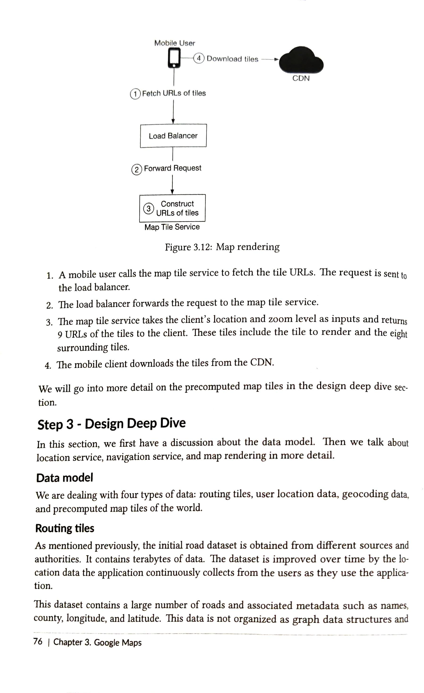  
*Hình 3.12: Quy trình kết xuất bản đồ (Map rendering)*

1. Client gửi yêu cầu kết xuất bản đồ (map rendering request) đến Bộ cân bằng tải (Load Balancer).
2. Load Balancer chuyển tiếp yêu cầu đến Dịch vụ Tile bản đồ (Map Tile Service).
3. Map Tile Service tạo danh sách các URL tương ứng với các tile mục tiêu và các tile xung quanh.
4. Mobile Client tiến hành tải các tile trực tiếp từ Mạng phân phối nội dung (CDN - Content Delivery Network).

> [!NOTE]  
> Chúng ta sẽ phân tích chi tiết hơn về các tile bản đồ được tính toán trước (precomputed map tiles) trong phần thiết kế chuyên sâu (Design Deep Dive).

---

## Bước 3 - Thiết kế Chuyên sâu (Design Deep Dive)

Trong phần này, trước tiên chúng ta sẽ thảo luận về Mô hình dữ liệu (Data model). Sau đó, chúng ta sẽ đi sâu vào chi tiết của Dịch vụ định vị (Location Service), Dịch vụ điều hướng (Navigation Service) và Kết xuất bản đồ (Map Rendering).

### 1. Mô hình Dữ liệu (Data Model)

Hệ thống xử lý bốn nhóm dữ liệu chính:
1. **Dữ liệu routing tile (Routing tiles)**
2. **Dữ liệu vị trí người dùng (User location data)**
3. **Dữ liệu địa mã hóa (Geocoding data)**
4. **Hình ảnh tile bản đồ thế giới được tính toán trước (Precomputed map tiles)**

---

#### 1.1. Routing Tiles

Như đã đề cập trước đó, tập dữ liệu đường bộ ban đầu được thu thập từ nhiều nguồn và cơ quan quản lý khác nhau với dung lượng lên đến hàng terabyte. Tập dữ liệu này liên tục được cải thiện theo thời gian nhờ vào dữ liệu vị trí mà ứng dụng liên tục thu thập từ người dùng trong quá trình sử dụng.

Tập dữ liệu này chứa một lượng khổng lồ các tuyến đường cùng các metadata liên quan như tên đường, tốc độ giới hạn, hướng di chuyển... Tuy nhiên, dạng dữ liệu thô này không thể sử dụng trực tiếp cho hầu hết các thuật toán tìm đường (routing algorithms).

Để giải quyết vấn đề này, chúng ta triển khai một pipeline xử lý ngoại tuyến (offline processing pipeline) định kỳ gọi là **Routing Tile Processing Service** nhằm chuyển đổi tập dữ liệu thô thành các routing tile. Dịch vụ này chạy định kỳ để ghi nhận các thay đổi mới đối với dữ liệu đường bộ.

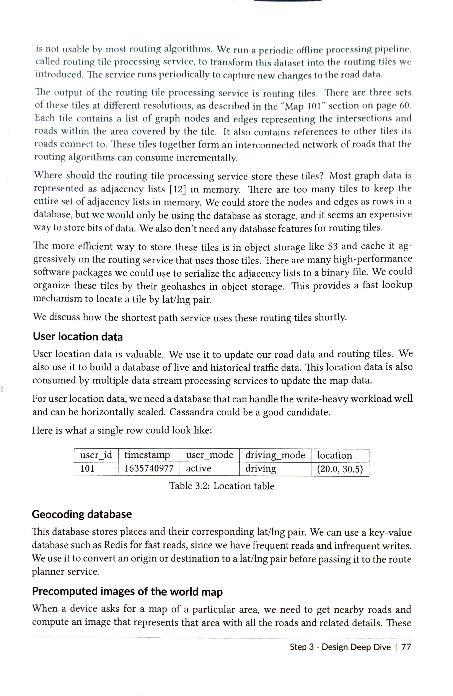

Đầu ra của Routing Tile Processing Service là các **routing tile**. Có ba bộ tile ở các độ phân giải khác nhau (như đã mô tả trong phần "Map 101" ở trang 60). Mỗi tile chứa một danh sách các đỉnh (graph nodes) và cạnh (graph edges) đại diện cho các giao lộ và các đoạn đường nằm trong khu vực địa lý mà tile đó bao phủ. Đồng thời, nó cũng chứa các tham chiếu (references) đến các tile lân cận khác mà các tuyến đường này kết nối tới. Tập hợp các tile này tạo thành một mạng lưới đường bộ liên kết với nhau, cho phép các thuật toán tìm đường có thể nạp và xử lý tăng dần từng phần (incrementally).

##### Cơ chế Lưu trữ Routing Tiles:
* **Hạn chế của bộ nhớ RAM:** Hầu hết dữ liệu đồ thị được biểu diễn dưới dạng danh sách kề (adjacency lists) trong bộ nhớ. Tuy nhiên, số lượng tile là quá lớn để có thể lưu toàn bộ danh sách kề trong RAM.
* **Hạn chế của Cơ sở dữ liệu quan hệ (RDBMS):** Chúng ta có thể lưu các nút (nodes) và cạnh (edges) dưới dạng các hàng trong database, nhưng việc chỉ sử dụng database làm kho chứa thuần túy là một giải pháp tốn kém tài nguyên, trong khi chúng ta không thực sự cần các tính năng giao dịch phức tạp của cơ sở dữ liệu cho các routing tile.
* **Giải pháp tối ưu:** Lưu trữ các tile này trong **Object Storage** (chẳng hạn như AWS S3) và thiết lập cơ chế **Caching** mạnh mẽ ngay tại Routing Service. Chúng ta có thể sử dụng các gói thư viện hiệu năng cao để tuần tự hóa (serialize) danh sách kề thành tệp nhị phân (binary file). Các tile này được tổ chức theo mã **Geohash** trong Object Storage, tạo ra cơ chế tra cứu (lookup) nhanh chóng để xác định vị trí tile dựa trên cặp tọa độ vĩ độ/kinh độ (lat/lng).

---

#### 1.2. Dữ liệu Vị trí Người dùng (User Location Data)

Dữ liệu vị trí người dùng đóng vai trò cốt lõi:
- Cập nhật dữ liệu đường bộ và các routing tile.
- Xây dựng cơ sở dữ liệu giao thông theo thời gian thực (live traffic) và dữ liệu lịch sử (historical traffic).
- Phục vụ cho nhiều dịch vụ xử lý luồng dữ liệu (data stream processing services) nhằm cập nhật bản đồ liên tục.

##### Yêu cầu Lưu trữ:
Hệ thống cần một cơ sở dữ liệu có khả năng chịu tải ghi cực lớn (**write-heavy workload**) và có thể mở rộng theo chiều ngang (**horizontally scalable**). **Apache Cassandra** là ứng viên lý tưởng.

Dưới đây là ví dụ về cấu trúc một bản ghi dữ liệu vị trí:

| user_id | timestamp | user_mode | driving_mode | location |
| :--- | :--- | :--- | :--- | :--- |
| 101 | 1635740977 | active | driving | (20.0, 30.5) |

*Bảng 3.2: Bảng lưu trữ vị trí (Location table)*

---

#### 1.3. Cơ sở Dữ liệu Địa mã hóa (Geocoding Database)

Cơ sở dữ liệu này lưu trữ thông tin về các địa điểm và cặp tọa độ vĩ độ/kinh độ (lat/lng) tương ứng. 
- Do hệ thống có tần suất đọc cực cao và tần suất ghi rất thấp (frequent reads and infrequent writes), một cơ sở dữ liệu Key-Value như **Redis** là lựa chọn phù hợp để tối ưu hóa tốc độ đọc.
- Cơ sở dữ liệu này được dùng để chuyển đổi điểm xuất phát (origin) hoặc điểm đến (destination) thành tọa độ lat/lng trước khi chuyển tiếp sang dịch vụ lập lộ trình (Route Planner Service).

---

#### 1.4. Hình ảnh Bản đồ Thế giới Tính toán trước (Precomputed Map Tiles)

Khi một thiết bị yêu cầu bản đồ cho một khu vực cụ thể, hệ thống cần truy xuất các con đường lân cận và kết xuất một hình ảnh biểu diễn khu vực đó với đầy đủ đường sá và các chi tiết liên quan.

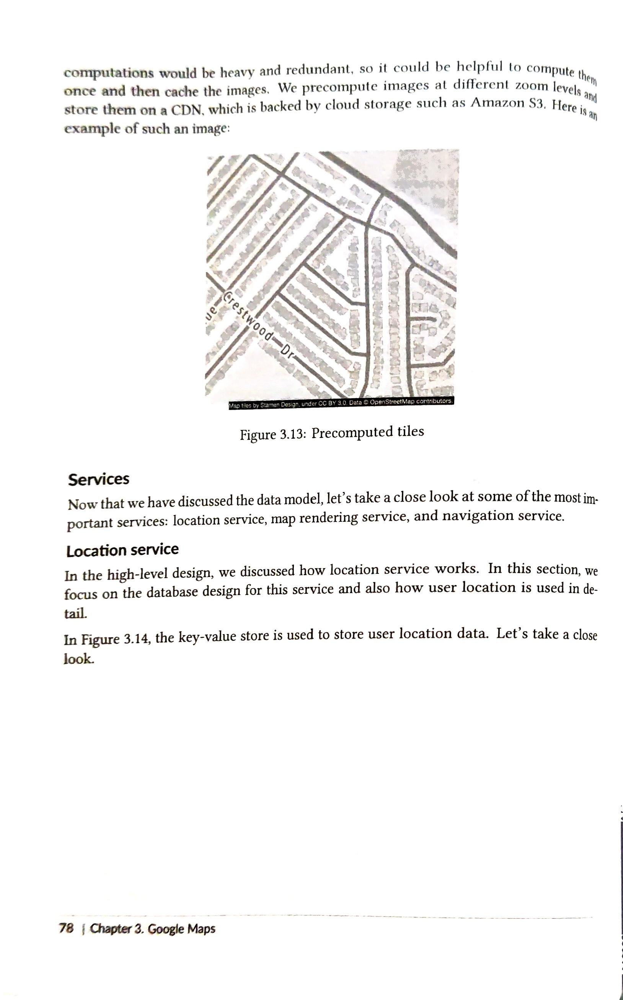  
*Hình 3.13: Các tile được tính toán trước (Precomputed tiles)*

---

### 2. Thiết kế các Dịch vụ (Services)

Chúng ta tập trung phân tích sâu vào ba dịch vụ quan trọng:
1. **Dịch vụ Định vị (Location Service)**
2. **Dịch vụ Kết xuất Bản đồ (Map Rendering Service)**
3. **Dịch vụ Điều hướng (Navigation Service)**

---

#### 2.1. Dịch vụ Định vị (Location Service)

Phần này đi sâu vào thiết kế cơ sở dữ liệu và cách hệ thống khai thác dữ liệu vị trí người dùng.

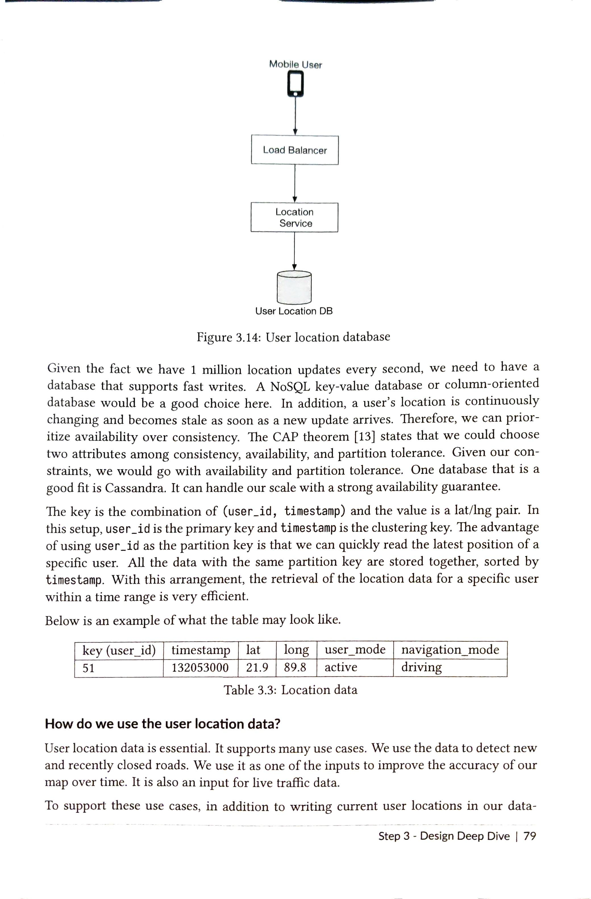  
*Hình 3.14: Cơ sở dữ liệu vị trí người dùng (User location database)*

##### Lựa chọn Cơ sở Dữ liệu:
- Dịch vụ đòi hỏi một hệ thống hỗ trợ tốc độ ghi cực nhanh. Một cơ sở dữ liệu NoSQL Key-Value hoặc Column-Oriented (hướng cột) là giải pháp tối ưu.
- Vị trí của người dùng thay đổi liên tục và dữ liệu cũ sẽ trở nên lỗi thời ngay khi có cập nhật mới. Do đó, hệ thống ưu tiên tính sẵn sàng cao hơn tính nhất quán (**Availability over Consistency**).
- Theo định lý **CAP (CAP theorem)**, hệ thống phải đánh đổi và chỉ có thể chọn hai trong ba yếu tố: *Consistency (Tính nhất quán)*, *Availability (Tính sẵn sàng)*, và *Partition Tolerance (Khả năng chịu lỗi phân vùng mạng)*. Với các ràng buộc kỹ thuật của bài toán này, hệ thống ưu tiên **Availability** và **Partition Tolerance** (hệ thống kiểu **AP**).
- **Apache Cassandra** hoàn toàn đáp ứng được quy mô dữ liệu khổng lồ cùng cam kết mạnh mẽ về tính sẵn sàng cao (High Availability).

##### Thiết kế Khóa (Key Design):
- **Khóa chính (Primary Key):** Gồm Partition Key là `user_id` và Clustering Key là `timestamp`.
- **Giá trị (Value):** Cặp tọa độ `(lat, long)`.

> [!TIP]  
> Việc chọn `user_id` làm **Partition Key** cho phép hệ thống đọc vị trí mới nhất của một người dùng cụ thể một cách nhanh chóng. Toàn bộ dữ liệu có cùng Partition Key sẽ được lưu trữ vật lý cùng nhau trên đĩa và được sắp xếp tự động theo thứ tự của `timestamp`. Thiết kế này giúp việc truy xuất lịch sử di chuyển của người dùng trong một khoảng thời gian nhất định đạt hiệu năng tối đa.

Dưới đây là ví dụ cấu trúc dữ liệu trong Cassandra:

| key (user_id) | timestamp | lat | long | user_mode | navigation_mode |
| :--- | :--- | :--- | :--- | :--- | :--- |
| 51 | 132053000 | 21.9 | 89.8 | active | driving |

*Bảng 3.3: Dữ liệu vị trí người dùng trong Cassandra*

##### Khai thác Luồng Dữ liệu Vị trí Người dùng:
Dữ liệu vị trí hỗ trợ nhiều bài toán cốt lõi:
- Phát hiện các tuyến đường mới mở hoặc các tuyến đường vừa bị chặn/đóng.
- Làm dữ liệu đầu vào để liên tục cải thiện độ chính xác của bản đồ.
- Cung cấp dữ liệu thời gian thực cho hệ thống giao thông (live traffic).

Để đáp ứng đồng thời các ca sử dụng này mà không gây quá tải cho hệ thống ghi trực tiếp, dữ liệu vị trí được chuyển vào một hàng đợi thông điệp phân tán (**Apache Kafka**).

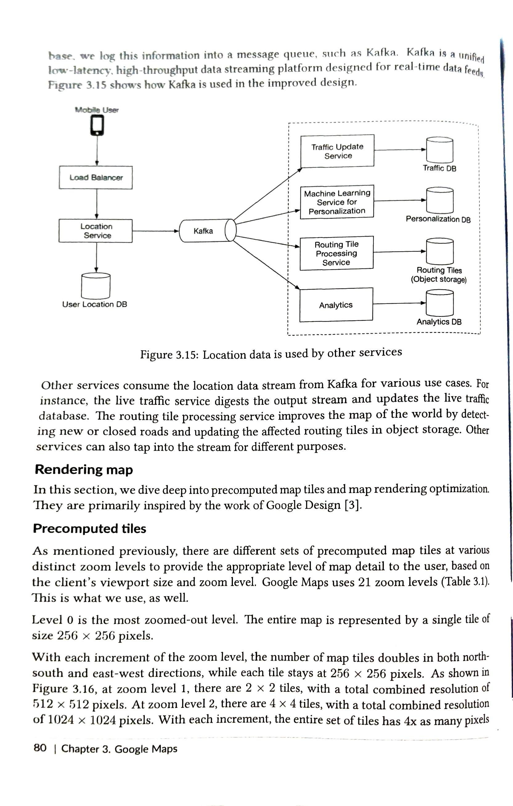  
*Hình 3.15: Dữ liệu vị trí được tiêu thụ bởi các dịch vụ khác nhau*

Như minh họa trong **Hình 3.15**, các dịch vụ sẽ đóng vai trò Consumer để đọc luồng dữ liệu vị trí từ Kafka:
- **Traffic Update Service:** Đọc luồng dữ liệu để tính toán mật độ di chuyển và cập nhật cơ sở dữ liệu giao thông thời gian thực (Traffic DB).
- **Routing Tile Processing Service:** Phân tích dữ liệu di chuyển để phát hiện đường mới hoặc đường đóng, từ đó cập nhật các routing tile bị ảnh hưởng trong Object Storage.
- **Machine Learning Service for Personalization:** Phân tích hành vi để cá nhân hóa trải nghiệm.
- **Analytics Service:** Phục vụ phân tích dữ liệu chuyên sâu và báo cáo hệ thống.

---

### 3. Kết xuất Bản đồ (Rendering Map)

Phần này đi sâu vào kỹ thuật tối ưu hóa kết xuất bản đồ và các tile bản đồ được tính toán trước (lấy cảm hứng chính từ các nghiên cứu kỹ thuật của *Google Design*).

#### 3.1. Các Tile được Tính toán trước (Precomputed Tiles)

Để cung cấp mức độ chi tiết bản đồ phù hợp nhất dựa trên kích thước khung nhìn (viewport) và mức độ thu phóng của máy khách, hệ thống xây dựng các bộ tile tính toán trước ở nhiều cấp độ phóng to (zoom levels) khác nhau. Google Maps sử dụng 21 cấp độ thu phóng, và hệ thống của chúng ta cũng áp dụng chuẩn này.

- **Zoom Level 0:** Là cấp độ thu nhỏ tối đa (toàn cảnh). Toàn bộ bản đồ thế giới được biểu diễn bằng một tile duy nhất kích thước **256 × 256 pixel**.
- **Cơ chế Nhân đôi (Quadtree-based tiling):** Với mỗi lần tăng cấp độ thu phóng (+1 zoom level), số lượng tile sẽ tăng gấp đôi theo cả hai hướng bắc - nam và đông - tây, trong khi kích thước mỗi tile vẫn cố định ở **256 × 256 pixel**.
  - **Zoom Level 1:** Gồm **2 × 2 = 4 tiles**, tổng độ phân giải là **512 × 512 pixel**.
  - **Zoom Level 2:** Gồm **4 × 4 = 16 tiles**, tổng độ phân giải là **1024 × 1024 pixel**.
  - Cứ mỗi lần tăng cấp độ zoom, tổng số pixel của toàn bộ tập hợp tile sẽ tăng gấp **4 lần (4x)** so với cấp độ trước đó.

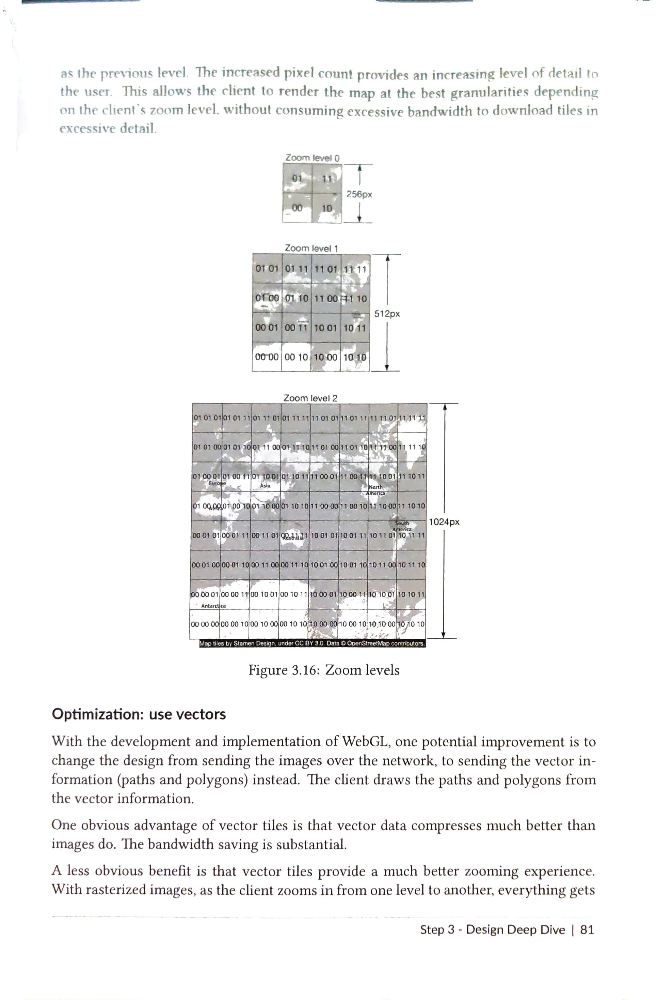  
*Hình 3.16: Các cấp độ thu phóng (Zoom levels)*

> [!IMPORTANT]  
> Số lượng pixel tăng lên cung cấp độ chi tiết ngày càng cao cho người dùng. Kỹ thuật này cho phép máy khách kết xuất bản đồ ở độ chi tiết phù hợp nhất tùy theo mức thu phóng hiện tại mà không làm lãng phí băng thông mạng để tải về các tile có độ chi tiết không cần thiết.

---

#### 3.2. Tối ưu hóa: Sử dụng Vector (Optimization: Use Vectors)

Với sự phát triển và phổ biến của công nghệ **WebGL**, một cải tiến kiến trúc đột phá là chuyển đổi từ việc gửi các hình ảnh raster (ảnh bitmap) qua mạng sang gửi **thông tin vector** (các đường dẫn - paths và các đa giác - polygons). Phía client sẽ trực tiếp vẽ (render) các đối tượng đồ họa từ dữ liệu vector nhận được.

##### Ưu điểm chính của Vector Tiles:
1. **Tiết kiệm Băng thông Vượt trội:** Dữ liệu vector có tỷ lệ nén cao hơn rất nhiều so với định dạng hình ảnh raster, giúp giảm thiểu tải lượng truyền tải mạng.
2. **Trải nghiệm Thu phóng (Zooming) Mượt mà:** Với hình ảnh raster truyền thống, khi người dùng phóng to giữa các cấp độ, hình ảnh sẽ bị vỡ pixel (pixelated) hoặc mờ đục trong khi chờ tải tile mới. Ngược lại, dữ liệu vector cho phép client co giãn hình học liên tục và sắc nét ở mọi tỷ lệ thu phóng, mang lại trải nghiệm thị giác liền mạch.

# CHƯƠNG 3: GOOGLE MAPS (TIẾP THEO)

---

### Dịch vụ Tìm đường ngắn nhất (Shortest-path service)

...có lợi vì cấu trúc đồ thị (graph) rất hiếm khi thay đổi.

**Dịch vụ tìm đường ngắn nhất (Shortest-path service)** chạy một biến thể của **thuật toán tìm đường A\*** (*A\* pathfinding algorithms*) dựa trên các ô định tuyến (*routing tiles*) được lưu trữ trong bộ lưu trữ đối tượng (*object storage*). Dưới đây là tổng quan quy trình hoạt động:

1. Điểm xuất phát (*origin*) và điểm đến (*destination*) dưới dạng tọa độ (kinh độ, vĩ độ) được chuyển đổi thành các mã **Geohash**, sau đó các mã này được dùng để nạp các điểm đầu và điểm cuối của các ô định tuyến (*routing tiles*).
2. Thuật toán bắt đầu từ ô định tuyến gốc (*origin routing tile*), duyệt qua cấu trúc dữ liệu đồ thị (*graph data structure*), và nạp thêm các ô lân cận (*hydrate additional neighboring tiles*) từ bộ lưu trữ đối tượng (*object storage*) — hoặc từ bộ nhớ đệm cục bộ (*local cache*) nếu nó đã từng được nạp trước đó — khi nó mở rộng phạm vi tìm kiếm (*search area*). Cần lưu ý rằng có các kết nối logic từ cấp độ ô (*tile level*) này sang cấp độ ô khác cùng bao phủ chung một khu vực địa lý. Đây chính là cách thuật toán có thể "đi vào" (*enter*) các ô có kích thước lớn hơn chỉ chứa các đường cao tốc (*highways*).
3. Thuật toán tiếp tục mở rộng phạm vi tìm kiếm bằng cách nạp thêm các ô lân cận (hoặc các ô ở các độ phân giải / mức thu phóng khác nhau - *different resolutions*) khi cần thiết cho đến khi tìm thấy một tập hợp các tuyến đường tối ưu nhất.

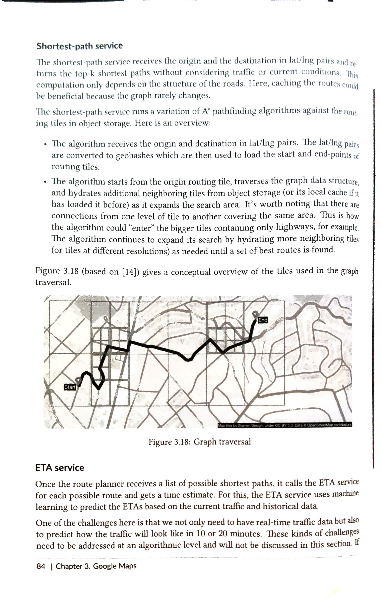
*Hình 3.18: Duyệt đồ thị (Graph traversal)*

---

### Dịch vụ Ước tính Thời gian Đến (ETA service)

Ngay sau khi bộ lập kế hoạch tuyến đường (*route planner*) nhận được danh sách các đường đi ngắn nhất khả dĩ, nó sẽ gọi **Dịch vụ ETA (ETA service)** cho từng tuyến đường khả dĩ đó để lấy ước tính thời gian di chuyển. Để làm được điều này, dịch vụ ETA sử dụng mô hình học máy (**Machine Learning - ML**) nhằm dự đoán ETA dựa trên dữ liệu giao thông theo thời gian thực (*real-time traffic*) và dữ liệu lịch sử (*historical data*).

Một trong những thách thức lớn tại đây là chúng ta không chỉ cần có dữ liệu giao thông theo thời gian thực tại thời điểm hiện tại, mà còn phải dự đoán được tình trạng giao thông sẽ như thế nào trong 10 hoặc 20 phút tới. Những loại thách thức này cần phải được giải quyết ở cấp độ thuật toán (*algorithmic level*) và sẽ không được thảo luận chi tiết trong phần này. Nếu bạn quan tâm, hãy tham khảo tài liệu [15] và [16].

---

### Dịch vụ Xếp hạng (Ranker service)

Cuối cùng, sau khi bộ lập kế hoạch tuyến đường (*route planner*) nhận được các dự đoán ETA, nó sẽ chuyển tiếp thông tin này đến **Dịch vụ Xếp hạng (Ranker service)** để áp dụng các bộ lọc tiềm năng do người dùng định cấu hình. Một số bộ lọc mẫu bao gồm các tùy chọn như: tránh đường có thu phí (*avoid toll roads*) hoặc tránh đường cao tốc (*avoid freeways*).

Dịch vụ xếp hạng sau đó sẽ sắp xếp các tuyến đường khả dĩ từ nhanh nhất đến chậm nhất và trả về **k kết quả hàng đầu (top-k results)** cho dịch vụ điều hướng (*navigation service*).

---

### Các dịch vụ Cập nhật (Updater services)

Các dịch vụ này sẽ lắng nghe/kết nối trực tiếp (*tap into*) vào luồng cập nhật vị trí qua **Apache Kafka** (*Kafka location update stream*) và thực hiện cập nhật bất đồng bộ (*asynchronously update*) các cơ sở dữ liệu quan trọng:

* **Dịch vụ cập nhật ô định tuyến (Routing tiles updater service):** Ví dụ như ghi nhận các tuyến đường mới được phát hiện hoặc các lệnh đóng đường (*road closures*) vào một tập hợp các ô định tuyến được cập nhật liên tục. Điều này giúp dịch vụ tìm đường ngắn nhất (*shortest path service*) đạt độ chính xác cao hơn.
* **Dịch vụ cập nhật giao thông (Traffic update service):** Trích xuất tình trạng giao thông thực tế từ các luồng dữ liệu vị trí do người dùng gửi về để cập nhật cơ sở dữ liệu giao thông (*traffic database*), phục vụ cho dịch vụ ETA đưa ra các ước tính chính xác hơn.

---

### Cải tiến: ETA thích ứng và Tái định tuyến (Improvement: Adaptive ETA and Rerouting)

Hệ thống cần có khả năng theo dõi và tái định tuyến liên tục bất cứ khi nào tình trạng giao thông thay đổi. Ở đây, chúng ta cần trả lời một vài câu hỏi kỹ thuật then chốt:

1. **Làm thế nào để chúng ta theo dõi những người dùng đang chủ động điều hướng (*actively navigating users*)?**
2. **Làm thế nào để lưu trữ dữ liệu, sao cho chúng ta có thể xác định vị trí (*locate*) những người dùng bị ảnh hưởng bởi sự thay đổi giao thông một cách hiệu quả giữa hàng triệu tuyến đường điều hướng đang hoạt động?**

Hãy bắt đầu với một giải pháp trực quan/ngây thơ (*naive solution*). Trong Hình 3.19, tuyến đường điều hướng của `user_1` được biểu diễn qua các ô định tuyến: $r_1, r_2, r_3, \dots, r_7$.

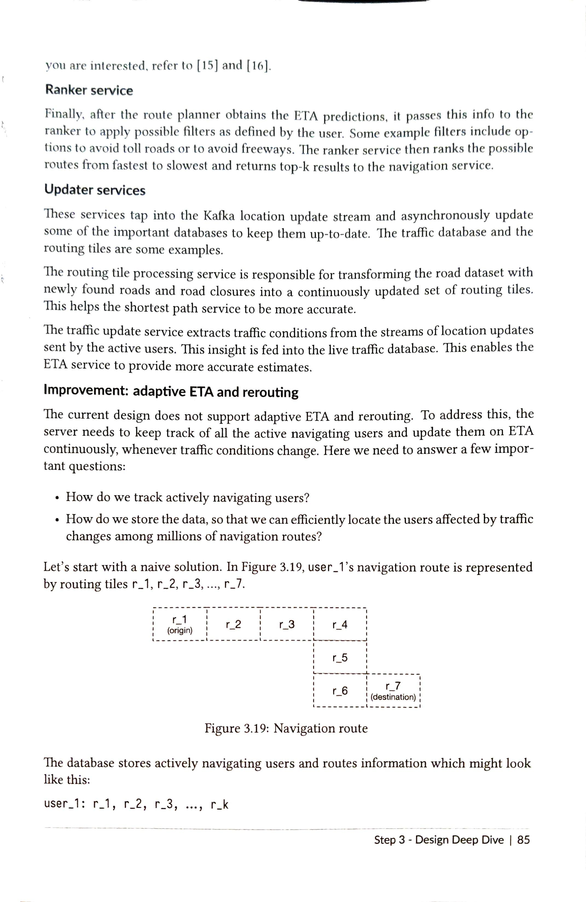
*Hình 3.19: Tuyến đường điều hướng (Navigation route)*

Cơ sở dữ liệu lưu trữ thông tin về người dùng đang điều hướng và các tuyến đường tương ứng có cấu trúc bảng dạng như sau:

```text
user_1: r_1, r_2, r_3, ..., r_k
user_2: r_4, r_6, r_9, ..., r_n
user_3: r_2, r_8, r_9, ..., r_m
user_n: r_2, r_10, r_21, ..., r_l
```


Giả sử số lượng hàng trong bảng cơ sở dữ liệu là $n$ và chiều dài trung bình của một tuyến đường điều hướng (tính theo số lượng ô định tuyến) là $m$. Độ phức tạp thời gian (**Time Complexity**) để quét và tìm ra tất cả những người dùng bị ảnh hưởng bởi một sự thay đổi giao thông cục bộ sẽ là $\mathcal{O}(n \times m)$.

> [!QUESTION]
> **Liệu chúng ta có thể tăng tốc tiến trình này hay không?**

Hãy cùng khám phá một cách tiếp cận khác tối ưu hơn. Đối với mỗi người dùng đang điều hướng tích cực:
* Chúng ta lưu giữ ô định tuyến hiện tại (*current routing tile*).
* Ô định tuyến ở cấp độ phân giải tiếp theo chứa nó (*super tile* bao phủ ở level cao hơn).
* Đệ quy tìm kiếm ô định tuyến ở cấp phân giải tiếp theo cho đến khi chúng ta tìm thấy ô bao phủ cả điểm đến (*destination*) của người dùng trong cùng một ô (Hình 3.20).

Bằng cách cấu trúc này, chúng ta có một hàng trong bảng cơ sở dữ liệu có dạng:

$$\text{user\_1}, r_1, \text{super}(r_1), \text{super}(\text{super}(r_1)), \dots$$

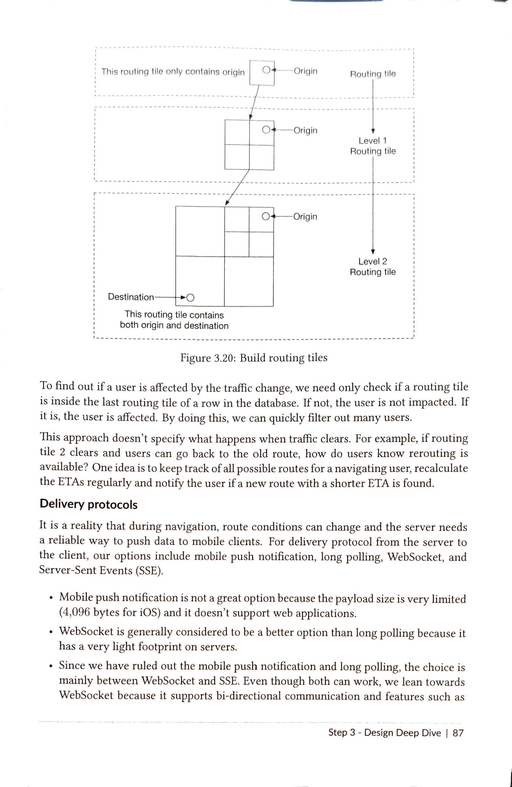
*Hình 3.20: Xây dựng các ô định tuyến theo cấp bậc (Build routing tiles)*

Để kiểm tra xem một người dùng có bị ảnh hưởng bởi sự thay đổi giao thông hay không, chúng ta **chỉ cần kiểm tra xem ô định tuyến có biến động giao thông có nằm bên trong ô định tuyến cuối cùng (ô bao quát lớn nhất) của hàng đó trong cơ sở dữ liệu hay không**. 
* Nếu **không**, người dùng chắc chắn không bị ảnh hưởng.
* Nếu **có**, người dùng nằm trong diện bị tác động và cần xử lý chi tiết hơn.

Bằng phương pháp này, chúng ta có thể lọc bỏ (*filter out*) nhanh chóng phần lớn người dùng không liên quan với chi phí tính toán rất thấp.

> [!NOTE]
> Cách tiếp cận này chưa chỉ định điều gì sẽ xảy ra khi tình trạng tắc nghẽn giao thông được giải tỏa (*traffic clears*). Ví dụ: nếu ô định tuyến số 2 ($r_2$) hết tắc đường và người dùng có thể quay lại tuyến đường cũ tối ưu hơn, làm sao người dùng biết được có gợi ý tái định tuyến (*rerouting*)?
> 
> Một ý tưởng kiến trúc là: duy trì theo dõi tất cả các tuyến đường khả dĩ (*all possible routes*) của người dùng đang điều hướng, định kỳ tính toán lại ETA và gửi thông báo cho người dùng nếu phát hiện một lộ trình mới có ETA ngắn hơn đáng kể.

---

### Giao thức Truyền dữ liệu xuống Client (Delivery protocols)

Trong quá trình điều hướng thực tế, điều kiện cung đường có thể liên tục biến động và máy chủ (*server*) cần một cơ chế tin cậy để chủ động đẩy dữ liệu (*push data*) xuống các ứng dụng di động (*mobile clients*). Đối với giao thức truyền tải từ server xuống client, các phương án cân nhắc bao gồm:
1. **Thông báo đẩy di động (Mobile push notification)**
2. **Long polling**
3. **WebSocket**
4. **Server-Sent Events (SSE)**

* **Mobile Push Notification:** Không phải là một lựa chọn tốt vì kích thước gói tin (*payload size*) bị giới hạn nghiêm ngặt (tối đa 4.096 bytes trên iOS) và không hỗ trợ trực tiếp các ứng dụng web (*web applications*).
* **WebSocket:** Nhìn chung được đánh giá là lựa chọn vượt trội hơn so với *Long Polling* vì nó chiếm dụng tài nguyên máy chủ rất thấp (*very light footprint on servers*).
* **WebSocket vs. Server-Sent Events (SSE):** Sau khi đã loại trừ Push Notification và Long Polling, sự lựa chọn chủ yếu nằm giữa WebSocket và SSE. Mặc dù cả hai đều đáp ứng được yêu cầu, chúng tôi ưu tiên lựa chọn **WebSocket** vì nó hỗ trợ giao tiếp hai chiều hoàn toàn (**Bi-directional Communication**) và các tính năng nâng cao trong tương lai như giao hàng chặng cuối (*last-mile delivery*) có thể đòi hỏi kênh tương tác thời gian thực hai chiều giữa tài xế và hệ thống.

> [!TIP]
> Để biết thêm chi tiết chuyên sâu về các thuật toán ETA và cơ chế tái định tuyến (*rerouting*), vui lòng tham khảo tài liệu [15].

---

### Sơ đồ Thiết kế Tổng thể Hệ thống (Final Design)

Hình 3.21 mô tả kiến trúc hoàn chỉnh của toàn bộ hệ thống Google Maps:

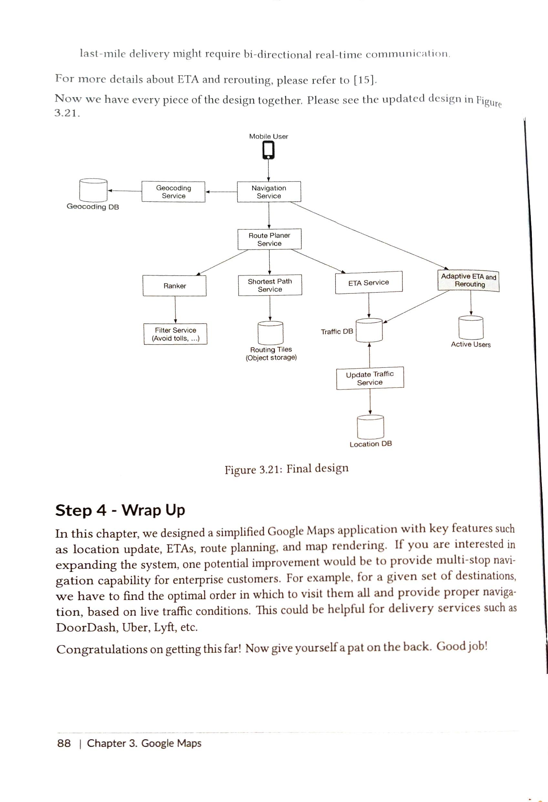
*Hình 3.21: Thiết kế tổng thể hệ thống (Final design)*

Luồng phối hợp giữa các thành phần kiến trúc:
* **Mobile User**: Giao tiếp thông qua WebSocket / HTTPS.
* **Geocoding Service & Geocoding DB**: Phân giải chuyển đổi qua lại giữa địa chỉ dạng chuỗi và tọa độ địa lý.
* **Navigation Service**: Điều phối phiên điều hướng người dùng.
* **Route Planner Service**: Phối hợp giữa **Shortest Path Service** (truy vấn *Routing Tiles* từ *Object Storage*), **ETA Service** (truy vấn *Traffic DB*), và **Ranker / Filter Service** (lọc tuyến đường theo sở thích).
* **Adaptive ETA and Rerouting Service**: Theo dõi danh sách người dùng tích cực (*Active Users*) và tính toán cập nhật lộ trình thích ứng.
* **Update Traffic Service**: Tiếp nhận dữ liệu luồng vị trí từ *Location DB* / Kafka để cập nhật tức thời vào *Traffic DB*.

---

## Bước 4: Tổng kết Chương (Step 4 - Wrap Up)

Trong chương này, chúng ta đã cùng nhau thiết kế một hệ thống ứng dụng Google Maps tối giản với các tính năng cốt lõi:
* Cập nhật vị trí người dùng (*Location update*)
* Dự đoán thời gian đến (*ETAs*)
* Lập kế hoạch đường đi (*Route planning*)
* Kết xuất bản đồ (*Map rendering*)

Nếu bạn muốn mở rộng hệ thống này hơn nữa, một hướng cải tiến tiềm năng là cung cấp **khả năng điều hướng đa điểm dừng (multi-stop navigation capability)** phục vụ các khách hàng doanh nghiệp (*enterprise customers*). 

Ví dụ: đối với một tập hợp nhiều điểm giao hàng cho trước, hệ thống phải giải bài toán tìm thứ tự tối ưu nhất để ghé thăm tất cả các điểm đó (biến thể của bài toán *Traveling Salesperson Problem - TSP*) và cung cấp chỉ dẫn điều hướng chính xác dựa trên tình trạng giao thông thời gian thực. Tính năng này đặc biệt giá trị cho các dịch vụ giao vận và gọi xe công nghệ như DoorDash, Uber, Lyft, v.v.

> Xin chúc mừng bạn đã hoàn thành một chương kiến trúc đồ sộ đến chặng đường này! Bạn hoàn toàn xứng đáng tự hào về kết quả đạt được. Làm rất tốt!

---

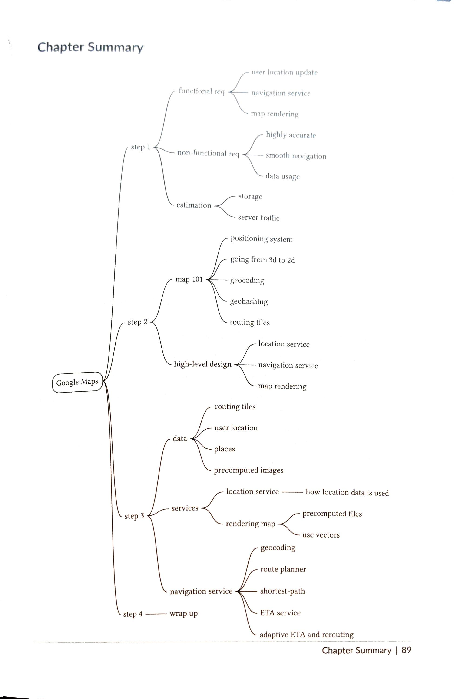

### Tóm tắt Nội dung Toàn bộ Chương 3 (Chapter Summary)

| Phân tầng / Bước thiết kế | Các thành phần & Khái niệm cốt lõi |
| :--- | :--- |
| **Bước 1: Yêu cầu bài toán (Requirements)** | • **Yêu cầu chức năng (Functional req):** Cập nhật vị trí người dùng (*User location update*), Dịch vụ điều hướng (*Navigation service*), Kết xuất bản đồ (*Map rendering*).<br>• **Yêu cầu phi chức năng (Non-functional req):** Độ chính xác cực cao (*Highly accurate*), Điều hướng mượt mà (*Smooth navigation*), Tối ưu mức tiêu thụ dữ liệu & pin (*Data usage*). |
| **Ước tính quy mô (Estimation)** | • Dung lượng lưu trữ dữ liệu bản đồ (*Storage*).<br>• Lưu lượng truy cập máy chủ (*Server traffic / QPS*). |
| **Kiến thức nền tảng Bản đồ (Map 101)** | • Hệ thống định vị (*Positioning system*).<br>• Chiếu bề mặt từ 3D sang 2D (*Going from 3D to 2D*).<br>• Mã hóa địa lý (*Geocoding*).<br>• Phân mảnh không gian với **Geohashing** & **Quadtree**.<br>• Các ô định tuyến (*Routing tiles*). |
| **Bước 2: Thiết kế cấp cao (High-level design)** | • Dịch vụ vị trí (*Location service*).<br>• Dịch vụ điều hướng (*Navigation service*).<br>• Dịch vụ kết xuất bản đồ (*Map rendering*). |
| **Mô hình Dữ liệu (Data Model)** | • Ô định tuyến (*Routing tiles*).<br>• Dữ liệu vị trí người dùng (*User location data*).<br>• Dữ liệu địa điểm (*Places data*).<br>• Hình ảnh kết xuất sẵn (*Precomputed images*). |
| **Bước 3: Đi sâu vào chi tiết thiết kế (Step 3 - Design Deep Dive)** | • **Location Service:** Cách thức khai thác và xử lý dữ liệu vị trí (*How location data is used*).<br>• **Map Rendering:** Tạo trước các ô bản đồ (*Precomputed tiles*), tối ưu băng thông với đồ họa vector (*Use vectors*).<br>• **Navigation Service:**<br>&nbsp;&nbsp;+ Mã hóa địa lý (*Geocoding*).<br>&nbsp;&nbsp;+ Bộ lập kế hoạch tuyến đường (*Route planner*).<br>&nbsp;&nbsp;+ Dịch vụ đường ngắn nhất (*Shortest-path service* - biến thể A\*).<br>&nbsp;&nbsp;+ Dịch vụ ETA (*Machine Learning*).<br>&nbsp;&nbsp;+ Dịch vụ xếp hạng (*Ranker service*).<br>&nbsp;&nbsp;+ Dịch vụ cập nhật bất đồng bộ (*Updater services* qua Kafka).<br>&nbsp;&nbsp;+ Cơ chế thích ứng: Adaptive ETA & Rerouting.<br>&nbsp;&nbsp;+ Giao thức truyền tải thời gian thực (*WebSocket*). |
| **Bước 4: Tổng kết (Step 4 - Wrap Up)** | • Mở rộng bài toán điều hướng đa điểm dừng (*Multi-stop navigation* cho Logistics/Ride-hailing). |

## Tài liệu tham khảo (Reference Material)

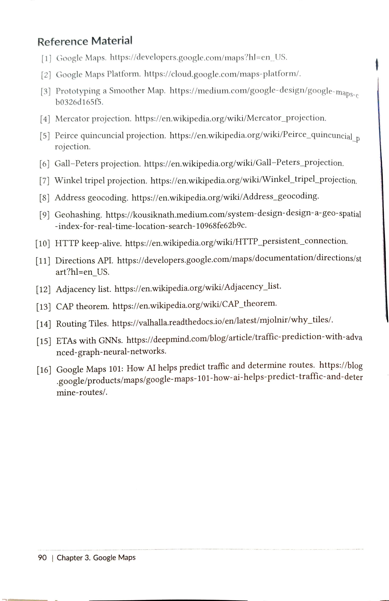

- **[1]** Google Maps: [https://developers.google.com/maps?hl=en_US](https://developers.google.com/maps?hl=en_US)
- **[2]** Google Maps Platform: [https://cloud.google.com/maps-platform/](https://cloud.google.com/maps-platform/)
- **[3]** Bing Maps Tile System: `b0326d165f5` *(Hệ thống Tile bản đồ của Bing Maps)*
- **[4]** Phép chiếu Mercator (Mercator projection): [https://en.wikipedia.org/wiki/Mercator_projection](https://en.wikipedia.org/wiki/Mercator_projection)
- **[5]** Web Mercator projection: Phép chiếu Web Mercator
- **[6]** Phép chiếu Gall-Peters (Gall-Peters projection): [https://en.wikipedia.org/wiki/Gall-Peters_projection](https://en.wikipedia.org/wiki/Gall-Peters_projection)
- **[7]** Phép chiếu Winkel tripel (Winkel tripel projection): [https://en.wikipedia.org/wiki/Winkel_tripel_projection](https://en.wikipedia.org/wiki/Winkel_tripel_projection)
- **[8]** Mã hóa địa lý địa chỉ (Address geocoding): [https://en.wikipedia.org/wiki/Address_geocoding](https://en.wikipedia.org/wiki/Address_geocoding)
- **[9]** Geohashing: [System Design: Thiết kế chỉ mục không gian địa lý (Geo-Spatial Index) cho tìm kiếm vị trí theo thời gian thực (Real-Time Location Search)](https://kousiknath.medium.com/system-design-design-a-geo-spatial-index-for-real-time-location-search-10968fe62b9c)
- **[10]** Kết nối HTTP duy trì (HTTP keep-alive / Persistent Connection): [https://en.wikipedia.org/wiki/HTTP_persistent_connection](https://en.wikipedia.org/wiki/HTTP_persistent_connection)
- **[11]** Directions API: [https://developers.google.com/maps/documentation/directions/start?hl=en_US](https://developers.google.com/maps/documentation/directions/start?hl=en_US)
- **[12]** Danh sách kề (Adjacency list): [https://en.wikipedia.org/wiki/Adjacency_list](https://en.wikipedia.org/wiki/Adjacency_list)
- **[13]** Định lý CAP (CAP theorem): [https://en.wikipedia.org/wiki/CAP_theorem](https://en.wikipedia.org/wiki/CAP_theorem)
- **[14]** Routing Tiles (Mảnh dữ liệu định tuyến): [https://valhalla.readthedocs.io/en/latest/mjolnir/why_tiles/](https://valhalla.readthedocs.io/en/latest/mjolnir/why_tiles/)
- **[15]** Dự đoán thời gian đến dự kiến với mạng nơ-ron đồ thị (ETAs with GNNs - Graph Neural Networks): [https://deepmind.com/blog/article/traffic-prediction-with-advanced-graph-neural-networks](https://deepmind.com/blog/article/traffic-prediction-with-advanced-graph-neural-networks)
- **[16]** Google Maps 101: Cách thức AI hỗ trợ dự đoán lưu lượng giao thông và xác định lộ trình (Google Maps 101: How AI helps predict traffic and determine routes): [https://blog.google/products/maps/google-maps-101-how-ai-helps-predict-traffic-and-determine-routes/](https://blog.google/products/maps/google-maps-101-how-ai-helps-predict-traffic-and-determine-routes/)

*Trang 90 / Chương 3: Google Maps*

---

## Hàng đợi thông điệp phân tán (Distributed Message Queue)

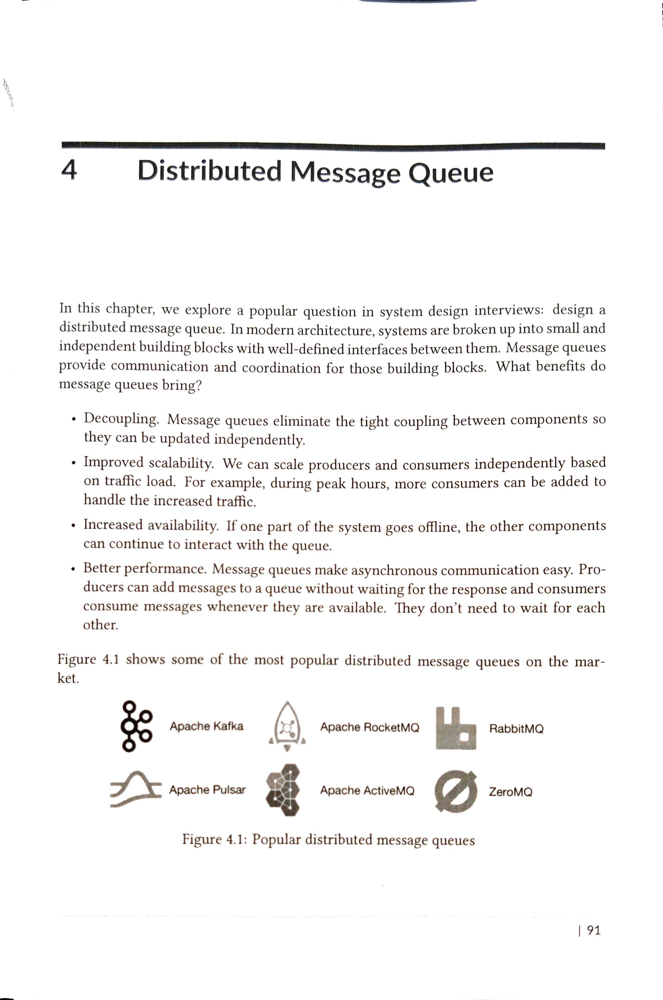

Trong chương này, chúng ta sẽ khám phá một câu hỏi rất phổ biến trong các buổi phỏng vấn thiết kế hệ thống (System Design Interview): **Thiết kế một hàng đợi thông điệp phân tán (Distributed Message Queue)**.

Hàng đợi thông điệp cung cấp cơ chế giao tiếp và điều phối (communication and coordination) cho các khối kiến trúc độc lập (independent building blocks) với các giao diện (interfaces) được định nghĩa rõ ràng. Vậy hàng đợi thông điệp mang lại những lợi ích gì?

* **Phân rã liên kết (Decoupling):** Hàng đợi thông điệp loại bỏ sự phụ thuộc chặt chẽ (tight coupling) giữa các thành phần, cho phép chúng có thể được nâng cấp, triển khai độc lập.
* **Khả năng mở rộng (Improved Scalability):** Cả phía sản xuất (producers) và phía tiêu thụ (consumers) đều có thể được co giãn độc lập (scaled independently) dựa trên lưu lượng tải thực tế để xử lý lưu lượng truy cập gia tăng (handle the increased traffic).
* **Tăng cường tính sẵn sàng (Increased Availability):** Nếu một thành phần trong hệ thống gặp sự cố ngoại tuyến (goes offline), các thành phần còn lại vẫn có thể tiếp tục tương tác và gửi nhận dữ liệu thông qua hàng đợi (queue).
* **Cải thiện hiệu năng (Better Performance):** Hàng đợi thông điệp giúp việc giao tiếp bất đồng bộ (asynchronous communication) trở nên dễ dàng. Phía sản xuất (producers) có thể đẩy các thông điệp vào hàng đợi mà không cần phải chờ phản hồi (waiting for the response), và phía tiêu thụ (consumers) sẽ xử lý thông điệp bất cứ khi nào tài nguyên sẵn sàng. Chúng không cần phải chờ đợi lẫn nhau (blocking/waiting).

Hình 4.1 minh họa một số hệ thống hàng đợi thông điệp phân tán phổ biến nhất trên thị trường hiện nay:

* **Apache Kafka**
* **Apache RocketMQ**
* **RabbitMQ**
* **Apache Pulsar**
* **Apache ActiveMQ**
* **ZeroMQ**

> [!NOTE]
> **Hình 4.1:** Các hệ thống hàng đợi thông điệp phân tán phổ biến (Popular distributed message queues).

*Trang 191*

---

## Điều hướng

- [chuong-02-nearby-friends.md](chuong-02-nearby-friends.md)
- [Mục lục](README.md)
- [chuong-04-distributed-message-queue.md](chuong-04-distributed-message-queue.md)
