[← Chương trước](chuong-03-google-maps.md) | [Mục lục](README.md) | [Chương tiếp theo →](chuong-05-metrics-monitoring-and-alerting-system.md)

---

# CHƯƠNG 4: HÀNG ĐỢI TIN NHẮN PHÂN TÁN (DISTRIBUTED MESSAGE QUEUE)

## So sánh Hàng Đợi Tin Nhắn với Nền Tảng Luồng Sự Kiện (Message Queues vs Event Streaming Platforms)

Các tính năng bổ sung này thường chỉ xuất hiện trên các nền tảng luồng sự kiện (*event streaming platforms*). Những tính năng này khiến thiết kế trở nên phức tạp hơn đáng kể. Xuyên suốt chương này, chúng tôi sẽ chỉ ra những điểm mà thiết kế có thể được đơn giản hóa nếu trọng tâm buổi phỏng vấn của bạn xoay quanh các hàng đợi tin nhắn phân tán truyền thống (*traditional distributed message queues*).

---

## Bước 1 - Hiểu Rõ Vấn Đề và Xác Định Phạm Vi Thiết Kế (Step 1 - Understand the Problem and Establish Design Scope)

Tóm lại, chức năng cơ bản của một hàng đợi tin nhắn rất rõ ràng: bên sản xuất (*producers*) gửi tin nhắn vào hàng đợi (*queue*), và bên tiêu thụ (*consumers*) lấy tin nhắn từ hàng đợi đó. Ngoài chức năng cơ bản này, còn có nhiều yếu tố cân nhắc khác bao gồm hiệu năng (*performance*), ngữ nghĩa chuyển phát tin nhắn (*message delivery semantics*), lưu giữ dữ liệu (*data retention*), v.v. Bộ câu hỏi dưới đây sẽ giúp làm rõ các yêu cầu và thu hẹp phạm vi thiết kế.

* **Ứng viên:** Định dạng và kích thước trung bình của tin nhắn là bao nhiêu? Nó chỉ là văn bản thuần (*text only*) hay cho phép đa phương tiện (*multimedia*)?
* **Người phỏng vấn:** Kích thước tin nhắn thường nằm trong khoảng vài kilobyte (KB).
* **Ứng viên:** Tin nhắn có thể được tiêu thụ lặp lại nhiều lần (*repeatedly consumed*) hay không?
* **Người phỏng vấn:** Có, tin nhắn có thể được tiêu thụ lặp lại bởi các consumers khác nhau. Lưu ý rằng đây là một tính năng bổ sung (*added feature*). Một hàng đợi tin nhắn phân tán truyền thống không giữ lại tin nhắn sau khi nó đã được chuyển phát thành công tới một consumer. Do đó, một tin nhắn không thể được tiêu thụ lặp lại trong một hàng đợi tin nhắn truyền thống.
* **Ứng viên:** Tin nhắn có được tiêu thụ theo đúng thứ tự mà chúng được tạo ra hay không?
* **Người phỏng vấn:** Có, tin nhắn cần được tiêu thụ theo đúng thứ tự mà chúng được sản xuất ra. Lưu ý rằng đây cũng là một tính năng bổ sung. Hàng đợi tin nhắn phân tán truyền thống thường không đảm bảo thứ tự chuyển phát (*delivery order*).
* **Ứng viên:** Dữ liệu có cần được lưu trữ bền vững (*persisted*) không, và thời gian lưu giữ dữ liệu (*data retention*) là bao lâu?
* **Người phỏng vấn:** Có, hãy giả định thời gian lưu giữ dữ liệu là hai tuần. Đây cũng là một tính năng bổ sung. Hàng đợi tin nhắn phân tán truyền thống thường không lưu giữ tin nhắn.
* **Ứng viên:** Chúng ta sẽ hỗ trợ bao nhiêu producers và consumers?
* **Người phỏng vấn:** Càng nhiều càng tốt.
* **Ứng viên:** Ngữ nghĩa chuyển phát dữ liệu (*data delivery semantics*) chúng ta cần hỗ trợ là gì? Ví dụ: tối đa một lần (*at-most-once*), ít nhất một lần (*at-least-once*), hay chính xác một lần (*exactly-once*)?
* **Người phỏng vấn:** Chúng ta chắc chắn muốn hỗ trợ ít nhất một lần (*at-least-once*). Lý tưởng nhất là chúng ta nên hỗ trợ tất cả các cơ chế trên và cho phép người dùng cấu hình linh hoạt.
* **Ứng viên:** Mục tiêu về thông lượng (*throughput*) và độ trễ đầu-cuối (*end-to-end latency*) là bao nhiêu?
* **Người phỏng vấn:** Hệ thống cần hỗ trợ thông lượng cao (*high throughput*) cho các trường hợp sử dụng như thu thập/tổng hợp log (*log aggregation*). Đồng thời, hệ thống cũng phải hỗ trợ chuyển phát với độ trễ thấp (*low latency*) cho các use case hàng đợi tin nhắn truyền thống hơn.

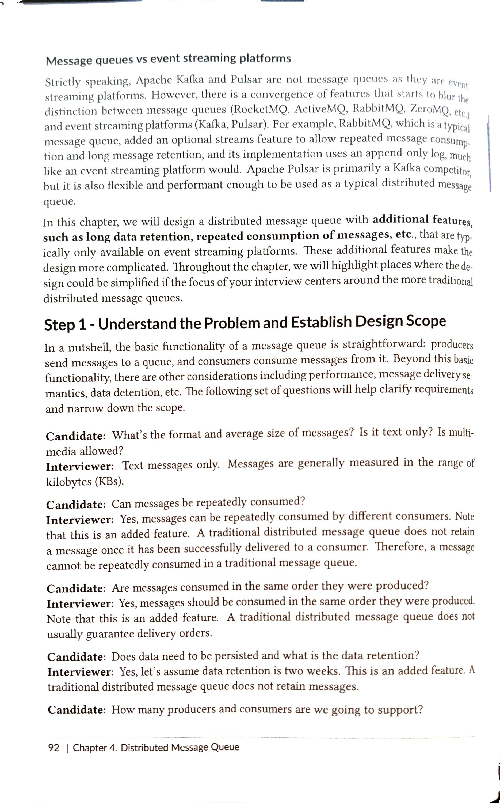

---

Từ cuộc trao đổi trên, chúng ta xác định các yêu cầu sau:

### Yêu Cầu Chức Năng (Functional Requirements)
* **Producers:** Gửi tin nhắn vào hàng đợi tin nhắn (*message queue*).
* **Consumers:** Tiêu thụ tin nhắn từ hàng đợi tin nhắn.
* **Tiêu thụ tin nhắn:** Tin nhắn có thể được tiêu thụ lặp lại nhiều lần hoặc chỉ một lần duy nhất.
* **Cắt tỉa dữ liệu:** Dữ liệu lịch sử có thể được cắt tỉa/xóa dần (*truncated*).
* **Kích thước tin nhắn:** Nằm trong phạm vi vài kilobyte (KB).
* **Đảm bảo thứ tự:** Khả năng chuyển phát tin nhắn tới các consumers theo đúng thứ tự chúng được thêm vào hàng đợi (*FIFO - First In, First Out*).
* **Ngữ nghĩa chuyển phát:** Các mức ngữ nghĩa chuyển phát dữ liệu (*at-least-once*, *at-most-once*, hoặc *exactly-once*) có thể được cấu hình linh hoạt bởi người dùng.

### Yêu Cầu Phi Chức Năng (Non-functional Requirements)
* **Thông lượng cao hoặc độ trễ thấp (High Throughput / Low Latency):** Có thể cấu hình dựa trên trường hợp sử dụng thực tế.
* **Khả năng mở rộng (Scalability):** Hệ thống về bản chất phải là một hệ phân tán (*distributed system*). Hệ thống phải chịu được sự gia tăng đột biến về lưu lượng tin nhắn (*sudden surge in message volume*).
* **Lưu trữ bền vững và an toàn dữ liệu (Persistence and Durability):** Dữ liệu phải được ghi bền vững xuống đĩa cứng (*disk-persisted*) và được sao chép nhân bản trên nhiều nút (*replicated across multiple nodes*).

### Điều Chỉnh Cho Hàng Đợi Tin Nhắn Truyền Thống (Adjustments for Traditional Message Queues)
Các hàng đợi tin nhắn truyền thống như RabbitMQ không có yêu cầu lưu giữ dữ liệu (*retention*) khắt khe như vậy; dung lượng lưu trữ cần thiết nhỏ hơn vài bậc độ lớn so với dung lượng yêu cầu của các nền tảng luồng sự kiện (*event streaming platforms*). Hàng đợi tin nhắn truyền thống cũng thường không duy trì thứ tự tin nhắn nghiêm ngặt; tin nhắn có thể được tiêu thụ theo thứ tự khác với thứ tự chúng được tạo ra. Những khác biệt này giúp đơn giản hóa thiết kế rất nhiều và chúng ta sẽ thảo luận chi tiết tại các phần phù hợp.

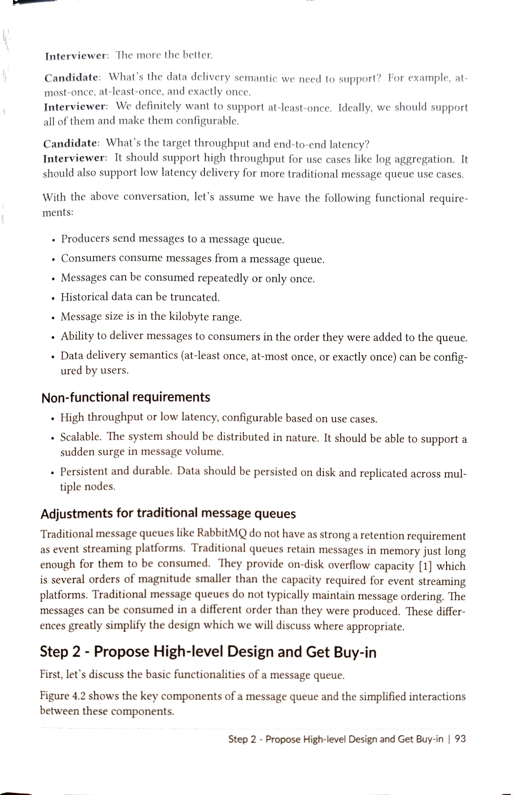

---


---

## Bước 2 - Đề Xuất Thiết Kế Cấp Cao và Đạt Được Sự Thống Nhất (Step 2 - Propose High-level Design and Get Buy-in)

Trước tiên, hãy cùng thảo luận về các chức năng cơ bản của một hàng đợi tin nhắn.

**Hình 4.2** minh họa các thành phần cốt lõi của một hàng đợi tin nhắn và các tương tác được đơn giản hóa giữa các thành phần này:

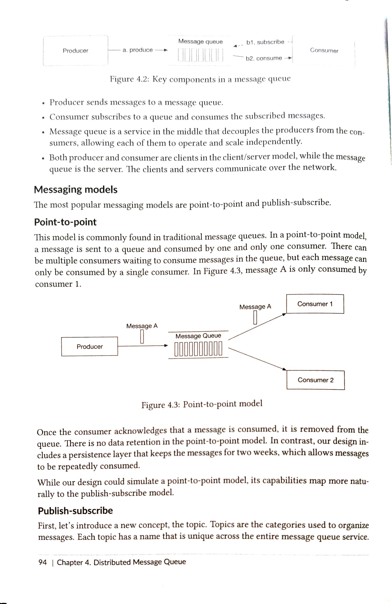

* **Producer:** Gửi tin nhắn vào hàng đợi tin nhắn (*a.produce*).
* **Consumer:** Đăng ký nhận tin từ một hàng đợi (*b1.subscribe*) và tiêu thụ các tin nhắn đã đăng ký (*b2.consume*).
* **Message Queue:** Là dịch vụ trung gian giúp tách rời (*decouple*) producers khỏi consumers, cho phép mỗi bên hoạt động và mở rộng quy mô độc lập (*scale independently*). Producer và consumer đóng vai trò là các clients, còn message queue là server; clients và servers giao tiếp với nhau qua mạng (*network*).

### Các Mô Hình Nhắn Tin (Messaging Models)
Hai mô hình nhắn tin phổ biến nhất là **Điểm-tới-Điểm (Point-to-Point)** và **Xuất bản-Đăng ký (Publish-Subscribe)**.

#### 1. Điểm-tới-Điểm (Point-to-Point)
Mô hình này thường thấy trong các hàng đợi tin nhắn truyền thống. Trong mô hình điểm-tới-điểm, một tin nhắn được gửi tới một hàng đợi và chỉ được tiêu thụ bởi duy nhất một consumer (*consumed by one and only one consumer*). Có thể có nhiều consumers cùng lắng nghe một queue, nhưng mỗi tin nhắn riêng biệt chỉ được một consumer duy nhất xử lý. 

Trong **Hình 4.3**, `Message A` chỉ được tiêu thụ duy nhất bởi `Consumer 1`.

*Khi consumer gửi tín hiệu xác nhận (acknowledgement - ACK) rằng tin nhắn đã được tiêu thụ thành công, tin nhắn đó sẽ bị xóa khỏi hàng đợi.* Không có cơ chế lưu giữ dữ liệu (*data retention*) trong mô hình point-to-point. Ngược lại, thiết kế của chúng tôi cho phép tin nhắn có thể được tiêu thụ lặp lại nhiều lần.

Mặc dù thiết kế của chúng ta hoàn toàn có thể giả lập mô hình điểm-tới-điểm, các năng lực cốt lõi của nó ánh xạ tự nhiên và trực tiếp hơn tới mô hình xuất bản-đăng ký (*publish-subscribe*).

#### 2. Xuất bản-Đăng ký (Publish-Subscribe)
Trong mô hình này, chúng ta đưa vào khái niệm **Chủ đề (Topic)**. Topic là danh mục logic dùng để tổ chức và phân loại các tin nhắn. Mỗi topic sở hữu một tên định danh duy nhất trên toàn bộ dịch vụ message queue.

---

Tin nhắn được gửi tới và đọc từ một topic cụ thể. Trong mô hình này, một tin nhắn gửi đến một topic có thể được chuyển phát tới nhiều consumers khác nhau đăng ký topic đó (như `Consumer 1` và `Consumer 2` trong **Hình 4.4**).

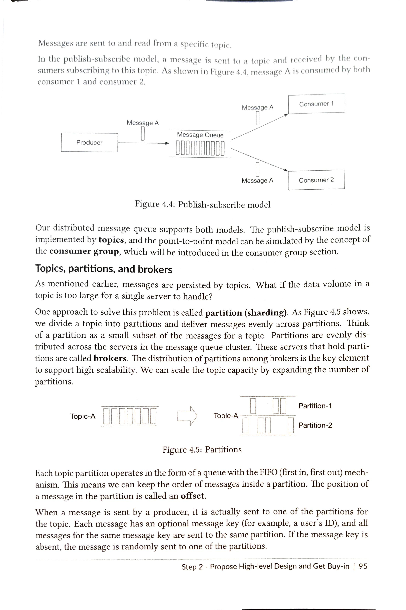

Mô hình publish-subscribe được hiện thực hóa thông qua các **Topics**, trong khi mô hình điểm-tới-điểm có thể được mô phỏng linh hoạt thông qua khái niệm **Nhóm người tiêu thụ (Consumer Group)** (sẽ được trình bày chi tiết ở phần sau).

---

### Chủ Đề, Phân Vùng và Máy Chủ Môi Giới (Topics, Partitions, and Brokers)

Như đã đề cập trước đó, tin nhắn được lưu trữ bền vững theo topics. Tuy nhiên, điều gì sẽ xảy ra nếu khối lượng dữ liệu trong một topic quá lớn, vượt quá khả năng xử lý của một server đơn lẻ?

Một giải pháp kinh điển để giải quyết bài toán này là **Phân vùng (Partition / Sharding)**. Như mô tả ở **Hình 4.5**, chúng ta chia nhỏ một topic thành nhiều phân vùng (*partitions*). Có thể hình dung mỗi partition là một tập con nhỏ các tin nhắn thuộc topic đó. Các partitions được phân phối đồng đều trên các máy chủ trong cụm message queue. Những máy chủ lưu trữ partitions này được gọi là **Brokers**. 

> [!IMPORTANT]
> **Cơ chế cốt lõi cho Khả năng mở rộng (Scalability):**
> Việc phân phối các partitions đồng đều giữa các brokers chính là yếu tố then chốt hỗ trợ khả năng mở rộng quy mô cao (*high scalability*). Chúng ta có thể mở rộng dung lượng và thông lượng của một topic bằng cách tăng số lượng partitions.

Mỗi partition của một topic hoạt động dưới dạng một hàng đợi tuân thủ cơ chế **FIFO (First In, First Out)** nghiêm ngặt. Điều này có nghĩa là chúng ta hoàn toàn có thể duy trì trật tự của các tin nhắn bên trong một partition. Vị trí tuần tự của một tin nhắn bên trong partition được gọi là **Offset**.

Khi một producer phát đi một tin nhắn, tin nhắn đó thực chất được gửi tới một trong các partitions của topic:
* Mỗi tin nhắn có thể chứa một khóa tin nhắn tùy chọn (*message key*, ví dụ: `User ID`). Tất cả các tin nhắn có cùng một message key sẽ được định tuyến gửi vào cùng một partition.
* Nếu message key bị khuyết thiếu, tin nhắn sẽ được phân phối ngẫu nhiên (hoặc round-robin) tới một trong các partitions.

---

Mỗi consumer sẽ đảm nhiệm việc đọc tin nhắn từ một tập hợp con các partitions của topic. Các consumers tập hợp lại thành một nhóm tiêu thụ (*consumer group*) cho topic đó.

Cụm hàng đợi tin nhắn (*message queue cluster*) với các brokers và partitions được biểu diễn trực quan trong **Hình 4.6**.

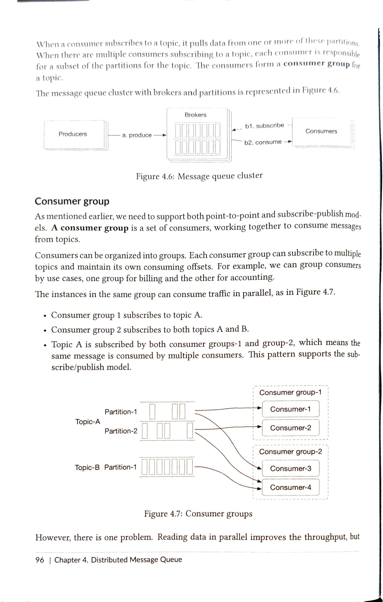

---

### Nhóm Người Tiêu Thụ (Consumer Group)

Như đã nêu ở phần trước, hệ thống cần hỗ trợ cả hai mô hình: *point-to-point* và *publish-subscribe*. Một **Consumer Group** là một tập hợp các consumers phối hợp cùng nhau để tiêu thụ tin nhắn từ các topics.

Các consumers có thể được tổ chức thành các groups. Mỗi consumer group có thể đăng ký nhiều topics và tự duy trì các con trỏ offset tiêu thụ riêng biệt (*consuming offsets*). Ví dụ: chúng ta có thể nhóm các consumers theo các trường hợp sử dụng nghiệp vụ khác nhau: một nhóm chuyên trách thanh toán (*billing*) và một nhóm chuyên trách kế toán (*accounting*).

Các instances trong cùng một group có thể đọc và xử lý lưu lượng truy cập song song (*parallel consumption*), như minh họa ở **Hình 4.7**:
* **Consumer Group 1:** Đăng ký lắng nghe `Topic A`.
* **Consumer Group 2:** Đăng ký lắng nghe cả `Topic A` và `Topic B`.
* `Topic A` được đăng ký đồng thời bởi cả `Consumer Group 1` và `Consumer Group 2`, điều này đồng nghĩa với việc cùng một tin nhắn sẽ được tiêu thụ bởi nhiều consumer groups độc lập. Mô hình này hiện thực hóa hoàn hảo cơ chế **Publish/Subscribe**.

> [!NOTE]
> **Vấn đề tiềm ẩn với việc đọc song song:**
> Đọc dữ liệu song song giúp tăng thông lượng (*throughput*) vượt trội, tuy nhiên lại phát sinh thách thức đối với việc đảm bảo trật tự tin nhắn giữa các partitions...

# CHƯƠNG 4: HÀNG ĐỢI TIN NHẮN PHÂN TÁN (DISTRIBUTED MESSAGE QUEUE)

---

### Trang 104

nhằm đảm bảo thứ tự tiêu thụ tin nhắn (message consumption order) trong Phân vùng 1 (Partition-1).

Tin tốt là chúng ta có thể khắc phục điều này bằng cách bổ sung một ràng buộc: **một phân vùng đơn lẻ (single partition) chỉ có thể được tiêu thụ bởi duy nhất một consumer trong cùng một nhóm (consumer group)**. Nếu số lượng consumer trong một nhóm vượt quá số phân vùng của topic này, một số consumer sẽ ở trạng thái nhàn rỗi (idle). Ví dụ, trong Hình 4.7, Consumer-3 thuộc Consumer group-2 không thể tiêu thụ các tin nhắn từ Topic B vì nó đã được tiêu thụ bởi Consumer-4 trong cùng nhóm consumer đó.

Với ràng buộc này, nếu chúng ta đưa tất cả consumer vào trong cùng một nhóm consumer, thì việc gửi nhận tin nhắn sẽ tuân theo mô hình điểm-điểm (point-to-point model). Do phân vùng là đơn vị lưu trữ nhỏ nhất (smallest storage unit), chúng ta có thể cấp phát trước đủ số lượng phân vùng để tránh nhu cầu phải tăng số lượng phân vùng một cách động (dynamically increase partitions). Để xử lý quy mô tải cao (high scale), chúng ta chỉ cần bổ sung thêm các consumer.

---

### Kiến Trúc Mức Cao (High-Level Architecture)

Hình 4.8 minh họa thiết kế mức cao (high-level design) đã được cập nhật.

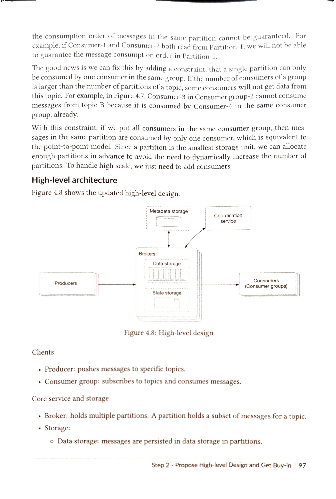
*Hình 4.8: Thiết kế mức cao (High-level design)*

#### Phía Khách (Clients)
- **Producer**: Đẩy tin nhắn (pushes messages) đến các topic cụ thể.
- **Consumer group**: Đăng ký nhận dữ liệu từ các topic (subscribes to topics) và tiêu thụ tin nhắn (consumes messages).

#### Dịch Vụ Cốt Lõi Và Lưu Trữ (Core Service and Storage)
- **Broker**: Chứa nhiều phân vùng (partitions). Một phân vùng lưu giữ một tập hợp con các tin nhắn của một topic.
- **Lưu trữ (Storage)**:
  - **Lưu trữ dữ liệu (Data storage)**: Tin nhắn được lưu trữ bền vững (persisted) trong vùng lưu trữ dữ liệu theo từng phân vùng.

---
*Bước 2 - Đề xuất thiết kế mức cao và nhận sự đồng thuận (Step 2 - Propose High-level Design and Get Buy-in) / Trang 97*

---

### Trang 105

  - **Lưu trữ trạng thái (State storage)**: Trạng thái của consumer (consumer states) được quản lý bởi vùng lưu trữ trạng thái.
  - **Lưu trữ siêu dữ liệu (Metadata storage)**: Cấu hình của topic, vị trí phân vùng (partition locations), và kế hoạch phân bổ bản sao (replica distribution plans) được lưu trữ tại đây, tách biệt khỏi vùng lưu trữ dữ liệu.
- **Dịch vụ điều phối (Coordination service)**:
  - **Phát hiện dịch vụ (Service discovery)**: Xác định broker nào đang hoạt động (which brokers are alive).
  - **Bầu chọn Controller (Leader election)**: Một trong các broker được bầu làm Controller chịu trách nhiệm quản trị trạng thái cluster và gán phân vùng (assigning partitions).
  - **Apache ZooKeeper** [2] hoặc **etcd** [3] thường được sử dụng phổ biến để bầu chọn controller.

---

### Bước 3 - Thiết Kế Chi Tiết (Step 3 - Design Deep Dive)

Hiệu năng truy xuất tuần tự vượt trội của ổ đĩa quay (rotational disks) kết hợp cùng chiến lược lưu bộ nhớ đệm đĩa quyết liệt (aggressive disk caching strategy) của các hệ điều hành hiện đại mang lại thông lượng cực cao. 

Dữ liệu tin nhắn được truyền nguyên bản (zero-copy) từ producer đến hàng đợi và cuối cùng tới consumer mà không qua bất kỳ sự biến đổi nào. Điều này giảm thiểu tối đa chi phí xử lý và sao chép dữ liệu của toàn hệ thống (system overhead).

Consumer cũng sẽ nạp tin nhắn theo lô (fetch messages in batches) khi có thể.

---

### Lưu Trữ Dữ Liệu (Data Storage)

Bây giờ, hãy cùng khám phá chi tiết hơn các phương án lưu trữ bền vững tin nhắn (persist messages). Để đưa ra lựa chọn tối ưu nhất, hãy xem xét đặc tính lưu lượng (traffic pattern) của một hàng đợi tin nhắn:
- **Ghi nhiều, đọc nhiều (Write-heavy, read-heavy)**.
- **Không có thao tác cập nhật (update) hay xóa (delete)**. *Lưu ý*: Hàng đợi tin nhắn truyền thống thường không lưu trữ tin nhắn bền vững trừ khi hàng đợi bị dồn ứ (falls behind), khi đó sẽ phát sinh thao tác xóa khi hàng đợi bắt kịp tiến độ. Mô hình chúng ta đang thảo luận ở đây là cơ chế lưu trữ bền vững của một nền tảng truyền tải luồng dữ liệu (data streaming platform).
- **Phần lớn các truy cập đọc/ghi là truy cập tuần tự (sequential read/write access)**.

#### Phương Án 1: Cơ Sở Dữ Liệu (Option 1: Database)
Phương án đầu tiên là sử dụng cơ sở dữ liệu:
- **Cơ sở dữ liệu quan hệ (Relational database)**: Tạo một bảng cho topic và ghi các tin nhắn vào bảng dưới dạng các hàng dữ liệu (rows).

---
*Trang 98 / Chương 4: Hàng Đợi Tin Nhắn Phân Tán (Chapter 4. Distributed Message Queue)*

---

### Trang 106

phương án này không mở rộng tốt (scale well) khi đối mặt với tải ghi liên tục ở cường độ cao.

Điều này đồng nghĩa với việc cơ sở dữ liệu không phải là sự lựa chọn tối ưu và hoàn toàn có thể trở thành điểm nghẽn cổ chai (bottleneck) của toàn bộ hệ thống.

#### Phương Án 2: Nhật Ký Ghi Trước (Option 2: Write-Ahead Log - WAL)
Phương án thứ hai là sử dụng **Nhật ký ghi trước (Write-Ahead Log - WAL)**. WAL thực chất là một tệp tin thông thường (plain file), trong đó các mục dữ liệu mới chỉ được nối tiếp vào cuối tệp theo cơ chế chỉ cho phép ghi tiếp (append-only log). Cơ chế WAL được ứng dụng rộng rãi trong rất nhiều hệ thống phân tán và cơ sở dữ liệu, chẳng hạn như `redo log` trong MySQL [4] và WAL trong ZooKeeper.

Chúng tôi khuyến nghị lưu trữ bền vững các tin nhắn dưới dạng **các tệp nhật ký WAL trên ổ đĩa cứng**. WAL sở hữu mô hình truy cập đọc/ghi hoàn toàn tuần tự (pure sequential read/write access pattern). Hiệu năng của ổ đĩa khi thực hiện truy cập tuần tự là cực kỳ ấn tượng [5]. Hơn thế nữa, các ổ đĩa quay truyền thống (rotational disks) sở hữu dung lượng lưu trữ rất lớn cùng chi phí vô cùng kinh tế.

Mỗi tin nhắn mới ghi vào phân vùng sẽ nhận một chỉ số vị trí (offset) tăng đơn điệu (monotonically increasing offset). Cách triển khai đơn giản nhất là lấy số thứ tự dòng (line number) của tệp nhật ký làm offset. Tuy nhiên, một tệp tin không thể phình to vô hạn, do đó giải pháp tối ưu là chia nhỏ tệp nhật ký thành nhiều phân đoạn (segments).

Khi phân đoạn đang hoạt động (active segment) đạt tới một ngưỡng kích thước nhất định, một phân đoạn hoạt động mới sẽ được khởi tạo để tiếp nhận các tin nhắn mới; đồng thời phân đoạn hiện tại sẽ chuyển sang trạng thái không hoạt động (inactive), giống như các phân đoạn khác trước đó. Các phân đoạn không hoạt động chỉ phục vụ cho các yêu cầu đọc (read requests). Những tệp phân đoạn cũ không còn hoạt động có thể được cắt tỉa hoặc xóa bỏ (truncated) nếu chúng vượt quá giới hạn thời gian lưu trữ (retention limit) hoặc dung lượng cho phép.

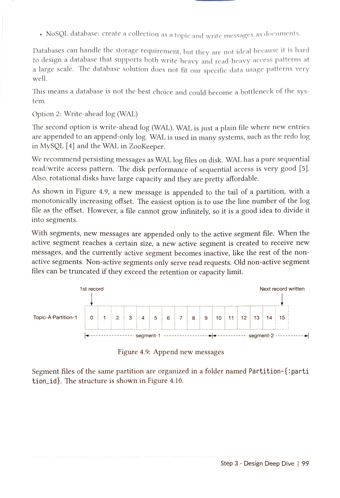
*Hình 4.9: Ghi nối tiếp các tin nhắn mới (Append new messages)*

Các tệp phân đoạn của cùng một phân vùng được tổ chức bên trong một thư mục có cấu trúc tên là `Partition-{partition_id}`. Cấu trúc thư mục được mô tả chi tiết trong Hình 4.10.

---
*Bước 3 - Thiết kế chi tiết (Step 3 - Design Deep Dive) / Trang 99*

---

### Trang 107

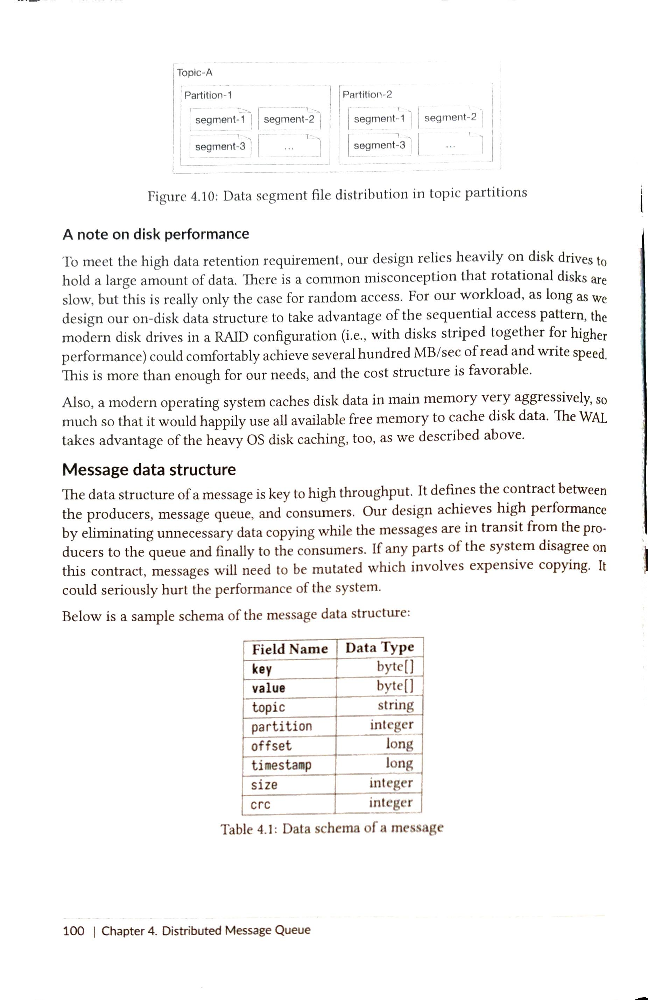
*Hình 4.10: Phân bổ tệp phân đoạn dữ liệu trong các phân vùng topic (Data segment file distribution in topic partitions)*

#### Đôi Nét Về Hiệu Năng Ổ Đĩa (A Note on Disk Performance)

Khi chúng ta thiết kế cấu trúc dữ liệu trên đĩa (on-disk data structure) để tận dụng tối đa mô hình truy cập tuần tự (sequential access pattern), các ổ đĩa hiện đại chạy trong cấu hình RAID (cụ thể là kỹ thuật phân chia dải đĩa - disk striping nhằm tối ưu hóa hiệu năng) hoàn toàn có thể dễ dàng đạt được tốc độ đọc và ghi lên đến hàng trăm MB/giây. Mức thông lượng này đáp ứng thừa thãi các yêu cầu khắt khe của hệ thống, trong khi cấu trúc chi phí phần cứng lại cực kỳ thuận lợi và tối ưu.

Thêm vào đó, các hệ điều hành hiện đại áp dụng cơ chế lưu bộ nhớ đệm đĩa vào bộ nhớ chính (RAM) vô cùng mạnh mẽ và chủ động (aggressive page caching), tới mức hệ điều hành sẵn sàng tận dụng toàn bộ bộ nhớ RAM còn trống để làm đệm cho dữ liệu trên đĩa. Cơ chế WAL khai thác triệt để lợi thế từ bộ nhớ đệm đĩa của hệ điều hành (OS disk caching) như chúng ta đã phân tích ở trên.

---

### Cấu Trúc Dữ Liệu Tin Nhắn (Message Data Structure)

Cấu trúc dữ liệu của một tin nhắn đóng vai trò then chốt để đạt được thông lượng cao (high throughput). Cấu trúc này xác lập một bản giao ước chuẩn (contract) giữa producer, hàng đợi tin nhắn và consumer. Thiết kế của chúng tôi đạt hiệu năng cao vượt trội nhờ việc loại bỏ hoàn toàn các bước sao chép dữ liệu không cần thiết (zero unnecessary data copying) trong suốt quá trình tin nhắn luân chuyển từ producer đến hàng đợi và cuối cùng tới các consumer. Nếu bất kỳ thành phần nào trong hệ thống không tuân thủ giao ước chung này, tin nhắn sẽ buộc phải trải qua quá trình biến đổi (mutated), kéo theo các thao tác sao chép dữ liệu (expensive copying) tốn kém tài nguyên CPU và bộ nhớ, từ đó làm suy giảm nghiêm trọng hiệu năng của hệ thống.

Dưới đây là lược đồ dữ liệu mẫu (sample schema) của cấu trúc tin nhắn:

| Tên trường (Field Name) | Kiểu dữ liệu (Data Type) | Mô tả kỹ thuật |
| :--- | :--- | :--- |
| `key` | `byte[]` | Khóa phân vùng của tin nhắn |
| `value` | `byte[]` | Phần thân tải trọng dữ liệu (Payload) |
| `topic` | `string` | Tên của topic chứa tin nhắn |
| `partition` | `integer` | Định danh phân vùng (Partition ID) |
| `offset` | `long` | Vị trí tuần tự của tin nhắn trong phân vùng |
| `timestamp` | `long` | Dấu thời gian ghi nhận tin nhắn |
| `size` | `integer` | Kích thước của toàn bộ tin nhắn |
| `crc` | `integer` | Mã kiểm tra phần dư tuần hoàn kiểm tra toàn vẹn |

*Bảng 4.1: Lược đồ dữ liệu của một tin nhắn (Data schema of a message)*

---
*Trang 100 / Chương 4: Hàng Đợi Tin Nhắn Phân Tán (Chapter 4. Distributed Message Queue)*

---

### Trang 108

#### Khóa Tin Nhắn (Message Key)
Khóa tin nhắn được sử dụng bởi thuật toán ánh xạ (mapping algorithm) để định tuyến và lựa chọn phân vùng phù hợp. Xin lưu ý rằng **khóa (key) không tương đương với số hiệu phân vùng (partition number)**.

Khóa có thể là một chuỗi ký tự (string) hoặc một số (number). Nó thường mang thông tin nghiệp vụ cụ thể. Số hiệu phân vùng là một khái niệm nội bộ bên trong hàng đợi tin nhắn, và khái niệm này không nên bị phơi bày một cách tường minh ra ngoài cho các client.

Nhờ thuật toán ánh xạ thích hợp (ví dụ Consistent Hashing), ngay cả khi số lượng phân vùng có sự thay đổi, các tin nhắn vẫn có thể được phân phối đồng đều đến tất cả các phân vùng.

#### Giá Trị Tin Nhắn (Message Value)
Giá trị tin nhắn chính là tải trọng (payload) chứa nội dung thực tế của tin nhắn. Nó có thể ở dạng văn bản thuần (plain text) hoặc một khối nhị phân đã được nén (compressed binary block).

> [!NOTE]
> **Nhắc nhở quan trọng (Reminder):**
> Khóa (key) và giá trị (value) của một tin nhắn hoàn toàn khác biệt so với cặp key-value trong một hệ thống lưu trữ khóa-giá trị (Key-Value Store). Trong cơ sở dữ liệu KV store, các khóa là duy nhất (unique) và chúng ta tra cứu giá trị thông qua khóa. Trong một tin nhắn của hàng đợi, các khóa không bắt buộc phải là duy nhất. Đôi khi trường khóa thậm chí không bắt buộc phải có, và chúng ta không dùng khóa để truy vấn tìm kiếm giá trị.

#### Các Trường Dữ Liệu Khác Của Tin Nhắn
- **Topic**: Tên của topic mà tin nhắn này trực thuộc.
- **Partition**: Mã định danh (ID) của phân vùng lưu trữ tin nhắn.
- **Offset**: Vị trí tuyệt đối của tin nhắn bên trong phân vùng. Chúng ta có thể định vị chính xác bất kỳ tin nhắn nào thông qua bộ ba giá trị kết hợp: `topic`, `partition`, `offset`.
- **Timestamp**: Dấu thời gian ghi lại thời điểm tin nhắn này được lưu trữ vào hệ thống.
- **Size**: Kích thước (dung lượng byte) của tin nhắn này.
- **CRC**: Kiểm tra độ dư tuần hoàn (Cyclic Redundancy Check) được áp dụng để đảm bảo tính toàn vẹn tuyệt đối của dữ liệu thô (raw data integrity).

Để hỗ trợ thêm các tính năng mở rộng, một số trường tùy chọn có thể được bổ sung theo nhu cầu. Ví dụ: các tin nhắn có thể được lọc theo thẻ (tags) nếu các thẻ này được định nghĩa nằm trong các trường tùy chọn.

---

### Xử Lý Gom Lô (Batching)

Cơ chế xử lý gom lô (Batching) hiện diện xuyên suốt trong toàn bộ thiết kế này. Chúng ta thực hiện gom lô tin nhắn tại producer, consumer và ngay tại chính bản thân hàng đợi tin nhắn. Batching đóng vai trò sống còn đối với hiệu năng tổng thể của hệ thống. Trong phần này, chúng ta tập trung chủ yếu vào cơ chế batching bên trong hàng đợi tin nhắn. Chúng ta sẽ thảo luận chi tiết hơn về batching ở producer và consumer trong chốc lát nữa.

Batching là yếu tố quyết định để cải thiện hiệu năng bởi vì:

---
*Bước 3 - Thiết kế chi tiết (Step 3 - Design Deep Dive) / Trang 101*

---

### Trang 109

- Gom nhiều thông điệp lại trong một lượt truyền giúp khấu hao tối đa chi phí đắt đỏ của các chu kỳ khứ hồi mạng (amortizes the cost of expensive network round trips).
- Cho phép hệ thống ghi các khối dữ liệu tuần tự lớn hơn xuống đĩa, qua đó tối ưu hóa thông lượng ghi đĩa tuần tự (sequential disk write throughput).

chúng ta sẽ quay trở lại và hoàn tất việc đào sâu chi tiết vào các thành phần còn lại của hàng đợi tin nhắn.

---

### Luồng Hoạt Động Của Producer (Producer Flow)

Khi một producer muốn gửi tin nhắn đến một phân vùng, tin nhắn bắt buộc phải được gửi đến bản sao chính (leader replica) của phân vùng đó. Chúng ta sẽ tìm hiểu sâu hơn về cơ chế nhân bản (replication) ở phần sau.

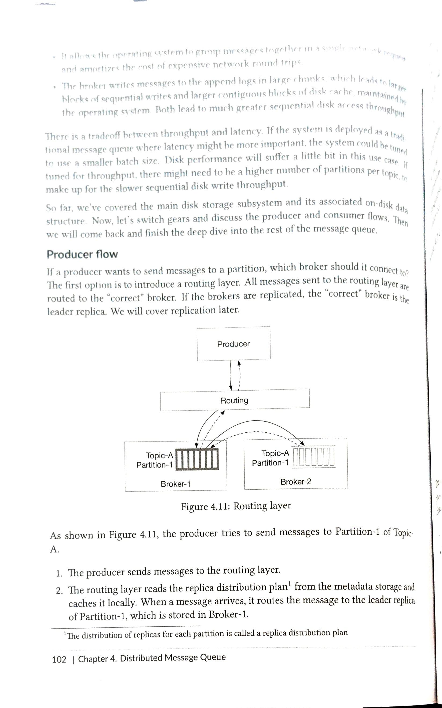
*Hình 4.11: Tầng định tuyến (Routing layer)*

Như được minh họa trong Hình 4.11, producer cố gắng gửi các tin nhắn đến Partition-1 của Topic-A:

1. **Producer gửi tin nhắn đến tầng định tuyến (Routing layer)**.
2. **Tầng định tuyến đọc kế hoạch phân bổ bản sao (replica distribution plan¹)** từ vùng lưu trữ siêu dữ liệu (metadata storage) và lưu vào bộ đệm cục bộ (cached locally). Khi một tin nhắn tới, tầng định tuyến sẽ chuyển tiếp tin nhắn đó đến đúng bản sao leader (leader replica) của Partition-1 hiện đang được đặt trên Broker-1.

> [!NOTE]
> ¹ *Sự phân bổ các bản sao (replicas) cho từng phân vùng cụ thể được gọi là kế hoạch phân bổ bản sao (replica distribution plan).*

---
*Trang 102 / Chương 4: Hàng Đợi Tin Nhắn Phân Tán (Chapter 4. Distributed Message Queue)*

# Chương 4: Hàng Đợi Tin Nhắn Phân Tán (Distributed Message Queue)

---

### --- Trang 110 ---

...leader (bản sao chỉ huy).
4. Khi đã có "đủ" số lượng bản sao (replicas) đồng bộ hóa tin nhắn thành công, leader sẽ xác nhận ghi (*commit*) dữ liệu (được lưu bền vững trên đĩa cứng - *persisted on disk*), đồng nghĩa với việc dữ liệu này đã sẵn sàng để được tiêu thụ (*consumed*). Sau đó, leader phản hồi lại cho bên sản xuất (*producer*).

Bạn có thể tự hỏi tại sao chúng ta cần cả hai loại bản sao: bản sao chỉ huy (*leader replica*) và bản sao đi theo (*follower replica*). Lý do cốt lõi chính là **khả năng chịu lỗi (Fault Tolerance)**. Chúng ta sẽ phân tích chuyên sâu (*deep dive*) vào quy trình này trong phần "Các bản sao đồng bộ" (*In-sync replicas*) ở trang 113.

Cách tiếp cận này hoạt động hiệu quả, tuy nhiên nó tồn tại một số nhược điểm:
* Một tầng định tuyến (*routing layer*) mới đồng nghĩa với việc tăng thêm độ trễ mạng (*network latency*) do chi phí phụ trội (*overhead*) và các chặng mạng bổ sung (*additional network hops*).
* Gom nhóm yêu cầu theo lô (*Request batching*) là một trong những động lực lớn nhất thúc đẩy hiệu năng và hiệu quả vận hành. Thiết kế hiện tại chưa tính đến yếu tố này.

Hình 4.12 minh họa thiết kế cải tiến.

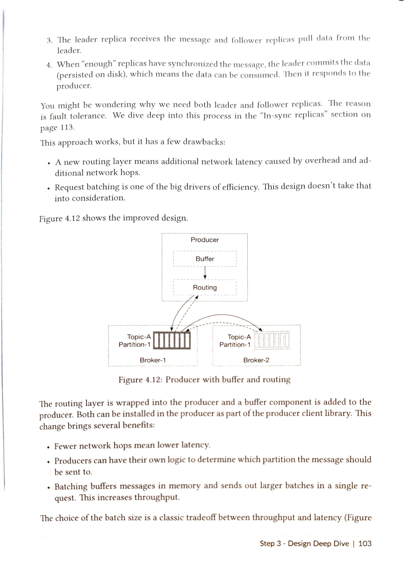

**Hình 4.12: Producer tích hợp bộ đệm (buffer) và tầng định tuyến (routing)**

Tầng định tuyến (*routing layer*) được tích hợp trực tiếp bên trong Producer, đồng thời một thành phần bộ đệm (*buffer component*) cũng được bổ sung vào Producer. Cả hai thành phần này đều có thể được cài đặt ngay bên trong Producer như một phần của thư viện máy khách (*producer client library*). Sự thay đổi này mang lại một số lợi ích vượt trội:
* **Ít chặng mạng hơn (*Fewer network hops*) đồng nghĩa với độ trễ thấp hơn (*lower latency*).**
* **Các Producer có thể tự sở hữu logic riêng** để xác định tin nhắn nên được gửi đến phân vùng (*partition*) nào.
* **Cơ chế gom nhóm (*Batching*) lưu đệm tin nhắn trong bộ nhớ (*in-memory*)** và gửi đi các lô dữ liệu (*batches*) lớn hơn chỉ trong một yêu cầu duy nhất. Điều này giúp tăng đáng kể thông lượng (*throughput*).

Việc lựa chọn kích thước lô (*batch size*) là một sự đánh đổi kinh điển (*classic tradeoff*) giữa thông lượng (*throughput*) và độ trễ (*latency*) (Hình 4.13)...

---

### --- Trang 111 ---

...dựa trên từng trường hợp sử dụng cụ thể (*use cases*).

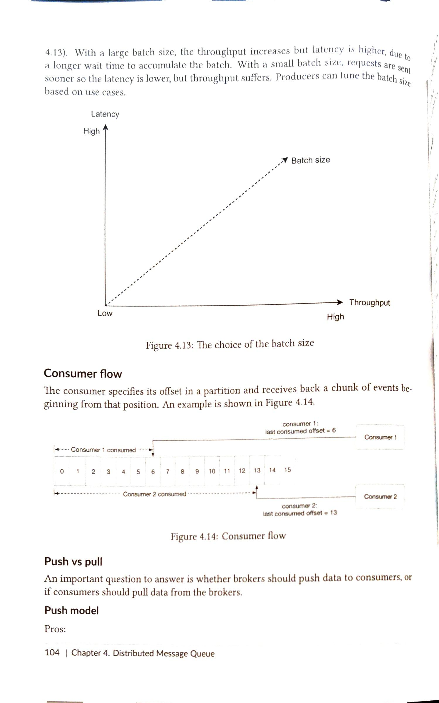

**Hình 4.13: Sự lựa chọn kích thước lô (batch size)**

> [!NOTE]
> * **Kích thước lô nhỏ (*Small batch size*):** Độ trễ thấp (*Low latency*), nhưng thông lượng thấp (*Low throughput*) do chi phí phụ trội (*overhead*) từ nhiều yêu cầu mạng.
> * **Kích thước lô lớn (*Large batch size*):** Thông lượng cao (*High throughput*), nhưng độ trễ tăng (*High latency*) do phải chờ gom đủ dữ liệu vào bộ đệm.

---

### Luồng xử lý của bên tiêu thụ (Consumer Flow)

...bắt đầu từ vị trí đó. Một ví dụ minh họa được thể hiện trong Hình 4.14.

 *(Minh họa Hình 4.14)*

**Hình 4.14: Luồng xử lý của Consumer (Consumer flow)**
*(Trong sơ đồ: Consumer 1 có offset tiêu thụ cuối cùng = 6; Consumer 2 có offset tiêu thụ cuối cùng = 13)*

---

### Đẩy so với Kéo (Push vs Pull)

Một câu hỏi quan trọng cần được giải đáp là: Liệu các Broker nên **đẩy (*push*) dữ liệu** tới các Consumer, hay các Consumer nên chủ động **kéo (*pull*) dữ liệu** từ các Broker?

#### Mô hình Đẩy (Push model)

**Ưu điểm (Pros):**
* **Độ trễ thấp (*Low latency*):** Ngay khi Broker nhận được tin nhắn, nó có thể lập tức đẩy tin nhắn đó tới Consumer mà không có độ trễ do chu kỳ thăm dò (*polling delay*).

---

### --- Trang 112 ---

...ngay khi nhận được chúng.

**Nhược điểm (Cons):**
* Nếu tốc độ tiêu thụ chậm hơn tốc độ sản xuất, các Consumer có thể bị **quá tải (*overwhelmed*)**.
* Rất khó để điều tiết tốc độ truyền tải đồng đều vì các Broker nắm quyền kiểm soát tốc độ dữ liệu được luân chuyển.

#### Mô hình Kéo (Pull model)

**Ưu điểm (Pros):**
* **Consumer nắm quyền kiểm soát tốc độ tiêu thụ (*consumption rate*).** Chúng ta có thể cấu hình một tập hợp Consumer xử lý tin nhắn theo thời gian thực (*real-time*), và một tập hợp Consumer khác xử lý tin nhắn theo chế độ lô (*batch mode*).
* Nếu tốc độ tiêu thụ tụt lại phía sau tốc độ sản xuất, chúng ta có thể **mở rộng quy mô theo chiều ngang (*scale out*)** cho các Consumer, hoặc đơn giản là để Consumer tự bắt kịp tiến độ (*catch up*) khi có đủ tài nguyên.
* **Mô hình kéo phù hợp hơn nhiều cho xử lý theo lô (*batch processing*).** Ở mô hình đẩy (*push model*), Broker không nắm bắt được liệu Consumer có khả năng xử lý tin nhắn ngay lập tức hay không. Nếu Broker gửi từng tin nhắn đơn lẻ tới Consumer trong khi Consumer đang bị nghẽn (*backed up*), các tin nhắn mới sẽ phải xếp hàng chờ trong bộ đệm. Ngược lại, mô hình kéo cho phép kéo toàn bộ các tin nhắn khả dụng đứng sau vị trí hiện tại của Consumer trong nhật ký (*log*) (hoặc kéo tối đa theo kích thước giới hạn cấu hình `max size`). Điều này cực kỳ thích hợp cho việc gom lô dữ liệu mạnh mẽ (*aggressive batching*).

**Nhược điểm (Cons):**
* Khi không có tin nhắn mới nào trên Broker, Consumer vẫn có thể tiếp tục kéo dữ liệu liên tục, gây lãng phí tài nguyên tính toán và mạng. Để khắc phục vấn đề này, nhiều hệ thống hàng đợi tin nhắn hỗ trợ chế độ **thăm dò dài (Long Polling)**, cho phép yêu cầu kéo tin nhắn tạm dừng và chờ đợi một khoảng thời gian xác định trước khi có tin nhắn mới xuất hiện [6].

Dựa trên những cân nhắc kỹ thuật này, phần lớn các hệ thống hàng đợi tin nhắn phân tán hiện đại đều lựa chọn **mô hình kéo (*pull model*)**.

Hình 4.15 mô tả quy trình làm việc (*workflow*) của mô hình kéo dành cho Consumer.

---

### --- Trang 113 ---

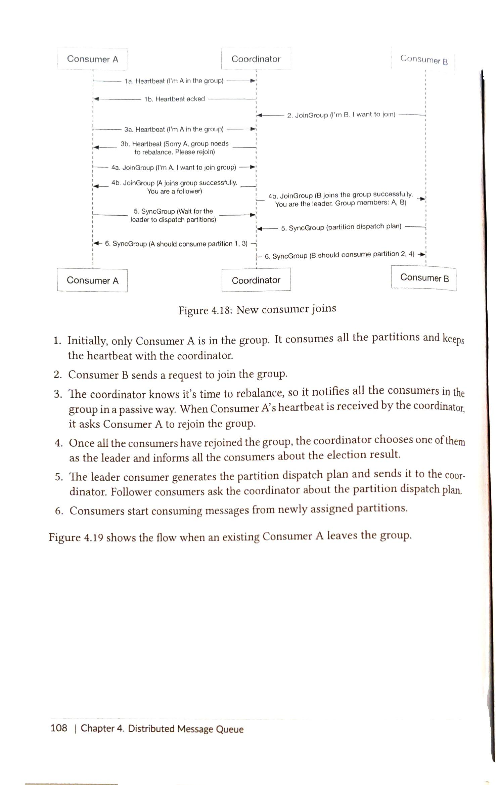

**Hình 4.18: Consumer mới gia nhập nhóm (New consumer joins)**

1. Consumer A duy trì tín hiệu nhịp tim (*heartbeat*) với Bộ điều phối (*Coordinator*).
2. Consumer B gửi yêu cầu xin gia nhập nhóm (`JoinGroup`).
3. Khi nhận được yêu cầu gia nhập từ Consumer B, Coordinator yêu cầu Consumer A phải tái gia nhập nhóm (*rejoin the group*).
4. Một khi tất cả các Consumer đã tái gia nhập nhóm thành công, Coordinator sẽ chọn một trong số chúng làm **Trưởng nhóm (*Leader*)** và thông báo kết quả bầu cử tới toàn bộ các Consumer.
5. Consumer Leader sẽ khởi tạo **kế hoạch phân phối phân vùng (*partition dispatch plan*)** và gửi bản kế hoạch này tới Coordinator. Các Consumer thành viên (*Follower consumers*) sẽ gửi yêu cầu hỏi Coordinator về kế hoạch phân phối phân vùng.
6. Các Consumer bắt đầu tiến hành tiêu thụ tin nhắn từ các phân vùng mới được phân định.

Hình 4.19 minh họa luồng xử lý khi một Consumer A hiện có rời khỏi nhóm.

---

### --- Trang 114 ---

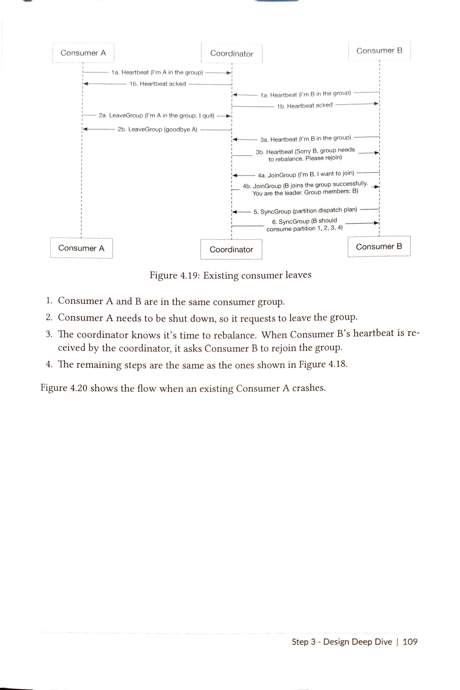

**Hình 4.19: Consumer hiện có rời nhóm (Existing consumer leaves)**

1. Consumer A và Consumer B đang cùng nằm trong một nhóm tiêu thụ (*consumer group*).
2. Consumer A cần tắt/ngừng hoạt động (*shut down*), do đó nó chủ động gửi yêu cầu rời nhóm (`LeaveGroup`).
3. Coordinator nhận biết đã đến lúc cần thực hiện tái cân bằng (*rebalance*). Khi tín hiệu nhịp tim (*heartbeat*) của Consumer B được gửi đến Coordinator, Coordinator sẽ yêu cầu Consumer B tái gia nhập nhóm.
4. Các bước tiếp theo tương tự như quy trình đã được mô tả ở Hình 4.18.

Hình 4.20 minh họa luồng xử lý khi một Consumer A hiện có gặp sự cố ngừng hoạt động đột ngột (*crashes*).

---

### --- Trang 115 ---

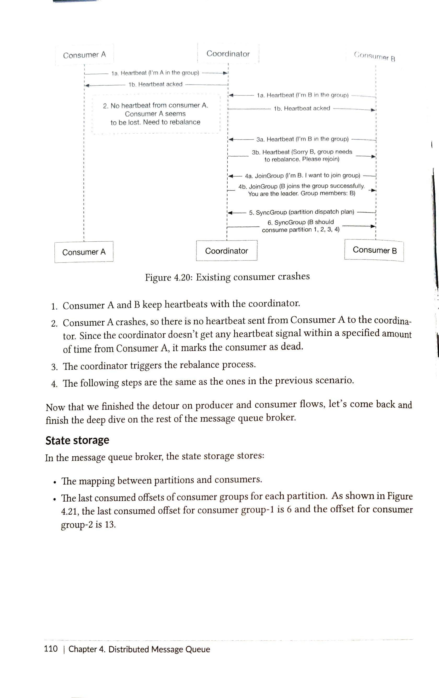

**Hình 4.20: Consumer hiện có bị sự cố đột ngột (Existing consumer crashes)**

1. Consumer A và B liên tục duy trì gửi nhịp tim (*heartbeats*) tới Coordinator.
2. Consumer A bị sự cố sập nguồn/treo máy (*crashes*), do đó không còn bất kỳ tín hiệu heartbeat nào được gửi từ Consumer A tới Coordinator. Vì Coordinator không nhận được bất kỳ tín hiệu heartbeat nào từ Consumer A trong một khoảng thời gian định trước (*timeout threshold*), nó sẽ đánh dấu Consumer này là đã chết (*dead*).
3. Coordinator kích hoạt quy trình tái cân bằng (*rebalance process*).
4. Các bước kế tiếp diễn ra tương tự như kịch bản trước đó.

Sau khi đã hoàn thành phần đi sâu chi tiết về luồng xử lý của Producer và Consumer, hãy quay trở lại và hoàn tất việc phân tích chuyên sâu các thành phần còn lại của Broker trong hàng đợi tin nhắn.

---

### Bộ lưu trữ trạng thái (State Storage)

Bên trong Broker của hàng đợi tin nhắn, bộ lưu trữ trạng thái (*state storage*) chịu trách nhiệm lưu trữ:
* **Ánh xạ giữa các phân vùng và các Consumer (*mapping between partitions and consumers*).**
* **Vị trí offset tiêu thụ cuối cùng (*last consumed offsets*) của các Consumer Group cho từng phân vùng.** Như minh họa trong Hình 4.21, offset tiêu thụ cuối cùng cho Consumer Group-1 là 6 và offset cho Consumer Group-2 là 13.

# Chương 4: Hàng Đợi Tin Nhắn Phân Tán (Distributed Message Queue)
## Bước 3: Đi Sâu Vào Thiết Kế Chi Tiết (Step 3 - Design Deep Dive)

---

### Quản Lý Trạng Thái Consumer (Consumer State Management) & Lưu Trữ Offset

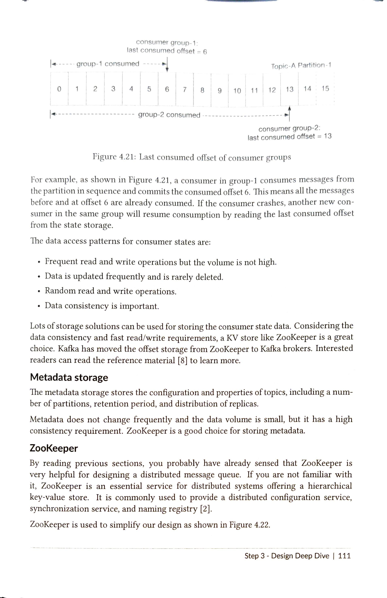

*Hình 4.21: Offset đã tiêu thụ gần nhất của các Consumer Group (Last consumed offset of consumer groups)*

Ví dụ, như được minh họa trong **Hình 4.21**, một consumer trong `group-1` tiêu thụ các tin nhắn từ phân vùng (partition) theo trình tự tuần tự và commit (xác nhận) offset đã tiêu thụ là `6`. Điều này đồng nghĩa với việc toàn bộ các tin nhắn trước và tại offset `6` đều đã được xử lý xong. Nếu consumer này gặp sự cố sập (crash), một consumer mới khác có thể tiếp tục công việc đọc tin nhắn bắt đầu từ vị trí offset đã được lưu trữ trong kho lưu trữ trạng thái (state storage).

Các mẫu hình truy cập dữ liệu (data access patterns) đối với trạng thái của consumer (consumer states) bao gồm:
* Thao tác đọc và ghi diễn ra thường xuyên nhưng khối lượng dữ liệu (volume) không lớn.
* Dữ liệu được cập nhật liên tục và rất hiếm khi bị xóa.
* Các thao tác đọc và ghi ngẫu nhiên (random read and write operations).
* Tính nhất quán của dữ liệu (data consistency) là yếu tố tối quan trọng.

Rất nhiều giải pháp lưu trữ có thể được triển khai để lưu trữ dữ liệu trạng thái của consumer. Xét theo các yêu cầu về tính nhất quán dữ liệu và tốc độ đọc/ghi cao, một hệ thống lưu trữ khóa-giá trị (KV store) như **ZooKeeper** là một lựa chọn tuyệt vời. Kafka hiện đã chuyển việc lưu trữ offset từ ZooKeeper trực tiếp sang các Kafka broker. Bạn đọc quan tâm có thể tìm đọc tài liệu tham khảo [8] để hiểu sâu hơn.

---

### Bộ Lưu Trữ Siêu Dữ Liệu (Metadata Storage)

Bộ lưu trữ siêu dữ liệu (metadata storage) lưu giữ các cấu hình và thuộc tính của các topic, bao gồm:
* Số lượng phân vùng (number of partitions).
* Thời gian lưu giữ tin nhắn (retention period).
* Cách thức phân bổ các bản sao (distribution of replicas).

Siêu dữ liệu (metadata) không thay đổi thường xuyên và dung lượng dữ liệu tương đối nhỏ, tuy nhiên nó đòi hỏi mức độ nhất quán dữ liệu (high consistency requirement) rất cao. Do đó, ZooKeeper là một lựa chọn lý tưởng cho việc lưu trữ metadata.

---

### ZooKeeper

Qua các phần trước, bạn có thể đã nhận thấy rằng **ZooKeeper** đóng vai trò cực kỳ hữu ích trong việc thiết kế một hàng đợi tin nhắn phân tán (distributed message queue). Nếu bạn chưa quen thuộc với công nghệ này, ZooKeeper là một dịch vụ thiết yếu dành cho các hệ thống phân tán, cung cấp một hệ thống lưu trữ phân cấp dạng khóa-giá trị (hierarchical key-value store). Nó thường được ứng dụng để cung cấp dịch vụ cấu hình phân tán (distributed configuration service), dịch vụ đồng bộ hóa (synchronization service) và hệ thống đăng ký định danh (naming registry) [2].

ZooKeeper được sử dụng để đơn giản hóa kiến trúc hệ thống của chúng ta như minh họa trong **Hình 4.22**.

---

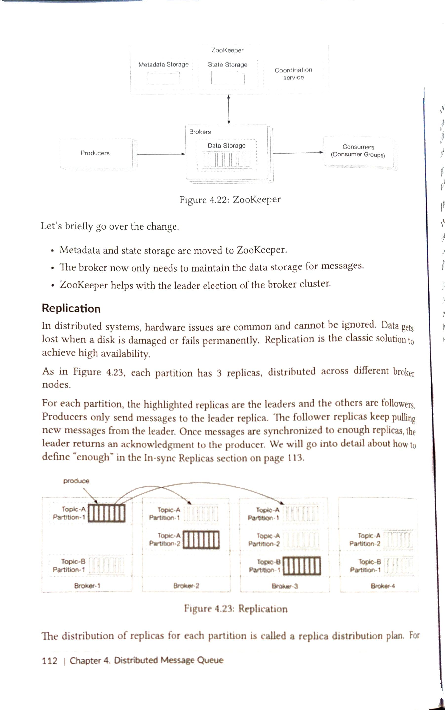

*Hình 4.22: Kiến trúc tích hợp ZooKeeper (ZooKeeper)*

Điểm qua nhanh các thay đổi trong kiến trúc:
* Bộ lưu trữ siêu dữ liệu (metadata storage) và bộ lưu trữ trạng thái (state storage) được chuyển giao hoàn toàn sang cho **ZooKeeper** đảm nhận.
* Phía **Broker** giờ đây chỉ cần duy trì kho lưu trữ dữ liệu (data storage) dành cho nội dung tin nhắn.
* ZooKeeper hỗ trợ điều phối bầu chọn nút trưởng (leader election) cho cụm máy chủ broker (broker cluster).

---

### Cơ Chế Sao Chép Dữ Liệu (Replication)

Cơ chế sao chép (replication) được áp dụng nhằm đạt được tính sẵn sàng cao (High Availability).

Như được mô tả trong **Hình 4.23**, mỗi phân vùng (partition) sở hữu 3 bản sao (replicas), được phân bổ rải đều trên các nút broker khác nhau.

Đối với từng phân vùng, các bản sao được đánh dấu nổi bật đóng vai trò là **Leader** (bản sao trưởng) và các bản sao còn lại là **Followers** (bản sao thứ cấp/người theo sau). Phía Producer chỉ gửi tin nhắn trực tiếp đến bản sao leader. Các bản sao follower sẽ liên tục kéo (pull/fetch) các tin nhắn mới từ leader về. Một khi các tin nhắn đã được đồng bộ hóa thành công tới đủ số lượng bản sao quy định, leader sẽ phản hồi một gói tin xác nhận (acknowledgment - ACK) về cho producer. Chúng ta sẽ đi sâu vào chi tiết định nghĩa thế nào là "đủ" trong phần *Bản sao đồng bộ (In-sync Replicas - ISR)* ở trang 113.


*(Sơ đồ chi tiết cơ chế Replication được triển khai qua các Broker)*

---

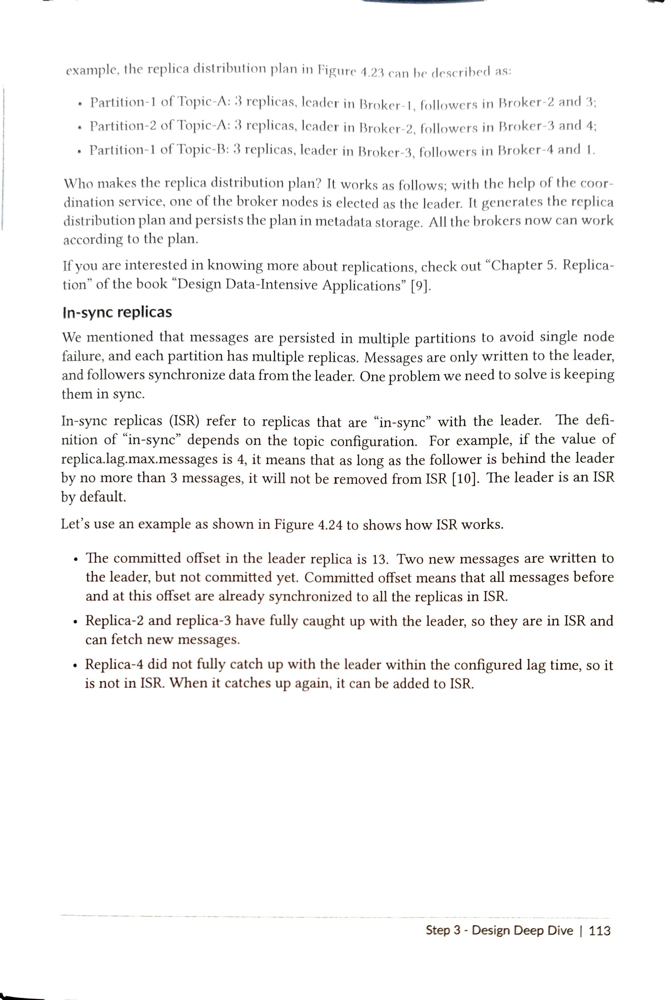

*Hình 4.23: Cơ chế sao chép phân vùng (Replication)*

Sự phân bổ của các bản sao cho từng phân vùng được gọi là **kế hoạch phân bổ bản sao (replica distribution plan)**. Ví dụ, kế hoạch phân bổ bản sao trong **Hình 4.23** có thể được mô tả như sau:
* **Partition-1 của Topic-A**: 3 bản sao, Leader nằm tại `Broker-1`, các Followers nằm tại `Broker-2` và `Broker-3`.
* **Partition-2 của Topic-A**: 3 bản sao, Leader nằm tại `Broker-2`, các Followers nằm tại `Broker-3` và `Broker-4`.
* **Partition-1 của Topic-B**: 3 bản sao, Leader nằm tại `Broker-3`, các Followers nằm tại `Broker-4` và `Broker-1`.

Ai là thành phần đưa ra kế hoạch phân bổ bản sao này? Cơ chế vận hành như sau: với sự trợ giúp của dịch vụ điều phối (coordination service - ZooKeeper), một trong các nút broker sẽ được bầu chọn làm nút điều phối trưởng (leader). Nút này sẽ tính toán tạo ra kế hoạch phân bổ bản sao và lưu trữ kiên cố (persist) kế hoạch đó vào kho lưu trữ metadata. Toàn bộ các broker trong cụm sau đó sẽ hoạt động tuân thủ theo kế hoạch này.

> [!TIP]
> Nếu bạn muốn tìm hiểu sâu hơn về các cơ chế sao chép phân tán, hãy tham khảo *"Chapter 5. Replication"* trong cuốn sách nổi tiếng *"Designing Data-Intensive Applications"* [9].

---

### Các Bản Sao Đồng Bộ (In-Sync Replicas - ISR)

Chúng ta đã biết rằng các tin nhắn được lưu trữ kiên cố trên nhiều phân vùng để tránh điểm lỗi đơn lẻ (Single Point of Failure - SPOF), và mỗi phân vùng có nhiều bản sao. Tin nhắn chỉ được ghi trực tiếp vào bản sao Leader, sau đó các Followers sẽ đồng bộ dữ liệu từ Leader. Một vấn đề cốt lõi cần giải quyết là duy trì trạng thái đồng bộ giữa chúng.

Định nghĩa thế nào là "đồng bộ" (in-sync) phụ thuộc vào cấu hình của từng topic. Ví dụ, nếu giá trị tham số cấu hình `replica.lag.max.messages` được thiết lập là `4`, điều này có nghĩa là miễn là bản sao follower không bị tụt hậu so với leader quá 3 tin nhắn, nó vẫn sẽ được giữ lại trong danh sách ISR [10]. Bản sao Leader mặc định luôn luôn là một thành viên của ISR.

Hãy cùng xem xét ví dụ trong **Hình 4.24** để hiểu rõ nguyên lý hoạt động của ISR:
* Offset đã commit (committed offset) tại bản sao leader hiện tại là `13`. Hai tin nhắn mới tiếp tục được ghi vào leader, nhưng chưa được đánh dấu là đã commit. **Committed offset** mang ý nghĩa rằng tất cả các tin nhắn nằm trước và tại vị trí offset này đều đã được đồng bộ hóa thành công tới toàn bộ các bản sao có mặt trong danh sách ISR.
* `Replica-2` và `replica-3` đã bắt kịp hoàn toàn tiến độ với leader, do đó chúng nằm trong tập hợp ISR và có quyền kéo (fetch) các tin nhắn mới tiếp theo.
* `Replica-4` không bắt kịp được tốc độ của leader trong khoảng thời gian trễ tối đa cho phép (configured lag time), vì vậy nó bị loại ra khỏi ISR. Khi nào nó đồng bộ bắt kịp trở lại, nó sẽ lại được kết nạp vào danh sách ISR.

---

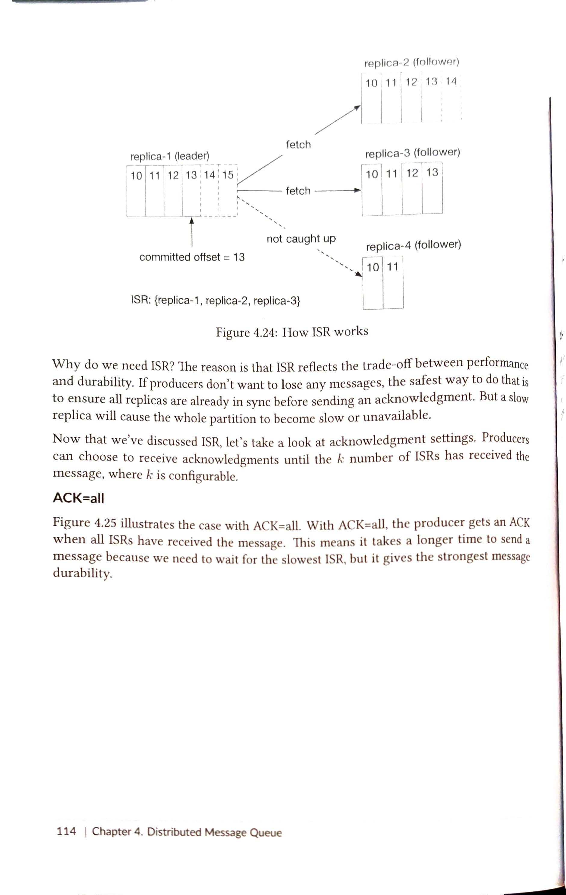

*Hình 4.24: Cách thức vận hành của ISR (How ISR works)*

Một tin nhắn được coi là đã ghi nhận thành công khi nó được sao chép tới $k$ bản sao, trong đó $k$ là tham số có thể cấu hình được.

---

### Mức Xác Nhận: ACK = all (Tất cả)

Với cấu hình `ACK=all`, producer chỉ nhận được gói tin xác nhận (ACK) sau khi tin nhắn đã được ghi nhận kiên cố vào leader và **toàn bộ các bản sao trong danh sách ISR**.

> [!IMPORTANT]
> Cấu hình `ACK=all` sẽ làm gia tăng độ trễ (latency) khi gửi tin nhắn vì hệ thống bắt buộc phải chờ đợi phản hồi từ bản sao ISR chậm chạp nhất; tuy nhiên, nó mang lại độ bền vững dữ liệu mạnh mẽ nhất (strongest message durability), ngăn ngừa tối đa rủi ro mất mát dữ liệu.

---

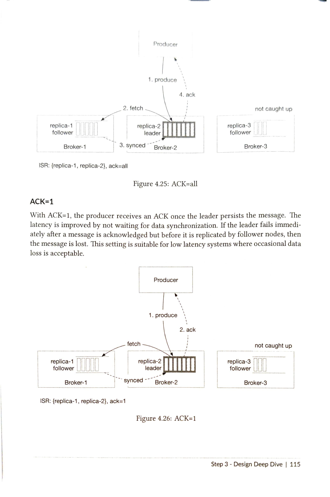

*Hình 4.25: Quy trình xử lý với ACK=all*

---

### Mức Xác Nhận: ACK = 1

Với mức cấu hình `ACK=1`, producer sẽ nhận được tín hiệu ACK ngay sau khi bản sao **Leader** lưu trữ kiên cố thành công tin nhắn vào đĩa cục bộ.

Độ trễ của hệ thống (latency) được cải thiện đáng kể do không cần phải chờ đợi quá trình đồng bộ hóa dữ liệu sang các nút follower. Tuy nhiên, nếu bản sao leader gặp sự cố (crash) ngay sau khi gửi ACK nhưng trước khi dữ liệu kịp sao chép sang các nút follower, thì tin nhắn đó sẽ **bị mất vĩnh viễn**. 

Mức thiết lập này đặc biệt phù hợp cho các hệ thống ưu tiên độ trễ thấp (low latency), chấp nhận rủi ro mất mát một tỷ lệ dữ liệu nhỏ ngẫu nhiên.


*Hình 4.26: Quy trình xử lý với ACK=1*

---

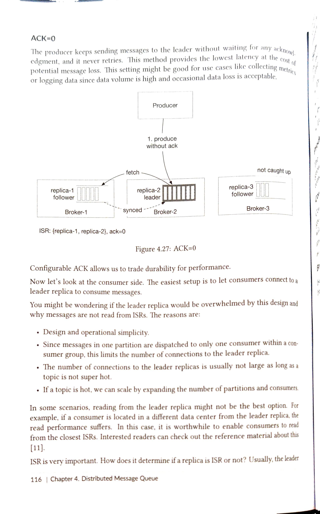

### Mức Xác Nhận: ACK = 0

Với `ACK=0`, producer tiếp tục gửi các tin nhắn tiếp theo mà không cần chờ đợi bất kỳ gói tin ACK nào từ broker. Mức cấu hình này mang lại thông lượng cao nhất (throughput) và độ trễ thấp nhất (lowest latency), rất phù hợp cho các luồng dữ liệu phân tích chỉ số thu thập từ xa (telemetry) hoặc ghi log hệ thống (logging data) – nơi lưu lượng dữ liệu cực lớn và việc mất mát một lượng nhỏ dữ liệu hoàn toàn có thể chấp nhận được.


*Hình 4.27: Quy trình xử lý với ACK=0*

Khả năng cấu hình linh hoạt các mức độ ACK cho phép chúng ta chủ động đánh đổi (trade-off) giữa **độ bền vững dữ liệu (durability)** và **hiệu năng hệ thống (performance)**.

---

### Định Tuyến Đọc Từ Bản Sao Trưởng (Leader Replica to Consume Messages)

Trong kiến trúc này, các consumer sẽ chỉ đọc/tiêu thụ tin nhắn trực tiếp từ **bản sao Leader**.

Bạn có thể đặt câu hỏi: liệu bản sao leader có bị quá tải (overwhelmed) với thiết kế này không, và tại sao tin nhắn không được đọc phân tán từ các bản sao trong ISR? Các lý do kiến trúc bao gồm:
* **Đơn giản hóa trong thiết kế và vận hành hệ thống (Design and operational simplicity).**
* Do các tin nhắn trong cùng một phân vùng chỉ được điều phối duy nhất tới một consumer cụ thể bên trong một consumer group, điều này giúp giới hạn số lượng kết nối đồng thời tới bản sao leader.
* Số lượng kết nối đồng thời tới các bản sao leader thường không quá lớn, trừ khi topic đó rơi vào trạng thái cực nóng ("super hot").
* Trong trường hợp một topic trở nên quá tải (hot topic), chúng ta hoàn toàn có thể mở rộng quy mô (scale) bằng cách gia tăng số lượng phân vùng (partitions) và tăng số lượng consumer tương ứng.

Tuy nhiên, trong một số kịch bản nhất định, việc chỉ đọc từ bản sao leader có thể không phải là lựa chọn tối ưu. Ví dụ: nếu một consumer nằm ở một trung tâm dữ liệu (data center) khác biệt về mặt địa lý so với bản sao leader, hiệu năng đọc (read performance) sẽ bị suy giảm do độ trễ mạng liên vùng. Trong tình huống này, việc kích hoạt tính năng cho phép consumer đọc trực tiếp từ **bản sao ISR gần nhất về mặt địa lý (closest ISRs)** là hoàn toàn xứng đáng. Bạn đọc quan tâm có thể xem thêm tài liệu tham khảo [11].

Tập hợp ISR là thành phần cực kỳ trọng yếu. Vậy hệ thống xác định một bản sao có thuộc danh sách ISR hay không bằng cách nào? Thông thường, bản sao leader sẽ...

# Chương 4: Hàng Đợi Tin Nhắn Phân Tán (Distributed Message Queue)

...tài liệu tham khảo [12] [13].

## Khả Năng Mở Rộng (Scalability)

Cho đến thời điểm hiện tại, chúng ta đã đạt được những bước tiến lớn trong việc thiết kế hệ thống hàng đợi tin nhắn phân tán (*distributed message queue system*). Ở bước tiếp theo, hãy cùng đánh giá khả năng mở rộng (*scalability*) của các thành phần khác nhau trong hệ thống:

* **Producers** (Bên sản xuất tin nhắn)
* **Consumers** (Bên tiêu thụ tin nhắn)
* **Brokers** (Các nút điều phối/lưu trữ tin nhắn)
* **Partitions** (Các phân vùng dữ liệu)

### Producer (Bên sản xuất)

Về mặt khái niệm, **Producer** đơn giản hơn nhiều so với **Consumer** vì nó không đòi hỏi cơ chế điều phối nhóm (*group coordination*). Khả năng mở rộng của các Producer có thể dễ dàng đạt được bằng cách thêm hoặc bớt các thực thể (*instances*) của producer.

### Consumer (Bên tiêu thụ)

Các nhóm tiêu thụ (*consumer groups*) hoàn toàn cô lập lẫn nhau, do đó việc thêm hoặc xóa một nhóm consumer là rất dễ dàng. Bên trong một consumer group, cơ chế tái cân bằng (**rebalancing mechanism**) giúp xử lý các trường hợp khi một consumer được thêm vào, bị gỡ bỏ hoặc gặp sự cố sập (*crash*). Nhờ vào mô hình consumer groups và cơ chế rebalance, khả năng mở rộng (*scalability*) cùng khả năng chịu lỗi (**fault tolerance**) của các consumer hoàn toàn được đảm bảo.

### Broker (Nút trung gian)

Trước khi đi sâu vào khả năng mở rộng ở phía broker, trước hết chúng ta hãy xem xét cơ chế phục hồi sau sự cố (**failure recovery**) của các broker.

---

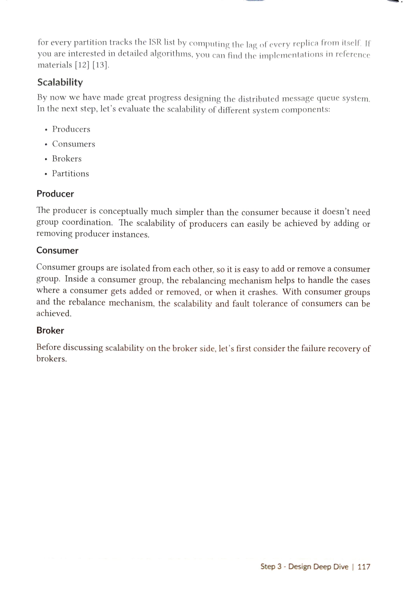

---

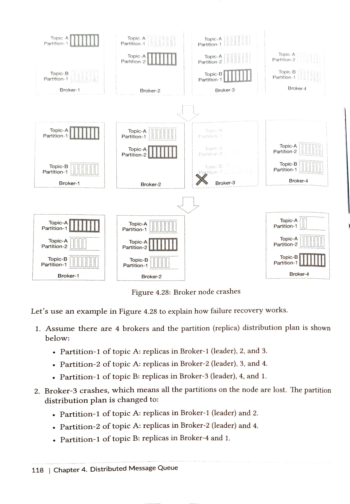

*Hình 4.28: Sự cố sập nút Broker (Broker node crashes)*

Hãy cùng sử dụng ví dụ trong **Hình 4.28** để giải thích cách thức hoạt động của cơ chế phục hồi lỗi (*failure recovery*):

1. **Khởi tạo ban đầu:** Giả sử có 4 broker và kế hoạch phân bổ phân vùng/bản sao (*partition/replica distribution plan*) được thiết lập như sau:
   * **Partition-1** của **Topic-A**: các bản sao (*replicas*) nằm tại Broker-1 (Leader), Broker-2, và Broker-3.
   * **Partition-2** của **Topic-A**: các bản sao nằm tại Broker-2 (Leader), Broker-3, và Broker-4.
   * **Partition-1** của **Topic-B**: các bản sao nằm tại Broker-3 (Leader), Broker-4, và Broker-1.

2. **Xảy ra sự cố:** Broker-3 gặp sự cố sập (*crashes*), đồng nghĩa với việc toàn bộ các partition trên nút này bị mất. Kế hoạch phân bổ bản sao chuyển thành:
   * **Partition-1** của **Topic-A**: các bản sao còn lại tại Broker-1 (Leader) và Broker-2.
   * **Partition-2** của **Topic-A**: các bản sao còn lại tại Broker-2 (Leader) và Broker-4.
   * **Partition-1** của **Topic-B**: các bản sao còn lại tại Broker-4 và Broker-1.

---

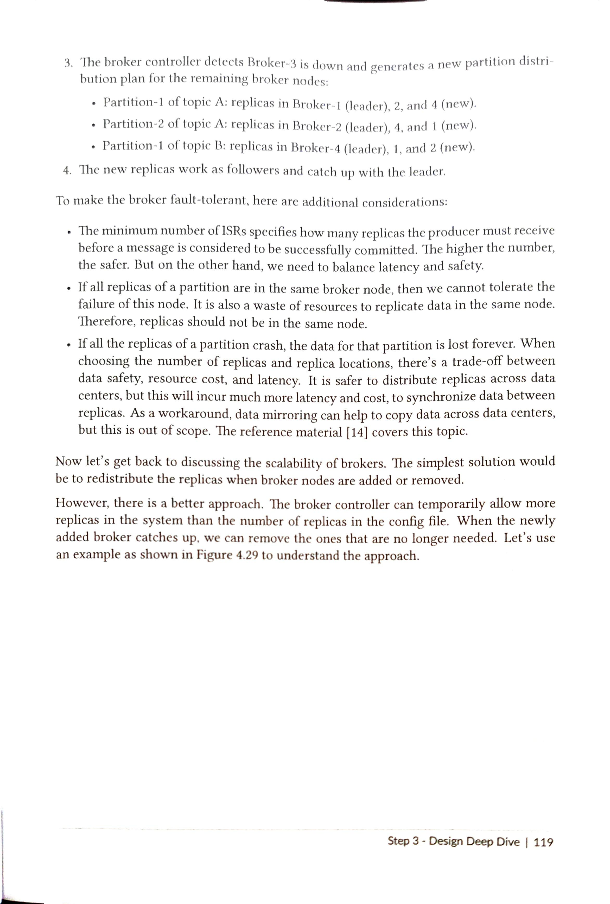

3. **Cập nhật kế hoạch phân bổ:** Bộ điều khiển phân bổ lại các bản sao trên các nút broker còn lại:
   * **Partition-2** của **Topic-A**: các bản sao tại Broker-2 (Leader), Broker-4, và Broker-1 (mới).
   * **Partition-1** của **Topic-B**: các bản sao tại Broker-4 (Leader), Broker-1, và Broker-2 (mới).

4. **Đồng bộ hóa:** Các bản sao mới sẽ hoạt động với vai trò bản sao theo sau (**Followers**) và tiến hành đồng bộ dữ liệu bắt kịp với nút **Leader**.

> [!NOTE]
> **Các cân nhắc bổ sung để đảm bảo khả năng chịu lỗi (Fault Tolerance) của Broker:**
> * Cần xác định số lượng bản sao xác nhận tối thiểu trước khi một tin nhắn được coi là đã ghi nhận thành công (**committed**). Con số này càng cao thì độ an toàn càng lớn. Tuy nhiên, chúng ta cần cân đối hài hòa giữa độ trễ (**Latency**) và tính an toàn dữ liệu (**Safety**).
> * Nếu tất cả các bản sao (*replicas*) của một phân vùng đều nằm trên cùng một nút broker, hệ thống sẽ không thể chịu đựng được sự cố sập nút đó. Do đó, các bản sao tuyệt đối không được đặt trên cùng một nút vật lý.
> * Nếu toàn bộ các bản sao của một phân vùng đều bị sập, dữ liệu của phân vùng đó sẽ vĩnh viễn bị mất. Khi lựa chọn số lượng bản sao và vị trí phân bổ, luôn có sự đánh đổi giữa an toàn dữ liệu, chi phí tài nguyên và độ trễ. Việc phân tán bản sao qua nhiều trung tâm dữ liệu (*data centers*) giúp tăng cường an toàn nhưng sẽ phát sinh thêm chi phí và độ trễ đồng bộ hóa dữ liệu. Vấn đề này thuộc phạm vi nâng cao, được đề cập chi tiết trong tài liệu tham khảo [14].

Quay trở lại với việc mở rộng quy mô (*scalability*) của các broker: Giải pháp đơn giản nhất là tái phân bổ lại các bản sao khi các nút broker được thêm mới hoặc gỡ bỏ.

Tuy nhiên, có một giải pháp tối ưu hơn: Bộ điều khiển broker (**broker controller**) có thể tạm thời cho phép số lượng bản sao trong hệ thống vượt quá giới hạn cấu hình trong tệp config. Khi nút broker mới thêm vào đã đồng bộ dữ liệu bắt kịp hệ thống, chúng ta mới gỡ bỏ các bản sao không còn cần thiết nữa. Hãy cùng xem xét ví dụ trong **Hình 4.29**.

---

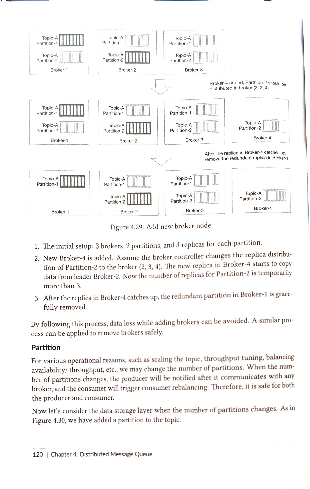

*Hình 4.29: Thêm nút broker mới (Add new broker node)*

1. **Thiết lập ban đầu:** 3 brokers, 2 partitions, và mỗi partition có 3 replicas.
2. **Thêm Broker mới:** Broker-4 được thêm vào. Bộ điều khiển broker thay đổi sơ đồ phân bổ của Partition-2 sang các broker (2, 3, 4). Bản sao mới tại Broker-4 bắt đầu sao chép dữ liệu từ Leader Broker-2. Tại thời điểm này, số lượng bản sao của Partition-2 tạm thời vượt quá 3.
3. **Hoàn tất đồng bộ:** Sau khi bản sao trên Broker-4 đã hoàn toàn bắt kịp dữ liệu, bản sao dư thừa trên Broker-1 sẽ được gỡ bỏ một cách an toàn (*gracefully removed*).

Nhờ quy trình này, hiện tượng mất mát dữ liệu khi bổ sung broker được loại bỏ hoàn toàn. Quy trình tương tự cũng được áp dụng để loại bỏ các broker một cách an toàn.

---

### Partition (Phân vùng)

Vì các lý do vận hành khác nhau—chẳng hạn như mở rộng topic, tinh chỉnh thông lượng (**Throughput**), cân đối giữa tính sẵn sàng (**Availability**) và thông lượng—chúng ta có thể thay đổi số lượng partition. Khi số lượng partition thay đổi:
* **Producer** sẽ nhận được thông báo sau khi tương tác với bất kỳ broker nào.
* **Consumer** sẽ kích hoạt quy trình tái cân bằng nhóm (**consumer rebalancing**).

Nhờ vậy, quy trình này diễn ra an toàn cho cả hai phía producer và consumer.

Hãy cùng xem xét tầng lưu trữ dữ liệu (*data storage layer*) khi số lượng partition thay đổi.

---

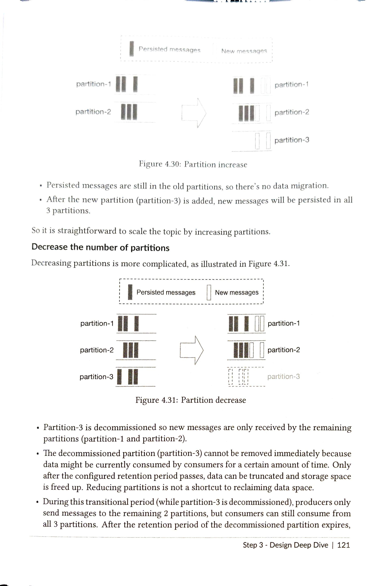

#### 1. Tăng số lượng phân vùng (Partition increase)

*Hình 4.30: Tăng phân vùng (Partition increase)*

* Các tin nhắn đã được lưu trữ bền vững (**Persisted messages**) vẫn nằm nguyên tại các partition cũ, do đó **không cần di chuyển dữ liệu** (*no data migration*).
* Sau khi phân vùng mới (**partition-3**) được thêm vào, các tin nhắn mới gửi đến sẽ được phân bổ đồng đều trên cả 3 partition.
* Do đó, việc mở rộng topic thông qua thao tác tăng số lượng partition là rất trực tiếp và dễ dàng.

#### 2. Giảm số lượng phân vùng (Decrease the number of partitions)

Việc giảm số lượng phân vùng sẽ phức tạp hơn đáng kể, được minh họa trong **Hình 4.31**.

*Hình 4.31: Giảm phân vùng (Partition decrease)*

* **Partition-3** được đưa vào trạng thái dừng hoạt động (**decommissioned**), do đó các tin nhắn mới chỉ được tiếp nhận bởi các phân vùng còn lại (partition-1 và partition-2).
* Phân vùng bị dừng hoạt động (partition-3) **không thể xóa bỏ ngay lập tức**, vì dữ liệu trên đó có thể vẫn đang được các consumer đọc trong một khoảng thời gian nhất định. Chỉ sau khi khoảng thời gian lưu trữ cấu hình (**retention period**) kết thúc, dữ liệu mới được cắt tỉa (*truncated*) để giải phóng không gian lưu trữ. Giảm partition không phải là giải pháp tức thời để thu hồi dung lượng đĩa.
* Trong giai đoạn chuyển tiếp này (khi partition-3 đang bị decommission): các producer chỉ gửi tin nhắn đến 2 partition còn lại, nhưng các consumer vẫn có thể đọc dữ liệu từ cả 3 partition. Sau khi retention period của partition bị dừng hoạt động kết thúc,...

---

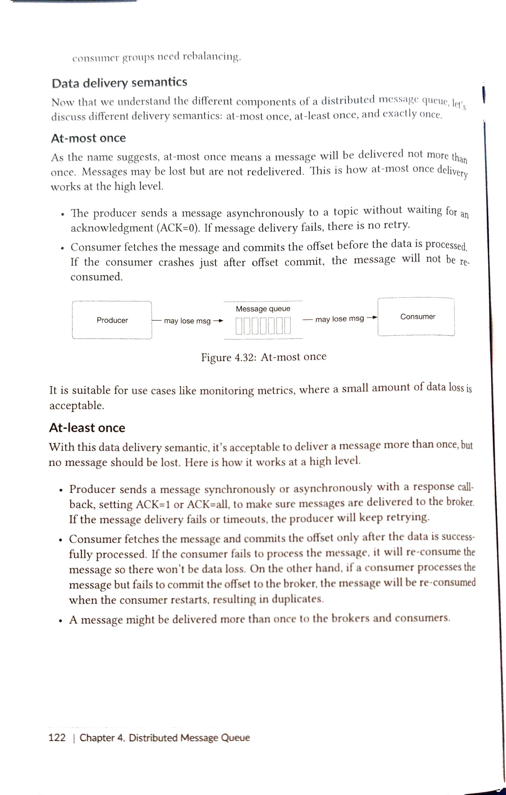

...các nhóm consumer sẽ cần thực hiện tái cân bằng (**rebalancing**).

---

## Ngữ Nghĩa Phân Phối Dữ Liệu (Data Delivery Semantics)

Hãy cùng thảo luận về các cơ chế/ngữ nghĩa phân phối dữ liệu khác nhau: **At-most once** (Tối đa một lần), **At-least once** (Ít nhất một lần), và **Exactly once** (Chính xác một lần).

---

### At-most once (Tối đa một lần)

Nguyên lý hoạt động tổng quan:
* **Producer** gửi tin nhắn bất đồng bộ mà không đợi phản hồi xác nhận từ phía broker (`ACK=0`). Nếu quá trình gửi gặp sự cố, hệ thống sẽ **không thử lại (no retry)**.
* **Consumer** đọc tin nhắn và thực hiện xác nhận chỉ mục vị trí (**commit offset**) trước khi tiến hành xử lý dữ liệu. Nếu consumer bị sập ngay sau khi đã commit offset, tin nhắn đó sẽ không bao giờ được tiêu thụ lại.

```
Producer ---> [Message Queue] ---> Consumer
(Có thể mất tin nhắn)         (Có thể mất tin nhắn)
```

*Hình 4.32: Phân phối tối đa một lần (At-most once)*

> [!TIP]
> Cơ chế này phù hợp với các hệ thống chấp nhận mất mát dữ liệu (ví dụ: thu thập số liệu metrics, logging sự kiện tần suất cao).

---

### At-least once (Ít nhất một lần)

Với ngữ nghĩa phân phối này, hệ thống chấp nhận việc một tin nhắn có thể được phân phối **nhiều hơn một lần**, nhưng **tuyệt đối không để mất tin nhắn**. Nguyên lý hoạt động tổng quan như sau:

* **Producer** gửi tin nhắn đồng bộ hoặc bất đồng bộ đi kèm hàm phản hồi (*response callback*), thiết lập chế độ xác nhận `ACK=1` hoặc `ACK=all`, nhằm đảm bảo chắc chắn rằng tin nhắn đã được ghi nhận trên broker. Nếu quá trình gửi thất bại hoặc hết thời gian chờ (**timeout**), producer sẽ liên tục thử lại (**retry**).
* **Consumer** chỉ tiến hành ghi nhận chỉ mục (**commit offset**) sau khi dữ liệu đã được xử lý thành công. Nếu consumer gặp lỗi trong quá trình xử lý, tin nhắn sẽ được tiêu thụ lại, đảm bảo không có mất mát dữ liệu. Ngược lại, nếu consumer xử lý xong tin nhắn nhưng gặp lỗi khi commit offset về phía broker, tin nhắn đó sẽ bị đọc lại khi consumer khởi động lại, dẫn đến tình trạng **trùng lặp dữ liệu** (*duplicates*).
* Một tin nhắn có thể được phân phối nhiều hơn một lần đến các broker và consumer.

# CHƯƠNG 4: HÀNG ĐỢI TIN NHẮN PHÂN TÁN (DISTRIBUTED MESSAGE QUEUE)

---

## BƯỚC 3: THIẾT KẾ ĐI SÂU CHI TIẾT (STEP 3 - DESIGN DEEP DIVE) *(Tiếp theo)*

---

### Semantics Phân Phối Tin Nhắn (Delivery Semantics) *(Tiếp theo)*

#### 2. Phân phối ít nhất một lần (At-least once)

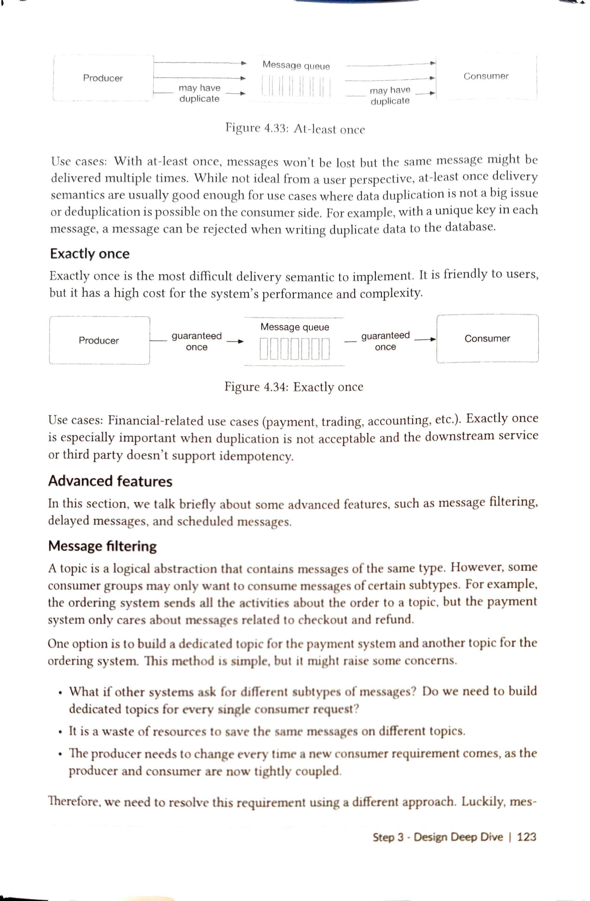

*Hình 4.33: Cơ chế At-least once (Ít nhất một lần)*

* **Message queue (Hàng đợi tin nhắn)**
* **Producer (Bên sản xuất)**: có thể bị trùng lặp (may have duplicate)
* **Consumer (Bên tiêu thụ)**: có thể nhận trùng lặp (may have duplicate)

**Trường hợp sử dụng (Use cases):** 
Với cơ chế *At-least once*, tin nhắn sẽ không bị mất (*won't be lost*), nhưng cùng một tin nhắn có thể được phân phối nhiều lần. Ngữ nghĩa (*semantics*) này thường đủ tốt cho các trường hợp sử dụng mà việc trùng lặp dữ liệu (*data duplication*) không phải là vấn đề nghiêm trọng, hoặc việc khử trùng lặp (*deduplication*) có thể thực hiện được ở phía Consumer. 

> [!TIP]
> **Ví dụ về Deduplication phía Consumer:**
> Bằng cách gắn một khóa duy nhất (*unique key*) trong mỗi tin nhắn, tin nhắn trùng lặp có thể bị từ chối khi ghi dữ liệu trùng vào cơ sở dữ liệu (tính chất *Idempotent write*).

---

#### 3. Phân phối chính xác một lần (Exactly once)

Cơ chế *Exactly once* là ngữ nghĩa phân phối khắt khe nhất, nhưng nó phải trả giá đắt bằng hiệu năng hệ thống (*performance*) và độ phức tạp (*complexity*).


*Hình 4.34: Cơ chế Exactly once (Chính xác một lần)*

* **Message queue (Hàng đợi tin nhắn)**
* **Producer**: được đảm bảo duy nhất một lần (*guaranteed once*)
* **Consumer**: được đảm bảo duy nhất một lần (*guaranteed once*)

> [!IMPORTANT]
> Cơ chế *Exactly once* đặc biệt quan trọng khi sự trùng lặp dữ liệu hoàn toàn không thể chấp nhận được, đồng thời dịch vụ hạ nguồn (*downstream service*) hoặc bên thứ ba không hỗ trợ tính lũy quyền/bất biến (*idempotency*).

---

### Các Tính Năng Nâng Cao (Advanced Features)

Trong phần này, chúng ta sẽ thảo luận ngắn gọn về một số tính năng nâng cao thường gặp, chẳng hạn như:
- Lọc tin nhắn (*Message filtering*)
- Tin nhắn trễ (*Delayed messages*)
- Tin nhắn đặt lịch (*Scheduled messages*)

---

#### Lọc tin nhắn (Message filtering)

Một topic là một trừu tượng hóa logic (*logical abstraction*) chứa các tin nhắn cùng loại. Tuy nhiên, một số nhóm tiêu thụ (*consumer groups*) có thể chỉ muốn tiêu thụ các tin nhắn thuộc một số kiểu con (*subtypes*) nhất định.

*Ví dụ:* Hệ thống đặt hàng (*ordering system*) gửi tất cả các sự kiện/hoạt động liên quan đến đơn hàng vào một topic chung, nhưng hệ thống thanh toán (*payment system*) chỉ quan tâm đến các tin nhắn liên quan đến thanh toán (*checkout*) và hoàn tiền (*refund*).

Một phương án là xây dựng một topic dành riêng cho hệ thống thanh toán và một topic khác cho hệ thống đặt hàng. Phương pháp này tuy đơn giản nhưng làm nảy sinh một số mối quan ngại:
* **Khả năng mở rộng nghiệp vụ:** Điều gì xảy ra nếu các hệ thống khác yêu cầu các kiểu con tin nhắn khác nhau? Liệu chúng ta có phải tạo các topic chuyên biệt cho từng yêu cầu tiêu thụ đơn lẻ của khách hàng?
* **Lãng phí tài nguyên:** Việc lưu cùng một tin nhắn trên nhiều topic khác nhau gây lãng phí bộ nhớ và tài nguyên lưu trữ (*waste of resources*).
* **Khớp nối chặt (Tight coupling):** Phía Producer phải thay đổi mã nguồn mỗi khi phát sinh yêu cầu mới từ Consumer, do Producer và Consumer lúc này đã bị gắn kết chặt chẽ với nhau.

Do đó, chúng ta cần giải quyết yêu cầu này bằng một cách tiếp cận khác: **Lọc tin nhắn (Message filtering)** chính là giải pháp cứu cánh.

---

*(Chuyển tiếp Trang 129)*

Lọc tin nhắn có thể thực hiện theo hai cách tiếp cận:
1. **Lọc tại Consumer:** Consumer nhận toàn bộ tin nhắn từ topic rồi tự lọc bỏ tin nhắn không cần thiết. Cách này đơn giản nhưng tạo ra lưu lượng mạng không cần thiết (*unnecessary traffic*), ảnh hưởng nghiêm trọng đến hiệu năng hệ thống (*system performance*).
2. **Lọc tại Broker:** Broker thực hiện lọc trước khi đẩy hoặc gửi tin nhắn cho Consumer.

Tuy nhiên, logic lọc tại Broker **không nên trích xuất payload (nội dung body) của tin nhắn** (*extract the message payload*), vì việc parse/giải mã payload sẽ tiêu tốn rất nhiều CPU và tài nguyên của Broker. 

Tốt hơn hết là đặt dữ liệu dùng để lọc vào phần **metadata (siêu dữ liệu)** của tin nhắn — thường là các **Message Tag** (nhãn tin nhắn). Nhờ có tag trong metadata, Broker có thể lọc tin nhắn trực tiếp theo chiều không gian đó một cách nhanh chóng mà không cần giải mã payload nặng nề.

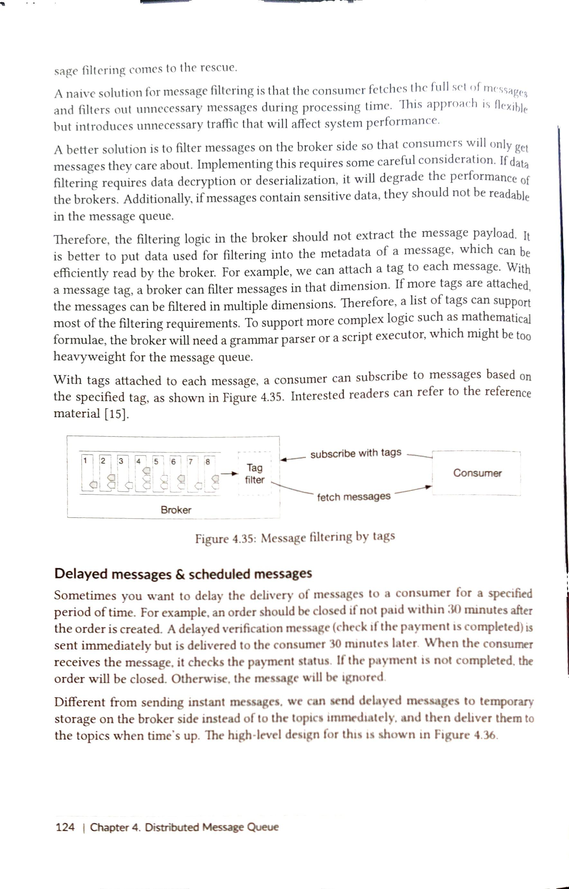

*Hình 4.35: Lọc tin nhắn theo Tags (Message filtering by tags)*

* **Producer**: Gửi tin nhắn kèm thẻ (*Tag*)
* **Broker**: Thực hiện lọc tin nhắn (*filter*) dựa trên thẻ metadata
* **Consumer**: Đăng ký nhận tin kèm bộ lọc tag (*subscribe with tags*) và kéo tin nhắn phù hợp về (*fetch messages*)

> [!NOTE]
> Để tìm hiểu sâu hơn về cơ chế lọc tin nhắn nâng cao (dựa trên biểu thức logic SQL92 hoặc lọc đa thuộc tính), bạn đọc có thể tham khảo thêm tài liệu tham khảo [15].

---

#### Tin nhắn trễ & Tin nhắn đặt lịch (Delayed messages & scheduled messages)

Đôi khi, bạn muốn trì hoãn việc phân phối tin nhắn đến Consumer trong một khoảng thời gian xác định (*specified period of time*).

* **Ví dụ:** Một đơn hàng sẽ tự động bị hủy/đóng nếu người dùng không thanh toán trong vòng 30 phút sau khi tạo đơn. 
  - Một tin nhắn xác minh trễ (*delayed verification message* - kiểm tra xem thanh toán đã hoàn tất chưa) được gửi đi ngay lập tức khi tạo đơn hàng, nhưng nó chỉ được phân phối đến Consumer sau đó đúng 30 phút.
  - Khi Consumer nhận được tin nhắn sau 30 phút, nó kiểm tra trạng thái thanh toán. Nếu thanh toán vẫn chưa hoàn thành, đơn hàng sẽ bị hủy. Ngược lại, nếu đơn hàng đã được thanh toán, tin nhắn sẽ được bỏ qua.

Khác với việc gửi tin nhắn tức thời (*instant messages*), chúng ta có thể gửi các tin nhắn trễ vào một **bộ lưu trữ tạm thời (temporary storage)** ở phía Broker thay vì đưa ngay vào các topic chính thức. Sau đó, khi hết thời gian chờ (*when time's up*), Broker mới chuyển chúng sang topic đích. 

Thiết kế mức cao (*high-level design*) cho tính năng này được thể hiện trong Hình 4.36.

---

*(Chuyển tiếp Trang 130)*

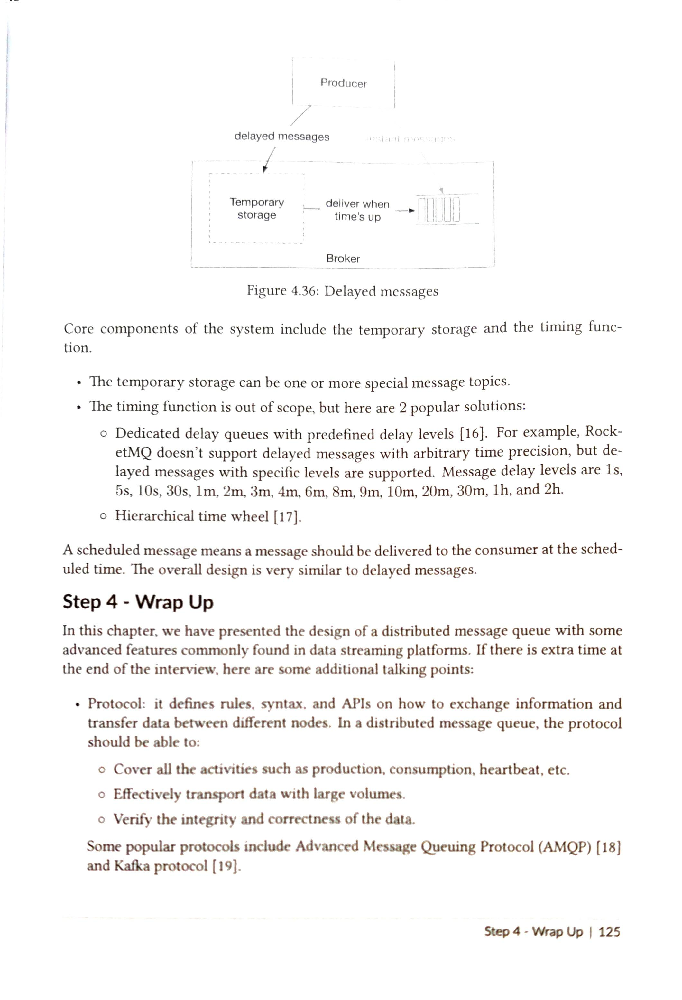

*Hình 4.36: Tin nhắn trễ (Delayed messages)*

* **Producer**: Gửi tin nhắn trễ (*delayed messages*) và tin nhắn tức thời (*instant messages*)
* **Broker**: 
  - Tin nhắn tức thời đi thẳng vào topic đích.
  - Tin nhắn trễ được đưa vào bộ lưu trữ tạm thời (*Temporary storage*).
  - Khi hết giờ (*deliver when time's up*), tin nhắn được phân phối sang topic đích để Consumer tiêu thụ.

Các thành phần cốt lõi (*Core components*) của hệ thống này bao gồm:
1. **Bộ lưu trữ tạm thời (Temporary storage):** Có thể là một hoặc nhiều topic tin nhắn đặc biệt (*special message topics*).
2. **Hàm định thời / Bộ đếm thời gian (Timing function):** Chi tiết triển khai nằm ngoài phạm vi cốt lõi, nhưng có 2 giải pháp phổ biến trong thực tế:
   * **Các hàng đợi trễ chuyên dụng với các mức độ trễ được định nghĩa trước (Dedicated delay queues with predefined delay levels) [16]:** Ví dụ, Apache RocketMQ không hỗ trợ tin nhắn trễ với độ chính xác thời gian tùy ý, nhưng hỗ trợ các mức trễ định sẵn (*specific levels*). Các mức trễ bao gồm: `1s, 5s, 10s, 30s, 1m, 2m, 3m, 4m, 6m, 8m, 9m, 10m, 20m, 30m, 1h, và 2h`.
   * **Bánh xe thời gian phân tầng (Hierarchical time wheel) [17]:** Cấu trúc dữ liệu tối ưu O(1) cho việc quản lý hàng triệu bộ hẹn giờ đồng thời.

> [!NOTE]
> **Tin nhắn đặt lịch (Scheduled message):** Nghĩa là tin nhắn cần được phân phối đến Consumer vào một thời điểm cụ thể đã lên lịch trước trên đồng hồ hệ thống. Thiết kế tổng thể của tin nhắn đặt lịch hoàn toàn tương tự như thiết kế của tin nhắn trễ.

---

## BƯỚC 4: TỔNG KẾT (STEP 4 - WRAP UP)

Trong chương này, chúng ta đã trình bày bản thiết kế hoàn chỉnh của một **Hàng đợi tin nhắn phân tán (Distributed Message Queue)** cùng với một số tính năng nâng cao thường thấy trong các nền tảng luồng dữ liệu (*data streaming platforms*). 

Nếu còn thời gian ở cuối buổi phỏng vấn kiến trúc, dưới đây là một số chủ đề thảo luận bổ sung (*additional talking points*):

* **Giao thức (Protocol):** Định nghĩa các quy tắc, cú pháp và API về cách trao đổi thông tin và truyền tải dữ liệu giữa các node khác nhau. Trong một hàng đợi tin nhắn phân tán, giao thức truyền thông cần phải:
  * Bao quát toàn bộ các hoạt động cốt lõi: gửi tin (*production*), nhận tin (*consumption*), nhịp tim báo sống (*heartbeat*), v.v.
  * Vận chuyển hiệu quả dữ liệu với lưu lượng cực lớn (*effectively transport data with large volumes*).
  * Xác thực tính toàn vẹn và tính chính xác của dữ liệu (*verify integrity and correctness*).
  * Một số giao thức phổ biến trong ngành bao gồm: **AMQP (Advanced Message Queuing Protocol)** [18] và **Kafka protocol** [19].

---

*(Chuyển tiếp Trang 131)*

* **Xử lý lỗi và Hàng đợi Thử lại / Chết (Retry & Dead-Letter Topics):** Khi Consumer xử lý tin nhắn thất bại, tin nhắn có thể được gửi vào một **Retry Topic** chuyên dụng để tiêu thụ lại sau một khoảng thời gian dãn cách, hoặc đưa vào **Dead-Letter Queue (DLQ)** nếu đã vượt quá số lần thử lại tối đa.
* **Lưu trữ dữ liệu lịch sử dài hạn (Historical data storage):** Tích hợp với các hệ thống lưu trữ phân tán có dung lượng khổng lồ và chi phí thấp như **HDFS (Hadoop Distributed File System)** [20] hoặc **Object Storage** (Amazon S3, Google Cloud Storage) để lưu trữ dữ liệu lịch sử lâu dài phục vụ mục đích phân tích (*analytics*) hoặc sao lưu.

> Xin chúc mừng bạn đã đi xa được đến chặng này! Hãy tự hào về nỗ lực của bản thân. Bạn đã làm rất tốt!

---

*(Chuyển tiếp Trang 132)*

## TỔNG KẾT CHƯƠNG (CHAPTER SUMMARY)

Dưới đây là sơ đồ tóm tắt toàn bộ cây kiến trúc của Chương 4:

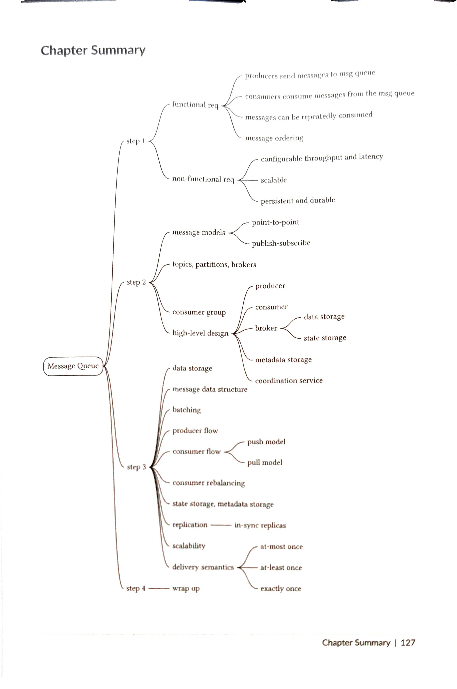

```mermaid
graph TD
    MQ["Hàng Đợi Tin Nhắn Phân Tán<br/>(Distributed Message Queue)"]

    %% Bước 1
    MQ --> S1["Bước 1: Hiểu bài toán & Xác định phạm vi<br/>(Step 1 - Understand the Problem)"]
    S1 --> FR["Yêu cầu chức năng<br/>(Functional Requirements)"]
    FR --> FR1["Producer gửi tin nhắn tới hàng đợi"]
    FR --> FR2["Consumer tiêu thụ tin nhắn từ hàng đợi"]
    FR --> FR3["Tin nhắn có thể tiêu thụ lặp lại"]
    FR --> FR4["Bảo đảm thứ tự tin nhắn (Message ordering)"]
    
    S1 --> NFR["Yêu cầu phi chức năng<br/>(Non-Functional Requirements)"]
    NFR --> NFR1["Thông lượng và độ trễ có thể tùy biến (Throughput & Latency)"]
    NFR --> NFR2["Khả năng mở rộng cao (Scalable)"]
    NFR --> NFR3["Bền vững và lưu trữ kiên cố (Persistent & Durable)"]

    %% Bước 2
    MQ --> S2["Bước 2: Đề xuất thiết kế mức cao<br/>(Step 2 - High-Level Design)"]
    S2 --> MM["Mô hình tin nhắn (Message Models)"]
    MM --> MM1["Point-to-Point (Điểm - Điểm)"]
    MM --> MM2["Publish-Subscribe (Xuất bản - Đăng ký)"]
    
    S2 --> CORE["Các thực thể cốt lõi"]
    CORE --> CORE1["Topics, Partitions, Brokers"]
    CORE --> CORE2["Producer, Consumer, Consumer Group"]
    
    S2 --> ARCH["Thành phần lưu trữ"]
    ARCH --> ARCH1["Data Storage (Lưu trữ tin nhắn)"]
    ARCH --> ARCH2["State Storage (Lưu trữ trạng thái)"]
    ARCH --> ARCH3["Metadata Storage (Lưu trữ siêu dữ liệu)"]
    ARCH --> ARCH4["Coordination Service (Dịch vụ điều phối)"]

    %% Bước 3
    MQ --> S3["Bước 3: Thiết kế đi sâu chi tiết<br/>(Step 3 - Design Deep Dive)"]
    S3 --> DS["Cấu trúc dữ liệu & Ghi log<br/>(Data Storage & Structure)"]
    DS --> DS1["Message data structure"]
    DS --> DS2["Batching (Gom cụm theo lô)"]
    
    S3 --> FLOW["Luồng dữ liệu (Data Flows)"]
    FLOW --> FLOW1["Producer flow: Push model"]
    FLOW --> FLOW2["Consumer flow: Pull model"]
    
    S3 --> CR["Consumer Rebalancing"]
    S3 --> REP["Nhân bản & Nhất quán (Replication)"]
    REP --> REP1["In-Sync Replicas (ISR)"]
    REP --> REP2["High Watermark (HW)"]
    
    S3 --> SCAL["Khả năng mở rộng (Scalability)"]
    
    S3 --> DELIV["Delivery Semantics"]
    DELIV --> D1["At-most once (Tối đa một lần)"]
    DELIV --> D2["At-least once (Ít nhất một lần)"]
    DELIV --> D3["Exactly once (Chính xác một lần)"]

    %% Bước 4
    MQ --> S4["Bước 4: Tổng kết & Tính năng nâng cao<br/>(Step 4 - Wrap Up)"]
    S4 --> ADV["Advanced Features"]
    ADV --> ADV1["Message filtering (Lọc bằng Tags)"]
    ADV --> ADV2["Delayed & Scheduled messages"]
    ADV --> ADV3["Protocols (AMQP, Kafka Protocol)"]
    ADV --> ADV4["Dead-letter queue & Historical storage"]
```

---

*(Chuyển tiếp Trang 133)*

## TÀI LIỆU THAM KHẢO (REFERENCE MATERIAL)

* **[1]** Queue Length Limit: [http://www.rabbitmq.com/maxlength.html](http://www.rabbitmq.com/maxlength.html)
* **[2]** The Log: What every software engineer should know about real-time data's unifying abstraction: [https://engineering.linkedin.com/distributed-systems/log-what-every-software-engineer-should-know-about-real-time-datas-unifying](https://engineering.linkedin.com/distributed-systems/log-what-every-software-engineer-should-know-about-real-time-datas-unifying)
* **[3]** Apache Pulsar Architecture: [https://pulsar.apache.org/docs/en/concepts-architecture-overview/](https://pulsar.apache.org/docs/en/concepts-architecture-overview/)
* **[4]** MySQL: [http://www.mysql.com](http://www.mysql.com)
* **[5]** RocksDB: [https://rocksdb.org/](https://rocksdb.org/)
* **[6]** Push vs Pull: [https://kafka.apache.org/documentation/#design_pull](https://kafka.apache.org/documentation/#design_pull)
* **[7]** Kafka consumer configs: [https://kafka.apache.org/documentation/#consumerconfigs](https://kafka.apache.org/documentation/#consumerconfigs)
* **[8]** How Apache Kafka works without Zookeeper: [https://chrzaszcz.dev/2019/12/kafka-without-zookeeper/](https://chrzaszcz.dev/2019/12/kafka-without-zookeeper/)
* **[9]** Kafka no longer requires ZooKeeper: [https://www.confluent.io/blog/kafka-no-longer-requires-zookeeper-ebfbf3862104](https://www.confluent.io/blog/kafka-no-longer-requires-zookeeper-ebfbf3862104)
* **[10]** Martin Kleppmann. *Designing Data-Intensive Applications*. O'Reilly Media, 2017. Tr. 151-197.
* **[11]** What does in-sync replicas in Apache Kafka really mean?: [https://cloudurable.com/blog/what-is-kafka-in-sync-replicas-isr/index.html](https://cloudurable.com/blog/what-is-kafka-in-sync-replicas-isr/index.html)
* **[12]** Fetch from Closest Replica: [https://cwiki.apache.org/confluence/display/KAFKA/KIP-392%3A+Allow+consumers+to+fetch+from+closest+replica](https://cwiki.apache.org/confluence/display/KAFKA/KIP-392%3A+Allow+consumers+to+fetch+from+closest+replica)
* **[13]** Hands-free Kafka Replication: A Lesson in Operational Simplicity: [https://www.confluent.io/blog/hands-free-kafka-replication-a-lesson-in-operational-simplicity/](https://www.confluent.io/blog/hands-free-kafka-replication-a-lesson-in-operational-simplicity/)
* **[14]** High Watermark in Apache Kafka: [https://issues.apache.org/jira/browse/KAFKA-4261](https://issues.apache.org/jira/browse/KAFKA-4261)
* **[15]** Message Filtering in Apache RocketMQ: [https://rocketmq.apache.org/docs/filter-example/](https://rocketmq.apache.org/docs/filter-example/)
* **[16]** Scheduled messages and delayed messages in Apache RocketMQ: [https://partners-intl.aliyun.com/help/doc-detail/43349.htm](https://partners-intl.aliyun.com/help/doc-detail/43349.htm)
* **[17]** Hashed and hierarchical timing wheels: [http://www.cs.columbia.edu/~nahum/w6998/papers/sosp87-timing-wheels.pdf](http://www.cs.columbia.edu/~nahum/w6998/papers/sosp87-timing-wheels.pdf)
* **[18]** Advanced Message Queuing Protocol (AMQP): [https://en.wikipedia.org/wiki/Advanced_Message_Queuing_Protocol](https://en.wikipedia.org/wiki/Advanced_Message_Queuing_Protocol)
* **[19]** Kafka protocol guide: [https://kafka.apache.org/protocol](https://kafka.apache.org/protocol)
* **[20]** Hadoop Distributed File System (HDFS): [https://hadoop.apache.org/docs/r1.2.1/hdfs_design.html](https://hadoop.apache.org/docs/r1.2.1/hdfs_design.html)

### Trang 134


[20] HDFS. https://hadoop.apache.org/docs/r1.2.1/hdfs_design.html.  
Tài liệu tham khảo 129 *(Reference Material 129)*

---

### Trang 135

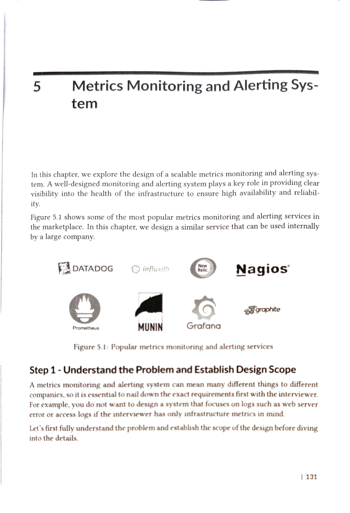

# Hệ Thống Giám Sát Chỉ Số và Cảnh Báo (Metrics Monitoring and Alerting System)

Trong chương này, chúng ta sẽ khám phá thiết kế của một **Hệ thống giám sát chỉ số và cảnh báo (Metrics Monitoring and Alerting System)** có khả năng mở rộng quy mô (*scalable*). Một hệ thống giám sát và cảnh báo được thiết kế tốt đóng vai trò then chốt trong việc cung cấp khả năng quan sát (*visibility*) rõ ràng về tình trạng sức khỏe của hạ tầng nhằm đảm bảo **Tính sẵn sàng cao (High Availability)** và **Độ tin cậy (Reliability)**.

**Hình 5.1** minh họa một số dịch vụ giám sát chỉ số và cảnh báo phổ biến nhất trên thị trường hiện nay. Trong chương này, chúng ta sẽ thiết kế một dịch vụ tương tự có thể được sử dụng nội bộ bởi một công ty quy mô lớn.

```
DATADOG
New Relic
influxdb
Nagios
graphite
MUNIN
Grafana
Prometheus
```

**Hình 5.1:** Các dịch vụ giám sát chỉ số và cảnh báo phổ biến *(Popular metrics monitoring and alerting services)*

---

## Bước 1 – Hiểu Rõ Vấn Đề và Xác Định Phạm Vi Thiết Kế (Step 1 - Understand the Problem and Establish Design Scope)

Một hệ thống giám sát chỉ số và cảnh báo có thể mang nhiều ý nghĩa rất khác nhau đối với từng công ty, do đó điều cốt yếu trước tiên là phải làm rõ các yêu cầu chính xác với người phỏng vấn (*interviewer*).

Ví dụ: bạn chắc chắn không muốn thiết kế một hệ thống tập trung vào nhật ký log (*logs*) chẳng hạn như access log hoặc error log của máy chủ web (*web server*), trong khi người phỏng vấn chỉ đang hướng đến các chỉ số hạ tầng (*infrastructure metrics*).

Hãy bắt đầu bằng việc hiểu trọn vẹn bài toán và thiết lập phạm vi thiết kế trước khi đi sâu vào chi tiết kỹ thuật.

/131

---

### Trang 136

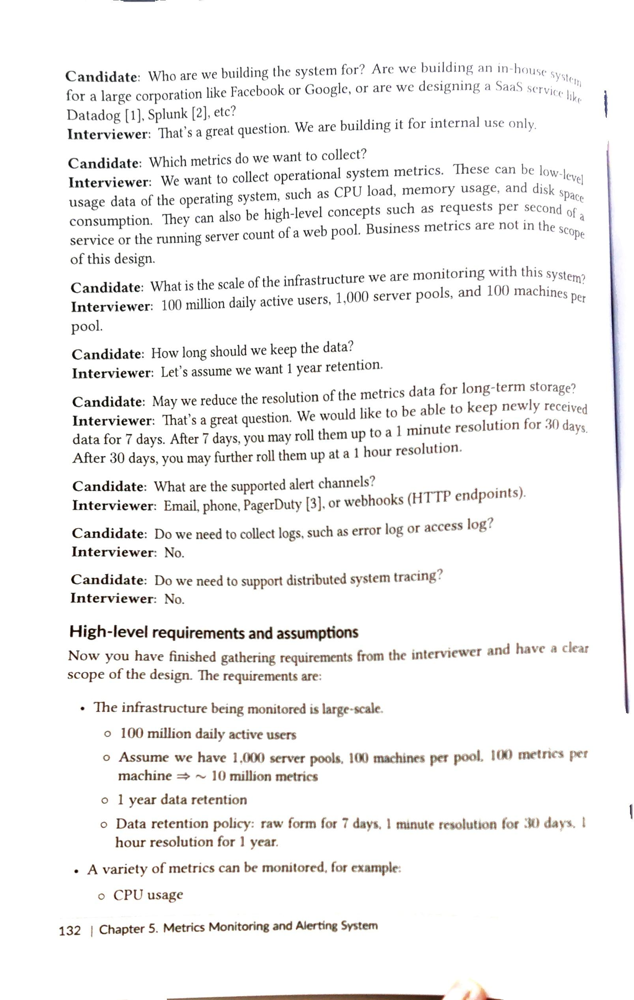

**Ứng viên (Candidate):** Chúng ta đang xây dựng một hệ thống để sử dụng nội bộ hay để cung cấp dịch vụ SaaS ra bên ngoài giống như Datadog [1], Splunk [2], v.v.?  
**Người phỏng vấn (Interviewer):** Đó là một câu hỏi rất hay. Chúng ta chỉ xây dựng nó để phục vụ sử dụng nội bộ.

**Ứng viên:** Chúng ta muốn thu thập những loại chỉ số (*metrics*) nào?  
**Người phỏng vấn:** Các chỉ số cấp độ hạ tầng hệ điều hành (*OS level metrics*) như mức sử dụng CPU (*CPU usage*), dung lượng bộ nhớ (*memory usage*), và không gian ổ đĩa (*disk space*). Ngoài ra còn có các chỉ số cấp ứng dụng (*application-level metrics*) như số lượng yêu cầu (*request count*) của các dịch vụ chạy trên cụm máy chủ (*server pool*).

**Ứng viên:** Quy mô hạ tầng mà chúng ta cần giám sát là bao nhiêu?  
**Người phỏng vấn:** Hãy giả định chúng ta có 100 triệu người dùng hoạt động hàng ngày (100 million DAU - Daily Active Users). Giả định có 1.000 server pool, mỗi pool có 100 máy, mỗi máy thu thập 100 chỉ số.

**Ứng viên:** Chúng ta cần lưu giữ dữ liệu trong bao lâu?  
**Người phỏng vấn:** Hãy giả định chúng ta muốn thời gian lưu giữ dữ liệu (*data retention*) là 1 năm.

**Ứng viên:** Chúng ta có được phép giảm độ phân giải dữ liệu chỉ số (*reduce resolution / downsampling*) phục vụ cho việc lưu trữ dài hạn không?  
**Người phỏng vấn:** Có, chúng ta có thể lưu dữ liệu ở định dạng thô (*raw form*) trong vòng 7 ngày, sau đó nén tổng hợp xuống độ phân giải 1 phút cho 30 ngày tiếp theo, và độ phân giải 1 giờ cho khoảng thời gian 1 năm.

**Ứng viên:** Các kênh cảnh báo (*alert channels*) nào cần được hỗ trợ?  
**Người phỏng vấn:** Email, webhook, PagerDuty, SMS.

**Ứng viên:** Chúng ta có cần thu thập log lỗi hay access log không?  
**Người phỏng vấn:** Không.

**Ứng viên:** Chúng ta có cần hỗ trợ truy vết hệ thống phân tán (Distributed System Tracing) không?  
**Người phỏng vấn:** Không.

---

### Các Yêu Cầu Mức Cao và Giả Định (High-level Requirements and Assumptions)

Dựa trên cuộc trao đổi, chúng ta có thể tóm tắt các yêu cầu cốt lõi và phạm vi thiết kế như sau:

#### Yêu cầu chức năng (Functional Requirements):
* **Hạ tầng được giám sát có quy mô lớn:**
  * 100 triệu người dùng hoạt động hàng ngày (100 million Daily Active Users - DAU).
  * Giả định hệ thống có 1.000 cụm máy chủ (*server pools*), 100 máy trên mỗi cụm, 100 chỉ số trên mỗi máy $\approx$ **10 triệu chỉ số (10 million metrics)**.
  * Thời gian lưu giữ dữ liệu 1 năm (*1 year data retention*).
  * **Chính sách lưu giữ dữ liệu (Data Retention Policy):** 
    * Dạng thô (*raw form*) trong **7 ngày**.
    * Độ phân giải 1 phút (*1 minute resolution*) trong **30 ngày**.
    * Độ phân giải 1 giờ (*1 hour resolution*) trong **1 năm**.
* **Đa dạng các loại chỉ số có thể được giám sát, ví dụ:**
  * Mức độ sử dụng CPU (*CPU usage*)

132 / Chương 5. Hệ Thống Giám Sát Chỉ Số và Cảnh Báo *(Chapter 5. Metrics Monitoring and Alerting System)*

---

### Trang 137

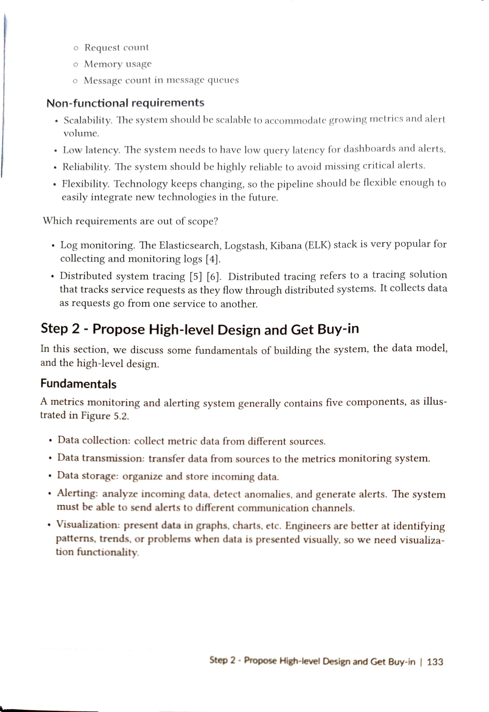

* Số lượng yêu cầu (*Request count*).
* Mức sử dụng bộ nhớ (*Memory usage*).
* Số lượng tin nhắn trong hàng đợi (*Message count in message queues*).

#### Yêu cầu phi chức năng (Non-functional Requirements):
* **Khả năng mở rộng (Scalability):** Hệ thống phải có khả năng mở rộng quy mô linh hoạt để đáp ứng khối lượng chỉ số và cảnh báo ngày càng tăng.
* **Độ trễ thấp (Low Latency):** Hệ thống cần có độ trễ truy vấn thấp (*low query latency*) đối với các bảng điều khiển trực quan (*dashboards*) và hệ thống cảnh báo (*alerts*).
* **Độ tin cậy (Reliability):** Hệ thống phải đạt độ tin cậy cực cao để tránh việc bỏ sót các cảnh báo nguy cấp (*critical alerts*).
* **Tính linh hoạt (Flexibility):** Công nghệ luôn thay đổi không ngừng, do đó đường ống dữ liệu (*data pipeline*) phải đủ linh hoạt để dễ dàng tích hợp các công nghệ mới trong tương lai.

#### Những yêu cầu nằm ngoài phạm vi (Out of Scope):
* **Giám sát nhật ký log (Log monitoring):** Ngăn xếp Elasticsearch, Logstash, Kibana (ELK stack) đã rất phổ biến và tối ưu cho việc thu thập và giám sát log [4].
* **Truy vết hệ thống phân tán (Distributed system tracing) [5] [6]:** Distributed tracing đề cập đến giải pháp theo dõi luồng thực thi của các yêu cầu dịch vụ (*service requests*) khi chúng di chuyển xuyên suốt qua các hệ thống phân tán. Nó thu thập dữ liệu khi các request luân chuyển từ dịch vụ này sang dịch vụ khác.

---

## Bước 2 – Đề Xuất Thiết Kế Mức Cao và Thống Nhất Phương Án (Step 2 - Propose High-level Design and Get Buy-in)

Trong phần này, chúng ta sẽ thảo luận về một số nguyên lý nền tảng (*fundamentals*) để xây dựng hệ thống, mô hình dữ liệu (*data model*), và thiết kế kiến trúc mức cao (*high-level design*).

### Các Nguyên Lý Nền Tảng (Fundamentals)

Một hệ thống giám sát chỉ số và cảnh báo thông thường bao gồm năm thành phần chính, như được minh họa trong **Hình 5.2**:

* **Thu thập dữ liệu (Data collection):** Thu thập dữ liệu chỉ số (*metric data*) từ nhiều nguồn phát sinh khác nhau.
* **Truyền dẫn dữ liệu (Data transmission):** Vận chuyển dữ liệu an toàn và hiệu quả từ các nguồn tới hệ thống giám sát chỉ số.
* **Lưu trữ dữ liệu (Data storage):** Tổ chức, lập chỉ mục và lưu trữ dữ liệu chỉ số gửi đến.
* **Cảnh báo (Alerting):** Phân tích dữ liệu nạp vào, phát hiện các điểm bất thường (*detect anomalies*), và phát sinh cảnh báo (*generate alerts*). Hệ thống phải có khả năng gửi cảnh báo tới nhiều kênh truyền thông khác nhau.
* **Trực quan hóa (Visualization):** Trình diễn dữ liệu dưới dạng đồ thị, biểu đồ (*graphs, charts*), v.v. Các kỹ sư có khả năng nhận diện các mẫu hành vi (*patterns*), xu hướng (*trends*), hoặc sự cố nhanh hơn rất nhiều khi dữ liệu được thể hiện trực quan; vì vậy chúng ta cần chức năng trực quan hóa mạnh mẽ.

Bước 2 · Đề Xuất Thiết Kế Mức Cao và Thống Nhất Phương Án | 133 *(Step 2 · Propose High-level Design and Get Buy-in | 133)*

---

## Điều hướng

- [chuong-03-google-maps.md](chuong-03-google-maps.md)
- [Mục lục](README.md)
- [chuong-05-metrics-monitoring-and-alerting-system.md](chuong-05-metrics-monitoring-and-alerting-system.md)
