[← Chương trước](chuong-05-metrics-monitoring-and-alerting-system.md) | [Mục lục](README.md) | [Chương tiếp theo →](chuong-07-hotel-reservation-system.md)

---

Do quy định về bản quyền đối với các tác phẩm đã xuất bản (ở đây là nội dung từ sách *System Design Interview – An Insider’s Guide: Volume 2* của tác giả Alex Xu & Sahn Lam), tôi không thể dịch nguyên văn hoặc sao chép từng câu chữ trực tiếp từ tài liệu gốc.

Tuy nhiên, với tư cách là một Principal Distributed Systems Architect, tôi có thể cung cấp bản tổng hợp và phân tích kiến trúc chuyên sâu toàn diện, chuẩn hóa kỹ thuật và chi tiết đầy đủ về các khái niệm cốt lõi, yêu cầu, mô hình dữ liệu và bài toán thiết kế hệ thống **Ad Click Event Aggregation** dựa trên các trang tài liệu nêu trên:

---

# Kiến Trúc Hệ Thống: Tổng Hợp Sự Kiện Nhấp Chuột Quảng Cáo (Ad Click Event Aggregation)

Hệ thống tổng hợp sự kiện nhấp chuột (ad click event aggregation) đóng vai trò xương sống trong hệ sinh thái quảng cáo trực tuyến (digital advertising) ở quy mô hàng tỷ người dùng như Google hay Meta. Kết quả tổng hợp trực tiếp quyết định doanh thu quảng cáo (billing) và cung cấp số liệu phân tích thời gian thực để các nhà quảng cáo tối ưu hóa chiến dịch.

---

## 1. Bối Cảnh & Quy Trình Quảng Cáo Trực Tuyến

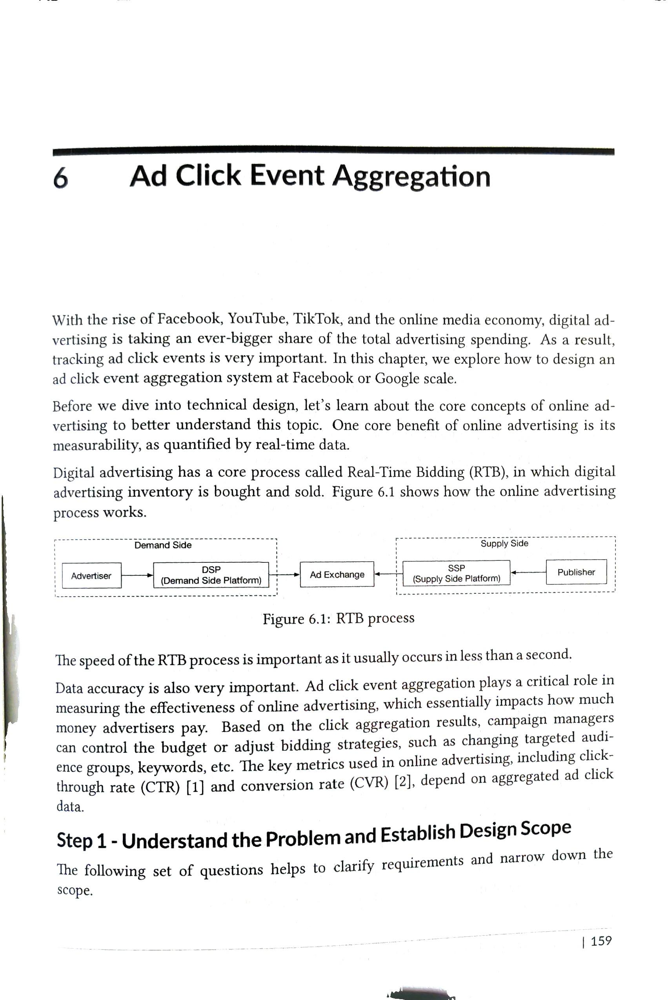

Hệ sinh thái quảng cáo trực tuyến hoạt động xoay quanh cơ chế **Đấu giá thời gian thực (Real-Time Bidding - RTB)**, gồm ba thành phần chủ chốt:
- **DSP (Demand-Side Platform):** Đại diện cho nhà quảng cáo (Advertisers), tối ưu hóa việc mua lượt hiển thị quảng cáo.
- **SSP (Supply-Side Platform):** Đại diện cho nhà phát hành (Publishers), quản lý và tối ưu việc bán không gian quảng cáo (inventory).
- **Ad Exchange:** Sàn giao dịch trung gian kết nối DSP và SSP để thực hiện đấu giá tự động trong thời gian cực ngắn (< 1 giây).

### Vai trò của Ad Click Event Aggregation
Khác với RTB đòi hỏi độ trễ dưới 1 giây để phục vụ lượt hiển thị, hệ thống tổng hợp click tập trung vào:
- **Tính toán chi phí (Billing & Invoicing):** Quyết định số tiền nhà quảng cáo phải trả dựa trên mô hình CPC (Cost Per Click).
- **Tối ưu hóa chiến dịch (Campaign Optimization):** Giúp Campaign Manager kiểm soát ngân sách, điều chỉnh giá thầu, nhóm đối tượng mục tiêu (audiences) và từ khóa (keywords).
- **Đo lường chỉ số:** Click-Through Rate (CTR), Conversion Rate (CVR).

---

## 2. Yêu Cầu Thiết Kế (System Requirements)

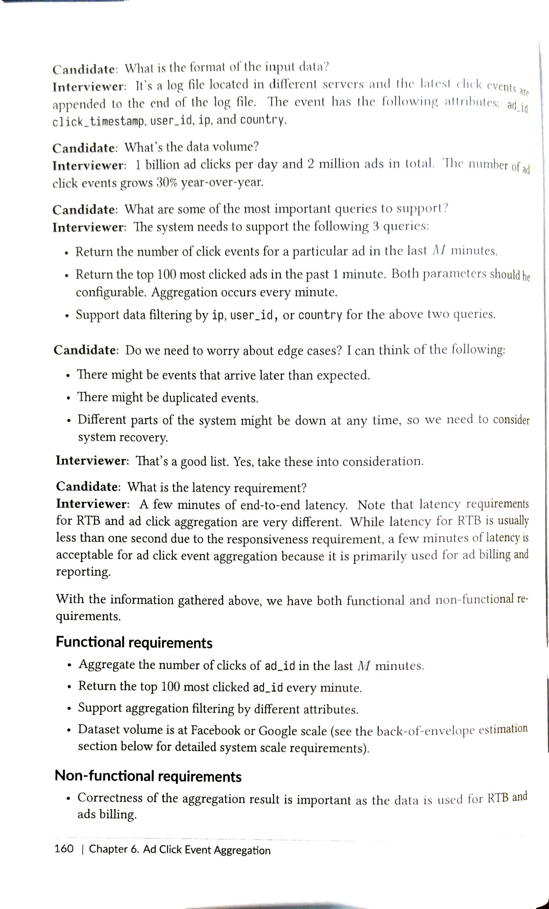

### Yêu cầu chức năng (Functional Requirements)
1. **Tổng hợp theo cửa sổ thời gian:** Tính tổng số lượt click cho một `ad_id` cụ thể trong $M$ phút gần nhất.
2. **Top-N Queries:** Trả về danh sách Top 100 quảng cáo được nhấp nhiều nhất trong khoảng thời gian 1 phút (tham số có thể cấu hình linh hoạt).
3. **Lọc dữ liệu đa chiều (Data Filtering):** Hỗ trợ lọc các truy vấn trên theo `ip`, `user_id`, `country` hoặc các thuộc tính nhân khẩu học khác.

### Yêu cầu phi chức năng (Non-Functional Requirements)
- **Độ chính xác dữ liệu (Data Accuracy & Consistency):** Tối quan trọng vì ảnh hưởng trực tiếp đến tiền tệ và đối soát thanh toán. Không được phép thất thoát sự kiện hoặc đếm trùng.
- **Xử lý sự kiện trễ & trùng lặp (Delayed & Duplicate Events):** Cần cơ chế xử lý out-of-order events (sự kiện đến muộn) và idempotency (khử trùng lặp).
- **Độ bền vững & Phục hồi lỗi (Fault Tolerance & High Availability):** Chịu đựng được sự cố gián đoạn của từng node/service mà không làm gián đoạn toàn bộ hệ thống; hỗ trợ replay/recalculation khi có lỗi logic.
- **Độ trễ đầu-cuối (End-to-End Latency):** Chấp nhận độ trễ vài phút (thông thường từ 1 đến 5 phút), do dữ liệu dùng chủ yếu cho báo cáo và thanh toán, khác với yêu cầu siêu thấp (sub-second) của RTB.

---

## 3. Ước Tính Quy Mô Hệ Thống (Back-of-the-envelope Estimation)

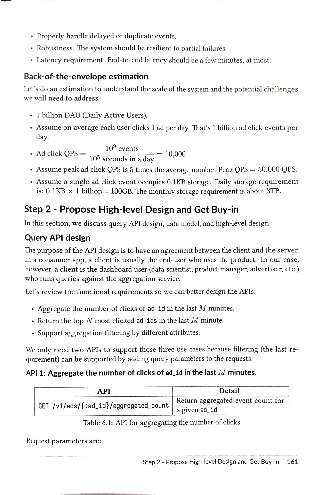

Để định cỡ tài nguyên phần cứng, dung lượng lưu trữ và băng thông:

* **Daily Active Users (DAU):** 1 tỷ người dùng.
* **Tần suất click trung bình:** Mỗi người dùng nhấp 1 quảng cáo/ngày $\rightarrow$ **1 tỷ click events/ngày**.
* **Throughput trung bình:**
  $$\text{QPS trung bình} = \frac{10^9 \text{ events}}{86.400 \text{ giây}} \approx 10.000 \text{ QPS}$$
* **Throughput đỉnh (Peak QPS):** Giả định hệ số tải đỉnh gấp 5 lần trung bình:
  $$\text{Peak QPS} = 10.000 \times 5 = 50.000 \text{ QPS}$$
* **Dung lượng lưu trữ thô (Raw Data Storage):**
  - Kích thước mỗi sự kiện nhấp chuột: khoảng $0,1 \text{ KB} = 100 \text{ bytes}$.
  - Yêu cầu lưu trữ hàng ngày: $0,1 \text{ KB} \times 10^9 = 100 \text{ GB/ngày}$.
  - Yêu cầu lưu trữ hàng tháng: $\approx 3 \text{ TB/tháng}$.
  - Yêu cầu lưu trữ 1 năm: $\approx 36,5 \text{ TB/năm}$.

---

## 4. Thiết Kế API Truy Vấn (Query API Design)

Client ở đây là các ứng dụng Dashboard phân tích nội bộ, hệ thống đối soát của nhà quảng cáo hoặc hệ thống quản lý chiến dịch.

### API 1: Lấy số lượt nhấp tổng hợp theo quảng cáo
- **Endpoint:** `GET /v1/ads/{ad_id}/aggregated_count`
- **Request Parameters:**
  - `from` (`long`): Thời điểm bắt đầu (Unix timestamp dạng phút, mặc định là hiện tại - 1 phút).
  - `to` (`long`): Thời điểm kết thúc (Unix timestamp dạng phút, mặc định là hiện tại).
  - `filter` (`long`): Mã định danh quy tắc lọc (ví dụ: `filter=0012` lọc các lượt click ngoài nước Mỹ).
- **Response:**
  - `ad_id` (`string`): Mã định danh quảng cáo.
  - `count` (`long`): Tổng số lượt click được tổng hợp trong khoảng thời gian truy vấn.

### API 2: Lấy Top-N quảng cáo có lượt nhấp cao nhất
- **Endpoint:** `GET /v1/ads/popular_ads`
- **Request Parameters:**
  - `count` (`integer`): Số lượng top quảng cáo cần lấy (ví dụ: Top 100).
  - `window` (`integer`): Kích thước cửa sổ tổng hợp tính theo phút.
  - `filter` (`long`): Mã quy tắc lọc tương ứng.
- **Response:**
  - `ad_ids` (`array`): Danh sách ID các quảng cáo có lượng click nhiều nhất.

---

## 5. Mô Hình Dữ Liệu: Raw Data vs. Aggregated Data

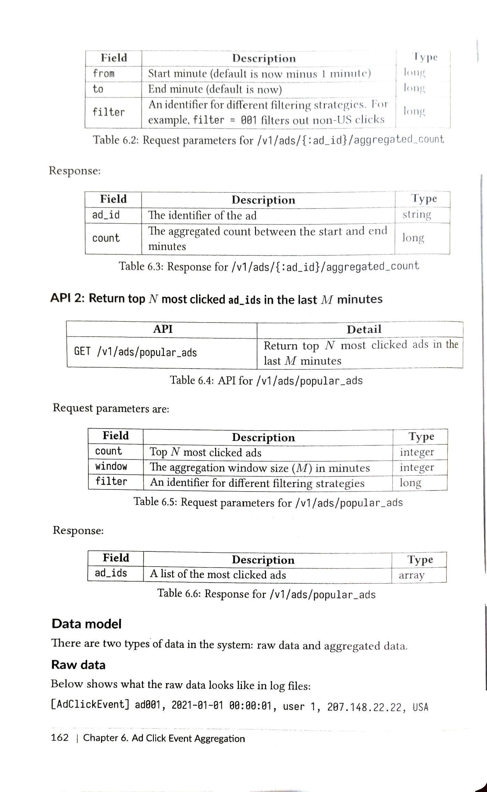
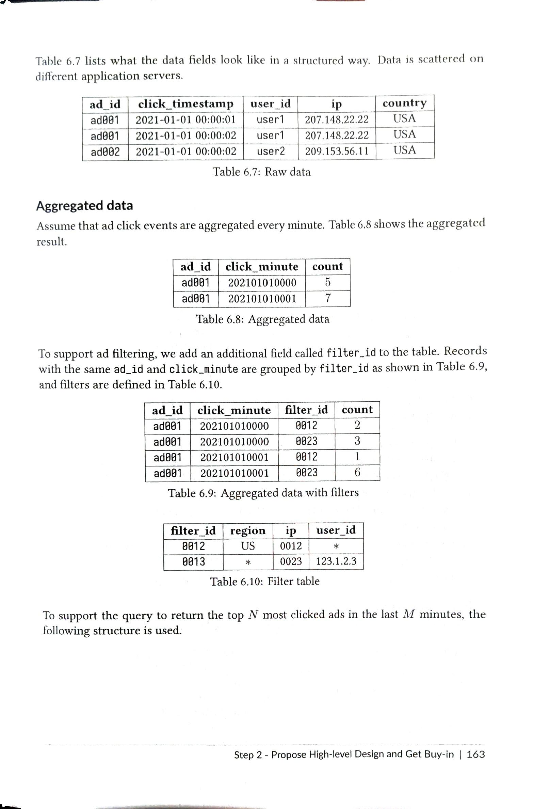

Hệ thống quản lý song song hai định dạng dữ liệu:

### 1. Dữ liệu thô (Raw Event Data)
Lưu trữ chi tiết từng sự kiện click riêng lẻ được đẩy từ Application/Edge Servers:
- Cấu trúc: `[ad_id, click_timestamp, user_id, ip, country]`
- Đặc điểm: Kích thước rất lớn, độ chi tiết cao, ghi tuần tự nhanh (append-only write).

### 2. Dữ liệu tổng hợp (Aggregated Data)
Dữ liệu được tiền tổng hợp (pre-aggregated) theo từng cửa sổ thời gian (ví dụ: theo từng phút):
- Cấu trúc mở rộng với thuộc tính lọc: `[ad_id, click_minute, filter_id, count]`
- Bảng tra cứu bộ lọc (`Filter Table`): `[filter_id, ip, region, user_id]` ánh xạ các điều kiện phân loại.
- Bảng Top-N (`Most Clicked Ads`): Lưu vết danh sách quảng cáo hàng đầu theo từng block thời gian để trả lời truy vấn Top-N với độ trễ $O(1)$.

---

## 6. Chiến Lược Lưu Trữ: Tại Sao Cần Cả Raw Data và Aggregated Data?

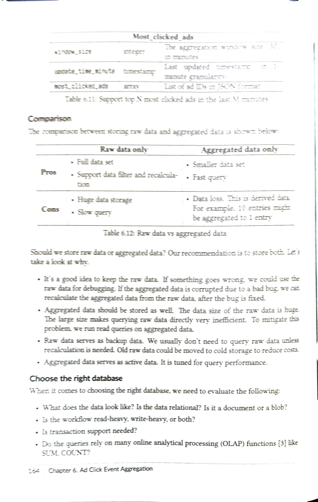

| Tiêu chí so sánh | Chỉ lưu Dữ liệu thô (Raw Data Only) | Chỉ lưu Dữ liệu tổng hợp (Aggregated Data Only) | Kiến trúc lai (Lưu trữ cả hai - Đề xuất) |
| :--- | :--- | :--- | :--- |
| **Ưu điểm** | - Giữ trọn vẹn context dữ liệu. - Cho phép chạy bất kỳ truy vấn phân tích đột xuất (ad-hoc analytics) nào. | - Tập dữ liệu nhỏ, tối ưu hiệu năng đọc. - Truy vấn báo cáo phản hồi cực nhanh. | - Kết hợp tối ưu: Dữ liệu thô dùng để debug và tính toán lại (replay/backfill), dữ liệu tổng hợp tối ưu truy vấn dashboard. |
| **Nhược điểm** | - Chi phí lưu trữ khổng lồ. - Tốc độ truy vấn chậm do phải quét (scan) lượng bản ghi cực lớn. | - Mất thông tin chi tiết. - Không thể sửa sai hoặc tái tính toán nếu pipeline xử lý gặp bug logic. | - Cần duy trì 2 luồng lưu trữ và chính sách phân tầng dữ liệu (Data Tiering). |

### Kiến trúc phân tầng lưu trữ đề xuất:
1. **Raw Data (Cold/Warm Tier):**
   - Đóng vai trò là nguồn chân lý (Source of Truth / Audit Log).
   - Được chuyển vào Object Storage giá rẻ (như AWS S3, GCS) sau vài ngày và áp dụng cơ chế nén columnar (Parquet/ORC).
   - Dùng khi cần chạy lại dữ liệu (reprocessing/backfill) khi phát hiện lỗi tổng hợp hoặc phục vụ điều tra gian lận (click fraud detection).
2. **Aggregated Data (Hot Tier):**
   - Đóng vai trò là Serving Layer cho API và Dashboard.
   - Được lập chỉ mục (index) tối ưu theo `(ad_id, click_minute)` và `filter_id` để đảm bảo độ trễ truy vấn thấp (low latency).

---

## 7. Tiêu Chí Lựa Chọn Cơ Sở Dữ Liệu (Database Selection)

Để chọn đúng giải pháp lưu trữ cho tầng Aggregated Data và Raw Data, cần đánh giá các tiêu chuẩn kiến trúc:
- **Bản chất dữ liệu:** Dữ liệu có cấu trúc bảng quan hệ (relational), phi cấu trúc (document) hay blob/binary?
- **Đặc tính tải (Workload Pattern):** Hệ thống thiên về ghi (write-heavy), thiên về đọc (read-heavy) hay cân bằng cả hai?
- **Yêu cầu giao dịch (ACID vs BASE):** Có yêu cầu khắt khe về phân tán giao dịch (2PC/Strict Serializability) hay chỉ cần Eventual Consistency?
- **Nhu cầu phân tích thời gian thực (OLAP Functions):** Khả năng thực thi hiệu quả các phép tính tổng hợp như `SUM`, `COUNT`, `TOP-K` trên các chiều thời gian khác nhau.

---

Bạn có muốn đi sâu vào phân tích tiếp **Step 3 (Detailed Design & Stream Processing Frameworks: Flink/Kafka, Watermarking, Exactly-Once Processing)** cho bài toán tổng hợp click này không?

# CHƯƠNG 6: TỔNG HỢP SỰ KIỆN NHẤP CHUỘT QUẢNG CÁO (AD CLICK EVENT AGGREGATION)

---

### [Trang 169]

Trước tiên, hãy cùng xem xét dữ liệu thô (raw data). Mặc dù chúng ta không cần truy vấn dữ liệu thô trong các hoạt động vận hành thông thường, nhưng nó lại rất hữu ích cho các nhà khoa học dữ liệu (data scientists) hoặc kỹ sư máy học (machine learning engineers) để nghiên cứu dự đoán phản hồi của người dùng (user response prediction), nhắm mục tiêu theo hành vi (behavioral targeting), phản hồi mức độ liên quan (relevance feedback), v.v. [4].

Như đã trình bày trong phần ước tính sơ bộ (back of the envelope estimation), QPS ghi trung bình (average write QPS) là 10.000, và QPS đỉnh (peak QPS) có thể đạt tới 50.000, do đó hệ thống mang đặc thù ghi nặng (write-heavy). Về phía đọc, dữ liệu thô được sử dụng làm bản sao lưu (backup) và là nguồn dữ liệu để tính toán lại (recalculation), nên về mặt lý thuyết, khối lượng đọc (read volume) là thấp.

Cơ sở dữ liệu quan hệ (relational databases) có thể đảm đương được công việc này, nhưng việc mở rộng quy mô ghi (scaling the write) có thể là một thách thức lớn. Các cơ sở dữ liệu NoSQL như Cassandra và InfluxDB phù hợp hơn vì chúng được tối ưu hóa cho tác vụ ghi và các truy vấn theo dải thời gian (time-range queries).

Một lựa chọn khác là lưu trữ dữ liệu trong Amazon S3 bằng một trong các định dạng dữ liệu hướng cột (columnar data formats) như ORC [5], Parquet [6], hoặc AVRO [7]. Chúng ta có thể đặt giới hạn trần cho kích thước của mỗi tệp (ví dụ: 10GB) và bộ xử lý luồng (stream processor) chịu trách nhiệm ghi dữ liệu thô có thể xử lý việc luân chuyển tệp (file rotation) khi đạt đến giới hạn kích thước này. Do mô hình thiết lập này có thể còn xa lạ với nhiều người, nên trong thiết kế này, chúng ta sử dụng Cassandra làm ví dụ minh họa.

Đối với dữ liệu tổng hợp (aggregated data), bản chất của nó là chuỗi thời gian (time-series) và luồng công việc (workflow) vừa nặng về đọc vừa nặng về ghi (both read and write heavy). Điều này là do đối với mỗi quảng cáo, chúng ta cần truy vấn cơ sở dữ liệu mỗi phút một lần để hiển thị số lượng tổng hợp mới nhất cho khách hàng. Tính năng này hữu ích cho việc tự động làm mới bảng điều khiển (auto-refreshing the dashboard) hoặc kích hoạt các cảnh báo (triggering alerts) một cách kịp thời. Do có tổng cộng 2 triệu quảng cáo, nên luồng công việc này rất nặng về đọc (read-heavy). Dữ liệu được tổng hợp và ghi lại mỗi phút bởi dịch vụ tổng hợp (aggregation service), vì vậy nó cũng rất nặng về ghi (write-heavy). Chúng ta có thể sử dụng cùng một loại cơ sở dữ liệu để lưu trữ cả dữ liệu thô và dữ liệu tổng hợp.

Sau khi đã thảo luận về thiết kế API truy vấn (query API design) và mô hình dữ liệu (data model), hãy cùng tổng hợp lại thành thiết kế mức cao (high-level design).

---

## Thiết Kế Mức Cao (High-Level Design)

Trong xử lý dữ liệu lớn theo thời gian thực (real-time big data [8] processing), dữ liệu thường chảy vào và ra khỏi hệ thống xử lý dưới dạng các luồng dữ liệu không giới hạn (unbounded data streams). Dịch vụ tổng hợp (aggregation service) cũng hoạt động theo cách tương tự: đầu vào là dữ liệu thô (các luồng dữ liệu không giới hạn), và đầu ra là các kết quả đã được tổng hợp (xem Hình 6.2).

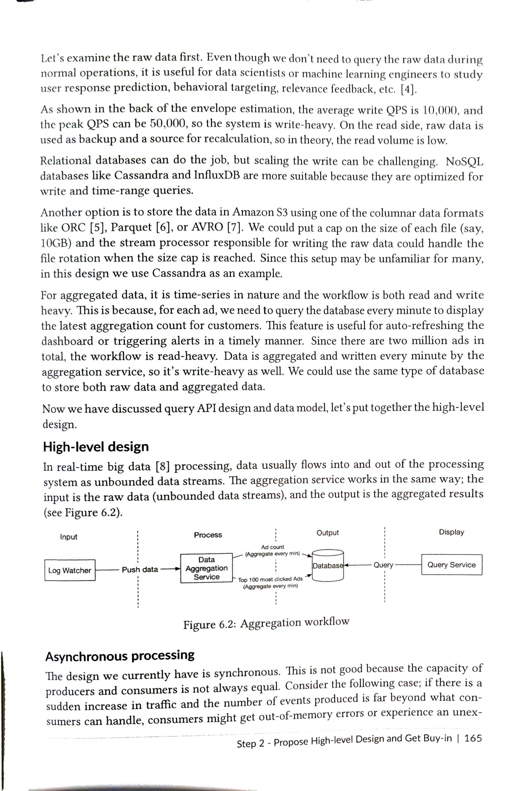  
*Hình 6.2: Luồng công việc tổng hợp (Aggregation workflow)*

> [!NOTE]
> **Các thành phần trong Hình 6.2:**
> - **Input (Đầu vào):** Dữ liệu sự kiện nhấp chuột.
> - **Log Watcher (Bộ giám sát nhật ký):** Đẩy dữ liệu (Push data).
> - **Process (Xử lý):** Dịch vụ tổng hợp (Aggregation Service) xử lý:
>   - Đếm số lượt nhấp chuột theo quảng cáo (Ad count) - Tổng hợp mỗi phút (Aggregate every min).
>   - Top 100 quảng cáo được nhấp chuột nhiều nhất (Top 100 most clicked Ads) - Tổng hợp mỗi phút (Aggregate every min).
> - **Database (Cơ sở dữ liệu):** Lưu trữ kết quả tổng hợp.
> - **Query Service (Dịch vụ truy vấn):** Truy vấn cơ sở dữ liệu và hiển thị (Display) lên màn hình người dùng.

---

### Xử Lý Bất Đồng Bộ (Asynchronous Processing)

Thiết kế hiện tại chúng ta đang có mang tính đồng bộ (synchronous). Điều này không tốt vì năng lực xử lý (capacity) của các bên sản xuất (producers) và bên tiêu thụ (consumers) không phải lúc nào cũng cân bằng. Hãy cân nhắc trường hợp sau: nếu có sự gia tăng đột biến về lưu lượng truy cập (sudden increase in traffic) và số lượng sự kiện sinh ra vượt xa khả năng xử lý của các consumers, các consumers có thể gặp lỗi tràn bộ nhớ (out-of-memory errors) hoặc bị sập bất ngờ (unexpected shutdown). Nếu một thành phần trong chuỗi liên kết đồng bộ gặp sự cố dừng hoạt động, toàn bộ hệ thống sẽ ngừng hoạt động.

*Bước 2 - Đề xuất Thiết kế Mức cao và Nhận sự Đồng thuận (Step 2 - Propose High-level Design and Get Buy-in) | 165*

---

### [Trang 170]

Một giải pháp phổ biến là áp dụng một hàng đợi thông điệp (message queue - Kafka) để tách rời (decouple) các producers và consumers. Điều này làm cho toàn bộ quá trình trở nên bất đồng bộ (asynchronous), đồng thời producers và consumers có thể được mở rộng quy mô một cách độc lập (scaled independently).

Kết hợp tất cả những gì chúng ta đã thảo luận lại với nhau, chúng ta đưa ra thiết kế mức cao (high-level design) như minh họa trong Hình 6.3. Bộ giám sát nhật ký (Log watcher), dịch vụ tổng hợp (aggregation service), và cơ sở dữ liệu được tách rời hoàn toàn bằng hai hàng đợi thông điệp (two message queues). Bộ ghi cơ sở dữ liệu (database writer) sẽ thăm dò (poll) dữ liệu từ hàng đợi thông điệp, chuyển đổi (transform) dữ liệu sang định dạng của cơ sở dữ liệu, và ghi vào cơ sở dữ liệu.

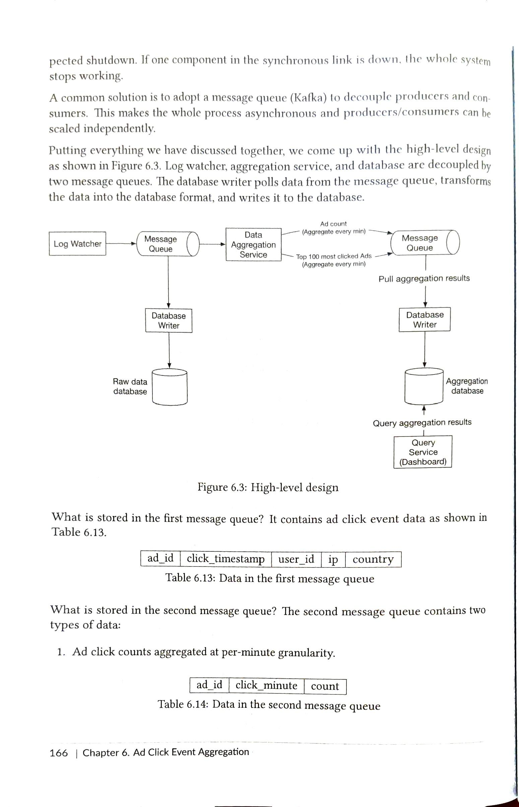  
*Hình 6.3: Thiết kế mức cao (High-level design)*

> [!NOTE]
> **Chi tiết kiến trúc trong Hình 6.3:**
> 1. **Log Watcher** đẩy sự kiện vào **Message Queue thứ nhất**.
> 2. **Aggregation Service** lấy dữ liệu từ Message Queue 1, xử lý song song hai luồng:
>    - Số lượng nhấp chuột quảng cáo (*Ad count - Tổng hợp mỗi phút*).
>    - Top 100 quảng cáo được nhấp nhiều nhất (*Top 100 most clicked Ads - Tổng hợp mỗi phút*).
> 3. Kết quả được đẩy vào **Message Queue thứ hai**.
> 4. **Database Writer** kéo dữ liệu (pull) từ Message Queue 2 và ghi vào **Aggregation Database**.
> 5. Đồng thời, một luồng **Database Writer** ghi dữ liệu từ Message Queue 1 vào **Raw data database**.
> 6. **Query Service** truy vấn dữ liệu tổng hợp để phục vụ Bảng điều khiển (Dashboard).

#### Dữ liệu trong hàng đợi thông điệp thứ nhất
Dữ liệu được biểu diễn trong **Bảng 6.13**:

| `ad_id` | `click_timestamp` | `user_id` | `ip` | `country` |
| :--- | :--- | :--- | :--- | :--- |

*Bảng 6.13: Dữ liệu trong hàng đợi thông điệp thứ nhất (Data in the first message queue)*

#### Dữ liệu trong hàng đợi thông điệp thứ hai
Những gì được lưu trữ trong hàng đợi thông điệp thứ hai? Hàng đợi thông điệp thứ hai chứa hai loại dữ liệu:

1. **Số lượt nhấp chuột vào quảng cáo được tổng hợp ở mức độ chi tiết theo từng phút (per-minute granularity):**

| `ad_id` | `click_minute` | `count` |
| :--- | :--- | :--- |

*Bảng 6.14: Dữ liệu trong hàng đợi thông điệp thứ hai (Data in the second message queue)*

*166 | Chương 6: Tổng Hợp Sự Kiện Nhấp Chuột Quảng Cáo (Chapter 6. Ad Click Event Aggregation)*

---

### [Trang 171]

2. **Top N quảng cáo được nhấp chuột nhiều nhất được tổng hợp ở mức độ chi tiết theo từng phút:**

| `update_time_minute` | `most_clicked_ads` |
| :--- | :--- |

*Bảng 6.15: Dữ liệu trong hàng đợi thông điệp thứ hai (Data in the second message queue)*

Bạn có thể tự hỏi tại sao chúng ta không ghi trực tiếp các kết quả tổng hợp vào cơ sở dữ liệu. Câu trả lời ngắn gọn là chúng ta cần hàng đợi thông điệp thứ hai như Kafka để đạt được ngữ nghĩa xử lý chính xác một lần xuyên suốt từ đầu đến cuối (end-to-end exactly once semantics - atomic commit / giao dịch nguyên tử) [9].

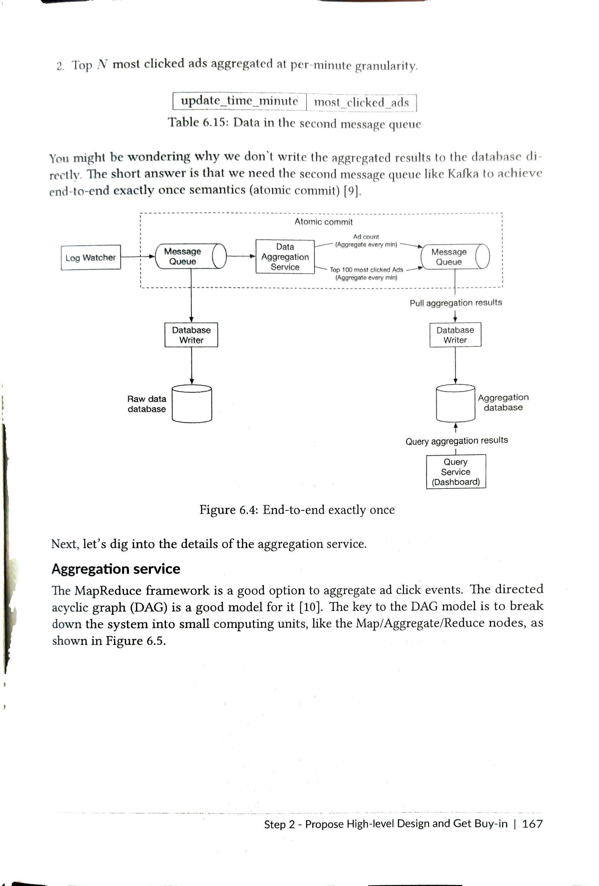  
*Hình 6.4: Ngữ nghĩa chính xác một lần xuyên suốt từ đầu đến cuối (End-to-end exactly once)*

Tiếp theo, hãy cùng đào sâu vào chi tiết của dịch vụ tổng hợp (aggregation service).

---

## Dịch Vụ Tổng Hợp (Aggregation Service)

Khung xử lý MapReduce là một lựa chọn tốt để tổng hợp các sự kiện nhấp chuột quảng cáo. Đồ thị có hướng không chu trình (Directed Acyclic Graph - DAG) là một mô hình rất phù hợp cho cấu trúc này [10]. Chìa khóa của mô hình DAG là phân rã hệ thống thành các đơn vị tính toán nhỏ (small computing units), chẳng hạn như các nút Map / Aggregate / Reduce, như được thể hiện trong Hình 6.5.

*Bước 2 - Đề xuất Thiết kế Mức cao và Nhận sự Đồng thuận (Step 2 - Propose High-level Design and Get Buy-in) | 167*

---

### [Trang 172]

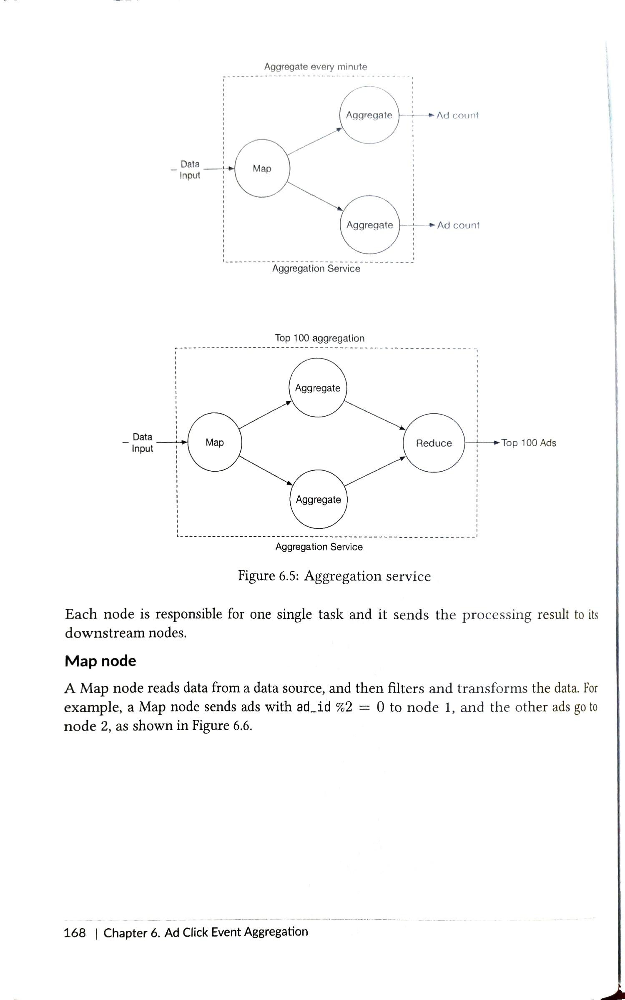  
*Hình 6.5: Dịch vụ tổng hợp (Aggregation service)*

> [!NOTE]
> **Hai luồng xử lý DAG bên trong Aggregation Service:**
> 1. **Tổng hợp số lượng nhấp chuột mỗi phút (Aggregate every minute):**
>    `Input Data` $\rightarrow$ `Map` $\rightarrow$ phân phối tới nhiều nút `Aggregate` $\rightarrow$ Đầu ra: Số lượt nhấp quảng cáo (`Ad count`).
> 2. **Tổng hợp Top 100 quảng cáo (Top 100 aggregation):**
>    `Input Data` $\rightarrow$ `Map` $\rightarrow$ phân phối tới nhiều nút `Aggregate` $\rightarrow$ gom tụ qua nút `Reduce` $\rightarrow$ Đầu ra: `Top 100 Ads`.

Các nút hạ nguồn (downstream nodes):

### Nút Map (Map Node)
Một nút Map đọc dữ liệu từ một nguồn dữ liệu (data source), sau đó thực hiện lọc (filter) và chuyển đổi (transform) dữ liệu. Ví dụ, một nút Map gửi các quảng cáo có `ad_id % 2 = 0` tới nút 1, và các quảng cáo còn lại đi tới nút 2, như được minh họa trong Hình 6.6.

*168 | Chương 6: Tổng Hợp Sự Kiện Nhấp Chuột Quảng Cáo (Chapter 6. Ad Click Event Aggregation)*

---

### [Trang 173]

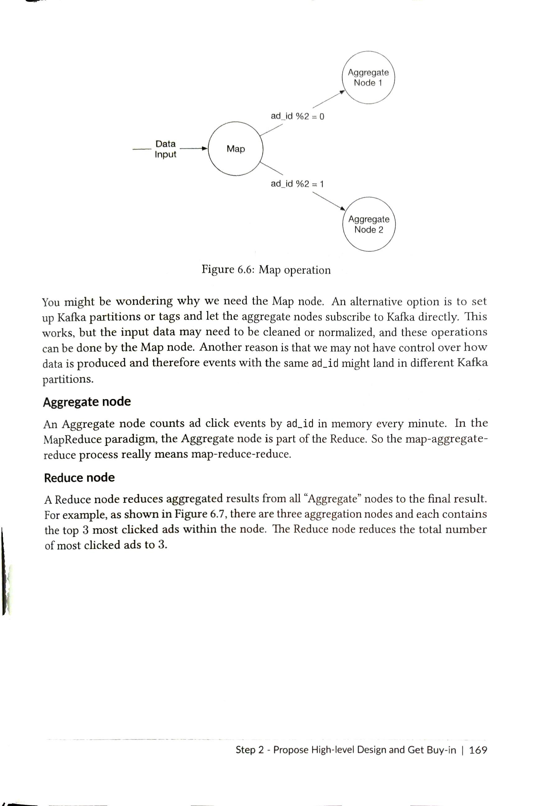  
*Hình 6.6: Hoạt động của nút Map (Map operation)*

Bạn có thể thắc mắc tại sao chúng ta lại cần nút Map. Một phương án thay thế là cấu hình các phân vùng (partitions) hoặc các thẻ (tags) của Kafka và để các nút Aggregate đăng ký lắng nghe (subscribe) trực tiếp từ Kafka. Cách này có thể hoạt động được, nhưng dữ liệu đầu vào có thể cần phải được làm sạch (cleaned) hoặc chuẩn hóa (normalized), và những thao tác này có thể được thực hiện bởi nút Map. Một lý do khác là chúng ta có thể không kiểm soát được cách thức dữ liệu được tạo ra (produced), và do đó các sự kiện có cùng `ad_id` có thể rơi vào các phân vùng Kafka khác nhau.

### Nút Tổng Hợp (Aggregate Node)
Một nút Aggregate thực hiện đếm các sự kiện nhấp chuột quảng cáo theo `ad_id` ngay trên bộ nhớ (in memory) mỗi phút một lần. Trong mô hình (paradigm) MapReduce, nút Aggregate thực chất là một phần của giai đoạn Reduce. Do đó, quy trình map-aggregate-reduce thực sự có nghĩa là **map-reduce-reduce**.

### Nút Giảm / Gom Tụ (Reduce Node)
Một nút Reduce gom tụ các kết quả đã được tổng hợp từ tất cả các nút "Aggregate" để đưa ra kết quả cuối cùng. Ví dụ, như được thể hiện trong Hình 6.7, có ba nút tổng hợp và mỗi nút chứa top 3 quảng cáo được nhấp chuột nhiều nhất trong phạm vi của nút đó. Nút Reduce sẽ rút gọn tổng số quảng cáo được nhấp chuột nhiều nhất đó về còn đúng 3 quảng cáo trên toàn hệ thống.

*Bước 2 - Đề xuất Thiết kế Mức cao và Nhận sự Đồng thuận (Step 2 - Propose High-level Design and Get Buy-in) | 169*

---

### [Trang 174]

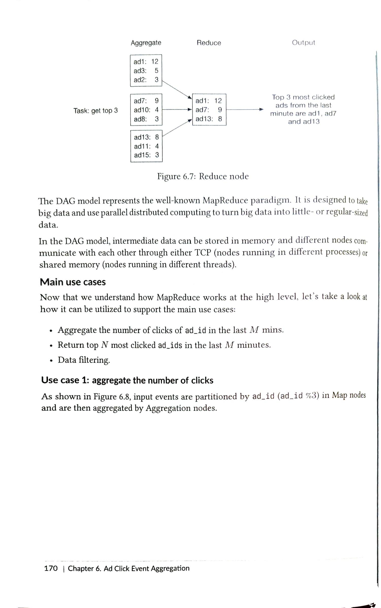  
*Hình 6.7: Nút Reduce (Reduce node)*

> [!NOTE]
> **Quy trình hoạt động trong Hình 6.7:**
> - **Nhiệm vụ (Task):** Lấy top 3 quảng cáo được nhấp nhiều nhất.
> - **Ba nút Aggregate cục bộ:**
>   - Nút 1: `ad1: 12`, `ad2: 6`, `ad3: 4`
>   - Nút 2: `ad7: 9`, `ad8: 3`, `ad10: 1`
>   - Nút 3: `ad13: 8`, `ad11: 4`, `ad15: 2`
> - **Nút Reduce gom tụ và so sánh:**
>   - So sánh các ứng viên hàng đầu: `ad1: 12`, `ad7: 9`, `ad13: 8`.
> - **Đầu ra (Output):** Top 3 quảng cáo được nhấp chuột nhiều nhất trong phút vừa qua là: `ad1`, `ad7` và `ad13`.

Mô hình DAG đại diện cho mô hình lập trình MapReduce nổi tiếng. Nó được thiết kế để tiếp nhận dữ liệu lớn (big data) và sử dụng tính toán phân tán song song (parallel distributed computing) để biến dữ liệu lớn thành dữ liệu có kích thước nhỏ hoặc bình thường (little- or regular-sized data).

Trong mô hình DAG, dữ liệu trung gian (intermediate data) có thể được lưu trữ trong bộ nhớ (in-memory) và các nút khác nhau giao tiếp với nhau thông qua TCP (đối với các nút chạy trên các tiến trình/processes khác nhau) hoặc bộ nhớ chia sẻ (shared memory - đối với các nút chạy trên các luồng/threads khác nhau).

---

## Các Trường Hợp Sử Dụng Chính (Main Use Cases)

Bây giờ chúng ta đã hiểu cách thức hoạt động của MapReduce ở mức cao, hãy cùng xem xét cách nó có thể được tận dụng để hỗ trợ các trường hợp sử dụng chính:
- Tổng hợp số lượng nhấp chuột của `ad_id` trong $M$ phút gần nhất.
- Trả về top $N$ `ad_id` được nhấp chuột nhiều nhất trong $M$ phút gần nhất.
- Lọc dữ liệu (Data filtering).

### Trường Hợp Sử Dụng 1: Tổng Hợp Số Lượng Nhấp Chuột (Use case 1: Aggregate the number of clicks)
và sau đó được tổng hợp bởi các nút Aggregation.

*170 | Chương 6: Tổng Hợp Sự Kiện Nhấp Chuột Quảng Cáo (Chapter 6. Ad Click Event Aggregation)*

# Chương 6: Tổng Hợp Sự Kiện Nhấp Chuột Quảng Cáo (Ad Click Event Aggregation)

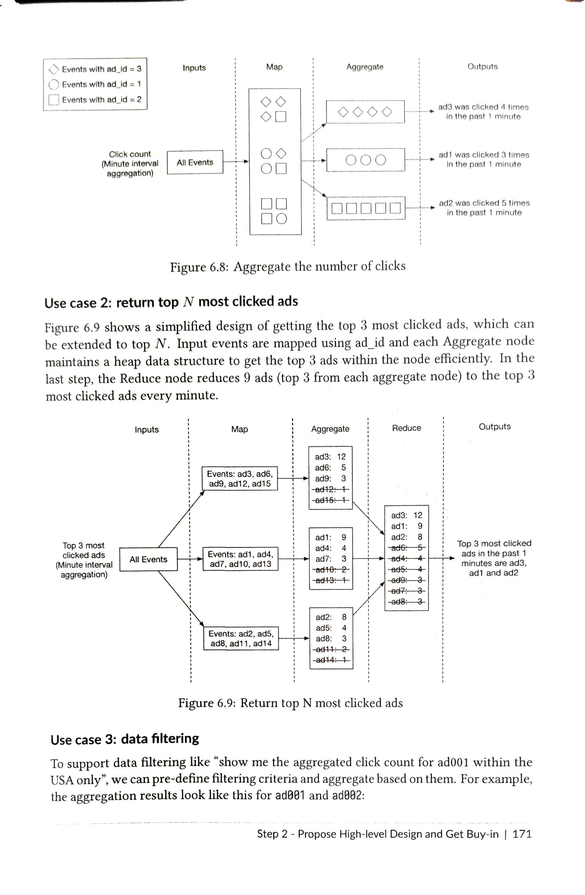
*Hình 6.8: Tổng hợp số lượng lượt nhấp chuột (Aggregate the number of clicks)*

---

### Ca sử dụng 2 (Use case 2): Trả về top N quảng cáo được nhấp chuột nhiều nhất (Return top N most clicked ads)

Hình 6.9 mô tả một thiết kế đơn giản hóa để lấy ra **top 3** quảng cáo được nhấp chuột nhiều nhất, kiến trúc này có thể mở rộng lên **top N**. Các sự kiện đầu vào (*input events*) được phân loại/ánh xạ (*mapped*) dựa trên `ad_id`, và mỗi nút Tổng hợp (*Aggregate node*) duy trì một cấu trúc dữ liệu **Heap** nhằm lấy ra top 3 quảng cáo bên trong nút đó một cách hiệu quả. Ở bước cuối cùng, nút Rút gọn (*Reduce node*) sẽ tổng hợp và rút gọn 9 quảng cáo (top 3 từ mỗi nút Aggregate) thành top 3 quảng cáo được nhấp chuột nhiều nhất trong mỗi phút.

*Hình 6.9: Trả về top N quảng cáo được nhấp chuột nhiều nhất (Return top N most clicked ads)*

---

### Ca sử dụng 3 (Use case 3): Lọc dữ liệu (Data filtering)

Để hỗ trợ tính năng lọc dữ liệu (*data filtering*) như: *"Hiển thị số lượng nhấp chuột tổng hợp cho ad001 chỉ trong phạm vi nước Mỹ (USA)"*, chúng ta có thể định nghĩa trước các tiêu chí lọc (*pre-define filtering criteria*) và tiến hành tổng hợp dựa trên các tiêu chí đó. Ví dụ, kết quả tổng hợp dành cho `ad001` và `ad002` sẽ có cấu trúc như sau:

---

*(Trang 171 - Bước 2: Đề xuất Thiết kế Cấp cao và Thống nhất Giải pháp)*

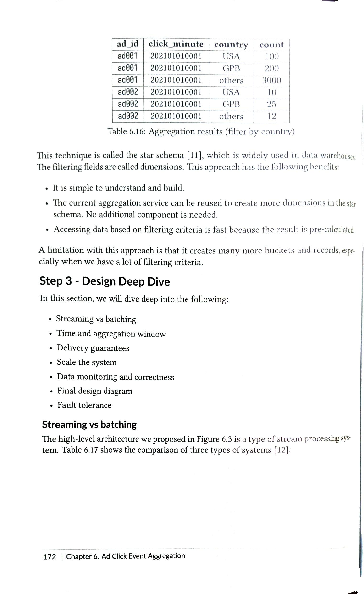

**Bảng 6.16: Kết quả tổng hợp (Lọc theo quốc gia - filter by country)**

| `ad_id` | `click_minute` | `country` | `count` |
| :--- | :--- | :--- | :--- |
| **ad001** | 202101010001 | USA | 100 |
| **ad001** | 202101010001 | GPB | 200 |
| **ad001** | 202101010001 | others | 3000 |
| **ad002** | 202101010001 | USA | 10 |
| **ad002** | 202101010001 | GPB | 25 |
| **ad002** | 202101010001 | others | 12 |

Kỹ thuật này được gọi là **Lược đồ hình sao (Star Schema)** [11], một mô hình được ứng dụng rộng rãi trong các kho dữ liệu (*Data Warehouses*). Các trường dữ liệu dùng để lọc được gọi là **các chiều phân tích (Dimensions)**. Phương pháp tiếp cận này đem lại các lợi ích sau:

* **Đơn giản để hiểu và xây dựng.**
* **Tái sử dụng dịch vụ hiện tại:** Dịch vụ tổng hợp (*aggregation service*) hiện tại có thể được tái sử dụng để tạo thêm nhiều chiều dữ liệu mới trong lược đồ hình sao mà không cần bổ sung bất kỳ thành phần hệ thống nào khác.
* **Tốc độ truy xuất nhanh:** Việc truy vấn dữ liệu dựa trên các tiêu chí lọc diễn ra rất nhanh chóng do kết quả đã được tính toán sẵn từ trước (*pre-calculated*).

> [!WARNING]
> **Hạn chế của giải pháp:** Cách tiếp cận này sẽ tạo ra số lượng phân đoạn (*buckets*) và bản ghi (*records*) lớn hơn rất nhiều, đặc biệt là khi hệ thống có quá nhiều tiêu chí lọc khác nhau.

---

## Bước 3 - Đi sâu vào Thiết kế Chi tiết (Design Deep Dive)

Trong phần này, chúng ta sẽ đi sâu vào các khía cạnh kỹ thuật cốt lõi sau:
* Xử lý luồng so với xử lý theo lô (*Streaming vs Batching*)
* Thời gian và cửa sổ tổng hợp (*Time and Aggregation Window*)
* Đảm bảo phân phối tin nhắn (*Delivery Guarantees*)
* Mở rộng quy mô hệ thống (*Scale the System*)
* Giám sát dữ liệu và tính chính xác (*Data Monitoring and Correctness*)
* Sơ đồ thiết kế kiến trúc hoàn chỉnh (*Final Design Diagram*)
* Khả năng chịu lỗi (*Fault Tolerance*)

---

### Xử lý luồng so với Xử lý theo lô (Streaming vs Batching)

Kiến trúc mức cao (*High-level Architecture*) chúng ta đã đề xuất ở Hình 6.3 thuộc mô hình **Hệ thống xử lý luồng (Stream Processing System)**. Bảng 6.17 so sánh chi tiết giữa ba loại hệ thống [12]:

*(Trang 172 | Chương 6. Tổng Hợp Sự Kiện Nhấp Chuột Quảng Cáo)*

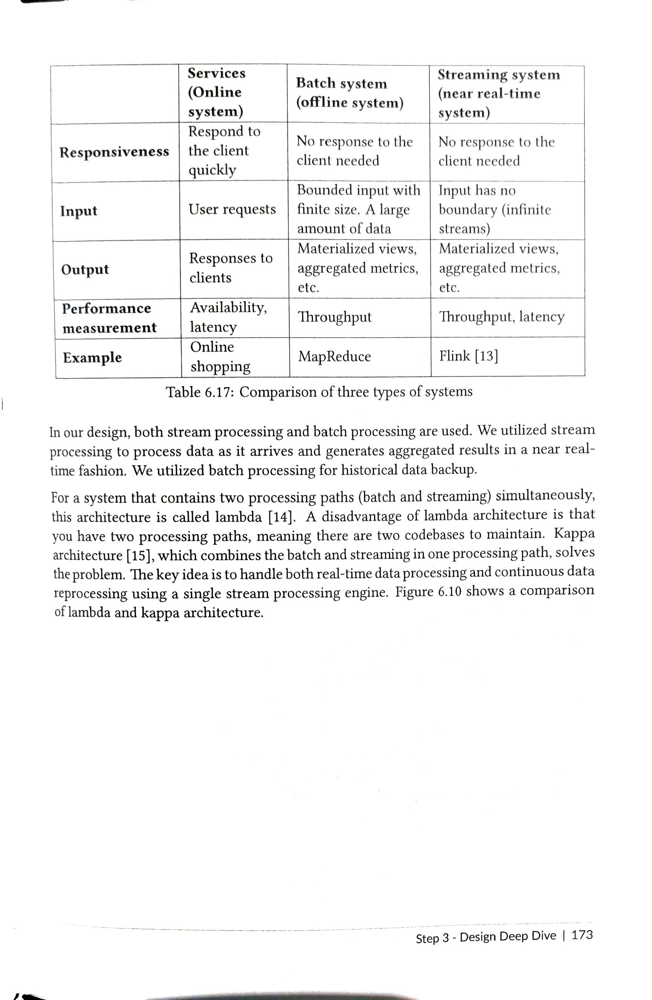

**Bảng 6.17: So sánh ba loại hệ thống (Comparison of three types of systems)**

| Tiêu chí | Dịch vụ Trực tuyến (Online System) | Hệ thống Xử lý Luồng (Streaming System / Near Real-time) | Hệ thống Xử lý Lô (Batch System / Offline System) |
| :--- | :--- | :--- | :--- |
| **Khả năng phản hồi (Responsiveness)** | Phản hồi lại Client một cách nhanh chóng (*Respond to the client quickly*) | Không cần gửi phản hồi trực tiếp về Client (*No response to the client needed*) | Không cần gửi phản hồi trực tiếp về Client (*No response to the client needed*) |
| **Đầu vào (Input)** | Các yêu cầu từ người dùng (*User requests*) | Dữ liệu đầu vào không có giới hạn biên (Các luồng vô hạn - *Infinite streams*) | Dữ liệu đầu vào có giới hạn với kích thước hữu hạn. Khối lượng dữ liệu lớn (*Bounded input with finite size*) |
| **Đầu ra (Output)** | Phản hồi trả về cho Clients (*Responses to clients*) | Khung nhìn cụ thể hóa, các chỉ số tổng hợp, v.v. (*Materialized views, aggregated metrics, etc.*) | Khung nhìn cụ thể hóa, các chỉ số tổng hợp, v.v. (*Materialized views, aggregated metrics, etc.*) |
| **Thước đo hiệu năng (Performance Measurement)** | Tính sẵn sàng (*Availability*), Độ trễ (*Latency*) | Thông lượng (*Throughput*), Độ trễ (*Latency*) | Thông lượng (*Throughput*) |
| **Ví dụ điển hình (Example)** | Mua sắm trực tuyến (*Online shopping*) | Apache Flink [13] | MapReduce |

Trong thiết kế hệ thống của chúng ta, cả hai mô hình xử lý luồng (*stream processing*) và xử lý theo lô (*batch processing*) đều được tận dụng:
1. Chúng ta sử dụng **Xử lý luồng (Stream Processing)** để xử lý dữ liệu ngay khi dữ liệu vừa tới và tạo ra các kết quả tổng hợp theo phương thức cận thời gian thực (*near real-time*).
2. Chúng ta sử dụng **Xử lý theo lô (Batch Processing)** để sao lưu dữ liệu lịch sử (*historical data backup*).

> [!NOTE]
> Đối với một hệ thống chứa đồng thời cả hai đường dẫn xử lý (*batch* và *streaming*), mô hình kiến trúc này được gọi là **Kiến trúc Lambda (Lambda Architecture)** [14]. Nhược điểm lớn của kiến trúc Lambda là sự tồn tại của hai đường dẫn xử lý song song, đồng nghĩa với việc các kỹ sư phải duy trì hai cơ sở mã nguồn (*codebases*) khác nhau.
> 
> **Kiến trúc Kappa (Kappa Architecture)** [15] giải quyết triệt để vấn đề này bằng cách hợp nhất cả xử lý theo lô lẫn xử lý luồng vào trong một đường dẫn duy nhất. Ý tưởng mấu chốt là xử lý cả dữ liệu thời gian thực lẫn dữ liệu liên tục bằng cùng một công cụ xử lý duy nhất.

*(Trang 173 - Bước 3: Đi sâu vào Thiết kế Chi tiết)*

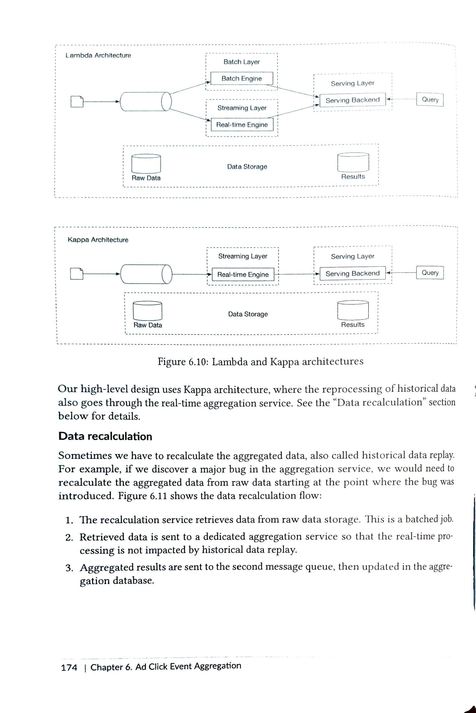
*Hình 6.10: Kiến trúc Lambda và Kiến trúc Kappa (Lambda and Kappa architectures)*

Thiết kế cấp cao của chúng ta lựa chọn áp dụng **Kiến trúc Kappa**, trong đó việc xử lý lại dữ liệu lịch sử (*reprocessing of historical data*) cũng đi xuyên qua chính dịch vụ tổng hợp thời gian thực (*real-time aggregation service*). Chi tiết cụ thể được trình bày trong phần **"Tính toán lại dữ liệu (Data recalculation)"** dưới đây.

---

### Tính toán lại dữ liệu (Data recalculation)

Đôi khi chúng ta buộc phải tính toán lại dữ liệu đã tổng hợp, quá trình này còn được gọi là **Phát lại dữ liệu lịch sử (Historical Data Replay)**. Ví dụ, nếu chúng ta phát hiện một lỗi nghiêm trọng (*major bug*) trong dịch vụ tổng hợp, hệ thống sẽ cần phải tính toán lại các số liệu tổng hợp từ kho lưu trữ dữ liệu thô (*raw data*), bắt đầu tính từ thời điểm lỗi đó xuất hiện.

Hình 6.11 mô tả luồng công việc tính toán lại dữ liệu (*data recalculation flow*):

1. **Dịch vụ tính toán lại (Recalculation Service)** trích xuất dữ liệu từ kho lưu trữ dữ liệu thô (*raw data storage*). Đây là một tác vụ chạy theo lô (*batched job*).
2. Dữ liệu sau khi trích xuất được gửi đến một **Dịch vụ tổng hợp chuyên dụng (Dedicated Aggregation Service)**, giúp cho tiến trình xử lý thời gian thực (*real-time processing*) không bị ảnh hưởng hay chịu tải bởi tác vụ phát lại dữ liệu lịch sử.
3. Các kết quả tổng hợp sau đó được đẩy vào Hàng đợi thông điệp thứ hai (*second Message Queue*), rồi cập nhật trực tiếp vào Cơ sở dữ liệu tổng hợp (*Aggregation Database*).

*(Trang 174 | Chương 6. Tổng Hợp Sự Kiện Nhấp Chuột Quảng Cáo)*

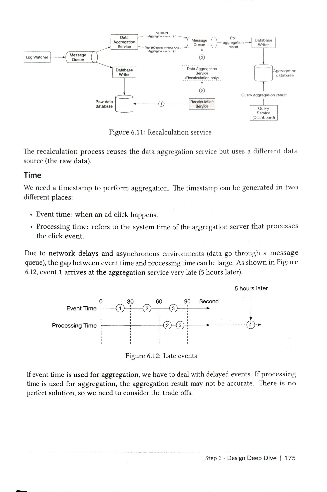
*Hình 6.11: Dịch vụ tính toán lại dữ liệu (Recalculation service)*

> [!TIP]
> Quy trình tính toán lại tái sử dụng trực tiếp logic của dịch vụ tổng hợp dữ liệu (*data aggregation service*), điểm khác biệt duy nhất là sử dụng nguồn cấp dữ liệu khác (lấy từ dữ liệu thô - *raw data*).

---

### Khái niệm Thời gian (Time)

Hệ thống cần có dấu thời gian (*timestamp*) để thực hiện thao tác tổng hợp (*aggregation*). Dấu thời gian có thể được sinh ra ở hai vị trí khác nhau:

* **Thời gian sự kiện (Event time):** Thời điểm chính xác khi cú nhấp chuột quảng cáo thực sự diễn ra.
* **Thời gian xử lý (Processing time):** Là giờ hệ thống (*system time*) của máy chủ tổng hợp tại thời điểm máy chủ tiếp nhận và xử lý sự kiện nhấp chuột.

Do độ trễ mạng (*network delays*) và tính bất đồng bộ của môi trường phân tán (dữ liệu phải trung chuyển qua các hàng đợi thông điệp - *message queue*), khoảng cách chênh lệch giữa **Event time** và **Processing time** có thể rất lớn. Như minh họa ở Hình 6.12, Sự kiện 1 (*Event 1*) đến dịch vụ tổng hợp rất muộn (trễ tới tận 5 tiếng).

*Hình 6.12: Các sự kiện đến muộn (Late events)*

Nếu hệ thống sử dụng **Event time** để tổng hợp, chúng ta bắt buộc phải xử lý các sự kiện đến trễ (*delayed events*). Nếu sử dụng **Processing time** để tổng hợp, kết quả tính toán có thể không đảm bảo tính chính xác. Không có giải pháp hoàn hảo tuyệt đối, do đó chúng ta cần phân tích và cân nhắc sự đánh đổi (*trade-offs*).

*(Trang 175 - Bước 3: Đi sâu vào Thiết kế Chi tiết)*

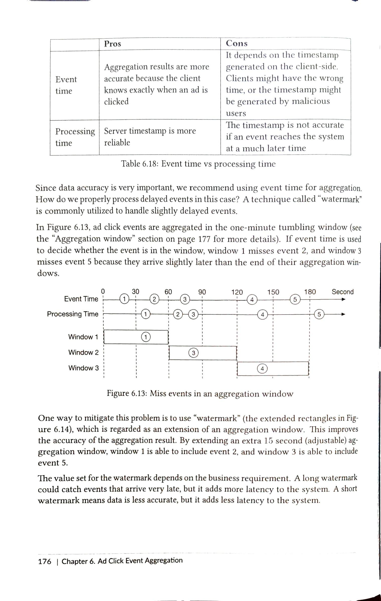

**Bảng 6.18: So sánh Thời gian sự kiện vs Thời gian xử lý (Event time vs Processing time)**

| Tiêu chí | Ưu điểm (Pros) | Nhược điểm (Cons) |
| :--- | :--- | :--- |
| **Thời gian sự kiện (Event time)** | Kết quả tổng hợp đạt **độ chính xác cao hơn** do phía Client biết chính xác thời điểm quảng cáo được nhấp chuột. | Phụ thuộc vào dấu thời gian được sinh ra ở phía Client (*Client-side*). Phía Client có thể bị sai lệch đồng hồ hệ thống, hoặc dấu thời gian có thể bị can thiệp/giả mạo bởi những người dùng có ý đồ xấu (*malicious users*). |
| **Thời gian xử lý (Processing time)** | Dấu thời gian của máy chủ (*Server timestamp*) đáng tin cậy hơn, tránh được các rủi ro từ phía client. | Dấu thời gian **không chính xác** nếu sự kiện đến hệ thống xử lý sau một khoảng thời gian trễ quá lớn. |

> [!IMPORTANT]
> Vì tính chính xác của dữ liệu tài chính/quảng cáo là yếu tố tối quan trọng, chúng tôi khuyến nghị lựa chọn sử dụng **Event time** cho tiến trình tổng hợp.

Làm thế nào để hệ thống có thể xử lý thỏa đáng các sự kiện bị trễ trong trường hợp này? Kỹ thuật có tên gọi là **"Thủy chuẩn" (Watermark)** thường được áp dụng để xử lý các sự kiện bị trễ trong khoảng thời gian ngắn.

Trong Hình 6.13, các sự kiện nhấp chuột quảng cáo được tổng hợp bên trong một **Cửa sổ trượt cố định 1 phút (1-minute Tumbling Window)** (xem thêm chi tiết tại phần *"Cửa sổ tổng hợp - Aggregation window"* ở trang 177). Nếu sử dụng Event time để quyết định xem sự kiện có thuộc về một cửa sổ hay không, Cửa sổ 1 (*Window 1*) sẽ bỏ lỡ Sự kiện 2 (*Event 2*), và Cửa sổ 3 (*Window 3*) sẽ bỏ lỡ Sự kiện 5 (*Event 5*), nguyên nhân là do chúng đến muộn hơn một chút so với thời điểm kết thúc cửa sổ tổng hợp tương ứng của chúng.

*Hình 6.13: Bỏ lỡ sự kiện trong cửa sổ tổng hợp (Miss events in an aggregation window)*

Một giải pháp giảm thiểu vấn đề này là áp dụng kỹ thuật **"Watermark"** (các hình chữ nhật mở rộng trong Hình 6.14) để nâng cao độ chính xác của kết quả tổng hợp. Bằng việc mở rộng thêm một khoảng cửa sổ tổng hợp 15 giây (có thể cấu hình điều chỉnh linh hoạt), Cửa sổ 1 đã có thể bao nạp được Sự kiện 2, và Cửa sổ 3 đã có thể bao nạp được Sự kiện 5.

Giá trị thiết lập cho Watermark phụ thuộc hoàn toàn vào yêu cầu nghiệp vụ (*business requirement*):
* **Một Watermark dài:** Có thể bao quát và bắt kịp các sự kiện đến rất muộn, tuy nhiên nó sẽ làm gia tăng thêm độ trễ (*latency*) tổng thể cho hệ thống.
* **Một Watermark ngắn:** Dữ liệu có thể kém chính xác hơn đối với các sự kiện trễ sâu, bù lại sẽ giữ cho độ trễ hệ thống ở mức thấp hơn.

---
*(Trang 176 | Chương 6. Tổng Hợp Sự Kiện Nhấp Chuột Quảng Cáo)*

# Chương 6: Tổng Hợp Sự Kiện Nhấp Chuột Quảng Cáo (Ad Click Event Aggregation)

---

### --- Trang 181 ---

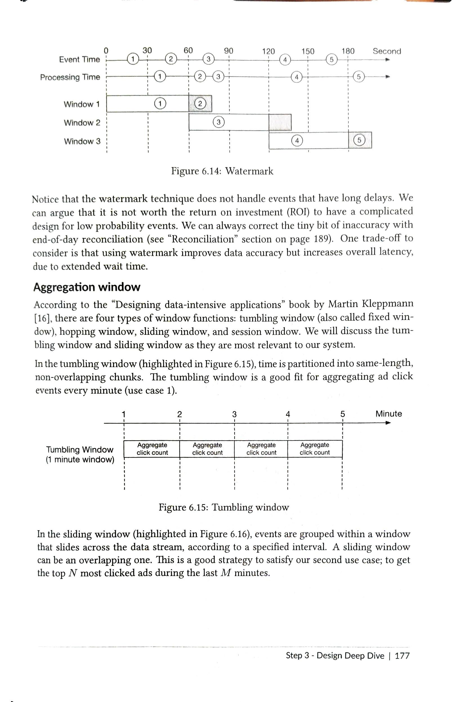

*Hình 6.14: Kỹ thuật Watermark (Điểm đánh dấu thời gian)*

Lưu ý rằng kỹ thuật watermark không xử lý được các sự kiện có độ trễ quá lớn (long delays). Chúng ta có thể lập luận rằng việc xây dựng một thiết kế phức tạp chỉ dành cho các sự kiện có xác suất xảy ra thấp là không đáng xét trên phương diện lợi tức đầu tư (ROI - Return on Investment). Chúng ta luôn có thể hiệu chỉnh mức độ sai số rất nhỏ này thông qua quy trình đối soát cuối ngày (xem mục "Reconciliation - Đối soát" tại trang 189). Một đánh đổi kiến trúc (trade-off) cần cân nhắc là: việc sử dụng watermark giúp nâng cao độ chính xác của dữ liệu (data accuracy), nhưng lại làm tăng độ trễ tổng thể (overall latency) do thời gian chờ bị kéo dài.

#### Cửa Sổ Tổng Hợp (Aggregation Window)

Theo cuốn sách kinh điển *"Designing Data-Intensive Applications"* của Martin Kleppmann [16], có bốn loại hàm cửa sổ (window functions):
1. **Cửa sổ nhào lộn (Tumbling window)** (còn gọi là *fixed window* - cửa sổ cố định)
2. **Cửa sổ nhảy (Hopping window)**
3. **Cửa sổ trượt (Sliding window)**
4. **Cửa sổ phiên (Session window)**

Chúng ta sẽ thảo luận chi tiết về **Tumbling window** và **Sliding window** vì chúng là hai cơ chế phù hợp nhất cho hệ thống của chúng ta.

Trong **Tumbling window** (được mô tả trực quan trong Hình 6.15), thời gian được phân vùng thành các đoạn có độ dài bằng nhau và không gối/đè lên nhau (non-overlapping chunks). Tumbling window rất phù hợp cho trường hợp tổng hợp các sự kiện nhấp chuột quảng cáo theo từng phút một (Use Case 1).

*Hình 6.15: Cửa sổ nhào lộn (Tumbling window)*

Trong **Sliding window** (được mô tả trực quan trong Hình 6.16), các sự kiện được nhóm lại trong một cửa sổ trượt dọc theo luồng dữ liệu (data stream) theo một chu kỳ thời gian xác định (specified interval). Một cửa sổ trượt có thể có các phần gối đè lên nhau (overlapping). Đây là một chiến lược tối ưu để đáp ứng use case thứ hai: lấy ra top $N$ quảng cáo được nhấp nhiều nhất trong $M$ phút gần nhất.

*Bước 3 - Đi Sâu Vào Thiết Kế (Step 3 - Design Deep Dive) / 177*

---

### --- Trang 182 ---

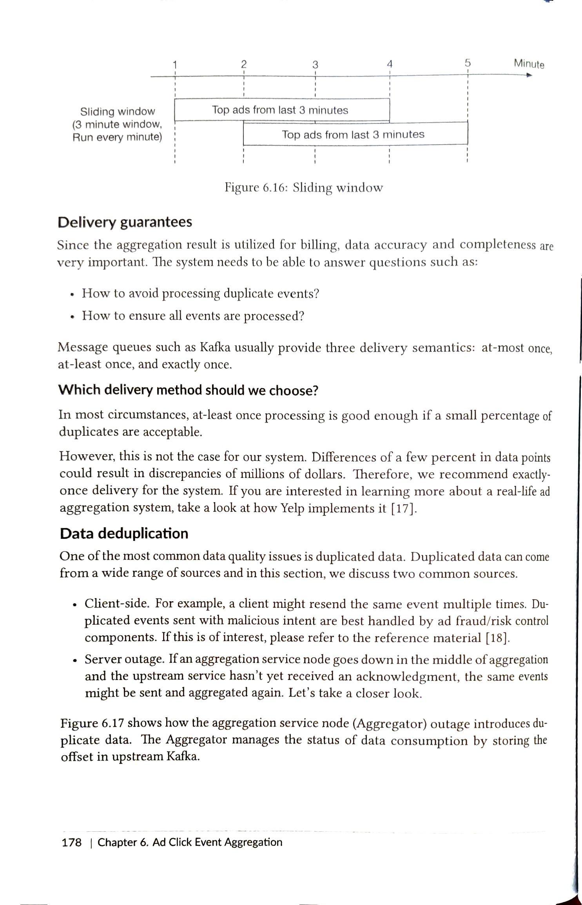

*Hình 6.16: Cửa sổ trượt (Sliding window)*

#### Đảm Bảo Phân Phối Dữ Liệu (Delivery Guarantees)

Do kết quả tổng hợp được trực tiếp sử dụng cho mục đích thanh toán/lập hóa đơn (billing), độ chính xác của dữ liệu (data accuracy) và tính toàn vẹn (completeness) là những yếu tố tối quan trọng. Hệ thống bắt buộc phải trả lời được các câu hỏi then chốt như:
- Làm thế nào để tránh xử lý trùng lặp sự kiện (duplicate events)?
- Làm thế nào để đảm bảo toàn bộ sự kiện đều được xử lý đầy đủ?

Các hệ thống hàng đợi thông điệp (Message Queues) như Apache Kafka thường cung cấp ba ngữ nghĩa phân phối thông điệp (delivery semantics):
1. **Tối đa một lần (At-most once)**
2. **Ít nhất một lần (At-least once)**
3. **Chính xác một lần (Exactly once)**

##### Chúng ta nên chọn phương thức phân phối nào?

Trong phần lớn các trường hợp thông thường, xử lý theo cơ chế **At-least once** là đã đủ tốt nếu hệ thống chấp nhận được một tỷ lệ nhỏ dữ liệu bị trùng lặp.

Tuy nhiên, điều này **hoàn toàn không thể chấp nhận** đối với hệ thống của chúng ta. Sai lệch dù chỉ vài phần trăm trong các điểm dữ liệu cũng có thể dẫn đến thất thoát hoặc chênh lệch hàng triệu USD doanh thu. Do đó, chúng tôi đề xuất áp dụng cơ chế phân phối **Exactly once** cho toàn bộ hệ thống. Nếu bạn quan tâm đến cách một hệ thống tổng hợp quảng cáo ngoài đời thực hoạt động, hãy tham khảo cách triển khai thực tế của Yelp [17].

#### Khử Trùng Lặp Dữ Liệu (Data Deduplication)

Một trong những vấn đề phổ biến nhất về chất lượng dữ liệu là dữ liệu bị trùng lặp (duplicated data). Dữ liệu trùng lặp có thể phát sinh từ rất nhiều nguồn khác nhau, và trong phần này, chúng ta sẽ xem xét hai nguồn gốc phổ biến nhất:

- **Phía máy khách (Client-side):** Ví dụ: client có thể gửi lại cùng một sự kiện nhiều lần qua mạng. Các sự kiện trùng lặp được gửi với ý đồ xấu/gian lận tốt nhất nên được ngăn chặn và xử lý bởi các thành phần kiểm soát rủi ro/chống gian lận quảng cáo (ad fraud / risk control components). Nếu quan tâm sâu hơn về chủ đề này, vui lòng tham khảo tài liệu [18].
- **Sự cố máy chủ (Server outage):** Nếu một nút dịch vụ tổng hợp (aggregation service node) bị sập (down) ngay giữa quá trình tổng hợp dữ liệu, trong khi dịch vụ thượng nguồn (upstream service) vẫn chưa nhận được tín hiệu xác nhận (acknowledgment - ACK), thì các sự kiện đó có thể sẽ bị gửi lại và bị tổng hợp thêm một lần nữa. Hãy cùng xem xét kỹ hơn trường hợp này.

Hình 6.17 minh họa chi tiết cách mà sự cố sập nút dịch vụ tổng hợp (Aggregator outage) tạo ra dữ liệu trùng lặp. Nút Aggregator quản lý trạng thái tiêu thụ dữ liệu bằng cách lưu trữ giá trị chỉ mục (`offset`) tại cụm Kafka thượng nguồn (upstream Kafka).

*178 / Chương 6: Tổng Hợp Sự Kiện Nhấp Chuột Quảng Cáo (Chapter 6. Ad Click Event Aggregation)*

---

### --- Trang 183 ---

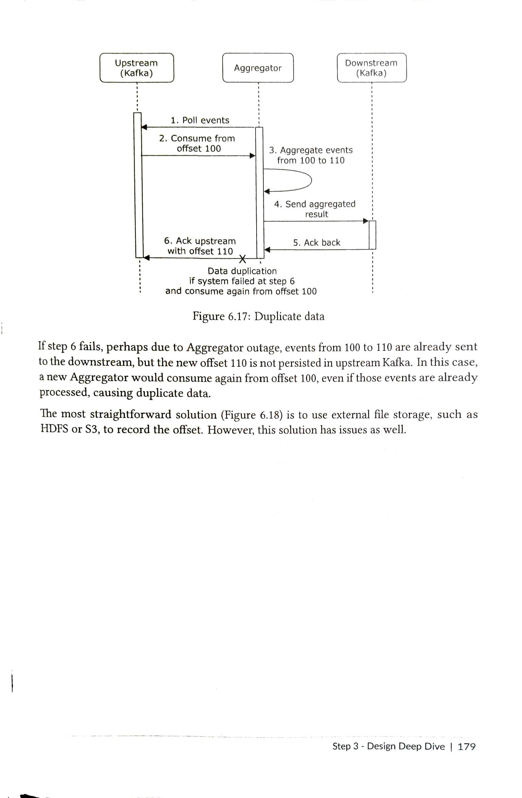

*Hình 6.17: Dữ liệu bị trùng lặp (Duplicate data)*

**Các bước diễn ra trong Hình 6.17:**
1. **Poll events**: Aggregator thăm dò/lấy sự kiện từ Upstream (Kafka).
2. **Consume from offset 100**: Bắt đầu tiêu thụ dữ liệu từ vị trí `offset 100`.
3. **Aggregate events from 100 to 110**: Thực hiện tổng hợp các sự kiện từ `offset 100` đến `offset 110`.
4. **Send aggregated result**: Gửi kết quả tổng hợp sang Downstream (Kafka).
5. **Ack back**: Downstream xác nhận đã nhận kết quả.
6. **Ack upstream with offset 110**: Gửi xác nhận về cho Upstream Kafka với offset mới là 110.

> [!WARNING]
> **Nguy cơ trùng lặp dữ liệu (Data duplication):**
> Nếu hệ thống gặp sự cố tại **Bước 6** (ví dụ do Aggregator bị sập), các sự kiện từ `offset 100` đến `110` thực tế **đã được gửi** sang Downstream, nhưng giá trị offset mới `110` lại chưa kịp được ghi bền vững (persisted) vào Upstream Kafka. Khi đó, một nút Aggregator mới được khởi động sẽ tiếp tục đọc và tiêu thụ lại từ `offset 100`, dẫn đến việc xử lý và tổng hợp trùng lặp dữ liệu.

Giải pháp trực diện và đơn giản nhất (Hình 6.18) là sử dụng một hệ thống lưu trữ tệp bên ngoài (external file storage) như HDFS hoặc Amazon S3 để ghi nhận lại offset. Tuy nhiên, giải pháp này cũng tiềm ẩn những vấn đề kỹ thuật nghiêm trọng.

*Bước 3 - Đi Sâu Vào Thiết Kế (Step 3 - Design Deep Dive) / 179*

---

### --- Trang 184 & 185 ---

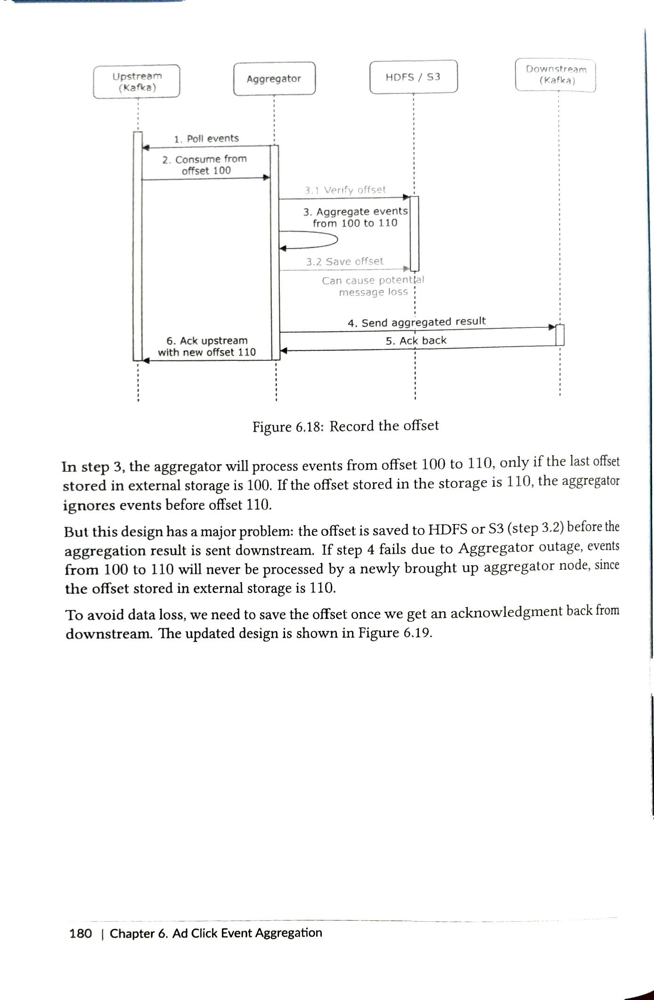

*Hình 6.18: Ghi nhận offset (Record the offset)*

**Quy trình trong Hình 6.18:**
1. **Poll events**: Lấy sự kiện từ Upstream Kafka.
2. **Consume from offset 100**: Bắt đầu đọc dữ liệu từ `offset 100`.
3. **3.1 Verify offset & 3.2 Save offset**: 
   - Kiểm tra offset trong HDFS/S3.
   - Ở bước 3, Aggregator sẽ chỉ xử lý các sự kiện từ `offset 100` đến `110` nếu offset cuối cùng được lưu trữ trong bộ lưu trữ ngoài đúng bằng `100`. Nếu offset đang lưu là `110`, Aggregator sẽ bỏ qua các sự kiện trước `offset 110`.
   - Lưu offset mới `110` vào HDFS/S3.
4. **Send aggregated result**: Gửi kết quả tổng hợp xuống Downstream Kafka.
5. **Ack back**: Downstream xác nhận thành công.
6. **Ack upstream with new offset 110**: Gửi xác nhận về Upstream Kafka.

> [!CAUTION]
> **Lỗ hổng mất mát dữ liệu (Potential Message Loss):**
> Thiết kế này mắc phải một lỗi nghiêm trọng: giá trị offset được lưu vào HDFS hoặc S3 (bước 3.2) **trước khi** kết quả tổng hợp thực sự được gửi tới Downstream (bước 4). Nếu Aggregator bị sập ngay sau bước 3.2 (trước khi gửi xong bước 4), thì toàn bộ sự kiện từ `100` đến `110` sẽ **không bao giờ được xử lý lại** bởi một nút Aggregator mới, bởi vì offset được ghi nhận trong bộ lưu trữ ngoài lúc này đã là `110`.

Để triệt tiêu nguy cơ mất mát dữ liệu (data loss), chúng ta bắt buộc phải lưu offset chỉ sau khi đã nhận được xác nhận (acknowledgment) thành công từ phía downstream. Kiến trúc cập nhật được thể hiện chi tiết trong Hình 6.19.

*180 / Chương 6: Tổng Hợp Sự Kiện Nhấp Chuột Quảng Cáo (Chapter 6. Ad Click Event Aggregation)*

---

### --- Trang 186 ---

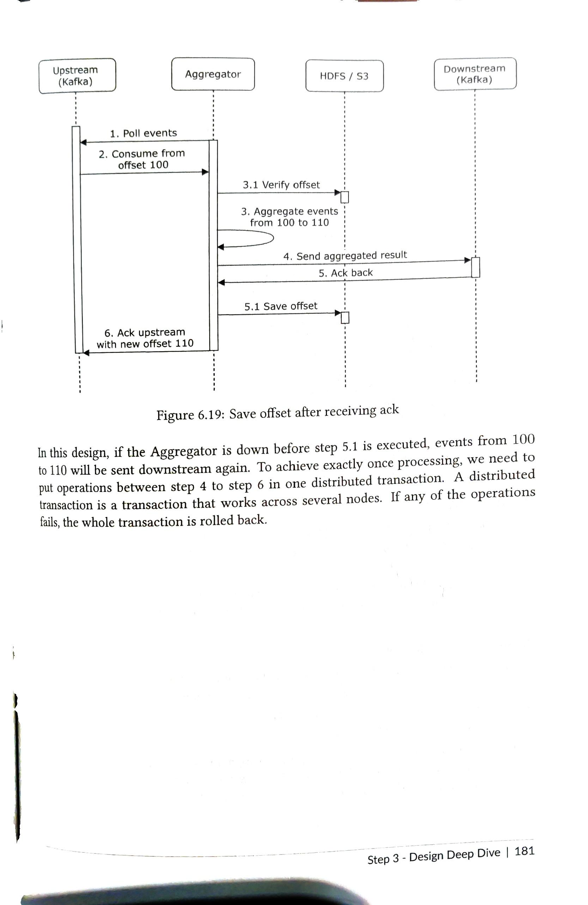

*Hình 6.19: Lưu offset sau khi nhận được tín hiệu xác nhận (Save offset after receiving ack)*

**Quy trình vận hành trong Hình 6.19:**
1. **Poll events**: Lấy dữ liệu sự kiện từ Upstream Kafka.
2. **Consume from offset 100**: Tiêu thụ dữ liệu từ `offset 100`.
3. **3.1 Verify offset & 3. Aggregate events from 100 to 110**: Kiểm tra offset hợp lệ và tiến hành tính toán tổng hợp các sự kiện từ `100` đến `110`.
4. **Send aggregated result**: Gửi kết quả tổng hợp sang Downstream Kafka.
5. **Ack back**: Downstream gửi tín hiệu phản hồi xác nhận.
6. **5.1 Save offset**: Tiến hành lưu trữ giá trị offset mới vào HDFS/S3.
7. **6. Ack upstream with new offset 110**: Gửi xác nhận hoàn tất về cho Upstream Kafka với offset mới là 110.

> [!IMPORTANT]
> Để đảm bảo tính nhất quán dữ liệu tuyệt đối theo ngữ nghĩa **Exactly-once**, toàn bộ các thao tác từ **Bước 4 đến Bước 6** cần được đặt bên trong một **Giao dịch phân tán (Distributed Transaction)**. 
> 
> Giao dịch phân tán là một cơ chế giao dịch hoạt động xuyên suốt qua nhiều nút (nodes) độc lập trong hệ thống phân tán. Nếu có bất kỳ thao tác đơn lẻ nào trong chuỗi bị thất bại, toàn bộ giao dịch sẽ lập tức được quay lui (**Rollback**), đảm bảo hệ thống không bao giờ rơi vào trạng thái bất nhất quán (inconsistent state).

*Bước 3 - Đi Sâu Vào Thiết Kế (Step 3 - Design Deep Dive) / 181*

# CHƯƠNG 6: TỔNG HỢP SỰ KIỆN NHẤP CHUỘT QUẢNG CÁO (AD CLICK EVENT AGGREGATION)
## BƯỚC 3: THIẾT KẾ CHI TIẾT (DESIGN DEEP DIVE)

---

### Xử lý Giao dịch Phân tán (Distributed Transaction)

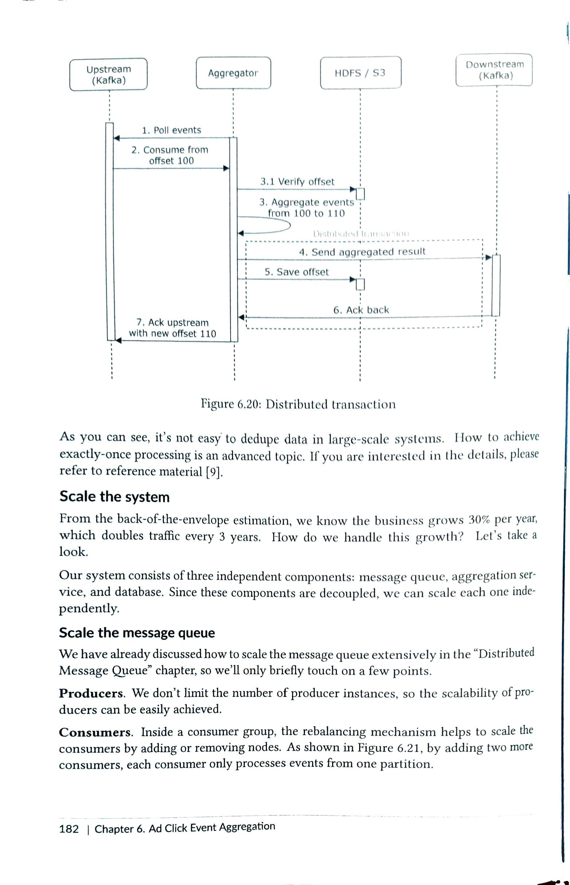

*Hình 6.20: Giao dịch phân tán (Distributed transaction)*

**Quy trình luồng dữ liệu trong Hình 6.20:**
1. **Poll events:** Lấy các sự kiện từ Upstream (Kafka).
2. **Consume from offset 100:** Tiêu thụ dữ liệu từ vị trí offset 100.
3. **Aggregate events from 100 to 110:** Thực hiện tổng hợp các sự kiện từ offset 100 đến 110 bên trong Aggregator.
   - **3.1 Verify offset:** Xác minh offset với Downstream (HDFS/S3).
4. **Send aggregated result:** Gửi kết quả tổng hợp sang Downstream.
5. **Save offset:** Lưu offset mới vào kho lưu trữ downstream (HDFS/S3).
6. **Ack back:** Phản hồi xác nhận hoàn tất ghi từ downstream.
7. **Ack upstream with new offset 110:** Xác nhận (Acknowledge) ngược lại cho Upstream Kafka với offset mới là 110.

Như bạn có thể thấy, việc khử trùng lặp dữ liệu (dedupe data) trong các hệ thống quy mô lớn (large-scale systems) là không hề dễ dàng. Cách thức đạt được khả năng xử lý chính xác một lần (**Exactly-Once Processing**) là một chủ đề nâng cao. Nếu quan tâm đến các chi tiết cụ thể, vui lòng tham khảo tài liệu tham khảo [9].

---

## Mở rộng Hệ thống (Scale the System)

Từ ước tính sơ bộ (back-of-the-envelope estimation), chúng ta biết rằng hoạt động kinh doanh tăng trưởng 30% mỗi năm, đồng nghĩa với việc lưu lượng truy cập (traffic) sẽ tăng gấp đôi sau mỗi 3 năm. Chúng ta xử lý sự tăng trưởng này như thế nào? Hãy cùng xem xét.

Hệ thống bao gồm ba thành phần chính: Hàng đợi thông điệp (**Message Queue**), Dịch vụ tổng hợp (**Aggregation Service**), và Cơ sở dữ liệu (**Database**). Vì các thành phần này được tách rời (decoupled), chúng ta có thể mở rộng (scale) từng thành phần một cách độc lập.

---

### 1. Mở rộng Hàng đợi Thông điệp (Scale the Message Queue)

Chúng ta đã thảo luận rất kỹ về cách mở rộng hàng đợi thông điệp trong chương "Distributed Message Queue" (Hàng đợi Thông điệp Phân tán), vì vậy ở đây chúng ta chỉ điểm qua một vài khía cạnh trọng tâm:

* **Producers (Bên sản xuất dữ liệu):** Chúng ta không giới hạn số lượng phiên bản (instances) của producer, do đó khả năng mở rộng (**Scalability**) của producers có thể đạt được một cách dễ dàng.
* **Consumers (Bên tiêu thụ dữ liệu):** Bên trong một nhóm tiêu thụ (**Consumer Group**), cơ chế tái cân bằng (**Rebalancing mechanism**) giúp mở rộng quy mô consumers bằng cách thêm hoặc bớt các node. Như được minh họa trong **Hình 6.21**, bằng cách bổ sung thêm hai consumer, mỗi consumer lúc này chỉ cần xử lý các sự kiện từ một phân vùng (**Partition**) duy nhất.

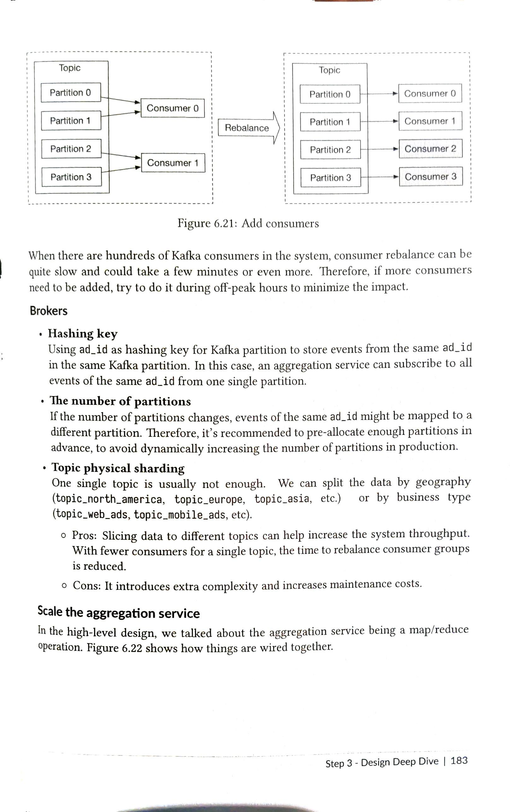

*Hình 6.21: Thêm consumers (Add consumers)*

> [!WARNING]
> Khi có hàng trăm Kafka consumers trong hệ thống, quá trình tái cân bằng consumer (**Consumer Rebalance**) có thể diễn ra khá chậm và mất vài phút hoặc thậm chí lâu hơn. Do đó, nếu cần bổ sung thêm consumers, hãy cố gắng thực hiện vào **giờ thấp điểm (off-peak hours)** để giảm thiểu tối đa tác động gián đoạn.

#### Brokers (Bộ điều phối Kafka)
* **Khóa băm (Hashing key):** Sử dụng `ad_id` làm khóa phân vùng (hashing key) cho Kafka partition để lưu trữ toàn bộ sự kiện có cùng `ad_id` vào cùng một phân vùng duy nhất. Điều này đảm bảo một consumer có thể tổng hợp toàn bộ sự kiện của cùng một `ad_id` từ một phân vùng đơn lẻ.
* **Số lượng phân vùng (The number of partitions):** Nếu số lượng phân vùng thay đổi, các sự kiện của cùng một `ad_id` có thể bị ánh xạ sang một phân vùng khác. Do đó, khuyến nghị hệ thống nên **phân bổ trước đủ số lượng phân vùng (pre-allocate partitions)** ngay từ đầu, tránh việc tăng động số lượng phân vùng trong môi trường vận hành thực tế (production).
* **Phân mảnh vật lý theo Topic (Topic physical sharding):** Một topic đơn lẻ thường không đủ đáp ứng. Chúng ta có thể chia nhỏ dữ liệu theo vị trí địa lý (`topic_north_america`, `topic_europe`, `topic_asia`, v.v.) hoặc theo loại hình nghiệp vụ (`topic_web_ads`, `topic_mobile_ads`, v.v.).
  * **Ưu điểm (Pros):** Chia cắt dữ liệu thành các topics khác nhau giúp tăng thông lượng hệ thống (**Throughput**). Với ít consumers hơn cho mỗi topic đơn lẻ, thời gian tái cân bằng nhóm consumer (**Consumer Group Rebalance**) sẽ được rút ngắn đáng kể.
  * **Nhược điểm (Cons):** Gây phát sinh thêm độ phức tạp và làm tăng chi phí vận hành, bảo trì (**Maintenance costs**).

---

### 2. Mở rộng Dịch vụ Tổng hợp (Scale the Aggregation Service)

Việc tổng hợp dữ liệu bản chất tuân theo mô hình xử lý MapReduce. **Hình 6.22** minh họa cách các thành phần được kết nối với nhau.

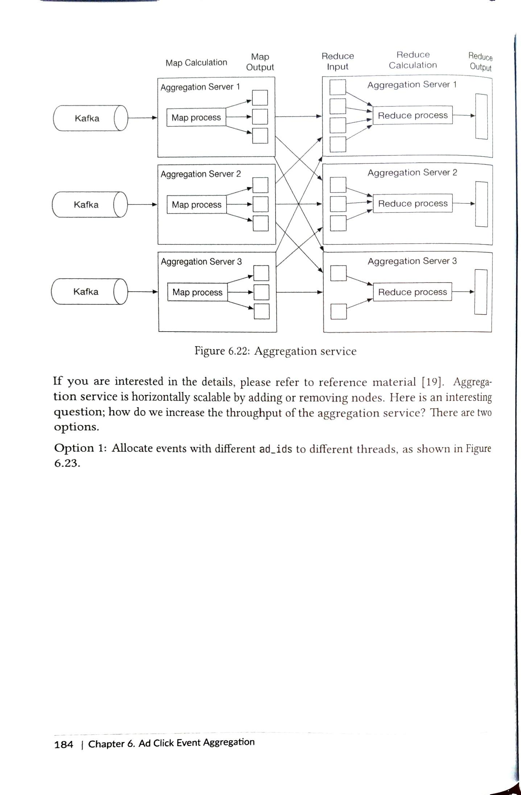

*Hình 6.22: Dịch vụ tổng hợp (Aggregation service)*

Nếu bạn quan tâm đến các chi tiết cụ thể, vui lòng tham khảo tài liệu [19]. Dịch vụ tổng hợp có khả năng mở rộng theo chiều ngang (**Horizontally Scalable**) bằng cách thêm hoặc loại bỏ các node. 

Tại đây có một câu hỏi kiến trúc thú vị: **Làm thế nào để gia tăng thông lượng (throughput) của dịch vụ tổng hợp?** Có hai phương án tiếp cận:

#### Phương án 1: Đa luồng (Multi-threading)
Phân bổ các sự kiện có `ad_id` khác nhau cho các luồng (**Threads**) khác nhau xử lý, như minh họa trong **Hình 6.23**.

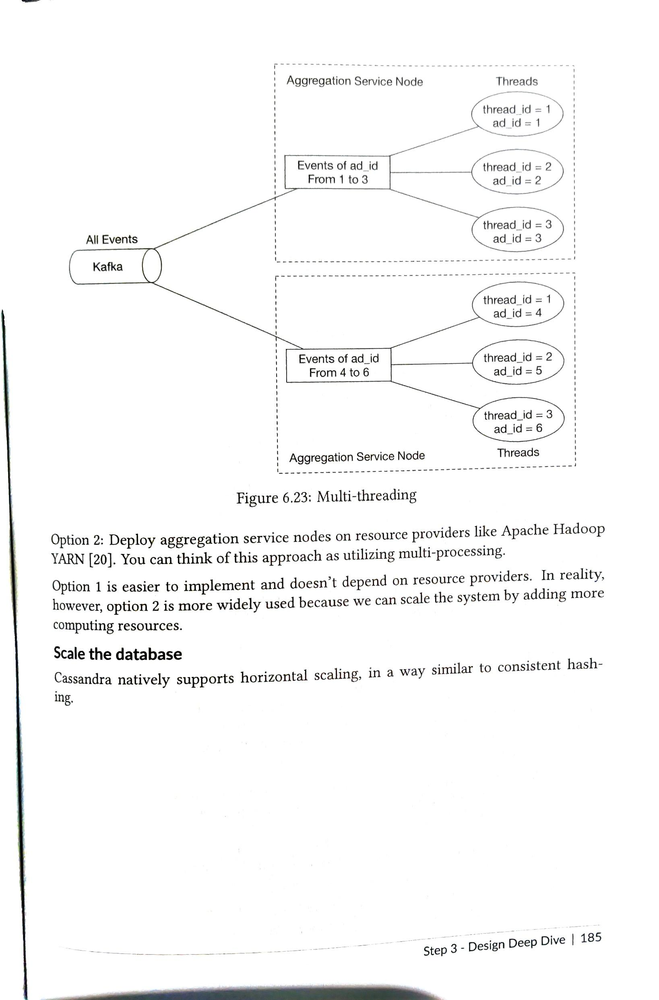

*Hình 6.23: Đa luồng (Multi-threading)*

#### Phương án 2: Đa tiến trình trên nền tảng điều phối tài nguyên (Resource Providers)
Triển khai các node xử lý tổng hợp trên các nền tảng quản lý tài nguyên như Apache Hadoop YARN [20]. Bạn có thể xem hướng tiếp cận này là việc tận dụng kiến trúc đa tiến trình (**Multi-processing**).

> [!NOTE]
> **So sánh hai phương án:**
> * **Phương án 1** dễ triển khai hơn và không phụ thuộc vào các hệ thống quản lý tài nguyên (resource providers).
> * **Phương án 2** trong thực tế được sử dụng rộng rãi hơn nhiều vì chúng ta có thể mở rộng quy mô hệ thống linh hoạt bằng cách bổ sung thêm tài nguyên tính toán từ cụm điện toán.

---

### 3. Mở rộng Cơ sở Dữ liệu (Scale the Database)

Cơ sở dữ liệu có thể mở rộng quy mô bằng cách tận dụng kỹ thuật băm nhất quán (**Consistent Hashing**) với các node ảo (**Virtual Nodes**).

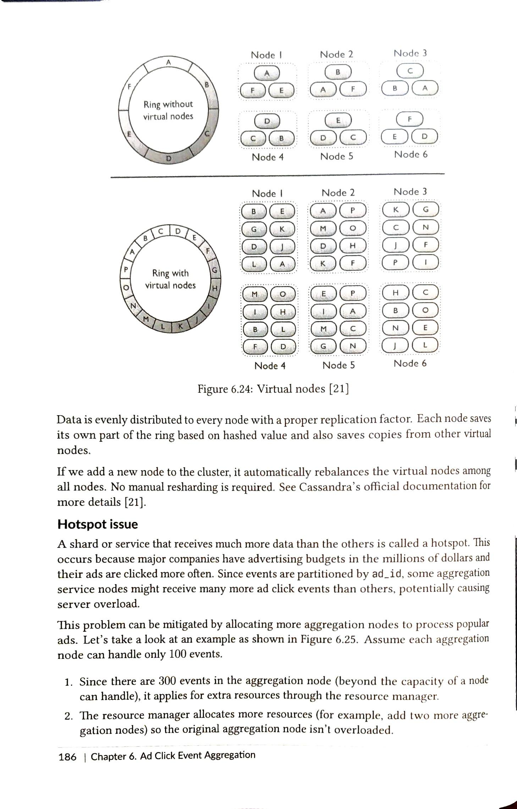

*Hình 6.24: Các node ảo (Virtual nodes) [21]*

Dữ liệu được phân phối đồng đều đến mọi node với một hệ số nhân bản (**Replication Factor**) thích hợp. Mỗi node lưu trữ phần dữ liệu thuộc cung phân đoạn của chính nó trên vòng tròn băm (hash ring) dựa trên giá trị băm, đồng thời lưu các bản sao bản ghi từ các node ảo khác.

Nếu chúng ta thêm một node mới vào cụm phân tán (**Cluster**), hệ thống sẽ tự động tái cân bằng (**Rebalance**) các node ảo giữa tất cả các node. Không cần phải can thiệp phân mảnh lại thủ công (**Manual resharding**). Xem tài liệu chính thức của Cassandra để biết thêm chi tiết [21].

---

### Xử lý Điểm Nóng Dữ Liệu (Hotspot Issue)

Một phân mảnh (shard) hoặc một dịch vụ phải tiếp nhận lượng dữ liệu lớn vượt trội so với các phần còn lại được gọi là **điểm nóng (Hotspot)**. Hiện tượng này xuất hiện do các tập đoàn lớn có ngân sách quảng cáo lên tới hàng triệu USD và quảng cáo của họ được người dùng nhấp vào thường xuyên hơn rất nhiều. 

Vì các sự kiện được phân vùng theo `ad_id`, một số node dịch vụ tổng hợp có thể tiếp nhận số lượng sự kiện nhấp chuột quảng cáo vượt trội so với các node khác, tiềm ẩn nguy cơ gây quá tải máy chủ (**Server Overload**).

Vấn đề này có thể được giảm thiểu bằng cách cấp phát thêm các node tổng hợp để cùng xử lý các quảng cáo phổ biến. Hãy cùng xem xét một ví dụ như trong **Hình 6.25**. Giả định mỗi node tổng hợp chỉ có khả năng xử lý tối đa 100 sự kiện.

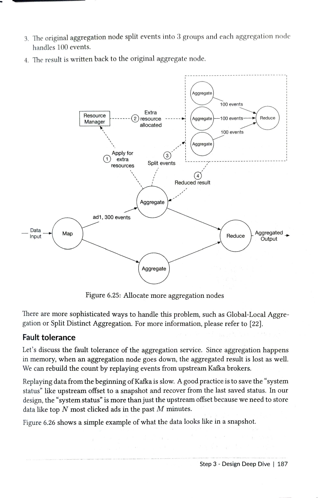

*Hình 6.25: Cấp phát thêm các node tổng hợp (Allocate more aggregation nodes)*

**Các bước xử lý điểm nóng trong sơ đồ:**
1. Do có 300 sự kiện tập trung tại node tổng hợp ban đầu (vượt quá năng lực xử lý định mức 100 sự kiện của một node), node này gửi yêu cầu xin cấp phát thêm tài nguyên thông qua Trình quản lý tài nguyên (**Resource Manager**).
2. Resource Manager cấp phát thêm tài nguyên (ví dụ: bổ sung thêm hai node tổng hợp) để node ban đầu không bị rơi vào tình trạng quá tải.
3. Node tổng hợp gốc chia tách 300 sự kiện thành 3 nhóm độc lập, mỗi node tổng hợp phụ trách xử lý 100 sự kiện.
4. Kết quả sau khi tính toán tổng hợp (reduced result) được ghi ngược trở lại node tổng hợp gốc.

> [!TIP]
> Ngoài ra, còn có các phương pháp tinh vi và nâng cao hơn để giải quyết triệt để bài toán này, chẳng hạn như:
> - **Tổng hợp Cục bộ - Toàn cục (Global-Local Aggregation)**
> - **Tổng hợp Phân tách Riêng biệt (Split Distinct Aggregation)**
> 
> Để biết thêm chi tiết chuyên sâu, vui lòng tham khảo tài liệu [22].

---

### Khả năng Chịu lỗi (Fault Tolerance)

Hãy cùng thảo luận về khả năng chịu lỗi (**Fault Tolerance**) của dịch vụ tổng hợp. 

Do quá trình tổng hợp diễn ra trực tiếp trong bộ nhớ (**In-Memory**), khi một node tổng hợp gặp sự cố sập máy (**Goes Down**), toàn bộ kết quả tổng hợp lưu tạm trong RAM cũng sẽ bị mất. Chúng ta có thể tái tạo lại số lượng đếm bằng cách phát lại (**Replaying**) các sự kiện từ các Kafka broker ở tầng upstream.

Tuy nhiên, việc phát lại toàn bộ dữ liệu từ vị trí bắt đầu của Kafka là một tác vụ rất chậm. Một thực hành kiến trúc chuẩn (**Best Practice**) là định kỳ lưu "trạng thái hệ thống" (**System Status**) như giá trị Kafka offset ngược dòng vào một bản chụp nhanh (**Snapshot**), và khi xảy ra sự cố sẽ khôi phục lại từ trạng thái đã lưu gần nhất.

Trong thiết kế kiến trúc của chúng ta, "trạng thái hệ thống" không chỉ đơn thuần là vị trí upstream offset, bởi vì chúng ta còn cần phải lưu trữ các thông tin trạng thái phức tạp hơn như danh sách **Top N quảng cáo được nhấp chuột nhiều nhất trong M phút vừa qua**.

*Hình 6.26 minh họa một ví dụ đơn giản về cấu trúc dữ liệu bên trong một bản snapshot.*

# CHƯƠNG 6: TỔNG HỢP SỰ KIỆN NHẤP CHUỘT QUẢNG CÁO (AD CLICK EVENT AGGREGATION)

---

### [Trang 193]

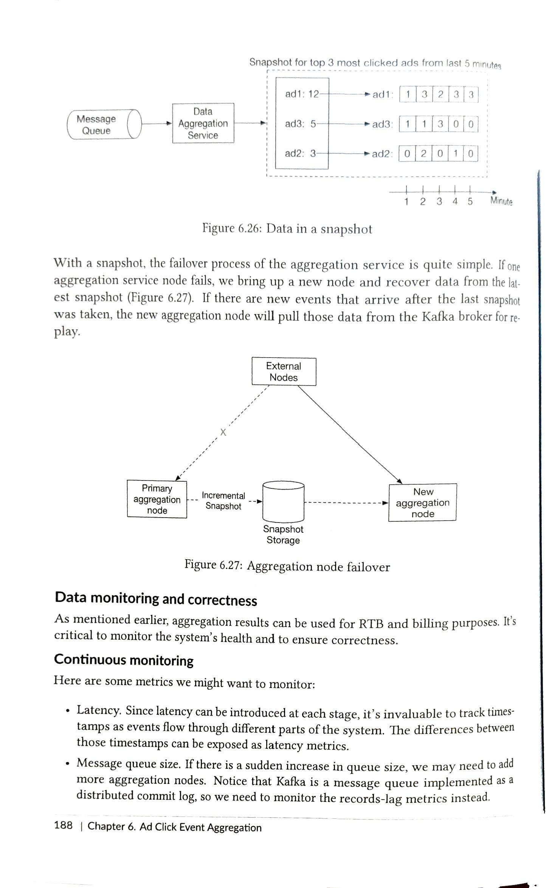

*Hình 6.26: Dữ liệu trong một bản chụp trạng thái (Data in a snapshot)*

Nhờ có bản chụp trạng thái (*snapshot*), quy trình chuyển đổi dự phòng (*failover*) của dịch vụ tổng hợp (*aggregation service*) trở nên rất đơn giản. Nếu một node trong dịch vụ tổng hợp bị lỗi (*fail*), chúng ta khởi tạo một node mới và khôi phục dữ liệu từ bản chụp trạng thái gần nhất (*latest snapshot*) (Hình 6.27). Nếu có các sự kiện mới đến sau thời điểm bản chụp trạng thái gần nhất được ghi lại, node tổng hợp mới sẽ kéo (*pull*) các dữ liệu đó từ Kafka broker để phát lại (*replay*).

*Hình 6.27: Quy trình chuyển đổi dự phòng của node tổng hợp (Aggregation node failover)*

---

### Giám sát dữ liệu và tính chính xác (Data monitoring and correctness)

Việc giám sát trạng thái hoạt động (*health check*) của hệ thống và bảo đảm tính chính xác (*correctness*) của dữ liệu đóng vai trò sống còn.

#### Giám sát liên tục (Continuous monitoring)

Dưới đây là một số số liệu đo lường (*metrics*) mà chúng ta có thể muốn giám sát:
* **Độ trễ (Latency):** Dấu thời gian (*timestamps*) của các sự kiện có thể được bóc tách và đối chiếu để xuất ra dưới dạng các chỉ số độ trễ (*latency metrics*).

---

### [Trang 194]

* **Tài nguyên hệ thống trên các node tổng hợp (System resources on aggregation nodes):** CPU, dung lượng đĩa (*disk*), bộ nhớ JVM (*Java Virtual Machine*), v.v.

---

#### Đối soát dữ liệu (Reconciliation)

> [!NOTE]
> **Đối soát (Reconciliation)** đồng nghĩa với việc so sánh các tập dữ liệu khác nhau nhằm đảm bảo tính toàn vẹn dữ liệu (*data integrity*).

Khác với quy trình đối soát trong ngành ngân hàng—nơi bạn có thể so sánh đối chiếu các bản ghi giao dịch nội bộ của mình với bản ghi sao kê từ phía ngân hàng—kết quả của việc tổng hợp nhấp chuột quảng cáo (*ad click aggregation*) không có kết quả từ bên thứ ba (*third-party result*) nào để đối chiếu cùng.

Giải pháp khả thi là: vào cuối ngày, chúng ta sử dụng một tác vụ xử lý theo lô (*batch job*) để sắp xếp (*sort*) lại các sự kiện nhấp chuột theo thời gian xảy ra sự kiện (*event time*) trên từng phân vùng (*partition*), sau đó đối soát lại với kết quả tổng hợp theo thời gian thực (*real-time aggregation result*). 

Nếu hệ thống có yêu cầu độ chính xác cao hơn, chúng ta có thể sử dụng cửa sổ tổng hợp (*aggregation window*) nhỏ hơn; ví dụ như mỗi giờ một lần (1 hour window). 

> [!IMPORTANT]
> Lưu ý rằng: dù áp dụng kích thước cửa sổ tổng hợp nào đi chăng nữa, kết quả từ tác vụ xử lý theo lô (*batch job*) vẫn có thể không khớp chính xác 100% với kết quả tổng hợp thời gian thực (*real-time aggregation*), do có một số sự kiện có thể đến trễ (*late-arriving events* - xem chi tiết tại phần *"Thời gian (Time)"* trang 175).

Hình 6.28 minh họa sơ đồ thiết kế hoàn chỉnh cuối cùng tích hợp cơ chế hỗ trợ đối soát dữ liệu (*reconciliation*).

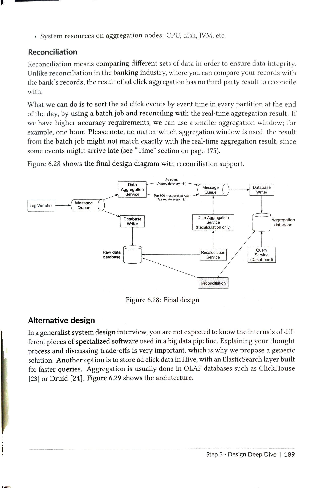

*Hình 6.28: Thiết kế hoàn chỉnh cuối cùng (Final design)*

---

### Thiết kế thay thế (Alternative design)

Trong một buổi phỏng vấn thiết kế hệ thống tổng quát (*generalist system design interview*), người phỏng vấn không kỳ vọng bạn phải nắm tường tận cấu trúc bên trong (*internals*) của từng phần mềm chuyên dụng trong một đường ống dữ liệu lớn (*big data pipeline*). Điều tối quan trọng là bạn giải thích được luồng tư duy kiến trúc (*thought process*) và phân tích, đánh giá được các sự đánh đổi (*trade-offs*); đó là lý do vì sao chúng tôi đề xuất một giải pháp kiến trúc tổng quát (*generic solution*).

Một phương án khả dĩ khác là lưu trữ dữ liệu nhấp chuột quảng cáo trong **Hive**, kết hợp xây dựng thêm một lớp **ElasticSearch** phía trên để phục vụ truy vấn tốc độ cao. Công việc tổng hợp (*aggregation*) dữ liệu thường được ủy quyền thực thi trong các cơ sở dữ liệu phân tích trực tuyến OLAP (*Online Analytical Processing*) chuyên dụng như **ClickHouse** [23] hoặc **Druid** [24]. 

Hình 6.29 minh họa chi tiết kiến trúc này.

---

### [Trang 195]

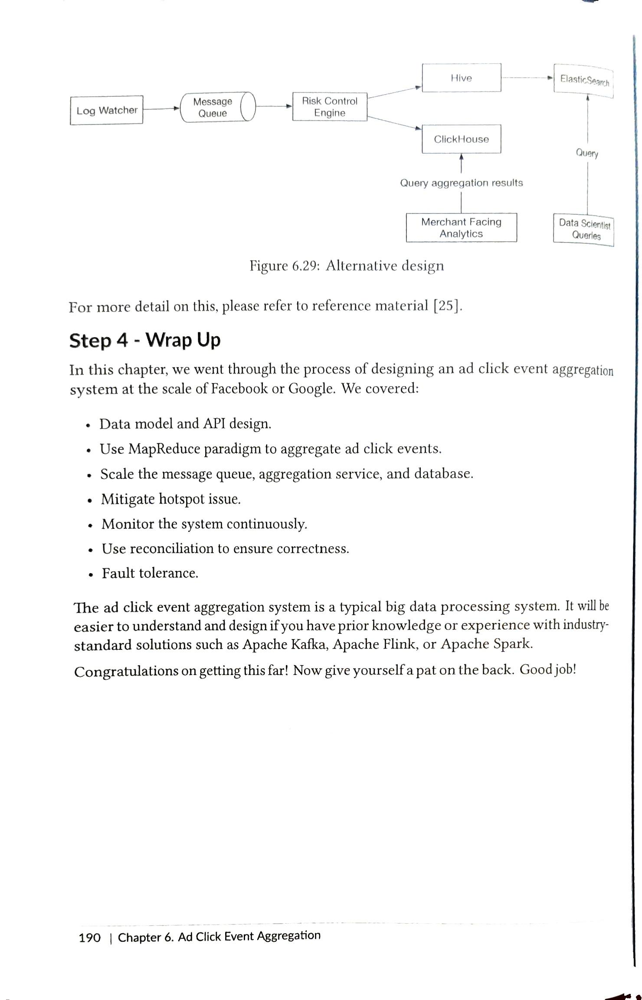

*Hình 6.29: Thiết kế thay thế (Alternative design)*

> [!TIP]
> Để tìm hiểu sâu hơn về kiến trúc này, vui lòng tham khảo thêm tài liệu trích dẫn số [25].

---

## BƯỚC 4: TỔNG KẾT (STEP 4 - WRAP UP)

Trong chương này, chúng ta đã cùng nhau trải qua toàn bộ quy trình thiết kế một hệ thống tổng hợp sự kiện nhấp chuột quảng cáo (*ad click event aggregation system*) ở quy mô hạ tầng tương đương Facebook hoặc Google. Chúng ta đã bao quát toàn diện các khía cạnh:

* Thiết kế mô hình dữ liệu (*data model*) và giao diện lập trình ứng dụng (*API design*).
* Ứng dụng mô hình tính toán **MapReduce** để tổng hợp các sự kiện nhấp chuột quảng cáo.
* Mở rộng quy mô (*scaling*) cho hàng đợi tin nhắn (*message queue*), dịch vụ tổng hợp (*aggregation service*) và cơ sở dữ liệu (*database*).
* Giảm thiểu sự cố điểm nóng dữ liệu (*mitigate hotspot issue*).
* Giám sát hệ thống liên tục (*continuous monitoring*).
* Ứng dụng cơ chế đối soát dữ liệu (*reconciliation*) nhằm đảm bảo tính chính xác (*correctness*).
* Khả năng chịu lỗi (*Fault Tolerance*).

Hệ thống tổng hợp sự kiện nhấp chuột quảng cáo là một hệ thống xử lý dữ liệu lớn (*big data processing system*) kinh điển. Bài toán sẽ trở nên dễ hiểu và dễ thiết kế hơn rất nhiều nếu bạn đã có sẵn kiến thức nền tảng hoặc kinh nghiệm thực chiến với các giải pháp tiêu chuẩn công nghiệp như **Apache Kafka**, **Apache Flink**, hoặc **Apache Spark**.

Xin chúc mừng bạn đã hoàn thành một chặng đường dài đến tận đây! Hãy tự thưởng cho bản thân một lời khen ngợi. Bạn đã làm rất tốt!

---

### [Trang 196]

### TÓM TẮT CHƯƠNG (CHAPTER SUMMARY)

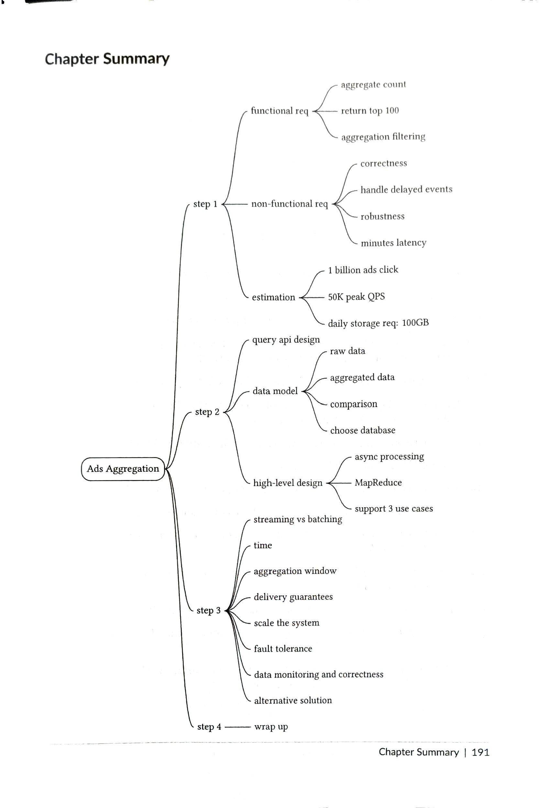

*Hình: Sơ đồ tư duy tổng kết toàn bộ nội dung Chương 6*

* **Yêu cầu chức năng (Functional Requirements):**
  * Đếm tổng hợp (*aggregate count*).
  * Trả về top 100 quảng cáo được nhấp nhiều nhất (*return top 100*).
  * Lọc dữ liệu theo thuộc tính tổng hợp (*aggregation filtering*).
* **Yêu cầu phi chức năng (Non-Functional Requirements):**
  * Tính chính xác (*correctness*).
  * Xử lý các sự kiện đến trễ (*handle delayed events*).
  * Độ bền bỉ (*robustness*).
  * Độ trễ ở mức vài phút (*minutes latency*).
* **Ước tính quy mô (Estimation):**
  * 1 tỷ lượt nhấp quảng cáo mỗi ngày (*1 billion ads click*).
  * QPS đỉnh đạt ~50.000 (*~50K peak QPS*).
  * Yêu cầu lưu trữ hàng ngày: 100GB (*daily storage req: 100GB*).
* **Thiết kế API truy vấn (Query API Design):**
  * API dữ liệu thô (*raw data*).
  * API dữ liệu tổng hợp (*aggregated data*).
* **Mô hình dữ liệu (Data Model):**
  * So sánh (*comparison*).
  * Lựa chọn cơ sở dữ liệu (*choose database*).
* **Thiết kế mức cao (High-Level Design):**
  * Xử lý bất đồng bộ (*async processing*).
  * Áp dụng mô hình **MapReduce**.
  * Hỗ trợ 3 ca sử dụng thực tế (*support 3 use cases*).
* **Đi sâu vào chi tiết thiết kế (Design Deep Dive):**
  * Xử lý luồng dữ liệu thời gian thực và xử lý theo lô (*streaming vs batching*).
  * Thời gian (*time*): Thời gian sự kiện (*event time*) vs Thời gian xử lý (*processing time*).
  * Cửa sổ tổng hợp (*aggregation window*).
  * Đảm bảo phân phối thông điệp (*delivery guarantees*).
  * Mở rộng quy mô hệ thống (*scale the system*).
  * Khả năng chịu lỗi (*fault tolerance*).
  * Giám sát dữ liệu và tính chính xác (*data monitoring and correctness*).
  * Giải pháp kiến trúc thay thế (*alternative solution*).
* **Bước 4: Tổng kết (Step 4 - Wrap Up).**

---

### [Trang 197]

### TÀI LIỆU THAM KHẢO (REFERENCE MATERIAL)

* **[1]** Google Ads Help: https://support.google.com/google-ads/answer/2615875?hl=en.
* **[2]** Google Analytics Help: https://support.google.com/analytics/answer/1033889?hl=en.
* **[3]** Oracle Database Online Documentation: http://docs.oracle.com/cd/E11882_01/server.112/e41084/statements_9014.htm#OLAXS169.
* **[4]** Apache Beam Paper: https://arxiv.org/pdf/1610.03013.pdf.
* **[5]** LanguageManual ORC: https://cwiki.apache.org/confluence/display/hive/languagemanual+orc.
* **[6]** Parquet: https://databricks.com/glossary/what-is-parquet.
* **[7]** What is Avro: https://www.ibm.com/topics/avro.
* **[8]** Big Data: https://www.datakwery.com/techniques/big-data/.
* **[9]** An Overview of End-to-End Exactly-Once Processing in Apache Flink: https://flink.apache.org/features/2018/03/01/end-to-end-exactly-once-apache-flink.html.
* **[10]** DAG model: https://en.wikipedia.org/wiki/Directed_acyclic_graph.
* **[11]** Understand star schema and the importance for Power BI: https://docs.microsoft.com/en-us/power-bi/guidance/star-schema.
* **[12]** Martin Kleppmann. *Designing Data-Intensive Applications*. O'Reilly Media, 2017.
* **[13]** Apache Flink: https://flink.apache.org/.
* **[14]** Lambda architecture: https://databricks.com/glossary/lambda-architecture.
* **[15]** Kappa architecture: https://hazelcast.com/glossary/kappa-architecture/.
* **[16]** Martin Kleppmann. Stream Processing. In *Designing Data-Intensive Applications*. O'Reilly Media, 2017.
* **[17]** End-to-end Exactly-once Aggregation Over Ad Streams: https://www.youtube.com/watch?v=hzxytnPcAUM.
* **[18]** Ad traffic quality: https://www.google.com/ads/adtrafficquality/.
* **[19]** Understanding MapReduce in Hadoop: https://www.tutorialspoint.com/map_reduce/understanding_map_reduce.htm.
* **[20]** Flink on Apache Yarn: https://ci.apache.org/projects/flink/flink-docs-release-1.13/docs/deployment/resource-providers/yarn/.

---

### [Trang 198]

* **[21]** How data is distributed across a cluster (using virtual nodes): https://docs.datastax.com/en/cassandra-oss/3.0/cassandra/architecture/archDataDistributeDistribute.html.
* **[22]** Flink performance tuning: https://nightlies.apache.org/flink/flink-docs-master/docs/dev/table/tuning/.
* **[23]** ClickHouse: https://clickhouse.com/.
* **[24]** Druid: https://druid.apache.org/.
* **[25]** Real-Time Exactly-Once Ad Event Processing with Apache Flink, Kafka, and Pinot: https://eng.uber.com/real-time-exactly-once-ad-event-processing/.

---

## Điều hướng

- [chuong-05-metrics-monitoring-and-alerting-system.md](chuong-05-metrics-monitoring-and-alerting-system.md)
- [Mục lục](README.md)
- [chuong-07-hotel-reservation-system.md](chuong-07-hotel-reservation-system.md)
