[← Chương trước](chuong-06-ad-click-event-aggregation.md) | [Mục lục](README.md) | [Chương tiếp theo →](chuong-08-distributed-email-service.md)

---

# Chương 7: Hệ Thống Đặt Phòng Khách Sạn (Hotel Reservation System)

Trong chương này, chúng ta sẽ thiết kế một hệ thống đặt phòng khách sạn (hotel reservation system) cho một chuỗi khách sạn quy mô lớn như Marriott International. Thiết kế và các kỹ thuật được áp dụng trong chương này cũng có thể mở rộng cho các chủ đề phỏng vấn kiến trúc hệ thống đặt chỗ phổ biến khác:
* **Thiết kế Airbnb (Design Airbnb)**
* **Thiết kế hệ thống đặt vé máy bay (Design a flight reservation system)**
* **Thiết kế hệ thống đặt vé xem phim (Design a movie ticket booking system)**

---

## Bước 1 - Hiểu Rõ Bài Toán và Xác Định Phạm Vi Thiết Kế (Step 1 - Understand the Problem and Establish Design Scope)

Hệ thống đặt phòng khách sạn là một hệ thống phức tạp và các thành phần của nó thay đổi tùy theo các kịch bản nghiệp vụ (business use cases). Trước khi đi sâu vào thiết kế chi tiết, chúng ta cần đặt ra các câu hỏi làm rõ (clarification questions) với người phỏng vấn để thu hẹp phạm vi bài toán.

---

**Ứng viên (Candidate):** Quy mô của hệ thống (scale of the system) là bao nhiêu?  
**Người phỏng vấn (Interviewer):** Hãy giả định chúng ta đang xây dựng một website cho một chuỗi khách sạn sở hữu 5.000 khách sạn và tổng cộng 1 triệu phòng.

**Ứng viên:** Khách hàng thanh toán ngay khi họ đặt phòng (make reservations) hay thanh toán khi họ đến nhận phòng tại khách sạn?  
**Người phỏng vấn:** Để đơn giản hóa, khách hàng sẽ thanh toán toàn bộ (pay in full) ngay tại thời điểm đặt phòng.

**Ứng viên:** Khách hàng chỉ đặt phòng thông qua website của khách sạn thôi đúng không? Chúng ta có cần hỗ trợ các phương thức đặt phòng khác như qua cuộc gọi điện thoại không?  
**Người phỏng vấn:** Hãy giả định người dùng có thể đặt phòng khách sạn qua website hoặc ứng dụng di động (app) của khách sạn.

**Ứng viên:** Khách hàng có thể hủy phòng đã đặt (cancel reservations) hay không?  
**Người phỏng vấn:** Có, hệ thống cho phép hủy phòng.

**Ứng viên:** Còn yếu tố nào khác chúng ta cần xem xét không?  
**Người phỏng vấn:** Có, chúng ta cho phép đặt phòng vượt mức (overbooking) 10%. Trong trường hợp bạn chưa biết, overbooking có nghĩa là khách sạn sẽ bán ra số lượng phòng nhiều hơn số phòng thực tế họ có. Các khách sạn làm điều này dựa trên dự tính rằng sẽ có một lượng khách hàng hủy đặt phòng.

---

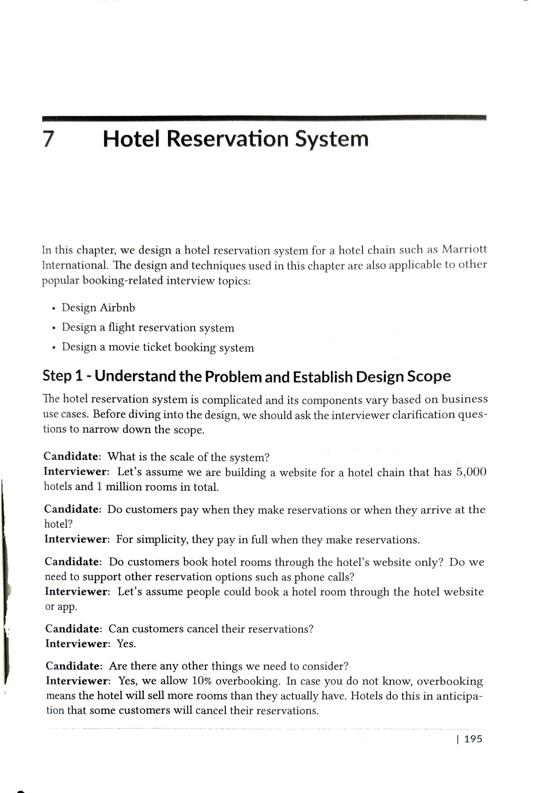

---

**Ứng viên:** Do thời gian có hạn, tôi giả định tính năng tìm kiếm phòng khách sạn (hotel room search) sẽ nằm ngoài phạm vi thiết kế (out of scope). Chúng ta sẽ tập trung vào các tính năng sau:
* Hiển thị trang thông tin liên quan đến khách sạn (Show the hotel-related page).
* Hiển thị trang chi tiết liên quan đến phòng khách sạn (Show the hotel room-related detail page).
* Đặt phòng (Reserve a room).
* Trang quản trị (Admin panel) để thêm/xóa/cập nhật thông tin khách sạn hoặc phòng.
* Hỗ trợ tính năng đặt phòng vượt mức (Support the overbooking feature).

**Người phỏng vấn:** Nghe rất hợp lý.  
**Người phỏng vấn:** Thêm một điều nữa, giá phòng khách sạn thay đổi linh hoạt (dynamically). Giá của một phòng khách sạn phụ thuộc vào tỷ lệ lấp đầy dự kiến (occupancy rate) của khách sạn vào một ngày cụ thể. Trong buổi phỏng vấn này, chúng ta có thể giả định rằng giá phòng có thể khác nhau vào mỗi ngày.  
**Ứng viên:** Tôi sẽ ghi nhận yêu cầu này.

---

### Yêu Cầu Phi Chức Năng (Non-functional Requirements)

* **Hỗ trợ mức độ đồng thời cao (Support high concurrency):** Trong mùa cao điểm hoặc các sự kiện lớn, một số khách sạn nổi tiếng có thể có rất nhiều khách hàng cùng cố gắng đặt chung một phòng cùng một lúc.
* **Độ trễ ở mức vừa phải (Moderate latency):** Thời gian phản hồi nhanh khi người dùng thực hiện đặt phòng là lý tưởng, tuy nhiên hệ thống mất vài giây để xử lý một yêu cầu đặt phòng (reservation request) vẫn hoàn toàn được chấp nhận.

---

### Ước Tính Nhanh (Back-of-the-envelope Estimation)

* Tổng cộng 5.000 khách sạn và 1 triệu phòng.
* Giả định 70% số phòng được lấp đầy (occupied) và thời gian lưu trú trung bình (average stay duration) là 3 ngày.
* **Lượng đặt phòng ước tính mỗi ngày (Estimated daily reservations):**
  $$\frac{1.000.000 \times 0,7}{3} = 233.333 \quad (\text{làm tròn lên } \approx 240.000)$$
* **Số lượt đặt phòng mỗi giây (Reservations per second - TPS):**
  $$\frac{240.000}{10^5 \text{ giây trong một ngày}} \approx 3$$
  Như chúng ta thấy, số lượng giao dịch đặt phòng trung bình mỗi giây (TPS - Transaction Per Second) không quá cao.

Tiếp theo, hãy tính toán sơ bộ chỉ số truy vấn mỗi giây (QPS - Queries Per Second) của tất cả các trang trong hệ thống. Luồng khách hàng điển hình gồm ba bước:

1. **Xem trang chi tiết khách sạn/phòng (View hotel/room detail page):** Người dùng duyệt trang này (query).
2. **Xem trang đặt phòng (View the booking page):** Người dùng xác nhận thông tin chi tiết đặt phòng, chẳng hạn như ngày tháng, số lượng khách, thông tin thanh toán trước khi đặt (query).
3. **Đặt phòng (Reserve a room):** Người dùng nhấp vào nút "Đặt phòng" ("Book") để đặt phòng và phòng sẽ được giữ chỗ (transaction).

---

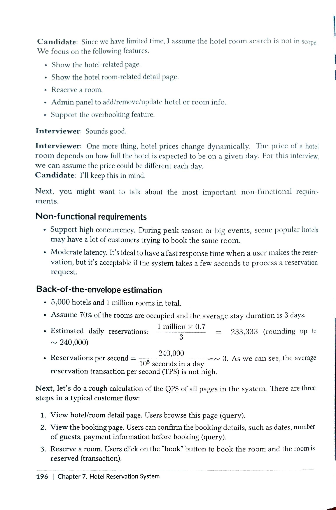

---

Hãy giả định có khoảng 10% người dùng chuyển sang bước tiếp theo và 90% người dùng sẽ rời bỏ phễu (drop off) trước khi đến bước cuối cùng. Chúng ta cũng có thể giả định rằng không có tính năng tìm nạp trước (prefetching - tìm nạp nội dung trước khi người dùng đến bước tiếp theo) nào được triển khai. 

Hình 7.1 hiển thị ước tính sơ bộ về chỉ số QPS trông như thế nào đối với các bước khác nhau. Chúng ta biết TPS đặt phòng cuối cùng là 3, vì vậy chúng ta có thể tính toán ngược lại dọc theo phễu chuyển đổi (funnel). QPS của trang xác nhận đơn hàng là 30 và QPS của trang chi tiết là 300.

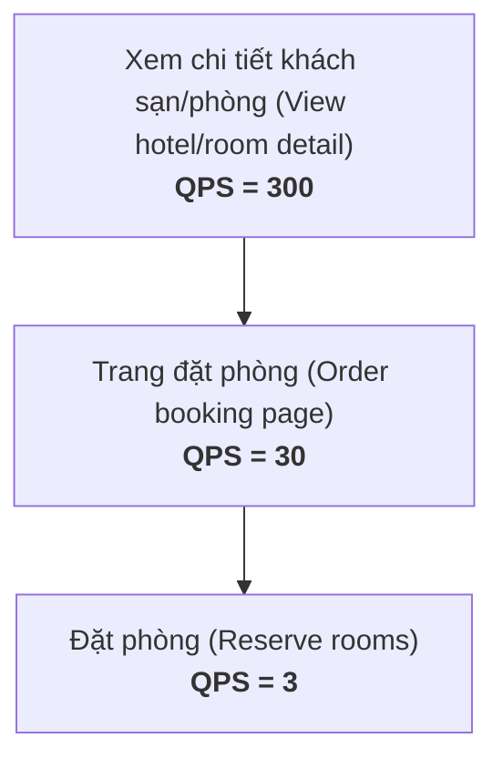

*Hình 7.1: Phân bổ QPS (QPS distribution)*

---

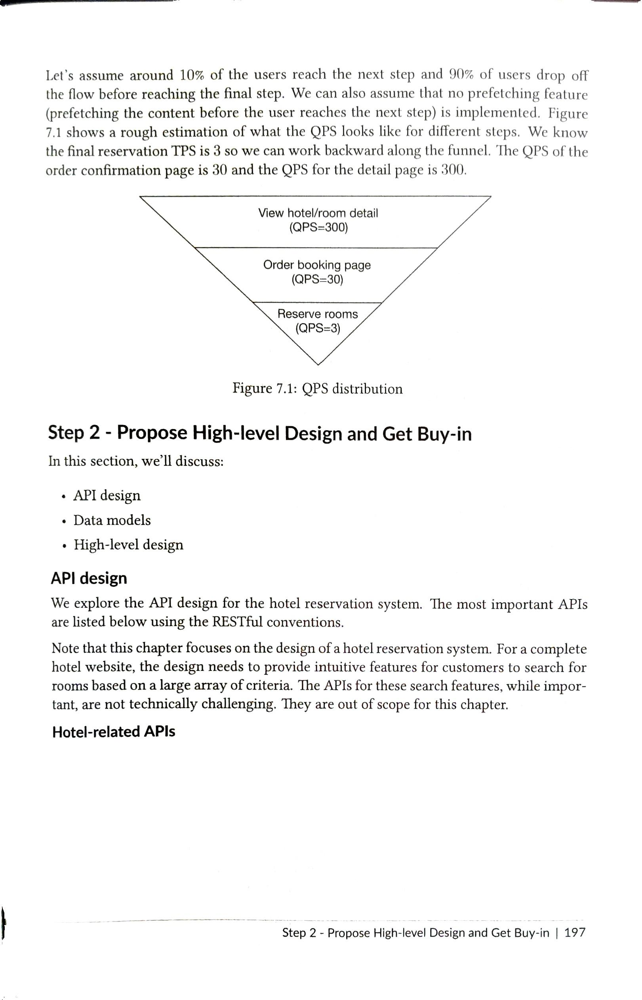

---

## Bước 2 - Đề Xuất Thiết Kế Cấp Cao và Đạt Được Sự Thống Nhất (Step 2 - Propose High-level Design and Get Buy-in)

Trong phần này, chúng ta sẽ thảo luận:
* Thiết kế API (API design)
* Mô hình dữ liệu (Data models)
* Thiết kế cấp cao (High-level design)

---

### Thiết Kế API (API Design)

Chúng ta khám phá thiết kế API cho hệ thống đặt phòng khách sạn. Các API quan trọng nhất được liệt kê bên dưới theo quy ước chuẩn RESTful.

> [!NOTE]
> Lưu ý rằng chương này tập trung vào thiết kế hệ thống đặt phòng khách sạn (hotel reservation system). Đối với một website khách sạn hoàn chỉnh, thiết kế cần cung cấp các tính năng trực quan cho khách hàng để tìm kiếm phòng dựa trên một loạt các tiêu chí lớn. Mặc dù các API phục vụ các tính năng tìm kiếm này rất quan trọng, nhưng chúng không có nhiều thách thức về mặt kỹ thuật. Do đó, chúng nằm ngoài phạm vi của chương này.

#### Các API Liên Quan Đến Khách Sạn (Hotel-related APIs)

| API | Chi tiết (Detail) |
| :--- | :--- |
| `GET /v1/hotels/{id}` | Lấy thông tin chi tiết về một khách sạn. |
| `POST /v1/hotels` | Thêm mới một khách sạn. API này chỉ khả dụng cho nhân viên khách sạn (hotel staff). |
| `PUT /v1/hotels/{id}` | Cập nhật thông tin khách sạn. API này chỉ khả dụng cho nhân viên khách sạn. |
| `DELETE /v1/hotels/{id}` | Xóa một khách sạn. API này chỉ khả dụng cho nhân viên khách sạn. |

*Bảng 7.1: Các API liên quan đến khách sạn (Hotel-related APIs)*

#### Các API Liên Quan Đến Phòng (Room-related APIs)

| API | Chi tiết (Detail) |
| :--- | :--- |
| `GET /v1/hotels/{id}/rooms/{id}` | Lấy thông tin chi tiết về một phòng. |
| `POST /v1/hotels/{id}/rooms` | Thêm một phòng mới. API này chỉ khả dụng cho nhân viên khách sạn. |
| `PUT /v1/hotels/{id}/rooms/{id}` | Cập nhật thông tin phòng. API này chỉ khả dụng cho nhân viên khách sạn. |
| `DELETE /v1/hotels/{id}/rooms/{id}` | Xóa một phòng. API này chỉ khả dụng cho nhân viên khách sạn. |

*Bảng 7.2: Các API liên quan đến phòng (Room-related APIs)*

#### Các API Liên Quan Đến Đặt Phòng (Reservation-related APIs)

| API | Chi tiết (Detail) |
| :--- | :--- |
| `GET /v1/reservations` | Lấy lịch sử đặt phòng của người dùng đang đăng nhập. |
| `GET /v1/reservations/{id}` | Lấy thông tin chi tiết về một đơn đặt phòng. |
| `POST /v1/reservations` | Tạo một đơn đặt phòng mới. |
| `DELETE /v1/reservations/{id}` | Hủy một đơn đặt phòng. |

*Bảng 7.3: Các API liên quan đến đặt phòng (Reservation-related APIs)*

Tạo một đơn đặt phòng mới là một tính năng tối quan trọng. Các tham số yêu cầu (request parameters) của việc tạo một đơn đặt phòng mới (`POST /v1/reservations`) có thể có cấu trúc như sau:

```json
{
  "startDate": "2021-04-28",
  "endDate": "2021-04-30",
  "hotelID": "245",
  "roomID": "U12354673389",
  "reservationID": "13422445"
}
```

> [!IMPORTANT]
> Lưu ý rằng `reservationID` được sử dụng làm **khóa lũy kế (idempotency key)** nhằm ngăn ngừa tình trạng đặt phòng trùng lặp (double booking). Đặt phòng trùng lặp có nghĩa là nhiều lượt đặt phòng được tạo cho cùng một phòng vào cùng một ngày. Các chi tiết cụ thể sẽ được giải thích trong phần "Vấn đề tương tranh" ("Concurrency issue") ở trang 206.

---

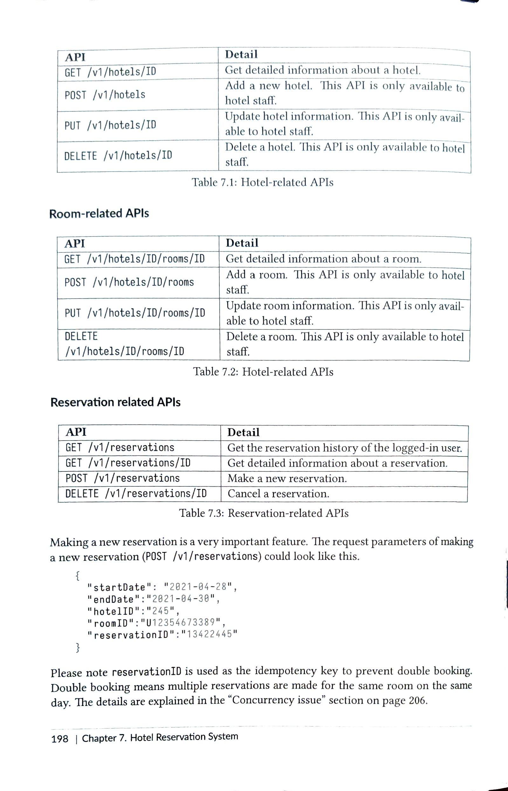

---

### Mô Hình Dữ Liệu (Data Model)

Trước khi quyết định sử dụng cơ sở dữ liệu (database) nào, chúng ta hãy xem xét kỹ lưỡng các mô hình truy cập dữ liệu (data access patterns). Đối với hệ thống đặt phòng khách sạn, chúng ta cần hỗ trợ các truy vấn sau:

* **Query 1:** Xem thông tin chi tiết về một khách sạn.
* **Query 2:** Tìm các loại phòng còn trống trong một khoảng thời gian nhất định (Find available types of rooms given a date range).
* **Query 3:** Ghi nhận một lượt đặt phòng (Record a reservation).
* **Query 4:** Tra cứu một đơn đặt phòng hoặc lịch sử đặt phòng trong quá khứ.

Từ phần ước tính nhanh (back-of-the-envelope estimation), chúng ta biết quy mô của hệ thống không quá lớn nhưng chúng ta cần chuẩn bị cho lưu lượng truy cập tăng vọt đột biến (traffic surges) trong các sự kiện lớn. Cân nhắc các yêu cầu này, chúng ta lựa chọn **cơ sở dữ liệu quan hệ (relational database)** vì các lý do sau:

* **Cơ sở dữ liệu quan hệ hoạt động rất hiệu quả với luồng công việc đọc nhiều và ghi ít thường xuyên hơn (read-heavy and write less frequently workflow):** Điều này là do số lượng người dùng truy cập website/ứng dụng khách sạn cao hơn vài bậc độ lớn (orders of magnitude) so với những người thực sự tiến hành đặt phòng. Các cơ sở dữ liệu NoSQL thường được tối ưu hóa cho tác vụ ghi (writes), trong khi cơ sở dữ liệu quan hệ hoạt động đủ tốt cho các luồng công việc nặng về đọc.
* **Cơ sở dữ liệu quan hệ cung cấp các đảm bảo tính chất ACID (Atomicity, Consistency, Isolation, Durability):** Các thuộc tính ACID là cực kỳ quan trọng đối với một hệ thống đặt chỗ. Nếu thiếu các thuộc tính này, việc ngăn chặn các vấn đề như số dư âm, thanh toán trùng (double charge), đặt phòng trùng (double reservations), v.v. là không hề dễ dàng. Các thuộc tính ACID giúp mã nguồn ứng dụng (application code) đơn giản hơn rất nhiều và giúp toàn bộ hệ thống dễ suy luận logic hơn. Một cơ sở dữ liệu quan hệ thông thường luôn cung cấp sẵn các bảo đảm này.
* **Cơ sở dữ liệu quan hệ có thể dễ dàng mô hình hóa dữ liệu (easily model the data):** Cấu trúc của dữ liệu nghiệp vụ rất rõ ràng và mối quan hệ giữa các thực thể khác nhau (`hotel`, `room`, `room_type`, v.v.) là ổn định. Kiểu mô hình dữ liệu này có thể được mô hình hóa dễ dàng bởi một cơ sở dữ liệu quan hệ.

Bây giờ khi chúng ta đã chọn cơ sở dữ liệu quan hệ làm kho lưu trữ dữ liệu (data store), hãy cùng khám phá thiết kế lược đồ (schema design). Hình 7.2 minh họa một thiết kế lược đồ trực quan và đây là cách tự nhiên nhất mà nhiều ứng viên thường dùng để mô hình hóa hệ thống đặt phòng khách sạn.

---

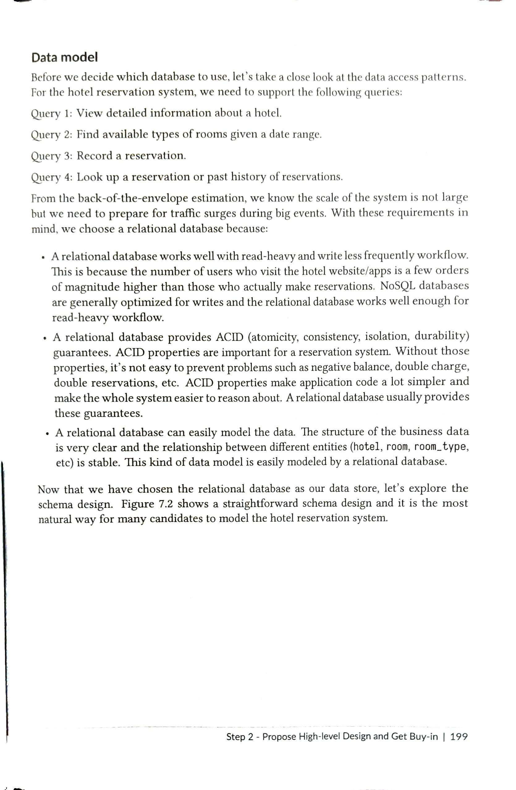

---

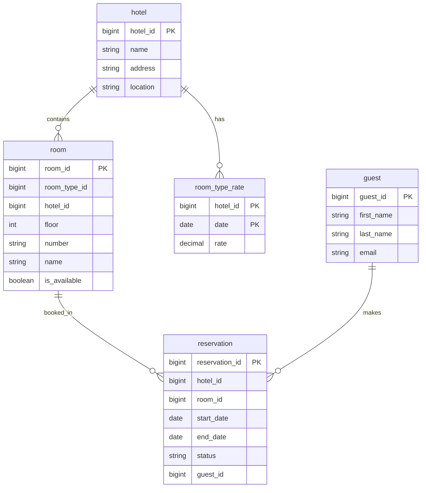

*Hình 7.2: Lược đồ cơ sở dữ liệu (Database schema)*

Hầu hết các thuộc tính đều mang tính tự giải thích (self-explanatory), chúng ta sẽ chỉ giải thích trường `status` trong bảng `reservation`. Trường `status` có thể ở một trong các trạng thái sau: **pending**, **paid**, **refunded**, **canceled**, **rejected**. Máy trạng thái (state machine) được thể hiện trong Hình 7.3.

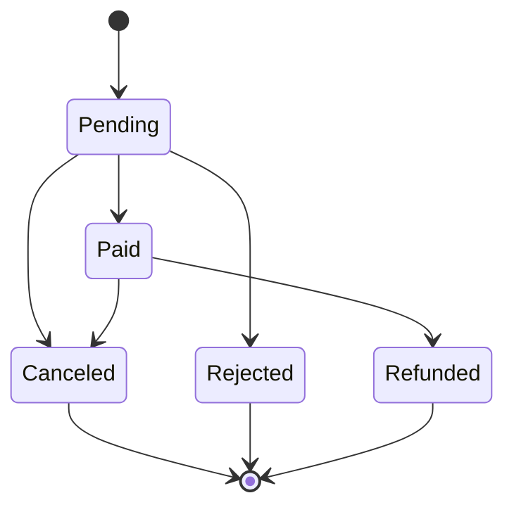

*Hình 7.3: Trạng thái đặt phòng (Reservation status)*

---

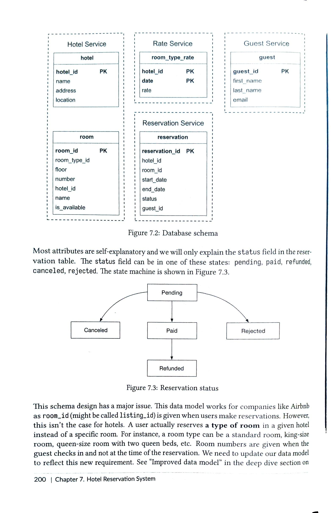

---

Thiết kế lược đồ này có **một vấn đề lớn (a major issue)**:

Mô hình dữ liệu này hoạt động tốt cho các công ty như **Airbnb** vì `room_id` (có thể được gọi là `listing_id`) được chỉ định trực tiếp khi người dùng thực hiện đặt chỗ. Tuy nhiên, điều này lại không đúng đối với các **khách sạn**. 

Người dùng trên thực tế đặt một **loại phòng (type of room)** trong một khách sạn nhất định thay vì một căn phòng cụ thể. Ví dụ, một loại phòng có thể là: phòng tiêu chuẩn (standard room), phòng giường King (king-size room), phòng giường Queen với hai giường queen (queen-size room with two queen beds), v.v. 

Số phòng cụ thể (room numbers) chỉ được chỉ định khi khách hàng đến làm thủ tục nhận phòng (check-in) chứ không phải tại thời điểm đặt phòng. Chúng ta cần cập nhật mô hình dữ liệu của mình để phản ánh đúng yêu cầu nghiệp vụ mới này. Xem mục "Mô hình dữ liệu cải tiến" ("Improved data model") trong phần chuyên sâu (deep dive section).

# Chương 7: Hệ Thống Đặt Phòng Khách Sạn (Hotel Reservation System)

*(Tham khảo thêm trang 203 để biết thêm chi tiết)*

---

## Bước 2: Đề Xuất Thiết Kế Cấp Cao (High-Level Design) và Thống Nhất Phương Án

### Thiết Kế Cấp Cao (High-Level Design)

Hệ thống đặt phòng khách sạn này được thiết kế dựa trên kiến trúc vi dịch vụ (**Microservice Architecture**). Trong những năm gần đây, kiến trúc vi dịch vụ đã trở nên vô cùng phổ biến và được ứng dụng rộng rãi tại các tập đoàn công nghệ hàng đầu như Amazon, Netflix, Uber, Airbnb, Twitter,...

Sơ đồ kiến trúc tổng quan cấp cao được minh họa trong **Hình 7.4**:

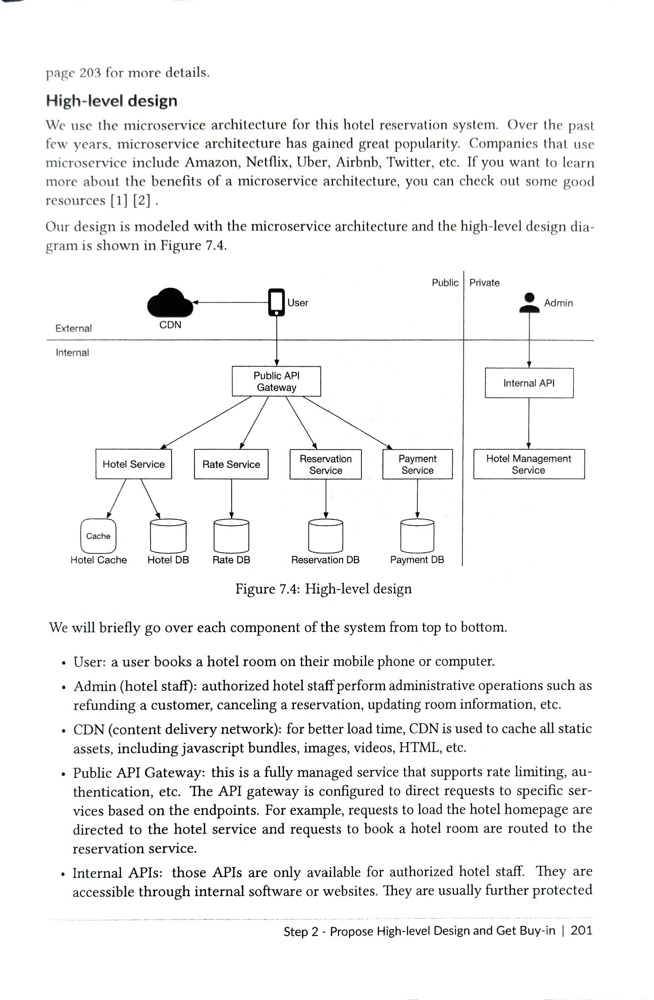
*Hình 7.4: Thiết kế cấp cao (High-level design)*

---

### Tổng Quan Về Các Thành Phần Trong Hệ Thống (Từ Trên Xuống Dưới)

* **Người Dùng (User):** Khách hàng thực hiện quy trình tìm kiếm và đặt phòng khách sạn thông qua trình duyệt web trên máy tính hoặc ứng dụng di động.
* **Quản Trị Viên / Nhân Viên Khách Sạn (Admin / Hotel Staff):** Đội ngũ nhân sự được cấp quyền thực hiện các nghiệp vụ quản trị như: hoàn tiền cho khách (*refund*), hủy phòng (*cancel reservation*), cập nhật thông tin phòng,...
* **Mạng Phân Phối Nội Dung (CDN - Content Delivery Network):** Đóng vai trò bộ nhớ đệm (cache) phân tán nhằm tối ưu hóa thời gian tải trang (**Load Time** / **Latency**) cho toàn bộ tài nguyên tĩnh bao gồm: mã JavaScript bundles, hình ảnh, video, tệp HTML,...
* **Public API Gateway:** Dịch vụ cổng được quản lý toàn diện (**Fully Managed Service**), tích hợp các cơ chế bảo vệ như giới hạn tốc độ truy cập (**Rate Limiting**), xác thực danh tính (**Authentication**),... API Gateway điều hướng (*route*) các yêu cầu mạng đến các vi dịch vụ tương ứng dựa trên endpoint. Ví dụ: yêu cầu tải trang chủ khách sạn được chuyển hướng tới `Hotel Service`, trong khi yêu cầu đặt phòng được định tuyến tới `Reservation Service`.
* **Hệ Thống API Nội Bộ (Internal APIs):** Tập hợp các giao diện lập trình ứng dụng dành riêng cho nhân viên nội bộ được ủy quyền, truy cập thông qua phần mềm hoặc trang web quản trị nội bộ. Các API này thường được tăng cường bảo mật thông qua mạng riêng ảo (**VPN - Virtual Private Network**).

---

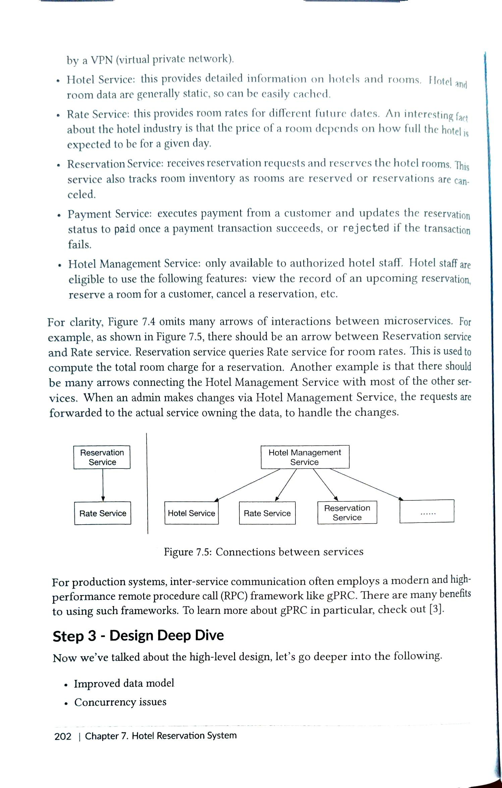

* **Hotel Service:** Quản lý dữ liệu thông tin chi tiết về khách sạn và phòng nghỉ. Do bản chất dữ liệu này mang tính tĩnh (**Static Data**), hệ thống có thể dễ dàng áp dụng cơ chế bộ đệm (**Cache**) để giảm tải truy vấn cơ sở dữ liệu.
* **Rate Service:** Cung cấp thông tin biểu giá phòng biến động theo từng ngày cụ thể trong tương lai.
* **Reservation Service:** Xử lý toàn bộ logic nghiệp vụ đặt phòng, kiểm tra phòng trống và cập nhật trạng thái phòng khi phát sinh giao dịch đặt hoặc hủy phòng.
* **Payment Service:** Tiếp nhận và xử lý các giao dịch thanh toán từ khách hàng; cập nhật trạng thái đặt phòng thành `PAID` (đã thanh toán) khi giao dịch tài chính thành công, hoặc `REJECTED` (từ chối) nếu giao dịch thất bại.
* **Hotel Management Service:** Dịch vụ nghiệp vụ dành riêng cho nhân viên khách sạn với các tính năng: tra cứu hồ sơ đặt phòng sắp tới, đặt phòng thủ công cho khách, hủy đặt phòng,...

---

### Giao Tiếp Giữa Các Dịch Vụ (Inter-Service Communication)

Để giữ sơ đồ mạch lạc, **Hình 7.4** đã lược giản các luồng tương tác giữa các vi dịch vụ. 

Trên thực tế, như được mô tả trong **Hình 7.5**:
* Phải có luồng kết nối giữa `Reservation Service` và `Rate Service`. `Reservation Service` truy vấn `Rate Service` để lấy đơn giá phòng theo thời gian thực nhằm tính toán tổng chi phí đặt phòng.
* Tương tự, `Hotel Management Service` sẽ kết nối với hầu hết các vi dịch vụ còn lại. Khi người quản trị thực hiện các thay đổi thông qua giao diện quản trị, các yêu cầu sẽ được chuyển tiếp trực tiếp đến dịch vụ nắm giữ bản ghi dữ liệu gốc (**Data Owner**) để xử lý.


*Hình 7.5: Các kết nối giữa các dịch vụ (Connections between services)*

> [!NOTE]  
> Trong môi trường sản xuất (**Production Systems**), cơ chế giao tiếp liên dịch vụ (**Inter-Service Communication**) thường ưu tiên triển khai các khung giao thức gọi thủ tục từ xa (**RPC Framework**) hiện đại, hiệu năng cao và độ trễ thấp như **gRPC**.

---

## Bước 3: Đi Sâu Vào Thiết Kế Kỹ Thuật Chi Tiết (Design Deep Dive)

Sau khi đã thống nhất được kiến trúc tổng quan, chúng ta sẽ đi sâu vào các khía cạnh kỹ thuật then chốt sau:
1. **Mô hình dữ liệu cải tiến (Improved Data Model)**
2. **Xử lý xung đột đồng thời (Concurrency Issues)**
3. **Mở rộng hệ thống (Scaling the System)**
4. **Giải quyết vấn đề bất đồng nhất dữ liệu trong kiến trúc vi dịch vụ (Data Inconsistency in Microservice Architecture)**

---

### 1. Mô Hình Dữ Liệu Cải Tiến (Improved Data Model)

Như đã đề cập trong phần thiết kế cấp cao, khi người dùng đặt phòng, hệ thống thực chất đặt **loại phòng** (*Room Type*) thay vì một số phòng cụ thể ngay lập tức. Cần điều chỉnh schema cơ sở dữ liệu và API như thế nào để đáp ứng nghiệp vụ này?

Trong API đặt phòng, tham số `roomID` được thay thế bằng `roomTypeID`. Endpoint khởi tạo đặt phòng có cấu trúc như sau:

```http
POST /v1/reservations
```

**Tham số yêu cầu (Request Parameters):**
```json
{
  "startDate": "2021-04-28",
  "endDate": "2021-04-30",
  "hotelID": "245",
  "roomTypeID": "12354673389",
  "reservationID": "13422445"
}
```

Mô hình Schema cơ sở dữ liệu cập nhật được thể hiện trong **Hình 7.6**:

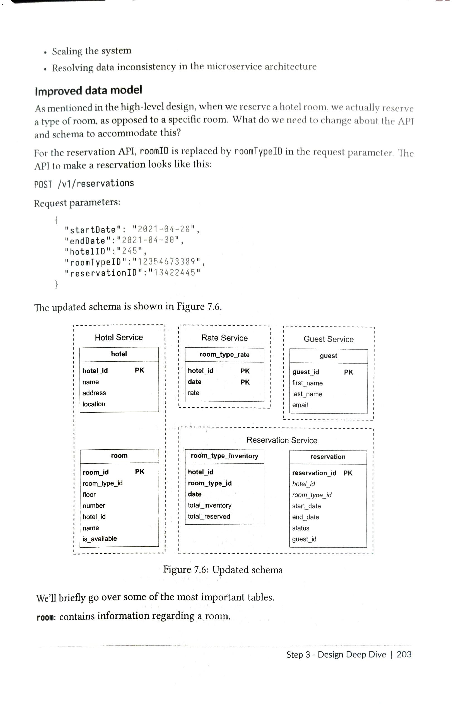
*Hình 7.6: Mô hình dữ liệu cập nhật (Updated schema)*

---

### Chi Tiết Các Bảng Dữ Liệu Cốt Lõi

* **`room`**: Lưu trữ thông tin chi tiết của từng phòng vật lý (số phòng, tầng,...).
* **`room_type_rate`**: Lưu trữ thông tin giá theo từng loại phòng cho các ngày trong tương lai.
* **`reservation`**: Ghi nhận toàn bộ dữ liệu đơn đặt phòng của khách hàng.
* **`room_type_inventory`**: Bảng trung tâm quản lý số lượng tồn kho của các loại phòng. Đây là bảng quan trọng bậc nhất trong hệ thống đặt phòng:
  * `hotel_id`: Định danh duy nhất của khách sạn.
  * `room_type_id`: Định danh loại phòng.
  * `date`: Một ngày cụ thể.
  * `total_inventory`: Tổng số lượng phòng hiện có (đã trừ đi số lượng phòng tạm dừng kinh doanh do bảo trì/sửa chữa).
  * `total_reserved`: Tổng số phòng đã được đặt cho bộ ba `(hotel_id, room_type_id, date)`.

> [!TIP]  
> Dù có nhiều cách tiếp cận để thiết kế bảng kiểm kê, việc lưu trữ **mỗi ngày là một hàng riêng biệt** giúp các truy vấn kiểm tra và quản lý đặt phòng trong một khoảng thời gian (*Date Range Queries*) trở nên trực quan và tối ưu. Bộ ba `(hotel_id, room_type_id, date)` đóng vai trò là khóa chính tổng hợp (**Composite Primary Key**).

Dữ liệu cho bảng này được khởi tạo trước (**Pre-populated**) cho toàn bộ các ngày trong tương lai trong vòng **2 năm**. Một tác vụ định kỳ chạy hàng ngày (**Scheduled Daily Job**) sẽ tự động nạp dữ liệu gối đầu khi thời gian tiến về phía trước.

---

### Ước Tính Dung Lượng Lưu Trữ (Storage Estimation)

Giả định hệ thống quản lý **5.000** khách sạn, mỗi khách sạn có trung bình **20** loại phòng khác nhau:

$$\text{Tổng số bản ghi} = 5.000 \times 20 \times 2 \times 365 = 73.000.000\text{ hàng (73 triệu bản ghi)}$$

73 triệu bản ghi không phải là dung lượng quá lớn, hoàn toàn có thể lưu trữ trên một máy chủ cơ sở dữ liệu đơn lẻ. Tuy nhiên, một máy chủ duy nhất sẽ tạo ra điểm lỗi đơn (**Single Point of Failure - SPOF**). Để đảm bảo tính sẵn sàng cao (**High Availability**), giải pháp là thiết lập cơ chế nhân bản cơ sở dữ liệu (**Database Replication**) qua nhiều vùng khả dụng (**Availability Zones - AZ**) hoặc đa khu vực (**Multi-Region**).

**Bảng 7.4: Dữ liệu mẫu bảng `room_type_inventory`**

| `hotel_id` | `room_type_id` | `date` | `total_inventory` | `total_reserved` |
| :--- | :--- | :--- | :--- | :--- |
| 211 | 1001 | 2021-06-01 | 100 | 80 |
| 211 | 1001 | 2021-06-02 | 100 | 82 |
| 211 | 1001 | 2021-06-03 | 100 | 86 |
| ... | ... | ... | ... | ... |
| 211 | 1001 | 2023-05-31 | 100 | 0 |
| 211 | 1002 | 2021-06-01 | 200 | 164 |
| 2210 | 101 | 2021-06-01 | 30 | 23 |
| 2210 | 101 | 2021-06-02 | 30 | 25 |

---

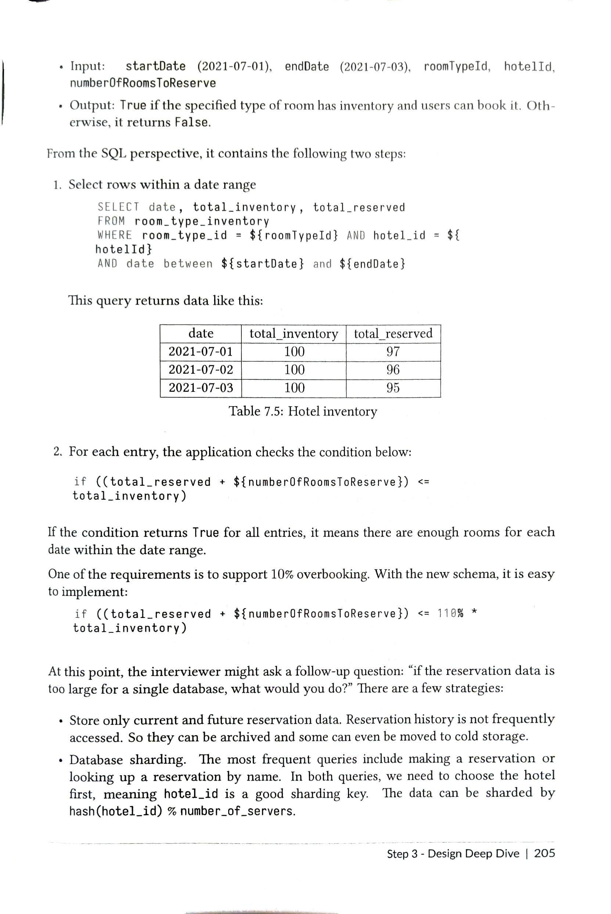

### Quy Trình Kiểm Tra Tồn Kho Phòng Trống

Hệ thống sử dụng bảng `room_type_inventory` để kiểm tra khả năng phục vụ đơn đặt phòng:
* **Đầu vào (Input):** `startDate` (2021-07-01), `endDate` (2021-07-03), `roomTypeId`, `hotelId`, `numberOfRoomsToReserve`.
* **Đầu ra (Output):** Trả về `True` nếu loại phòng yêu cầu còn đủ số lượng tồn trống trong toàn bộ khoảng thời gian; ngược lại trả về `False`.

Về mặt truy vấn SQL, quy trình gồm 2 bước:

#### Bước 1: Truy Vấn Các Bản Ghi Trong Khoảng Thời Gian
```sql
SELECT date, total_inventory, total_reserved
FROM room_type_inventory
WHERE room_type_id = $roomTypeId 
  AND hotel_id = $hotelId
  AND date BETWEEN $startDate AND $endDate;
```

Kết quả trả về dạng:

**Bảng 7.5: Tồn kho phòng khách sạn**

| `date` | `total_inventory` | `total_reserved` |
| :--- | :--- | :--- |
| 2021-07-01 | 100 | 97 |
| 2021-07-02 | 100 | 96 |
| 2021-07-03 | 100 | 95 |

#### Bước 2: Kiểm Tra Điều Kiện Nghiệp Vụ Tại Ứng Dụng
Ứng dụng duyệt qua từng ngày và kiểm tra điều kiện:
```python
if (total_reserved + numberOfRoomsToReserve) <= total_inventory:
    # Hợp lệ
```
Nếu điều kiện trên thỏa mãn cho **tất cả** các ngày trong dải ngày đặt, hệ thống xác nhận còn đủ phòng trống.

> [!TIP]  
> **Hỗ trợ đặt phòng vượt mức (Overbooking):**  
> Một trong các yêu cầu nghiệp vụ thực tế là cho phép bán vượt mức 10% công suất phòng. Với mô hình dữ liệu này, điều kiện logic được mở rộng:
> ```python
> if (total_reserved + numberOfRoomsToReserve) <= (1.10 * total_inventory):
>     # Hợp lệ với chính sách overbooking 10%
> ```

---

### Chiến Lược Mở Rộng Cơ Sở Dữ Liệu Khi Quy Mô Vượt Ngưỡng (Scaling Storage)

Khi khối lượng dữ liệu đặt phòng tăng trưởng vượt quá giới hạn chịu tải của một nút cơ sở dữ liệu duy nhất, các giải pháp phân tán được áp dụng:

1. **Lưu trữ phân tầng (Data Archiving & Cold Storage):** Chỉ duy trì dữ liệu đặt phòng hiện tại và tương lai trên cơ sở dữ liệu hoạt động (**Active Database**). Dữ liệu lịch sử hiếm khi được truy xuất nên có thể định kỳ chuyển sang lưu trữ trữ lạnh (**Cold Storage**).
2. **Phân mảnh cơ sở dữ liệu (Database Sharding):** Các truy vấn phổ biến nhất luôn gắn liền với mã khách sạn (`hotel_id`). Do đó, `hotel_id` là một khóa phân mảnh lý tưởng (**Sharding Key**). Dữ liệu được phân bổ đồng đều qua thuật toán băm:
   $$\text{Shard ID} = \text{hash}(\text{hotel\_id}) \pmod{\text{number\_of\_servers}}$$

---

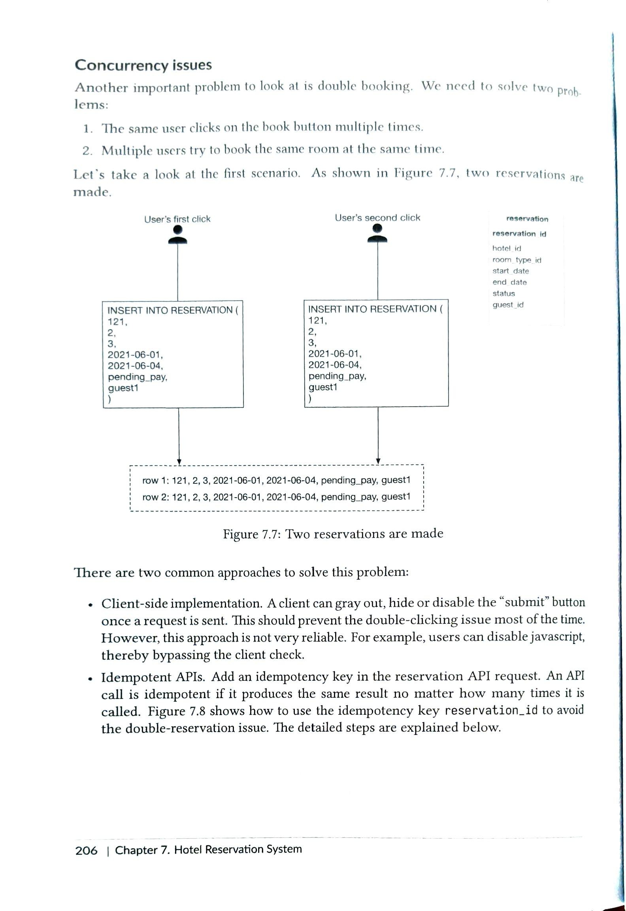

### 2. Xử Lý Các Vấn Đề Đồng Thời (Concurrency Issues)

Trong hệ thống đặt phòng quy mô lớn, hai thách thức nghiêm trọng về tương tranh (**Concurrency**) bao gồm:
1. **Cùng một người dùng nhấn nút đặt phòng nhiều lần liên tiếp (Double Booking do Double Click).**
2. **Nhiều người dùng cùng cố gắng đặt loại phòng cuối cùng tại cùng một thời điểm (Race Condition / Overbooking ngoài dự tính).**

---

#### Vấn Đề 1: Người Dùng Nhấn Đặt Phòng Nhiều Lần (Double Clicking)


*Hình 7.7: Hai bản ghi đặt phòng bị tạo trùng (Two reservations are made)*

Như thể hiện trong **Hình 7.7**, khi khách hàng nhấn nút gửi yêu cầu hai lần liên tiếp với độ trễ cực ngắn, hai câu lệnh `INSERT INTO reservation` độc lập sẽ được thực thi đồng thời, dẫn đến việc tạo ra 2 bản ghi đặt phòng bị trùng lặp cho cùng một giao dịch.

Có hai phương án kỹ thuật xử lý vấn đề này:

* **Xử lý tại tầng Client (Client-Side Implementation):** Vô hiệu hóa (*disable*), làm mờ (*gray out*) hoặc ẩn nút "Submit" ngay sau khi lượt click đầu tiên được kích hoạt. Tuy nhiên, phương án này **không đáng tin cậy tuyệt đối** do người dùng có thể can thiệp (ví dụ: tắt JavaScript trên trình duyệt hoặc gửi trực tiếp HTTP requests từ client ngoài).
* **Thiết Kế API Đảm Bảo Tính Bất Biến / Khả Đẳng (Idempotent APIs):** Bổ sung một mã bất biến (**Idempotency Key**) vào thân yêu cầu API đặt phòng. Một lời gọi API được định nghĩa là có tính bất biến (**Idempotent**) nếu việc thực thi nó nhiều lần với cùng một tham số đều mang lại kết quả trạng thái duy nhất giống như khi thực thi một lần. 

Trong hệ thống này, trường `reservation_id` được sử dụng làm **Idempotency Key** để ngăn chặn hoàn toàn việc tạo đơn hàng trùng lặp.

# CHƯƠNG 7: HỆ THỐNG ĐẶT PHÒNG KHÁCH SẠN (HOTEL RESERVATION SYSTEM)

---

## BƯỚC 3: THIẾT KẾ ĐI SÂU VÀO CHI TIẾT (STEP 3 - DESIGN DEEP DIVE)

### Xử lý Đặt trùng lặp (Double Reservation) & Ràng buộc duy nhất (Unique Constraint)

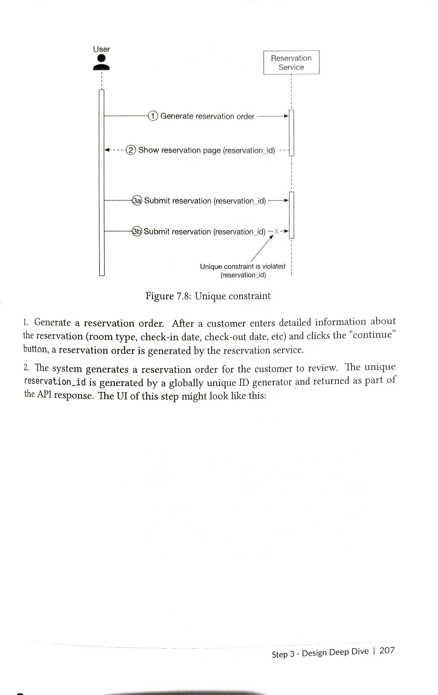

*Hình 7.8: Ràng buộc duy nhất (Unique constraint)*

1. **Khởi tạo đơn đặt phòng (Generate a reservation order):** Sau khi khách hàng nhập thông tin chi tiết về việc đặt phòng (loại phòng, ngày nhận phòng - check-in date, ngày trả phòng - check-out date, v.v.) và nhấp vào nút "Tiếp tục" ("Continue"), một đơn đặt phòng sẽ được khởi tạo bởi dịch vụ đặt phòng (reservation service). Mã định danh đặt phòng (`reservation_id`) sẽ được trả về trong phản hồi API (API response). Giao diện người dùng (UI) của bước này có thể trông như sau:

---

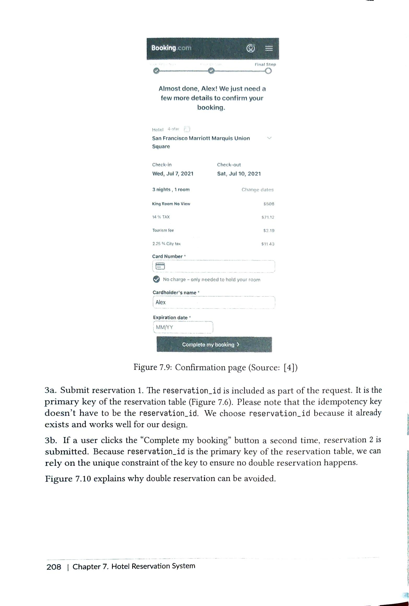

*Hình 7.9: Trang xác nhận (Confirmation page - Nguồn: [4])*

* **3a. Gửi yêu cầu đặt phòng lần 1 (Submit reservation 1):** `reservation_id` được đính kèm như một phần của yêu cầu (request). Đây là khóa chính (primary key) của bảng đặt phòng `reservation` (Hình 7.6). Xin lưu ý rằng khóa lũy kế/khóa chống trùng lặp (idempotency key) không nhất thiết phải là `reservation_id`. Chúng tôi chọn `reservation_id` vì nó đã tồn tại sẵn và hoạt động hiệu quả cho thiết kế của chúng ta.
* **3b. Nếu người dùng nhấp vào nút "Hoàn tất đặt phòng của tôi" ("Complete my booking") lần thứ hai:** Yêu cầu đặt phòng lần 2 (reservation 2) được gửi đi. Bởi vì `reservation_id` là khóa chính của bảng `reservation`, chúng ta có thể dựa vào ràng buộc duy nhất (unique constraint) của khóa này để đảm bảo không xảy ra hiện tượng đặt phòng trùng lặp (no double reservation). 

Hình 7.10 giải thích lý do tại sao việc đặt phòng trùng lặp có thể tránh được:

---

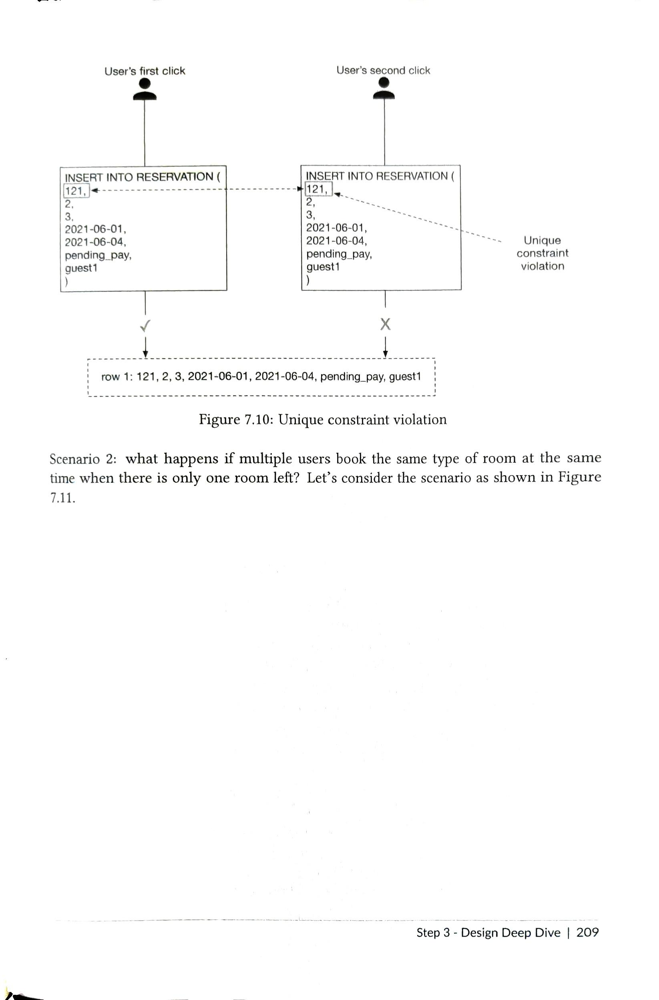

*Hình 7.10: Vi phạm ràng buộc duy nhất (Unique constraint violation)*

```sql
-- Lần nhấp đầu tiên của người dùng (User's first click)
INSERT INTO RESERVATION(
    121,
    2,
    3,
    2021-06-01,
    2021-06-04,
    pending_pay,
    guest1
);
-- Kết quả: Thành công chèn dòng 1: row 1: 121, 2, 3, 2021-06-01, 2021-06-04, pending_pay, guest1

-- Lần nhấp thứ hai của người dùng (User's second click)
INSERT INTO RESERVATION(
    121,
    2,
    3,
    2021-06-01,
    2021-06-04,
    pending_pay,
    guest1
);
-- Kết quả: Vi phạm ràng buộc duy nhất (Unique constraint violation)!
```

---

### Kịch bản 2: Điều gì xảy ra nếu nhiều người dùng cùng đặt một loại phòng tại cùng một thời điểm khi chỉ còn lại duy nhất 1 phòng?

Hãy cùng xem xét kịch bản được minh họa trong Hình 7.11.

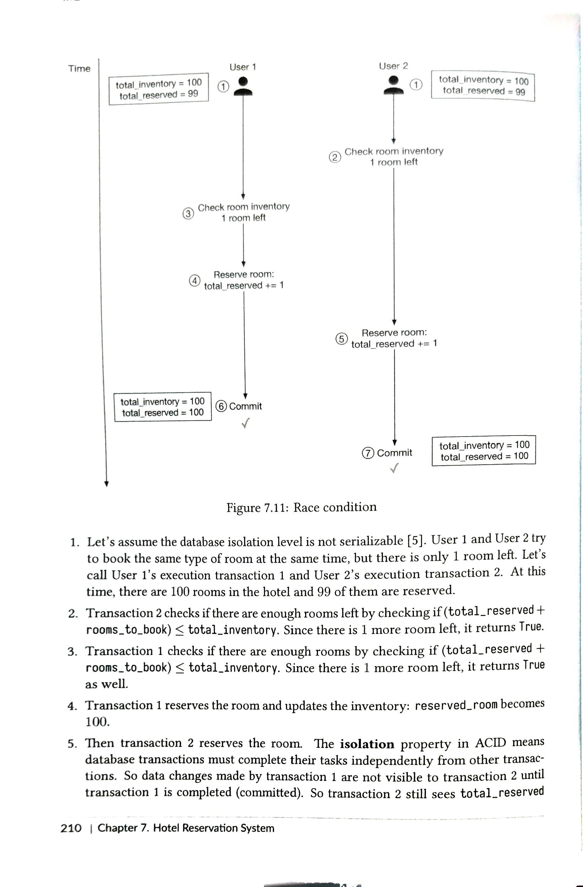

*Hình 7.11: Điều kiện tương tranh (Race condition)*

1. Giả sử mức độ cô lập của cơ sở dữ liệu (database isolation level) không phải là tuần tự hóa (serializable) [5]. Người dùng 1 (User 1) và Người dùng 2 (User 2) cùng cố gắng đặt cùng một loại phòng tại cùng một thời điểm, nhưng chỉ còn lại duy nhất 1 phòng trống. Hãy gọi tiến trình thực thi của User 1 là Giao dịch 1 (transaction 1) và của User 2 là Giao dịch 2 (transaction 2). Tại thời điểm này, khách sạn có tổng cộng 100 phòng (`total_inventory = 100`) và 99 phòng trong số đó đã được đặt trước (`total_reserved = 99`).
2. Giao dịch 2 kiểm tra xem còn đủ phòng hay không bằng biểu thức kiểm tra:
   $$\text{if } (\text{total\_reserved} + \text{rooms\_to\_book}) \le \text{total\_inventory}$$
   Vì vẫn còn lại 1 phòng trống, hệ thống trả về `True`.
3. Giao dịch 1 cũng kiểm tra xem còn đủ phòng hay không bằng biểu thức kiểm tra:
   $$\text{if } (\text{total\_reserved} + \text{rooms\_to\_book}) \le \text{total\_inventory}$$
   Vì vẫn còn lại 1 phòng trống, hệ thống cũng trả về `True`.
4. Giao dịch 1 tiến hành giữ phòng và cập nhật lượng tồn kho (inventory): `total_reserved` trở thành 100.
5. Sau đó, Giao dịch 2 tiến hành giữ phòng. Thuộc tính cô lập (Isolation) trong chuẩn ACID quy định rằng các giao dịch cơ sở dữ liệu phải hoàn thành tác vụ của chúng một cách độc lập với các giao dịch khác đang diễn ra đồng thời, trừ khi giao dịch 1 đã hoàn tất (đã được `commit`). Do đó, Giao dịch 2 vẫn nhìn thấy giá trị `total_reserved` là 99 và thực hiện giữ phòng bằng cách cập nhật tồn kho: `total_reserved` trở thành 100. Điều này dẫn đến việc hệ thống cho phép cả hai người dùng cùng đặt phòng thành công, trong khi thực tế chỉ còn lại đúng 1 phòng duy nhất.
6. Giao dịch 1 commit thay đổi thành công.
7. Giao dịch 2 commit thay đổi thành công.

> [!IMPORTANT]
> **Vấn đề tranh chấp dữ liệu (Race Condition):** Giải pháp cho bài toán này nhìn chung đòi hỏi một cơ chế khóa (locking mechanism). Chúng ta sẽ xem xét và khám phá các kỹ thuật sau:
> * Khóa bi quan (Pessimistic locking)
> * Khóa lạc quan (Optimistic locking)
> * Ràng buộc cơ sở dữ liệu (Database constraints)

Trước khi đi sâu vào giải pháp khắc phục, hãy cùng xem qua đoạn mã giả SQL (SQL pseudo-code) được sử dụng để đặt phòng. Câu lệnh SQL bao gồm hai phần:
1. Kiểm tra lượng tồn kho phòng (Check room inventory)
2. Giữ phòng/Đặt phòng (Reserve a room)

```sql
# Bước 1: Kiểm tra lượng tồn kho phòng (check room inventory)
SELECT date, total_inventory, total_reserved
FROM room_type_inventory
WHERE room_type_id = ${roomTypeId} AND hotel_id = ${hotelId}
  AND date BETWEEN ${startDate} AND ${endDate};

# Đối với mỗi bản ghi được trả về từ Bước 1
if ((total_reserved + ${numberOfRoomsToReserve}) > 110% * total_inventory)
    Rollback;

# Bước 2: Giữ phòng (reserve rooms)
UPDATE room_type_inventory
SET total_reserved = total_reserved + ${numberOfRoomsToReserve}
WHERE room_type_id = ${roomTypeId}
  AND date BETWEEN ${startDate} AND ${endDate};
Commit;
```

---

### Tùy chọn 1: Khóa bi quan (Option 1: Pessimistic locking)

Khóa bi quan (Pessimistic locking) [6], còn được gọi là kiểm soát tương tranh bi quan (pessimistic concurrency control), ngăn chặn việc cập nhật đồng thời bằng cách đặt một khóa (lock) lên bản ghi ngay khi một người dùng bắt đầu cập nhật nó. Những người dùng khác muốn cập nhật bản ghi đó bắt buộc phải chờ đợi cho đến khi người dùng đầu tiên giải phóng khóa (commit các thay đổi).

Đối với MySQL, câu lệnh `SELECT ... FOR UPDATE` hoạt động bằng cách khóa các hàng (row-level lock) được trả về bởi truy vấn lựa chọn. Giả sử một giao dịch được bắt đầu bởi "transaction 1". Các giao dịch khác muốn truy cập cùng hàng dữ liệu sẽ phải chờ.

Phần giải thích chi tiết được thể hiện trong Hình 7.12:

---

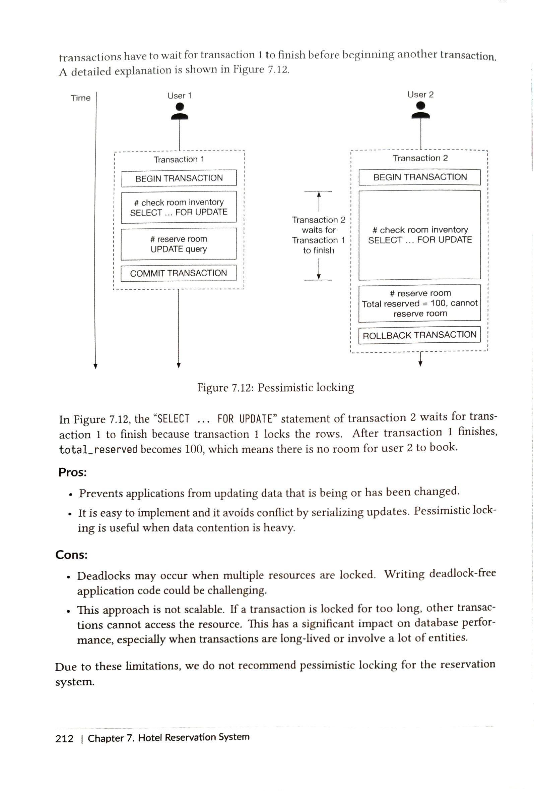

*Hình 7.12: Khóa bi quan (Pessimistic locking)*

Trong Hình 7.12, câu lệnh `SELECT ... FOR UPDATE` của Giao dịch 2 (transaction 2) phải chờ Giao dịch 1 (transaction 1) hoàn tất vì Giao dịch 1 đang khóa các hàng dữ liệu đó. Sau khi Giao dịch 1 hoàn tất và commit, `total_reserved` đã trở thành 100, đồng nghĩa với việc không còn phòng trống nào cho User 2 đặt nữa, dẫn đến việc Giao dịch 2 phải `ROLLBACK TRANSACTION`.

#### Ưu điểm (Pros):
* Ngăn chặn ứng dụng cập nhật dữ liệu đang bị hoặc đã bị thay đổi bởi giao dịch khác.
* Dễ dàng triển khai và tránh được xung đột bằng cách tuần tự hóa các thao tác cập nhật (serializing updates). Khóa bi quan rất hữu ích khi mức độ tranh chấp dữ liệu (data contention) ở mức cao.

#### Nhược điểm (Cons):
* Tắc nghẽn bế tắc (Deadlocks) có thể xảy ra khi có nhiều tài nguyên bị khóa đồng thời. Việc viết mã nguồn ứng dụng hoàn toàn không bị deadlock có thể là một thử thách lớn.
* Cách tiếp cận này **không có khả năng mở rộng tốt (not scalable)**. Nếu một giao dịch giữ khóa quá lâu, các giao dịch khác sẽ không thể truy cập vào tài nguyên. Điều này gây ảnh hưởng nghiêm trọng đến hiệu năng (performance) và độ trễ (latency) của cơ sở dữ liệu, đặc biệt là khi các giao dịch tồn tại lâu (long-lived transactions) hoặc liên quan đến nhiều thực thể dữ liệu (entities).

> [!WARNING]
> Do các hạn chế nghiêm trọng về khả năng mở rộng (scalability) và nguy cơ tắc nghẽn (deadlock), chúng tôi **không khuyến nghị** sử dụng khóa bi quan (pessimistic locking) cho hệ thống đặt phòng khách sạn.

# CHƯƠNG 7: HỆ THỐNG ĐẶT PHÒNG KHÁCH SẠN (HOTEL RESERVATION SYSTEM)

---

## Bước 3 - Đi Sâu Vào Thiết Kế Chi Tiết (Step 3 - Design Deep Dive)

### Lựa Chọn 2: Khóa Lạc Quan (Option 2: Optimistic Locking)

Có hai phương thức phổ biến để triển khai khóa lạc quan (*Optimistic Locking*): **số phiên bản (*version number*)** và **nhãn thời gian (*timestamp*)**. Sử dụng số phiên bản nhìn chung được coi là lựa chọn tối ưu hơn vì đồng hồ hệ thống của máy chủ (*server clock*) có thể bị lệch (sai số trôi dạt thời gian - *clock drift*) theo thời gian. Chúng tôi sẽ giải thích phương thức hoạt động của khóa lạc quan kết hợp cùng số phiên bản.

**Hình 7.13** minh họa một trường hợp xử lý thành công và một trường hợp gặp xung đột thất bại.

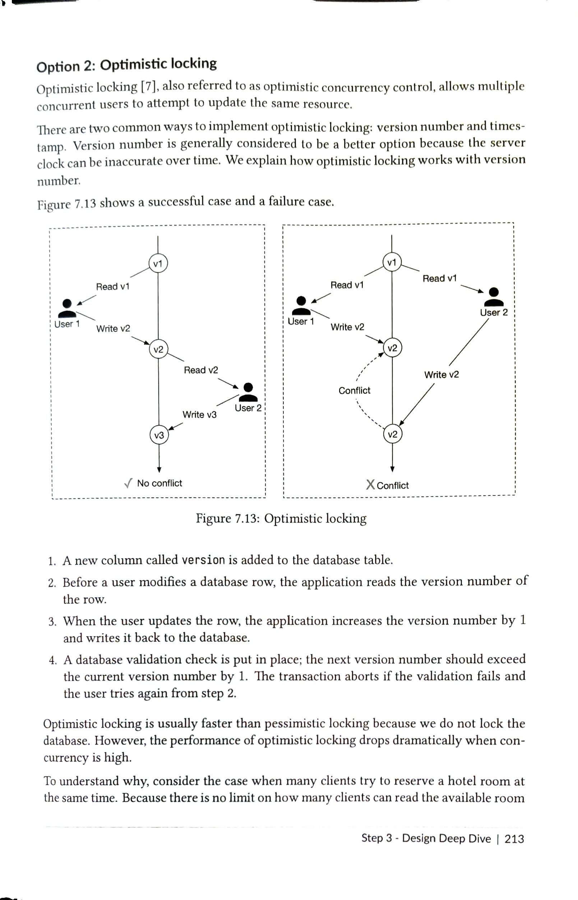
*Hình 7.13: Khóa lạc quan (Optimistic locking)*

**Quy trình từng bước:**
1. Một cột mới có tên là `version` được thêm vào bảng cơ sở dữ liệu (*database table*).
2. Trước khi người dùng chỉnh sửa một hàng trong cơ sở dữ liệu (*database row*), tầng ứng dụng (*application layer*) sẽ đọc giá trị số phiên bản (`version number`) hiện tại của hàng đó.
3. Khi người dùng thực hiện cập nhật hàng, ứng dụng sẽ tăng số phiên bản lên thêm 1 (`version + 1`) và ghi ngược trở lại cơ sở dữ liệu.
4. Một bước kiểm tra tính hợp lệ (*validation check*) ở mức cơ sở dữ liệu được kích hoạt: số phiên bản mới kế tiếp bắt buộc phải lớn hơn số phiên bản hiện tại đúng 1 đơn vị. Giao dịch (*transaction*) sẽ bị hủy bỏ (*abort/rollback*) nếu bước kiểm tra này thất bại, và người dùng sẽ phải thử lại từ Bước 2.

Khóa lạc quan (*Optimistic locking*) thường có tốc độ xử lý nhanh hơn khóa bi quan (*Pessimistic locking*) do chúng ta không cần phải khóa giữ tài nguyên cơ sở dữ liệu (*database locks*). Tuy nhiên, hiệu năng (*performance*) của khóa lạc quan sẽ sụt giảm nghiêm trọng khi độ tương tranh (*concurrency*) tăng cao.

Để hiểu rõ nguyên nhân, hãy xem xét trường hợp có rất nhiều máy khách (*clients*) cùng cố gắng đặt một phòng khách sạn tại cùng một thời điểm. Do không có giới hạn về số lượng client có thể đọc số lượng phòng trống hiện có (*available room count*), tất cả bọn họ đều đọc về cùng một giá trị số phòng trống và cùng một số phiên bản hiện tại. Khi các client khác nhau tiến hành đặt phòng và ghi ngược kết quả vào cơ sở dữ liệu, **chỉ duy nhất một client thực hiện thành công**, và toàn bộ các client còn lại đều sẽ nhận về thông báo thất bại trong kiểm tra phiên bản (*version check failure*). 

Các client thất bại này buộc phải thử lại (*retry*). Trong lượt thử lại tiếp theo, lại chỉ có duy nhất một client thành công, và phần còn lại vẫn tiếp tục phải retry. Mặc dù kết quả cuối cùng đảm bảo tính toàn vẹn dữ liệu chuẩn xác, nhưng việc phải liên tục thử lại (*repeated retries*) sẽ gây ra trải nghiệm người dùng (*User Experience - UX*) vô cùng tồi tệ.

#### Ưu Điểm (Pros):
- Ngăn chặn triệt để tình trạng ứng dụng chỉnh sửa dữ liệu đã lỗi thời (*stale data*).
- Không cần phải khóa giữ tài nguyên của cơ sở dữ liệu. Đứng từ góc độ của database, trên thực tế không hề có cơ chế khóa (*no locking*) nào diễn ra. Toàn bộ logic kiểm soát xung đột bằng số phiên bản được giao phó hoàn toàn cho tầng ứng dụng xử lý.
- Khóa lạc quan thường được sử dụng lý tưởng khi mức độ tranh chấp dữ liệu (*data contention*) ở mức thấp. Khi xung đột hiếm khi xảy ra, các giao dịch có thể hoàn tất mà không phải chịu chi phí tài nguyên tốn kém cho việc quản lý khóa (*lock management overhead*).

#### Nhược Điểm (Cons):
- Hiệu năng (*Performance*) rất kém khi mức độ tranh chấp dữ liệu tăng cao (*heavy data contention*).

> [!TIP]
> Khóa lạc quan (*Optimistic locking*) là một lựa chọn tốt đối với hệ thống đặt phòng khách sạn thông thường, bởi vì chỉ số truy vấn mỗi giây (*QPS - Queries Per Second*) cho thao tác đặt phòng (write/booking) nhìn chung không quá cao.

---

### Lựa Chọn 3: Ràng Buộc Cơ Sở Dữ Liệu (Option 3: Database Constraints)

Cách tiếp cận này rất tương đồng với khóa lạc quan (*Optimistic locking*). Hãy cùng khám phá cơ chế hoạt động của nó. Trong bảng `room_type_inventory`, chúng ta bổ sung thêm ràng buộc (*constraint*) sau:

```sql
CONSTRAINT 'check_room_count' CHECK((total_inventory - total_reserved >= 0))
```

Sử dụng cùng ví dụ như được minh họa ở **Hình 7.14**: Khi Người dùng 2 (*User 2*) cố gắng đặt một phòng, `total_reserved` sẽ trở thành 101, điều này vi phạm trực tiếp ràng buộc `total_inventory (100) - total_reserved (101) >= 0`. Giao dịch (*transaction*) ngay lập tức bị hoàn tác (*rolled back*).

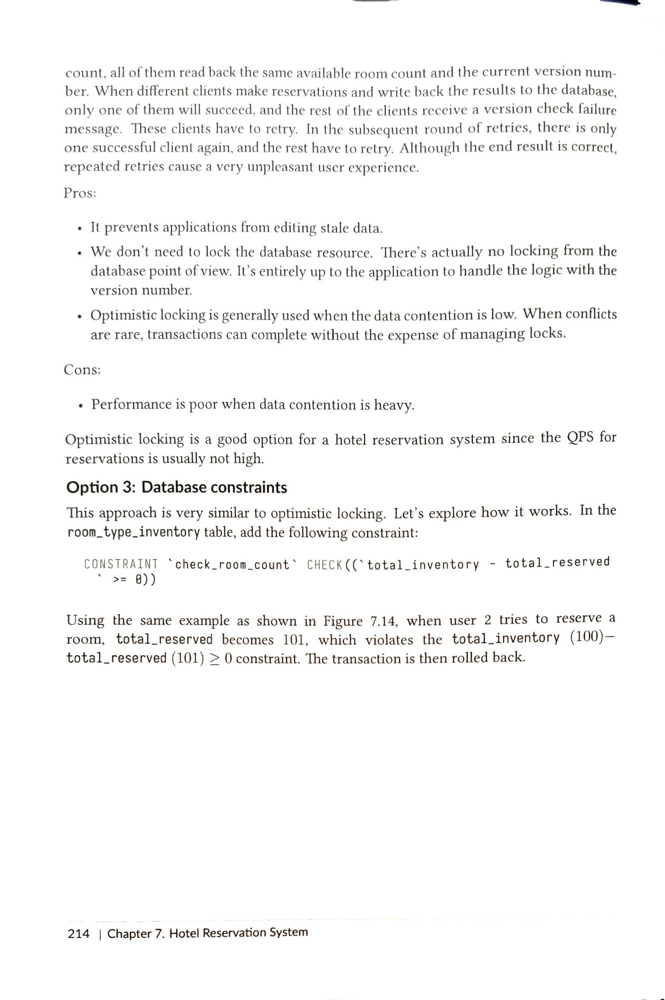
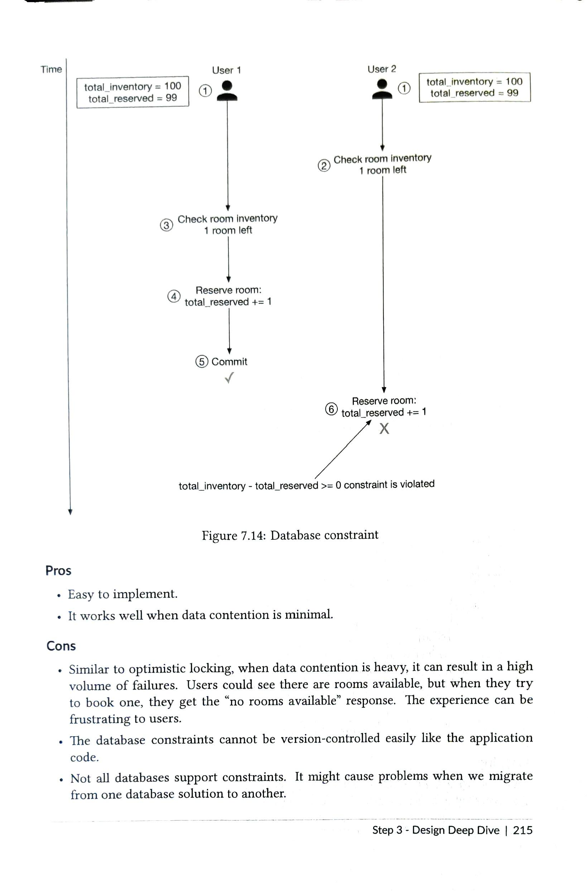
*Hình 7.14: Ràng buộc cơ sở dữ liệu (Database constraint)*

#### Ưu Điểm (Pros):
- Dễ dàng triển khai (*Easy to implement*).
- Hoạt động rất hiệu quả khi mức độ tranh chấp dữ liệu ở mức tối thiểu (*minimal data contention*).

#### Nhược Điểm (Cons):
- Tương tự như khóa lạc quan, khi mức độ tranh chấp dữ liệu cao, giải pháp này có thể dẫn đến một lượng lớn giao dịch thất bại (*high volume of failures*). Người dùng có thể nhìn thấy phòng vẫn còn trống, nhưng khi họ bấm đặt phòng thì lại nhận được phản hồi "hết phòng" (*no rooms available*). Trải nghiệm này có thể khiến người dùng cảm thấy rất ức chế.
- Các ràng buộc cơ sở dữ liệu (*database constraints*) không thể quản lý phiên bản mã nguồn (*version-controlled*) một cách dễ dàng và linh hoạt như mã nguồn ứng dụng (*application code*).
- Không phải mọi hệ quản trị cơ sở dữ liệu đều hỗ trợ ràng buộc (`CHECK constraints`). Điều này có thể phát sinh vấn đề tương thích khi chúng ta di chuyển dữ liệu (*migration*) từ giải pháp cơ sở dữ liệu này sang giải pháp khác.

> [!NOTE]
> Vì giải pháp này dễ triển khai và mức độ tranh chấp dữ liệu đối với việc đặt phòng khách sạn thông thường không cao (chỉ số QPS thấp), đây cũng là một lựa chọn tốt khác cho hệ thống đặt phòng khách sạn.

---

## Khả Năng Mở Rộng (Scalability)

Thông thường, tải (*system load*) của một hệ thống đặt phòng khách sạn nội bộ là không quá lớn. Tuy nhiên, người phỏng vấn kiến trúc có thể đặt ra một câu hỏi đào sâu tiếp nối (*follow-up question*): 

> *"Điều gì sẽ xảy ra nếu hệ thống đặt phòng khách sạn này không chỉ phục vụ cho một chuỗi khách sạn đơn lẻ, mà phục vụ cho một trang web du lịch quy mô toàn cầu cực kỳ phổ biến như Booking.com hay Expedia.com?"*

Trong trường hợp này, chỉ số QPS có thể cao gấp **1.000 lần**.

Khi tải hệ thống lên rất cao, chúng ta cần xác định và thấu hiểu rõ đâu sẽ là điểm nghẽn cổ chai (*bottleneck*). Tất cả các dịch vụ xử lý (*services*) của chúng ta đều là phi trạng thái (*stateless*), vì vậy chúng có thể dễ dàng mở rộng theo chiều ngang (*horizontal scaling / scale out*) bằng cách bổ sung thêm máy chủ. Tuy nhiên, cơ sở dữ liệu (*database*) lại là nơi lưu trữ toàn bộ trạng thái (*stateful*) và không thể mở rộng đơn giản bằng cách chỉ gắn thêm cơ sở dữ liệu. 

Hãy cùng khám phá cách thức mở rộng quy mô cơ sở dữ liệu.

---

### Phân Mảnh Cơ Sở Dữ Liệu (Database Sharding)

Một phương thức hiệu quả để mở rộng cơ sở dữ liệu là áp dụng kỹ thuật **phân mảnh cơ sở dữ liệu (*Database Sharding*)**. Ý tưởng cốt lõi là chia tách dữ liệu trên nhiều cơ sở dữ liệu độc lập sao cho mỗi cơ sở dữ liệu chỉ chứa một phần dữ liệu tổng thể.

Khi thực hiện phân mảnh database, chúng ta cần cân nhắc chiến lược phân phối dữ liệu (*data distribution*). Như đã phân tích từ phần mô hình dữ liệu (*data model*), phần lớn các truy vấn đều bắt buộc phải lọc theo mã định danh khách sạn (`hotel_id`). Do đó, một kết luận tự nhiên và hợp lý là chúng ta sẽ phân mảnh dữ liệu dựa trên `hotel_id` (*shard by hotel_id*). 

Trong **Hình 7.15**, tải hệ thống được phân bổ đồng đều trên 16 phân mảnh (*shards*) bằng hàm băm/chia dư `hotel_id % 16`. 
$$\text{Tải mỗi shard} = \frac{\text{Tổng QPS}}{16} = 1.875\text{ QPS}$$
Con số này hoàn toàn nằm gọn trong ngưỡng năng lực chịu tải của một máy chủ cơ sở dữ liệu MySQL đơn lẻ.

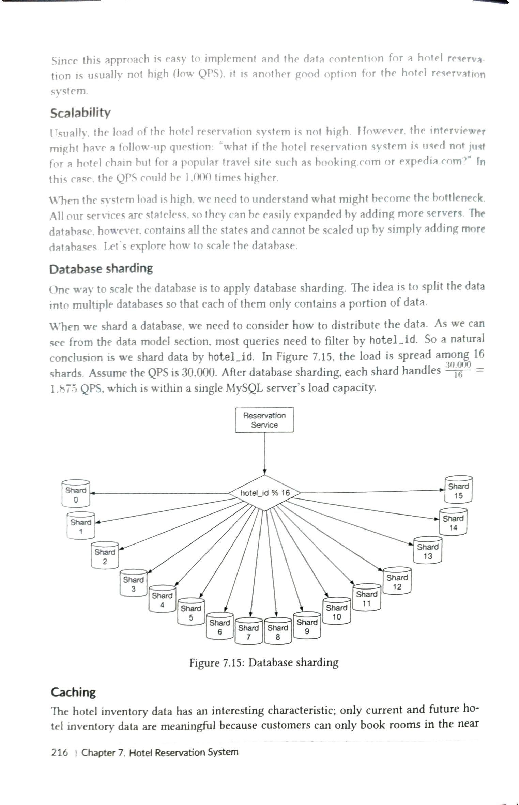
*Hình 7.15: Phân mảnh cơ sở dữ liệu (Database sharding)*

---

### Bộ Nhớ Đệm (Caching)

Dữ liệu tồn kho phòng khách sạn (*hotel inventory data*) mang một đặc tính rất thú vị: **chỉ có dữ liệu tồn kho ở hiện tại và tương lai mới có ý nghĩa thực tế**, bởi vì khách hàng chỉ có thể đặt phòng trong tương lai gần.

Do đó, đối với lựa chọn lưu trữ, về mặt lý tưởng chúng ta mong muốn có một cơ chế **thời gian sống (*TTL - Time-To-Live*)** để tự động hủy và dọn dẹp các dữ liệu cũ đã hết hạn. Dữ liệu lịch sử có thể được lưu trữ và truy vấn trên một cơ sở dữ liệu tách biệt khác. 

**Redis** là một lựa chọn vô cùng thích hợp vì hỗ trợ cơ chế TTL và chính sách loại trừ bộ nhớ đệm theo mức độ ít được sử dụng gần đây nhất (*LRU - Least Recently Used eviction policy*), giúp chúng ta tối ưu hóa triệt để việc sử dụng bộ nhớ (*RAM*).

Nếu tốc độ tải trang và khả năng mở rộng của cơ sở dữ liệu trở thành vấn đề nan giải (chẳng hạn khi chúng ta thiết kế ở quy mô khổng lồ của Booking.com hoặc Expedia), chúng ta có thể bổ sung một tầng bộ nhớ đệm (*cache layer*) nằm trên cơ sở dữ liệu, đồng thời chuyển toàn bộ logic **kiểm tra phòng trống (*check room inventory*)** và **giữ chỗ phòng (*reserve room*)** lên tầng cache này, như được minh họa trong **Hình 7.16**. 

Trong thiết kế này, chỉ có một tỷ lệ rất nhỏ các yêu cầu thực sự chạm tới cơ sở dữ liệu tồn kho (*inventory database*), vì hầu hết các yêu cầu không đủ điều kiện (hết phòng) đều đã bị chặn lại ngay từ tầng cache tồn kho (*inventory cache*). 

> [!IMPORTANT]
> Một điểm đặc biệt quan trọng cần lưu ý: ngay cả khi Redis hiển thị rằng vẫn còn đủ phòng trống, chúng ta vẫn bắt buộc phải kiểm tra lại tính sẵn sàng của phòng một lần nữa tại phía cơ sở dữ liệu như một biện pháp phòng ngừa rủi ro cẩn trọng. Cơ sở dữ liệu luôn luôn là **nguồn chân lý duy nhất (*Source of Truth*)** cho dữ liệu tồn kho phòng.

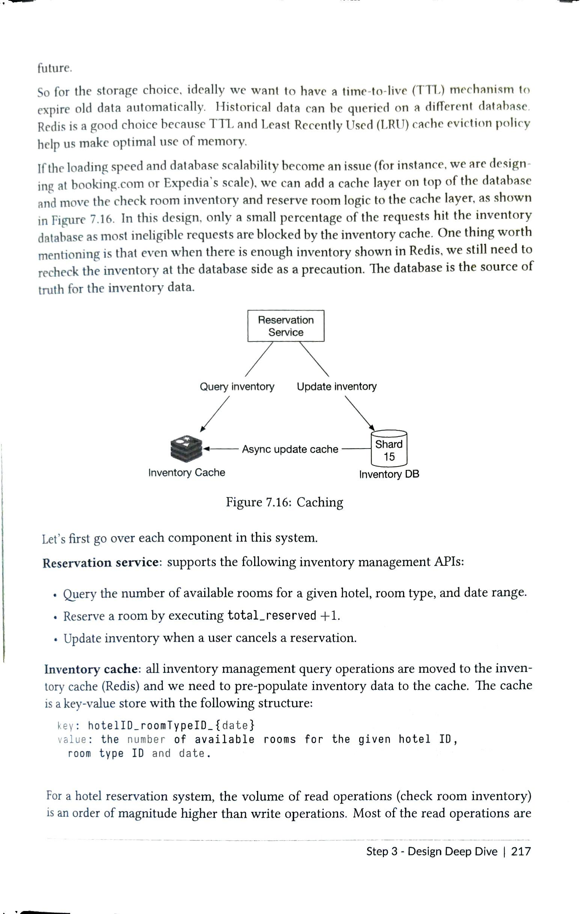
*Hình 7.16: Bộ nhớ đệm (Caching)*

#### Chi Tiết Các Thành Phần Trong Kiến Trúc:

- **Dịch vụ đặt phòng (Reservation service):** Hỗ trợ các giao diện lập trình ứng dụng (*APIs*) quản lý tồn kho sau:
  - Truy vấn số lượng phòng khả dụng cho một khách sạn, loại phòng và khoảng ngày xác định.
  - Đặt giữ phòng bằng cách thực thi lệnh tăng số phòng đã đặt: `total_reserved + 1`.
  - Cập nhật hoàn trả lại tồn kho khi người dùng hủy đặt phòng (*cancellation*).
- **Bộ nhớ đệm tồn kho (Inventory cache):** Toàn bộ các thao tác truy vấn quản lý tồn kho được chuyển dịch sang bộ nhớ đệm tồn kho (Redis) và chúng ta cần nạp sẵn dữ liệu tồn kho vào cache (*pre-populate inventory data*). Cache là một kho lưu trữ dạng khóa - giá trị (*key-value store*) với cấu trúc sau:
  - **Khóa (`key`):** `{hotelID}_{roomTypeID}_{date}`
  - **Giá trị (`value`):** Số lượng phòng còn trống cho bộ thông tin `hotelID`, `roomTypeID` và ngày (`date`) tương ứng.
  
  Đối với hệ thống đặt phòng khách sạn, lưu lượng các thao tác đọc (*read operations* - kiểm tra tồn kho phòng) lớn hơn nhiều bậc độ lớn (*an order of magnitude higher*) so với các thao tác ghi (*write operations* - đặt phòng). Phần lớn các thao tác đọc này đều được giải quyết nhanh chóng bởi bộ nhớ đệm (*cache*).
- **Cơ sở dữ liệu tồn kho (Inventory DB):** Lưu trữ dữ liệu tồn kho và đóng vai trò là **nguồn chân lý tối cao (*source of truth*)**.

---

### Những Thách Thức Mới Do Bộ Nhớ Đệm Đặt Ra (New Challenges Posed by the Cache)

Việc bổ sung thêm một tầng bộ nhớ đệm (*cache layer*) giúp gia tăng đáng kể khả năng mở rộng (*Scalability*) và thông lượng (*Throughput*) của hệ thống, nhưng đồng thời nó cũng đặt ra một thách thức kỹ thuật lớn: **làm thế nào để duy trì tính nhất quán dữ liệu (*Data Consistency*) giữa cơ sở dữ liệu và bộ nhớ đệm?**

Khi người dùng tiến hành đặt phòng, có hai thao tác được thực thi theo luồng thành công lý tưởng (*happy path*):
1. **Truy vấn tồn kho phòng:** Để xác định xem còn đủ số lượng phòng trống hay không. Truy vấn này chạy trực tiếp trên bộ nhớ đệm tồn kho (*Inventory cache*).
2. **Cập nhật dữ liệu tồn kho:** Cơ sở dữ liệu tồn kho (*Inventory DB*) được ghi nhận cập nhật trước. Thay đổi này sau đó được truyền đồng bộ/bất đồng bộ sang bộ nhớ đệm (*asynchronously propagated*). 

Việc cập nhật cache bất đồng bộ này có thể được kích hoạt bởi chính mã nguồn ứng dụng (tầng ứng dụng cập nhật bộ nhớ đệm tồn kho ngay sau khi dữ liệu đã được lưu thành công vào cơ sở dữ liệu). Hoặc dữ liệu có thể được lan truyền bằng cơ chế **Thu thập Thay đổi Dữ liệu (*CDC - Change Data Capture*)** [8]. 

CDC là một cơ chế chuyên biệt đọc các thay đổi dữ liệu trực tiếp từ nhật ký giao dịch của cơ sở dữ liệu và áp dụng các thay đổi đó sang một hệ thống dữ liệu khác. Một giải pháp phổ biến mã nguồn mở là **Debezium** [9]. Nó sử dụng một trình kết nối nguồn (*source connector*) để đọc các biến động từ cơ sở dữ liệu và phản ánh chúng lên các giải pháp bộ nhớ đệm phân tán như Redis [10].

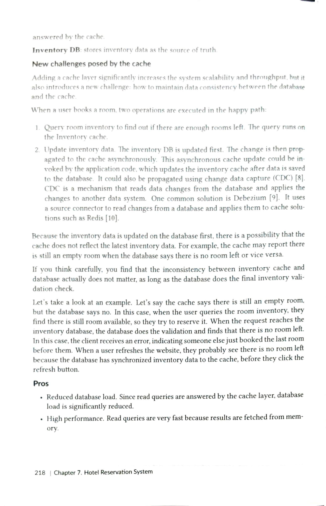

Do dữ liệu tồn kho được cập nhật trên cơ sở dữ liệu trước tiên, hoàn toàn tồn tại khả năng bộ nhớ đệm chưa kịp phản ánh dữ liệu tồn kho mới nhất (hiện tượng trễ đồng bộ - *replication lag*). Ví dụ: cache có thể báo rằng vẫn còn một phòng trống trong khi cơ sở dữ liệu báo rằng đã hết sạch phòng, hoặc ngược lại.

Nếu suy xét kỹ lưỡng, bạn sẽ nhận ra rằng **sự không nhất quán tạm thời giữa cache tồn kho và cơ sở dữ liệu thực chất không gây nguy hại nghiêm trọng**, miễn là cơ sở dữ liệu luôn thực hiện bước kiểm tra xác thực tính hợp lệ của tồn kho cuối cùng (*final inventory validation check*).

**Hãy cùng xem xét ví dụ cụ thể sau:**
Giả sử cache báo rằng vẫn còn một phòng trống, nhưng cơ sở dữ liệu thì ghi nhận đã hết. Trong tình huống này, khi người dùng truy vấn tồn kho phòng, họ thấy phòng vẫn còn trống nên tiến hành bấm đặt phòng. Khi yêu cầu đặt phòng chạm tới cơ sở dữ liệu tồn kho, cơ sở dữ liệu thực thi kiểm tra xác thực và phát hiện ra không còn phòng trống nào. Lúc này, client sẽ nhận được thông báo lỗi cho biết đã có người khác nhanh tay đặt mất căn phòng cuối cùng ngay trước họ. Khi người dùng bấm tải lại (*refresh*) trang web, rất có thể họ sẽ thấy hiển thị hết phòng, vì cơ sở dữ liệu đã kịp hoàn tất việc đồng bộ dữ liệu tồn kho mới nhất sang cache trước khi họ bấm nút refresh.

#### Ưu Điểm Của Giải Pháp Caching (Pros):
- **Giảm tải triệt để cho cơ sở dữ liệu (*Reduced database load*):** Vì phần lớn các truy vấn đọc được xử lý và phản hồi trực tiếp bởi tầng cache, áp lực tải lên cơ sở dữ liệu được giảm thiểu cực kỳ đáng kể.
- **Hiệu năng vượt trội (*High performance*):** Các truy vấn đọc diễn ra với độ trễ cực thấp (*very fast*) do toàn bộ kết quả được truy xuất trực tiếp từ bộ nhớ trong (*In-Memory*).

# CHƯƠNG 7: HỆ THỐNG ĐẶT PHÒNG KHÁCH SẠN (HOTEL RESERVATION SYSTEM)

---

### Nhược điểm (Cons)
* **Duy trì tính nhất quán dữ liệu (Data Consistency) giữa Cơ sở dữ liệu (Database) và Bộ nhớ đệm (Cache) là rất khó khăn.** Chúng ta cần cân nhắc kỹ lưỡng về việc sự thiếu nhất quán này sẽ ảnh hưởng như thế nào đến trải nghiệm người dùng (*User Experience*).

---

## Tính nhất quán dữ liệu giữa các dịch vụ (Data consistency among services)

Trong kiến trúc nguyên khối truyền thống (*monolithic architecture*) [11], một cơ sở dữ liệu quan hệ (*relational database*) dùng chung được sử dụng để đảm bảo tính nhất quán của dữ liệu (*data consistency*). 

Trong thiết kế vi dịch vụ (*microservice design*) của chúng ta, chúng tôi đã chọn một hướng tiếp cận lai (*hybrid approach*) bằng cách để Dịch vụ Đặt phòng (*Reservation Service*) xử lý cả các giao diện lập trình ứng dụng (*API*) về đặt phòng lẫn tồn kho phòng (*inventory*), nhờ đó các bảng cơ sở dữ liệu tồn kho (*inventory*) và đặt phòng (*reservation*) được lưu trữ trong cùng một cơ sở dữ liệu quan hệ. 

Như đã giải thích trong phần "Các vấn đề tương tranh" (*Concurrency issues*) ở trang 206, cách bố trí này cho phép chúng ta tận dụng triệt để các thuộc tính **ACID** (*Atomicity, Consistency, Isolation, Durability*) của cơ sở dữ liệu quan hệ để xử lý một cách chuẩn xác, thanh thoát nhiều vấn đề tranh chấp/tương tranh (*concurrency issues*) phát sinh trong luồng đặt phòng.

Tuy nhiên, nếu người phỏng vấn của bạn là một người theo chủ nghĩa vi dịch vụ thuần túy (*microservice purist*), họ có thể chất vấn cách tiếp cận lai (*hybrid approach*) này. Trong suy nghĩ của họ, đối với một kiến trúc microservices chuẩn mực, mỗi microservice phải sở hữu cơ sở dữ liệu riêng biệt của chính nó, như được minh họa ở phía bên phải trong **Hình 7.17**.

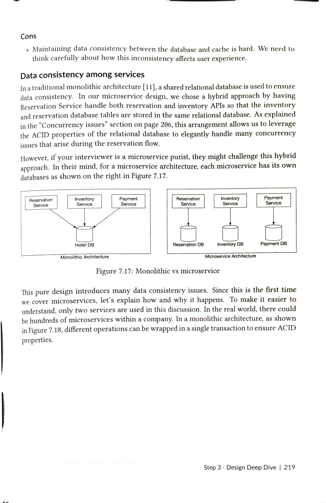

* **Kiến trúc Nguyên khối (Monolithic Architecture):**
  * Bao gồm: Dịch vụ Tồn kho (*Inventory Service*), Dịch vụ Thanh toán (*Payment Service*), Dịch vụ Đặt phòng (*Reservation Service*).
  * Dùng chung một Cơ sở dữ liệu Khách sạn (*Hotel DB*).
* **Kiến trúc Vi dịch vụ (Microservice Architecture):**
  * Dịch vụ Tồn kho (*Inventory Service*) kết nối riêng với Cơ sở dữ liệu Tồn kho (*Inventory DB*).
  * Dịch vụ Đặt phòng (*Reservation Service*) kết nối riêng với Cơ sở dữ liệu Đặt phòng (*Reservation DB*).
  * Dịch vụ Thanh toán (*Payment Service*) kết nối riêng với Cơ sở dữ liệu Thanh toán (*Payment DB*).

*Hình 7.17: So sánh Kiến trúc Nguyên khối và Kiến trúc Vi dịch vụ (Monolithic vs microservice)*

---

Thiết kế thuần túy (*pure design*) này dẫn đến rất nhiều vấn đề về tính nhất quán dữ liệu (*data consistency issues*). Vì đây là lần đầu tiên chúng ta đề cập đến microservices, hãy cùng giải thích điều đó xảy ra như thế nào và tại sao nó lại xảy ra. 

Để dễ hiểu hơn, chỉ có hai dịch vụ được đưa vào cuộc thảo luận này. Trong thế giới thực, có thể có hàng trăm microservices bên trong một doanh nghiệp. Trong một kiến trúc nguyên khối (*monolithic architecture*), như thể hiện trong **Hình 7.18**, các thao tác khác nhau có thể được gói gọn bên trong một transaction duy nhất (*single transaction*) để đảm bảo các thuộc tính **ACID**.

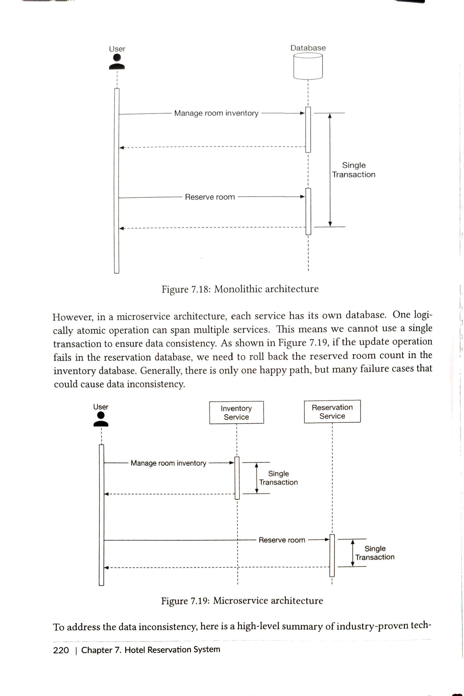

*Hình 7.18: Kiến trúc Nguyên khối (Monolithic architecture)*
* Luồng xử lý: Người dùng (*User*) $\rightarrow$ Quản lý tồn kho phòng (*Manage room inventory*) & Đặt phòng (*Reserve room*) $\rightarrow$ Gói gọn trong một Transaction Đơn lẻ (*Single Transaction*) $\rightarrow$ Cơ sở dữ liệu (*Database*).

---

Tuy nhiên, trong một kiến trúc microservices, mỗi dịch vụ lại sở hữu cơ sở dữ liệu riêng của nó. Một thao tác mang tính nguyên tử về mặt logic (*logically atomic operation*) có thể trải rộng trên nhiều dịch vụ khác nhau. Điều này đồng nghĩa với việc chúng ta không thể sử dụng một transaction đơn lẻ (*single transaction*) để đảm bảo tính nhất quán dữ liệu. 

Như được minh họa trong **Hình 7.19**, nếu thao tác cập nhật thất bại trong cơ sở dữ liệu đặt phòng (*reservation database*), chúng ta cần phải hoàn tác (*roll back*) số lượng phòng đã giữ chỗ trong cơ sở dữ liệu tồn kho (*inventory database*). 

Thông thường, chỉ có một luồng thực thi thành công lý tưởng duy nhất (*happy path*), nhưng lại có vô số trường hợp lỗi (*failure cases*) có thể gây ra tình trạng bất đồng bộ/thiếu nhất quán dữ liệu (*data inconsistency*).

* **Dịch vụ Tồn kho (Inventory Service):** Quản lý tồn kho phòng (*Manage room inventory*) $\rightarrow$ Transaction Đơn lẻ (*Single Transaction*).
* **Dịch vụ Đặt phòng (Reservation Service):** Đặt phòng (*Reserve room*) $\rightarrow$ Transaction Đơn lẻ (*Single Transaction*).

*Hình 7.19: Kiến trúc Vi dịch vụ (Microservice architecture)*

Để giải quyết vấn đề bất đồng bộ/thiếu nhất quán dữ liệu (*data inconsistency*), dưới đây là tóm tắt cấp cao (*high-level summary*) về các kỹ thuật đã được chứng minh trong ngành công nghiệp phần mềm. Nếu bạn muốn đọc chi tiết chuyên sâu, vui lòng tham khảo các tài liệu tham khảo.

* **Two-phase commit (2PC) [12]:** 2PC là một giao thức cơ sở dữ liệu được sử dụng để đảm bảo việc commit transaction mang tính nguyên tử (*atomic transaction commit*) trên nhiều node khác nhau; tức là, hoặc tất cả các node đều thành công, hoặc tất cả các node đều thất bại. Bởi vì 2PC là một giao thức chặn (*blocking protocol*), sự cố lỗi của một node đơn lẻ sẽ chặn đứng toàn bộ tiến trình cho đến khi node đó phục hồi xong. Giao thức này không đạt hiệu năng cao (*not performant*).
* **Saga:** Một Saga là một chuỗi tuần tự các transaction cục bộ (*local transactions*). Mỗi transaction sẽ cập nhật dữ liệu và phát hành (*publish*) một message/sự kiện để kích hoạt bước transaction tiếp theo. Nếu một bước thất bại, saga sẽ thực thi các transaction bù trừ (*compensating transactions*) để hoàn tác lại các thay đổi đã được thực hiện bởi các transaction phía trước đó [13]. 2PC hoạt động như một commit đơn lẻ để thực thi các transaction tuân thủ chuẩn ACID, trong khi Saga bao gồm nhiều bước phân tán và dựa vào tính nhất quán cuối cùng (*eventual consistency*).

> [!IMPORTANT]
> Cần lưu ý rằng việc giải quyết tình trạng thiếu nhất quán dữ liệu giữa các microservices đòi hỏi sự phức tạp kỹ thuật rất lớn. Việc quyết định xem sự phức tạp tăng thêm đó có xứng đáng để đánh đổi hay không là tùy thuộc vào bạn với tư cách là một Kiến trúc sư Hệ thống (*Architect*). Đối với bài toán cụ thể này, chúng tôi quyết định rằng sự đánh đổi đó là không đáng, và vì vậy chúng tôi đã chọn cách tiếp cận thực dụng (*pragmatic approach*) hơn: lưu trữ dữ liệu đặt phòng (*reservation*) và dữ liệu tồn kho (*inventory*) dưới cùng một cơ sở dữ liệu quan hệ (*relational database*).

---

## Bước 4 - Tổng Kết (Step 4 - Wrap Up)

Trong chương này, chúng tôi đã trình bày một thiết kế cho hệ thống đặt phòng khách sạn (*hotel reservation system*). 

1. Chúng ta bắt đầu bằng việc thu thập các yêu cầu (*gathering requirements*) và tính toán ước lượng sơ bộ (*back-of-the-envelope estimation*) để nắm bắt quy mô tải (*scale*). 
2. Trong phần thiết kế cấp cao (*high-level design*), chúng ta đã trình bày thiết kế API, bản thảo đầu tiên của mô hình dữ liệu (*data model*), và sơ đồ kiến trúc hệ thống tổng thể. 
3. Trong phần đi sâu vào chi tiết (*deep dive*), chúng ta đã khám phá thiết kế lược đồ cơ sở dữ liệu (*database schema design*) thay thế khi nhận ra rằng việc đặt phòng nên được thực hiện ở cấp độ loại phòng (*room type level*), thay vì đặt theo từng phòng cụ thể. 
4. Chúng ta đã thảo luận chuyên sâu về các điều kiện tranh đoạt/xung đột (*race conditions*) và đề xuất một vài giải pháp tiềm năng:
   * **Khóa bi quan (pessimistic locking)**
   * **Khóa lạc quan (optimistic locking)**
   * **Ràng buộc cơ sở dữ liệu (database constraints)**
5. Sau đó, chúng ta đã thảo luận về các cách tiếp cận khác nhau để mở rộng quy mô hệ thống (*scale the system*), bao gồm phân mảnh cơ sở dữ liệu (**Database Sharding**) và sử dụng bộ nhớ đệm **Redis Cache**. 
6. Cuối cùng, chúng ta đã điểm qua các vấn đề về tính nhất quán dữ liệu (*data consistency issues*) trong kiến trúc vi dịch vụ (*microservice architecture*) và lướt nhanh qua một số giải pháp xử lý.

Xin chúc mừng bạn đã đi được một chặng đường dài đến đây! Giờ hãy tự vỗ vai khen ngợi chính mình. Làm tốt lắm!

---

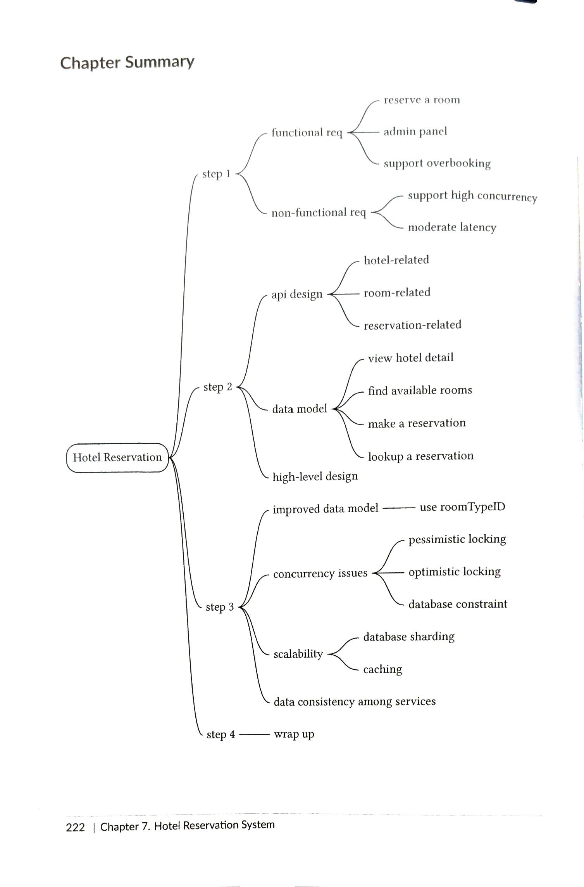

### Tóm tắt chương (Chapter Summary)

* **Yêu cầu chức năng (functional req):**
  * Đặt phòng (*reserve a room*)
  * Trang quản trị (*admin panel*)
  * Hỗ trợ đặt vượt số lượng (*support overbooking*)
* **Yêu cầu phi chức năng (non-functional req):**
  * Hỗ trợ khả năng tương tranh cao (*support high concurrency*)
  * Độ trễ trung bình/vừa phải (*moderate latency*)
* **Mô hình dữ liệu (data model):**
  * Liên quan đến khách sạn (*hotel-related*)
  * Liên quan đến phòng (*room-related*)
  * Liên quan đến đặt phòng (*reservation-related*)
* **Thiết kế cấp cao (high-level design):**
  * Xem thông tin chi tiết khách sạn (*view hotel detail*)
  * Tìm kiếm phòng còn trống (*find available rooms*)
  * Thực hiện đặt phòng (*make a reservation*)
  * Tra cứu thông tin đặt phòng (*lookup a reservation*)
* **Mô hình dữ liệu cải tiến (improved data model):** Sử dụng `roomTypeID`
* **Vấn đề tương tranh (concurrency issues):**
  * Khóa bi quan (*pessimistic locking*)
  * Khóa lạc quan (*optimistic locking*)
  * Ràng buộc cơ sở dữ liệu (*database constraint*)
* **Khả năng mở rộng (scalability):**
  * Phân mảnh cơ sở dữ liệu (*database sharding*)
  * Bộ nhớ đệm (*caching*)
* **Tính nhất quán dữ liệu giữa các dịch vụ (data consistency among services)**
* **Bước 4 (step 4):** Tổng kết (*wrap up*)

---

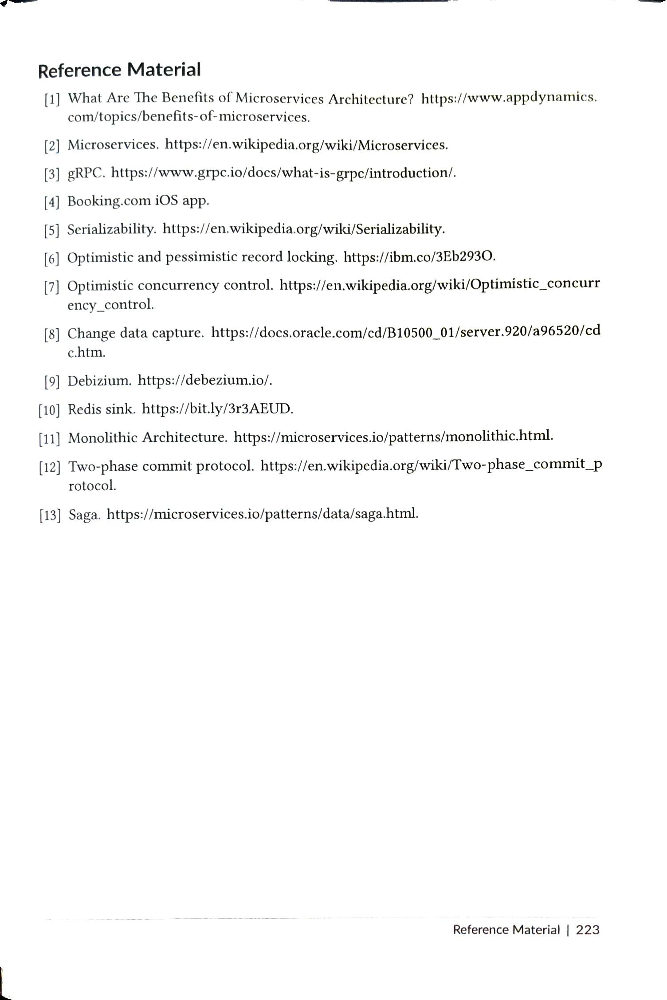

## Tài liệu tham khảo (Reference Material)

* **[1]** What Are The Benefits of Microservices Architecture? https://www.appdynamics.com/topics/benefits-of-microservices.
* **[2]** Microservices. https://en.wikipedia.org/wiki/Microservices.
* **[3]** gRPC. https://www.grpc.io/docs/what-is-grpc/introduction/.
* **[4]** Booking.com iOS app.
* **[5]** Serializability. https://en.wikipedia.org/wiki/Serializability.
* **[6]** Optimistic and pessimistic record locking. https://ibm.co/3Eb2930.
* **[7]** Optimistic concurrency control. https://en.wikipedia.org/wiki/Optimistic_concurrency_control.
* **[8]** Change data capture. https://docs.oracle.com/cd/B10500_01/server.920/a96520/cdc.htm.
* **[9]** Debezium. https://debezium.io/.
* **[10]** Redis sink. https://bit.ly/3r3AEUD.
* **[11]** Monolithic Architecture. https://microservices.io/patterns/monolithic.html.
* **[12]** Two-phase commit protocol. https://en.wikipedia.org/wiki/Two-phase_commit_protocol.
* **[13]** Saga. https://microservices.io/patterns/data/saga.html.

---

## Điều hướng

- [chuong-06-ad-click-event-aggregation.md](chuong-06-ad-click-event-aggregation.md)
- [Mục lục](README.md)
- [chuong-08-distributed-email-service.md](chuong-08-distributed-email-service.md)
