[← Chương trước](chuong-07-hotel-reservation-system.md) | [Mục lục](README.md) | [Chương tiếp theo →](chuong-09-s3-like-object-storage.md)

---

# CHƯƠNG 8: DỊCH VỤ EMAIL PHÂN TÁN (DISTRIBUTED EMAIL SERVICE)

---

## Trang 228

Trong chương này, chúng ta sẽ thiết kế một dịch vụ email quy mô lớn (large-scale email service), chẳng hạn như Gmail, Outlook hoặc Yahoo Mail. Sự phát triển vượt bậc của Internet đã dẫn đến sự bùng nổ về khối lượng email. Vào năm 2020, Gmail đã có hơn 1,8 tỷ người dùng hoạt động và Outlook có hơn 400 triệu người dùng trên toàn thế giới [1] [2].

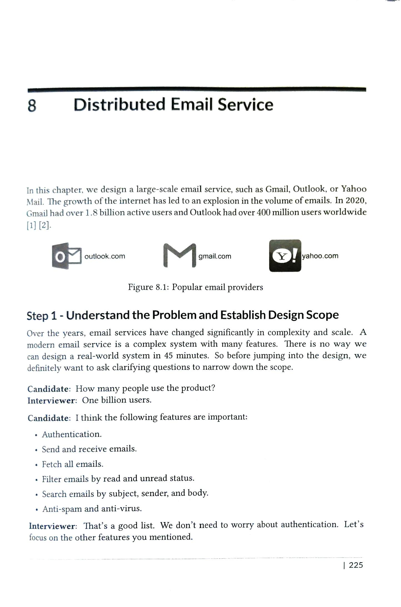

* **gmail.com**
* **outlook.com**
* **yahoo.com**

*Hình 8.1: Các nhà cung cấp dịch vụ email phổ biến (Popular email providers)*

---

### Bước 1 - Hiểu Rõ Vấn Đề Và Xác Định Phạm Vi Thiết Kế (Step 1 - Understand the Problem and Establish Design Scope)

Qua nhiều năm, các dịch vụ email đã thay đổi đáng kể về độ phức tạp và quy mô. Một dịch vụ email hiện đại là một hệ thống phức tạp với rất nhiều tính năng. Chúng ta không thể nào thiết kế toàn bộ một hệ thống thực tế hoàn chỉnh chỉ trong vòng 45 phút. Vì vậy, trước khi bắt tay vào thiết kế, chúng ta chắc chắn cần đặt ra các câu hỏi làm rõ (clarifying questions) để thu hẹp phạm vi bài toán.

* **Ứng viên (Candidate):** Có bao nhiêu người sử dụng sản phẩm này?
* **Người phỏng vấn (Interviewer):** 1 tỷ người dùng (One billion users).
* **Ứng viên:** Tôi nghĩ các tính năng sau đây là quan trọng:
  * Xác thực người dùng (Authentication).
  * Gửi và nhận email (Send and receive emails).
  * Tải về toàn bộ email (Fetch all emails).
  * Lọc email theo trạng thái đã đọc và chưa đọc (Filter emails by read and unread status).
  * Tìm kiếm email theo tiêu đề (subject), người gửi (sender) và nội dung thư (body).
  * Chống thư rác (anti-spam) và chống mã độc/virus (anti-virus).
* **Người phỏng vấn:** Đó là một danh sách rất tốt. Chúng ta không cần phải bận tâm về tính năng xác thực (authentication). Hãy tập trung vào các tính năng còn lại mà bạn vừa nêu.

---

## Trang 229

* **Ứng viên:** Người dùng kết nối với các máy chủ thư (mail servers) như thế nào?
* **Người phỏng vấn:** Theo cách truyền thống, người dùng kết nối với các mail server thông qua các ứng dụng khách gốc (native clients) sử dụng các giao thức SMTP, POP, IMAP và các giao thức độc quyền của từng nhà cung cấp (vendor-specific protocols). Những giao thức đó ở một mức độ nào đó đã cũ (legacy), tuy nhiên hiện vẫn còn rất phổ biến. Đối với buổi phỏng vấn này, hãy giả định rằng giao thức HTTP được sử dụng cho việc giao tiếp giữa client và server.
* **Ứng viên:** Email có thể chứa tệp đính kèm (attachments) không?
* **Người phỏng vấn:** Có.

---

### Các Yêu Cầu Phi Chức Năng (Non-functional requirements)

Tiếp theo, hãy cùng điểm qua các yêu cầu phi chức năng quan trọng nhất:

* **Độ tin cậy (Reliability):** Chúng ta tuyệt đối không được làm mất dữ liệu email (not lose email data).
* **Tính sẵn sàng cao (Availability):** Dữ liệu email và người dùng phải được tự động nhân bản (automatically replicated) qua nhiều node để đảm bảo tính sẵn sàng. Bên cạnh đó, hệ thống phải tiếp tục hoạt động bình thường ngay cả khi xảy ra lỗi hệ thống cục bộ (partial system failures / Fault Tolerance).
* **Khả năng mở rộng (Scalability):** Khi số lượng người dùng tăng lên, hệ thống phải có khả năng xử lý số lượng người dùng và khối lượng email ngày càng tăng. Hiệu năng của hệ thống không được suy giảm (performance degradation) khi có thêm nhiều người dùng hoặc email.
* **Tính linh hoạt và khả năng mở rộng tính năng (Flexibility and extensibility):** Một hệ thống linh hoạt/dễ mở rộng cho phép chúng ta bổ sung các tính năng mới một cách dễ dàng và mượt mà mà không làm gián đoạn hệ thống hiện tại. Các giao thức email truyền thống (như POP, IMAP) vốn rất hạn chế về khả năng tùy biến (customization) và mở rộng cho các tính năng hiện đại. Do đó, chúng ta có thể cần các giao thức tùy chỉnh (custom protocols) để đáp ứng các yêu cầu về tính linh hoạt và mở rộng này.

---

### Ước Tính Nhanh Quy Mô (Back-of-the-envelope estimation)

Hãy thực hiện một phép tính ước lượng nhanh để xác định quy mô và phát hiện ra một số thách thức mà giải pháp của chúng ta sẽ cần phải giải quyết. Về mặt bản chất kiến trúc, email là những ứng dụng tiêu tốn cực kỳ nhiều tài nguyên lưu trữ (storage heavy applications).

* **1 tỷ người dùng (1 billion users).**
* Giả định số lượng email trung bình một người gửi mỗi ngày là 10. Chỉ số thông lượng truy vấn mỗi giây (**QPS - Queries Per Second**) cho tác vụ gửi email:
  
  $$\text{QPS gửi email} = \frac{10^9 \times 10}{10^5} = 100{,}000$$

  *(với $10^5$ là số giây ước tính trong 1 ngày: $24 \times 3600 \approx 86{,}400 \approx 10^5$).*

* Giả định số lượng email trung bình một người nhận được trong một ngày là 40 [3] và kích thước trung bình của siêu dữ liệu email (email metadata) là 50 KB. Metadata ở đây bao gồm tất cả mọi thông tin liên quan đến một email, ngoại trừ các tệp đính kèm.
* Giả định metadata được lưu trữ trong một cơ sở dữ liệu (database). Yêu cầu dung lượng lưu trữ để duy trì metadata trong vòng 1 năm là:
  
  $$1 \text{ tỷ người dùng} \times 40 \text{ email/ngày} \times 365 \text{ ngày} \times 50\text{ KB} = 730\text{ PB}$$

* Giả định có 20% số lượng email có chứa tệp đính kèm và kích thước tệp đính kèm trung bình là 500 KB.
* Dung lượng lưu trữ dành cho các tệp đính kèm trong vòng 1 năm là:
  
  $$1 \text{ tỷ người dùng} \times 40 \text{ email/ngày} \times 365 \text{ ngày} \times 20\% \times 500\text{ KB} = 1{,}460\text{ PB}$$

---

## Trang 230

Từ phép tính ước tính nhanh quy mô này, rõ ràng chúng ta sẽ phải xử lý một khối lượng dữ liệu khổng lồ. Do đó, nhiều khả năng chúng ta sẽ cần một giải pháp cơ sở dữ liệu phân tán (distributed database solution).

---

### Bước 2 - Đề Xuất Thiết Kế Cấp Cao Và Đạt Được Thỏa Thuận (Step 2 - Propose High-level Design and Get Buy-in)

Trong phần này, trước tiên chúng ta sẽ thảo luận về một số kiến thức cơ bản về mail server và cách các mail server tiến hóa theo thời gian. Sau đó, chúng ta sẽ xem xét thiết kế cấp cao (high-level design) của các mail server phân tán. Nội dung được cấu trúc như sau:

* Kiến thức nhập môn về Email (Email knowledge 101)
* Máy chủ thư truyền thống (Traditional mail servers)
* Máy chủ thư phân tán (Distributed mail servers)

---

### Kiến Thức Nhập Môn Về Email (Email knowledge 101)

Có nhiều giao thức email khác nhau được sử dụng để gửi và nhận email. Trong lịch sử, hầu hết các mail server đều sử dụng các giao thức email như POP, IMAP và SMTP.

#### Các Giao Thức Email (Email protocols)

* **SMTP:** Giao thức truyền tải thư tín đơn giản (**Simple Mail Transfer Protocol - SMTP**) là giao thức tiêu chuẩn để gửi email từ một mail server này sang một mail server khác.
* Các giao thức phổ biến nhất để tải/truy xuất email (retrieving emails) được gọi là **Post Office Protocol (POP)** và **Internet Mail Access Protocol (IMAP)**.
* **POP:** Là giao thức mail tiêu chuẩn dùng để nhận và tải email từ một mail server từ xa về email client cục bộ. Một khi email đã được tải về máy tính hoặc điện thoại của bạn, chúng sẽ bị xóa khỏi email server, điều này đồng nghĩa với việc bạn chỉ có thể truy cập email trên duy nhất một máy tính hoặc điện thoại. Chi tiết kỹ thuật về POP được quy định trong RFC 1939 [4]. POP yêu cầu mail client phải tải toàn bộ nội dung email về. Việc này có thể mất nhiều thời gian nếu email chứa một tệp đính kèm dung lượng lớn.
* **IMAP:** Cũng là một giao thức mail tiêu chuẩn để nhận email cho client cục bộ. Khi bạn đọc một email, bạn được kết nối tới một mail server bên ngoài và dữ liệu được truyền về thiết bị cục bộ của bạn. IMAP chỉ tải một thư về khi bạn bấm vào xem nó, và các email không bị xóa khỏi mail server, nghĩa là bạn có thể truy cập email từ nhiều thiết bị khác nhau. IMAP là giao thức được sử dụng rộng rãi nhất cho các tài khoản email cá nhân. Nó hoạt động rất tốt khi đường truyền kết nối chậm vì chỉ có thông tin tiêu đề email (email header) được tải về cho đến khi thư thực sự được mở ra.
* **HTTPS:** Về mặt kỹ thuật thuần túy thì không phải là một giao thức thư điện tử, nhưng nó có thể được sử dụng để truy cập hộp thư của bạn, đặc biệt là đối với email trên nền tảng web (web-based email). Ví dụ, Microsoft Outlook thường xuyên giao tiếp với các thiết bị di động qua HTTPS trên một giao thức tùy biến được gọi là ActiveSync [5].

#### Dịch Vụ Phân Giải Tên Miền - DNS (Domain name service)

Một DNS server được sử dụng để tra cứu bản ghi Mail Exchanger (**MX record**) cho tên miền của người nhận. Nếu bạn thực hiện tra cứu DNS cho miền `gmail.com` từ dòng lệnh (command line), bạn có thể nhận được các bản ghi MX như hiển thị trong Hình 8.2.

---

## Trang 231

```text
draws-mbp- draws nslookup
set q=mx
gmail.com
Server:     192.168.86.1
Address:    192.168.86.1#53

Non-authoritative answer:
gmail.com   mail exchanger = 20 alt2.gmail-smtp-in.l.google.com.
gmail.com   mail exchanger = 30 alt3.gmail-smtp-in.l.google.com.
gmail.com   mail exchanger = 40 alt4.gmail-smtp-in.l.google.com.
gmail.com   mail exchanger = 5  gmail-smtp-in.l.google.com.
gmail.com   mail exchanger = 10 alt1.gmail-smtp-in.l.google.com.
```

| Độ ưu tiên (Priority) | Loại bản ghi (MX) | Máy chủ thư đích (Mail servers) |
| :--- | :--- | :--- |
| 5 | MX | `gmail-smtp-in.l.google.com.` |
| 10 | MX | `alt1.gmail-smtp-in.l.google.com.` |
| 20 | MX | `alt2.gmail-smtp-in.l.google.com.` |
| 30 | MX | `alt3.gmail-smtp-in.l.google.com.` |
| 40 | MX | `alt4.gmail-smtp-in.l.google.com.` |

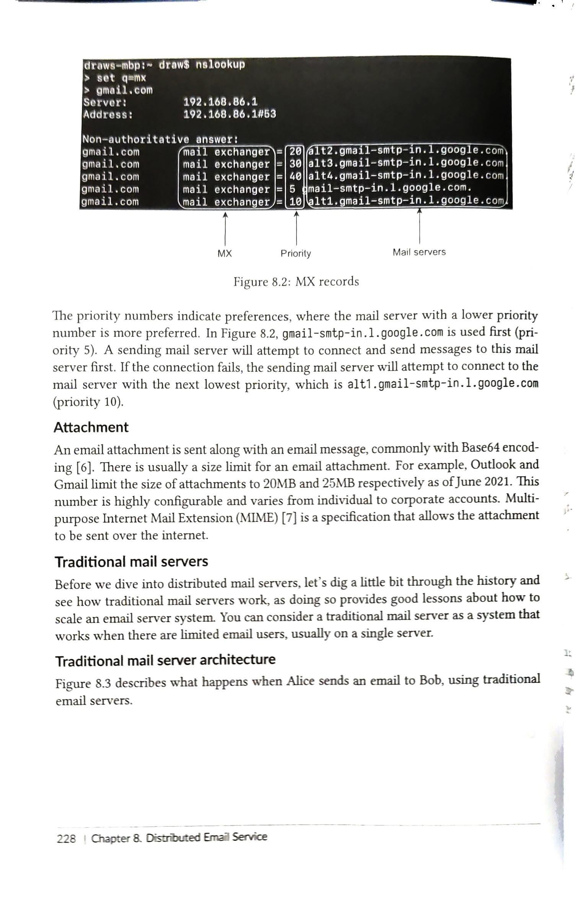

*Hình 8.2: Các bản ghi MX (MX records)*

Các con số độ ưu tiên (**Priority**) thể hiện mức độ ưu tiên chọn lựa, trong đó mail server có số ưu tiên thấp hơn sẽ được ưu tiên cao hơn. Trong Hình 8.2, `gmail-smtp-in.l.google.com` được sử dụng đầu tiên (độ ưu tiên bằng 5). Một mail server gửi thư sẽ cố gắng kết nối và gửi các thông điệp đến mail server này trước. Nếu kết nối thất bại, mail server gửi thư sẽ chuyển sang cố gắng kết nối tới mail server có độ ưu tiên thấp tiếp theo, đó là `alt1.gmail-smtp-in.l.google.com` (độ ưu tiên bằng 10).

#### Tệp Đính Kèm (Attachment)

Một tệp đính kèm email được gửi kèm theo một thông điệp email, thông thường được mã hóa bằng thuật toán **Base64** [6]. Thông thường luôn có một giới hạn kích thước cho một tệp đính kèm email. Ví dụ, tính đến tháng 6 năm 2021, Outlook và Gmail giới hạn kích thước tệp đính kèm lần lượt là 20MB và 25MB. Con số này có thể cấu hình linh hoạt và khác nhau giữa tài khoản cá nhân và tài khoản doanh nghiệp. Chuẩn MIME (**Multipurpose Internet Mail Extensions**) [7] là một đặc tả kỹ thuật cho phép các tệp đính kèm được truyền tải qua môi trường Internet.

---

### Máy Chủ Thư Truyền Thống (Traditional mail servers)

Trước khi chúng ta đi sâu vào các mail server phân tán, hãy cùng tìm hiểu một chút về lịch sử và xem các mail server truyền thống hoạt động như thế nào, vì làm như vậy sẽ mang lại những bài học kinh nghiệm quý giá về cách mở rộng quy mô (scale) một hệ thống mail server. Bạn có thể coi một mail server truyền thống là một hệ thống hoạt động khi số lượng người dùng email còn hạn chế, thông thường chạy trên một máy chủ đơn lẻ (single server).

#### Kiến Trúc Máy Chủ Thư Truyền Thống (Traditional mail server architecture)

Hình 8.3 mô tả những gì diễn ra khi người dùng Alice gửi một email cho người dùng Bob, sử dụng các mail server truyền thống.

---

## Trang 232

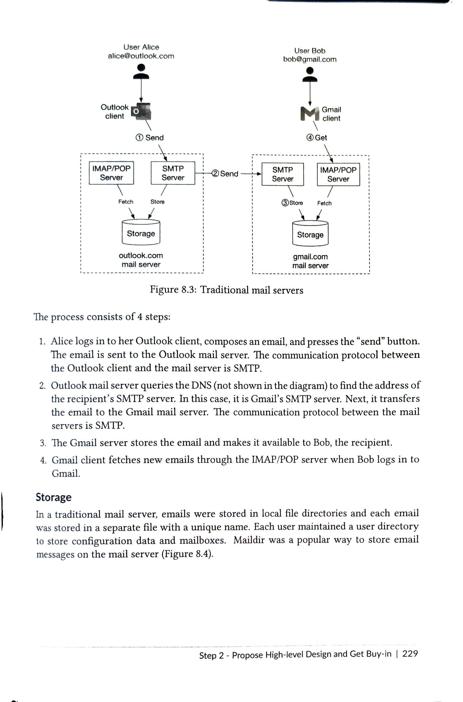

*Hình 8.3: Kiến trúc máy chủ thư truyền thống (Traditional mail servers)*

Quy trình bao gồm 4 bước:

1. **Bước 1:** Email được gửi tới mail server của Outlook. Giao thức giao tiếp giữa Outlook client và mail server là **SMTP**.
2. **Bước 2:** Mail server của Outlook truy vấn DNS (không được hiển thị trong sơ đồ) để tìm địa chỉ máy chủ SMTP của người nhận. Trong trường hợp này, đó là máy chủ SMTP của Gmail. Tiếp theo, nó chuyển tiếp email sang cho mail server của Gmail. Giao thức giao tiếp giữa các mail server với nhau là **SMTP**.
3. **Bước 3:** Máy chủ Gmail lưu trữ email vào bộ lưu trữ (storage) và hiển thị sẵn sàng cho Bob, người nhận thư.
4. **Bước 4:** Ứng dụng Gmail client tải các email mới về thông qua máy chủ **IMAP/POP** khi Bob đăng nhập vào Gmail.

#### Bộ Lưu Trữ (Storage)

Trong một mail server truyền thống, các email được lưu trữ trong các thư mục tệp tin cục bộ (local file directories) và mỗi email được lưu trong một tệp riêng biệt với một tên tệp duy nhất. Mỗi người dùng duy trì một thư mục người dùng riêng để lưu trữ dữ liệu cấu hình và các hộp thư. **Maildir** là một cấu trúc thư mục rất phổ biến để lưu trữ các thông điệp email trên mail server (Hình 8.4).

---

## Trang 233

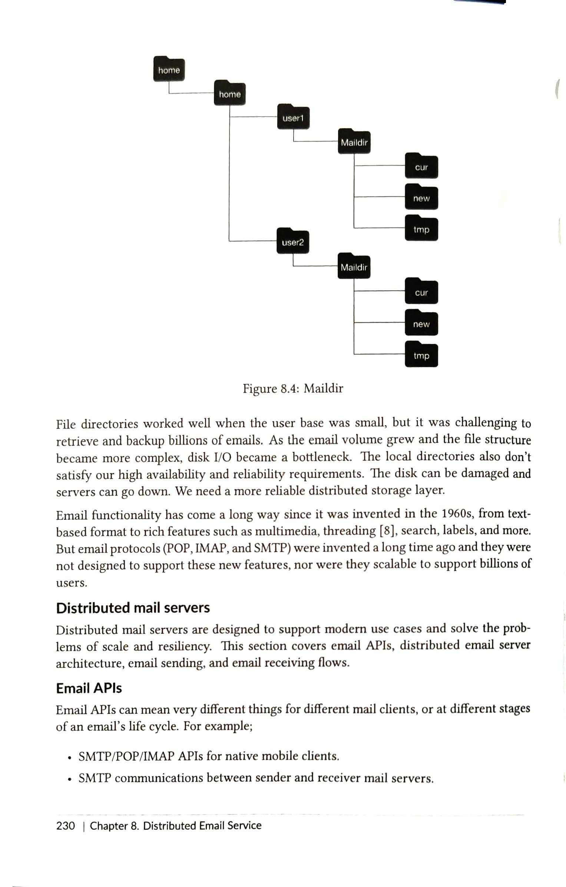

*Hình 8.4: Cấu trúc thư mục Maildir (Maildir)*

```text
home/
└── user1/
    └── Maildir/
        ├── cur/
        ├── new/
        └── tmp/
home/
└── user2/
    └── Maildir/
        ├── cur/
        ├── new/
        └── tmp/
```

Các thư mục tệp cục bộ hoạt động tốt khi tập người dùng còn nhỏ, nhưng cực kỳ khó khăn để có thể truy xuất và sao lưu hàng tỷ email. Khi khối lượng email bùng nổ và cấu trúc tệp tin trở nên phức tạp hơn, năng lực đọc/ghi đĩa (**Disk I/O**) đã trở thành điểm nghẽn cổ chai (**bottleneck**). Các thư mục tệp cục bộ này cũng không thể đáp ứng được các yêu cầu khắt khe của chúng ta về **Tính sẵn sàng cao (High Availability)** và **Độ tin cậy (Reliability)**. Ổ cứng vật lý có thể bị hỏng hóc và các máy chủ có thể sập bất cứ lúc nào. Chúng ta bắt buộc phải có một tầng lưu trữ phân tán (**Distributed Storage Layer**) đáng tin cậy hơn.

Các tính năng email đã trải qua một chặng đường phát triển rất dài kể từ khi được phát minh vào những năm 1960, từ định dạng thuần văn bản (text-based) đơn giản cho đến các tính năng phong phú ngày nay như đa phương tiện (multimedia), luồng hội thoại (**threading**) [8], tìm kiếm, gắn nhãn (labels) và nhiều tính năng khác. Tuy nhiên, các giao thức email cổ điển (POP, IMAP và SMTP) đã được phát minh từ rất lâu trước đây và chúng vốn không được thiết kế để hỗ trợ những tính năng hiện đại mới này, cũng như không có khả năng mở rộng quy mô (**scalable**) để phục vụ hàng tỷ người dùng.

---

### Máy Chủ Thư Phân Tán (Distributed mail servers)

Các máy chủ thư phân tán được thiết kế chuyên biệt để hỗ trợ các kịch bản sử dụng hiện đại và giải quyết triệt để các bài toán hóc búa về quy mô (**scale**) cũng như tính chống chịu lỗi (**resiliency / Fault Tolerance**). Phần này sẽ trình bày chi tiết về các Email API, kiến trúc mail server phân tán, luồng gửi email (email sending flow) và luồng nhận email (email receiving flow).

#### Các Giao Diện Lập Trình Ứng Dụng Email (Email APIs)

Email API có thể mang ý nghĩa rất khác nhau đối với các mail client khác nhau, hoặc tại các giai đoạn khác nhau trong vòng đời của một email (email's life cycle). Ví dụ:

* Các API **SMTP/POP/IMAP** dành cho các native mobile client.
* Các giao tiếp **SMTP** giữa máy chủ thư của người gửi (sender mail server) và máy chủ thư của người nhận (receiver mail server).

# Chương 8: Dịch Vụ Email Phân Tán (Distributed Email Service)

RESTful API thông qua giao thức HTTP được sử dụng để xây dựng các ứng dụng email trên nền tảng web (webmail) với đầy đủ tính năng và khả năng tương tác cao.

Do giới hạn về dung lượng của cuốn sách, chúng tôi chỉ trình bày một số API quan trọng nhất dành cho webmail. Phương thức phổ biến nhất để giao tiếp trong webmail là thông qua giao thức HTTP.

---

## Bước 2: Đề Xuất Thiết Kế Cấp Cao (High-level Design) và Thống Nhất Phương Án

### Các Endpoint API Chính Cho Webmail

#### 1. Endpoint: `POST /v1/messages`
Gửi một thông điệp (email) tới các người nhận nằm trong các tiêu đề (headers) `To`, `Cc`, và `Bcc`.

#### 2. Endpoint: `GET /v1/folders`
Trả về toàn bộ các thư mục của một tài khoản email.

**Response cấu trúc dữ liệu:**
```json
[
  {
    "id": "string",       // Định danh duy nhất của thư mục (Unique folder identifier).
    "name": "string",     // Tên của thư mục.
    "user_id": "string"   // Tham chiếu đến chủ sở hữu tài khoản (account owner).
  }
]
```

> [!NOTE]
> Theo tiêu chuẩn **RFC 6154 [9]**, các thư mục mặc định có thể là một trong các thư mục sau:
> `All` (Tất cả), `Archive` (Lưu trữ), `Drafts` (Thư nháp), `Flagged` (Được gắn cờ), `Junk` (Thư rác), `Sent` (Đã gửi), và `Trash` (Thùng rác).

#### 3. Endpoint: `GET /v1/folders/:folder_id/messages`
Trả về danh sách tất cả các thông điệp thuộc về một thư mục cụ thể. Cần lưu ý rằng đây là định nghĩa API ở mức độ tinh giản cao. Trong triển khai thực tế, endpoint này bắt buộc phải hỗ trợ phân trang (Pagination).

**Response:**
* Danh sách các đối tượng thông điệp (List of message objects).

#### 4. Endpoint: `GET /v1/messages/:message_id`
Lấy toàn bộ thông tin chi tiết về một thông điệp cụ thể. Các thông điệp là khối xây dựng cốt lõi (core building blocks) của một ứng dụng email, chứa các dữ liệu về người gửi, người nhận, tiêu đề thư, nội dung, tệp đính kèm, v.v.

**Response:**
Một đối tượng thông điệp (A message's object):
```typescript
{
  user_id: string,                       // Tham chiếu đến chủ sở hữu tài khoản (account owner).
  from: { name: string, email: string }, // Cặp <name, email> của người gửi (sender).
  to: [{ name: string, email: string }], // Danh sách các cặp <name, email> của người nhận.
  subject: string,                       // Tiêu đề của email.
  body: string,                          // Nội dung thân thư (Message body).
  is_read: boolean                       // Cờ chỉ thị thông điệp đã đọc hay chưa.
}
```

---

### Kiến Trúc Máy Chủ Email Phân Tán (Distributed Mail Server Architecture)

Việc thiết lập một máy chủ email phục vụ số lượng nhỏ người dùng là tương đối dễ dàng, tuy nhiên kiến trúc này chỉ được thiết kế để hoạt động trên một máy chủ đơn lẻ (single server). Việc đồng bộ hóa dữ liệu trên nhiều máy chủ (synchronizing data across servers) là một bài toán khó, và việc ngăn chặn email bị các máy chủ mail phía người nhận phân loại nhầm thành thư rác (spam) là một thách thức cực kỳ lớn.

Trong phần này, chúng ta sẽ khám phá cách tận dụng các công nghệ điện toán đám mây (Cloud Technologies) để giải quyết bài toán này. Sơ đồ thiết kế cấp cao (High-level design) được thể hiện ở **Hình 8.5**.

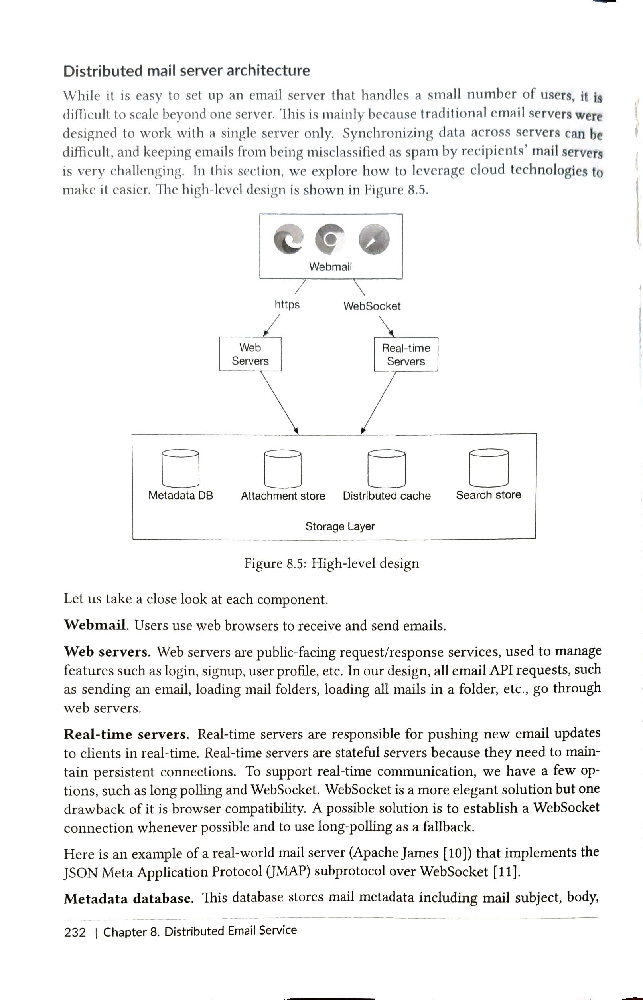
*Hình 8.5: Sơ đồ kiến trúc cấp cao (High-level design)*

---

### Chi Tiết Từng Thành Phần Trong Kiến Trúc

* **Webmail:** Người dùng sử dụng trình duyệt web (web browsers) để nhận và gửi email.
* **Web Servers:** Các máy chủ web đóng vai trò là dịch vụ tiếp nhận và xử lý yêu cầu/phản hồi (request/response services) hướng ra công chúng, đảm nhiệm các tính năng như đăng nhập (login), đăng ký (signup), quản lý hồ sơ người dùng (user profile), v.v. Trong thiết kế này, tất cả các yêu cầu API email như gửi email, tải danh sách thư mục, tải thư trong thư mục đều đi qua Web Servers.
* **Real-time Servers:** Đảm nhiệm việc đẩy các cập nhật email mới tới máy khách (clients) theo thời gian thực (real-time). Đây là các máy chủ có trạng thái (**Stateful Servers**) vì chúng cần duy trì các kết nối liên tục (persistent connections). Để hỗ trợ giao tiếp thời gian thực, chúng ta có một số lựa chọn kỹ thuật như **Long Polling** và **WebSocket**. 
  * WebSocket là giải pháp tối ưu và thanh lịch hơn, nhưng nhược điểm là khả năng tương thích của một số trình duyệt. 
  * Giải pháp thực tế: Thiết lập kết nối WebSocket bất cứ khi nào có thể, và dùng Long Polling làm cơ chế dự phòng (fallback).
  > [!TIP]
  > Một ví dụ thực tế là máy chủ mail nguồn mở **Apache James [10]** đã triển khai giao thức con **JMAP (JSON Meta Application Protocol) qua WebSocket [11]**.
* **Metadata Database (Cơ sở dữ liệu Siêu dữ liệu):** Lưu trữ siêu dữ liệu của email bao gồm tiêu đề (subject), nội dung tệp tin văn bản (body), người gửi (from user), danh sách người nhận (to users), v.v. Chi tiết lựa chọn cơ sở dữ liệu sẽ được phân tích sâu ở phần sau.
* **Attachment Store (Kho lưu trữ Tệp đính kèm):** Chúng ta lựa chọn kho lưu trữ đối tượng (**Object Store**) chẳng hạn như **Amazon Simple Storage Service (S3)** làm nơi lưu trữ tệp đính kèm. S3 là hạ tầng lưu trữ có khả năng mở rộng cao (Scalability), phù hợp để lưu trữ các tệp dung lượng lớn như hình ảnh, video, tài liệu. Tệp đính kèm có thể có kích thước lên đến 25 MB.
  
  > [!IMPORTANT]
  > Các cơ sở dữ liệu NoSQL họ Column-family như **Cassandra** không phù hợp làm kho lưu trữ tệp đính kèm vì hai nguyên nhân chính:
  > 1. Mặc dù Cassandra hỗ trợ kiểu dữ liệu `BLOB` với kích thước lý thuyết tối đa là 2 GB, nhưng giới hạn thực tế để hoạt động hiệu quả là **nhỏ hơn 1 MB [12]**.
  > 2. Việc lưu trữ attachment trong Cassandra làm mất khả năng sử dụng bộ nhớ đệm theo hàng (**Row Cache**), do tệp đính kèm tiêu tốn quá nhiều tài nguyên bộ nhớ RAM.
* **Distributed Cache (Bộ nhớ đệm Phân tán):** Do các email gần đây nhất thường xuyên được người dùng tải lặp đi lặp lại, việc lưu bộ nhớ đệm (caching) các email mới trong bộ nhớ RAM sẽ cải thiện đáng kể thời gian tải (load time). Chúng ta có thể sử dụng **Redis** tại đây vì nó cung cấp cấu trúc dữ liệu phong phú (như List) và dễ dàng mở rộng quy mô (Scale).
* **Search Store (Kho Tìm kiếm Phân tán):** Là một kho lưu trữ tài liệu phân tán (**Distributed Document Store**). Nó sử dụng cấu trúc dữ liệu chỉ mục đảo (**Inverted Index [13]**) nhằm hỗ trợ tìm kiếm toàn văn bản (**Full-text Search**) với tốc độ cực nhanh.

---

### Các Luồng Xử Lý Chính (Workflows)

Hệ thống bao gồm hai luồng nghiệp vụ cốt lõi:
1. **Luồng gửi email (Email sending flow)**
2. **Luồng nhận email (Email receiving flow)**

---

### Luồng Gửi Email (Email Sending Flow)

Sơ đồ quy trình gửi email được biểu diễn chi tiết tại **Hình 8.6**.

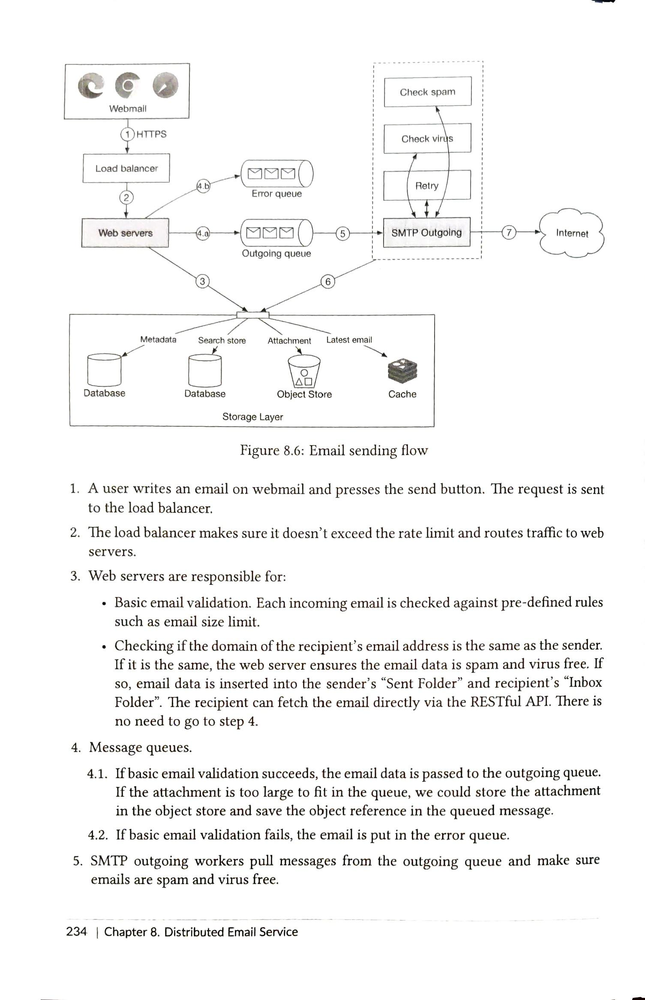
*Hình 8.6: Quy trình gửi email (Email sending flow)*

#### Các bước thực thi chi tiết:
1. Người dùng soạn email trên giao diện Webmail và nhấn nút gửi. Yêu cầu (Request) được chuyển đến bộ cân bằng tải (**Load Balancer**).
2. Bộ cân bằng tải kiểm tra đảm bảo lưu lượng không vượt quá giới hạn tần suất (**Rate Limit**) và định tuyến lưu lượng truy cập đến các **Web Servers**.
3. **Web Servers** đảm nhiệm các tác vụ:
   * **Xác thực email cơ bản:** Kiểm tra email đến dựa trên các quy tắc xác định trước, chẳng hạn như giới hạn kích thước email (size limit).
   * **Kiểm tra miền (Domain Check):** Kiểm tra xem miền của địa chỉ email người nhận có trùng với miền của người gửi hay không:
     * *Nếu trùng tên miền (gửi nội bộ):* Web server đảm bảo dữ liệu email không chứa mã độc (virus) và không phải thư rác (spam). Nếu hợp lệ, dữ liệu email được ghi đồng thời vào thư mục **"Sent Folder"** của người gửi và **"Inbox Folder"** của người nhận. Người nhận có thể lấy email trực tiếp thông qua RESTful API mà không cần chuyển tiếp qua bước 4.
4. **Hàng đợi thông điệp (Message Queues):**
   * **4.1.** Nếu quá trình xác thực email cơ bản thành công, dữ liệu email được đẩy vào **Outgoing Queue (Hàng đợi gửi đi)**. Trường hợp tệp đính kèm quá lớn để đưa trực tiếp vào hàng đợi, hệ thống lưu tệp vào **Object Store (S3)** và chỉ lưu trữ đường dẫn tham chiếu đối tượng (object reference) trong thông điệp hàng đợi.
   * **4.2.** Nếu xác thực email cơ bản thất bại, email sẽ được đẩy vào **Error Queue (Hàng đợi lỗi)**.
5. **SMTP Outgoing Workers:** Tiến hành rút thông điệp (pull messages) từ **Outgoing Queue**, thực hiện quét mã độc (check virus) và kiểm tra thư rác (check spam).
6. Email gửi đi được lưu vào thư mục **"Sent Folder"** của tầng lưu trữ (Storage Layer).
7. **SMTP Outgoing Workers** gửi email qua mạng Internet đến máy chủ thư của người nhận (Recipient Mail Server).

> [!NOTE]
> Mỗi thông điệp trong **Outgoing Queue** chứa toàn bộ các siêu dữ liệu cần thiết để khởi tạo email. Hàng đợi phân tán (**Distributed Message Queue**) là thành phần trọng yếu cho phép xử lý email bất đồng bộ (**Asynchronous Mail Processing**). Bằng cách phân tách (**Decoupling**) các SMTP Outgoing Workers khỏi Web Servers, chúng ta có thể mở rộng quy mô (Scale) các worker này một cách hoàn toàn độc lập.

#### Chiến lược giám sát Outgoing Queue:
Kích thước hàng đợi gửi đi cần được giám sát rất chặt chẽ. Nếu phát hiện số lượng lớn email bị tồn đọng (stuck) trong hàng đợi, hệ thống cần phân tích nguyên nhân gốc rễ:
* **Máy chủ mail phía người nhận không khả dụng (Unavailable):** Trong trường hợp này, cần kích hoạt cơ chế thử lại sau. Chiến lược **Exponential Backoff (Thử lại với độ trễ tăng theo cấp số nhân) [14]** là một giải pháp tối ưu.
* **Thiếu số lượng Consumer xử lý gửi mail:** Cần mở rộng quy mô tăng thêm các Consumer Worker để giảm tải và rút ngắn thời gian xử lý.

---

### Luồng Nhận Email (Email Receiving Flow)

Sơ đồ quy trình tiếp nhận email được minh họa tại **Hình 8.7**.

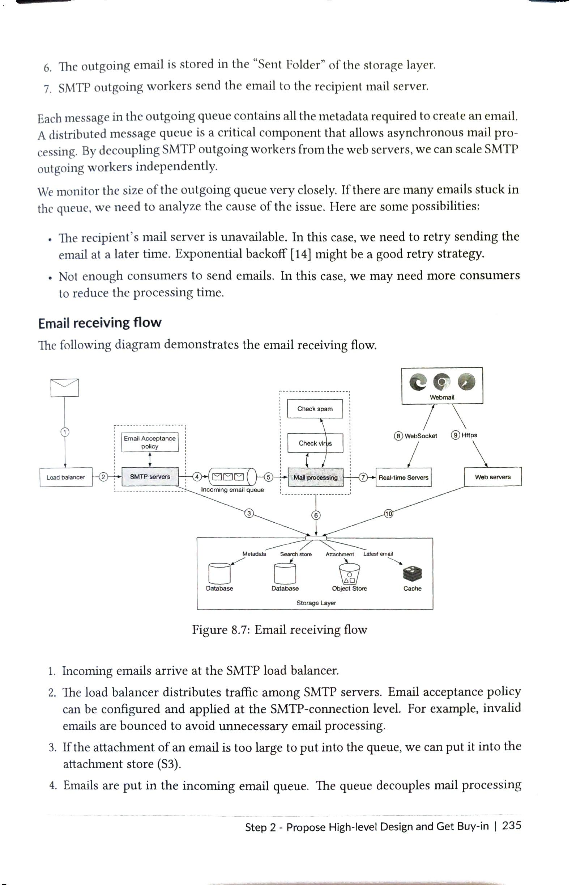
*Hình 8.7: Quy trình nhận email (Email receiving flow)*

#### Các bước thực thi chi tiết:
1. Các email đến sẽ đi vào bộ cân bằng tải **SMTP Load Balancer**.
2. Bộ cân bằng tải phân phối lưu lượng truy cập tới các cụm **SMTP Servers**. Tại tầng kết nối SMTP (**SMTP-connection level**), chính sách chấp nhận email (**Email Acceptance Policy**) có thể được cấu hình và áp dụng trực tiếp. Ví dụ: các email không hợp lệ sẽ bị từ chối trả về ngay lập tức (**bounced**) để tránh tốn tài nguyên xử lý không cần thiết.
3. Nếu tệp đính kèm của email vượt quá kích thước cho phép đưa vào hàng đợi, tệp sẽ được lưu vào **Attachment Store (S3)**.
4. Email được đưa vào **Incoming Email Queue (Hàng đợi email đến)**. Hàng đợi này giúp phân tách hoàn toàn các **Mail Processing Workers** khỏi các **SMTP Servers**, cho phép mở rộng quy mô độc lập. Đồng thời, hàng đợi đóng vai trò như một bộ đệm (**Buffer**) chống quá tải khi lưu lượng email đột ngột tăng vọt (**Surge**).
5. **Mail Processing Workers** đảm nhiệm xử lý nhiều tác vụ phức tạp, bao gồm lọc thư rác (spam filter), ngăn chặn mã độc (virus check), v.v. Các bước tiếp theo mặc định rằng email đã vượt qua khâu kiểm duyệt hợp lệ.
6. Dữ liệu email được đồng bộ ghi vào **Mail Storage (Metadata DB)**, **Cache**, và **Object Store**.
7. Nếu người nhận hiện đang trực tuyến (**Online**), email mới sẽ được đẩy trực tiếp tới các cụm **Real-time Servers**.
8. **Real-time Servers** (sử dụng WebSocket) cho phép máy khách nhận thông báo và email mới theo thời gian thực.
9. Đối với người dùng ngoại tuyến (**Offline**), email vẫn được lưu trữ an toàn tại tầng lưu trữ (**Storage Layer**). Khi người dùng quay lại trực tuyến, ứng dụng webmail sẽ kết nối tới **Web Servers** thông qua RESTful API.
10. **Web Servers** truy xuất các email mới từ tầng lưu trữ và trả lời về cho máy khách.

---

## Bước 3: Phân Tích Kỹ Thuật Chuyên Sâu (Design Deep Dive)

Sau khi đã nắm rõ cấu trúc tổng thể của hệ thống máy chủ email, chúng ta sẽ đi sâu vào các thành phần kỹ thuật cốt lõi và phương thức mở rộng quy mô (Scale) hệ thống:
* **Cơ sở dữ liệu Siêu dữ liệu (Metadata Database)**
* **Tìm kiếm (Search)**
* **Khả năng gửi nhận thành công (Deliverability)**
* **Khả năng mở rộng quy mô (Scalability)**

---

### Cơ Sở Dữ Liệu Siêu Dữ Liệu (Metadata Database)

Trong phần này, chúng ta phân tích các đặc trưng của siêu dữ liệu email, phương pháp lựa chọn cơ sở dữ liệu phù hợp, mô hình dữ liệu (Data Model), và cơ chế gom nhóm chuỗi hội thoại (**Conversation Threads**).

#### Đặc trưng của Siêu dữ liệu Email (Characteristics of Email Metadata)
* **Kích thước tiêu đề (Headers) thường nhỏ và có tần suất truy cập cao:** Chứa các thông tin định tuyến, người gửi, thời gian, trạng thái.
* **Kích thước thân thư (Body) dao động linh hoạt từ nhỏ đến lớn nhưng tần suất truy cập thấp:** Thông thường người dùng chỉ đọc nội dung một email một lần duy nhất.
* **Tính cô lập dữ liệu theo từng người dùng (Data Isolation):** Đa số các thao tác trên hộp thư như truy xuất thư, đánh dấu đã đọc, hoặc tìm kiếm đều bị cô lập hoàn toàn cho từng cá nhân người dùng. Nói cách khác, email thuộc về người dùng nào thì chỉ người dùng đó có quyền truy cập và thao tác.
* **Thời gian tác động trực tiếp đến mức độ sử dụng dữ liệu (Data Recency):** Người dùng chủ yếu có nhu cầu đọc các email gần đây nhất. Theo thống kê thực tế, có đến **82% các truy vấn đọc (Read Queries) nhắm vào các dữ liệu có độ tuổi dưới 16 ngày [15]**.
* **Yêu cầu cực cao về độ tin cậy và toàn vẹn dữ liệu (High Reliability):** Mất mát dữ liệu (Data Loss) là điều hoàn toàn không thể chấp nhận được trong hệ thống email.

# Chương 8: Dịch Vụ Email Phân Tán (Distributed Email Service)

---

### Lựa Chọn Cơ Sở Dữ Liệu Phù Hợp (Choosing the right database)

Ở quy mô của Gmail hoặc Outlook, hệ thống cơ sở dữ liệu thường được tùy biến riêng (custom-made) nhằm giảm thiểu số lượng thao tác đọc/ghi mỗi giây (**IOPS - Input/Output Operations Per Second**) [16], vì đây có thể dễ dàng trở thành điểm nghẽn chính (**major constraint**) trong hệ thống. Việc lựa chọn cơ sở dữ liệu phù hợp là không hề dễ dàng. Sẽ rất hữu ích nếu chúng ta cân nhắc toàn bộ các phương án khả thi hiện có trước khi đưa ra quyết định tối ưu nhất.

- **Cơ sở dữ liệu quan hệ (Relational database):** Động lực chính đằng sau phương án này là khả năng tìm kiếm email hiệu quả. Chúng ta có thể xây dựng các chỉ mục (**indexes**) cho tiêu đề email (**email header**) và phần thân (**email body**). Nhờ các chỉ mục này, các câu truy vấn tìm kiếm đơn giản sẽ thực thi rất nhanh. Tuy nhiên, các cơ sở dữ liệu quan hệ thường được tối ưu hóa cho các mẩu dữ liệu nhỏ và không lý tưởng cho các mục dữ liệu kích thước lớn. Một email điển hình thường lớn hơn vài KB và có thể dễ dàng vượt quá 100 KB khi có chứa mã HTML. Bạn có thể lập luận rằng kiểu dữ liệu BLOB được thiết kế để hỗ trợ các mục dữ liệu lớn. Tuy nhiên, các truy vấn tìm kiếm trên kiểu dữ liệu BLOB phi cấu trúc lại không hề hiệu quả. Vì vậy, các cơ sở dữ liệu quan hệ như MySQL hay PostgreSQL không phải là sự lựa chọn phù hợp.
- **Lưu trữ đối tượng phân tán (Distributed object storage):** Một giải pháp tiềm năng khác là lưu trữ email thô (**raw emails**) trong kho lưu trữ đám mây như Amazon S3. Đây có thể là một lựa chọn tốt cho mục đích lưu trữ sao lưu (**backup storage**), nhưng rất khó để hỗ trợ hiệu quả các tính năng như đánh dấu email đã đọc, tìm kiếm email dựa trên từ khóa, gom nhóm chuỗi hội thoại email (**email threading**), v.v.
- **Cơ sở dữ liệu NoSQL (NoSQL databases):** Google Bigtable được sử dụng bởi Gmail, vì vậy đây chắc chắn là một giải pháp khả thi. Tuy nhiên, Bigtable không phải là mã nguồn mở và cách thức triển khai tìm kiếm email trong đó vẫn là một ẩn số. Cassandra cũng có thể là một lựa chọn tốt, nhưng chúng ta chưa thấy bất kỳ nhà cung cấp dịch vụ email lớn nào sử dụng nó.

Dựa trên các phân tích ở trên, rất ít giải pháp hiện có dường như đáp ứng hoàn hảo các nhu cầu của chúng ta. Các nhà cung cấp dịch vụ email quy mô lớn có xu hướng tự xây dựng các cơ sở dữ liệu tùy biến cao của riêng họ. Tuy nhiên, trong khuôn khổ một buổi phỏng vấn thiết kế hệ thống, chúng ta sẽ không có đủ thời gian để thiết kế một cơ sở dữ liệu phân tán hoàn toàn mới, mặc dù việc giải thích các đặc tính cốt lõi mà cơ sở dữ liệu cần phải có là vô cùng quan trọng:

- Một cột đơn lẻ (**single column**) có thể chứa dung lượng lên tới hàng Megabyte (single-digit of MB).
- Tính nhất quán dữ liệu mạnh mẽ (**Strong data consistency**).
- Được thiết kế tối ưu để giảm thiểu thao tác I/O trên đĩa cứng (**disk I/O**).
- Phải có tính sẵn sàng cao (**High Availability**) và khả năng chịu lỗi (**Fault Tolerance**).
- Dễ dàng tạo các bản sao lưu gia tăng (**incremental backups**).

---

### Mô Hình Dữ Liệu (Data model)

Một cách để lưu trữ dữ liệu là sử dụng `user_id` làm khóa phân vùng (**partition key**), nhờ đó dữ liệu của một người dùng sẽ được lưu trữ trên một phân mảnh (**shard**) duy nhất. Một hạn chế của mô hình dữ liệu này là các thông điệp email không được chia sẻ giữa nhiều người dùng với nhau. Tuy nhiên, vì đây không phải là một yêu cầu đối với chúng ta trong buổi phỏng vấn này, nên đó không phải là điều chúng ta cần bận tâm.

Bây giờ hãy cùng định nghĩa các bảng dữ liệu. Khóa chính (**primary key**) bao gồm hai thành phần: khóa phân vùng (**partition key**) và khóa phân cụm (**clustering key**).

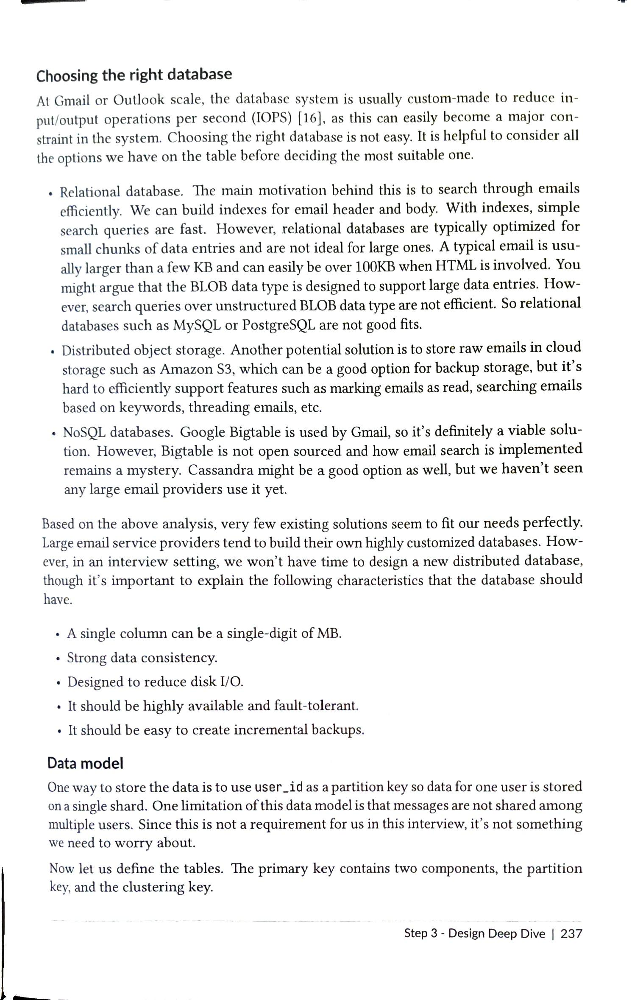

- **Partition key (Khóa phân vùng):** Chịu trách nhiệm phân phối dữ liệu đồng đều giữa các node.
- **Clustering key (Khóa phân cụm):** Chịu trách nhiệm sắp xếp thứ tự dữ liệu bên trong một phân vùng (**partition**).

Tầng truy cập dữ liệu cần hỗ trợ các truy vấn sau:
1. Truy vấn thứ nhất: Lấy toàn bộ các thư mục (**folders**) của một người dùng.
2. Truy vấn thứ hai: Hiển thị tất cả email cho một thư mục cụ thể.
3. Truy vấn thứ ba: Tạo / xóa / lấy một email cụ thể.
4. Truy vấn thứ tư: Lấy tất cả email đã đọc (**read**) hoặc chưa đọc (**unread**).
5. Điểm cộng (**Bonus point**): Lấy chuỗi hội thoại email (**conversation threads**).

Hãy cùng xem xét từng truy vấn một.

#### Truy Vấn 1: Lấy toàn bộ các thư mục của một người dùng (Query 1: get all folders for a user)

Như được thể hiện trong Bảng 8.1, `user_id` là khóa phân vùng (**partition key**), do đó các thư mục thuộc sở hữu của cùng một người dùng sẽ nằm trên cùng một phân vùng.

*Ký hiệu:*
- **K**: Partition Key (Khóa phân vùng)
- **C↑**: Clustering Key (Khóa phân cụm sắp xếp tăng dần - ascending)
- **C↓**: Clustering Key (Khóa phân cụm sắp xếp giảm dần - descending)

| folders_by_user | Kiểu dữ liệu | Vai trò khóa |
| :--- | :--- | :--- |
| **user_id** | UUID | **K** |
| **folder_id** | UUID | **C↑** |
| **folder_name** | TEXT | |

*Bảng 8.1: Thư mục theo người dùng (Folders by user)*

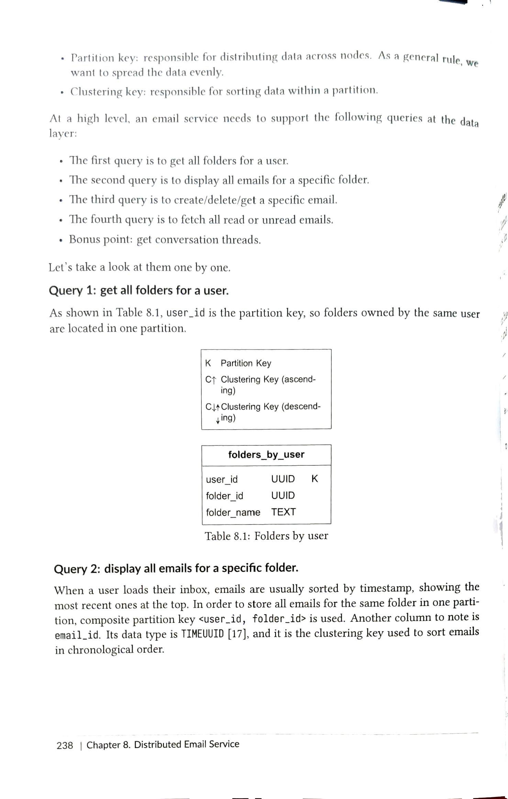

---

#### Truy Vấn 2: Hiển thị tất cả email cho một thư mục cụ thể (Query 2: display all emails for a specific folder)

Khi người dùng tải hộp thư đến (**inbox**), các email thường được sắp xếp theo mốc thời gian (**timestamp**), hiển thị những email mới nhất ở trên cùng. Để lưu trữ tất cả email của cùng một thư mục trong một phân vùng duy nhất, khóa phân vùng tổng hợp (**composite partition key**) `<user_id, folder_id>` được sử dụng. Một cột khác cần lưu ý là `email_id`. Kiểu dữ liệu của nó là `TIMEUUID` [17], và nó đóng vai trò là khóa phân cụm (**clustering key**) được sử dụng để sắp xếp các email theo thứ tự thời gian.

| emails_by_folder | Kiểu dữ liệu | Vai trò khóa |
| :--- | :--- | :--- |
| **user_id** | UUID | **K** |
| **folder_id** | UUID | **K** |
| **email_id** | TIMEUUID | **C↓** |
| **from** | TEXT | |
| **subject** | TEXT | |
| **preview** | TEXT | |
| **is_read** | BOOLEAN | |

*Bảng 8.2: Email theo thư mục (Emails by folder)*

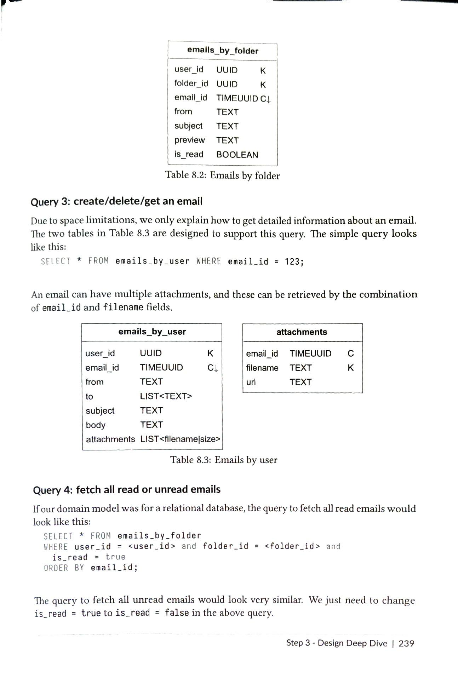

---

#### Truy Vấn 3: Tạo / xóa / lấy một email (Query 3: create/delete/get an email)

Do giới hạn về mặt không gian tài liệu, chúng tôi chỉ giải thích cách lấy thông tin chi tiết của một email. Hai bảng trong Bảng 8.3 được thiết kế để hỗ trợ truy vấn này. Câu truy vấn đơn giản có dạng như sau:

```sql
SELECT * FROM emails_by_user WHERE email_id = 123;
```

Một email có thể có nhiều tệp đính kèm (**attachments**), và các tệp này có thể được truy xuất thông qua sự kết hợp của hai trường `email_id` và `filename`.

**emails_by_user:**

| emails_by_user | Kiểu dữ liệu | Vai trò khóa |
| :--- | :--- | :--- |
| **user_id** | UUID | **K** |
| **email_id** | TIMEUUID | **C↑** |
| **from** | TEXT | |
| **to** | LIST\<TEXT\> | |
| **subject** | TEXT | |
| **body** | TEXT | |
| **attachments** | LIST\<filename \| size\> | |

**attachments:**

| attachments | Kiểu dữ liệu | Vai trò khóa |
| :--- | :--- | :--- |
| **email_id** | TIMEUUID | **K** |
| **filename** | TEXT | **C↑** |

*Bảng 8.3: Email theo người dùng và Tệp đính kèm (Emails by user & attachments)*

---

#### Truy Vấn 4: Lấy tất cả email đã đọc hoặc chưa đọc (Query 4: fetch all read or unread emails)

Nếu mô hình miền dữ liệu (**domain model**) của chúng ta dành cho một cơ sở dữ liệu quan hệ, câu truy vấn để lấy tất cả email đã đọc sẽ trông như thế này:

```sql
SELECT * FROM emails_by_folder
WHERE user_id = <user_id> AND folder_id = <folder_id> AND is_read = true
ORDER BY email_id;
```

Truy vấn để lấy tất cả email chưa đọc cũng sẽ tương tự. Chúng ta chỉ cần đổi `is_read = true` thành `is_read = false` trong câu truy vấn trên.

Tuy nhiên, mô hình dữ liệu của chúng ta được thiết kế cho NoSQL. Một cơ sở dữ liệu NoSQL thông thường chỉ hỗ trợ truy vấn trên các khóa phân vùng (**partition key**) và khóa phân cụm (**clustering key**). Do `is_read` trong bảng `emails_by_folder` không thuộc bất kỳ loại khóa nào trong số đó, hầu hết các cơ sở dữ liệu NoSQL sẽ từ chối câu truy vấn này.

Một cách để vượt qua hạn chế này là tải toàn bộ thư mục của một người dùng về và thực hiện việc lọc dữ liệu (**filtering**) tại tầng ứng dụng (**application layer**). Giải pháp này có thể hoạt động đối với một dịch vụ email quy mô nhỏ, nhưng ở quy mô thiết kế của chúng ta, nó không mang lại hiệu quả cao.

Vấn đề này thường được giải quyết bằng kỹ thuật phi chuẩn hóa dữ liệu (**Denormalization**) trong NoSQL. Để hỗ trợ các truy vấn lọc email đã đọc/chưa đọc, chúng ta phi chuẩn hóa dữ liệu của bảng `emails_by_folder` thành hai bảng riêng biệt như thể hiện trong Bảng 8.4:

- `read_emails`: lưu trữ toàn bộ các email đang ở trạng thái đã đọc (**read status**).
- `unread_emails`: lưu trữ toàn bộ các email đang ở trạng thái chưa đọc (**unread status**).

Để đánh dấu một email từ **CHƯA ĐỌC (UNREAD)** thành **ĐÃ ĐỌC (READ)**, email đó sẽ bị xóa khỏi bảng `unread_emails` và sau đó được chèn vào bảng `read_emails`.

Để lấy tất cả các email chưa đọc cho một thư mục cụ thể, chúng ta có thể thực thi một truy vấn như sau:

```sql
SELECT * FROM unread_emails
WHERE user_id = <user_id> AND folder_id = <folder_id>
ORDER BY email_id;
```

**read_emails:**

| read_emails | Kiểu dữ liệu | Vai trò khóa |
| :--- | :--- | :--- |
| **user_id** | UUID | **K** |
| **folder_id** | UUID | **K** |
| **email_id** | TIMEUUID | **C↓** |
| **from** | TEXT | |
| **subject** | TEXT | |
| **preview** | TEXT | |

**unread_emails:**

| unread_emails | Kiểu dữ liệu | Vai trò khóa |
| :--- | :--- | :--- |
| **user_id** | UUID | **K** |
| **folder_id** | UUID | **K** |
| **email_id** | TIMEUUID | **C↓** |
| **from** | TEXT | |
| **subject** | TEXT | |
| **preview** | TEXT | |

*Bảng 8.4: Email đã đọc và chưa đọc (Read and unread emails)*

> [!NOTE]
> Kỹ thuật phi chuẩn hóa dữ liệu (**Denormalization**) như mô tả ở trên là một thực tiễn phổ biến. Mặc dù nó làm cho mã nguồn ứng dụng trở nên phức tạp hơn và khó bảo trì hơn, nhưng nó giúp cải thiện đáng kể hiệu năng đọc (**read performance**) của các truy vấn này ở quy mô lớn.

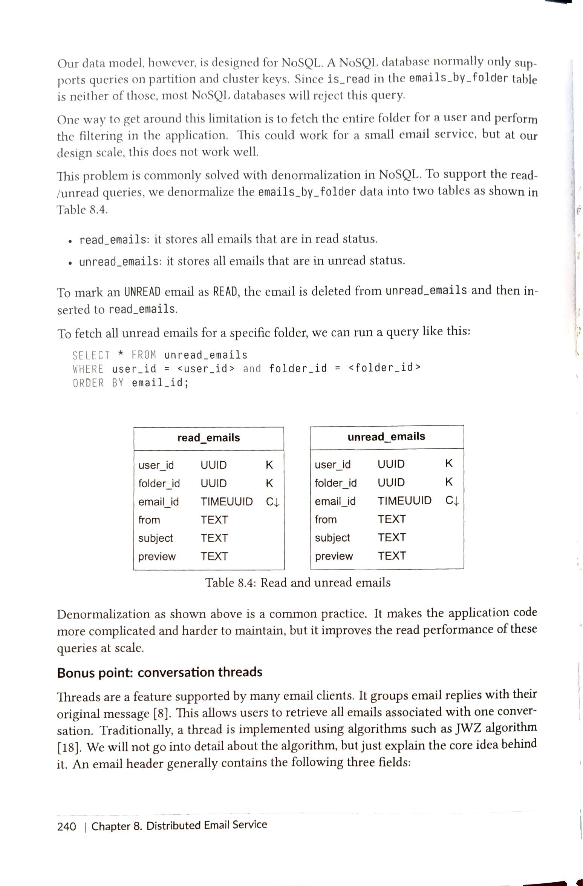

---

#### Điểm Cộng: Chuỗi Hội Thoại (Bonus point: conversation threads)

Chuỗi hội thoại (**Threads**) là một tính năng được hỗ trợ bởi nhiều ứng dụng email client. Nó gom nhóm các email phản hồi (**replies**) với thông điệp gốc của chúng [8]. Điều này cho phép người dùng truy xuất toàn bộ các email liên quan đến một cuộc trò chuyện. 

Về mặt truyền thống, một luồng hội thoại được triển khai bằng các thuật toán như thuật toán JWZ (**JWZ algorithm**) [18]. Chúng ta sẽ không đi sâu vào chi tiết của thuật toán này, mà chỉ giải thích ý tưởng cốt lõi đằng sau nó. Phần tiêu đề email (**email header**) thường chứa ba trường sau:

```json
"headers": {
  "Message-Id": "<7BA84B2A-438C-4D12-8B57-862183C34581@gmail.com>",
  "In-Reply-To": "<CAEWTXuPfN=LzECjDJtgY9Vu03kgFvJnJUSHTt6Tw@gmail.com>",
  "References": ["<7BA04B2A-430C-4D12-8B57-862183C34501@gmail.com>"]
}
```

| Trường Header | Ý nghĩa |
| :--- | :--- |
| **Message-Id** | Giá trị định danh của một thông điệp (message ID). Nó được tạo ra bởi client trong quá trình gửi thông điệp. |
| **In-Reply-To** | `Message-Id` của thông điệp cha (**parent**) mà thông điệp hiện tại đang phản hồi. |
| **References** | Danh sách các `Message-Id` có liên quan đến một chuỗi hội thoại (**thread**). |

*Bảng 8.5: Tiêu đề email (Email header)*

Nhờ các trường này, một ứng dụng email client có thể tái cấu trúc lại các cuộc trò chuyện từ các thông điệp riêng lẻ, miễn là toàn bộ các thông điệp trong chuỗi phản hồi (**reply chain**) đã được nạp trước (**preloaded**).

---

### Đánh Đổi Tính Nhất Quán (Consistency trade-off)

Các cơ sở dữ liệu phân tán dựa vào cơ chế nhân bản dữ liệu (**replication**) để đạt được tính sẵn sàng cao (**High Availability**) bắt buộc phải thực hiện sự đánh đổi căn bản giữa tính nhất quán (**Consistency**) và tính sẵn sàng (**Availability**). Tính chính xác (**Correctness**) là cực kỳ quan trọng đối với các hệ thống email, vì vậy theo thiết kế, chúng ta muốn có một node chính duy nhất (**single primary**) cho bất kỳ hộp thư (**mailbox**) nào. 

Trong trường hợp xảy ra sự cố chuyển vùng dự phòng (**failover**), hộp thư đó sẽ tạm thời không thể truy cập được bởi các client, do đó hoạt động đồng bộ/cập nhật (**sync/update operation**) của họ sẽ bị tạm dừng cho đến khi quá trình failover hoàn tất. Thiết kế này chấp nhận đánh đổi tính sẵn sàng để ưu tiên tính nhất quán (**trades availability in favor of consistency**).

---

### Khả Năng Chuyển Phát Email (Email deliverability)

Việc thiết lập một máy chủ thư (**mail server**) và bắt đầu gửi email là rất dễ dàng. Phần khó khăn nằm ở việc làm sao để các email thực sự được chuyển phát đến hộp thư đến (**inbox**) của người nhận. Nếu một email bị rơi vào thư mục rác (**spam folder**), điều đó đồng nghĩa với việc có khả năng rất cao là người nhận sẽ không đọc nó. Thư rác (**email spam**) là một vấn nạn khổng lồ. Theo nghiên cứu thực hiện bởi Statista [19], hơn 50% tổng số email được gửi đi là thư rác. Nếu chúng ta thiết lập một máy chủ thư mới, rất có thể email của chúng ta sẽ rơi thẳng vào hộp thư rác vì một máy chủ email mới chưa hề có danh tiếng (**reputation**). Có một vài yếu tố cần xem xét để cải thiện khả năng chuyển phát email:

- **Địa chỉ IP chuyên dụng (Dedicated IPs):** Chúng tôi khuyến nghị nên có các địa chỉ IP chuyên dụng riêng cho việc gửi email. Các nhà cung cấp dịch vụ email thường ít chấp nhận email đến từ các địa chỉ IP mới hoàn toàn không có lịch sử hoạt động.
- **Phân loại email (Classify emails):** Gửi các danh mục email khác nhau từ các địa chỉ IP khác nhau. Ví dụ: bạn nên tránh gửi email tiếp thị (**marketing emails**) và các email quan trọng khác từ cùng một máy chủ, vì điều đó có thể khiến các nhà cung cấp dịch vụ Internet (**ISP**) đánh dấu tất cả email của bạn là thư quảng cáo (**promotional**).
- **Danh tiếng của người gửi email (Email sender reputation):** Làm ấm (**warm up**) các địa chỉ IP của máy chủ email mới một cách từ từ để xây dựng danh tiếng tốt, nhờ đó các nhà cung cấp lớn như Office365, Gmail, Yahoo Mail, v.v. sẽ ít có khả năng đưa email của chúng ta vào thư mục spam. Theo Amazon Simple Email Service (SES) [20], phải mất khoảng từ 2 đến 6 tuần để "làm ấm" một địa chỉ IP mới.

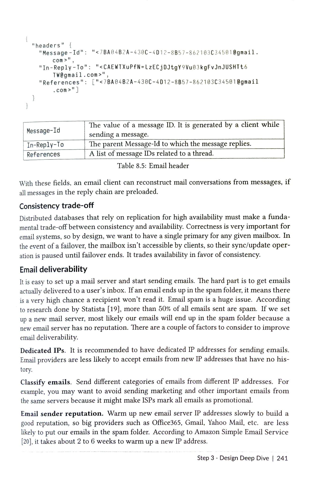

---

...tác động đáng kể đến danh tiếng của máy chủ.

- **Xử lý phản hồi (Feedback processing):** Việc thiết lập các vòng lặp phản hồi (**feedback loops**) với các ISP là cực kỳ quan trọng để chúng ta có thể giữ tỷ lệ khiếu nại (**complaint rate**) ở mức thấp và nhanh chóng khóa (**ban**) các tài khoản phát tán thư rác. Nếu một email gửi không thành công hoặc người dùng gửi khiếu nại, một trong những kết quả sau sẽ xảy ra:
  - **Hard bounce (Trả về vĩnh viễn):** Điều này có nghĩa là email bị ISP từ chối vì địa chỉ email của người nhận không hợp lệ.
  - **Soft bounce (Trả về tạm thời):** Soft bounce cho biết email gửi không thành công do các điều kiện tạm thời, chẳng hạn như máy chủ ISP đang quá tải.
  - **Complaint (Khiếu nại):** Điều này có nghĩa là người nhận đã nhấp vào nút "báo cáo thư rác" (**report spam**).

Hình 8.8 minh họa quy trình thu thập và xử lý các sự cố trả về/khiếu nại (**bounces/complaints**). Chúng tôi sử dụng các hàng đợi riêng biệt (**separate queues**) cho soft bounces, hard bounces và complaints để chúng có thể được quản lý độc lập.

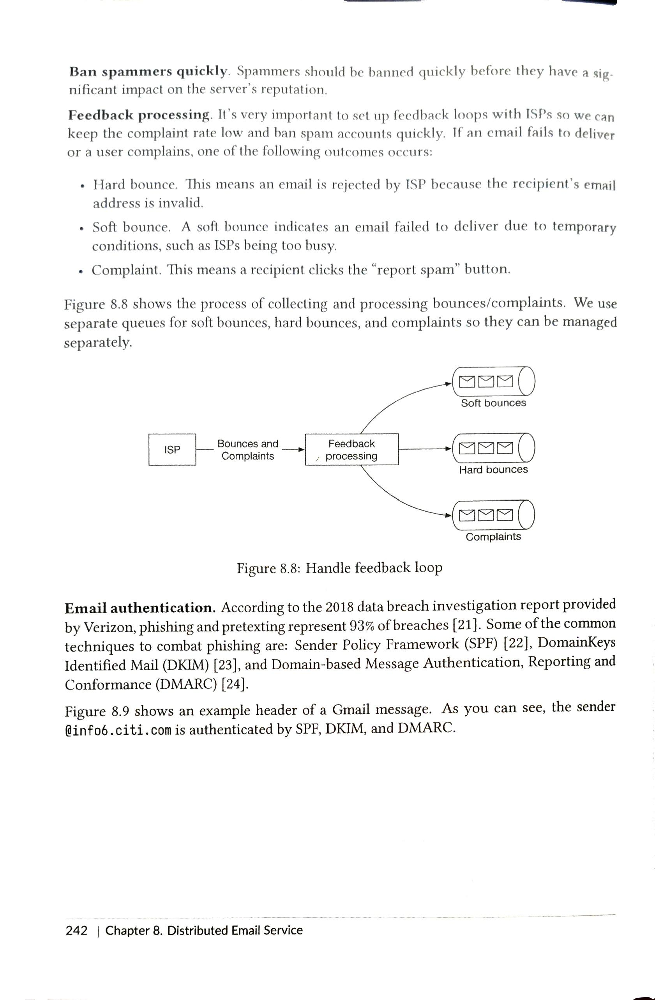

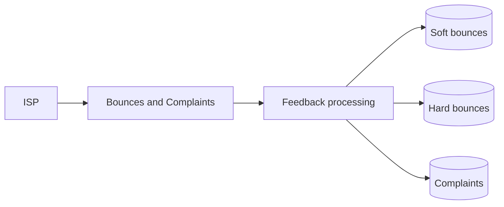
*Hình 8.8: Xử lý vòng lặp phản hồi (Handle feedback loop)*

- **Xác thực email (Email authentication):** Theo Báo cáo Điều tra Vi phạm Dữ liệu năm 2018 do Verizon cung cấp, tấn công giả mạo (**phishing**) và lừa đảo lấy lòng tin (**pretexting**) chiếm tới 93% các vụ vi phạm [21]. Một số kỹ thuật phổ biến để chống lại tấn công lừa đảo bao gồm:
  - **SPF (Sender Policy Framework)** [22]
  - **DKIM (DomainKeys Identified Mail)** [23]
  - **DMARC (Domain-based Message Authentication, Reporting and Conformance)** [24]

Hình 8.9 hiển thị một ví dụ về tiêu đề email của Google Gmail. Như bạn có thể thấy, người gửi `@info6.citi.com` đã được xác thực thành công bởi SPF, DKIM và DMARC.

# CHƯƠNG 8: DỊCH VỤ EMAIL PHÂN TÁN (DISTRIBUTED EMAIL SERVICE)

---

## BƯỚC 3: THIẾT KẾ ĐI SÂU VÀO CHI TIẾT (DESIGN DEEP DIVE) - TIẾP THEO

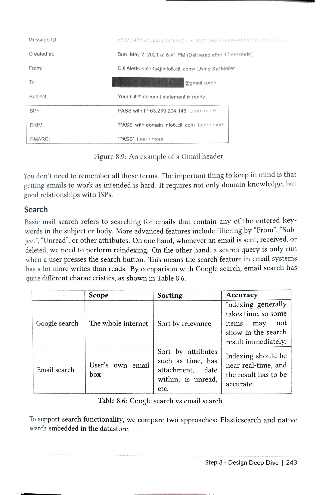

```email-header
Message ID
Created at:
Sun, May 2, 2021 at 6:41 PM (Delivered after 17 seconds)
From:
Citi Alerts <alerts@info6.citi.com> Using XyzMailer
To:
<...@gmail.com>
Subject:
Your Citi account statement is ready
SPF:
'PASS' with IP 63.239.204.146 Learn more
DKIM:
'PASS' with domain info6.citi.com Learn more
DMARC:
'PASS' Learn more
```
**Hình 8.9: Ví dụ về một email header của Gmail**

Bạn không cần phải ghi nhớ tất cả các thuật ngữ đó. Điều quan trọng cần ghi nhớ là việc làm cho email hoạt động chuẩn xác như mong muốn là rất khó. Nó đòi hỏi không chỉ kiến thức chuyên ngành (domain knowledge), mà còn cả mối quan hệ tốt với các ISP (Internet Service Providers - Nhà cung cấp dịch vụ Internet).

---

### Tìm kiếm (Search)

Tìm kiếm thư cơ bản (Basic mail search) đề cập đến việc tìm kiếm các email có chứa bất kỳ từ khóa nào được nhập trong phần tiêu đề (subject) hoặc phần thân thư (body). Các tính năng nâng cao hơn bao gồm lọc theo "From" (Người gửi), "Subject" (Tiêu đề), "Unread" (Chưa đọc), hoặc các thuộc tính khác. 

* Một mặt, bất cứ khi nào một email được gửi (sent), nhận (received), hoặc xóa (deleted), chúng ta cần phải thực hiện đánh chỉ mục lại (reindexing).
* Mặt khác, một truy vấn tìm kiếm (search query) chỉ được chạy khi người dùng nhấn nút tìm kiếm. 

Điều này có nghĩa là tính năng tìm kiếm trong hệ thống email có khối lượng ghi (writes) nhiều hơn rất nhiều so với khối lượng đọc (reads). So với Google search, tìm kiếm email có các đặc tính khá khác biệt, như được thể hiện trong **Bảng 8.6**.

| Tiêu chí | Phạm vi (Scope) | Sắp xếp (Sorting) | Độ chính xác (Accuracy) | Đánh chỉ mục (Indexing) |
| :--- | :--- | :--- | :--- | :--- |
| **Google search** | Toàn bộ mạng internet (The whole internet) | Sắp xếp theo mức độ liên quan (Sort by relevance) | Việc đánh chỉ mục thường mất thời gian, vì vậy một số mục có thể không hiển thị trong kết quả tìm kiếm ngay lập tức. | Indexing taking time |
| **Email search** | Hộp thư của chính người dùng (User's own email box) | Sắp xếp theo các thuộc tính như thời gian, có tệp đính kèm, khoảng ngày, chưa đọc, v.v. (Sort by attributes such as time, has attachment, date within, is unread, etc.) | Việc đánh chỉ mục phải ở trạng thái gần thời gian thực (near real-time), và kết quả trả về phải hoàn toàn chính xác. | Near real-time & accurate |

**Bảng 8.6: Google search so với Email search**

Để hỗ trợ chức năng tìm kiếm, chúng ta so sánh hai phương pháp tiếp cận: **Elasticsearch** và **công cụ tìm kiếm tích hợp sẵn (native search) được nhúng trong kho lưu trữ dữ liệu (datastore)**.

---

### Phương án 1: Elasticsearch (Option 1: Elasticsearch)

Thiết kế mức cao (high-level design) cho việc tìm kiếm email sử dụng Elasticsearch được thể hiện trong **Hình 8.10**. Bởi vì các truy vấn hầu hết được thực hiện trên chính máy chủ email của người dùng, chúng ta có thể nhóm các tài liệu nền tảng (underlying documents) về cùng một node bằng cách sử dụng `user_id` làm khóa phân vùng (partition key).

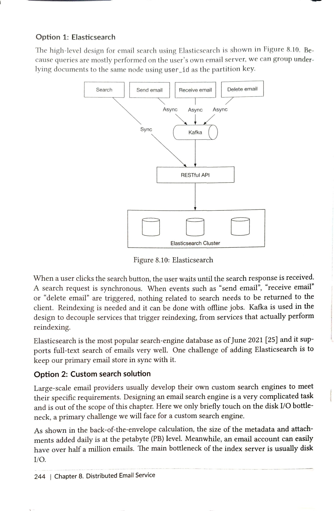

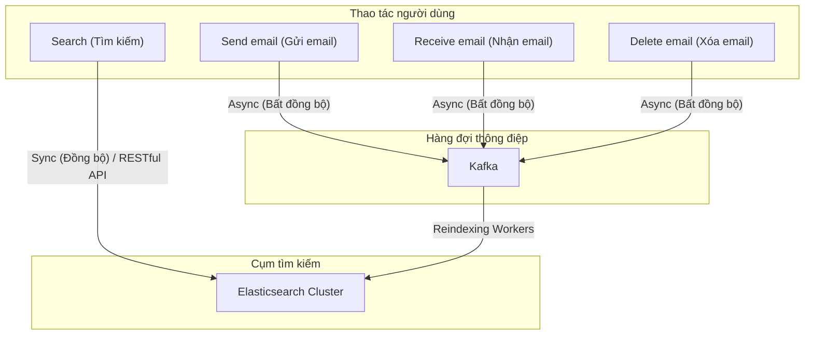
**Hình 8.10: Elasticsearch**

Khi người dùng nhấn nút tìm kiếm, người dùng sẽ đợi cho đến khi nhận được phản hồi tìm kiếm. Một yêu cầu tìm kiếm (search request) là đồng bộ (synchronous). 

Khi các sự kiện như *"send email"*, *"receive email"* hoặc *"delete email"* được kích hoạt, không có phản hồi nào liên quan đến tìm kiếm cần phải trả về cho client. Việc đánh chỉ mục lại (reindexing) là cần thiết và nó có thể được thực hiện bằng các tiến trình xử lý ngoại tuyến (offline jobs / batch workers). **Kafka** được sử dụng trong thiết kế để tách rời (decouple) các dịch vụ kích hoạt việc đánh chỉ mục lại khỏi các dịch vụ thực sự thực hiện công việc đánh chỉ mục lại.

Elasticsearch là cơ sở dữ liệu công cụ tìm kiếm phổ biến nhất tính đến tháng 6 năm 2021 [25] và nó hỗ trợ tìm kiếm toàn văn (full-text search) cho email rất tốt. Một thách thức lớn khi thêm Elasticsearch là làm sao giữ cho kho lưu trữ email chính (primary email store) luôn đồng bộ dữ liệu (in sync) với nó.

---

### Phương án 2: Giải pháp tìm kiếm tùy chỉnh (Option 2: Custom search solution)

Các nhà cung cấp email quy mô lớn thường tự phát triển các công cụ tìm kiếm tùy chỉnh (custom search engines) riêng để đáp ứng các yêu cầu đặc thù của họ. Thiết kế một công cụ tìm kiếm email là một tác vụ cực kỳ phức tạp và nằm ngoài phạm vi của chương này. Ở đây chúng ta chỉ đề cập ngắn gọn về nút thắt cổ chai I/O đĩa (disk I/O bottleneck) — một thách thức hàng đầu mà chúng ta sẽ phải đối mặt đối với một công cụ tìm kiếm tùy chỉnh.

Như đã chỉ ra trong phần tính toán ước tính sơ bộ (back-of-the-envelope calculation), kích thước metadata và tệp đính kèm (attachments) được thêm vào hàng ngày nằm ở quy mô Petabyte (PB). Trong khi đó, một tài khoản email có thể dễ dàng chứa hơn nửa triệu email. Nút thắt cổ chai chính của máy chủ chỉ mục (index server) thường là **Disk I/O**.

---

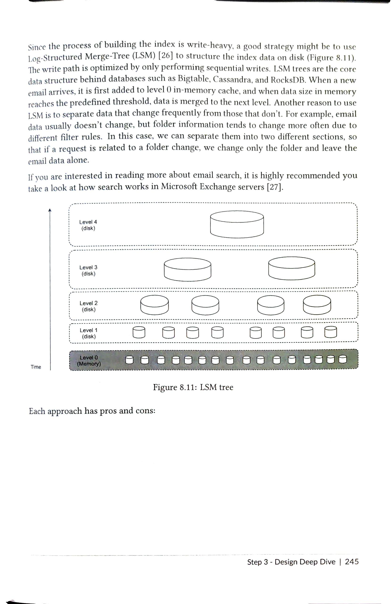

...các quy tắc bộ lọc khác nhau (different filter rules). Trong trường hợp này, chúng ta có thể tách chúng thành hai phần khác nhau, để nếu một yêu cầu liên quan đến việc thay đổi thư mục (folder change), chúng ta chỉ thay đổi thư mục và giữ nguyên dữ liệu email mà không can thiệp vào.

> [!TIP]
> Nếu bạn quan tâm đến việc tìm hiểu thêm về tìm kiếm email, chúng tôi đặc biệt khuyến nghị bạn nên tham khảo cách tìm kiếm hoạt động trong các máy chủ **Microsoft Exchange** [27].

```
Level 4 (disk)  -------------------------
Level 3 (disk)  -------------------
Level 2 (disk)  -------------
Level 1 (disk)  -------
Level 0 (Memory) ---
                    ---------> Time (Thời gian)
```
**Hình 8.11: Cấu trúc cây LSM (Log-Structured Merge-tree)**

Mỗi phương pháp tiếp cận đều có ưu và nhược điểm riêng:

---

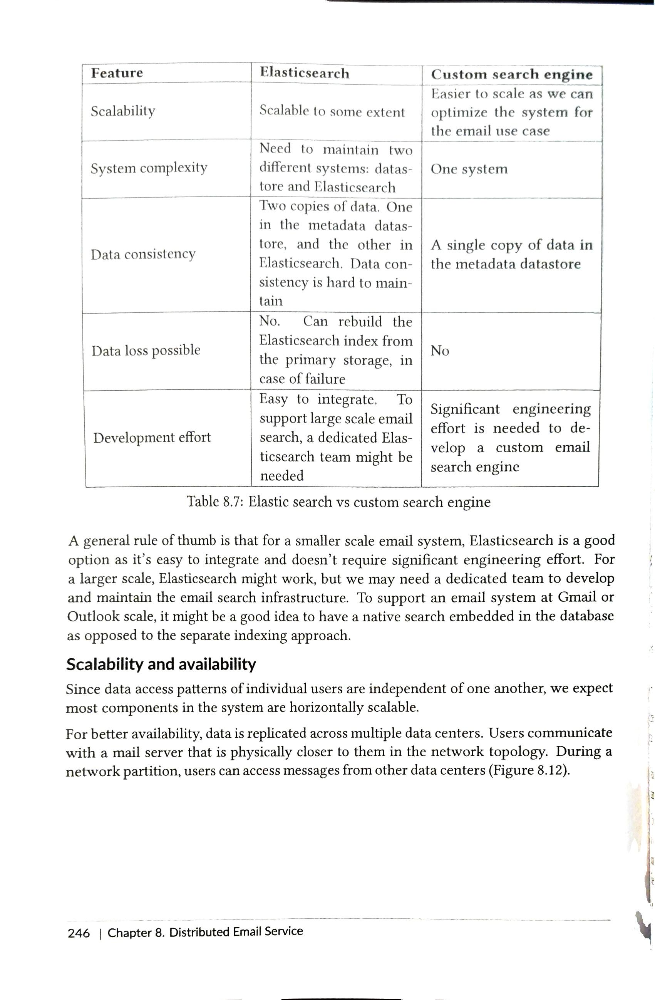

| Đặc tính (Feature) | Elasticsearch | Công cụ tìm kiếm tùy chỉnh (Custom search engine) |
| :--- | :--- | :--- |
| **Khả năng mở rộng (Scalability)** | Có thể mở rộng ở một mức độ nhất định (Scalable to some extent) | Dễ dàng mở rộng hơn (Easier to scale) do chúng ta có thể tối ưu hóa hệ thống riêng cho trường hợp sử dụng email |
| **Độ phức tạp hệ thống (System complexity)** | Cần bảo trì hai hệ thống khác nhau: kho lưu trữ dữ liệu (datastore) và Elasticsearch | Một hệ thống duy nhất (One system) |
| **Tính nhất quán dữ liệu (Data consistency)** | Hai bản sao dữ liệu: Một trong kho dữ liệu metadata, bản còn lại trong Elasticsearch. Tính nhất quán của dữ liệu rất khó duy trì (Data consistency is hard to maintain) | Một bản sao dữ liệu duy nhất trong kho lưu trữ dữ liệu metadata (A single copy of data in the metadata datastore) |
| **Khả năng mất dữ liệu (Data loss possible)** | Không. Có thể xây dựng lại chỉ mục Elasticsearch từ bộ lưu trữ chính trong trường hợp xảy ra sự cố (Can rebuild the Elasticsearch index from the primary storage, in case of failure) | Không (No) |
| **Nỗ lực phát triển (Development effort)** | Dễ tích hợp. Để hỗ trợ tìm kiếm email quy mô lớn, có thể cần một đội ngũ chuyên trách về Elasticsearch (A dedicated Elasticsearch team might be needed) | Cần nỗ lực kỹ thuật rất lớn (Significant engineering effort is needed) để phát triển một công cụ tìm kiếm email tùy chỉnh |

**Bảng 8.7: So sánh Elasticsearch vs Công cụ tìm kiếm tùy chỉnh**

Quy tắc ngón tay cái tổng quát (A general rule of thumb) là:
* Đối với một hệ thống email quy mô nhỏ hơn, **Elasticsearch** là một lựa chọn tốt vì nó dễ tích hợp và không đòi hỏi nỗ lực kỹ thuật quá lớn.
* Đối với quy mô lớn hơn, Elasticsearch vẫn có thể hoạt động, nhưng chúng ta có thể cần một đội ngũ kỹ sư chuyên trách để phát triển và duy trì hạ tầng tìm kiếm email.
* Để hỗ trợ một hệ thống email ở quy mô khổng lồ như **Gmail** hay **Outlook**, việc xây dựng một công cụ tìm kiếm tích hợp sẵn (native search) được nhúng trực tiếp trong cơ sở dữ liệu thay vì phương pháp lập chỉ mục tách rời (separate indexing) có thể là một ý tưởng tối ưu hơn.

---

### Khả năng mở rộng và Tính sẵn sàng cao (Scalability and Availability)

Vì các mẫu hình truy cập dữ liệu (data access patterns) của từng người dùng riêng lẻ là độc lập với nhau, chúng ta kỳ vọng hầu hết các thành phần trong hệ thống đều có khả năng mở rộng theo chiều ngang (horizontally scalable).

Để đạt được tính sẵn sàng cao hơn (better availability), dữ liệu được sao chép (replicated) trên nhiều trung tâm dữ liệu (multi-data centers). Người dùng sẽ giao tiếp với máy chủ thư điện tử (mail server) gần họ nhất về mặt vật lý trong cấu trúc tô-pô mạng (network topology). Trong suốt quá trình xảy ra phân mảnh mạng (network partition), người dùng vẫn có thể truy cập các thư từ các trung tâm dữ liệu khác (**Hình 8.12**).

---

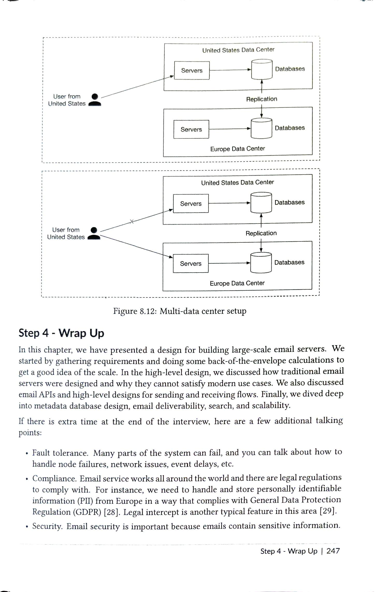

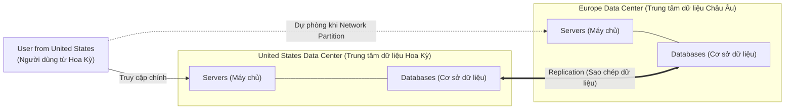
**Hình 8.12: Thiết lập đa trung tâm dữ liệu (Multi-data center setup)**

---

## BƯỚC 4: TỔNG KẾT (STEP 4 - WRAP UP)

Trong chương này, chúng tôi đã trình bày một thiết kế để xây dựng các máy chủ email quy mô lớn. 
1. Chúng ta bắt đầu bằng việc thu thập các yêu cầu và thực hiện một số phép tính toán ước lượng sơ bộ (back-of-the-envelope calculations) để nắm rõ quy mô hệ thống.
2. Trong phần thiết kế mức cao (high-level design), chúng ta đã thảo luận về cách các máy chủ email truyền thống được thiết kế và lý do tại sao chúng không thể đáp ứng được các trường hợp sử dụng hiện đại. Chúng ta cũng đã thảo luận về các API email cùng các thiết kế kiến trúc mức cao cho luồng gửi (sending flow) và luồng nhận (receiving flow).
3. Cuối cùng, chúng ta đã đi sâu vào thiết kế cơ sở dữ liệu metadata, khả năng gửi thư thành công (email deliverability), tính năng tìm kiếm (search), và khả năng mở rộng (scalability).

Nếu còn thời gian vào cuối buổi phỏng vấn, dưới đây là một vài chủ đề thảo luận bổ sung (additional talking points):

* **Khả năng chịu lỗi (Fault tolerance):** Rất nhiều thành phần trong hệ thống có thể gặp sự cố, và bạn có thể nói về cách xử lý lỗi hỏng hóc node (node failures), các sự cố mạng (network issues), độ trễ sự kiện (event delays), v.v.
* **Tuân thủ pháp lý (Compliance):** Dịch vụ email hoạt động trên toàn thế giới và có nhiều quy định pháp lý bắt buộc phải tuân thủ. Ví dụ: chúng ta cần xử lý và lưu trữ thông tin nhận dạng cá nhân (PII - Personally Identifiable Information) từ Châu Âu theo cách tuân thủ Quy định chung về bảo vệ dữ liệu (GDPR - General Data Protection Regulation) [28]. Nghe lén / Giám sát hợp pháp (Legal intercept) cũng là một tính năng tiêu biểu khác trong lĩnh vực này [29].
* **Bảo mật (Security):** Bảo mật email là vô cùng quan trọng vì email chứa nhiều thông tin nhạy cảm.

---

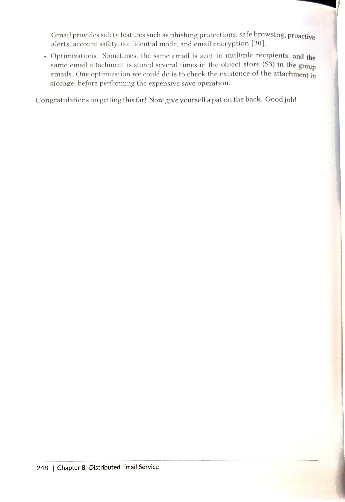

...cảnh báo (alerts), an toàn tài khoản (account safety), chế độ bảo mật tuyệt mật (confidential mode), và mã hóa email (email encryption) [30].

...lưu trữ (storage), trước khi thực hiện thao tác lưu tốn kém (expensive save operation).

> [!NOTE]
> Xin chúc mừng bạn đã đi được một chặng đường dài đến đây! Hãy tự thưởng cho mình một cái vỗ vai khích lệ. Bạn đã làm rất tốt! (Good job!)

---
*Trang 248 / Chương 8: Dịch Vụ Email Phân Tán (Distributed Email Service)*

# CHƯƠNG 8: DỊCH VỤ EMAIL PHÂN TÁN (DISTRIBUTED EMAIL SERVICE)

---

## TỔNG KẾT CHƯƠNG (CHAPTER SUMMARY)

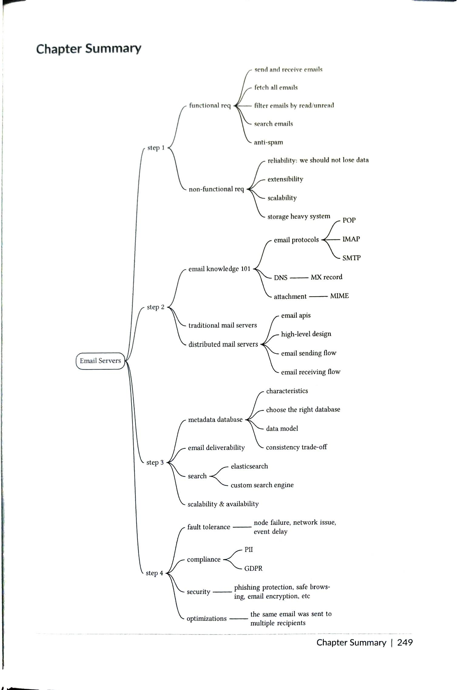

* **Yêu cầu chức năng (Functional Requirements):**
  * Gửi và nhận email (**send and receive emails**)
  * Tải/Lấy toàn bộ email (**fetch all emails**)
  * Lọc email theo trạng thái đã đọc/chưa đọc (**filter emails by read/unread**)
  * Tìm kiếm email (**search emails**)
  * Chống thư rác (**anti-spam**)

* **Yêu cầu phi chức năng (Non-functional Requirements):**
  * Độ tin cậy: Không được phép mất mát dữ liệu (**reliability: we should not lose data**)
  * Khả năng mở rộng tính năng (**extensibility**)
  * Khả năng mở rộng quy mô (**scalability**)
  * Hệ thống thiên về lưu trữ dung lượng lớn (**storage-heavy system**)

* **Kiến thức cơ bản về Email (Email Knowledge 101):**
  * **Các giao thức email (Email protocols):**
    * **POP (Post Office Protocol)**
    * **IMAP (Internet Message Access Protocol)**
    * **SMTP (Simple Mail Transfer Protocol)**
  * **Hệ thống phân giải tên miền (DNS):**
    * Bản ghi **MX record (Mail Exchange record)**
  * **Tệp đính kèm (Attachment):**
    * Chuẩn mã hóa mở rộng **MIME (Multipurpose Internet Mail Extensions)**
  * **Giao diện lập trình email (Email APIs)**

* **Thiết kế tổng quan (High-Level Design):**
  * Máy chủ thư truyền thống (**traditional mail servers**)
  * Máy chủ thư phân tán (**distributed mail servers**)
  * Luồng gửi email (**email sending flow**)
  * Luồng nhận email (**email receiving flow**)

* **Máy chủ Email (Email Servers):**
  * **Đặc tính hệ thống (Characteristics)**
  * **Lựa chọn cơ sở dữ liệu phù hợp (Choose the right database):**
    * Cơ sở dữ liệu siêu dữ liệu (**metadata database**)
    * Mô hình dữ liệu (**data model**)
    * Đánh đổi tính nhất quán dữ liệu (**consistency trade-off**)
  * Khả năng chuyển phát email thành công (**email deliverability**)

* **Bước 3: Đi sâu vào chi tiết thiết kế (Step 3 - Deep Dive):**
  * **Tìm kiếm (Search):**
    * **Elasticsearch**
    * Công cụ tìm kiếm tùy biến (**custom search engine**)
    * Khả năng mở rộng quy mô & Độ sẵn sàng cao (**scalability & availability**)
  * **Khả năng chịu lỗi (Fault tolerance):**
    * Lỗi nút máy chủ (**node failure**)
    * Sự cố mạng (**network issue**)
    * Độ trễ sự kiện (**event delay**)
  * **Bảo mật & Tuân thủ (Security & Compliance):**
    * Thông tin định danh cá nhân (**PII - Personally Identifiable Information**)
    * Tuân thủ quy định bảo vệ dữ liệu (**compliance: GDPR**)
    * Chống tấn công giả mạo (**phishing protection**)
    * Duyệt web an toàn (**safe browsing**)
    * Mã hóa email (**email encryption**)

* **Bước 4: Tối ưu hóa (Step 4 - Optimizations):**
  * Tối ưu hóa trường hợp cùng một email được gửi tới nhiều người nhận (**the same email was sent to multiple recipients**)

> [!NOTE]
> *Trang 249 | Chapter Summary 1*

---

## TÀI LIỆU THAM KHẢO (REFERENCE MATERIAL)

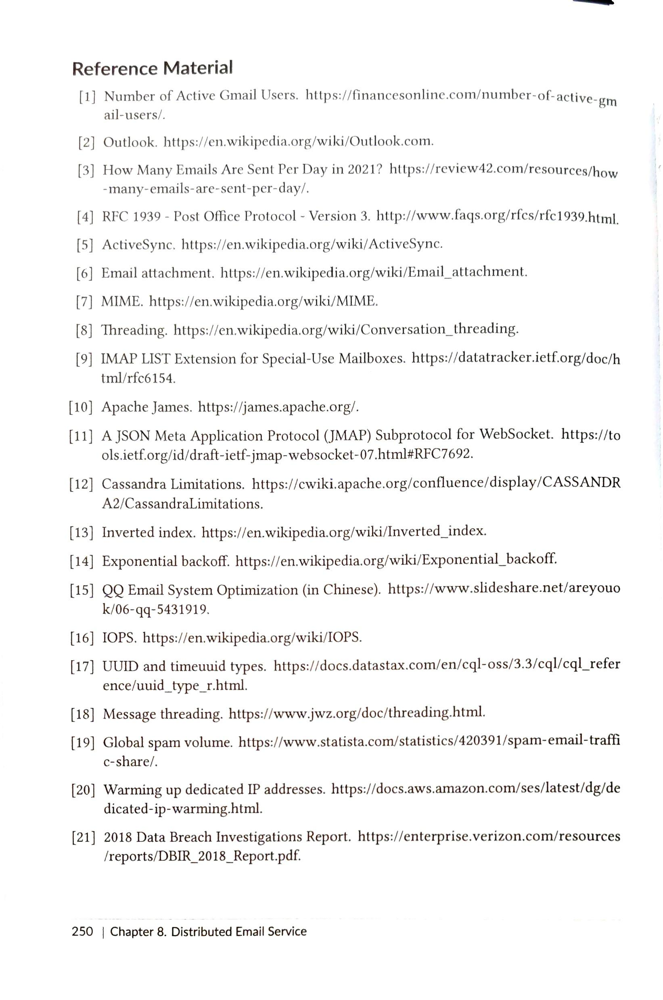

* **[1]** *ail-users/.* (Thống kê người dùng dịch vụ thư điện tử toàn cầu).
* **[2]** **Outlook:** [https://en.wikipedia.org/wiki/Outlook.com](https://en.wikipedia.org/wiki/Outlook.com).
* **[3]** **How Many Emails Are Sent Per Day in 2021?** (Có bao nhiêu email được gửi mỗi ngày trong năm 2021?): [https://review42.com/resources/how-many-emails-are-sent-per-day/](https://review42.com/resources/how-many-emails-are-sent-per-day/).
* **[4]** **RFC 1939 - Post Office Protocol - Version 3 (POP3):** [http://www.faqs.org/rfcs/rfc1939.html](http://www.faqs.org/rfcs/rfc1939.html).
* **[5]** **ActiveSync:** [https://en.wikipedia.org/wiki/ActiveSync](https://en.wikipedia.org/wiki/ActiveSync).
* **[7]** **MIME (Multipurpose Internet Mail Extensions):** [https://en.wikipedia.org/wiki/MIME](https://en.wikipedia.org/wiki/MIME).
* **[8]** **Threading (Phân luồng hội thoại email):** [https://en.wikipedia.org/wiki/Conversation_threading](https://en.wikipedia.org/wiki/Conversation_threading).
* **[9]** **IMAP LIST Extension for Special-Use Mailboxes (Tiện ích mở rộng IMAP LIST cho hộp thư mục đích đặc biệt):** [https://datatracker.ietf.org/doc/html/rfc6154](https://datatracker.ietf.org/doc/html/rfc6154).
* **[10]** **Apache James (Hệ thống Mail Server phân tán mã nguồn mở):** [https://james.apache.org/](https://james.apache.org/).
* **[11]** **A JSON Meta Application Protocol (JMAP) Subprotocol for WebSocket:** [https://tools.ietf.org/id/draft-ietf-jmap-websocket-07.html#RFC7692](https://tools.ietf.org/id/draft-ietf-jmap-websocket-07.html#RFC7692).
* **[12]** **Cassandra Limitations (Các giới hạn kỹ thuật của Apache Cassandra):** [https://cwiki.apache.org/confluence/display/CASSANDRA2/CassandraLimitations](https://cwiki.apache.org/confluence/display/CASSANDRA2/CassandraLimitations).
* **[13]** **Inverted index (Chỉ mục đảo):** [https://en.wikipedia.org/wiki/Inverted_index](https://en.wikipedia.org/wiki/Inverted_index).
* **[15]** **QQ Email System Optimization (Tối ưu hóa kiến trúc hệ thống QQ Mail - Tiếng Trung):** [https://www.slideshare.net/areyouok/06-qq-5431919](https://www.slideshare.net/areyouok/06-qq-5431919).
* **[16]** **IOPS (Input/Output Operations Per Second - Số phép toán xuất/nhập mỗi giây):** [https://en.wikipedia.org/wiki/IOPS](https://en.wikipedia.org/wiki/IOPS).
* **[17]** **UUID and timeuuid types (Kiểu dữ liệu UUID và TimeUUID trong CQL):** [https://docs.datastax.com/en/cql-oss/3.3/cql/cql_reference/uuid_type_r.html](https://docs.datastax.com/en/cql-oss/3.3/cql/cql_reference/uuid_type_r.html).
* **[18]** **Message threading (Thuật toán xâu chuỗi thông điệp/hội thoại):** [https://www.jwz.org/doc/threading.html](https://www.jwz.org/doc/threading.html).
* **[19]** **Global spam volume (Lưu lượng thư rác toàn cầu):** [https://www.statista.com/statistics/420391/spam-email-traffic-share/](https://www.statista.com/statistics/420391/spam-email-traffic-share/).
* **[20]** **Warming up dedicated IP addresses (Làm ấm địa chỉ IP chuyên dụng trong Amazon SES):** [https://docs.aws.amazon.com/ses/latest/dg/dedicated-ip-warming.html](https://docs.aws.amazon.com/ses/latest/dg/dedicated-ip-warming.html).
* **[21]** **2018 Data Breach Investigations Report (Báo cáo điều tra vi phạm dữ liệu 2018 của Verizon):** [https://enterprise.verizon.com/resources/reports/DBIR_2018_Report.pdf](https://enterprise.verizon.com/resources/reports/DBIR_2018_Report.pdf).

> [!NOTE]
> *Trang 250 | Chapter 8. Distributed Email Service*

---

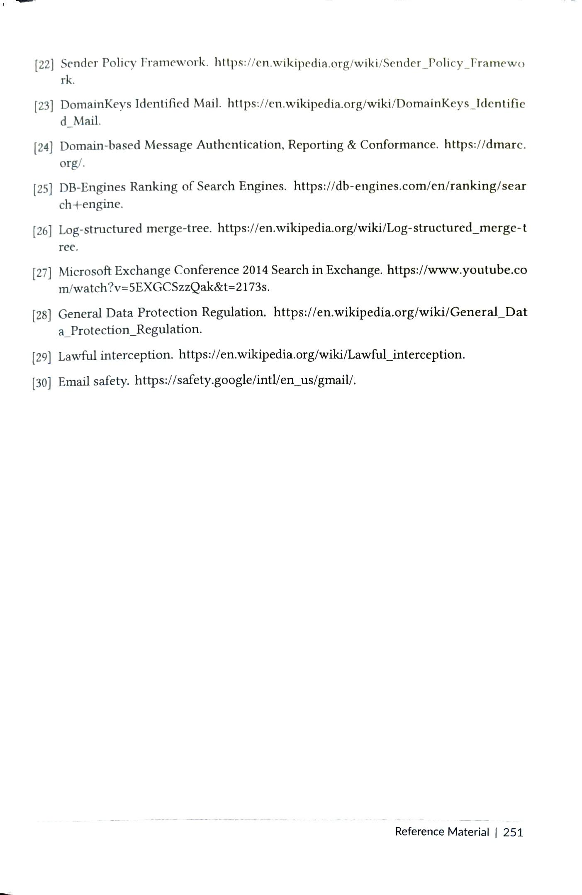

* **[22]** **Sender Policy Framework (SPF - Khung chính sách người gửi xác thực nguồn gốc thư):** [https://en.wikipedia.org/wiki/Sender_Policy_Framework](https://en.wikipedia.org/wiki/Sender_Policy_Framework).
* **[23]** **DomainKeys Identified Mail (DKIM - Xác thực thư bằng chữ ký số tên miền):** [https://en.wikipedia.org/wiki/DomainKeys_Identified_Mail](https://en.wikipedia.org/wiki/DomainKeys_Identified_Mail).
* **[24]** **Domain-based Message Authentication, Reporting & Conformance (DMARC - Cơ chế chứng thực, báo cáo và tuân thủ thư dựa trên tên miền):** [https://dmarc.org/](https://dmarc.org/).
* **[25]** **DB-Engines Ranking of Search Engines (Bảng xếp hạng các công cụ tìm kiếm dữ liệu theo DB-Engines):** [https://db-engines.com/en/ranking/search+engine](https://db-engines.com/en/ranking/search+engine).
* **[26]** **Log-structured merge-tree (LSM-Tree - Cấu trúc cây hòa trộn có cấu trúc nhật ký):** [https://en.wikipedia.org/wiki/Log-structured_merge-tree](https://en.wikipedia.org/wiki/Log-structured_merge-tree).
* **[27]** **Microsoft Exchange Conference 2014 Search in Exchange (Tìm kiếm trong Microsoft Exchange - Hội thảo Exchange 2014):** [https://www.youtube.com/watch?v=5EXGCSzzQak&t=2173s](https://www.youtube.com/watch?v=5EXGCSzzQak&t=2173s).
* **[28]** **General Data Protection Regulation (GDPR - Quy định chung về bảo vệ dữ liệu của Liên minh Châu Âu):** [https://en.wikipedia.org/wiki/General_Data_Protection_Regulation](https://en.wikipedia.org/wiki/General_Data_Protection_Regulation).
* **[29]** **Lawful interception (Cơ chế chặn bắt dữ liệu hợp pháp theo quy định pháp lý):** [https://en.wikipedia.org/wiki/Lawful_interception](https://en.wikipedia.org/wiki/Lawful_interception).
* **[30]** **Email safety (Bảo mật và an toàn email trên Gmail):** [https://safety.google/intl/en_us/gmail/](https://safety.google/intl/en_us/gmail/).

> [!NOTE]
> *Trang 251 | Reference Material*

---

## Điều hướng

- [chuong-07-hotel-reservation-system.md](chuong-07-hotel-reservation-system.md)
- [Mục lục](README.md)
- [chuong-09-s3-like-object-storage.md](chuong-09-s3-like-object-storage.md)
