[← Chương trước](chuong-08-distributed-email-service.md) | [Mục lục](README.md) | [Chương tiếp theo →](chuong-10-real-time-gaming-leaderboard.md)

---

# Chương 9: Lưu Trữ Đối Tượng Tương Tự S3 (S3-like Object Storage)

---

### --- Trang 255 ---

**Lưu Trữ Đối Tượng Tương Tự S3 (S3-like Object Storage)**

**Dịch vụ Lưu trữ Đơn giản (Simple Storage Service - S3)** là một dịch vụ do Amazon Web Services (AWS) cung cấp, mang lại giải pháp lưu trữ đối tượng (object storage) thông qua giao diện dựa trên API RESTful. Dưới đây là một số sự kiện nổi bật về AWS S3:
* **Khởi chạy:** Tháng 6 năm 2006.
* **Năm 2010:** S3 bổ sung hỗ trợ quản lý phiên bản (*versioning*), chính sách bucket (*bucket policy*), và tải lên nhiều phần (*multipart upload*).
* **Năm 2011:** S3 bổ sung mã hóa phía máy chủ (*server-side encryption*), xóa nhiều đối tượng (*multi-object delete*), và hết hạn đối tượng (*object expiration*).
* **Năm 2013:** Amazon báo cáo đã có 2 nghìn tỷ (2 trillion) đối tượng được lưu trữ trên S3.
* **Năm 2014 và 2015:** Chính sách vòng đời (*life cycle policy*), thông báo sự kiện (*event notification*), và sao chép xuyên vùng (*cross-region replication*) được giới thiệu.
* **Năm 2021:** Amazon báo cáo có hơn 100 nghìn tỷ (100 trillion) đối tượng được lưu trữ trên S3.

Trước khi đi sâu vào hệ thống lưu trữ đối tượng (*object storage*), trước tiên chúng ta hãy cùng xem xét lại các hệ thống lưu trữ nói chung và định nghĩa một số thuật ngữ cơ bản.

---

### Khái Niệm Cơ Bản Về Hệ Thống Lưu Trữ (Storage System 101)

Ở mức độ tổng quan kiến trúc (*high-level*), các hệ thống lưu trữ được chia thành ba nhóm lớn:
* **Lưu trữ dạng khối (Block storage)**
* **Lưu trữ dạng tệp (File storage)**
* **Lưu trữ dạng đối tượng (Object storage)**

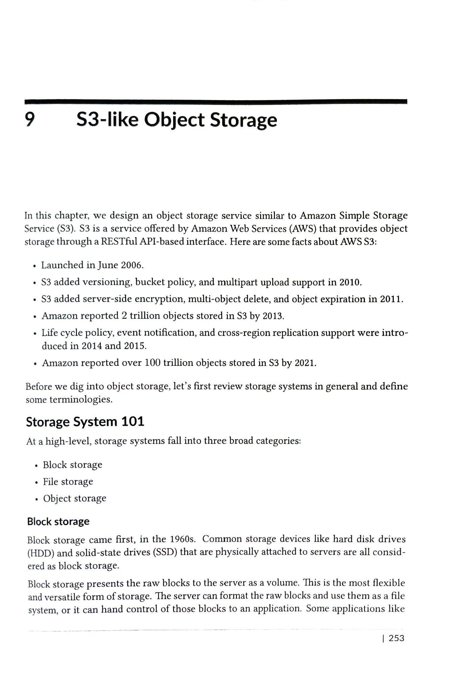

#### Lưu Trữ Dạng Khối (Block Storage)
Lưu trữ dạng khối ra đời đầu tiên vào những năm 1960. Các thiết bị lưu trữ thông thường như ổ đĩa cứng (Hard Disk Drive - HDD) và ổ đĩa thể rắn (Solid-State Drive - SSD) được gắn trực tiếp về mặt vật lý vào máy chủ đều được xem là lưu trữ dạng khối.

Lưu trữ dạng khối cung cấp các khối thô (*raw blocks*) cho máy chủ dưới dạng một phân vùng đĩa (*volume*). Đây là hình thức lưu trữ linh hoạt và đa năng nhất. Máy chủ có thể định dạng (*format*) các khối thô này để sử dụng như một hệ thống tệp tin (*file system*), hoặc chuyển giao quyền kiểm soát các khối đó trực tiếp cho một ứng dụng. Một số ứng dụng chuyên biệt như

---

### --- Trang 256 ---

cơ sở dữ liệu (*database*) hoặc công cụ máy ảo (*virtual machine engine*) quản lý trực tiếp các khối này nhằm tối ưu hóa và tận dụng triệt để từng giọt hiệu năng (*performance*).

Lưu trữ dạng khối không chỉ giới hạn ở các thiết bị gắn vật lý trực tiếp. Nó có thể được kết nối với máy chủ qua mạng tốc độ cao (*high-speed network*) hoặc thông qua các giao thức kết nối tiêu chuẩn công nghiệp như **Fibre Channel (FC)** [1] và **iSCSI** [2]. Về mặt khái niệm, lưu trữ dạng khối gắn qua mạng (*network-attached block storage*) vẫn cung cấp các khối thô. Đối với các máy chủ, cơ chế hoạt động của nó hoàn toàn tương tự như lưu trữ dạng khối gắn vật lý trực tiếp.

#### Lưu Trữ Dạng Tệp (File Storage)
Lưu trữ dạng tệp được xây dựng trên nền tảng của lưu trữ dạng khối (*block storage*). Nó cung cấp một lớp trừu tượng ở mức cao hơn (*higher-level abstraction*) giúp việc xử lý các tệp tin và thư mục trở nên dễ dàng hơn. Dữ liệu được lưu trữ dưới dạng các tệp tin theo một cấu trúc thư mục phân cấp (*hierarchical directory structure*). Lưu trữ dạng tệp là giải pháp lưu trữ đa dụng (*general-purpose storage*) phổ biến nhất.

Lưu trữ dạng tệp có thể cho phép một lượng lớn máy chủ truy cập đồng thời thông qua các giao thức mạng cấp độ tệp phổ biến như **SMB/CIFS** [3] và **NFS** [4]. Các máy chủ khi truy cập vào hệ thống lưu trữ dạng tệp không cần phải xử lý sự phức tạp của việc quản lý các khối thô, định dạng phân vùng (*volume formatting*), v.v. Sự đơn giản của lưu trữ dạng tệp khiến nó trở thành một giải pháp tuyệt vời để chia sẻ số lượng lớn tệp tin và thư mục trong phạm vi một tổ chức.

#### Lưu Trữ Dạng Đối Tượng (Object Storage)
Lưu trữ dạng đối tượng là một công nghệ mới hơn. Nó thực hiện một sự đánh đổi rất có chủ đích: **hy sinh hiệu năng (*performance*) để đổi lấy độ bền vững dữ liệu cao (*high durability*), khả năng mở rộng quy mô khổng lồ (*vast scale*), và chi phí thấp (*low cost*)**. Nó hướng tới dữ liệu tương đối "lạnh" (*cold data*) và chủ yếu được sử dụng cho mục đích lưu trữ lâu dài (*archival*) và sao lưu dự phòng (*backup*).

Hệ thống lưu trữ đối tượng lưu toàn bộ dữ liệu dưới dạng các đối tượng (*objects*) trong một cấu trúc phẳng (*flat structure*). Tại đây hoàn toàn không có cấu trúc thư mục phân cấp. Việc truy cập dữ liệu thông thường được cung cấp qua giao diện **RESTful API**. Tốc độ truy xuất tương đối chậm hơn so với các loại lưu trữ khác. Hầu hết các nhà cung cấp dịch vụ đám mây công cộng (*public cloud service providers*) đều có các sản phẩm lưu trữ đối tượng, chẳng hạn như **AWS S3**, **Google Cloud Storage (Google object storage)**, và **Azure Blob Storage**.

#### So Sánh (Comparison)

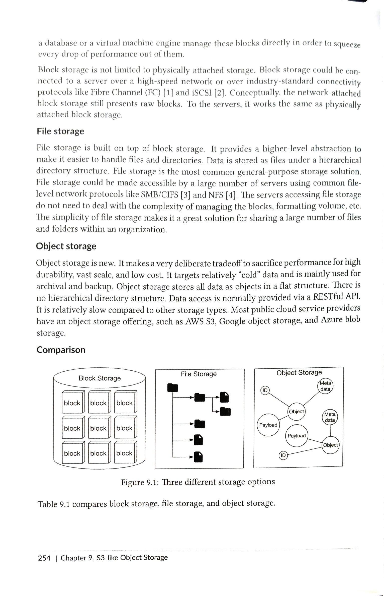

*Hình 9.1: Ba tùy chọn lưu trữ khác nhau (Three different storage options)*

Bảng 9.1 so sánh giữa lưu trữ dạng khối (*block storage*), lưu trữ dạng tệp (*file storage*), và lưu trữ dạng đối tượng (*object storage*).

---

### --- Trang 257 ---

| Tiêu chí | Lưu trữ dạng khối (Block storage) | Lưu trữ dạng tệp (File storage) | Lưu trữ dạng đối tượng (Object storage) |
| :--- | :--- | :--- | :--- |
| **Khả năng chỉnh sửa nội dung (Mutable Content)** | Có thể chỉnh sửa (Mutable) | Có thể chỉnh sửa (Mutable) | Không (N - hỗ trợ quản lý phiên bản đối tượng (*object versioning*), không hỗ trợ cập nhật tại chỗ (*in-place update*)) |
| **Chi phí (Cost)** | Cao (High) | Trung bình đến cao (Medium to high) | Thấp (Low) |
| **Hiệu năng (Performance)** | Trung bình đến cao, rất cao (Medium to high, very high) | Trung bình đến cao (Medium to high) | Thấp đến trung bình (Low to medium) |
| **Tính nhất quán (Consistency)** | Nhất quán mạnh (Strong consistency) [5] | Nhất quán mạnh (Strong consistency) | Nhất quán mạnh (Strong consistency) |
| **Giao thức truy cập dữ liệu (Data access)** | SAS [6] / iSCSI / FC | Truy cập tệp tiêu chuẩn, CIFS/SMB, và NFS | RESTful API |
| **Khả năng mở rộng (Scalability)** | Khả năng mở rộng trung bình (Medium scalability) | Khả năng mở rộng cao (High scalability) | Khả năng mở rộng quy mô cực lớn (Vast scalability) |
| **Phù hợp nhất cho (Good for)** | Máy ảo (Virtual Machines - VM), các ứng dụng hiệu năng cao như cơ sở dữ liệu (*database*) | Truy cập hệ thống tệp đa mục đích (*General-purpose file system access*) | Dữ liệu nhị phân (*Binary data*), dữ liệu phi cấu trúc (*unstructured data*) |

*Bảng 9.1: Các tùy chọn lưu trữ (Storage options)*

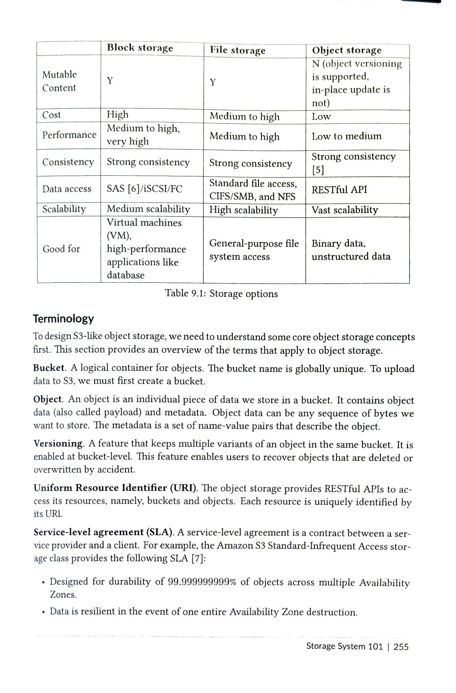

#### Thuật Ngữ (Terminology)
Để thiết kế một hệ thống lưu trữ đối tượng tương tự S3, trước tiên chúng ta cần nắm vững một số khái niệm cốt lõi về lưu trữ đối tượng. Phần này cung cấp tổng quan về các thuật ngữ áp dụng cho hệ thống lưu trữ đối tượng:

* **Bucket:** Một vùng chứa logic (*logical container*) dành cho các đối tượng. Tên bucket là duy nhất trên toàn cầu (*globally unique*). Để tải dữ liệu lên S3, trước tiên chúng ta bắt buộc phải tạo một bucket.
* **Đối tượng (Object):** Một đối tượng là một thực thể dữ liệu riêng lẻ được lưu trữ trong một bucket. Nó bao gồm dữ liệu đối tượng (còn gọi là tải trọng - *payload*) và siêu dữ liệu (*metadata*). Dữ liệu đối tượng có thể là bất kỳ chuỗi byte nào mà chúng ta muốn lưu trữ. Siêu dữ liệu là một tập hợp các cặp khóa-giá trị (*name-value pairs*) dùng để mô tả đối tượng.
* **Quản lý phiên bản (Versioning):** Một tính năng lưu giữ nhiều biến thể khác nhau của cùng một đối tượng trong cùng một bucket. Tính năng này được kích hoạt ở cấp độ bucket (*bucket-level*). Nó cho phép người dùng khôi phục các đối tượng bị xóa hoặc ghi đè do sơ suất ngoài ý muốn.
* **Định danh tài nguyên đồng nhất (Uniform Resource Identifier - URI):** Hệ thống lưu trữ đối tượng cung cấp các RESTful API để truy cập tài nguyên của nó, cụ thể là các bucket và object. Mỗi tài nguyên được định danh duy nhất bởi một URI của chính nó.
* **Thỏa thuận mức dịch vụ (Service-Level Agreement - SLA):** Thỏa thuận mức dịch vụ là một hợp đồng mang tính cam kết giữa nhà cung cấp dịch vụ và khách hàng. Ví dụ: hạng lưu trữ Tiêu chuẩn - Truy cập Không thường xuyên của Amazon S3 (*Amazon S3 Standard-Infrequent Access*) cung cấp cam kết SLA như sau [7]:
  * Được thiết kế với độ bền vững dữ liệu (*durability*) đạt 99.999999999% (11 số 9) cho các đối tượng trên nhiều Vùng Sẵn sàng (*Availability Zones - AZ*).
  * Dữ liệu có khả năng chống chịu và phục hồi khi xảy ra sự cố phá hủy toàn bộ một Vùng Sẵn sàng (*Availability Zone*).

---

### --- Trang 258 ---

  * Được thiết kế với tính sẵn sàng (*availability*) đạt 99.9% (3 số 9).

---

### Bước 1 - Hiểu Rõ Vấn Đề Và Xác Định Phạm Vi Thiết Kế (Step 1 - Understand the Problem and Establish Design Scope)

**Ứng viên:** Những tính năng nào cần được bao gồm trong bản thiết kế?  
**Người phỏng vấn:** Chúng tôi muốn bạn thiết kế một hệ thống lưu trữ đối tượng tương tự S3 với các chức năng sau:
* Tạo bucket (*Bucket creation*).
* Tải lên và tải xuống đối tượng (*Object uploading and downloading*).
* Quản lý phiên bản đối tượng (*Object versioning*).
* Liệt kê các đối tượng trong một bucket (*Listing objects in a bucket*). Chức năng này tương tự như lệnh `aws s3 ls` [8].

**Ứng viên:** Kích thước dữ liệu điển hình là bao nhiêu?  
**Người phỏng vấn:** Chúng ta cần lưu trữ hiệu quả cả các đối tượng có kích thước khổng lồ (*massive objects* - từ vài GB trở lên) lẫn số lượng lớn các đối tượng nhỏ (*tens of KBs* - vài chục KB).

**Ứng viên:** Chúng ta cần lưu trữ bao nhiêu dữ liệu trong vòng một năm?  
**Người phỏng vấn:** 100 Petabytes (PB).

**Ứng viên:** Chúng ta có thể giả định độ bền vững dữ liệu (*data durability*) là 6 số 9 (99.9999%) và tính sẵn sàng của dịch vụ (*service availability*) là 4 số 9 (99.99%) hay không?  
**Người phỏng vấn:** Vâng, điều đó hoàn toàn hợp lý.

#### Yêu Cầu Phi Chức Năng (Non-functional requirements)
* **Dung lượng:** 100PB dữ liệu.
* **Độ bền vững dữ liệu (Data durability):** 6 số 9 (99.9999%).
* **Tính sẵn sàng của dịch vụ (Service availability):** 4 số 9 (99.99%).
* **Hiệu quả lưu trữ (Storage efficiency):** Giảm thiểu chi phí lưu trữ trong khi vẫn duy trì mức độ tin cậy (*reliability*) và hiệu năng (*performance*) cao.

#### Ước Tính Định Lượng Nhanh (Back-of-the-envelope estimation)
Hệ thống lưu trữ đối tượng rất có thể sẽ gặp phải các điểm nghẽn cổ chai (*bottlenecks*) ở dung lượng đĩa cứng (*disk capacity*) hoặc số lượng thao tác vào/ra đĩa mỗi giây (Disk I/O Per Second - **IOPS**). Hãy cùng phân tích:

* **Dung lượng đĩa (Disk capacity):** Hãy giả định các đối tượng tuân theo phân phối kích thước như sau:
  * 20% tổng số đối tượng là đối tượng nhỏ (nhỏ hơn 1MB).
  * 60% đối tượng là đối tượng kích thước trung bình (từ 1MB ~ 64MB).
  * 20% đối tượng là đối tượng kích thước lớn (lớn hơn 64MB).
* **IOPS:** Giả định một ổ đĩa cứng thông thường (chuẩn giao tiếp SATA, tốc độ quay 7200 vòng/phút - rpm) có khả năng thực hiện từ 100 ~ 150 lượt tìm kiếm ngẫu nhiên mỗi giây (tức **100 ~ 150 IOPS**).

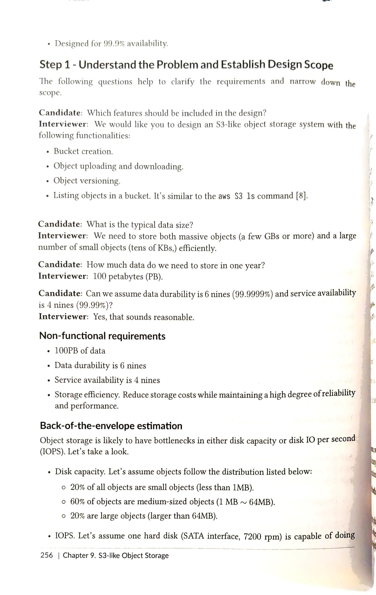

---

### --- Trang 259 ---

Dựa trên các giả định đó, chúng ta có thể ước tính tổng số lượng đối tượng mà hệ thống có thể lưu trữ bền vững (*persist*). Để đơn giản hóa phép tính, hãy sử dụng kích thước trung vị (*median size*) cho từng loại đối tượng (0.5MB cho đối tượng nhỏ, 32MB cho đối tượng trung bình, và 200MB cho đối tượng lớn). Với tỷ lệ sử dụng lưu trữ thực tế là 40%, ta có:

$$100\text{ PB} = 100 \times 1000 \times 1000 \times 1000\text{ MB} = 10^{11}\text{ MB}$$

$$\text{Tổng số đối tượng} = \frac{10^{11} \times 0.4}{(0.2 \times 0.5\text{ MB} + 0.6 \times 32\text{ MB} + 0.2 \times 200\text{ MB})} \approx 0.68\text{ tỷ đối tượng (0.68 billion objects)}.$$

* Nếu chúng ta giả định siêu dữ liệu (*metadata*) của một đối tượng có kích thước khoảng 1KB, chúng ta sẽ cần khoảng không gian lưu trữ là **0.68TB** để chứa toàn bộ thông tin siêu dữ liệu.

Mặc dù chúng ta có thể không sử dụng trực tiếp toàn bộ các con số này, nhưng việc nắm được bức tranh tổng quan về quy mô (*scale*) và các ràng buộc (*constraints*) của hệ thống là rất hữu ích.

---

### Bước 2 - Đề Xuất Thiết Kế Cấp Cao Và Thống Nhất Ý Kiến (Step 2 - Propose High-level Design and Get Buy-in)

Trước khi đi sâu vào thiết kế chi tiết, hãy cùng khám phá một vài đặc tính thú vị của lưu trữ đối tượng, vì chúng sẽ tác động trực tiếp đến kiến trúc hệ thống.

* **Tính bất biến của đối tượng (Object immutability):** Một trong những điểm khác biệt chính giữa lưu trữ đối tượng và hai loại hệ thống lưu trữ còn lại là các đối tượng được lưu bên trong hệ thống lưu trữ đối tượng là **bất biến (immutable)**. Chúng ta có thể xóa chúng hoặc thay thế chúng hoàn toàn bằng một phiên bản mới, nhưng chúng ta **không thể thực hiện các thay đổi cục bộ tăng dần (incremental changes)**.
* **Kho lưu trữ Khóa - Giá trị (Key-value store):** Chúng ta có thể sử dụng URI của đối tượng để truy xuất dữ liệu đối tượng (Đoạn mã 9.1). URI của đối tượng đóng vai trò là Khóa (*Key*) và dữ liệu đối tượng đóng vai trò là Giá trị (*Value*).

```http
Request:
GET /bucket1/object1.txt HTTP/1.1

Response:
HTTP/1.1 200 OK
Content-Length: 4567

[4567 bytes of object data]
```
*Đoạn mã 9.1: Sử dụng URI của đối tượng để truy xuất dữ liệu đối tượng (Listing 9.1)*

* **Ghi một lần, đọc nhiều lần (Write once, read many times):** Mô hình truy cập dữ liệu (*data access pattern*) đối với dữ liệu đối tượng là ghi một lần và đọc nhiều lần. Theo nghiên cứu được công bố bởi LinkedIn, có tới **95% các yêu cầu là các thao tác đọc (read operations)** [9].
* **Hỗ trợ cả đối tượng kích thước nhỏ và lớn:** Kích thước đối tượng có thể rất khác nhau và hệ thống của chúng ta cần phải hỗ trợ hiệu quả cả hai.

Triết lý thiết kế của hệ thống lưu trữ đối tượng rất tương đồng với triết lý của hệ thống tệp tin UNIX (*UNIX file system*). Trong UNIX, khi chúng ta lưu một tệp tin vào hệ thống tệp cục bộ, nó không lưu tên tệp (*filename*) và dữ liệu tệp (*file data*) chung với nhau. Thay vào đó, tên tệp được lưu trong một cấu trúc dữ liệu gọi là **"inode"** [10],

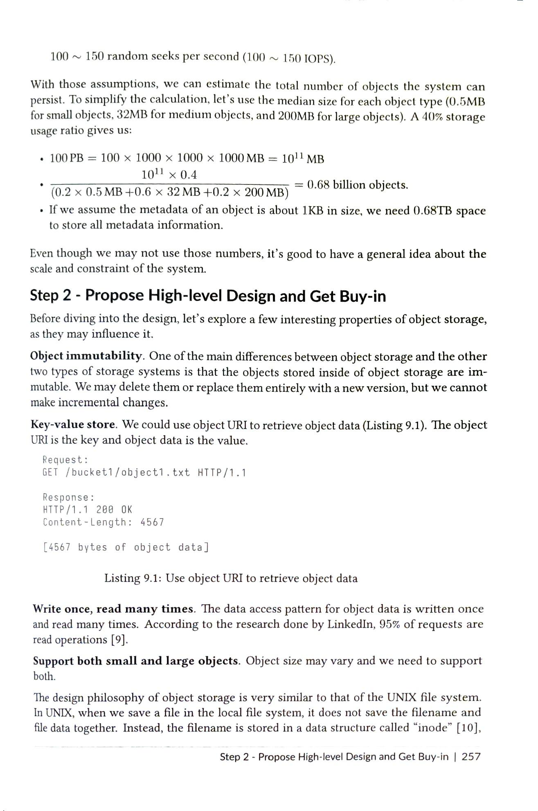

---

### --- Trang 260 ---

chứa các con trỏ trỏ tới các vị trí thực tế trên đĩa cứng (*pointers to the actual disk locations*).

Kho lưu trữ siêu dữ liệu (*metadata store*) đóng vai trò tương tự như `inode`, lưu trữ toàn bộ siêu dữ liệu của đối tượng. Ổ đĩa cứng trở thành kho lưu trữ dữ liệu (*data store*) dùng để lưu trữ dữ liệu thực của đối tượng (*payload*). 

Trong hệ thống tệp UNIX, `inode` sử dụng con trỏ khối tệp (*file block pointer*) để ghi lại vị trí của dữ liệu trên đĩa cứng. Trong lưu trữ đối tượng, kho lưu trữ siêu dữ liệu (*metadata store*) sử dụng mã định danh của đối tượng (**Object ID**) để tìm dữ liệu đối tượng tương ứng trong kho dữ liệu (*data store*) thông qua một yêu cầu mạng (*network request*). 

Hình 9.2 thể hiện sự so sánh đối chiếu giữa hệ thống tệp UNIX và hệ thống lưu trữ đối tượng:

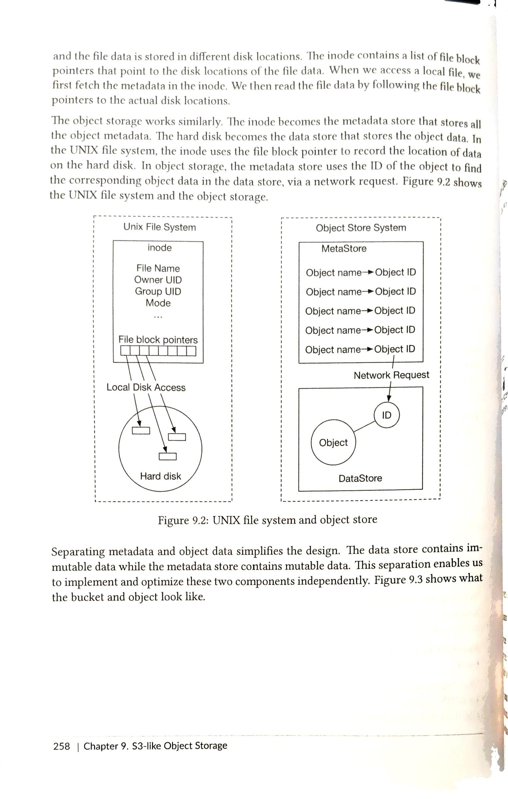

*Hình 9.2: Hệ thống tệp UNIX và hệ thống lưu trữ đối tượng (UNIX file system and object store)*

> [!NOTE]
> **Tách Biệt Siêu Dữ Liệu và Dữ Liệu Đối Tượng:**
> Việc tách rời giữa siêu dữ liệu (*metadata*) và dữ liệu đối tượng (*object data/payload*) giúp đơn giản hóa đáng kể thiết kế kiến trúc:
> * **Kho dữ liệu (Data store):** Chỉ chứa dữ liệu bất biến (*immutable data*).
> * **Kho siêu dữ liệu (Metadata store):** Chứa dữ liệu có thể biến đổi (*mutable data*).
> 
> Sự phân tách này cho phép chúng ta có thể triển khai, tối ưu hóa và mở rộng quy mô (*scale*) hai thành phần cốt lõi này một cách hoàn toàn độc lập với nhau.

Hình 9.3 minh họa cấu trúc trực quan của bucket và object trong hệ thống.

# CHƯƠNG 9: HỆ THỐNG LƯU TRỮ ĐỐI TƯỢNG TƯƠNG TỰ S3 (S3-LIKE OBJECT STORAGE)

---

### [Trang 261]

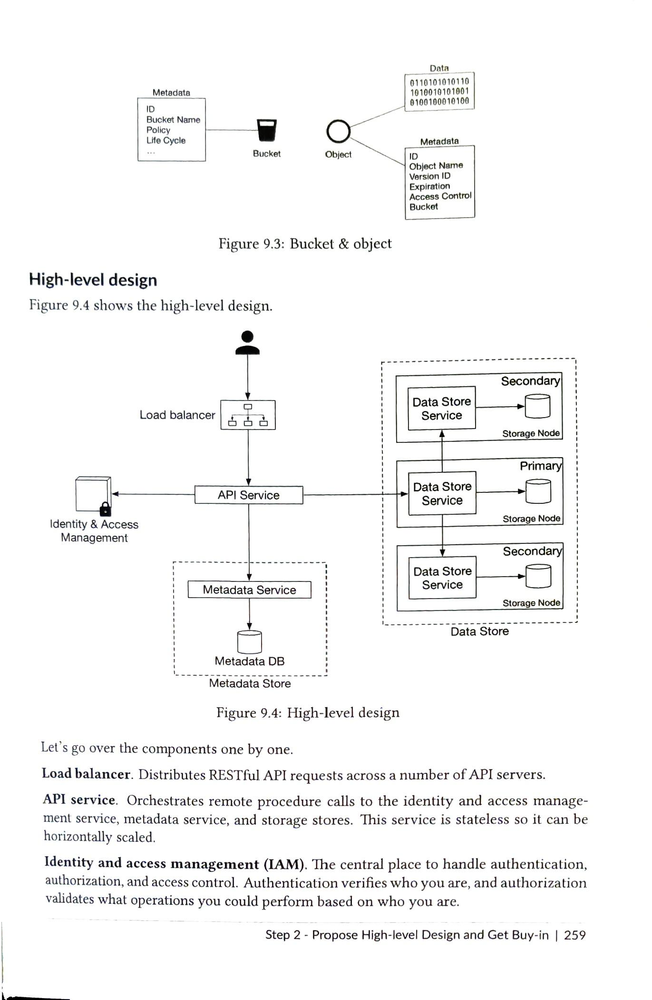

```
Data
0110101010110
Metadata
1010010101001
0100160010100
```

| Bucket | Object |
| :--- | :--- |
| **ID** | **ID** |
| **Bucket Name** | **Object Name** |
| **Policy** | **Version ID** |
| **Life Cycle** | **Expiration** |
| **Metadata** | **AccessControl** |
| | **Bucket** |

**Hình 9.3: Bucket & Đối tượng (Bucket & object)**

---

## Thiết kế Mức cao (High-level design)

**Hình 9.4** thể hiện thiết kế mức cao (high-level design).


*(Tham chiếu sơ đồ kiến trúc Hình 9.4: High-level design)*

```
[Load Balancer Service]
          │
          ▼
   [API Service] ───────────────► [Identity & Access Management]
     │          \
     │           \
     │            ▼
     │     [Metadata Service] ───► [Metadata DB / Metadata Store]
     ▼
[Data Store]
  ├── Primary Storage Node
  ├── Secondary Storage Node
  └── Secondary Storage Node
```

**Hình 9.4: Thiết kế Mức cao (High-level design)**

Hãy cùng xem xét từng thành phần một:

* **Bộ cân bằng tải (Load balancer):** Phân phối các yêu cầu RESTful API qua một loạt các máy chủ API (API servers).
* **Dịch vụ API (API service):** Điều phối các lời gọi thủ tục từ xa (remote procedure calls - RPC) tới dịch vụ quản lý danh tính và truy cập (identity and access management service), dịch vụ siêu dữ liệu (metadata service), và các kho lưu trữ (storage stores). Dịch vụ này là phi trạng thái (stateless), do đó nó có thể được mở rộng theo chiều ngang (horizontally scaled).
* **Quản lý Danh tính và Truy cập (Identity and access management - IAM):** Nơi tập trung xử lý việc xác thực (authentication), phân quyền (authorization), và kiểm soát truy cập (access control). Xác thực (Authentication) kiểm tra bạn là ai, và phân quyền (authorization) xác thực bạn có thể thực hiện những thao tác nào dựa trên danh tính của bạn.

---
*Bước 2 - Đề xuất Thiết kế Mức cao và Đạt được Đồng thuận | Trang 259*

---

### [Trang 262]

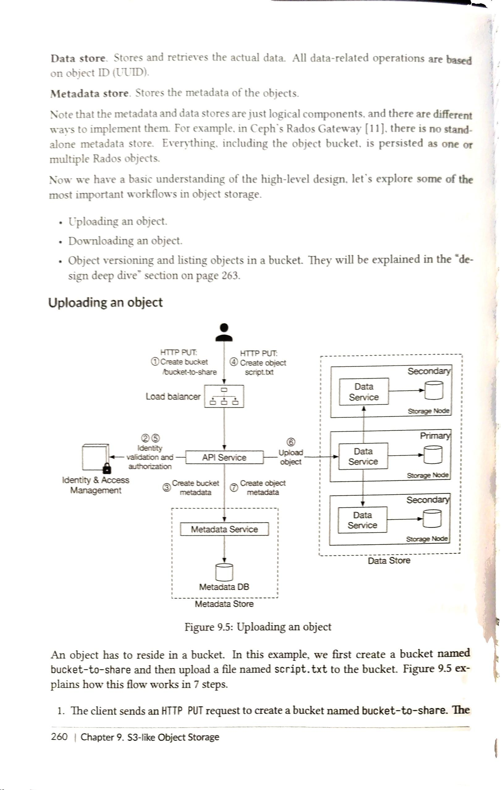

* **Kho lưu trữ dữ liệu (Data store):** Lưu trữ và truy xuất dữ liệu thực tế. Tất cả các thao tác liên quan đến dữ liệu đều dựa trên định danh đối tượng (object ID - UUID).
* **Kho lưu trữ siêu dữ liệu (Metadata store):** Lưu trữ siêu dữ liệu (metadata) của các đối tượng.

> [!NOTE]
> Lưu ý rằng kho lưu trữ siêu dữ liệu (metadata store) và kho lưu trữ dữ liệu (data store) chỉ là các thành phần logic, và có nhiều cách khác nhau để hiện thực chúng. Ví dụ, trong Rados Gateway của Ceph [11], không có kho lưu trữ siêu dữ liệu độc lập (standalone metadata store). Mọi thứ, bao gồm cả bucket của đối tượng, đều được lưu trữ bền vững (persisted) dưới dạng một hoặc nhiều đối tượng Rados (Rados objects).

Bây giờ chúng ta đã có hiểu biết cơ bản về thiết kế mức cao, hãy cùng khám phá một số quy trình làm việc (workflows) quan trọng nhất trong lưu trữ đối tượng:

* Tải lên một đối tượng (Uploading an object).
* Tải xuống một đối tượng (Downloading an object).
* Đánh phiên bản đối tượng (Object versioning) và liệt kê các đối tượng trong một bucket (listing objects in a bucket). Các phần này sẽ được giải thích chi tiết trong phần Đào sâu Thiết kế (Design Deep Dive) ở trang 263.

---

### Tải lên một đối tượng (Uploading an object)


*(Tham chiếu sơ đồ quy trình Hình 9.5: Uploading an object)*

**Hình 9.5: Tải lên một đối tượng (Uploading an object)**

Một đối tượng bắt buộc phải nằm trong một bucket. Trong ví dụ này, trước tiên chúng ta tạo một bucket có tên là `bucket-to-share` và sau đó tải lên một tệp tin có tên là `script.txt` vào bucket đó. **Hình 9.5** giải thích cách quy trình này hoạt động qua 7 bước:

1. Phía máy khách (Client) gửi một yêu cầu HTTP PUT để tạo một bucket có tên là `bucket-to-share`. Yêu cầu được chuyển tiếp tới dịch vụ API (API service).

---
*Trang 260 | Chương 9: Lưu Trữ Đối Tượng Tương Tự S3*

---

### [Trang 263]

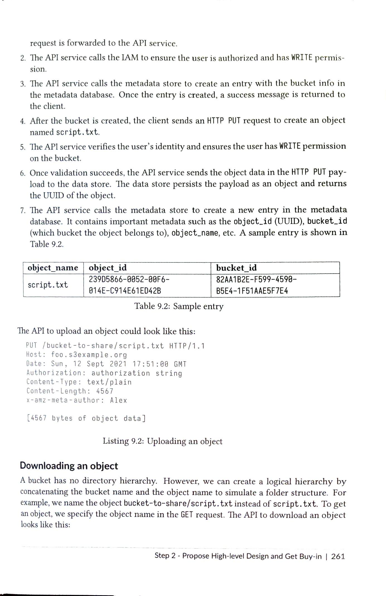

2. Dịch vụ API gọi IAM để đảm bảo người dùng đã được xác thực danh tính và có quyền GHI (WRITE permission).
3. Dịch vụ API gọi kho lưu trữ siêu dữ liệu (metadata store) để tạo một bản ghi chứa thông tin bucket trong cơ sở dữ liệu siêu dữ liệu (metadata database). Khi bản ghi được tạo thành công, một thông báo thành công sẽ được trả về cho client.
4. Sau khi bucket được tạo, client gửi một yêu cầu HTTP PUT để tạo một đối tượng có tên là `script.txt`.
5. Dịch vụ API xác minh danh tính người dùng và đảm bảo người dùng có quyền GHI (WRITE permission) trên bucket.
6. Khi việc xác thực thành công, dịch vụ API gửi dữ liệu đối tượng trong phần tải trọng (payload) của HTTP PUT tới kho lưu trữ dữ liệu (data store). Kho lưu trữ dữ liệu lưu trữ bền vững (persists) payload dưới dạng một đối tượng và trả về mã định danh duy nhất (UUID) của đối tượng.
7. Dịch vụ API gọi kho lưu trữ siêu dữ liệu để tạo một bản ghi mới trong cơ sở dữ liệu siêu dữ liệu. Bản ghi này chứa các siêu dữ liệu quan trọng như `object_id` (UUID), `bucket_id` (đối tượng thuộc về bucket nào), `object_name`, v.v. Một bản ghi mẫu được hiển thị trong **Bảng 9.2**.

| object_name | object_id | bucket_id |
| :--- | :--- | :--- |
| `script.txt` | `239D5866-0052-00F6-014E-C914E61ED42B` | `82AA1B2E-F599-4590-B5E4-1F51AAE5F7E4` |

**Bảng 9.2: Bản ghi mẫu (Sample entry)**

API để tải lên một đối tượng có thể trông như sau:

```http
PUT /bucket-to-share/script.txt HTTP/1.1
Host: foo.s3example.org
Date: Sun, 12 Sept 2021 17:51:00 GMT
Authorization: authorization string
Content-Type: text/plain
Content-Length: 4567
x-amz-meta-author: Alex

[4567 bytes of object data]
```

**Đoạn mã 9.2: Tải lên một đối tượng (Listing 9.2: Uploading an object)**

---

### Tải xuống một đối tượng (Downloading an object)

Một bucket không có cấu trúc phân cấp thư mục (directory hierarchy). Tuy nhiên, chúng ta có thể tạo một cấu trúc phân cấp logic (logical hierarchy) bằng cách nối tên bucket và tên đối tượng để mô phỏng một cấu trúc thư mục. Ví dụ, chúng ta đặt tên đối tượng là `bucket-to-share/script.txt` thay vì `script.txt`. Để lấy một đối tượng, chúng ta chỉ định tên đối tượng trong yêu cầu GET. API để tải xuống một đối tượng trông như sau:

---
*Bước 2 - Đề xuất Thiết kế Mức cao và Đạt được Đồng thuận | Trang 261*

---

### [Trang 264]

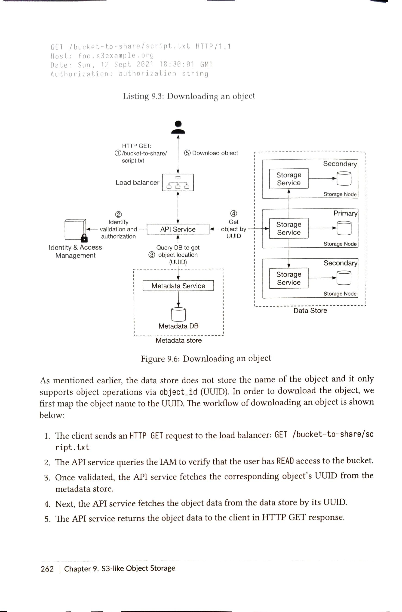

```http
GET /bucket-to-share/script.txt HTTP/1.1
Host: foo.s3example.org
Date: Sun, 12 Sept 2021 18:30:01 GMT
Authorization: authorization string
```

**Đoạn mã 9.3: Tải xuống một đối tượng (Listing 9.3: Downloading an object)**


*(Tham chiếu sơ đồ quy trình Hình 9.6: Downloading an object)*

**Hình 9.6: Tải xuống một đối tượng (Downloading an object)**

Như đã đề cập trước đó, kho lưu trữ dữ liệu (data store) không lưu trữ tên của đối tượng và nó chỉ hỗ trợ các thao tác đối tượng thông qua `object_id` (UUID). Để tải xuống đối tượng, trước tiên chúng ta phải ánh xạ tên đối tượng sang UUID. Quy trình làm việc (workflow) của việc tải xuống một đối tượng được hiển thị dưới đây:

1. Client gửi một yêu cầu HTTP GET tới bộ cân bằng tải: `GET /bucket-to-share/script.txt`
2. Dịch vụ API truy vấn IAM để xác minh rằng người dùng có quyền ĐỌC (READ access) đối với bucket.
3. Khi đã được xác thực, dịch vụ API lấy UUID của đối tượng tương ứng từ kho lưu trữ siêu dữ liệu (metadata store).
4. Tiếp theo, dịch vụ API lấy dữ liệu đối tượng từ kho lưu trữ dữ liệu (data store) bằng UUID của nó.
5. Dịch vụ API trả về dữ liệu đối tượng cho client trong phản hồi HTTP GET.

---
*Trang 262 | Chương 9: Lưu Trữ Đối Tượng Tương Tự S3*

---

### [Trang 265]

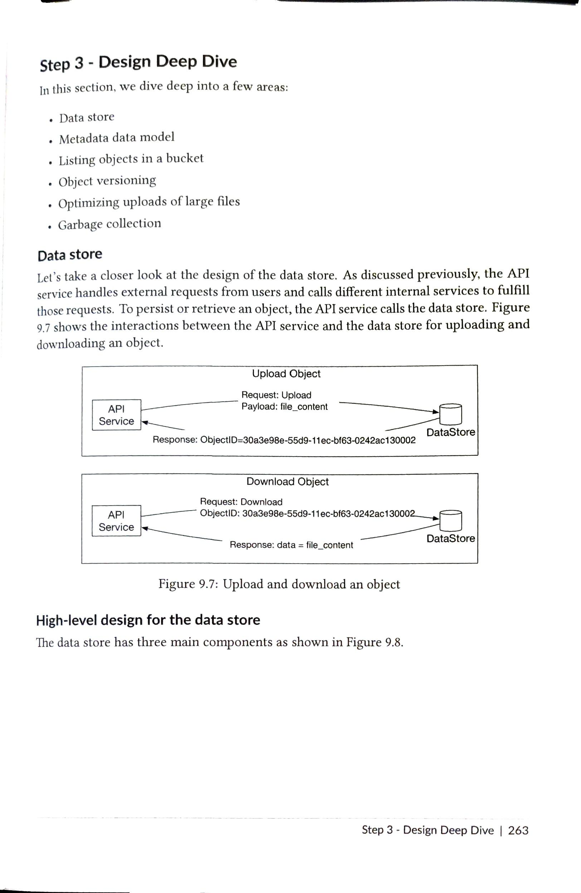

## Bước 3 - Đào sâu Thiết kế (Step 3 - Design Deep Dive)

Trong phần này, chúng ta sẽ đào sâu chi tiết vào một vài khía cạnh:

* Kho lưu trữ dữ liệu (Data store)
* Mô hình dữ liệu siêu dữ liệu (Metadata data model)
* Liệt kê các đối tượng trong một bucket (Listing objects in a bucket)
* Đánh phiên bản đối tượng (Object versioning)
* Tối ưu hóa việc tải lên các tệp tin lớn (Optimizing uploads of large files)
* Thu gom rác (Garbage collection)

---

### Kho lưu trữ dữ liệu (Data store)

Hãy cùng xem xét kỹ hơn về thiết kế của kho lưu trữ dữ liệu. Như đã thảo luận trước đó, dịch vụ API xử lý các yêu cầu bên ngoài từ người dùng và gọi các dịch vụ nội bộ khác nhau để đáp ứng các yêu cầu đó. Để lưu trữ bền vững (persist) hoặc truy xuất một đối tượng, dịch vụ API gọi kho lưu trữ dữ liệu. **Hình 9.7** thể hiện các tương tác giữa dịch vụ API và kho lưu trữ dữ liệu đối với việc tải lên và tải xuống một đối tượng.


```
[ Upload Object ]
  Client / API Service ────── Request: Upload (Payload: file_content) ─────► [ Data Store ]
  Client / API Service ◄───── Response: ObjectID = 30a3e98e-55d9... ──────── [ Data Store ]

[ Download Object ]
  Client / API Service ────── Request: Download (ObjectID: 30a3e98e...) ───► [ Data Store ]
  Client / API Service ◄───── Response: data = file_content ──────────────── [ Data Store ]
```

**Hình 9.7: Tải lên và tải xuống một đối tượng (Upload and download an object)**

---

### Thiết kế mức cao cho kho lưu trữ dữ liệu (High-level design for the data store)

Kho lưu trữ dữ liệu có ba thành phần chính như được hiển thị trong **Hình 9.8**.

---
*Bước 3 - Đào sâu Thiết kế | Trang 263*

---

### [Trang 266]

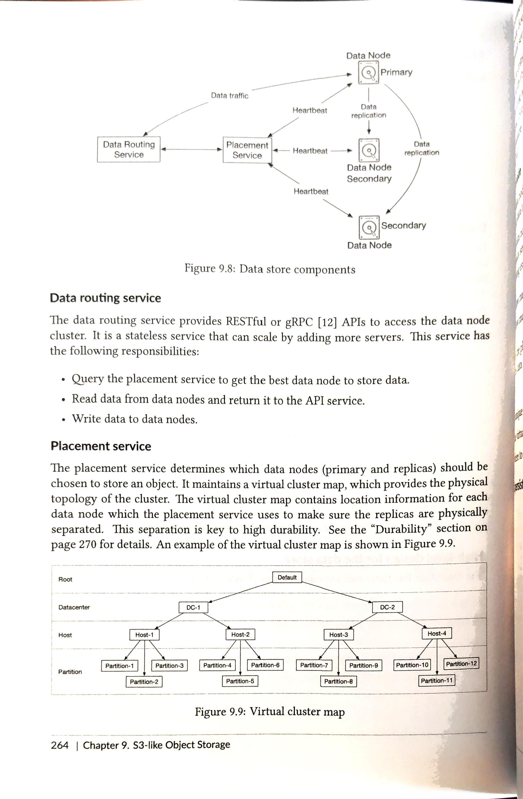

```
                       ┌─────────────────────────┐
                       │    Placement Service    │
                       └────────────┬────────────┘
                        Heartbeat ▲ │ ▲ Heartbeat
                                  │ │ │
        ┌─────────────────────────┘ │ └─────────────────────────┐
        │                           │                           │
        ▼                           ▼                           ▼
┌──────────────┐ Data traffic ┌──────────────┐ Data replication ┌──────────────┐
│ Data Routing │─────────────►│  Data Node   │─────────────────►│  Data Node   │
│   Service    │              │  (Primary)   │                  │ (Secondary)  │
└──────────────┘              └──────────────┘                  └──────────────┘
                                    │                                  ▲
                                    │         Data replication         │
                                    └──────────────────────────────────┘
                                    │
                                    ▼
                              ┌──────────────┐
                              │  Data Node   │
                              │ (Secondary)  │
                              └──────────────┘
```

**Hình 9.8: Các thành phần của kho lưu trữ dữ liệu (Data store components)**

#### Dịch vụ định tuyến dữ liệu (Data routing service)

Dịch vụ định tuyến dữ liệu cung cấp các RESTful hoặc gRPC [12] API để truy cập cụm nút dữ liệu (data node cluster). Đây là một dịch vụ phi trạng thái (stateless service) có thể mở rộng quy mô bằng cách thêm nhiều máy chủ hơn. Dịch vụ này đảm nhận các trách nhiệm sau:

* Truy vấn dịch vụ định vị (placement service) để lấy nút dữ liệu (data node) tối ưu nhất nhằm lưu trữ dữ liệu.
* Đọc dữ liệu từ các nút dữ liệu và trả về cho dịch vụ API.
* Ghi dữ liệu vào các nút dữ liệu.

#### Dịch vụ định vị (Placement service)

Dịch vụ định vị xác định nút dữ liệu nào (nút chính - primary và các bản sao - replicas) nên được chọn để lưu trữ dữ liệu. Dịch vụ này duy trì một bản đồ cụm ảo (virtual cluster map) theo dõi cấu trúc liên kết mạng vật lý (physical topology) của cụm máy chủ. Bản đồ cụm ảo chứa thông tin vị trí của từng nút dữ liệu, mà dịch vụ định vị sử dụng để đảm bảo rằng các bản sao được cách ly về mặt vật lý (physically separated). Sự cách ly này là chìa khóa để đạt được độ bền vững cao (high durability). Xem chi tiết tại phần "Độ bền vững" (Durability) ở trang 270. Một ví dụ về bản đồ cụm ảo được hiển thị trong **Hình 9.9**.


```
                            [ Root ]
                               │
                           [ Default ]
                               │
               ┌───────────────┴───────────────┐
               ▼                               ▼
            [ DC-1 ]                        [ DC-2 ]
               │                               │
        ┌──────┴──────┐                 ┌──────┴──────┐
        ▼             ▼                 ▼             ▼
    [ Host-1 ]    [ Host-2 ]        [ Host-3 ]    [ Host-4 ]
     ├── P-1       ├── P-4           ├── P-7       ├── P-10
     ├── P-2       ├── P-5           ├── P-8       ├── P-11
     └── P-3       └── P-6           └── P-9       └── P-12
```

*(Ghi chú: P = Partition / Phân vùng)*

**Hình 9.9: Bản đồ cụm ảo (Virtual cluster map)**

---
*Trang 264 | Chương 9: Lưu Trữ Đối Tượng Tương Tự S3*

# Chương 9: Thiết Kế Hệ Thống Lưu Trữ Đối Tượng Tương Tự S3 (S3-like Object Storage)

---

### --- Trang 267 ---

Dịch vụ định vị (**placement service**) liên tục giám sát toàn bộ các nút dữ liệu (**data nodes**) thông qua cơ chế nhịp tim (**heartbeats**). Nếu một nút dữ liệu không gửi tín hiệu heartbeat trong khoảng thời gian ân hạn (**grace period**) có thể cấu hình được là 15 giây, thì...

Đây là một dịch vụ tối quan trọng (**critical service**), do đó chúng tôi đề xuất xây dựng một cụm (**cluster**) gồm 5 hoặc 7 nút placement service sử dụng giao thức đồng thuận (**consensus protocol**) Paxos [13] hoặc Raft [14]. Giao thức đồng thuận đảm bảo rằng miễn là hơn một nửa số nút còn hoạt động bình thường (đạt đa số quá bán / **quorum**), thì toàn bộ dịch vụ vẫn tiếp tục vận hành. Ví dụ, nếu cụm placement service có 7 nút, nó có thể chịu đựng được sự cố lỗi đồng thời của 3 nút (**fault tolerance**). Để tìm hiểu thêm về các giao thức đồng thuận, hãy tham khảo các tài liệu tham khảo [13] [14].

#### Nút dữ liệu (Data node)

Nút dữ liệu lưu trữ dữ liệu đối tượng thực tế. Nó đảm bảo độ tin cậy (**reliability**) và độ bền vững dữ liệu (**durability**) bằng cách nhân bản (**replicating**) dữ liệu tới nhiều nút dữ liệu, tập hợp này còn được gọi là một nhóm nhân bản (**replication group**).

Mỗi nút dữ liệu đều có một tiến trình dịch vụ dữ liệu (**data service daemon**) chạy ngầm bên trong. Tiến trình này liên tục gửi tín hiệu heartbeat tới placement service. Thông điệp heartbeat bao gồm các thông tin thiết yếu sau:
- Nút dữ liệu hiện đang quản lý bao nhiêu ổ đĩa cứng (HDD hoặc SSD)?
- Lượng dữ liệu hiện đang lưu trữ trên từng ổ đĩa là bao nhiêu?

Khi placement service nhận được heartbeat lần đầu tiên từ một nút dữ liệu, nó sẽ cấp phát một mã định danh (**ID**) cho nút dữ liệu đó, thêm nó vào bản đồ cụm ảo (**virtual cluster map**), và phản hồi lại các thông tin sau:
- Một ID duy nhất (**unique ID**) của nút dữ liệu.
- Bản đồ cụm ảo (**virtual cluster map**).
- Vị trí thực hiện nhân bản dữ liệu (**where to replicate data**).

#### Luồng duy trì bền vững dữ liệu (Data persistence flow)

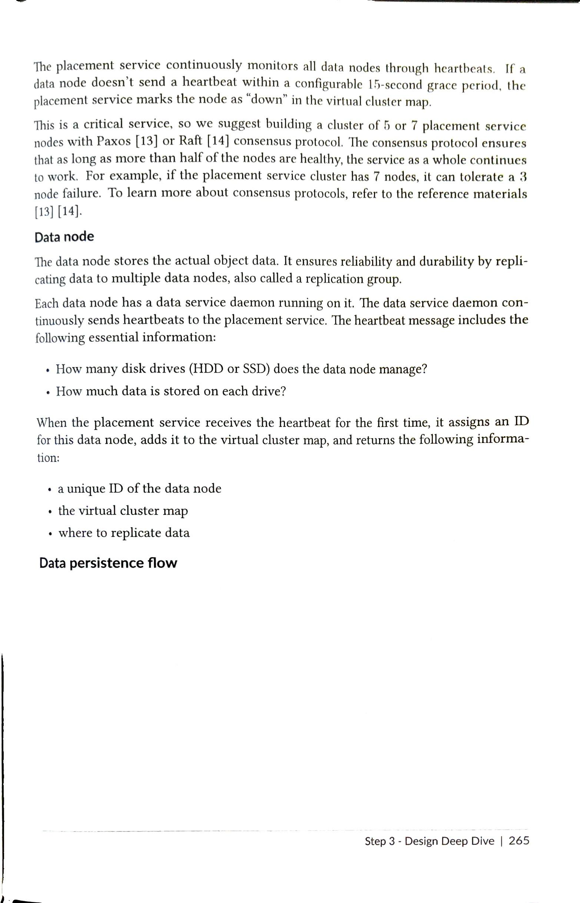

---

### --- Trang 268 ---

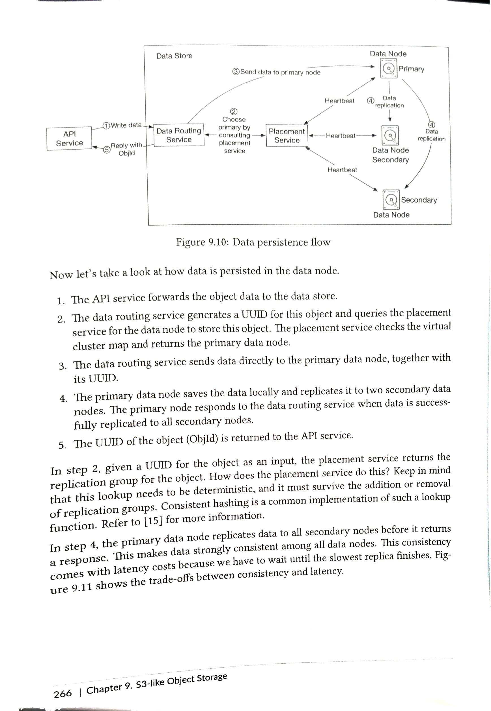

*Hình 9.10: Luồng duy trì bền vững dữ liệu (Data persistence flow)*

Bây giờ, hãy cùng xem xét cách dữ liệu được lưu trữ bền vững (**persisted**) trong nút dữ liệu:

1. **API service** chuyển tiếp dữ liệu đối tượng tới kho dữ liệu (**data store**).
2. Dịch vụ định tuyến dữ liệu (**data routing service**) tạo một mã **UUID** cho đối tượng này và truy vấn **placement service** để xác định nút dữ liệu sẽ lưu trữ đối tượng. Placement service kiểm tra bản đồ cụm ảo (**virtual cluster map**) và trả về nút dữ liệu chính (**primary data node**).
3. Data routing service gửi trực tiếp dữ liệu cùng với mã UUID của nó tới nút dữ liệu chính (**primary data node**).
4. Nút dữ liệu chính lưu dữ liệu cục bộ (**locally**) và nhân bản (**replicates**) dữ liệu đó tới hai nút dữ liệu phụ (**secondary data nodes**). Nút chính sẽ phản hồi lại cho data routing service khi dữ liệu đã được nhân bản thành công tới tất cả các nút phụ.
5. Mã UUID của đối tượng (**ObjId**) được trả về cho API service.

Ở bước 2, khi nhận đầu vào là mã UUID của đối tượng, placement service sẽ trả về [nút lưu trữ tương ứng thông qua một thuật toán/hàm định tuyến]. Tham khảo thêm tại [15] để biết thêm thông tin.

---

### --- Trang 269 ---

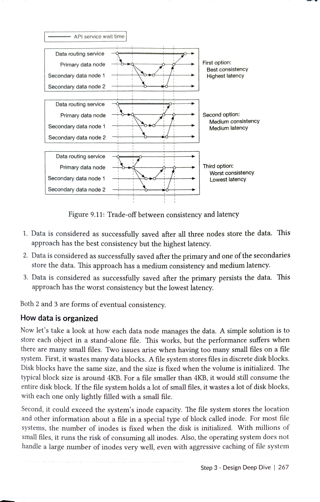

*Hình 9.11: Đánh đổi giữa tính nhất quán và độ trễ (Trade-off between consistency and latency)*

1. **Lựa chọn thứ nhất: Tính nhất quán cao nhất (Best consistency) – Độ trễ cao nhất (Highest latency)**  
   Dữ liệu được coi là đã lưu thành công sau khi cả ba nút (nút chính và cả hai nút phụ) đều lưu trữ xong dữ liệu. Phương pháp này mang lại tính nhất quán cao nhất nhưng có độ trễ lớn nhất.

2. **Lựa chọn thứ hai: Tính nhất quán trung bình (Medium consistency) – Độ trễ trung bình (Medium latency)**  
   Dữ liệu được coi là đã lưu thành công sau khi nút chính và một trong hai nút phụ lưu trữ xong dữ liệu. Phương pháp này cân bằng ở mức độ nhất quán trung bình và độ trễ trung bình.

3. **Lựa chọn thứ ba: Tính nhất quán thấp nhất (Worst consistency) – Độ trễ thấp nhất (Lowest latency)**  
   Dữ liệu được coi là đã lưu thành công ngay sau khi nút chính duy trì bền vững (**persists**) dữ liệu thành công. Phương pháp này có tính nhất quán thấp nhất nhưng mang lại độ trễ thấp nhất.

> [!NOTE]
> Cả lựa chọn 2 và 3 đều là các hình thức của tính nhất quán cuối cùng (**eventual consistency**).

#### Cách dữ liệu được tổ chức (How data is organized)

Bây giờ chúng ta hãy xem xét cách mỗi nút dữ liệu quản lý dữ liệu. Một giải pháp đơn giản là lưu trữ mỗi đối tượng trong một tệp tin độc lập riêng biệt (**stand-alone file**). Cách tiếp cận này có thể hoạt động được, nhưng hiệu năng sẽ suy giảm nghiêm trọng khi có quá nhiều tệp tin nhỏ. Hai vấn đề kỹ thuật lớn phát sinh khi có quá nhiều tệp tin nhỏ trên một hệ thống tệp tin (**file system**):

- **Thứ nhất, gây lãng phí nhiều khối dữ liệu (data blocks):** Một hệ thống tệp tin lưu trữ các tệp theo từng khối đĩa rời rạc (**discrete disk blocks**). Các khối đĩa này có kích thước cố định được thiết lập khi phân vùng ổ đĩa được khởi tạo. Kích thước khối điển hình thường vào khoảng **4KB**. Đối với một tệp nhỏ hơn 4KB, nó vẫn sẽ chiếm dụng trọn vẹn toàn bộ một khối đĩa 4KB đó. Nếu hệ thống tệp tin lưu giữ rất nhiều tệp nhỏ, nó sẽ làm lãng phí rất nhiều khối đĩa, bởi vì mỗi khối chỉ được lấp đầy một phần dung lượng rất nhỏ.
- **Thứ hai, có thể vượt quá dung lượng inode của hệ thống (inode capacity):** Hệ thống tệp tin lưu trữ vị trí và các siêu dữ liệu khác về một tệp trong một cấu trúc khối đặc biệt gọi là **inode**. Đối với hầu hết các hệ thống tệp tin, số lượng inode được ấn định cố định khi đĩa được định dạng/khởi tạo. Với hàng triệu tệp tin nhỏ, hệ thống sẽ đối mặt với nguy cơ cạn kiệt toàn bộ số lượng inode khả dụng. Ngoài ra, hệ điều hành cũng không thể xử lý hiệu quả một lượng quá lớn các inode, ngay cả khi áp dụng các cơ chế lưu tạm tích cực (**aggressive caching**) trên hệ thống tệp tin...

---

### --- Trang 270 ---

...trong thực tế.

Để giải quyết những vấn đề này, chúng ta có thể gộp nhiều đối tượng nhỏ thành một tệp tin lớn hơn. Cơ chế này hoạt động rất hiệu quả trong việc phục vụ các yêu cầu ghi dữ liệu. Hình 9.12 giải thích chi tiết cách thức quy trình này vận hành.

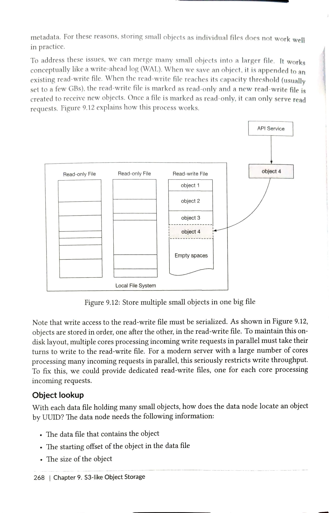

*Hình 9.12: Lưu trữ nhiều đối tượng nhỏ vào trong một tệp lớn (Store multiple small objects in one big file)*

> [!IMPORTANT]
> Lưu ý rằng các thao tác truy cập ghi (**write access**) vào tệp đọc-ghi (**read-write file**) phải được tuần tự hóa (**serialized**). Như minh họa trong Hình 9.12, các đối tượng được lưu trữ tuần tự, nối tiếp nhau trong tệp đọc-ghi. Để duy trì bố cục sắp xếp trên đĩa (**on-disk layout**) này, nhiều lõi CPU (**cores**) xử lý các yêu cầu ghi đến song song phải tuần tự xếp hàng để ghi vào tệp đọc-ghi.  
> 
> Đối với một máy chủ hiện đại có số lượng lớn lõi CPU xử lý đồng thời nhiều yêu cầu gửi tới, điều này sẽ hạn chế nghiêm trọng thông lượng ghi (**write throughput**). Để khắc phục vấn đề này, chúng ta có thể cấp phát các tệp đọc-ghi chuyên dụng riêng biệt, mỗi tệp dành riêng cho một lõi CPU xử lý các yêu cầu ghi gửi đến.

#### Tra cứu đối tượng (Object lookup)

Khi mỗi tệp dữ liệu chứa nhiều đối tượng nhỏ, làm thế nào nút dữ liệu có thể xác định chính xác vị trí của một đối tượng dựa vào mã **UUID**? Nút dữ liệu cần các thông tin thiết yếu sau:
- Tệp dữ liệu chứa đối tượng đó (**file_name**)
- Vị trí bắt đầu của đối tượng trong tệp dữ liệu (**start_offset**)
- Kích thước của đối tượng (**object_size**)

---

### --- Trang 271 ---

Lược đồ cơ sở dữ liệu (**database schema**) để hỗ trợ việc tra cứu này được thể hiện trong Bảng 9.3:

```sql
object_mapping
--------------
object_id
file_name
start_offset
object_size
```

*Bảng 9.3: Bảng object_mapping*

| Trường dữ liệu (Field) | Mô tả (Description) |
| :--- | :--- |
| **object_id** | Mã UUID của đối tượng |
| **file_name** | Tên tệp tin chứa đối tượng |
| **start_offset** | Địa chỉ bắt đầu của đối tượng trong tệp tin |
| **object_size** | Số byte dữ liệu của đối tượng |

*Bảng 9.4: Các trường dữ liệu trong bảng object_mapping*

Chúng tôi đã cân nhắc hai phương án kỹ thuật để lưu trữ cấu trúc ánh xạ này: một kho lưu trữ khóa-giá trị dựa trên tệp (**file-based key-value store**) như **RocksDB** [16], hoặc một **cơ sở dữ liệu quan hệ** (**relational database**). 

RocksDB hoạt động dựa trên cấu trúc **SSTable** [17], có tốc độ ghi rất nhanh nhưng đọc chậm hơn. Cơ sở dữ liệu quan hệ thường sử dụng công cụ lưu trữ (**storage engine**) dựa trên cấu trúc cây **B+ tree** [18], cho tốc độ đọc rất nhanh nhưng tốc độ ghi chậm hơn. Như đã đề cập trước đó, mô hình truy cập dữ liệu (**data access pattern**) của hệ thống là **ghi một lần và đọc nhiều lần** (**write once, read multiple times**). Vì cơ sở dữ liệu quan hệ mang lại hiệu năng đọc tốt hơn, nên nó là sự lựa chọn ưu việt hơn so với RocksDB.

Chúng ta nên triển khai cơ sở dữ liệu quan hệ này như thế nào? Ở quy mô hệ thống của chúng ta, khối lượng dữ liệu cho bảng ánh xạ là cực kỳ khổng lồ. Việc triển khai một cụm cơ sở dữ liệu tập trung duy nhất có quy mô lớn để hỗ trợ tất cả các nút dữ liệu có thể khả thi, nhưng lại cực kỳ khó khăn trong việc quản trị và bảo trì. Cần lưu ý rằng dữ liệu ánh xạ này hoàn toàn biệt lập (**isolated**) trong phạm vi nội bộ của từng nút dữ liệu. Hoàn toàn không có nhu cầu chia sẻ dữ liệu ánh xạ này giữa các nút dữ liệu với nhau. 

Để tận dụng tối đa đặc tính này, chúng ta có thể triển khai một cơ sở dữ liệu quan hệ gọn nhẹ cục bộ trên từng nút dữ liệu. **SQLite** [19] là một sự lựa chọn rất lý tưởng ở đây. Đây là một cơ sở dữ liệu quan hệ dựa trên tệp (**file-based relational database**) với danh tiếng và độ ổn định rất cao.

#### Luồng duy trì bền vững dữ liệu cập nhật (Updated data persistence flow)

Vì chúng ta đã thực hiện khá nhiều thay đổi cấu trúc bên trong nút dữ liệu, hãy cùng xem lại quy trình lưu một đối tượng mới vào nút dữ liệu (Hình 9.13).

1. API service gửi một yêu cầu để lưu một đối tượng mới có tên là `object 4`.
2. Dịch vụ nút dữ liệu (**data node service**) ghi nối tiếp (**appends**) đối tượng `object 4` vào cuối tệp đọc-ghi có tên là `/data/c`.
3. Một bản ghi mới của `object 4` được chèn vào bảng `object_mapping`.
4. Dịch vụ nút dữ liệu trả về mã UUID cho API service.

---

### --- Trang 272 ---

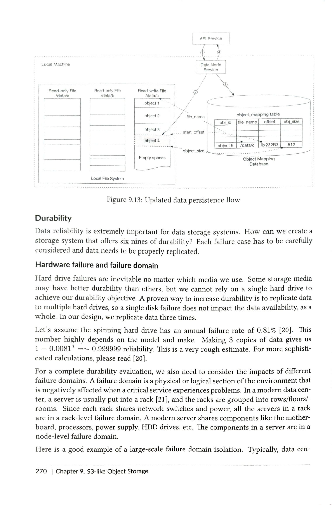

*Hình 9.13: Luồng duy trì bền vững dữ liệu được cập nhật (Updated data persistence flow)*

#### Độ bền vững dữ liệu (Durability)

Độ tin cậy dữ liệu (**data reliability**) là yếu tố sống còn đối với các hệ thống lưu trữ dữ liệu. Làm thế nào để chúng ta có thể xây dựng một hệ thống lưu trữ cung cấp độ bền vững dữ liệu đạt mức "6 số 9" (**six nines of durability - 99.9999%**)? Mọi kịch bản lỗi đều phải được xem xét cẩn trọng và dữ liệu cần được nhân bản đúng cách.

#### Lỗi phần cứng và miền lỗi (Hardware failure and failure domain)

Các sự cố hư hỏng ổ cứng là điều không thể tránh khỏi cho dù chúng ta sử dụng bất kỳ loại phương tiện lưu trữ nào. Một số phương tiện lưu trữ có thể có độ bền tốt hơn các loại khác, nhưng chúng ta không thể chỉ phụ thuộc vào một ổ cứng đơn lẻ để đạt được mục tiêu về độ bền vững dữ liệu. Một phương pháp đã được kiểm chứng để nâng cao độ bền vững là nhân bản dữ liệu ra nhiều ổ cứng khác nhau, do đó sự cố hỏng hóc của một ổ đĩa đơn lẻ sẽ không ảnh hưởng đến tính sẵn sàng tổng thể (**High Availability**) của dữ liệu. Trong thiết kế của chúng tôi, dữ liệu được nhân bản 3 bản sao (**three-way replication**).

Giả sử rằng ổ đĩa cứng quay (**spinning hard drive**) có tỷ lệ hư hỏng hàng năm (**Annual Failure Rate - AFR**) là 0.81% [20]. Con số này phụ thuộc rất lớn vào model và nhà sản xuất. Việc tạo 3 bản sao dữ liệu mang lại cho chúng ta độ tin cậy ước tính là:
$$1 - 0.0081^3 \approx 0.999999$$
tương đương độ tin cậy đạt 99.9999%. Đây là một phép ước tính sơ bộ. Để có các phép tính toán phức tạp và chuẩn xác hơn, vui lòng tham khảo [20].

Để đánh giá toàn diện về độ bền vững, chúng ta cũng cần xem xét tác động của các **miền lỗi** (**failure domains**) khác nhau. Một miền lỗi là một khu vực vật lý hoặc logic của môi trường hạ tầng bị tác động tiêu cực khi một dịch vụ hoặc thành phần trọng yếu gặp sự cố. Trong một trung tâm dữ liệu (**data center**) hiện đại:
- Một máy chủ thường được đặt vào một tủ rack [21], và các tủ rack được nhóm lại thành các dãy/tầng/phòng máy. Do mỗi tủ rack dùng chung các thiết bị chuyển mạch mạng (**network switches**) và nguồn điện, nên toàn bộ máy chủ trong cùng một tủ rack sẽ nằm trong một **miền lỗi cấp độ tủ rack** (**rack-level failure domain**).
- Một máy chủ hiện đại chia sẻ các linh kiện như bo mạch chủ (motherboard)... tạo thành một **miền lỗi cấp độ nút** (**node-level failure domain**).

# Chương 9: Lưu Trữ Đối Tượng Tương Tự S3 (S3-like Object Storage)

## Bước 3 - Đi Sâu Vào Thiết Kế (Step 3 - Design Deep Dive)

...các trung tâm dữ liệu (datacenters) phân chia hạ tầng không chia sẻ tài nguyên (shared-nothing infrastructure) thành các **Vùng Khả Dụng (Availability Zones - AZs)** khác nhau. Chúng ta sao chép (replicate) dữ liệu của mình sang các AZ khác nhau để giảm thiểu tối đa phạm vi ảnh hưởng khi xảy ra sự cố (failure impact) (**Hình 9.14**). Lưu ý rằng việc lựa chọn cấp độ vùng lỗi (failure domain level) không trực tiếp làm tăng độ bền vững của dữ liệu (data durability), nhưng nó sẽ mang lại độ tin cậy (reliability) cao hơn trong các trường hợp cực đoan, chẳng hạn như mất điện trên diện rộng, hỏng hệ thống làm mát, thiên tai, v.v.

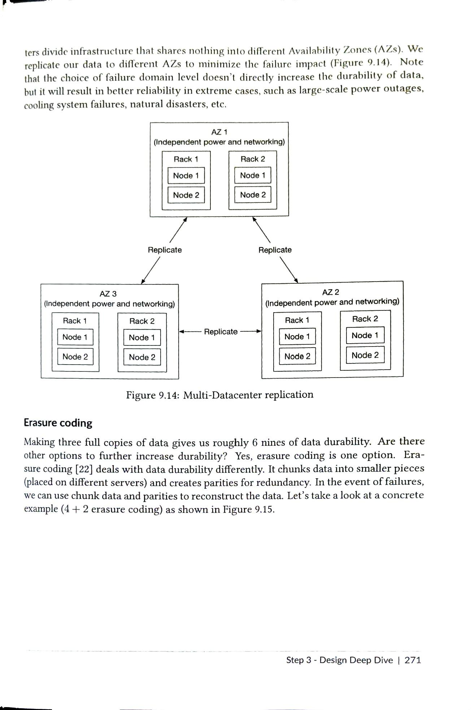

*Hình 9.14: Sao chép dữ liệu đa trung tâm dữ liệu (Multi-Datacenter replication)*

---

### Mã Hóa Xóa (Erasure Coding)

Việc tạo 3 bản sao đầy đủ (full copies) của dữ liệu mang lại cho chúng ta độ bền vững dữ liệu (data durability) vào khoảng 6 số 9 (6 nines - 99.9999%). Liệu có những lựa chọn nào khác để tăng cường độ bền vững hơn nữa không? Có, **Mã hóa xóa (Erasure coding)** là một lựa chọn. Mã hóa xóa [22] xử lý bài toán độ bền vững dữ liệu theo một cách thức khác biệt. Nó phân mảnh (chunk) dữ liệu thành các phần nhỏ hơn (được đặt trên các máy chủ khác nhau) và tạo ra các khối chẵn lẻ (parities) để dự phòng. Trong trường hợp xảy ra sự cố lỗi, chúng ta có thể sử dụng các khối dữ liệu mảnh (chunk data) và các parities để tái thiết lập (reconstruct) lại dữ liệu gốc. Hãy cùng xem xét một ví dụ cụ thể: mã hóa xóa (4 + 2) như được minh họa trong **Hình 9.15**.

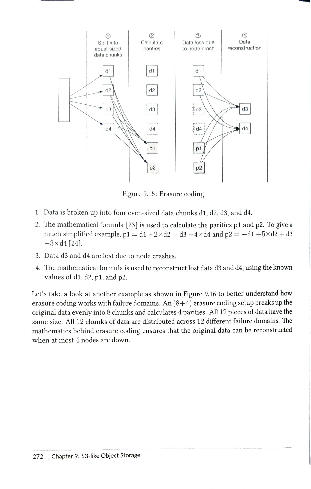

*Hình 9.15: Mã hóa xóa (Erasure coding)*

1. Dữ liệu được chia thành 4 khối dữ liệu có kích thước bằng nhau: $d_1, d_2, d_3$, và $d_4$.
2. Công thức toán học [23] được sử dụng để tính toán các khối parity $p_1$ và $p_2$. Lấy một ví dụ đơn giản hóa:
   $$p_1 = d_1 + 2 \times d_2 - d_3 + 4 \times d_4$$
   $$p_2 = -d_1 + 5 \times d_2 + d_3 - 3 \times d_4 \quad [24]$$
3. Dữ liệu $d_3$ và $d_4$ bị mất do sự cố sập nút (node crashes).
4. Công thức toán học được áp dụng để tái thiết lập lại dữ liệu bị mất $d_3$ và $d_4$, bằng cách sử dụng các giá trị đã biết của $d_1, d_2, p_1$, và $p_2$.

Hãy cùng xem xét một ví dụ khác như trong **Hình 9.16** để hiểu rõ hơn cách thức mã hóa xóa (erasure coding) hoạt động với các vùng lỗi (failure domains). Cấu hình mã hóa xóa (8 + 4) chia đều dữ liệu gốc thành 8 khối (chunks) và tính toán 4 khối parity. Toàn bộ 12 phần dữ liệu này đều có kích thước bằng nhau. Tất cả 12 khối dữ liệu được phân phối trải dài trên 12 failure domains khác nhau. Nền tảng toán học đằng sau mã hóa xóa đảm bảo rằng dữ liệu gốc có thể được tái thiết lập lại khi có tối đa 4 nút gặp sự cố ngừng hoạt động (nodes down).

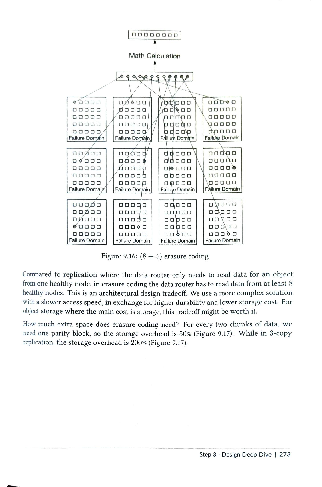

*Hình 9.16: Mã hóa xóa (8 + 4) ((8+4) erasure coding)*

So với kỹ thuật sao chép dữ liệu (replication) - nơi mà bộ định tuyến dữ liệu (data router) chỉ cần đọc dữ liệu cho một đối tượng (object) từ một nút khỏe mạnh duy nhất, thì trong mã hóa xóa (erasure coding), data router phải đọc dữ liệu từ ít nhất 8 nút khỏe mạnh. Đây là một sự đánh đổi trong thiết kế kiến trúc (**Architectural Design Tradeoff**):
- Chúng ta sử dụng một giải pháp phức tạp hơn với tốc độ truy cập chậm hơn (higher latency),
- Đổi lại là độ bền vững (durability) cao hơn và chi phí lưu trữ (storage cost) thấp hơn.

Đối với hệ thống lưu trữ đối tượng (object storage) - nơi mà chi phí chủ yếu nằm ở dung lượng lưu trữ, thì sự đánh đổi này là hoàn toàn xứng đáng.

Vậy mã hóa xóa đòi hỏi thêm bao nhiêu dung lượng lưu trữ? Cứ mỗi 2 khối dữ liệu, chúng ta cần 1 khối parity, vì vậy dung lượng lưu trữ phụ trội (storage overhead) là **50%** (**Hình 9.17**). Trong khi đó, ở cơ chế sao chép 3 bản (3-copy replication), chi phí lưu trữ phụ trội lên tới **200%** (**Hình 9.17**).

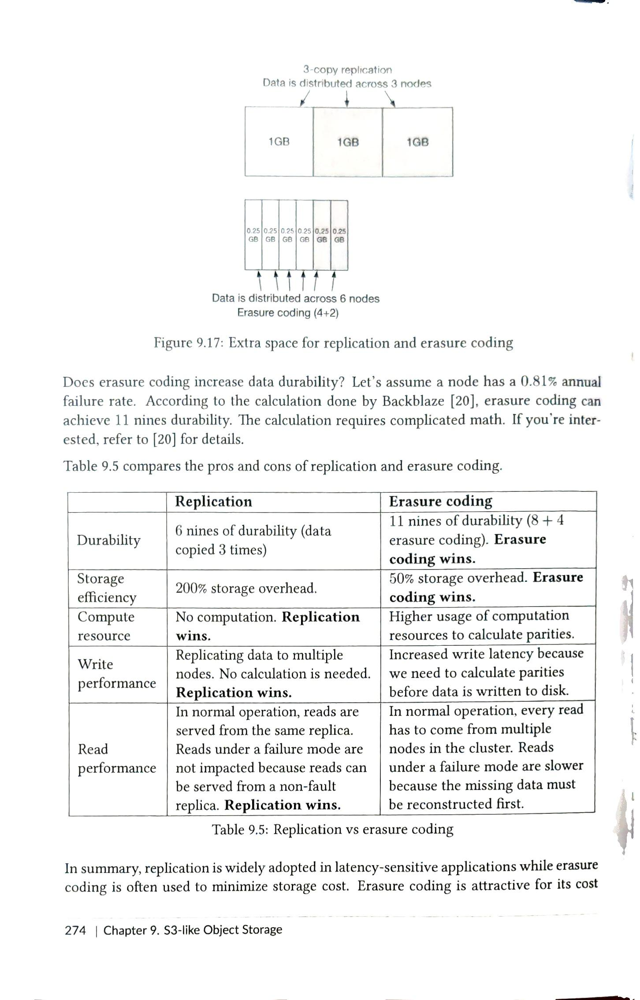

*Hình 9.17: Dung lượng phụ trội giữa sao chép dữ liệu và mã hóa xóa (Extra space for replication and erasure coding)*

Liệu mã hóa xóa có làm tăng độ bền vững của dữ liệu (data durability) hay không? Giả sử một nút có tỷ lệ hỏng hóc hàng năm (annual failure rate) là 0.81%. Dựa trên các phép tính được thực hiện bởi Backblaze [20], mã hóa xóa có thể đạt được độ bền vững lên tới **11 số 9 (11 nines durability - 99.999999999%)**. Phép tính này đòi hỏi các mô hình toán học phức tạp. Nếu bạn quan tâm, hãy tham khảo [20] để biết thêm chi tiết.

**Bảng 9.5** so sánh ưu và nhược điểm giữa cơ chế Sao chép dữ liệu (Replication) và Mã hóa xóa (Erasure coding).

| Tiêu chí | Sao chép dữ liệu (Replication) | Mã hóa xóa (Erasure coding) |
| :--- | :--- | :--- |
| **Độ bền vững (Durability)** | 6 số 9 về độ bền vững (dữ liệu nhân bản 3 lần) *(6 nines of durability)* | 11 số 9 về độ bền vững (với mã hóa xóa 8+4). **Erasure coding thắng.** *(11 nines of durability)* |
| **Hiệu quả lưu trữ (Storage efficiency)** | Tốn thêm 200% dung lượng lưu trữ phụ trội *(200% storage overhead)*. | Tốn thêm 50% dung lượng lưu trữ phụ trội *(50% storage overhead)*. **Erasure coding thắng.** |
| **Tài nguyên tính toán (Compute resource)** | Không yêu cầu tính toán. **Replication thắng.** *(No computation)* | Sử dụng nhiều tài nguyên tính toán hơn để tính toán các parity *(Higher usage of computation resources)*. |
| **Hiệu năng ghi (Write performance)** | Sao chép dữ liệu sang nhiều nút. Không cần tính toán. **Replication thắng.** *(Replicating data to multiple nodes)* | Độ trễ ghi (write latency) tăng lên vì chúng ta cần tính toán các khối parity trước khi dữ liệu được ghi xuống đĩa *(Increased write latency)*. |
| **Hiệu năng đọc (Read performance)** | Trong điều kiện vận hành bình thường, các yêu cầu đọc được phục vụ từ cùng một bản sao (replica). Khi có nút bị lỗi, hiệu năng đọc không bị ảnh hưởng vì có thể phục vụ từ bản sao không bị lỗi. **Replication thắng.** | Trong điều kiện vận hành bình thường, mỗi thao tác đọc đều phải lấy từ nhiều nút trong cụm (cluster). Khi có nút bị lỗi, tốc độ đọc sẽ chậm hơn vì dữ liệu bị thiếu phải được tái thiết lập trước *(reconstructed)*. |

*Bảng 9.5: So sánh giữa Replication và Erasure coding*

Tóm lại, cơ chế sao chép dữ liệu (replication) được áp dụng rộng rãi trong các ứng dụng nhạy cảm với độ trễ (latency-sensitive applications), trong khi mã hóa xóa (erasure coding) thường được sử dụng để tối thiểu hóa chi phí lưu trữ. Mã hóa xóa rất hấp dẫn nhờ tính hiệu quả về chi phí và độ bền vững cao, nhưng nó làm phức tạp hóa đáng kể thiết kế của các nút dữ liệu (data nodes). Do đó, đối với thiết kế trong chương này, chúng ta chủ yếu tập trung vào cơ chế **sao chép dữ liệu (replication)**.

---

### Kiểm Tra Tính Đúng Đắn (Correctness Verification)

Mã hóa xóa giúp gia tăng độ bền vững dữ liệu với chi phí lưu trữ tối ưu. Giờ đây, chúng ta có thể chuyển sang giải quyết một thách thức hóc búa khác: **sự hư hỏng dữ liệu (data corruption)**.

Nếu một ổ đĩa bị hỏng hoàn toàn và lỗi đó có thể phát hiện được, nó có thể được xử lý như một sự cố sập nút dữ liệu (data node failure). Trong trường hợp này, chúng ta có thể tái tạo lại dữ liệu bằng mã hóa xóa. Tuy nhiên, hiện tượng dữ liệu bị suy hao/hư hỏng trên bộ nhớ (in-memory data corruption) lại là sự cố xảy ra thường xuyên trong các hệ thống quy mô lớn.

Vấn đề này có thể được giải quyết bằng cách xác thực các mã kiểm tra (**checksums** [25]) giữa các ranh giới tiến trình (process boundaries). Checksum là một khối dữ liệu kích thước nhỏ được dùng để phát hiện lỗi dữ liệu. **Hình 9.18** minh họa cách mã checksum được tạo ra.

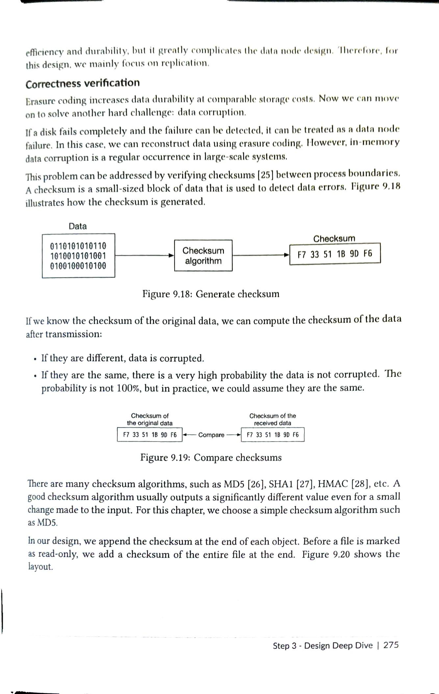

*Hình 9.18: Tạo mã checksum (Generate checksum)*

Nếu chúng ta biết trước mã checksum của dữ liệu gốc, chúng ta có thể tính toán lại checksum của dữ liệu sau khi truyền tải:
- **Nếu chúng khác nhau**: Dữ liệu đã bị hư hỏng (corrupted).
- **Nếu chúng trùng khớp**: Có xác suất rất cao là dữ liệu không bị hỏng. Xác suất này không phải là 100%, nhưng trên thực tế, chúng ta có thể giả định rằng dữ liệu hoàn toàn nguyên vẹn.

```
Mã checksum của           Mã checksum của
dữ liệu gốc              dữ liệu nhận được
[ F733511B9DF6 ] <--- So sánh ---> [ F733511B9DF6 ]
```
*Hình 9.19: So sánh các mã checksum (Compare checksums)*

Có rất nhiều thuật toán checksum, chẳng hạn như MD5 [26], SHA1 [27], HMAC [28], v.v. Một thuật toán checksum tốt thường sẽ xuất ra một giá trị khác biệt đáng kể ngay cả khi chỉ có một thay đổi nhỏ đối với dữ liệu đầu vào. Trong phạm vi chương này, chúng ta chọn một thuật toán checksum đơn giản như MD5.

Trong thiết kế của chúng ta, chúng ta sẽ nối thêm mã checksum vào cuối mỗi đối tượng (object). Trước khi một tệp được đánh dấu là chỉ đọc (read-only), chúng ta sẽ thêm mã checksum của toàn bộ tệp vào phần cuối cùng. **Hình 9.20** mô tả bố cục (layout) này.

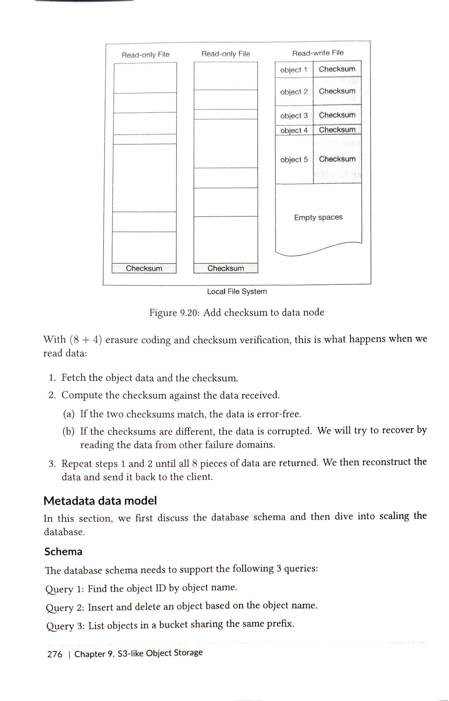

*Hình 9.20: Thêm mã checksum vào nút dữ liệu (Add checksum to data node)*

Với mô hình mã hóa xóa (8 + 4) kết hợp cùng cơ chế xác thực checksum, đây là những gì diễn ra khi chúng ta thực hiện thao tác đọc dữ liệu (read data):

1. Lấy dữ liệu đối tượng (object data) và mã checksum đi kèm.
2. Tính toán mã checksum đối với phần dữ liệu nhận được:
   - (a) Nếu hai mã checksum trùng khớp, dữ liệu không có lỗi (error-free).
   - (b) Nếu các mã checksum khác nhau, dữ liệu đã bị hư hỏng (corrupted). Chúng ta sẽ cố gắng khôi phục lại bằng cách đọc dữ liệu từ các vùng lỗi (failure domains) khác.
3. Lặp lại bước 1 và bước 2 cho đến khi toàn bộ 8 phần dữ liệu hợp lệ được trả về. Sau đó, chúng ta tiến hành tái tạo lại dữ liệu gốc và gửi trả lại cho phía client.

---

### Mô Hình Dữ Liệu Metadata (Metadata Data Model)

Trong phần này, trước tiên chúng ta sẽ thảo luận về lược đồ cơ sở dữ liệu (database schema), sau đó sẽ đi sâu vào việc mở rộng quy mô (scaling) cơ sở dữ liệu.

#### Lược Đồ (Schema)

Lược đồ cơ sở dữ liệu cần phải hỗ trợ 3 loại truy vấn (queries) sau đây:

- **Query 1**: Tìm mã định danh đối tượng (object ID) dựa theo tên đối tượng (object name).
- **Query 2**: Chèn (insert) và xóa (delete) một đối tượng dựa theo tên đối tượng.
- **Query 3**: Liệt kê danh sách các đối tượng trong một bucket có cùng tiền tố (shared prefix).

# Chương 9: Lưu Trữ Đối Tượng Tương Tự S3 (S3-like Object Storage)

---

### [Trang 279]

Hình 9.21 thể hiện thiết kế lược đồ cơ sở dữ liệu (schema design). Chúng ta cần hai bảng cơ sở dữ liệu: `bucket` và `object`.

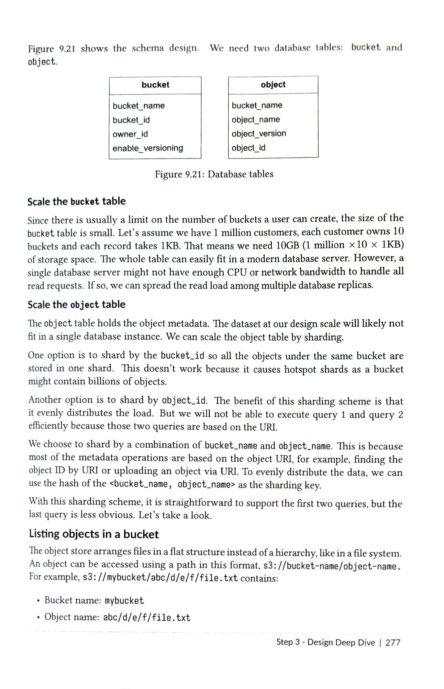

*Hình 9.21: Các bảng cơ sở dữ liệu (Database tables)*

| Bảng `bucket` | Bảng `object` |
| :--- | :--- |
| `bucket_name` | `bucket_name` |
| `bucket_id` | `object_name` |
| `owner_id` | `object_version` |
| `enable_versioning` | `object_id` |

---

#### Mở rộng quy mô bảng bucket (Scale the bucket table)

Do thông thường luôn có một giới hạn về số lượng bucket mà một người dùng có thể tạo, kích thước của bảng `bucket` là tương đối nhỏ. Giả sử chúng ta có 1 triệu khách hàng, mỗi khách hàng sở hữu 10 bucket và mỗi bản ghi chiếm 1KB dung lượng. Điều này có nghĩa là chúng ta chỉ cần 10GB ($1\text{ triệu} \times 10 \times 1\text{KB}$) không gian lưu trữ. Toàn bộ bảng này có thể dễ dàng nằm vừa vặn trong bộ nhớ/ổ đĩa của một máy chủ cơ sở dữ liệu hiện đại. 

Tuy nhiên, một máy chủ cơ sở dữ liệu đơn lẻ có thể không có đủ năng lực CPU hoặc băng thông mạng (network bandwidth) để xử lý toàn bộ các yêu cầu đọc (read requests). Nếu rơi vào trường hợp này, chúng ta có thể phân tán tải đọc (spread the read load) qua nhiều bản sao cơ sở dữ liệu (database replicas).

---

#### Mở rộng quy mô bảng object (Scale the object table)

Bảng `object` lưu trữ siêu dữ liệu của đối tượng (object metadata). Tập dữ liệu ở quy mô thiết kế của chúng ta gần như chắc chắn sẽ không thể chứa vừa trên một phiên bản cơ sở dữ liệu đơn lẻ (single database instance). Chúng ta có thể mở rộng quy mô bảng `object` bằng kỹ thuật phân mảnh dữ liệu (**Sharding**).

* **Lựa chọn 1: Phân mảnh theo `bucket_id`**
  Mọi đối tượng thuộc cùng một bucket sẽ được lưu trữ trong cùng một mảnh (**shard**). Phương án này **không hoạt động hiệu quả** vì nó gây ra các mảnh điểm nóng (**hotspot shards**), do một bucket có thể chứa tới hàng tỷ đối tượng.

* **Lựa chọn 2: Phân mảnh theo `object_id`**
  Lợi ích của cơ chế phân mảnh này là nó phân phối tải đồng đều (evenly distributes the load). Tuy nhiên, chúng ta sẽ không thể thực thi truy vấn 1 (query 1) và truy vấn 2 (query 2) một cách hiệu quả, bởi vì hai truy vấn đó được định tuyến dựa trên định danh tài nguyên đồng nhất (**URI - Uniform Resource Identifier**).

* **Lựa chọn tối ưu: Phân mảnh kết hợp `<bucket_name, object_name>`**
  Chúng tôi chọn phương án phân mảnh dựa trên sự kết hợp giữa `bucket_name` và `object_name`. Lý do là hầu hết các thao tác siêu dữ liệu (metadata operations) đều dựa trên URI của đối tượng, ví dụ: tìm ID đối tượng qua URI hoặc tải lên một đối tượng qua URI. Để phân phối dữ liệu đồng đều, chúng ta có thể sử dụng hàm băm (**hash**) của `<bucket_name, object_name>` làm khóa phân mảnh (**sharding key**).

Với cơ chế phân mảnh này, việc hỗ trợ hai truy vấn đầu tiên là rất trực diện, nhưng truy vấn cuối cùng thì phức tạp hơn. Hãy cùng xem xét chi tiết.

---

#### Liệt kê các đối tượng trong một bucket (Listing objects in a bucket)

Hệ thống lưu trữ đối tượng (object store) sắp xếp các tệp theo một cấu trúc phẳng (flat structure) thay vì phân cấp dạng cây (hierarchy) như trong một hệ thống tệp (file system) truyền thống.

Một đối tượng có thể được truy cập thông qua một đường dẫn có định dạng: `s3://bucket-name/object-name`.

Ví dụ: đường dẫn `s3://mybucket/abc/d/e/f/file.txt` bao gồm:
* **Bucket name**: `mybucket`
* **Object name**: `abc/d/e/f/file.txt`

---

### [Trang 280]

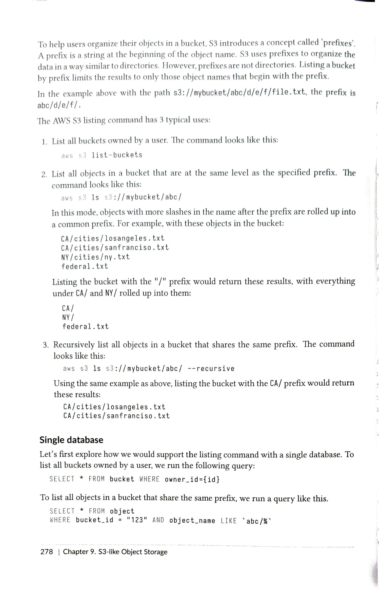

Để giúp người dùng tổ chức các đối tượng của họ bên trong một bucket, S3 giới thiệu một khái niệm gọi là **'tiền tố' (prefixes)**. Tiền tố là một chuỗi ký tự nằm ở phần đầu của tên đối tượng (`object_name`). S3 sử dụng các tiền tố để tổ chức dữ liệu theo cách tương tự như các thư mục. Tuy nhiên, các tiền tố **không phải là thư mục thực tế**. Việc liệt kê một bucket theo tiền tố sẽ giới hạn kết quả chỉ trả về các đối tượng có tên bắt đầu bằng tiền tố đó.

Trong ví dụ trên với đường dẫn `s3://mybucket/abc/d/e/f/file.txt`, tiền tố là `abc/d/e/f/`.

Lệnh liệt kê (listing command) của AWS S3 có 3 trường hợp sử dụng điển hình:

1. **Liệt kê tất cả các bucket do một người dùng sở hữu.** Lệnh có dạng như sau:
   ```bash
   aws s3 list-buckets
   ```

2. **Liệt kê tất cả các đối tượng trong một bucket nằm ở cùng một cấp độ với tiền tố được chỉ định.** Lệnh có dạng như sau:
   ```bash
   aws s3 ls s3://mybucket/abc/
   ```
   Trong chế độ này, các đối tượng có nhiều dấu gạch chéo (`/`) hơn trong tên sau phần tiền tố sẽ được gộp chung lại (**rolled up**) thành một tiền tố chung (common prefix). Ví dụ: với danh sách các đối tượng sau trong bucket:
   * `CA/cities/losangeles.txt`
   * `CA/cities/sanfranciso.txt`
   * `NY/cities/ny.txt`
   * `federal.txt`

   Việc liệt kê bucket với tiền tố `"/"` sẽ trả về các kết quả sau, trong đó mọi thứ nằm dưới `CA/` và `NY/` đều được gộp lại:
   * `CA/`
   * `NY/`
   * `federal.txt`

3. **Liệt kê đệ quy (recursively list) tất cả các đối tượng trong một bucket có chung tiền tố.** Lệnh có dạng như sau:
   ```bash
   aws s3 ls s3://mybucket/abc/ --recursive
   ```
   Sử dụng cùng ví dụ như trên, việc liệt kê bucket với tiền tố `CA/` theo chế độ đệ quy sẽ trả về kết quả:
   * `CA/cities/losangeles.txt`
   * `CA/cities/sanfranciso.txt`

---

#### Cơ sở dữ liệu đơn lẻ (Single database)

Trước tiên, hãy khám phá cách chúng ta hỗ trợ lệnh liệt kê với một cơ sở dữ liệu đơn lẻ. Để liệt kê tất cả các bucket do một người dùng sở hữu, chúng ta thực thi truy vấn sau:

```sql
SELECT * FROM bucket WHERE owner_id = {id};
```

Để liệt kê tất cả các đối tượng trong một bucket có chung một tiền tố, chúng ta thực thi một truy vấn tương tự như sau:

```sql
SELECT * FROM object
WHERE bucket_id = "123" AND object_name LIKE 'abc/%';
```

---

### [Trang 281]

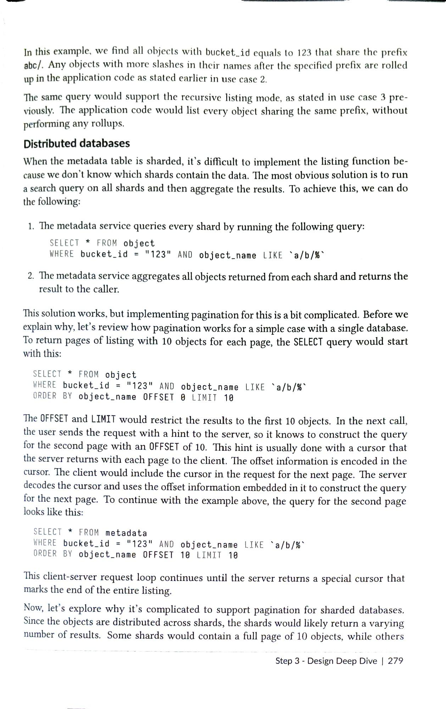

Trong ví dụ này, chúng ta tìm tất cả các đối tượng có `bucket_id` bằng 123 và có chung tiền tố `abc/`. Bất kỳ đối tượng nào có nhiều dấu gạch chéo hơn trong tên sau tiền tố đã chỉ định sẽ được gộp lại (rolled up) trong mã ứng dụng (application code) như đã trình bày ở trường hợp sử dụng 2.

Chính truy vấn này cũng sẽ hỗ trợ chế độ liệt kê đệ quy (recursive listing mode) như đã nêu trong trường hợp sử dụng 3 trước đó. Mã ứng dụng sẽ liệt kê mọi đối tượng có chung tiền tố mà không thực hiện bất kỳ thao tác gộp nào.

---

#### Cơ sở dữ liệu phân tán (Distributed databases)

Khi bảng siêu dữ liệu (metadata table) bị phân mảnh (**sharded**), việc triển khai chức năng liệt kê trở nên khó khăn vì chúng ta không biết được mảnh nào (shard nào) đang chứa dữ liệu. Giải pháp hiển nhiên nhất là thực thi một truy vấn tìm kiếm trên tất cả các shard và sau đó tổng hợp kết quả lại. Để đạt được điều này, chúng ta có thể thực hiện như sau:

1. Dịch vụ siêu dữ liệu (metadata service) truy vấn từng shard bằng cách chạy truy vấn:
   ```sql
   SELECT * FROM object;
   ```
2. Dịch vụ siêu dữ liệu tổng hợp (aggregates) tất cả các đối tượng được trả về từ mỗi shard và trả kết quả về cho bên gọi (caller).

Giải pháp này hoạt động được, nhưng việc triển khai phân trang (**pagination**) cho nó tương đối phức tạp. Trước khi giải thích lý do, hãy cùng xem lại cách thức hoạt động của phân trang trong trường hợp đơn giản với một cơ sở dữ liệu đơn lẻ.

Để trả về các trang liệt kê với 10 đối tượng trên mỗi trang, câu truy vấn `SELECT` sẽ bắt đầu như sau:

```sql
SELECT * FROM object
ORDER BY object_name OFFSET 0 LIMIT 10;
```

Mệnh đề `OFFSET` và `LIMIT` sẽ giới hạn kết quả trả về trong 10 đối tượng đầu tiên. Trong lệnh gọi tiếp theo, người dùng gửi yêu cầu kèm theo một gợi ý (hint) đến máy chủ, để máy chủ biết cách xây dựng truy vấn cho trang thứ hai với `OFFSET` là 10. Gợi ý này thường được thực hiện thông qua một con trỏ (**cursor**) mà máy chủ trả về cho máy khách (client) cùng với mỗi trang. Thông tin về offset được mã hóa bên trong con trỏ này. Máy khách sẽ đính kèm con trỏ trong yêu cầu lấy trang tiếp theo. Máy chủ giải mã con trỏ và sử dụng thông tin offset nhúng trong đó để cấu trúc truy vấn cho trang tiếp theo. Tiếp tục với ví dụ trên, truy vấn cho trang thứ hai trông như sau:

```sql
SELECT * FROM metadata
WHERE bucket_id = "123" AND object_name LIKE "a/b/%"
ORDER BY object_name OFFSET 10 LIMIT 10;
```

Vòng lặp yêu cầu giữa máy khách và máy chủ này tiếp tục cho đến khi máy chủ trả về một con trỏ đặc biệt đánh dấu sự kết thúc của toàn bộ danh sách liệt kê.

Bây giờ, hãy phân tích tại sao việc hỗ trợ phân trang cho các cơ sở dữ liệu đã phân mảnh lại phức tạp:

Bởi vì các đối tượng được phân tán trên nhiều shard, các shard nhiều khả năng sẽ trả về số lượng kết quả không đồng đều. Một số shard có thể chứa đủ một trang đầy 10 đối tượng, trong khi các shard khác có thể chỉ chứa một phần hoặc hoàn toàn rỗng.

---

### [Trang 282]

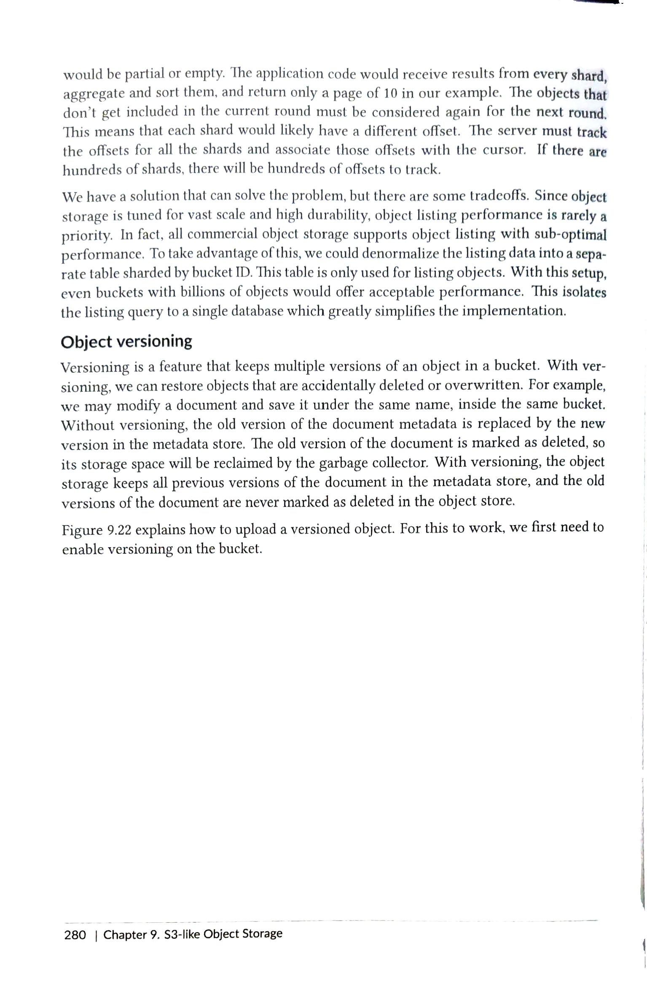

Mã ứng dụng sẽ phải nhận kết quả từ mọi shard, tổng hợp và sắp xếp chúng, rồi chỉ trả về một trang gồm 10 đối tượng (trong ví dụ của chúng ta). Các đối tượng không được đưa vào lượt hiện tại phải được xem xét lại cho lượt tiếp theo. 

Điều này đồng nghĩa với việc mỗi shard nhiều khả năng sẽ có một độ lệch (**offset**) khác nhau. Máy chủ phải theo dõi các offset cho tất cả các shard và liên kết các offset đó với con trỏ (cursor). Nếu có hàng trăm shard, sẽ có hàng trăm offset cần phải theo dõi.

Chúng ta có một giải pháp có thể giải quyết vấn đề này, nhưng phải đánh đổi (**trade-offs**). Do hệ thống lưu trữ đối tượng được tinh chỉnh chuyên biệt cho quy mô cực lớn và độ bền dữ liệu cao (**High Durability**), hiệu năng liệt kê đối tượng (object listing performance) hiếm khi là một ưu tiên hàng đầu. Trên thực tế, tất cả các hệ thống lưu trữ đối tượng thương mại đều hỗ trợ tính năng liệt kê đối tượng với hiệu năng ở mức dưới tối ưu (sub-optimal performance). 

Để tận dụng đặc điểm này, chúng ta có thể phi chuẩn hóa dữ liệu (**denormalize**) phục vụ việc liệt kê vào một bảng riêng biệt được phân mảnh theo ID của bucket (`bucket_id`). Bảng này chỉ được sử dụng duy nhất cho mục đích liệt kê các đối tượng. Với cấu hình này, ngay cả những bucket chứa hàng tỷ đối tượng cũng sẽ mang lại hiệu năng chấp nhận được. Điều này cô lập truy vấn liệt kê vào một cơ sở dữ liệu duy nhất, giúp đơn giản hóa việc triển khai đi rất nhiều.

---

#### Quản lý phiên bản đối tượng (Object versioning)

Quản lý phiên bản (**Versioning**) là một tính năng duy trì nhiều phiên bản của một đối tượng trong cùng một bucket. Với tính năng này, chúng ta có thể khôi phục lại các đối tượng vô tình bị xóa hoặc bị ghi đè. 

Ví dụ: chúng ta có thể sửa đổi một tài liệu và lưu lại dưới cùng một tên, bên trong cùng một bucket.
* **Không bật versioning**: Phiên bản cũ của siêu dữ liệu tài liệu sẽ bị thay thế bởi phiên bản mới trong kho lưu trữ siêu dữ liệu (metadata store). Phiên bản cũ của tài liệu bị đánh dấu là đã xóa, do đó không gian lưu trữ của nó sẽ được bộ thu gom rác (**Garbage Collector**) thu hồi.
* **Có bật versioning**: Hệ thống lưu trữ đối tượng giữ lại tất cả các phiên bản trước đó của tài liệu trong kho lưu trữ siêu dữ liệu, và các phiên bản cũ của tài liệu không bao giờ bị đánh dấu là đã xóa trong kho lưu trữ đối tượng.

Hình 9.22 giải thích cách tải lên một đối tượng có quản lý phiên bản. Để tính năng này hoạt động, trước tiên chúng ta cần kích hoạt versioning trên bucket.

---

### [Trang 283]

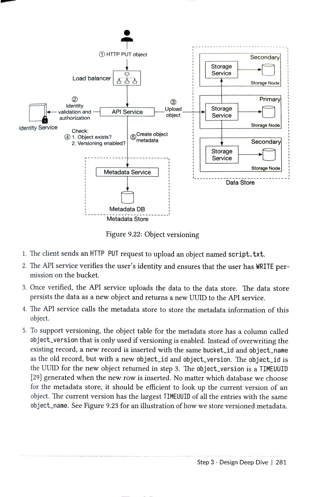

*Hình 9.22: Quản lý phiên bản đối tượng (Object versioning)*

**Quy trình tải lên đối tượng có quản lý phiên bản:**

1. **Gửi yêu cầu**: Máy khách (Client) gửi một yêu cầu `HTTP PUT` để tải lên một đối tượng có tên `script.txt`.
2. **Xác thực và phân quyền**: Dịch vụ API (API Service) xác minh danh tính người dùng thông qua Dịch vụ định danh (Identity Service) và đảm bảo rằng người dùng có quyền ghi (`WRITE`) trên bucket.
3. **Lưu trữ dữ liệu**: Sau khi được xác minh, Dịch vụ API tải dữ liệu lên kho lưu trữ dữ liệu (Data Store). Kho lưu trữ dữ liệu sẽ lưu trữ bền vững (persists) dữ liệu như một đối tượng mới và trả về một định danh duy nhất toàn cầu (**UUID**) mới cho Dịch vụ API.
4. **Lưu trữ siêu dữ liệu**: Dịch vụ API gọi kho lưu trữ siêu dữ liệu (Metadata Store) để lưu trữ thông tin siêu dữ liệu của đối tượng này.
5. **Cập nhật phiên bản**: Để hỗ trợ versioning, bảng `object` trong kho lưu trữ siêu dữ liệu có một cột tên là `object_version`, cột này chỉ được sử dụng nếu tính năng versioning được bật. Thay vì ghi đè lên bản ghi hiện có, một bản ghi mới được chèn vào với cùng `bucket_id` và `object_name` như bản ghi cũ, nhưng có một `object_id` và `object_version` mới:
   * `object_id` là UUID của đối tượng mới được trả về ở bước 3.
   * `object_version` là một **TIMEUUID** [29] được tạo ra khi hàng mới được chèn vào.

> [!NOTE]
> Bất kể chúng ta chọn cơ sở dữ liệu nào cho kho lưu trữ siêu dữ liệu, nó đều phải hỗ trợ tra cứu phiên bản hiện tại (current version) của một đối tượng một cách hiệu quả. Phiên bản hiện tại chính là bản ghi có **TIMEUUID lớn nhất** trong số tất cả các mục có cùng `object_name`. Xem Hình 9.23 để biết minh họa về cách chúng ta lưu trữ siêu dữ liệu có phiên bản.

---

### [Trang 284]

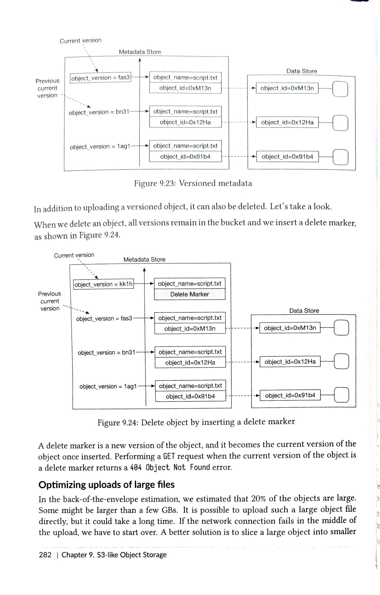

*Hình 9.23: Siêu dữ liệu được đánh phiên bản (Versioned metadata)*

```
[Kho Siêu Dữ Liệu - Metadata Store]                         [Kho Dữ Liệu - Data Store]
+------------------------------------------+               +--------------------------+
| Phiên bản hiện tại (Current version):    |               |                          |
| object_version = fas3                    | ------------> | object_id = 0xM13n       |
| object_name = script.txt                 |               |                          |
| object_id = 0xM13n                       |               +--------------------------+
+------------------------------------------+               +--------------------------+
| Phiên bản trước (Previous current):      |               |                          |
| object_version = bn31                    | ------------> | object_id = 0x12Ha       |
| object_name = script.txt                 |               |                          |
| object_id = 0x12Ha                       |               +--------------------------+
+------------------------------------------+               +--------------------------+
| object_version = 1ag1                    |               |                          |
| object_name = script.txt                 | ------------> | object_id = 0x91b4       |
| object_id = 0x91b4                       |               |                          |
+------------------------------------------+               +--------------------------+
```

Bên cạnh việc tải lên một đối tượng có quản lý phiên bản, đối tượng đó cũng có thể bị xóa. Hãy cùng xem xét quy trình này.

Khi chúng ta xóa một đối tượng, tất cả các phiên bản vẫn còn nguyên vẹn trong bucket và chúng ta chèn vào một **dấu đánh dấu đã xóa (Delete Marker)**, như thể hiện trong Hình 9.24.

```
[Kho Siêu Dữ Liệu - Metadata Store]                         [Kho Dữ Liệu - Data Store]
+------------------------------------------+
| Phiên bản hiện tại (Current version):    |
| object_version = kk1h                    |
| object_name = script.txt                 |
| [DELETE MARKER]                          |
+------------------------------------------+
| Phiên bản trước (Previous current):      |               +--------------------------+
| object_version = fas3                    | ------------> | object_id = 0xM13n       |
| object_name = script.txt                 |               +--------------------------+
| object_id = 0xM13n                       |
+------------------------------------------+               +--------------------------+
| object_version = bn31                    | ------------> | object_id = 0x12Ha       |
| object_name = script.txt                 |               +--------------------------+
| object_id = 0x12Ha                       |
+------------------------------------------+               +--------------------------+
| object_version = 1ag1                    | ------------> | object_id = 0x91b4       |
| object_name = script.txt                 |               +--------------------------+
| object_id = 0x91b4                       |
+------------------------------------------+
```

*Hình 9.24: Xóa đối tượng bằng cách chèn một dấu đánh dấu đã xóa (Delete object by inserting a delete marker)*

> [!IMPORTANT]
> Một dấu đánh dấu đã xóa (**Delete Marker**) thực chất là một phiên bản mới của đối tượng, và nó sẽ trở thành phiên bản hiện tại (current version) của đối tượng ngay khi được chèn vào. Việc thực hiện một yêu cầu `GET` khi phiên bản hiện tại của đối tượng là một delete marker sẽ trả về lỗi **`404 Object Not Found`**.

---

#### Tối ưu hóa tải lên các tệp lớn (Optimizing uploads of large files)

Trong phần ước tính sơ bộ (back-of-the-envelope estimation), chúng ta đã ước tính rằng 20% các đối tượng là đối tượng lớn. Một số đối tượng thậm chí có thể lớn hơn vài GB. Việc tải lên trực tiếp một tệp đối tượng lớn như vậy là khả thi, nhưng có thể mất rất nhiều thời gian. Nếu kết nối mạng bị gián đoạn giữa chừng trong quá trình tải lên, chúng ta sẽ phải bắt đầu lại từ đầu. Một giải pháp tốt hơn là chia nhỏ đối tượng lớn thành các phần nhỏ hơn...

# CHƯƠNG 9: HỆ THỐNG LƯU TRỮ ĐỐI TƯỢNG TƯƠNG TỰ S3 (S3-LIKE OBJECT STORAGE)

---

## Bước 3: Đi sâu vào Thiết kế Kiến trúc (Design Deep Dive) *(tiếp theo)*

...các phần nhỏ (parts) và tải chúng lên một cách độc lập. Sau khi toàn bộ các phần được tải lên hoàn tất, kho lưu trữ đối tượng (object store) sẽ tiến hành tái ráp nối (re-assemble) đối tượng hoàn chỉnh từ các phần đó. Quá trình này được gọi là **tải lên nhiều phần (multipart upload)**.

Hình 9.25 minh họa cách thức hoạt động của cơ chế tải lên nhiều phần (multipart upload):

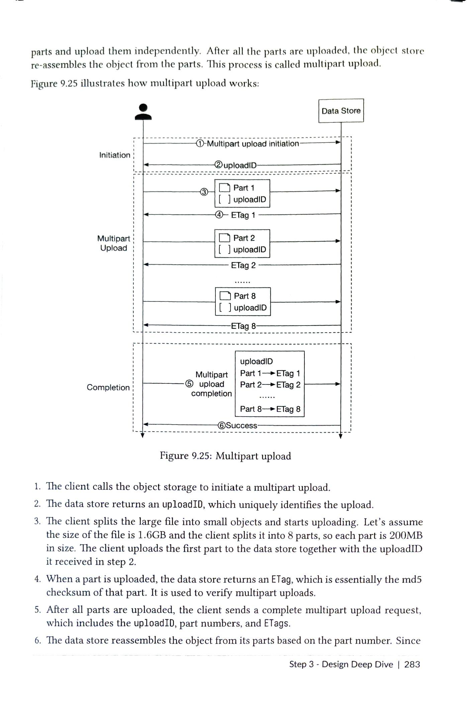
*Hình 9.25: Tải lên nhiều phần (Multipart upload)*

### Quy trình từng bước:
1. **Khởi tạo (Initiation)**: Client gọi đến kho lưu trữ đối tượng (object storage) để khởi tạo một tiến trình tải lên nhiều phần (`multipart upload initiation`).
2. **Cấp phát định danh**: Kho dữ liệu (data store) phản hồi một mã định danh tải lên duy nhất: `uploadID`.
3. **Phân mảnh và tải lên (Multipart Upload)**: Client chia nhỏ tệp tin kích thước lớn thành các đối tượng nhỏ và bắt đầu quá trình tải lên. Giả sử kích thước tệp tin là 1.6GB và client chia nó thành 8 phần (parts), như vậy mỗi phần sẽ có dung lượng 200MB. Client tải phần đầu tiên (Part 1) lên kho dữ liệu kèm theo mã `uploadID` đã nhận được ở Bước 2.
4. **Xác thực từng phần**: Khi một phần được tải lên thành công, kho dữ liệu sẽ trả về một mã `ETag`, về bản chất chính là mã băm kiểm tra (checksum) dạng MD5 của phần đó. Giá trị này được sử dụng để xác minh tính toàn vẹn của dữ liệu trong quá trình tải lên nhiều phần.
5. **Yêu cầu hoàn tất (Completion Request)**: Sau khi tất cả các phần được tải lên hoàn tất, client gửi một yêu cầu hoàn tất tải lên nhiều phần (`complete multipart upload request`), bao gồm: `uploadID`, danh sách số thứ tự các phần (`part numbers`) và các mã `ETags` tương ứng (ví dụ: `Part 1 → ETag 1`, `Part 2 → ETag 2`, ..., `Part 8 → ETag 8`).
6. **Tái ráp nối (Reassembly)**: Kho dữ liệu tiến hành tái ráp nối đối tượng hoàn chỉnh từ các phần riêng lẻ dựa trên số thứ tự phần (`part number`). 

> [!NOTE] 
> Vì đối tượng có kích thước rất lớn, quá trình tái ráp nối này có thể mất vài phút. Sau khi quá trình tái ráp nối hoàn tất, hệ thống sẽ trả về một thông điệp thành công (`success`) cho client.

Một vấn đề tiềm ẩn với phương pháp tiếp cận này là các phần dữ liệu cũ không còn hữu dụng sau khi đối tượng đã được tái ráp nối từ chúng. Để giải quyết triệt để vấn đề này, chúng ta có thể đưa vào một **dịch vụ thu gom rác (garbage collection service)** chịu trách nhiệm giải phóng dung lượng lưu trữ từ các phần dữ liệu không còn cần thiết nữa.

---

### Dọn rác (Garbage Collection)

**Thu gom rác (Garbage collection)** là tiến trình tự động thu hồi không gian lưu trữ không còn được sử dụng. Dưới đây là một số trường hợp khiến dữ liệu trở thành "rác" trong hệ thống:
* **Xóa đối tượng lười (Lazy object deletion)**: Một đối tượng được đánh dấu là đã xóa (marked as deleted) tại thời điểm thực hiện thao tác xóa mà chưa thực sự bị xóa vật lý ngay lập tức khỏi đĩa lưu trữ.
* **Dữ liệu mồ côi (Orphan data)**: Ví dụ dữ liệu tải lên dang dở (half-uploaded data) hoặc các phiên tải lên nhiều phần bị hủy bỏ/bỏ rơi (abandoned multipart uploads).
* **Dữ liệu hỏng (Corrupted data)**: Dữ liệu không vượt qua được bước xác minh mã kiểm tra toàn vẹn (failed checksum verification).

Bộ thu gom rác (garbage collector) không xóa các đối tượng khỏi kho dữ liệu ngay lập tức. Thay vào đó, các đối tượng đã xóa sẽ được dọn dẹp định kỳ thông qua một cơ chế nén/thu gọn dữ liệu (**compaction mechanism**).

Bộ thu gom rác cũng chịu trách nhiệm thu hồi không gian lưu trữ không sử dụng trên các bản sao (replicas):
* Đối với cơ chế **nhân bản (replication)**: chúng ta xóa đối tượng trên cả nút sơ cấp (primary node) và các nút dự phòng (backup nodes).
* Đối với cơ chế **mã hóa xóa (erasure coding)**: nếu áp dụng cấu hình `(8 + 4)`, chúng ta phải xóa các phân mảnh đối tượng trên toàn bộ 12 nút lưu trữ.

---

Hình 9.26 minh họa một ví dụ về cách thức hoạt động của cơ chế nén dữ liệu (compaction):

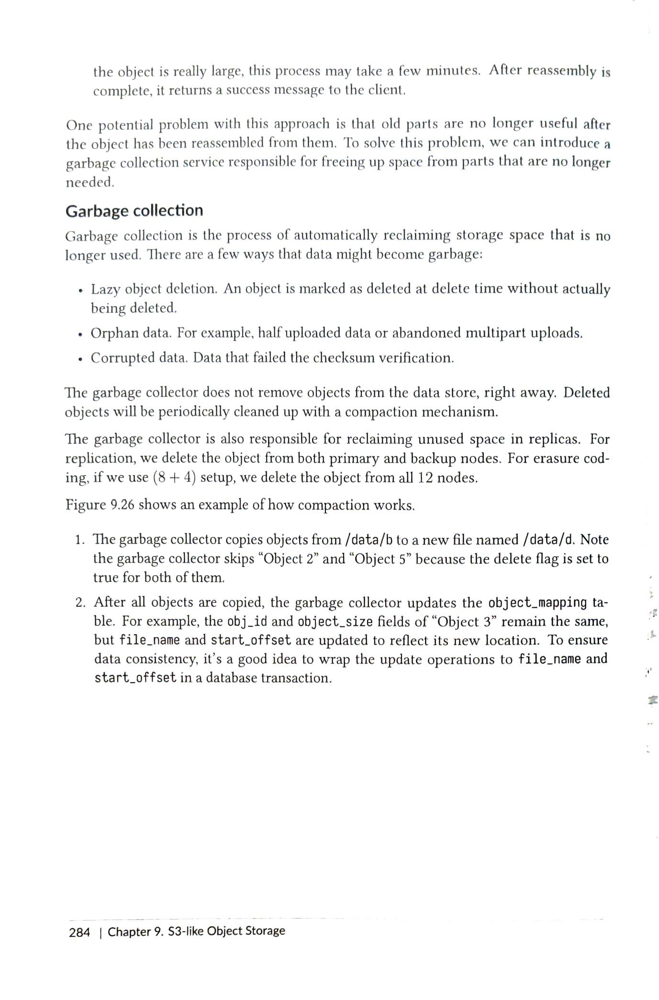
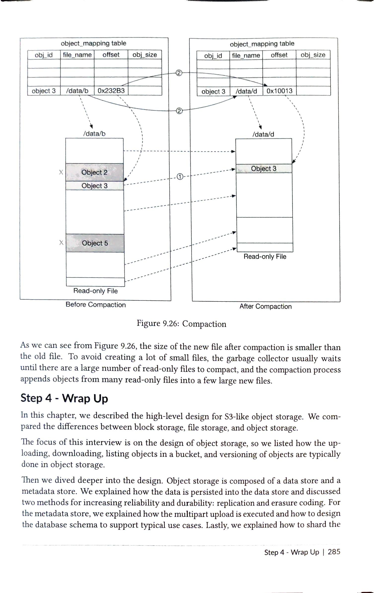
*Hình 9.26: Cơ chế nén dữ liệu (Compaction)*

#### Quy trình Compaction:
1. Bộ thu gom rác tiến hành sao chép các đối tượng hợp lệ từ tệp tin cũ `/data/b` sang một tệp tin mới mang tên `/data/d`. Lưu ý rằng bộ thu gom rác sẽ bỏ qua "Object 2" và "Object 5" vì cờ đánh dấu xóa (`delete flag`) của cả hai đối tượng này đều đang được thiết lập là `true`.
2. Sau khi tất cả các đối tượng hợp lệ được sao chép xong, bộ thu gom rác sẽ cập nhật bảng ánh xạ đối tượng (**`object_mapping` table**):
   * Ví dụ: trường `obj_id` và `obj_size` của "Object 3" vẫn giữ nguyên giá trị cũ.
   * Tuy nhiên, các trường `file_name` và `start_offset` (độ lệch bắt đầu) sẽ được cập nhật để phản ánh vị trí vật lý mới của nó (từ tệp `/data/b` với offset `0x232B3` sang tệp `/data/d` với offset `0x10013`).

> [!IMPORTANT]
> **Đảm bảo tính nhất quán dữ liệu (Data Consistency)**: Rất khuyến nghị nên bọc các thao tác cập nhật đối với `file_name` và `start_offset` bên trong một **giao dịch cơ sở dữ liệu (Database Transaction)** nguyên tử (ACID).

Như có thể quan sát từ Hình 9.26, kích thước của tệp tin mới sau quá trình nén (after compaction) nhỏ hơn đáng kể so với tệp tin cũ (before compaction). 

> [!TIP]
> **Tối ưu hóa I/O và Inode**: Nhằm tránh tình trạng tạo ra quá nhiều tệp tin dung lượng nhỏ phân mảnh, bộ thu gom rác thường chờ cho đến khi tích lũy đủ một lượng lớn các tệp chỉ đọc (read-only files) cần nén. Khi đó, tiến trình compaction sẽ nối (append) các đối tượng từ nhiều tệp chỉ đọc cũ vào một số lượng ít các tệp tin mới có dung lượng lớn hơn.

---

## Bước 4: Tổng kết (Step 4 - Wrap Up)

Trong chương này, chúng ta đã trình bày chi tiết bản thiết kế kiến trúc mức cao (high-level design) cho một hệ thống **lưu trữ đối tượng tương tự S3 (S3-like object storage)**. 

* Chúng ta đã phân tích và so sánh sự khác biệt cơ bản giữa:
  * **Lưu trữ khối (Block Storage)**
  * **Lưu trữ tệp (File Storage)**
  * **Lưu trữ đối tượng (Object Storage)**
* Trọng tâm cốt lõi của bài toán thiết kế này là xoay quanh hệ thống lưu trữ đối tượng, vì vậy chúng ta đã liệt kê cách thức hiện thực các hoạt động điển hình:
  * Tải lên đối tượng (Uploading objects)
  * Tải xuống đối tượng (Downloading objects)
  * Liệt kê các đối tượng trong một bucket (Listing objects in a bucket)
  * Quản lý đa phiên bản đối tượng (Object versioning)
* Tiếp theo, chúng ta đã đi sâu vào kiến trúc chi tiết. Hệ thống lưu trữ đối tượng được cấu thành từ hai thành phần độc lập: **Kho dữ liệu (Data Store)** và **Kho siêu dữ liệu (Metadata Store)**:
  * **Kho dữ liệu (Data Store)**: Giải thích phương thức dữ liệu được lưu bền vững (persisted) vào đĩa lưu trữ, đồng thời thảo luận sâu về hai phương pháp hàng đầu giúp gia tăng độ tin cậy (reliability) và độ bền vững dữ liệu (durability): **Nhân bản (Replication)** và **Mã hóa xóa (Erasure Coding)**.
  * **Kho siêu dữ liệu (Metadata Store)**: Giải thích chi tiết cơ chế thực thi tải lên nhiều phần (multipart upload) và phương pháp thiết kế lược đồ cơ sở dữ liệu (database schema) nhằm đáp ứng tối ưu các kịch bản sử dụng điển hình.
  * Cuối cùng, chúng ta đã làm rõ giải pháp phân mảnh cơ sở dữ liệu (database sharding) để đảm bảo khả năng mở rộng quy mô mở rộng (scalability).

---

## Tài liệu Tham khảo (Reference Material)

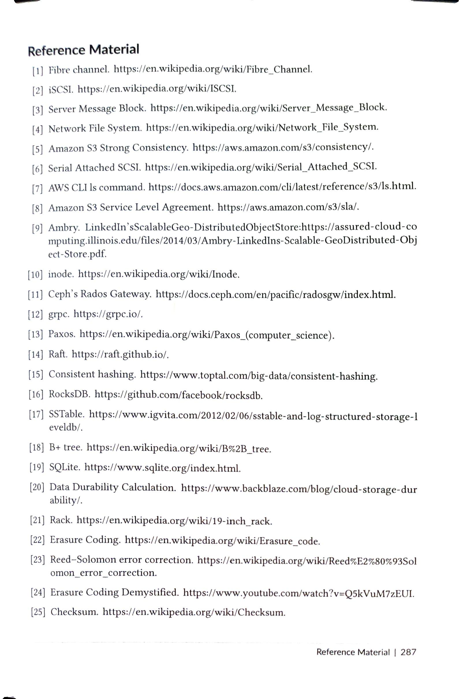
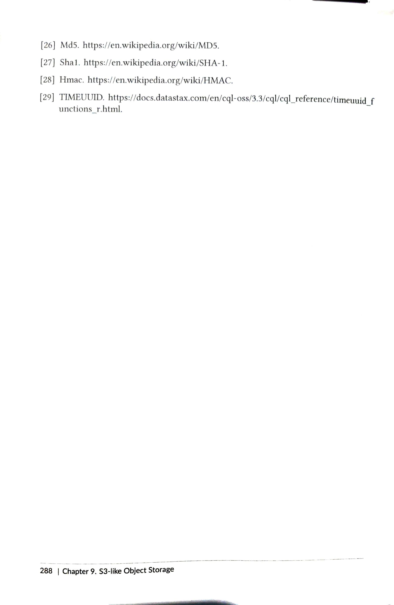

* **[1] Fibre Channel**: https://en.wikipedia.org/wiki/Fibre_Channel
* **[2] iSCSI**: https://en.wikipedia.org/wiki/ISCSI
* **[3] Server Message Block (SMB)**: https://en.wikipedia.org/wiki/Server_Message_Block
* **[4] Network File System (NFS)**: https://en.wikipedia.org/wiki/Network_File_System
* **[5] Amazon S3 Strong Consistency**: https://aws.amazon.com/s3/consistency/
* **[6] Serial Attached SCSI (SAS)**: https://en.wikipedia.org/wiki/Serial_Attached_SCSI
* **[7] AWS CLI ls command**: https://docs.aws.amazon.com/cli/latest/reference/s3/ls.html
* **[8] Amazon S3 Service Level Agreement (SLA)**: https://aws.amazon.com/s3/sla/
* **[9] Ambry: LinkedIn's Scalable Geo-Distributed Object Store**: https://assured-cloud-computing.illinois.edu/files/2014/03/Ambry-LinkedIns-Scalable-GeoDistributed-Object-Store.pdf
* **[10] Inode**: https://en.wikipedia.org/wiki/Inode
* **[12] gRPC**: https://grpc.io/
* **[13] Paxos Consensus Algorithm**: https://en.wikipedia.org/wiki/Paxos_(computer_science)
* **[14] Raft Consensus Algorithm**: https://raft.github.io/
* **[15] Consistent Hashing**: https://www.toptal.com/big-data/consistent-hashing
* **[16] RocksDB**: https://github.com/facebook/rocksdb
* **[17] SSTable and Log Structured Storage**: https://www.igvita.com/2012/02/06/sstable-and-log-structured-storage-leveldb/
* **[18] B+ Tree**: https://en.wikipedia.org/wiki/B%2B_tree
* **[19] SQLite**: https://www.sqlite.org/index.html
* **[20] Data Durability Calculation**: https://www.backblaze.com/blog/cloud-storage-durability/
* **[21] 19-inch Rack**: https://en.wikipedia.org/wiki/19-inch_rack
* **[22] Erasure Coding**: https://en.wikipedia.org/wiki/Erasure_code
* **[23] Reed-Solomon Error Correction**: https://en.wikipedia.org/wiki/Reed%E2%80%93Solomon_error_correction
* **[24] Erasure Coding Demystified**: https://www.youtube.com/watch?v=Q5kVuM7zEUI
* **[25] Checksum**: https://en.wikipedia.org/wiki/Checksum
* **[26] MD5**: https://en.wikipedia.org/wiki/MD5
* **[27] SHA-1**: https://en.wikipedia.org/wiki/SHA-1
* **[28] HMAC**: https://en.wikipedia.org/wiki/HMAC

---

## Điều hướng

- [chuong-08-distributed-email-service.md](chuong-08-distributed-email-service.md)
- [Mục lục](README.md)
- [chuong-10-real-time-gaming-leaderboard.md](chuong-10-real-time-gaming-leaderboard.md)
