[← Chương trước](chuong-09-s3-like-object-storage.md) | [Mục lục](README.md) | [Chương tiếp theo →](chuong-11-payment-system.md)

---

# Chương 10: Bảng Xếp Hạng Game Thời Gian Thực (Real-time Gaming Leaderboard)

---

### --- Trang 290 ---

Trong chương này, chúng ta sẽ cùng đi qua thử thách thiết kế một bảng xếp hạng (leaderboard) cho một trò chơi di động trực tuyến (online mobile game).

Bảng xếp hạng (leaderboard) là gì? Bảng xếp hạng rất phổ biến trong trò chơi điện tử và nhiều lĩnh vực khác nhằm hiển thị ai đang dẫn đầu một giải đấu (tournament) hoặc cuộc thi đấu cụ thể. Người dùng được cộng điểm khi hoàn thành các nhiệm vụ hoặc thử thách, và bất kỳ ai có số điểm cao nhất sẽ đứng ở vị trí đầu bảng xếp hạng.

**Hình 10.1** minh họa một ví dụ về bảng xếp hạng trò chơi di động. Bảng xếp hạng hiển thị thứ hạng của các đối thủ dẫn đầu và đồng thời hiển thị vị trí của chính người dùng trên đó.

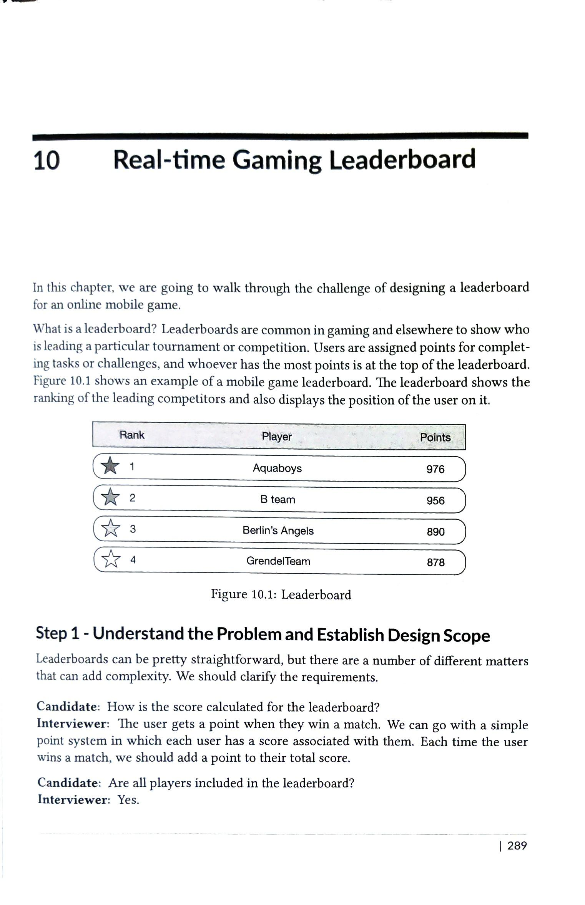

| Thứ hạng (Rank) | Người chơi (Player) | Điểm số (Points) |
| :--- | :--- | :--- |
| ★ 1 | Aquaboys | 976 |
| 2 | Bteam | 956 |
| 3 | Berlin's Angels | 890 |
| 4 | GrendelTeam | 878 |

*Hình 10.1: Bảng xếp hạng (Leaderboard)*

---

## Bước 1 - Hiểu Rõ Vấn Đề và Xác Định Phạm Vi Thiết Kế (Step 1 - Understand the Problem and Establish Design Scope)

Các bảng xếp hạng có thể khá đơn giản, nhưng có một số vấn đề khác nhau có thể làm gia tăng độ phức tạp. Chúng ta nên làm rõ các yêu cầu (requirements).

> **Ứng viên:** Điểm số cho bảng xếp hạng được tính toán như thế nào?  
> **Người phỏng vấn:** Người dùng nhận được một điểm khi họ thắng một trận đấu. Chúng ta có thể chọn một hệ thống tính điểm đơn giản, trong đó mỗi người dùng có một điểm số gắn liền với họ. Mỗi lần người dùng thắng một trận, chúng ta sẽ cộng thêm một điểm vào tổng điểm của họ.  
>  
> **Ứng viên:** Tất cả người chơi có được đưa vào bảng xếp hạng không?  
> **Người phỏng vấn:** Có.  

---

### --- Trang 291 ---

> **Ứng viên:** Bảng xếp hạng có gắn liền với một phân đoạn thời gian (time segment) nào không?  
> **Người phỏng vấn:** Mỗi tháng, một giải đấu (tournament) mới sẽ khởi tranh và bắt đầu một bảng xếp hạng mới.  
>  
> **Ứng viên:** Chúng ta có thể giả định rằng mình chỉ quan tâm đến top 10 người dùng không?  
> **Người phỏng vấn:** Chúng tôi muốn hiển thị top 10 người dùng cũng như vị trí của một người dùng cụ thể trên bảng xếp hạng. Nếu thời gian cho phép, chúng ta hãy thảo luận thêm về cách trả về những người dùng xếp trên 4 bậc và dưới 4 bậc so với một người dùng cụ thể.  
>  
> **Ứng viên:** Có bao nhiêu người dùng trong một giải đấu?  
> **Người phỏng vấn:** Trung bình 5 triệu người dùng hoạt động hàng ngày (Daily Active Users - DAU) và 25 triệu người dùng hoạt động hàng tháng (Monthly Active Users - MAU).  
>  
> **Ứng viên:** Trung bình có bao nhiêu trận đấu được chơi trong suốt một giải đấu?  
> **Người phỏng vấn:** Trung bình mỗi người chơi tham gia 10 trận đấu mỗi ngày.  
>  
> **Ứng viên:** Chúng ta xác định thứ hạng (rank) như thế nào nếu hai người chơi có cùng điểm số?  
> **Người phỏng vấn:** Trong trường hợp này, thứ hạng của họ là như nhau. Nếu thời gian cho phép, chúng ta có thể bàn về các cách để phá vỡ thế hòa điểm (break ties).  
>  
> **Ứng viên:** Bảng xếp hạng có cần phải theo thời gian thực (real-time) không?  
> **Người phỏng vấn:** Có, chúng tôi muốn trình bày kết quả theo thời gian thực (real-time), hoặc càng gần với thời gian thực càng tốt. Việc hiển thị kết quả theo lịch sử được xử lý theo lô (batched history) là không thể chấp nhận được.

Bây giờ chúng ta đã thu thập đầy đủ các yêu cầu, hãy liệt kê các yêu cầu chức năng (functional requirements).

### Yêu cầu chức năng (Functional Requirements)
* Hiển thị top 10 người chơi trên bảng xếp hạng.
* Hiển thị thứ hạng cụ thể của một người dùng.
* Hiển thị những người chơi xếp trên 4 bậc và dưới 4 bậc so với người dùng mong muốn (yêu cầu cộng thêm / bonus).

Bên cạnh việc làm rõ các yêu cầu chức năng, việc nắm bắt các yêu cầu phi chức năng (non-functional requirements) cũng rất quan trọng.

### Yêu cầu phi chức năng (Non-functional Requirements)
* Cập nhật điểm số theo thời gian thực (Real-time update on scores).
* Cập nhật điểm số được phản ánh lên bảng xếp hạng theo thời gian thực (real-time).
* Các yêu cầu chung về khả năng mở rộng (Scalability), tính sẵn sàng cao (High Availability), và độ tin cậy (Reliability).

---

### Ước tính sơ bộ (Back-of-the-envelope estimation)

Hãy xem xét một số phép tính ước tính sơ bộ để xác định quy mô tiềm năng và các thách thức mà giải pháp của chúng ta cần phải giải quyết.

Với 5 triệu người dùng hoạt động hàng ngày (5 million DAU), nếu trò chơi có phân phối người chơi đồng đều trong khoảng thời gian 24 giờ, chúng ta sẽ có trung bình khoảng 50 người dùng mỗi giây:

$$\frac{5.000.000 \text{ DAU}}{24 \times 3600 \text{ giây}} \approx 50 \text{ người dùng/giây}$$

Tuy nhiên, chúng ta đều biết rằng lượng sử dụng rất có thể không được phân phối đồng đều, và có khả năng xuất hiện các đợt cao điểm (peak periods) vào buổi tối khi nhiều người thuộc các múi giờ khác nhau có thời gian chơi game. Để dự trù cho điều này, chúng ta có thể giả định rằng tải lúc cao điểm (peak load) sẽ gấp 5 lần mức trung bình.

---

### --- Trang 292 ---

Do đó, chúng ta cần dự trù cho mức tải cao điểm (peak load) là 250 người dùng mỗi giây.

* **QPS (Queries Per Second) cho người dùng ghi điểm:** Nếu một người dùng chơi trung bình 10 ván mỗi ngày, QPS cho các người dùng ghi điểm là:  
  $$50 \times 10 \approx 500 \text{ QPS}$$  
  QPS lúc cao điểm (Peak QPS) gấp 5 lần mức trung bình:  
  $$500 \times 5 = 2.500 \text{ QPS}$$
* **QPS để lấy top 10 bảng xếp hạng:** Giả định rằng một người dùng mở trò chơi một lần mỗi ngày và bảng xếp hạng top 10 chỉ được tải khi người dùng lần đầu mở trò chơi. QPS cho thao tác này rơi vào khoảng 50 QPS.

---

## Bước 2 - Đề Xuất Thiết Kế Cấp Cao và Đạt Được Sự Đồng Thuận (Step 2 - Propose High-level Design and Get Buy-in)

Trong phần này, chúng ta sẽ thảo luận về thiết kế API (API design), kiến trúc cấp cao (high-level architecture), và các mô hình dữ liệu (data models).

### Thiết kế API (API design)

Ở mức cấp cao, chúng ta cần ba API sau:

#### `POST /v1/scores`
Cập nhật vị trí của một người dùng trên bảng xếp hạng khi người dùng đó thắng một ván đấu. Các tham số yêu cầu (request parameters) được liệt kê bên dưới. Đây phải là một API nội bộ (internal API) chỉ có thể được gọi bởi các máy chủ trò chơi (game servers). Phía máy khách (client) không được phép cập nhật trực tiếp điểm số bảng xếp hạng.

| Trường (Field) | Mô tả (Description) |
| :--- | :--- |
| `user_id` | Người dùng giành chiến thắng một ván đấu. |
| `points` | Số điểm mà một người dùng nhận được khi thắng một ván đấu. |

*Bảng 10.1: Các tham số yêu cầu (Request parameters)*

**Phản hồi (Response):**

| Tên (Name) | Mô tả (Description) |
| :--- | :--- |
| `200 OK` | Cập nhật điểm số của người dùng thành công. |
| `400 Bad Request` | Cập nhật điểm số của người dùng thất bại. |

*Bảng 10.2: Phản hồi (Response)*

#### `GET /v1/scores`
Lấy danh sách top 10 người chơi từ bảng xếp hạng.

**Mẫu phản hồi (Sample response):**

```json
{
  "data": [
    {
      "user_id": "user_id1",
      "user_name": "alice",
      "rank": 1,
      "score": 976
    },
    {
      "user_id": "user_id2",
      "user_name": "bob",
      "rank": 2,
      "score": 965
    }
  ],
  "total": 10
}
```

---

### --- Trang 293 ---

#### `GET /v1/scores/:user_id`
Lấy thứ hạng của một người dùng cụ thể.

| Trường (Field) | Mô tả (Description) |
| :--- | :--- |
| `user_id` | Mã định danh (ID) của người dùng mà chúng ta muốn lấy thứ hạng. |

*Bảng 10.3: Tham số yêu cầu (Request parameters)*

**Mẫu phản hồi (Sample response):**

```json
{
  "user_info": {
    "user_id": "user5",
    "score": 940,
    "rank": 6
  }
}
```

### Kiến trúc cấp cao (High-level architecture)

Sơ đồ thiết kế cấp cao được minh họa trong **Hình 10.2**. Có hai dịch vụ trong thiết kế này: Dịch vụ trò chơi (game service) cho phép người dùng tham gia chơi game, và dịch vụ bảng xếp hạng (leaderboard service) chịu trách nhiệm tạo và hiển thị bảng xếp hạng.

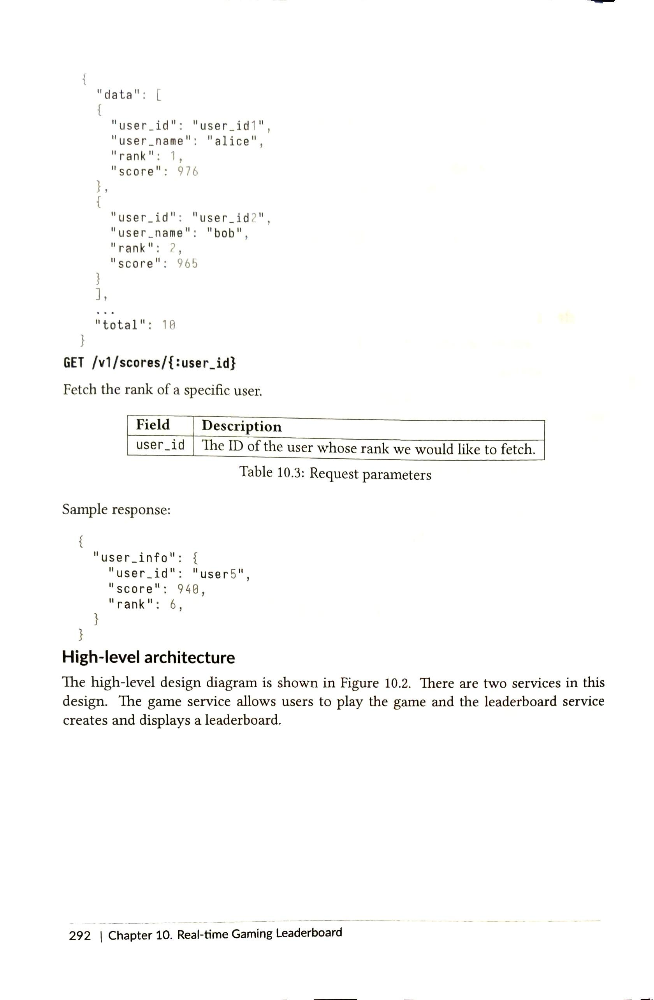

---

### --- Trang 294 ---

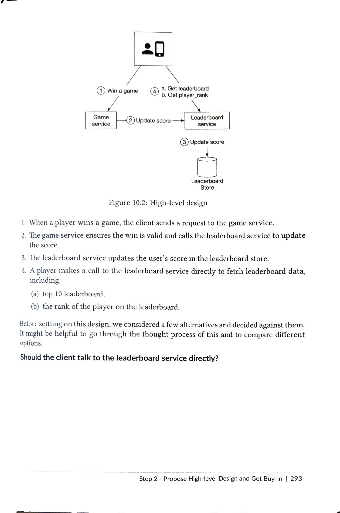

*Hình 10.2: Thiết kế cấp cao (High-level design)*

Quy trình hoạt động từng bước:
1. Khi một người chơi thắng một ván game, máy khách (client) gửi một yêu cầu (request) đến dịch vụ trò chơi (game service).
2. Dịch vụ trò chơi xác thực tính hợp lệ của chiến thắng và gọi dịch vụ bảng xếp hạng (leaderboard service) để cập nhật điểm số.
3. Dịch vụ bảng xếp hạng cập nhật điểm số của người dùng trong kho lưu trữ bảng xếp hạng (leaderboard store).
4. Người chơi thực hiện một lệnh gọi trực tiếp đến dịch vụ bảng xếp hạng để lấy dữ liệu bảng xếp hạng, bao gồm:
   * (a) Bảng xếp hạng top 10 (top 10 leaderboard).
   * (b) Thứ hạng của chính người chơi đó trên bảng xếp hạng.

Trước khi quyết định lựa chọn thiết kế này, chúng tôi đã cân nhắc một số phương án thay thế và quyết định bác bỏ chúng. Việc điểm qua luồng tư duy này và so sánh các tùy chọn khác nhau sẽ rất hữu ích.

#### Máy khách (client) có nên giao tiếp trực tiếp với dịch vụ bảng xếp hạng (leaderboard service) không?

---

### --- Trang 295 ---

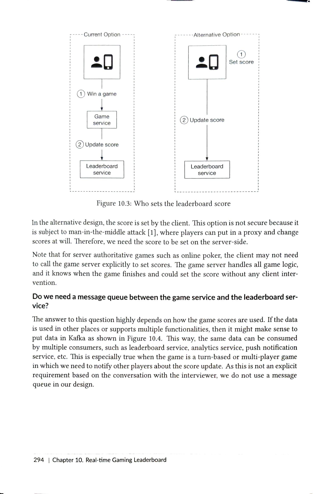

*Hình 10.3: Ai là bên thiết lập điểm số bảng xếp hạng (Who sets the leaderboard score)*

Trong thiết kế thay thế (Alternative Option), điểm số được thiết lập trực tiếp bởi máy khách (client). Tùy chọn này **không an toàn** vì nó dễ bị tấn công xen giữa (Man-In-The-Middle - MITM attack) [1], nơi người chơi có thể đặt một proxy can thiệp và tùy ý sửa đổi điểm số theo ý muốn. Do đó, chúng ta bắt buộc phải thiết lập điểm số ở phía máy chủ (server-side).

> [!IMPORTANT]
> Người chơi không cần phải gọi máy chủ game một cách tường minh để thiết lập điểm số. Máy chủ game xử lý toàn bộ logic trò chơi (game logic), nắm được khi nào ván game kết thúc và có thể tự động ghi nhận điểm số mà không cần bất kỳ sự can thiệp nào từ phía máy khách (client).

#### Chúng ta có cần một hàng đợi thông điệp (Message Queue) giữa dịch vụ trò chơi và dịch vụ bảng xếp hạng không?

Câu trả lời cho vấn đề này phụ thuộc rất lớn vào cách thức điểm số của trò chơi được sử dụng:
* Nếu dữ liệu điểm số được sử dụng ở nhiều nơi khác hoặc hỗ trợ nhiều chức năng khác nhau, thì việc đẩy dữ liệu vào Kafka (như minh họa trong **Hình 10.4**) là hoàn toàn hợp lý. Bằng cách này, cùng một dữ liệu có thể được tiêu thụ bởi nhiều bên tiêu thụ (multiple consumers) khác nhau, chẳng hạn như dịch vụ bảng xếp hạng (leaderboard service), dịch vụ phân tích dữ liệu (analytics service), dịch vụ thông báo đẩy (push notification service), v.v.
* Điều này đặc biệt đúng khi trò chơi thuộc thể loại theo lượt (turn-based) hoặc trò chơi nhiều người chơi (multiplayer game), nơi chúng ta cần thông báo cho các người chơi khác về việc cập nhật điểm số.

> [!NOTE]
> Vì đây không phải là một yêu cầu rõ ràng dựa trên cuộc trao đổi với người phỏng vấn, chúng ta **không sử dụng hàng đợi thông điệp (message queue)** trong thiết kế chính thức của mình.

# CHƯƠNG 10: BẢNG XẾP HẠNG GAME THỜI GIAN THỰC (REAL-TIME GAMING LEADERBOARD)

---

### Trang 296

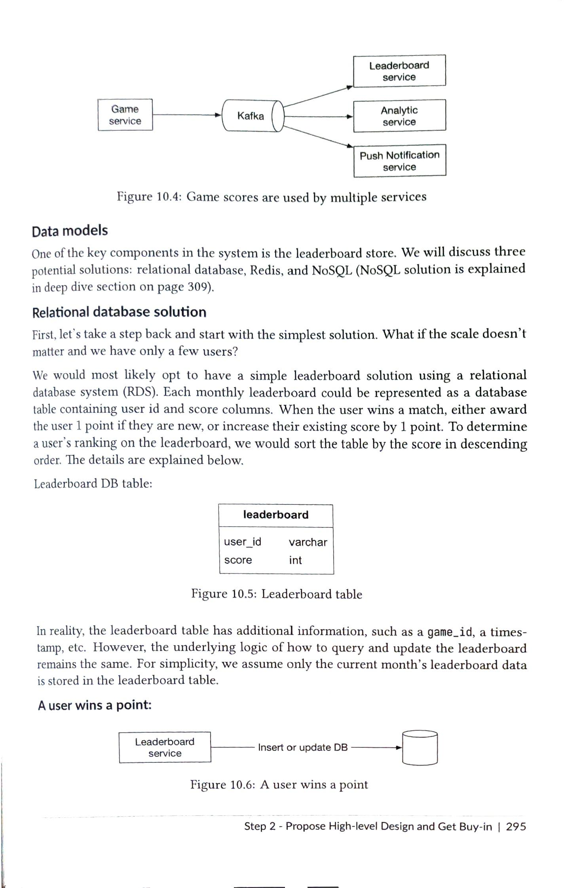
*Hình 10.4: Điểm số trò chơi (game scores) được sử dụng bởi nhiều dịch vụ (multiple services)*

```
[Game service] ──> [Kafka] ──┬──> [Leaderboard service]
                             ├──> [Analytic service]
                             └──> [Push Notification service]
```

---

### Mô hình Dữ liệu (Data models)

Một trong những thành phần cốt lõi trong hệ thống là kho lưu trữ bảng xếp hạng (**leaderboard store**). Chúng ta sẽ thảo luận về 3 giải pháp tiềm năng: **Cơ sở dữ liệu quan hệ (Relational Database)**, **Redis**, và **NoSQL** (Giải pháp NoSQL sẽ được giải thích chi tiết trong phần phân tích chuyên sâu - Deep Dive ở trang 309).

#### Giải pháp Cơ sở Dữ liệu Quan hệ (Relational database solution)

Đầu tiên, hãy lùi lại một bước và bắt đầu với giải pháp đơn giản nhất. Điều gì sẽ xảy ra nếu quy mô không phải là vấn đề và chúng ta chỉ có một số lượng nhỏ người dùng?

Chúng ta rất có thể sẽ lựa chọn một giải pháp bảng xếp hạng đơn giản sử dụng một hệ quản trị cơ sở dữ liệu quan hệ (**Relational Database System - RDS**). Mỗi bảng xếp hạng theo tháng có thể được biểu diễn dưới dạng một bảng cơ sở dữ liệu chứa các cột `user_id` và `score`. Khi người dùng thắng một trận đấu, chúng ta sẽ cộng cho người dùng 1 điểm nếu họ là người mới, hoặc tăng điểm hiện có của họ lên 1 điểm. Để xác định thứ hạng (**ranking**) của người dùng trên bảng xếp hạng, chúng ta sẽ sắp xếp bảng theo điểm số (`score`) theo thứ tự giảm dần (**descending order**). Chi tiết được giải thích bên dưới.

**Bảng Cơ sở Dữ liệu Bảng xếp hạng (Leaderboard DB table):**

```
+--------------------+
|    leaderboard     |
+--------------------+
| user_id : varchar  |
| score   : int      |
+--------------------+
```
*Hình 10.5: Bảng Leaderboard*

Trong thực tế, bảng `leaderboard` có thêm các thông tin bổ sung, chẳng hạn như `game_id`, `timestamp`, v.v. Tuy nhiên, logic cơ bản về cách truy vấn và cập nhật bảng xếp hạng vẫn giữ nguyên. Để đơn giản hóa, chúng ta giả định chỉ có dữ liệu bảng xếp hạng của tháng hiện tại được lưu trữ trong bảng `leaderboard`.

**Một người dùng ghi được một điểm (A user wins a point):**

```
[Leaderboard service] ──(Insert or update DB)──> [DB]
```
*Hình 10.6: Người dùng ghi được một điểm*

*Bước 2 - Đề xuất Thiết kế Cấp cao và Nhận sự Thỏa thuận (Step 2 - Propose High-level Design and Get Buy-in) | Trang 295*

---

### Trang 297

bản ghi trong bảng xếp hạng cho tháng đó, thao tác chèn (`INSERT`) đầu tiên sẽ là:

```sql
INSERT INTO leaderboard (user_id, score) VALUES ('mary1934', 1);
```

Thao tác cập nhật (`UPDATE`) điểm số của người dùng sẽ là:

```sql
UPDATE leaderboard SET score = score + 1 WHERE user_id = 'mary1934';
```

**Tìm vị trí trên bảng xếp hạng của một người dùng (Find a user's leaderboard position):**

```
[Leaderboard service] ──(Fetch from DB, sorted by rank)──> [DB]
```
*Hình 10.7: Tìm vị trí của người dùng trên bảng xếp hạng*

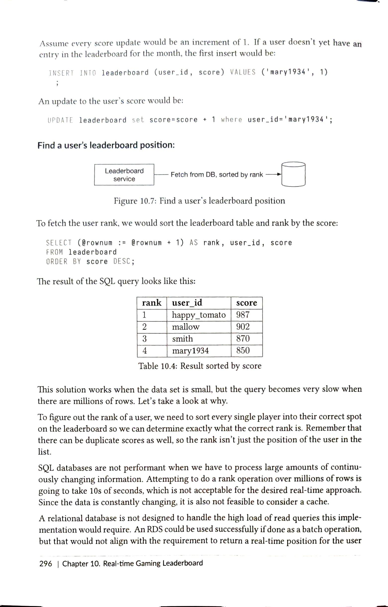

Để lấy thứ hạng của người dùng, chúng ta sẽ sắp xếp bảng xếp hạng và xếp hạng theo điểm số:

```sql
SELECT (@rownum := @rownum + 1) AS rank, user_id, score
FROM leaderboard
ORDER BY score DESC;
```

Kết quả của truy vấn SQL sẽ trông như thế này:

| rank | user_id | score |
| :--- | :--- | :--- |
| 1 | happy_tomato | 987 |
| 2 | mallow | 902 |
| 3 | smith | 870 |
| 4 | mary1934 | 850 |

*Bảng 10.4: Kết quả được sắp xếp theo điểm số (Result sorted by score)*

Giải pháp này hoạt động tốt khi tập dữ liệu còn nhỏ, nhưng truy vấn sẽ trở nên rất chậm khi có hàng triệu hàng dữ liệu (**millions of rows**). Hãy cùng xem xét lý do tại sao.

Để tìm ra thứ hạng của một người dùng, chúng ta cần phải sắp xếp từng người chơi vào đúng vị trí của họ trên bảng xếp hạng để có thể xác định chính xác thứ hạng đúng là gì. Hãy nhớ rằng cũng có thể có các điểm số trùng lặp (**duplicate scores**), vì vậy thứ hạng không chỉ đơn thuần là vị trí của người dùng trong danh sách.

> [!WARNING]
> Cơ sở dữ liệu SQL không có hiệu năng cao khi chúng ta phải xử lý một lượng lớn thông tin liên tục thay đổi. Việc cố gắng thực hiện một thao tác xếp hạng (**rank operation**) trên hàng triệu hàng dữ liệu sẽ mất tới hàng chục giây (**10s of seconds**), điều này hoàn toàn không thể chấp nhận được đối với phương tiếp cận thời gian thực (**real-time approach**) theo yêu cầu. Vì dữ liệu liên tục thay đổi, nên việc tính đến một bộ nhớ đệm (**cache**) cũng là bất khả thi.

Một cơ sở dữ liệu quan hệ không được thiết kế để xử lý tải cao của các truy vấn đọc (**high load of read queries**) mà kiến trúc này đòi hỏi. Một RDS có thể được sử dụng thành công nếu thực hiện dưới dạng tác vụ theo lô (**batch operation**), nhưng điều đó sẽ không phù hợp với yêu cầu trả về vị trí thời gian thực (**real-time position**) cho người dùng

*Trang 296 / Chương 10. Bảng Xếp Hạng Game Thời Gian Thực (Real-time Gaming Leaderboard)*

---

### Trang 298

trên bảng xếp hạng.

Một tối ưu hóa mà chúng ta có thể thực hiện là thêm một chỉ mục (**index**) và giới hạn số lượng trang cần quét bằng mệnh đề `LIMIT`. Truy vấn trông sẽ như thế này:

```sql
SELECT (@rownum := @rownum + 1) AS rank, user_id, score
FROM leaderboard
ORDER BY score DESC
LIMIT 10;
```

Tuy nhiên, cách tiếp cận này không mở rộng tốt (**doesn't scale well**). 
1. Thứ nhất, việc tìm thứ hạng của một người dùng không có hiệu năng cao vì về cơ bản nó đòi hỏi phải quét bảng (**table scan**) để xác định thứ hạng.
2. Thứ hai, cách tiếp cận này không cung cấp một giải pháp trực tiếp, dễ dàng để xác định thứ hạng của một người dùng không nằm ở nhóm dẫn đầu (**top of the leaderboard**).

---

#### Giải pháp Redis (Redis solution)

Chúng ta muốn tìm kiếm một giải pháp mang lại hiệu năng có thể dự đoán được (**predictable performance**) ngay cả với hàng triệu người dùng, và cho phép chúng ta dễ dàng truy cập vào các thao tác bảng xếp hạng phổ biến mà không cần phải phụ thuộc vào các truy vấn cơ sở dữ liệu phức tạp.

Redis cung cấp một giải pháp tiềm năng cho vấn đề của chúng ta. Redis là một kho lưu trữ dữ liệu trong bộ nhớ (**in-memory data store**) hỗ trợ các cặp khóa-giá trị (**key-value pairs**). Vì nó hoạt động hoàn toàn trên bộ nhớ, nó cho phép tốc độ đọc và ghi rất nhanh (**fast reads and writes**). Redis có một kiểu dữ liệu cụ thể gọi là **Sorted Sets** (Tập hợp có thứ tự), rất lý tưởng để giải quyết các bài toán thiết kế hệ thống bảng xếp hạng.

##### Sorted Sets là gì? (What are sorted sets?)

**Sorted Set** là một kiểu dữ liệu tương tự như một tập hợp (`set`). Mỗi phần tử thành viên (`member`) của một sorted set được liên kết với một điểm số (`score`). Các thành viên trong một set phải là duy nhất (**unique**), nhưng điểm số có thể lặp lại. Điểm số được sử dụng để xếp hạng sorted set theo thứ tự tăng dần (**ascending order**).

Trường hợp sử dụng bảng xếp hạng của chúng ta ánh xạ hoàn hảo vào sorted sets. Về mặt nội bộ, một sorted set được triển khai bởi hai cấu trúc dữ liệu: một bảng băm (**hash table**) và một danh sách nhảy (**skip list**) [2]. 
- Bảng băm ánh xạ người dùng sang điểm số (`users -> scores`).
- Danh sách nhảy ánh xạ điểm số sang người dùng (`scores -> users`). 

Trong sorted sets, người dùng được sắp xếp theo điểm số. Một cách tốt để hiểu sorted set là hình dung nó như một bảng với các cột `score` và `member` như được hiển thị trong Hình 10.8. Bảng được sắp xếp theo điểm số theo thứ tự giảm dần.

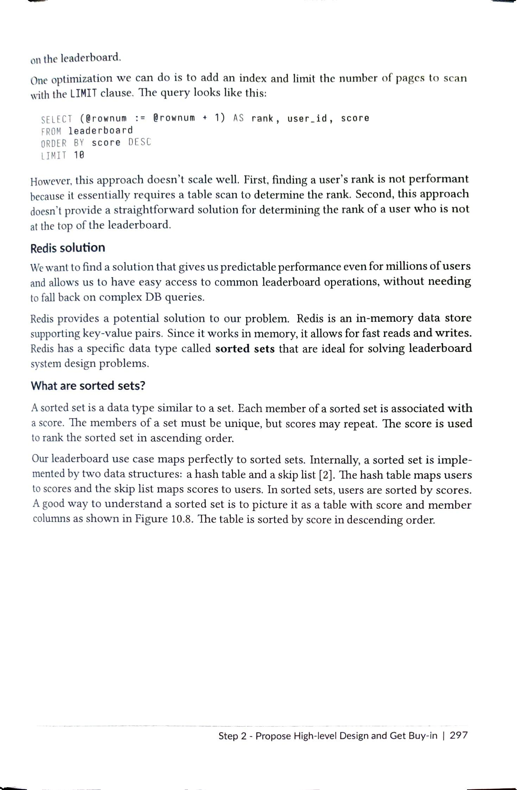

*Bước 2 - Đề xuất Thiết kế Cấp cao và Nhận sự Thỏa thuận (Step 2 - Propose High-level Design and Get Buy-in) | Trang 297*

---

### Trang 299

```
leaderboard_feb_2021
+-------+---------+
| score | member  |
+-------+---------+
|  99   | user10  |
|  97   | user20  |
|  94   | user105 |
|  92   | user45  |
|  90   | user7   |
|  86   | user101 |
|  83   | user9   |
|  82   | user302 |
|  79   | user200 |
|  72   | user309 |
+-------+---------+
```
*Hình 10.8: Bảng xếp hạng tháng Hai được biểu diễn bởi Sorted Set*

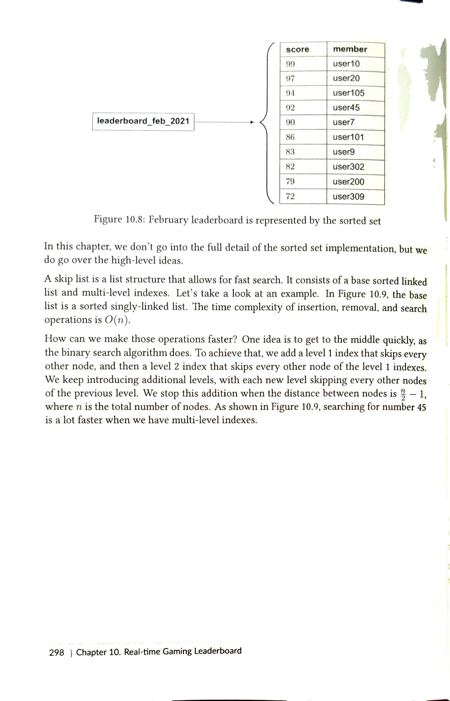

Trong chương này, chúng ta không đi sâu vào toàn bộ chi tiết triển khai bên dưới của sorted set, nhưng chúng ta sẽ điểm qua các ý tưởng cấp cao.

Một **skip list** là một cấu trúc danh sách cho phép tìm kiếm nhanh (**fast search**). Nó bao gồm một danh sách liên kết có thứ tự cơ sở (**base sorted linked list**) và các chỉ mục đa cấp (**multi-level indexes**). Hãy cùng xem qua một ví dụ. Trong Hình 10.9, danh sách cơ sở là một danh sách liên kết đơn có thứ tự (**sorted singly-linked list**). Độ phức tạp thời gian (**time complexity**) của các thao tác chèn (`insert`), xóa (`remove`), và tìm kiếm (`search`) là $O(n)$.

Làm thế nào để chúng ta có thể làm cho các thao tác đó nhanh hơn? Một ý tưởng là đi đến phần tử ở giữa thật nhanh, tương tự như thuật toán tìm kiếm nhị phân (**binary search**). Để đạt được điều đó:
- Chúng ta thêm một chỉ mục Cấp 1 (**Level 1 index**) nhảy qua cách một nút một lần.
- Sau đó thêm một chỉ mục Cấp 2 (**Level 2 index**) nhảy qua cách một nút của các chỉ mục Cấp 1.
- Chúng ta tiếp tục giới thiệu thêm các cấp bổ sung, với mỗi cấp mới sẽ nhảy qua cách một nút của cấp trước đó.
- Chúng ta dừng việc thêm này lại khi khoảng cách giữa các nút là $2^k - 1$, trong đó $n$ là tổng số nút. 

Như được hiển thị trong Hình 10.9, việc tìm kiếm số 45 nhanh hơn rất nhiều khi chúng ta có các chỉ mục đa cấp (**multi-level indexes**).

*Trang 298 / Chương 10. Bảng Xếp Hạng Game Thời Gian Thực (Real-time Gaming Leaderboard)*

---

### Trang 300

```
Level 2 index:  [ ] -----------------------------> [36] -----------------------------> [68]
                 |                                  |                                   |
Level 1 index:  [ ] -------------> [18] ---------> [36] ---------> [53] -------------> [68]
                 |                  |               |               |                   |
Base list:      [ ] -> [7] -> [9] -> [18] -> [25] -> [36] -> [45] -> [53] -> [60] -> [68]
                                                               ^
                                                       (Searching for 45)
```
*Hình 10.9: Danh sách nhảy (Skip list)*

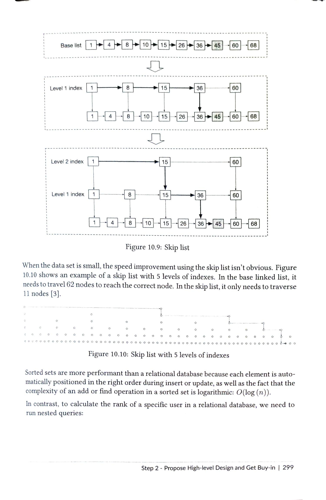

Khi tập dữ liệu nhỏ, sự cải thiện về tốc độ khi sử dụng skip list là chưa rõ ràng. Hình 10.10 cho thấy một ví dụ về một skip list với 5 cấp chỉ mục. Trong danh sách liên kết cơ sở, nó cần phải duyệt qua 62 nút để đến được nút chính xác. Trong skip list, nó chỉ cần duyệt qua 11 nút [3].

*Hình 10.10: Skip list với 5 cấp chỉ mục (Skip list with 5 levels of indexes)*

> [!TIP]
> **Sorted Sets** có hiệu năng cao hơn một cơ sở dữ liệu quan hệ vì mỗi phần tử được tự động định vị vào đúng thứ tự trong quá trình chèn hoặc cập nhật, cùng với thực tế là độ phức tạp của thao tác thêm (`add`) hoặc tìm kiếm (`find`) trong một sorted set là hàm logarit: **$O(\log(n))$**.

Ngược lại, để tính toán thứ hạng của một người dùng cụ thể trong cơ sở dữ liệu quan hệ, chúng ta cần phải chạy các truy vấn lồng nhau (**nested queries**):

*Bước 2 - Đề xuất Thiết kế Cấp cao và Nhận sự Thỏa thuận (Step 2 - Propose High-level Design and Get Buy-in) | Trang 299*

---

### Trang 301

```sql
SELECT (SELECT COUNT(*) 
        FROM leaderboard lb2 
        WHERE lb2.score >= lb1.score) AS RANK
FROM leaderboard lb1
WHERE lb1.user_id = :user_id;
```

#### Triển khai sử dụng Redis sorted sets (Implementation using Redis sorted sets)

Bây giờ khi chúng ta đã biết sorted sets rất nhanh, hãy cùng xem qua các thao tác Redis mà chúng ta sẽ sử dụng để xây dựng bảng xếp hạng của mình [4] [5] [6] [7]:

- **`ZADD`**: Chèn người dùng vào set nếu họ chưa tồn tại. Nếu đã tồn tại, cập nhật điểm số cho người dùng. Thao tác này mất thời gian $O(\log(n))$ để thực thi.
- **`ZINCRBY`**: Tăng điểm số của người dùng lên một lượng gia tăng chỉ định. Nếu người dùng chưa tồn tại trong set, nó sẽ mặc định coi điểm số bắt đầu từ 0. Thao tác này mất $O(\log(n))$ để thực thi.
- **`ZRANGE` / `ZREVRANGE`**: Lấy ra một dải người dùng được sắp xếp theo điểm số. Chúng ta có thể chỉ định thứ tự (`range` - tăng dần so với `revrange` - giảm dần), số lượng bản ghi cần lấy, và vị trí bắt đầu lấy. Thao tác này mất $O(\log(n) + m)$ để thực thi, trong đó $m$ là số lượng bản ghi cần lấy (thường là nhỏ trong trường hợp của chúng ta), và $n$ là tổng số phần tử trong sorted set.
- **`ZRANK` / `ZREVRANK`**: Lấy vị trí thứ hạng của bất kỳ người dùng nào được sắp xếp theo thứ tự tăng dần/giảm dần trong thời gian hàm logarit ($O(\log(n))$).

---

#### Luồng công việc với sorted sets (Workflow with sorted sets)

##### 1. Người dùng ghi điểm (A user scores a point)

```
[Leaderboard service] ──(ZINCRBY)──> [Redis]
```
*Hình 10.11: Người dùng ghi điểm (A user scores a point)*

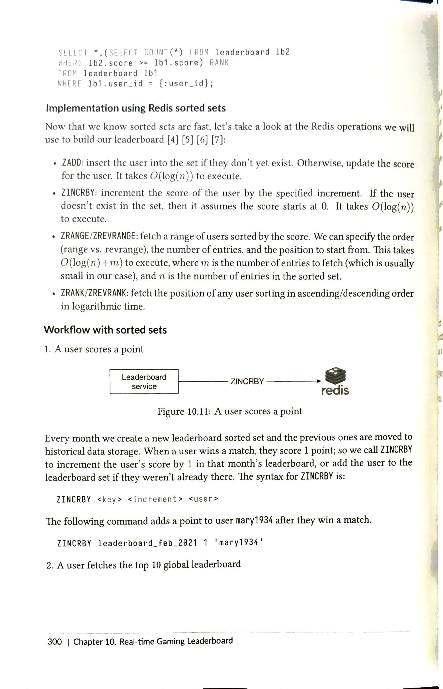

Mỗi tháng chúng ta tạo ra một sorted set bảng xếp hạng mới và các bảng xếp hạng trước đó sẽ được chuyển sang kho lưu trữ dữ liệu lịch sử (**historical data storage**). Khi một người dùng thắng một trận đấu, họ ghi được 1 điểm; do đó chúng ta gọi lệnh `ZINCRBY` để tăng điểm của người dùng lên 1 trong bảng xếp hạng của tháng đó, hoặc thêm người dùng vào leaderboard set nếu họ chưa có mặt ở đó. Cú pháp cho `ZINCRBY` là:

```text
ZINCRBY <key> <increment> <user>
```

Lệnh sau đây cộng thêm 1 điểm cho người dùng `mary1934` sau khi họ thắng một trận đấu:

```bash
ZINCRBY leaderboard_feb_2021 1 'mary1934'
```

##### 2. Người dùng lấy top 10 bảng xếp hạng toàn cầu (A user fetches the top 10 global leaderboard)

*Trang 300 / Chương 10. Bảng Xếp Hạng Game Thời Gian Thực (Real-time Gaming Leaderboard)*

# Chương 10: Bảng Xếp Hạng Game Thời Gian Thực (Real-time Gaming Leaderboard)

---

### Trang 302

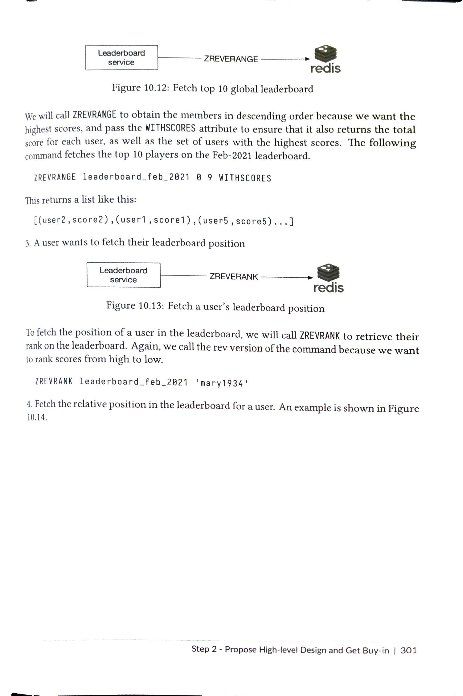  
*Hình 10.12: Lấy danh sách Top 10 bảng xếp hạng toàn cầu (Fetch top 10 global leaderboard)*

Chúng ta sẽ gọi lệnh `ZREVRANGE` để lấy các thành viên (members) theo thứ tự giảm dần vì mục tiêu là lấy các mức điểm cao nhất, đồng thời truyền thêm thuộc tính `WITHSCORES` để đảm bảo lệnh trả về cả tổng điểm của từng người dùng, cũng như tập hợp những người dùng có điểm số cao nhất. Lệnh sau đây truy xuất top 10 người chơi trên bảng xếp hạng tháng 2 năm 2021:

```bash
ZREVRANGE leaderboard_feb_2021 0 9 WITHSCORES
```

Lệnh này trả về một danh sách có định dạng như sau:
```text
[(user2, score2), (user1, score1), (user5, score5)...]
```

#### 3. Người dùng muốn truy vấn thứ hạng của chính mình trên bảng xếp hạng (Fetch their leaderboard position)

  
*Hình 10.13: Lấy vị trí thứ hạng của một người dùng trên bảng xếp hạng (Fetch a user's leaderboard position)*

Để lấy vị trí thứ hạng của một người dùng trong bảng xếp hạng, chúng ta sẽ gọi lệnh `ZREVRANK` để truy xuất thứ hạng (rank) của họ. Một lần nữa, chúng ta sử dụng phiên bản đảo ngược (`rev` - reverse) của lệnh vì chúng ta muốn xếp hạng điểm từ cao xuống thấp:

```bash
ZREVRANK leaderboard_feb_2021 mary1934
```

#### 4. Lấy vị trí tương đối trên bảng xếp hạng cho một người dùng (Fetch the relative position in the leaderboard for a user)
Một ví dụ minh họa được thể hiện trong Hình 10.14.

*Bước 2 - Đề xuất thiết kế cấp cao và đạt được sự đồng thuận (Step 2 - Propose High-level Design and Get Buy-in) | Trang 301*

---

### Trang 303

| Người chơi (Player) | Thứ hạng (Rank) | Điểm số (Points) |
| :--- | :--- | :--- |
| Aquaboys | 257 | 876 |
| Bteam | 258 | 845 |
| Berlin's Angels | 259 | 832 |
| GrendelTeam | 360 | 799 |
| **Mallow007** | **361** | **785** |
| Wo078 | 362 | 743 |
| milan~114 | 363 | 732 |
| Mailso_91_ | 364 | 726 |
| ... | 365 | 712 |

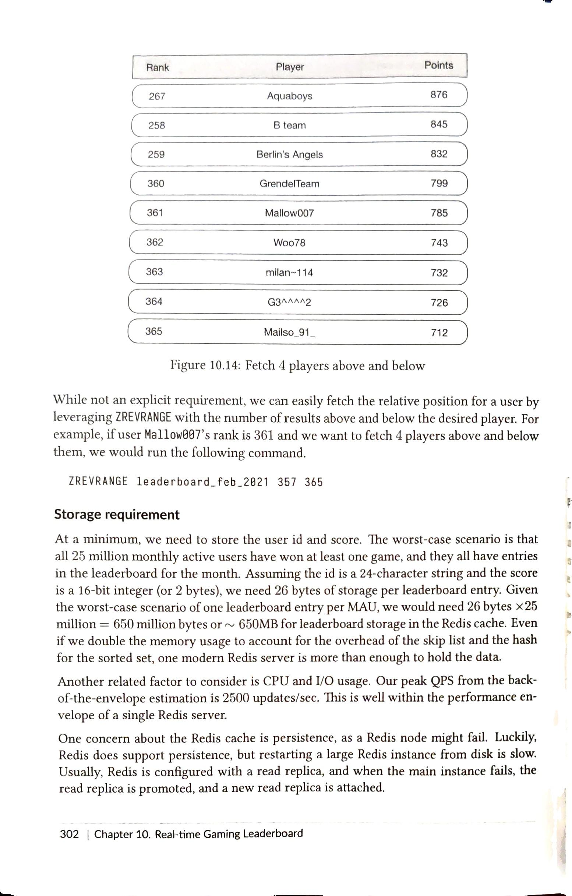  
*Hình 10.14: Lấy 4 người chơi xếp trên và 4 người chơi xếp dưới (Fetch 4 players above and below)*

Dù không phải là một yêu cầu tường minh, chúng ta vẫn có thể dễ dàng lấy vị trí tương đối của một người dùng bằng cách tận dụng lệnh `ZREVRANGE` với số lượng kết quả nằm phía trên và phía dưới người chơi mong muốn. Ví dụ: nếu thứ hạng của người dùng `Mallow007` là 361 và chúng ta muốn lấy 4 người chơi xếp trên cùng 4 người chơi xếp dưới họ, chúng ta sẽ thực thi lệnh sau:

```bash
ZREVRANGE leaderboard_feb_2021 357 365
```

### Yêu cầu về dung lượng lưu trữ (Storage requirement)

Ở mức tối thiểu, chúng ta cần lưu trữ User ID và Điểm số (score). Kịch bản xấu nhất (worst-case scenario) là toàn bộ 25 triệu người dùng hoạt động hàng tháng (Monthly Active Users - MAU) đều thắng ít nhất một ván game, và tất cả bọn họ đều có bản ghi (entry) trong bảng xếp hạng của tháng đó. 

Giả định User ID là một chuỗi 24 ký tự (24 bytes) và điểm số là một số nguyên 16-bit (16-bit integer, tương đương 2 bytes), chúng ta cần 26 bytes dung lượng lưu trữ cho mỗi bản ghi bảng xếp hạng. 

Với kịch bản xấu nhất là mỗi MAU có một bản ghi bảng xếp hạng:
$$\text{Dung lượng} = 26\text{ bytes} \times 25.000.000 = 650.000.000\text{ bytes} \approx 650\text{ MB}$$
cho việc lưu trữ bảng xếp hạng trong bộ nhớ đệm Redis (Redis cache). 

Ngay cả khi chúng ta nhân đôi mức sử dụng bộ nhớ để tính đến chi phí phụ trội (overhead) của cấu trúc Skip List và Hash map dùng cho Sorted Set, một máy chủ Redis hiện đại đơn lẻ vẫn là quá dư giả để chứa toàn bộ lượng dữ liệu này.

Một yếu tố liên quan khác cần xem xét là mức độ sử dụng CPU và I/O. Thông số QPS đỉnh (Peak QPS) từ phần ước tính sơ bộ (back-of-the-envelope estimation) là **2.500 lượt cập nhật/giây (updates/sec)**. Con số này nằm hoàn toàn trong giới hạn năng lực xử lý (performance envelope) của một máy chủ Redis đơn lẻ.

> [!NOTE]
> Một mối bận tâm đối với bộ nhớ đệm Redis là **Tính bền vững của dữ liệu (Persistence)**, do một node Redis hoàn toàn có thể gặp sự cố (fail). May mắn thay, Redis có hỗ trợ cơ chế lưu trữ bền vững (persistence - RDB/AOF), nhưng việc khởi động lại (restart) một phiên bản (instance) Redis có dung lượng lớn từ đĩa cứng diễn ra rất chậm. 
> 
> Thông thường, Redis được cấu hình với một Bản sao chỉ đọc (Read Replica). Khi phiên bản chính (Primary/Master instance) gặp sự cố, Read Replica sẽ được thăng cấp (promoted) lên làm Master, và một Read Replica mới sẽ được gắn vào (attached).

*302 | Chương 10: Bảng Xếp Hạng Game Thời Gian Thực (Chapter 10. Real-time Gaming Leaderboard)*

---

### Trang 304

Bên cạnh đó, chúng ta cần có 2 bảng phụ trợ (`user` và `point`) trong một cơ sở dữ liệu quan hệ (Relational Database) như MySQL:
- Bảng `user` sẽ lưu trữ User ID và tên hiển thị (display name) của người dùng (trong hệ thống thực tế có thể bao gồm cả ảnh đại diện profile image, metadata,...).
- Bảng `point` lưu trữ User ID, điểm số (`score`), và dấu thời gian (`timestamp`) khi họ thắng một ván game. Dữ liệu này có thể được tận dụng cho các tính năng game khác như lịch sử đấu (play history), và cũng có thể dùng để tái tạo (recreate) lại bảng xếp hạng Redis trong trường hợp cơ sở hạ tầng gặp sự cố thảm họa (infrastructure failure).

Như một bước tối ưu hóa hiệu năng nhỏ, việc tạo thêm một bộ nhớ đệm (cache) cho thông tin chi tiết của người dùng (user details) là hoàn toàn hợp lý, đặc biệt là dành riêng cho Top 10 người chơi vì họ là đối tượng được truy xuất thường xuyên nhất. Tuy nhiên, phần này không chiếm quá nhiều dung lượng dữ liệu.

---

## Bước 3 - Đi Sâu Vào Thiết Kế Chi Tiết (Step 3 - Design Deep Dive)

Sau khi đã thảo luận về thiết kế cấp cao (high-level design), chúng ta hãy cùng đào sâu vào các khía cạnh kỹ thuật sau:
- Có nên sử dụng nhà cung cấp dịch vụ đám mây (Cloud Provider) hay không?
  - Tự quản trị các dịch vụ của chính mình (Manage our own services)
  - Tận dụng các nhà cung cấp dịch vụ đám mây như Amazon Web Services (AWS)
- Mở rộng quy mô Redis (Scaling Redis)
- Giải pháp thay thế: Cơ sở dữ liệu NoSQL (Alternative solution: NoSQL)
- Các cân nhắc khác (Other considerations)

### Sử dụng nhà cung cấp dịch vụ đám mây hay không (To use a cloud provider or not)

Tùy thuộc vào hạ tầng sẵn có, chúng ta thường có hai lựa chọn kiến trúc để triển khai giải pháp. Hãy cùng phân tích chi tiết từng phương án:

#### 1. Tự quản trị các dịch vụ (Manage our own services)

Trong hướng tiếp cận này, chúng ta sẽ tạo một Redis Sorted Set cho bảng xếp hạng mỗi tháng để lưu trữ dữ liệu bảng xếp hạng của kỳ đó. Sorted Set lưu trữ thông tin định danh thành viên (member) và điểm số (score). Toàn bộ các thông tin chi tiết còn lại về người dùng, chẳng hạn như tên và ảnh đại diện, được lưu trữ trong cơ sở dữ liệu MySQL. 

Khi truy xuất bảng xếp hạng, bên cạnh dữ liệu thứ hạng, các API server cũng sẽ truy vấn cơ sở dữ liệu để lấy tên và ảnh đại diện tương ứng của người dùng nhằm hiển thị lên bảng xếp hạng. Nếu quy trình này trở nên kém hiệu quả về lâu dài, chúng ta có thể tận dụng một **bộ nhớ đệm hồ sơ người dùng (User Profile Cache)** để lưu trữ thông tin chi tiết cho Top 10 người chơi. Kiến trúc thiết kế được minh họa trong Hình 10.15.

*Bước 3 - Đi Sâu Vào Thiết Kế Chi Tiết | Trang 303 (Step 3 - Design Deep Dive / 303)*

---

### Trang 305

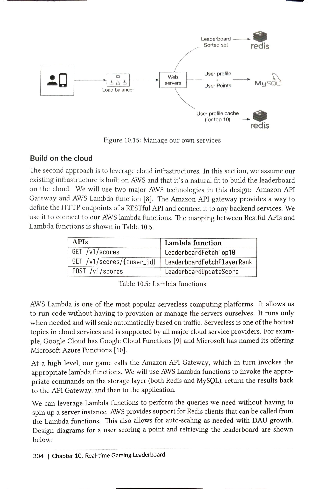  
*Hình 10.15: Tự quản trị các dịch vụ (Manage our own services)*

#### 2. Xây dựng trên nền tảng đám mây (Build on the cloud)

Cách tiếp cận thứ hai là tận dụng cơ sở hạ tầng đám mây (cloud infrastructures). Trong phần này, chúng ta giả định cơ sở hạ tầng hiện tại đã được xây dựng trên AWS, do đó việc xây dựng hệ thống bảng xếp hạng trên cloud là một lựa chọn hoàn toàn tương thích và tự nhiên. 

Chúng ta sẽ sử dụng hai công nghệ cốt lõi của AWS trong thiết kế này: **Amazon API Gateway** và **AWS Lambda function** [8]. 
- **Amazon API Gateway** cung cấp giải pháp định nghĩa các HTTP endpoints cho RESTful API và kết nối chúng tới bất kỳ dịch vụ backend nào. Chúng ta sử dụng nó để kết nối trực tiếp tới các hàm AWS Lambda. Bảng ánh xạ giữa các RESTful API và Lambda function được trình bày trong Bảng 10.5:

| Các API (APIs) | Hàm Lambda tương ứng (Lambda function) |
| :--- | :--- |
| `GET /v1/scores` | `LeaderboardFetchTop10` |
| `GET /v1/scores/{:user_id}` | `LeaderboardFetchPlayerRank` |
| `POST /v1/scores` | `LeaderboardUpdateScore` |

*Bảng 10.5: Các hàm Lambda (Lambda functions)*

**AWS Lambda** là một trong những nền tảng điện toán không máy chủ (serverless computing platform) phổ biến nhất hiện nay. Nó cho phép chúng ta thực thi mã nguồn mà không cần phải tự cấp phát (provision) hay quản trị các máy chủ. Lambda chỉ chạy khi có yêu cầu và sẽ tự động co giãn (auto-scale) dựa theo lưu lượng tải (traffic). 

Điện toán không máy chủ (Serverless) là một trong những chủ đề nổi bật nhất trong các dịch vụ điện toán đám mây và được hỗ trợ bởi tất cả các nhà cung cấp đám mây lớn. Ví dụ: Google Cloud có **Google Cloud Functions** [9] và Microsoft đặt tên cho giải pháp tương đương của họ là **Microsoft Azure Functions** [10].

Ở mức tổng quan kiến trúc (high level):
1. Ứng dụng game của chúng ta gọi tới **Amazon API Gateway**.
2. API Gateway lần lượt kích hoạt (invoke) các **AWS Lambda function** thích hợp.
3. Chúng ta sử dụng các hàm AWS Lambda để thực thi các tập lệnh tương ứng lên tầng lưu trữ (storage layer - bao gồm cả **Redis** và **MySQL**).
4. Kết quả được trả ngược về cho API Gateway, sau đó phản hồi lại cho ứng dụng client.

Chúng ta có thể tận dụng các hàm Lambda để thực hiện các truy vấn cần thiết mà không cần phải khởi tạo (spin up) một phiên bản máy chủ chuyên dụng nào. AWS cung cấp thư viện hỗ trợ sẵn các Redis client có thể gọi trực tiếp từ bên trong các hàm Lambda. Kiến trúc này cũng cho phép hệ thống tự động co giãn quy mô (auto-scaling) linh hoạt khi lượng người dùng hoạt động hàng ngày (DAU) tăng trưởng.

Sơ đồ thiết kế chi tiết cho hai luồng nghiệp vụ: khi người dùng ghi điểm và khi truy xuất bảng xếp hạng được trình bày dưới đây:

*304 | Chương 10: Bảng Xếp Hạng Game Thời Gian Thực (Chapter 10. Real-time Gaming Leaderboard)*

---

### Trang 306

#### Trường hợp sử dụng 1: Người chơi ghi điểm (Use case 1: scoring a point)

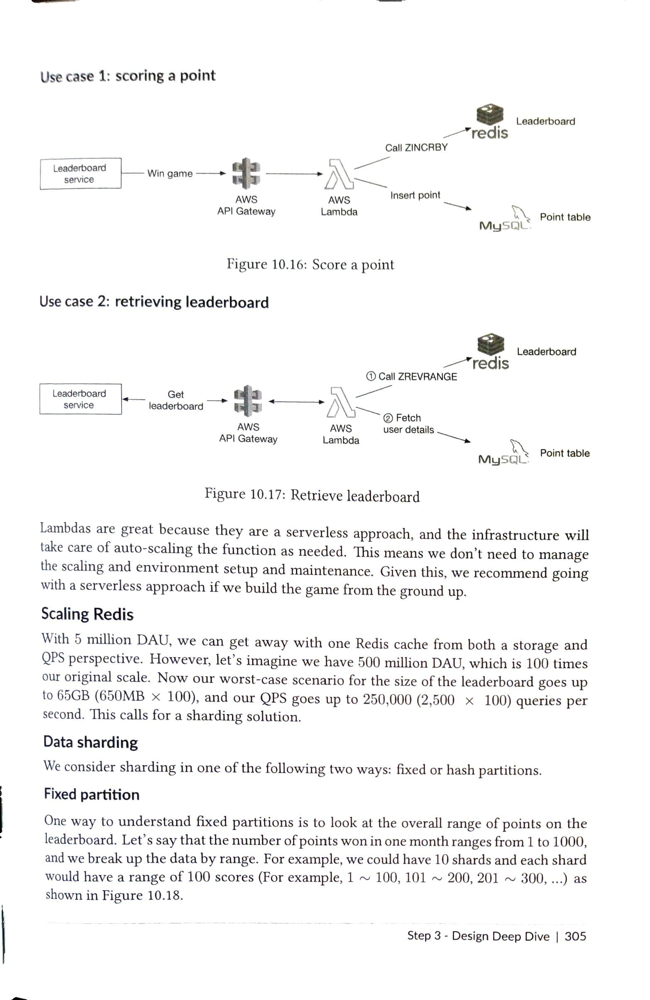  
*Hình 10.16: Ghi điểm (Score a point)*

*(Luồng xử lý: Game thắng cuộc $\rightarrow$ API Gateway $\rightarrow$ AWS Lambda: Gửi lệnh `ZINCRBY` tới Redis Sorted Set, đồng thời chèn điểm `Insert point` vào bảng `point` trên MySQL).*

#### Trường hợp sử dụng 2: Truy xuất bảng xếp hạng (Use case 2: retrieving leaderboard)

  
*Hình 10.17: Lấy bảng xếp hạng (Retrieve leaderboard)*

*(Luồng xử lý: Yêu cầu lấy bảng xếp hạng $\rightarrow$ API Gateway $\rightarrow$ AWS Lambda: Gửi lệnh `ZREVRANGE` tới Redis Leaderboard Sorted Set, đồng thời truy xuất thông tin chi tiết người dùng `Fetch user details` từ MySQL).*

> [!TIP]
> Mô hình Lambda mang lại hiệu quả vượt trội nhờ tính chất không máy chủ (serverless), trong đó tầng hạ tầng đám mây sẽ tự động đảm nhiệm hoàn toàn việc co giãn quy mô (auto-scaling) hàm theo nhu cầu thực tế. Điều này đồng nghĩa với việc đội ngũ kỹ thuật không cần bận tâm đến việc quản lý mở rộng quy mô, thiết lập môi trường hay bảo trì máy chủ. 
> 
> Dựa trên những ưu điểm này, chúng tôi khuyến nghị áp dụng phương pháp tiếp cận không máy chủ (Serverless approach) nếu chúng ta tiến hành xây dựng hệ thống game mới hoàn toàn từ đầu (from the ground up).

---

### Mở rộng quy mô Redis (Scaling Redis)

Với quy mô 5 triệu DAU, chúng ta hoàn toàn có thể xử lý tốt chỉ với một cụm Redis Cache duy nhất xét trên cả hai khía cạnh: dung lượng lưu trữ (storage) và thông lượng QPS. 

Tuy nhiên, hãy giả định kịch bản hệ thống đạt **500 triệu DAU**, tức là tăng gấp **100 lần** so với quy mô ban đầu:
- Kịch bản xấu nhất đối với dung lượng của bảng xếp hạng sẽ tăng vọt lên thành:
  $$650\text{ MB} \times 100 = 65\text{ GB}$$
- Thông lượng QPS đỉnh điểm sẽ chạm mức:
  $$2.500 \times 100 = 250.000\text{ truy vấn/giây (queries per second)}$$

Quy mô này bắt buộc chúng ta phải triển khai một giải pháp phân mảnh dữ liệu (**Sharding**).

### Phân mảnh dữ liệu (Data sharding)

Chúng ta cân nhắc kỹ thuật phân mảnh theo một trong hai cơ chế sau: Phân vùng cố định (**Fixed Partition**) hoặc Phân vùng theo hàm băm (**Hash Partition**).

#### 1. Phân vùng cố định (Fixed partition)

Một cách trực quan để hiểu về phân vùng cố định là quan sát toàn bộ dải điểm số (range of points) tổng thể trên bảng xếp hạng. Giả sử số điểm thắng được trong một tháng dao động trong dải từ 1 đến 1.000, chúng ta sẽ tiến hành chia nhỏ dữ liệu theo các dải giá trị này. 

Ví dụ: Chúng ta có thể cấu hình 10 phân mảnh (shards), và mỗi shard sẽ quản lý một dải gồm 100 mức điểm (chẳng hạn: $1 \sim 100$, $101 \sim 200$, $201 \sim 300$, ...), như được minh họa chi tiết trong Hình 10.18.

*Bước 3 - Đi Sâu Vào Thiết Kế Chi Tiết | Trang 305 (Step 3 - Design Deep Dive / 305)*

---

### Trang 307

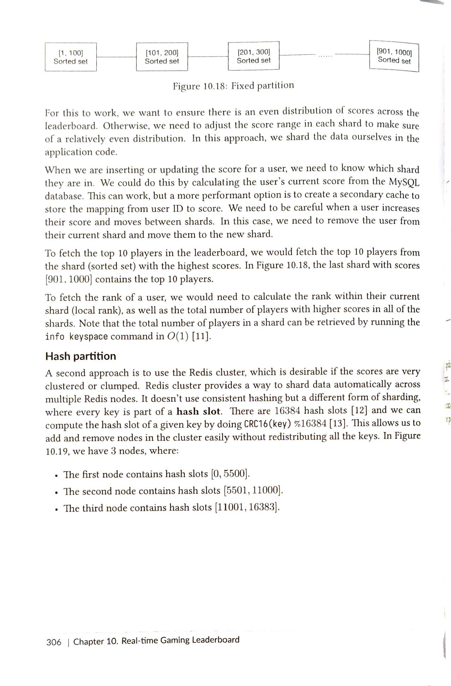  
*Hình 10.18: Phân vùng cố định (Fixed partition)*

Để cơ chế này vận hành hiệu quả, chúng ta phải đảm bảo rằng có sự phân bổ điểm số tương đối đồng đều (even distribution) giữa các dải điểm. Trong giải pháp tiếp cận này, chúng ta sẽ tự thực hiện việc phân mảnh dữ liệu (shard the data) trực tiếp trong tầng mã nguồn ứng dụng (Application Code).

> [!IMPORTANT]
> Khi thực hiện chèn mới (insert) hoặc cập nhật (update) điểm số cho một người dùng, hệ thống bắt buộc phải xác định được người dùng đó hiện đang thuộc về shard nào:
> - Chúng ta có thể xác định shard bằng cách tính toán điểm số hiện tại của người dùng từ cơ sở dữ liệu MySQL. Cách này hoạt động được, nhưng một phương án tối ưu hiệu năng hơn nhiều là thiết lập một bộ nhớ đệm thứ cấp (Secondary Cache) để lưu ánh xạ từ `User ID -> Score`.
> - Cần đặc biệt cẩn trọng khi người dùng tăng điểm và **chuyển dịch giữa các shard**. Trong trường hợp đó, chúng ta bắt buộc phải xóa (remove) người dùng ra khỏi shard hiện tại của họ và di chuyển (move) họ sang shard mới tương ứng với mức điểm mới.

- **Truy xuất Top 10 người chơi toàn cầu (Fetch top 10 players):** Chúng ta sẽ lấy Top 10 từ chính phân mảnh (Sorted Set) chứa dải điểm số cao nhất. Trong Hình 10.18, shard cuối cùng với dải điểm $[901, 1000]$ chính là nơi chứa Top 10 người chơi này.
- **Tính toán thứ hạng của một người dùng (Fetch the rank of a user):** Chúng ta cần tính toán thứ hạng của họ bên trong shard hiện tại (thứ hạng cục bộ - local rank), sau đó cộng dồn với tổng số lượng người chơi có điểm số cao hơn nằm ở tất cả các shard xếp trên. 
  
*(Lưu ý: Tổng số lượng người chơi trong một shard có thể được truy xuất tức thời bằng cách chạy lệnh `INFO keyspace` với độ phức tạp thời gian đạt $\mathcal{O}(1)$ [11]).*

---

#### 2. Phân vùng theo hàm băm (Hash partition)

Hướng tiếp cận thứ hai là sử dụng **Redis Cluster**, giải pháp đặc biệt lý tưởng nếu điểm số của người chơi bị co cụm hoặc tập trung quá dày đặc vào một vài dải nhất định (clustered or clumped). 

Redis Cluster cung cấp cơ chế tự động phân mảnh dữ liệu (shard data automatically) trên nhiều node Redis phân tán. Nó không sử dụng thuật toán Băm Nhất Quán thông thường (Consistent Hashing), mà triển khai một hình thức phân mảnh đặc thù: mỗi khóa (key) sẽ thuộc về một khe băm (**Hash Slot**). 

Hệ thống có tổng cộng **16.384 hash slots** [12], và chúng ta có thể xác định hash slot của một khóa bất kỳ bằng thuật toán:

$$\text{Hash Slot} = \text{CRC16}(\text{key}) \pmod{16384} \quad [13]$$

Cơ chế này cho phép chúng ta dễ dàng bổ sung thêm hoặc loại bỏ các node trong cluster mà không cần phải tái phân phối (redistribute) lại toàn bộ các khóa dữ liệu. 

Trong Hình 10.19, chúng ta có một kiến trúc gồm 3 node, trong đó:
- Node thứ nhất quản lý dải hash slots: $[0, 5500]$.
- Node thứ hai quản lý dải hash slots: $[5501, 11000]$.
- Node thứ ba quản lý dải hash slots: $[11001, 16383]$.

*306 | Chương 10: Bảng Xếp Hạng Game Thời Gian Thực (Chapter 10. Real-time Gaming Leaderboard)*

# Chương 10: Bảng Xếp Hạng Game Thời Gian Thực (Real-time Gaming Leaderboard)

---

### Bước 3: Đi sâu vào Thiết kế (Step 3 - Design Deep Dive) *(tiếp theo)*

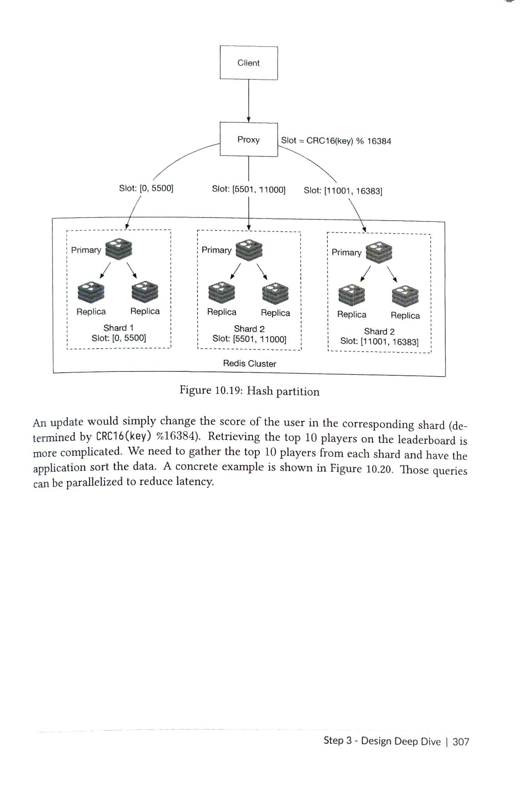
*Hình 10.19: Phân vùng băm (Hash partition)*

---

...có thể được thực hiện song song (parallelized) nhằm giảm độ trễ (latency).

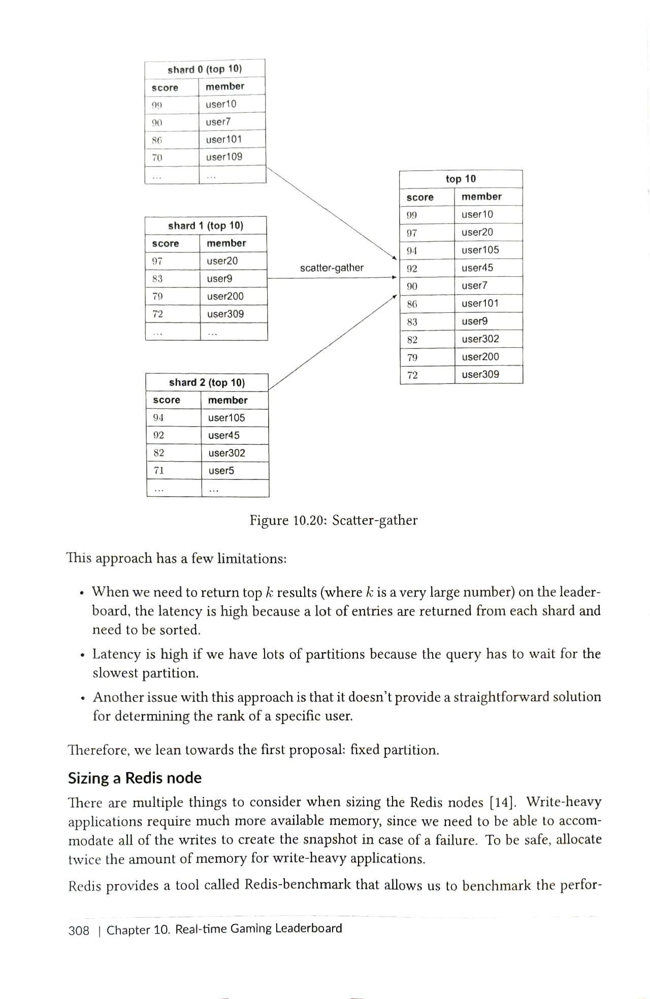
*Hình 10.20: Scatter-gather*

#### Dữ liệu minh họa cơ chế Scatter-gather (Hình 10.20)

| Shard | Điểm số (Score) | Thành viên (Member) |
| :--- | :--- | :--- |
| **shard 0 (top 10)** | 99 | user10 |
| | 90 | user7 |
| | 86 | user101 |
| | 70 | user109 |
| **shard 1 (top 10)** | 97 | user20 |
| | 83 | user9 |
| | 79 | user200 |
| | 72 | user309 |
| **shard 2 (top 10)** | 94 | user105 |
| | 92 | user45 |
| | 82 | user302 |
| | 71 | user5 |

**Kết quả tổng hợp Top 10 sau khi Scatter-gather:**

| Xếp hạng (Rank) | Điểm số (Score) | Thành viên (Member) |
| :---: | :---: | :--- |
| 1 | 99 | user10 |
| 2 | 97 | user20 |
| 3 | 94 | user105 |
| 4 | 92 | user45 |
| 5 | 90 | user7 |
| 6 | 86 | user101 |
| 7 | 83 | user9 |
| 8 | 82 | user302 |
| 9 | 79 | user200 |
| 10 | 72 | user309 |

---

Phương pháp tiếp cận này tồn tại một vài hạn chế:
- Khi chúng ta cần trả về danh sách $k$ kết quả dẫn đầu (top $k$ results) trên bảng xếp hạng (với $k$ là một số rất lớn), độ trễ (latency) sẽ tăng cao vì một lượng lớn bản ghi (entries) được trả về từ từng phân đoạn (shard) và cần phải được sắp xếp lại toàn bộ.
- Độ trễ (latency) sẽ rất cao nếu hệ thống có quá nhiều phân vùng (partitions), bởi vì câu truy vấn buộc phải chờ phân vùng xử lý chậm nhất hoàn tất (tail latency / slowest partition).
- Một vấn đề khác của phương pháp này là nó không cung cấp một giải pháp trực tiếp, mạch lạc để xác định thứ hạng (rank) chính xác của một người dùng cụ thể.

Do đó, chúng tôi ưu tiên nghiêng về đề xuất đầu tiên: **Phân vùng cố định (fixed partition)**.

---

### Định cỡ một Node Redis (Sizing a Redis node)

Có rất nhiều yếu tố cần cân nhắc khi tính toán kích thước (sizing) cho các node Redis [14]. Các ứng dụng thiên về ghi (write-heavy applications) đòi hỏi bộ nhớ khả dụng (available memory) lớn hơn rất nhiều, do hệ thống phải có khả năng tiếp nhận và chứa toàn bộ lượng dữ liệu ghi mới phát sinh trong quá trình tạo bản sao chụp nhanh (snapshot) để phòng ngừa sự cố lỗi (failure). Nhằm đảm bảo an toàn, hãy cấp phát dung lượng bộ nhớ gấp đôi (twice the amount of memory) đối với các ứng dụng thiên về ghi.

Redis cung cấp một công cụ mang tên **Redis-benchmark**, cho phép chúng ta đánh giá hiệu năng (benchmark) của cấu hình triển khai Redis bằng cách mô phỏng nhiều máy khách (multiple clients) đồng thời thực thi nhiều truy vấn, từ đó trả về số lượng yêu cầu xử lý trên mỗi giây (requests per second - RPS) tương ứng với phần cứng được chỉ định. Để tìm hiểu thêm về Redis-benchmark, vui lòng tham khảo tài liệu [15].

---

### Giải pháp thay thế: Cơ sở dữ liệu NoSQL (Alternative solution: NoSQL)

Một giải pháp thay thế đáng cân nhắc là sử dụng các cơ sở dữ liệu NoSQL (NoSQL databases). Chúng ta nên lựa chọn loại NoSQL nào? Về mặt lý tưởng, chúng ta muốn chọn một hệ CSDL NoSQL sở hữu các đặc tính sau:
- Tối ưu hóa cao cho các tác vụ ghi (Optimized for writes).
- Sắp xếp hiệu quả các phần tử bên trong cùng một phân vùng theo điểm số (Efficiently sort items within the same partition by score).

Các cơ sở dữ liệu NoSQL như Amazon DynamoDB [16], Cassandra, hoặc MongoDB có thể là những lựa chọn phù hợp. Trong chương này, chúng tôi sử dụng DynamoDB làm ví dụ điển hình. DynamoDB là một dịch vụ cơ sở dữ liệu NoSQL được quản lý hoàn toàn (fully managed NoSQL database), mang lại hiệu năng tin cậy cùng khả năng mở rộng quy mô vượt trội (great scalability). 

Để cho phép truy cập dữ liệu hiệu quả dựa trên các thuộc tính khác ngoài khóa chính (primary key), chúng ta có thể tận dụng **Chỉ mục phụ toàn cục (Global Secondary Indexes - GSI)** [17] trong DynamoDB. Một global secondary index chứa một tập hợp các thuộc tính được chọn lọc từ bảng cha (parent table), nhưng chúng được tổ chức và sắp xếp dựa trên một khóa chính hoàn toàn khác.

Hãy cùng xem xét một ví dụ cụ thể.

Sơ đồ hệ thống sau khi cập nhật được thể hiện trong **Hình 10.21**. Ở đây, Redis và MySQL đã được thay thế hoàn toàn bằng DynamoDB.

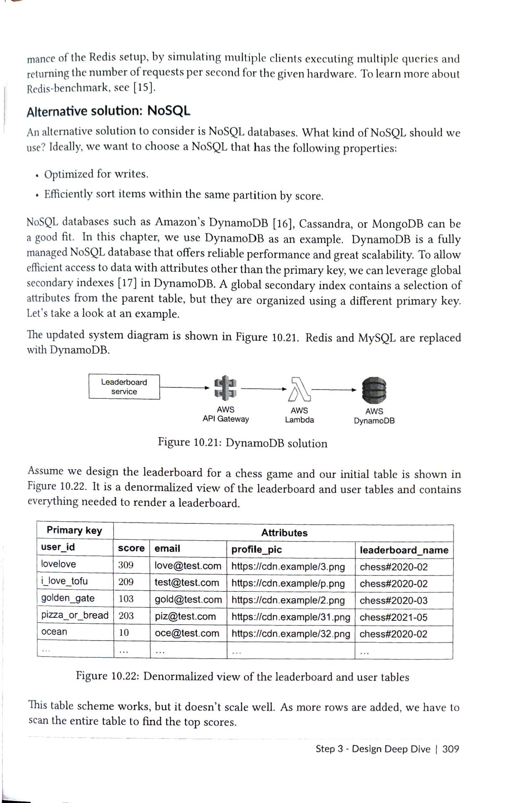
*Hình 10.21: Giải pháp kiến trúc sử dụng DynamoDB (DynamoDB solution)*

Giả sử chúng ta thiết kế bảng xếp hạng cho một trò chơi cờ vua (chess game), và bảng dữ liệu ban đầu được mô tả như trong **Hình 10.22**. Đây là một khung nhìn phi chuẩn hóa (denormalized view) kết hợp giữa bảng leaderboard và bảng user, chứa đựng toàn bộ các trường dữ liệu cần thiết để kết xuất (render) một bảng xếp hạng hoàn chỉnh.

| Khóa chính (Primary key) | Thuộc tính (Attributes) | | | |
| :--- | :--- | :--- | :--- | :--- |
| **user_id** | **score** | **email** | **profile_pic** | **leaderboard_name** |
| lovelove | 309 | love@test.com | https://cdn.example/3.png | chess#2020-02 |
| i_love_tofu | 209 | test@test.com | https://cdn.example/p.png | chess#2020-02 |
| golden_gate | 103 | gold@test.com | https://cdn.example/2.png | chess#2020-03 |
| pizza_or_bread | 203 | piz@test.com | https://cdn.example/31.png | chess#2021-05 |
| ocean | 10 | oce@test.com | https://cdn.example/32.png | chess#2020-02 |

*Hình 10.22: Khung nhìn phi chuẩn hóa của bảng leaderboard và user (Denormalized view of the leaderboard and user tables)*

Lược đồ bảng (table scheme) này tuy hoạt động được nhưng lại không có khả năng mở rộng quy mô tốt (doesn't scale well). Càng nhiều hàng (rows) được bổ sung vào, chúng ta càng bắt buộc phải quét toàn bộ bảng (scan the entire table) chỉ để tìm ra những người có điểm số cao nhất.

---

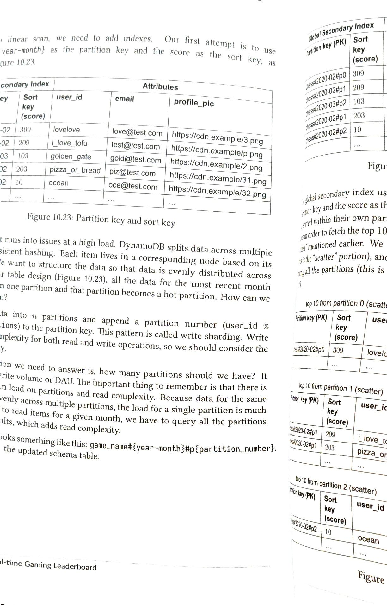
*Hình 10.23: Khóa phân vùng và khóa sắp xếp (Partition key and sort key)*

Để giải quyết vấn đề trên, chúng ta thiết lập một Global Secondary Index sử dụng `leaderboard_name` làm khóa phân vùng (partition key - PK) và `score` làm khóa sắp xếp (sort key).

| Global Secondary Index | | Thuộc tính (Attributes) | | |
| :--- | :--- | :--- | :--- | :--- |
| **Khóa phân vùng (Partition key - PK)** | **Khóa sắp xếp (Sort key)** | **user_id** | **email** | **profile_pic** |
| chess#2020-02 | 309 | lovelove | love@test.com | https://cdn.example/3.png |
| chess#2020-02 | 209 | i_love_tofu | test@test.com | https://cdn.example/p.png |
| chess#2020-03 | 103 | golden_gate | gold@test.com | https://cdn.example/2.png |
| chess#2021-05 | 203 | pizza_or_bread | piz@test.com | https://cdn.example/31.png |
| chess#2020-02 | 10 | ocean | oce@test.com | https://cdn.example/32.png |

Tuy nhiên, thiết kế này lại gặp sự cố khi tải cao (high load). DynamoDB phân tách dữ liệu trên nhiều nút lưu trữ bằng kỹ thuật băm nhất quán (consistent hashing). Mỗi bản ghi sẽ nằm trên một nút tương ứng dựa trên khóa phân vùng của nó. Chúng ta luôn muốn cấu trúc dữ liệu sao cho phân bổ đồng đều trên tất cả các phân vùng. Với thiết kế bảng trước đó (Hình 10.23), toàn bộ dữ liệu của tháng gần nhất sẽ dồn vào một phân vùng duy nhất, khiến phân vùng đó trở thành phân vùng quá nóng (**hot partition**). Làm thế nào để giải quyết vấn đề này?

Chúng ta có thể chia nhỏ dữ liệu thành $n$ phân vùng và gắn thêm số thứ tự phân vùng (`user_id % n`) vào khóa phân vùng:
- `game_name#year-month#p<partition_number>`

Điều này đồng nghĩa với việc chúng ta phải phân tán các lượt đọc (scatter reads), dẫn đến làm tăng độ phức tạp của tác vụ đọc (read complexity).

Dưới đây là bảng lược đồ dữ liệu đã được cập nhật:

---

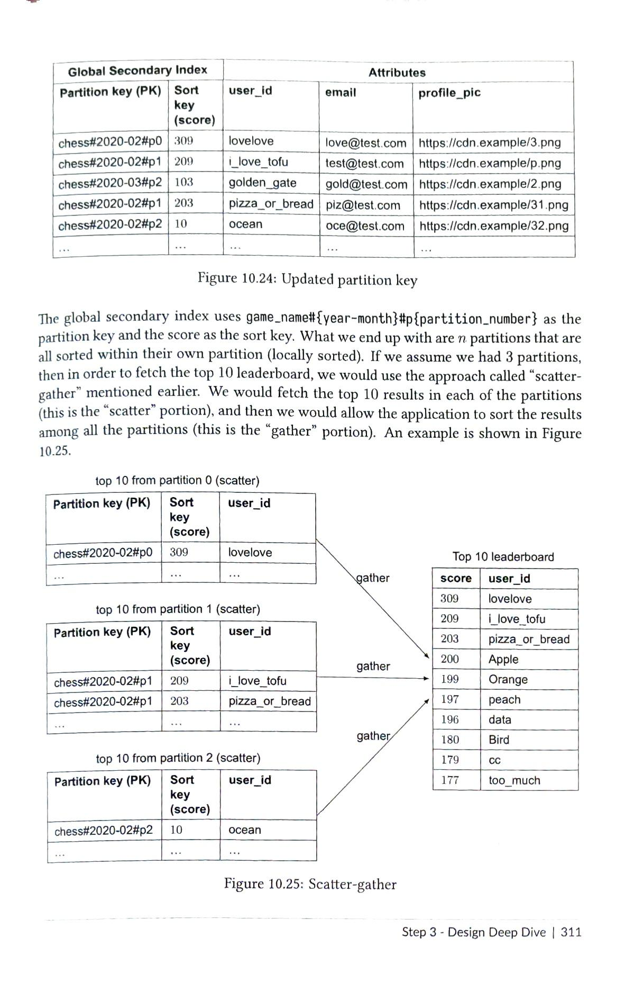
*Hình 10.24: Khóa phân vùng đã cập nhật (Updated partition key)*

| Global Secondary Index | | Thuộc tính (Attributes) | | |
| :--- | :--- | :--- | :--- | :--- |
| **Khóa phân vùng (Partition key - PK)** | **Khóa sắp xếp (Sort key)** | **user_id** | **email** | **profile_pic** |
| chess#2020-02#p0 | 309 | lovelove | love@test.com | https://cdn.example/3.png |
| chess#2020-02#p1 | 209 | i_love_tofu | test@test.com | https://cdn.example/p.png |
| chess#2020-03#p2 | 103 | golden_gate | gold@test.com | https://cdn.example/2.png |
| chess#2020-02#p1 | 203 | pizza_or_bread | piz@test.com | https://cdn.example/31.png |
| chess#2020-02#p2 | 10 | ocean | oce@test.com | https://cdn.example/32.png |

Chỉ mục phụ toàn cục (global secondary index) sử dụng định dạng `game_name#year-month#p<partition_number>` làm khóa phân vùng (partition key - PK) và `score` làm khóa sắp xếp (sort key). Các bản ghi dữ liệu đều được sắp xếp nội bộ ngay bên trong phân vùng của chính chúng (locally sorted). 

Nếu giả định hệ thống có 3 phân vùng, khi đó để lấy ra bảng xếp hạng Top 10, chúng ta sẽ áp dụng mô hình tiếp cận có tên gọi **"Scatter-gather"**:
1. Đầu tiên, chúng ta truy vấn Top 10 từ mỗi phân vùng riêng lẻ (đây chính là giai đoạn phân tán - **"scatter"**).
2. Sau đó, tầng ứng dụng (application layer) sẽ tổng hợp và sắp xếp lại kết quả giữa tất cả các phân vùng để chọn ra Top 10 chung cuộc (đây chính là giai đoạn thu thập/tổng hợp - **"gather"**). 

Ví dụ minh họa được thể hiện chi tiết trong **Hình 10.25**.


*Hình 10.25: Scatter-gather trên DynamoDB*

#### Chi tiết các luồng Scatter-gather (Hình 10.25)

**Top 10 từ phân vùng 0 (scatter):**
- PK: `chess#2020-02#p0` | Điểm số (Score): `309` | user_id: `lovelove`

**Top 10 từ phân vùng 1 (scatter):**
- PK: `chess#2020-02#p1` | Điểm số (Score): `209` | user_id: `i_love_tofu`
- PK: `chess#2020-02#p1` | Điểm số (Score): `203` | user_id: `pizza_or_bread`

**Top 10 từ phân vùng 2 (scatter):**
- PK: `chess#2020-02#p2` | Điểm số (Score): `10` | user_id: `ocean`

**Bảng xếp hạng Top 10 sau khi tổng hợp (Top 10 leaderboard - gather):**

| Điểm số (Score) | Mã người dùng (user_id) |
| :---: | :--- |
| 309 | lovelove |
| 209 | i_love_tofu |
| 203 | pizza_or_bread |
| 200 | Apple |
| 199 | Orange |
| 197 | peach |
| 196 | data |
| 180 | Bird |
| 179 | CC |
| 177 | too_much |

---

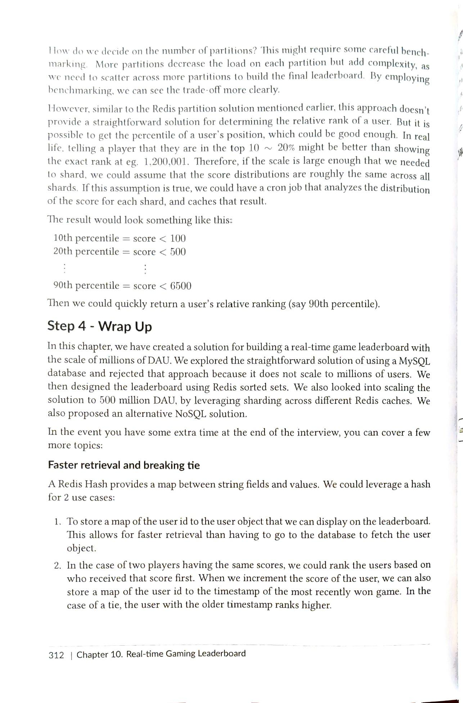

Làm thế nào để chúng ta quyết định số lượng phân vùng (number of partitions)? Vấn đề này đòi hỏi phải tiến hành đo lường đánh giá hiệu năng cẩn trọng (careful benchmarking). Thông qua việc đánh giá chuẩn (benchmarking), chúng ta có thể nhìn nhận các đánh đổi kỹ thuật (trade-offs) một cách rõ ràng hơn:
- Tăng số lượng phân vùng giúp phân tải ghi tốt hơn (giảm tải cho từng phân vùng đơn lẻ).
- Nhưng đồng thời nó lại làm tăng độ phức tạp và độ trễ khi đọc (read latency) do giai đoạn gather phải gom dữ liệu từ nhiều phân vùng hơn.

Ngoài ra, việc tính toán thứ hạng phân vị (percentile) cho vị trí của người dùng cũng là một phương án khả thi và hoàn toàn có thể đáp ứng đủ tốt nhu cầu thực tế. Trong các tình huống thực tế, người dùng thường không quá bận tâm đến thứ hạng tuyệt đối chính xác kiểu như vị trí thứ 1.200.001. 

Do đó, nếu quy mô hệ thống đủ lớn đến mức chúng ta bắt buộc phải phân mảnh (sharding), chúng ta có thể giả định rằng phân phối điểm số (score distributions) trên tất cả các shard là gần như tương đồng nhau. Nếu giả định này đúng, chúng ta có thể thiết lập một tác vụ định kỳ nền (**cron job**) để định kỳ phân tích phân phối điểm số của từng shard và lưu bộ nhớ đệm (cache) kết quả đó lại.

Kết quả thu được sẽ có dạng tương tự như sau:
- **Phân vị thứ 10 (10th percentile):** Điểm số < 100
- **Phân vị thứ 20 (20th percentile):** Điểm số < 500
- **Phân vị thứ 90 (90th percentile):** Điểm số < 6500

Nhờ đó, hệ thống có thể lập tức trả về thứ hạng tương đối của người dùng (ví dụ: nằm trong nhóm 90th percentile) một cách cực kỳ nhanh chóng.

---

## Bước 4: Tổng kết (Step 4 - Wrap Up)

Trong chương này, chúng ta đã xây dựng một giải pháp toàn diện cho bài toán thiết kế bảng xếp hạng game thời gian thực (real-time gaming leaderboard) đáp ứng quy mô hàng triệu người dùng hoạt động hàng ngày (DAU - Daily Active Users). 

- Ban đầu, chúng ta khảo sát giải pháp tiếp cận trực tiếp bằng việc sử dụng cơ sở dữ liệu quan hệ **MySQL**, và đã bác bỏ hướng đi này vì nó không thể mở rộng quy mô (scale) để phục vụ hàng triệu người dùng.
- Sau đó, chúng ta đã thiết kế bảng xếp hạng dựa trên cấu trúc dữ liệu **Sorted Sets của Redis**.
- Chúng ta cũng đã đào sâu vào bài toán mở rộng hệ thống lên quy mô **500 triệu DAU** thông qua kỹ thuật phân mảnh dữ liệu (**Sharding**) trên nhiều cụm bộ đệm Redis khác nhau.
- Đồng thời, chúng ta cũng đã đề xuất một giải pháp kiến trúc thay thế sử dụng cơ sở dữ liệu **NoSQL** (cụ thể là DynamoDB).

Trong trường hợp bạn vẫn còn dư chút thời gian ở cuối buổi phỏng vấn thiết kế hệ thống, bạn có thể thảo luận mở rộng thêm về một vài chủ đề chuyên sâu sau:

### Tối ưu hóa truy xuất nhanh hơn và Cơ chế xử lý hòa điểm (Faster retrieval and breaking tie)

Cấu trúc **Redis Hash** cung cấp một bản đồ liên kết (map) giữa các trường chuỗi ký tự (string fields) và các giá trị tương ứng (values). Chúng ta có thể tận dụng Redis Hash cho 2 ca sử dụng cụ thể:

1. **Lưu trữ một bản đồ (map) từ user_id sang đối tượng người dùng (user object)**: Giúp chúng ta hiển thị đầy đủ thông tin người dùng ngay trên bảng xếp hạng. Cách làm này cho phép truy xuất thông tin nhanh hơn đáng kể so với việc phải truy vấn ngược về cơ sở dữ liệu chính để lấy đối tượng người dùng.
2. **Cơ chế phân định thứ hạng khi đồng điểm (breaking tie)**: Trong trường hợp có hai người chơi đạt cùng một mức điểm số, chúng ta có thể xếp hạng người chơi dựa trên tiêu chí ai đạt được mức điểm số đó trước. Khi tăng điểm cho người dùng, chúng ta có thể lưu kèm một bản đồ giữa `user_id` và mốc thời gian (**timestamp**) của trận thắng gần nhất. Trong tình huống hòa điểm (tie), người dùng sở hữu mốc thời gian sớm hơn (older timestamp) sẽ được ưu tiên xếp ở vị trí cao hơn.

# CHƯƠNG 10: BẢNG XẾP HẠNG GAME THỜI GIAN THỰC (REAL-TIME GAMING LEADERBOARD)

---

## Phục hồi hệ thống khi gặp sự cố (System failure recovery)

Cụm phân tán **Redis cluster** hoàn toàn có khả năng gặp phải sự cố hỏng hóc trên quy mô lớn (**large-scale failure**). Dựa trên kiến trúc thiết kế đã trình bày ở trên, chúng ta có thể xây dựng một kịch bản/tập lệnh (**script**) tận dụng đặc điểm rằng: cơ sở dữ liệu quan hệ **MySQL** đã ghi nhận một bản ghi (**entry**) kèm theo nhãn thời gian (**timestamp**) mỗi khi một người dùng chiến thắng một trận đấu. 

Chúng ta có thể lặp qua toàn bộ các bản ghi này cho từng người dùng, và thực thi lệnh `ZINCRBY` một lần cho mỗi bản ghi tương ứng của từng người dùng đó. Cơ chế này cho phép chúng ta tái tạo lại toàn bộ bảng xếp hạng (**leaderboard**) ngoại tuyến (**offline**) nếu cần thiết, trong trường hợp xảy ra sự cố ngừng hoạt động trên diện rộng (**large-scale outage**).

> [!NOTE]
> Xin chúc mừng bạn đã đi được một chặng đường dài đến đây! Hãy tự thưởng cho mình một lời khen ngợi. Bạn đã hoàn thành rất xuất sắc!

---

## Tóm tắt chương (Chapter Summary)

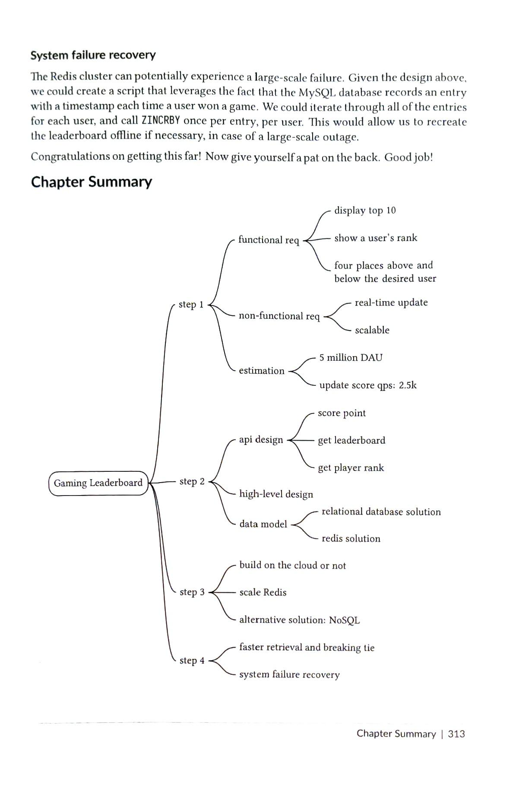

Dưới đây là cấu trúc tư duy hệ thống tóm lược toàn bộ nội dung của chương thiết kế **Gaming Leaderboard**:

### Bước 1: Xác định phạm vi và ước tính yêu cầu (Step 1 - Outline Scope & Estimation)
* **Yêu cầu chức năng (Functional requirements):**
  * Hiển thị top 10 người chơi dẫn đầu (**display top 10**).
  * Hiển thị thứ hạng của một người chơi cụ thể (**show a user's rank**).
  * Hiển thị 4 vị trí liền kề phía trên và phía dưới người chơi mong muốn (**four places above and below the desired user**).
  * Cập nhật bảng xếp hạng theo thời gian thực (**real-time update**).
* **Yêu cầu phi chức năng (Non-functional requirements):**
  * Khả năng mở rộng cao (**Scalable**).
  * Độ sẵn sàng cao (**High Availability**), khả năng chịu lỗi (**Fault Tolerance**).
* **Ước tính quy mô (Estimation):**
  * **5 triệu DAU** (Daily Active Users - Người dùng hoạt động hàng ngày).
  * QPS cập nhật điểm số (**Update score QPS**): xấp xỉ **2.5k**.
* **Thiết kế API (API Design):**
  * Ghi nhận điểm số: `scorepoint` / `update_score`.
  * Lấy bảng xếp hạng: `get leaderboard`.
  * Lấy thứ hạng người chơi: `getplayerrank`.

---

### Bước 2: Thiết kế cấp cao (Step 2 - High-level Design)
* **Mô hình dữ liệu (Data model):**
  * Giải pháp cơ sở dữ liệu quan hệ (**Relational database solution**).
  * Giải pháp lưu trữ bộ nhớ đệm **Redis** (**Redis solution**).
  * Xây dựng trên nền tảng đám mây hay tự triển khai tại chỗ (**Build on the cloud or not**).

---

### Bước 3: Đi sâu vào chi tiết kiến trúc (Step 3 - Deep Dive)
* Mở rộng quy mô **Redis** (**Scale Redis**): Phân mảnh dữ liệu (**Sharding**), phân cụm (**Clustering**), băm nhất quán (**Consistent Hashing**).
* Giải pháp thay thế dùng NoSQL (**Alternative solution: NoSQL**).
* Tối ưu hóa truy xuất nhanh hơn và xử lý hòa điểm (**Faster retrieval and breaking tie**).

---

### Bước 4: Hoàn thiện hệ thống (Step 4 - Wrap-up)
* Phục hồi hệ thống sau thảm họa/sự cố (**System failure recovery**).

---

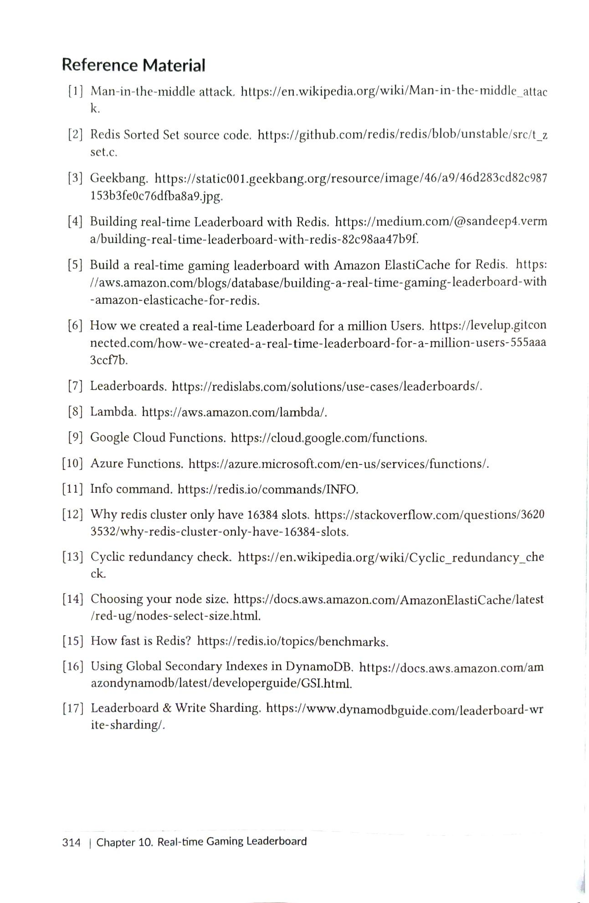

## Tài liệu tham khảo (Reference Material)

* **[1]** Tấn công xen giữa (Man-in-the-middle attack):  
  [https://en.wikipedia.org/wiki/Man-in-the-middle_attack](https://en.wikipedia.org/wiki/Man-in-the-middle_attack)
* **[2]** Mã nguồn Redis Sorted Set (Redis Sorted Set source code):  
  [https://github.com/redis/redis/blob/unstable/src/t_zset.c](https://github.com/redis/redis/blob/unstable/src/t_zset.c)
* **[3]** Geekbang:  
  [https://static001.geekbang.org/resource/image/46/a9/46d283cd82c987153b3fe0c76dfba8a9.jpg](https://static001.geekbang.org/resource/image/46/a9/46d283cd82c987153b3fe0c76dfba8a9.jpg)
* **[4]** Xây dựng Bảng xếp hạng thời gian thực với Redis (Building real-time Leaderboard with Redis):  
  [https://medium.com/@sandeep4.verma/building-real-time-leaderboard-with-redis-82c98aa47b9f](https://medium.com/@sandeep4.verma/building-real-time-leaderboard-with-redis-82c98aa47b9f)
* **[5]** Xây dựng bảng xếp hạng game thời gian thực với Amazon ElastiCache for Redis (Build a real-time gaming leaderboard with Amazon ElastiCache for Redis):  
  [https://aws.amazon.com/blogs/database/building-a-real-time-gaming-leaderboard-with-amazon-elasticache-for-redis](https://aws.amazon.com/blogs/database/building-a-real-time-gaming-leaderboard-with-amazon-elasticache-for-redis)
* **[6]** Cách chúng tôi tạo bảng xếp hạng thời gian thực cho một triệu người dùng (How we created a real-time Leaderboard for a million Users):  
  [https://levelup.gitconnected.com/how-we-created-a-real-time-leaderboard-for-a-million-users-555aaa3ccf7b](https://levelup.gitconnected.com/how-we-created-a-real-time-leaderboard-for-a-million-users-555aaa3ccf7b)
* **[7]** Bảng xếp hạng (Leaderboards - Redis Labs):  
  [https://redislabs.com/solutions/use-cases/leaderboards/](https://redislabs.com/solutions/use-cases/leaderboards/)
* **[8]** AWS Lambda:  
  [https://aws.amazon.com/lambda/](https://aws.amazon.com/lambda/)
* **[9]** Google Cloud Functions:  
  [https://cloud.google.com/functions](https://cloud.google.com/functions)
* **[10]** Azure Functions:  
  [https://azure.microsoft.com/en-us/services/functions/](https://azure.microsoft.com/en-us/services/functions/)
* **[11]** Lệnh Info trong Redis (Info command):  
  [https://redis.io/commands/INFO](https://redis.io/commands/INFO)
* **[12]** Tại sao cụm Redis chỉ có 16384 slot (Why redis cluster only have 16384 slots):  
  [https://stackoverflow.com/questions/36203532/why-redis-cluster-only-have-16384-slots](https://stackoverflow.com/questions/36203532/why-redis-cluster-only-have-16384-slots)
* **[13]** Kiểm tra phần dư tuần hoàn (Cyclic redundancy check - CRC):  
  [https://en.wikipedia.org/wiki/Cyclic_redundancy_check](https://en.wikipedia.org/wiki/Cyclic_redundancy_check)
* **[14]** Lựa chọn kích thước node phù hợp (Choosing your node size):  
  [https://docs.aws.amazon.com/AmazonElastiCache/latest/red-ug/nodes-select-size.html](https://docs.aws.amazon.com/AmazonElastiCache/latest/red-ug/nodes-select-size.html)
* **[15]** Redis nhanh đến mức nào? (How fast is Redis?):  
  [https://redis.io/topics/benchmarks](https://redis.io/topics/benchmarks)
* **[16]** Sử dụng Global Secondary Indexes trong DynamoDB (Using Global Secondary Indexes in DynamoDB):  
  [https://docs.aws.amazon.com/amazondynamodb/latest/developerguide/GSI.html](https://docs.aws.amazon.com/amazondynamodb/latest/developerguide/GSI.html)
* **[17]** Bảng xếp hạng & Phân mảnh ghi (Leaderboard & Write Sharding):  
  [https://www.dynamodbguide.com/leaderboard-write-sharding/](https://www.dynamodbguide.com/leaderboard-write-sharding/)

---

## Điều hướng

- [chuong-09-s3-like-object-storage.md](chuong-09-s3-like-object-storage.md)
- [Mục lục](README.md)
- [chuong-11-payment-system.md](chuong-11-payment-system.md)
