[← Chương trước](chuong-10-real-time-gaming-leaderboard.md) | [Mục lục](README.md) | [Chương tiếp theo →](chuong-12-digital-wallet.md)

---

# Chương 11: Hệ Thống Thanh Toán (Payment System)

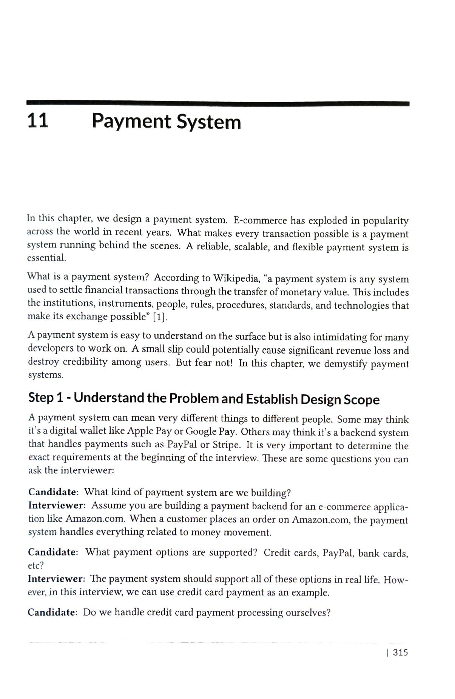

Trong chương này, chúng ta sẽ thiết kế một hệ thống thanh toán (**Payment System**). Thương mại điện tử (E-commerce) đã bùng nổ mạnh mẽ trên toàn thế giới trong những năm gần đây. Điều giúp cho mọi giao dịch có thể diễn ra suôn sẻ chính là hệ thống thanh toán vận hành ẩn sau hậu trường. Một hệ thống thanh toán đáng tin cậy (**Reliable**), có khả năng mở rộng (**Scalable**), và linh hoạt (**Flexible**) là điều tối quan trọng.

Hệ thống thanh toán là gì? Theo Wikipedia: *"hệ thống thanh toán là bất kỳ hệ thống nào được sử dụng để quyết toán các giao dịch tài chính thông qua việc chuyển giao giá trị tiền tệ. Điều này bao gồm các tổ chức, công cụ, con người, quy tắc, thủ tục, tiêu chuẩn và công nghệ giúp việc trao đổi này trở nên khả thi"* [1].

Một hệ thống thanh toán nhìn bề ngoài có vẻ rất dễ hiểu, nhưng lại là nỗi e ngại đối với nhiều kỹ sư khi bắt tay vào xây dựng. Một sơ suất nhỏ cũng có thể dẫn đến tổn thất doanh thu nghiêm trọng và phá hủy hoàn toàn uy tín đối với người dùng. Nhưng đừng lo lắng! Trong chương này, chúng ta sẽ làm sáng tỏ toàn bộ kiến trúc của hệ thống thanh toán.

---

## Bước 1 - Hiểu Rõ Bài Toán và Xác Định Phạm Vi Thiết Kế (Step 1 - Understand the Problem and Establish Design Scope)

Một hệ thống thanh toán có thể mang những ý nghĩa rất khác nhau đối với từng người. Một số người có thể nghĩ đó là ví điện tử kỹ thuật số (**Digital Wallet**) như Apple Pay hay Google Pay. Những người khác lại nghĩ đó là một hệ thống backend xử lý thanh toán như PayPal hoặc Stripe. Việc xác định chính xác các yêu cầu ngay từ đầu buổi phỏng vấn là vô cùng quan trọng. Dưới đây là một số câu hỏi bạn có thể trao đổi với người phỏng vấn:

* **Ứng viên:** Chúng ta đang xây dựng loại hệ thống thanh toán nào?
* **Người phỏng vấn:** Giả sử bạn đang xây dựng backend thanh toán cho một ứng dụng thương mại điện tử tương tự như Amazon.com. Khi một khách hàng đặt đơn hàng trên Amazon.com, hệ thống thanh toán sẽ xử lý mọi thứ liên quan đến dòng tiền chuyển dịch (**Money Movement**).
* **Ứng viên:** Những phương thức thanh toán nào được hỗ trợ? Thẻ tín dụng (Credit cards), PayPal, thẻ ngân hàng (Bank cards), v.v.?
* **Người phỏng vấn:** Hệ thống thanh toán trong thực tế cần hỗ trợ tất cả các phương thức này. Tuy nhiên, trong phạm vi buổi phỏng vấn này, chúng ta có thể lấy thanh toán bằng thẻ tín dụng làm ví dụ điển hình.
* **Ứng viên:** Chúng ta có tự mình trực tiếp xử lý quy trình thanh toán thẻ tín dụng không?

---

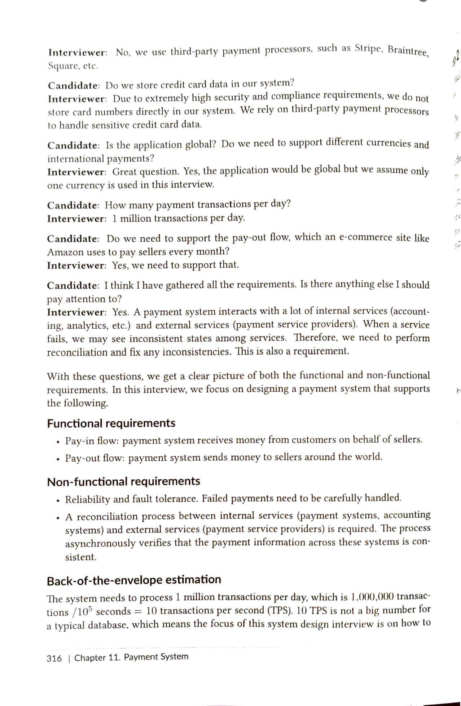

* **Người phỏng vấn:** Không, chúng ta sử dụng các cổng trung gian xử lý thanh toán bên ngoài (**Payment Processors**) như Stripe, Braintree, Square, v.v.
* **Ứng viên:** Chúng ta có lưu trữ dữ liệu thẻ tín dụng trong hệ thống của mình không?
* **Người phỏng vấn:** Không. Do các quy định bảo mật nghiêm ngặt như PCI DSS (Payment Card Industry Data Security Standard), chúng ta không trực tiếp lưu trữ hay xử lý dữ liệu thẻ tín dụng nhạy cảm.
* **Ứng viên:** Ứng dụng này có mang quy mô toàn cầu không? Chúng ta có cần hỗ trợ nhiều loại tiền tệ khác nhau và các giao dịch thanh toán quốc tế không?
* **Người phỏng vấn:** Câu hỏi rất hay. Đúng vậy, ứng dụng mang quy mô toàn cầu, nhưng trong khuôn khổ buổi phỏng vấn này, chúng ta giả định chỉ sử dụng một loại tiền tệ duy nhất.
* **Ứng viên:** Lượng giao dịch thanh toán mỗi ngày là bao nhiêu?
* **Người phỏng vấn:** 1 triệu giao dịch mỗi ngày (**1 million transactions per day**).
* **Ứng viên:** Chúng ta có cần hỗ trợ luồng chi trả (**Pay-out flow**), quy trình mà một trang thương mại điện tử như Amazon dùng để thanh toán tiền cho người bán hàng (Sellers/Merchants) mỗi tháng không?
* **Người phỏng vấn:** Có, chúng ta cần hỗ trợ luồng này.
* **Ứng viên:** Tôi nghĩ mình đã nắm được đầy đủ các yêu cầu. Còn điều gì khác tôi cần lưu ý không?
* **Người phỏng vấn:** Có. Một hệ thống thanh toán sẽ tương tác với rất nhiều dịch vụ nội bộ (Kế toán - Accounting, Phân tích dữ liệu - Analytics, v.v.) và các dịch vụ bên ngoài (Các nhà cung cấp dịch vụ thanh toán - Payment Service Providers / PSPs). Khi một dịch vụ gặp sự cố, chúng ta có thể thấy trạng thái bất đồng bộ/không nhất quán (**Inconsistent states**) giữa các dịch vụ. Do đó, chúng ta cần thực hiện quy trình đối soát (**Reconciliation**) và khắc phục bất kỳ sự không nhất quán nào. Đây cũng là một yêu cầu bắt buộc.

Thông qua các câu hỏi trên, chúng ta đã có được bức tranh rõ ràng về cả yêu cầu chức năng (**Functional Requirements**) lẫn phi chức năng (**Non-functional Requirements**). Trong buổi phỏng vấn này, chúng ta tập trung thiết kế một hệ thống thanh toán hỗ trợ các tiêu chí sau:

### Yêu Cầu Chức Năng (Functional Requirements)
* **Luồng thu tiền (Pay-in flow):** Hệ thống thanh toán nhận tiền từ khách hàng thay mặt cho người bán.
* **Luồng chi trả (Pay-out flow):** Hệ thống thanh toán gửi tiền cho người bán trên khắp thế giới.

### Yêu Cầu Phi Chức Năng (Non-functional Requirements)
* **Độ tin cậy và khả năng chịu lỗi (Reliability and Fault Tolerance):** Các giao dịch thanh toán thất bại cần được xử lý cẩn trọng và chặt chẽ.
* **Quy trình đối soát (Reconciliation process):** Cần có quy trình đối soát giữa các dịch vụ nội bộ (hệ thống thanh toán, hệ thống kế toán) và các dịch vụ bên ngoài (nhà cung cấp dịch vụ thanh toán - PSPs). Quy trình này sẽ xác minh bất đồng bộ (**Asynchronously**) để đảm bảo thông tin thanh toán trên toàn bộ các hệ thống này hoàn toàn nhất quán (**Consistent**).

### Ước Tính Định Lượng Thô (Back-of-the-envelope Estimation)
Hệ thống cần xử lý 1 triệu giao dịch mỗi ngày:

$$\frac{1,000,000 \text{ transactions}}{10^5 \text{ seconds}} \approx 10 \text{ Transactions Per Second (TPS)}$$

10 TPS không phải là một con số lớn đối với một cơ sở dữ liệu tiêu chuẩn. Điều này có nghĩa là trọng tâm của bài toán thiết kế hệ thống này là **cách xử lý chính xác tuyệt đối các giao dịch thanh toán**, thay vì đặt mục tiêu tối ưu hóa thông lượng cao (**High Throughput**).

---

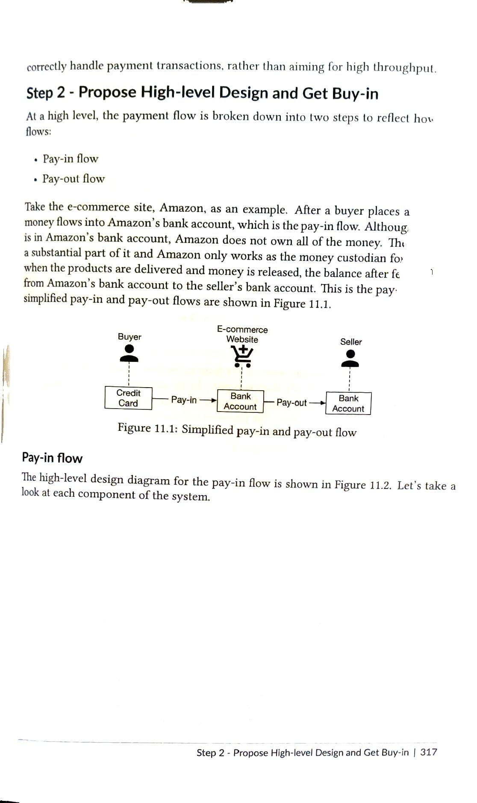

xử lý các giao dịch thanh toán một cách chuẩn xác, thay vì nhắm đến thông lượng lớn.

---

## Bước 2 - Đề Xuất Thiết Kế Cấp Cao và Đạt Được Sự Thống Nhất (Step 2 - Propose High-level Design and Get Buy-in)

Ở mức độ tổng quan (**High level**), luồng thanh toán được chia thành hai bước tương ứng với cách dòng tiền di chuyển:
* **Luồng thu tiền (Pay-in flow)**
* **Luồng chi trả (Pay-out flow)**

Lấy trang thương mại điện tử Amazon làm ví dụ:
1. Sau khi người mua đặt hàng, tiền sẽ chảy vào tài khoản ngân hàng của Amazon — đây chính là **Luồng thu tiền (Pay-in flow)**. Mặc dù tiền đã nằm trong tài khoản ngân hàng của Amazon, nhưng Amazon không sở hữu toàn bộ số tiền đó. Người bán sở hữu một phần đáng kể trong số tiền này, và Amazon chỉ đóng vai trò là bên ủy thác/quản lý giữ hộ tiền (**Money Custodian**).
2. Sau đó, khi sản phẩm đã được giao thành công và tiền được giải ngân, số dư sau khi trừ đi các khoản phí sàn sẽ được chuyển từ tài khoản ngân hàng của Amazon sang tài khoản ngân hàng của người bán — đây chính là **Luồng chi trả (Pay-out flow)**.

Sơ đồ đơn giản hóa của luồng thu tiền (**Pay-in**) và luồng chi trả (**Pay-out**) được thể hiện trong **Hình 11.1**.

```
             ┌─────────────────────────────────────────────────────────┐
             │                   E-commerce Website                    │
             │                        (Amazon)                         │
             └───────────────▲─────────────────────────┬───────────────┘
                             │                         │
                      Pay-in │                         │ Pay-out
                             │                         │
             ┌───────────────┴─────────┐     ┌─────────▼───────────────┐
             │       Buyer Card        │     │   Seller Bank Account   │
             │      Bank Account       │     │                         │
             └─────────────────────────┘     └─────────────────────────┘
```


*Hình 11.1: Luồng thu tiền (Pay-in) và chi trả (Pay-out) đơn giản hóa*

---

### Luồng Thu Tiền (Pay-in Flow)

Sơ đồ thiết kế cấp cao cho luồng thu tiền được minh họa trong **Hình 11.2**. Hãy cùng xem xét chi tiết từng thành phần của hệ thống.

---

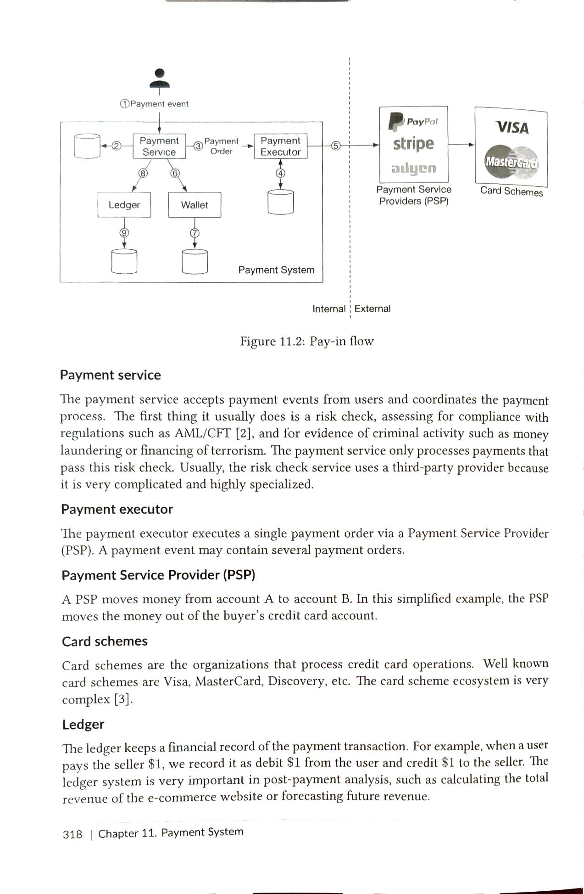

```
 [ Payment Event ]
        │
        ▼
┌──────────────────┐      ┌────────────────────┐
│ Payment Service  ├─────►│  Payment Executor  │
└────────┬─────────┘      └─────────┬──────────┘
         │                          │
         ├──────────────┐           │
         ▼              ▼           ▼
   ┌───────────┐  ┌───────────┐ ┌────────────────────────────────────────┐
   │  Ledger   │  │  Wallet   │ │ Payment Service Providers (PSP)        │
   │           │  │           │ │ (PayPal, Stripe, Adyen, ...)           │
   └───────────┘  └───────────┘ └───────────────────┬────────────────────┘
                                                    │
                                                    ▼
                                        ┌────────────────────────┐
                                        │      Card Schemes      │
                                        │  (Visa, Mastercard...) │
                                        └────────────────────────┘
 |<────── Payment System (Internal) ──────>| |<────── External ──────>|
```


*Hình 11.2: Luồng thu tiền (Pay-in flow)*

#### 1. Dịch Vụ Thanh Toán (Payment Service)
Dịch vụ thanh toán tiếp nhận các sự kiện thanh toán (**Payment Events**) từ người dùng và điều phối toàn bộ quy trình thanh toán. Việc đầu tiên dịch vụ này thường thực hiện là kiểm tra rủi ro (**Risk Check**), đánh giá mức độ tuân thủ các quy định pháp lý như phòng chống rửa tiền / chống tài trợ khủng bố (**AML/CFT - Anti-Money Laundering / Combating the Financing of Terrorism**) [2], cũng như phát hiện các dấu hiệu hoạt động tội phạm gian lận tài chính. Dịch vụ thanh toán chỉ xử lý các giao dịch vượt qua được bước kiểm tra rủi ro này. Thông thường, dịch vụ kiểm tra rủi ro sẽ sử dụng nhà cung cấp bên thứ ba do tính chất nghiệp vụ vô cùng phức tạp và đòi hỏi chuyên môn hóa cao.

#### 2. Bộ Thực Thi Thanh Toán (Payment Executor)
Bộ thực thi thanh toán thực thi một lệnh thanh toán đơn lẻ (**Payment Order**) thông qua một Nhà cung cấp dịch vụ thanh toán (**PSP - Payment Service Provider**). Một sự kiện thanh toán (**Payment Event**) có thể chứa nhiều lệnh thanh toán con.

#### 3. Nhà Cung Cấp Dịch Vụ Thanh Toán (PSP - Payment Service Provider)
Một PSP đảm nhiệm việc chuyển tiền từ tài khoản A sang tài khoản B. Trong ví dụ đơn giản hóa này, PSP sẽ trừ tiền và chuyển tiền ra khỏi tài khoản thẻ tín dụng của người mua.

#### 4. Tổ Chức Thẻ (Card Schemes)
Tổ chức thẻ là các tổ chức chuyên xử lý các hoạt động vận hành thẻ tín dụng. Các tổ chức thẻ nổi tiếng bao gồm Visa, MasterCard, Discover, American Express, v.v. Hệ sinh thái tổ chức thẻ là một mạng lưới rất phức tạp [3].

#### 5. Sổ Cái (Ledger)
Sổ cái lưu giữ hồ sơ tài chính kế toán của toàn bộ giao dịch thanh toán. Ví dụ, khi một người dùng thanh toán 1 USD cho người bán, chúng ta ghi nhận: **Ghi nợ (Debit) 1 USD** từ tài khoản người dùng và **Ghi có (Credit) 1 USD** vào tài khoản người bán. Hệ thống sổ cái đóng vai trò cốt lõi trong các phân tích tài chính hậu thanh toán (**Post-payment Analysis**), chẳng hạn như tính toán tổng doanh thu của website thương mại điện tử hoặc dự báo doanh thu trong tương lai.

---

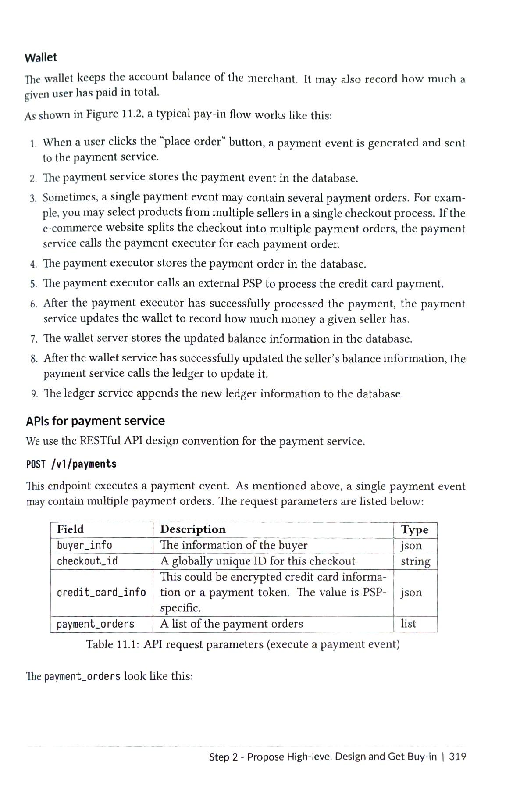

#### 6. Ví Điện Tử / Số Dư Tài Khoản (Wallet)
Hệ thống ví lưu giữ số dư tài khoản (**Account Balance**) của người bán (Merchant). Nó cũng có thể ghi nhận tổng số tiền mà một người dùng cụ thể đã chi trả lũy kế.

Như được minh họa trong **Hình 11.2**, một luồng thu tiền (**Pay-in flow**) điển hình diễn ra qua các bước tuần tự như sau:
1. Khi người dùng nhấp vào nút **"Đặt hàng" (Place Order)**, một sự kiện thanh toán (**Payment Event**) được tạo ra và gửi tới dịch vụ thanh toán (**Payment Service**).
2. Dịch vụ thanh toán lưu sự kiện thanh toán này vào cơ sở dữ liệu.
3. Đôi khi, một sự kiện thanh toán đơn lẻ có thể bao gồm nhiều lệnh thanh toán (**Payment Orders**). Ví dụ: bạn có thể chọn mua sản phẩm từ nhiều người bán khác nhau trong một lần thanh toán duy nhất (Checkout). Nếu website thương mại điện tử chia giỏ hàng thành nhiều lệnh thanh toán riêng biệt, dịch vụ thanh toán sẽ gọi bộ thực thi thanh toán (**Payment Executor**) cho từng lệnh thanh toán đó.
4. Bộ thực thi thanh toán lưu lệnh thanh toán vào cơ sở dữ liệu.
5. Bộ thực thi thanh toán gọi đến PSP bên ngoài để xử lý giao dịch thẻ tín dụng.
6. Sau khi bộ thực thi thanh toán đã xử lý giao dịch thành công, dịch vụ thanh toán sẽ cập nhật ví (**Wallet**) để ghi nhận số tiền mà người bán tương ứng nhận được.
7. Máy chủ ví lưu thông tin số dư đã được cập nhật vào cơ sở dữ liệu.
8. Sau khi dịch vụ ví đã cập nhật thành công số dư của người bán, dịch vụ thanh toán gọi sang hệ thống sổ cái (**Ledger**) để cập nhật bản ghi kế toán.
9. Dịch vụ sổ cái thêm mới (**Append-only**) thông tin sổ cái vào cơ sở dữ liệu.

---

### Các Giao Diện Lập Trình Ứng Dụng Cho Dịch Vụ Thanh Toán (APIs for Payment Service)

Chúng ta sử dụng quy ước thiết kế RESTful API cho dịch vụ thanh toán:

#### `POST /v1/payments`
Endpoint này dùng để thực thi một sự kiện thanh toán. Như đã đề cập ở trên, một sự kiện thanh toán có thể chứa nhiều lệnh thanh toán con. Các tham số yêu cầu (**Request Parameters**) được liệt kê dưới đây:

| Tên trường (Field) | Kiểu dữ liệu (Type) | Mô tả (Description) |
| :--- | :--- | :--- |
| `buyer_info` | `json` | Thông tin chi tiết của người mua |
| `checkout_id` | `string` | ID duy nhất toàn cầu (**Globally Unique ID**) cho phiên checkout này |
| `credit_card_info` | `json` | Có thể là thông tin thẻ tín dụng đã được mã hóa hoặc mã token thanh toán (**Payment Token**). Giá trị này mang tính đặc thù tùy theo từng PSP. |
| `payment_orders` | `list` | Danh sách các lệnh thanh toán con |

*Bảng 11.1: Các tham số yêu cầu API (Thực thi một sự kiện thanh toán)*

Cấu trúc của danh sách `payment_orders` có định dạng như sau:

---

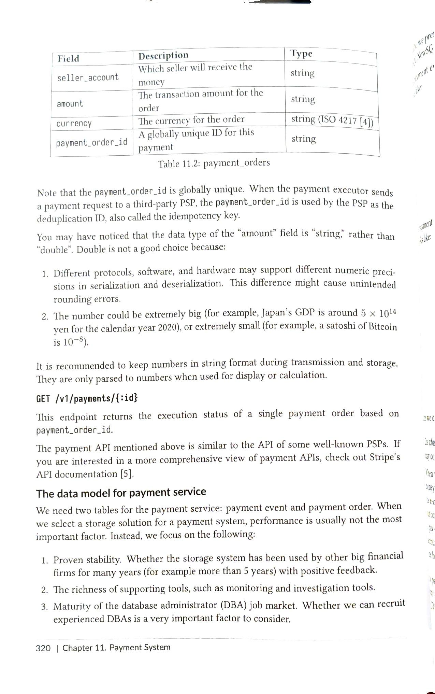

| Tên trường (Field) | Kiểu dữ liệu (Type) | Mô tả (Description) |
| :--- | :--- | :--- |
| `seller_account` | `string` | Tài khoản người bán nào sẽ nhận tiền |
| `amount` | `string` | Số tiền giao dịch cho đơn hàng |
| `currency` | `string` (ISO 4217 [4]) | Đơn vị tiền tệ của đơn hàng |
| `payment_order_id` | `string` | ID duy nhất toàn cầu cho lệnh thanh toán này |

*Bảng 11.2: Cấu trúc chi tiết của payment_orders*

> [!NOTE]
> Lưu ý rằng `payment_order_id` là mã định danh duy nhất toàn cầu. Mã này được PSP sử dụng làm khóa chống trùng lặp (**Deduplication ID**), hay còn gọi là **Khóa lũy kế / Khóa bất biến trạng thái (Idempotency Key)**.

> [!IMPORTANT]
> **Tại sao trường `amount` lại có kiểu dữ liệu là `string` thay vì kiểu số thực `double`?**
>
> `double` hoàn toàn không phải là sự lựa chọn tốt vì các lý do kỹ thuật sau:
> 1. Các giao thức truyền thông, phần mềm và nền tảng phần cứng khác nhau có thể hỗ trợ độ chính xác số học (**Numeric Precision**) khác nhau trong quá trình tuần tự hóa (**Serialization**) và giải tuần tự hóa (**Deserialization**). Sự khác biệt này có thể gây ra lỗi làm tròn số ngoài ý muốn (**Unintended Rounding Errors**), dẫn đến sai lệch tiền tệ.
> 2. Giá trị số có thể cực kỳ lớn (ví dụ: GDP của Nhật Bản xấp xỉ $5 \times 10^{14}$ Yên vào năm 2020), hoặc cực kỳ nhỏ (ví dụ: một satoshi của Bitcoin bằng $10^{-8}$ BTC).
>
> Khuyến nghị chuẩn kiến trúc là **luôn giữ các con số ở định dạng chuỗi (`string`) trong suốt quá trình truyền tải qua mạng và lưu trữ trong cơ sở dữ liệu**. Chúng chỉ nên được phân tích cú pháp (**Parse**) chuyển thành dạng số khi cần hiển thị trên giao diện người dùng hoặc khi thực hiện các phép tính toán học.

#### `GET /v1/payments/:id`
Endpoint này trả về trạng thái thực thi hiện tại của một lệnh thanh toán duy nhất dựa trên `payment_order_id`.

Các API thanh toán nêu trên tương đồng với thiết kế API của một số PSP nổi tiếng trong ngành. Nếu bạn muốn tìm hiểu một cái nhìn toàn diện hơn về các API thanh toán, hãy tham khảo tài liệu API chính thức của Stripe [5].

---

### Mô Hình Dữ Liệu Cho Dịch Vụ Thanh Toán (The Data Model for Payment Service)

Chúng ta cần hai bảng cơ sở dữ liệu cốt lõi cho dịch vụ thanh toán: bảng sự kiện thanh toán (**Payment Event**) và bảng lệnh thanh toán (**Payment Order**). 

Khi chúng ta lựa chọn giải pháp lưu trữ cho một hệ thống tài chính/thanh toán, **hiệu năng (Performance) thường không phải là yếu tố tiên quyết quan trọng nhất**. Thay vào đó, chúng ta tập trung cao độ vào các tiêu chí then chốt sau:

1. **Độ ổn định đã được kiểm chứng (Proven Stability):** Liệu hệ thống lưu trữ đó đã được các tổ chức tài chính lớn tin tưởng sử dụng trong nhiều năm (ví dụ trên 5 năm) với những phản hồi tích cực và sự ổn định tuyệt đối hay chưa.
2. **Sự phong phú của hệ sinh thái công cụ hỗ trợ (Richness of Supporting Tools):** Bao gồm các công cụ giám sát hiệu năng (**Monitoring**), truy vết, ghi log và điều tra lỗi (**Investigation Tools**).
3. **Mức độ trưởng thành của thị trường lao động cho Quản trị viên cơ sở dữ liệu (Maturity of DBA Job Market):** Khả năng tuyển dụng các kỹ sư DBA (Database Administrator) giàu kinh nghiệm là một yếu tố thực tế rất quan trọng cần phải cân nhắc trong vận hành hệ thống dài hạn.

# Chương 11: Hệ Thống Thanh Toán (Payment System)

---

### Trang 322

Thông thường, chúng ta ưu tiên sử dụng một cơ sở dữ liệu quan hệ (relational database) truyền thống có hỗ trợ giao dịch ACID (*Atomicity, Consistency, Isolation, Durability*) hơn là NoSQL/NewSQL.

Bảng sự kiện thanh toán (**payment event table**) chứa thông tin chi tiết về sự kiện thanh toán. Cấu trúc của bảng như sau:

| Tên trường (*Name*) | Kiểu dữ liệu (*Type*) |
| :--- | :--- |
| `checkout_id` | `string PK` *(Khóa chính)* |
| `buyer_info` | `string` |
| `seller_info` | `string` |
| `credit_card_info` | Phụ thuộc vào nhà cung cấp thẻ (*depends on the card provider*) |
| `is_payment_done` | `boolean` |

**Bảng 11.3: Sự kiện thanh toán (Payment event)**

Bảng lệnh thanh toán (**payment order table**) lưu trữ trạng thái thực thi của từng lệnh thanh toán. Cấu trúc của bảng như sau:

| Tên trường (*Name*) | Kiểu dữ liệu (*Type*) |
| :--- | :--- |
| `payment_order_id` | `String PK` *(Khóa chính)* |
| `buyer_account` | `string` |
| `amount` | `string` |
| `currency` | `string` |
| `checkout_id` | `string FK` *(Khóa ngoại)* |
| `payment_order_status` | `string` |
| `ledger_updated` | `boolean` |
| `wallet_updated` | `boolean` |

**Bảng 11.4: Lệnh thanh toán (Payment order)**

Trước khi đi sâu vào chi tiết các bảng, chúng ta hãy xem qua một số thông tin nền tảng:

* `checkout_id` là khóa ngoại (*foreign key*). Một lượt thanh toán đơn lẻ (*single checkout*) tạo ra một sự kiện thanh toán (*payment event*) và sự kiện này có thể chứa nhiều lệnh thanh toán (*payment orders*).
* Khi chúng ta gọi một PSP bên thứ ba (*third-party PSP - Payment Service Provider*) để trừ tiền từ thẻ tín dụng của người mua, tiền không được chuyển trực tiếp đến người bán. Thay vào đó, tiền được chuyển vào tài khoản ngân hàng của trang web thương mại điện tử. Quy trình này được gọi là **pay-in** (*thu tiền vào*). Khi điều kiện giải ngân (**pay-out**) được thỏa mãn, chẳng hạn như khi hàng hóa đã được giao thành công, người bán sẽ khởi tạo một yêu cầu giải ngân (*pay-out*). Chỉ khi đó, tiền mới được chuyển từ tài khoản ngân hàng của trang web thương mại điện tử sang tài khoản ngân hàng của người bán. Do đó, trong suốt luồng pay-in, chúng ta chỉ cần thông tin thẻ của người mua chứ không cần thông tin tài khoản ngân hàng của người bán.

Trong bảng lệnh thanh toán (**Bảng 11.4**), `payment_order_status` là một kiểu liệt kê (*enumeration - enum*) lưu giữ trạng thái thực thi của lệnh thanh toán. Trạng thái thực thi bao gồm `NOT_STARTED`, `EXECUTING`, `SUCCESS`, `FAILED`. Logic cập nhật trạng thái như sau:

1. Trạng thái ban đầu của `payment_order_status` là `NOT_STARTED`.

---

### Trang 323

`payment_order_status` chuyển sang `EXECUTING`. Tùy thuộc vào phản hồi từ bộ thực thi thanh toán (*payment executor*):
* Cập nhật số dư của người bán và cập nhật trường `wallet_updated` thành `TRUE`. Ở đây, chúng ta đơn giản hóa thiết kế bằng cách giả định rằng các cập nhật ví (*wallet updates*) luôn luôn thành công.
* Sau khi hoàn tất, bước tiếp theo của dịch vụ thanh toán (*payment service*) là gọi dịch vụ sổ cái (*ledger service*) để cập nhật cơ sở dữ liệu sổ cái bằng cách chuyển trường `ledger_updated` thành `TRUE`.

Khi tất cả các lệnh thanh toán thuộc cùng một `checkout_id` được xử lý thành công, dịch vụ thanh toán sẽ cập nhật trường `is_payment_done` thành `TRUE` trong bảng sự kiện thanh toán. Một tác vụ định kỳ (*scheduled job*) thường chạy theo một chu kỳ cố định để giám sát trạng thái của các lệnh thanh toán đang xử lý dở dang (*in-flight payment orders*). Nó sẽ gửi cảnh báo (*alert*) khi một lệnh thanh toán không hoàn thành trong một ngưỡng thời gian quy định (*threshold*) để các kỹ sư có thể điều tra xử lý.

#### Hệ thống sổ cái kép (Double-entry ledger system)

Có một nguyên tắc thiết kế vô cùng quan trọng trong hệ thống sổ cái: nguyên tắc ghi sổ kép (*double-entry principle*, còn được gọi là kế toán/ghi sổ kép - *double-entry accounting/bookkeeping* [6]). Hệ thống sổ cái kép là nền tảng cốt lõi cho bất kỳ hệ thống thanh toán nào và là chìa khóa để ghi chép kế toán chính xác. Nó ghi lại mọi giao dịch thanh toán vào hai tài khoản sổ cái riêng biệt với cùng một số tiền. Một tài khoản sẽ được ghi Nợ (*debited*) và tài khoản còn lại sẽ được ghi Có (*credited*) với cùng một lượng tiền chính xác (**Bảng 11.5**).

| Tài khoản (*Account*) | Nợ (*Debit*) | Có (*Credit*) |
| :--- | :--- | :--- |
| Người mua (*buyer*) | $1 | |
| Người bán (*seller*) | | $1 |

**Bảng 11.5: Hệ thống sổ cái kép (Double-entry system)**

Hệ thống sổ cái kép quy định rằng tổng giá trị của tất cả các bút toán giao dịch (*transaction entries*) phải bằng **0**. Mất một xu ở nơi này đồng nghĩa với việc ai đó khác nhận được một xu. Nó cung cấp khả năng truy vết xuyên suốt từ đầu đến cuối (*end-to-end traceability*) và đảm bảo tính nhất quán (*consistency*) trong toàn bộ chu kỳ thanh toán. Để tìm hiểu thêm về cách triển khai hệ thống sổ cái kép, hãy tham khảo bài viết kỹ thuật trên blog của Square về dịch vụ cơ sở dữ liệu kế toán ghi sổ kép bất biến (*immutable double-entry accounting database service*) [7].

#### Trang thanh toán ủy quyền (Hosted payment page)

Hầu hết các công ty đều ưu tiên không lưu trữ thông tin thẻ tín dụng trong hệ thống nội bộ của mình, bởi vì nếu làm vậy, họ sẽ phải tuân thủ các quy định pháp lý và tiêu chuẩn bảo mật vô cùng phức tạp như Tiêu chuẩn Bảo mật Dữ liệu Ngành Thẻ Thanh toán (*PCI DSS - Payment Card Industry Data Security Standard*) [8] tại Hoa Kỳ. Để tránh việc phải xử lý và lưu giữ thông tin thẻ tín dụng, các công ty sử dụng các trang thanh toán thẻ tín dụng do chính PSP lưu trữ và cung cấp (*hosted credit card pages*). Đối với các trang web, đó là một tiện ích giao diện (*widget*) hoặc một `iframe`, trong khi đối với các ứng dụng di động, đó có thể là một trang giao diện được xây dựng sẵn từ SDK thanh toán. **Hình 11.3** minh họa một ví dụ về trải nghiệm thanh toán tích hợp với PayPal: thu thập trực tiếp thông tin thẻ của khách hàng thay vì phụ thuộc vào dịch vụ thanh toán nội bộ của chúng ta.

---

### Trang 324

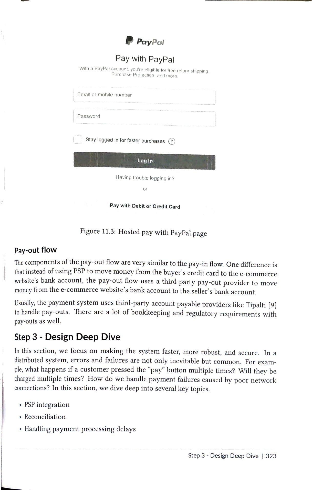

**Hình 11.3: Trang thanh toán ủy quyền bằng PayPal (Hosted pay with PayPal page)**

#### Luồng giải ngân (Pay-out flow)

Các thành phần của luồng giải ngân (*pay-out flow*) rất tương đồng với luồng thu tiền (*pay-in flow*). Một điểm khác biệt là thay vì sử dụng PSP để chuyển tiền từ thẻ tín dụng của người mua vào tài khoản ngân hàng của trang web thương mại điện tử, luồng giải ngân sử dụng một nhà cung cấp dịch vụ giải ngân bên thứ ba (*third-party pay-out provider*) để chuyển tiền từ tài khoản ngân hàng của trang web thương mại điện tử sang tài khoản ngân hàng của người bán.

Thông thường, hệ thống thanh toán sử dụng các nhà cung cấp dịch vụ quản lý công nợ phải trả bên thứ ba (*third-party account payable providers*) như Tipalti [9] để xử lý các khoản giải ngân. Ngoài ra, việc giải ngân cũng đi kèm rất nhiều yêu cầu nghiêm ngặt về kế toán sổ sách và tuân thủ quy định pháp lý (*regulatory requirements*).

---

## Bước 3 - Đi Sâu Vào Thiết Kế Chi Tiết (Step 3 - Design Deep Dive)

Trong phần này, chúng ta tập trung vào việc làm cho hệ thống vận hành nhanh hơn, mạnh mẽ hơn (*robust*) và an toàn hơn (*secure*). Trong một hệ thống phân tán (*distributed system*), các lỗi và sự cố không chỉ là điều không thể tránh khỏi mà còn diễn ra rất thường xuyên. Ví dụ:
* Điều gì sẽ xảy ra nếu khách hàng bấm nút "thanh toán" nhiều lần? Liệu họ có bị trừ tiền nhiều lần không?
* Chúng ta xử lý các sự cố thanh toán do kết nối mạng chập chờn như thế nào?

Trong phần này, chúng ta sẽ đi sâu vào một số chủ đề then chốt:

* Tích hợp PSP (*PSP integration*)
* Đối soát (*Reconciliation*)
* Xử lý độ trễ trong quá trình xử lý thanh toán (*Handling payment processing delays*)

---

### Trang 325

* Giao tiếp giữa các dịch vụ nội bộ (*Communication among internal services*)
* Xử lý các giao dịch thanh toán thất bại (*Handling failed payments*)
* Phân phát chính xác một lần (*Exactly-once delivery*)
* Tính nhất quán (*Consistency*)
* Bảo mật (*Security*)

### Tích hợp PSP (PSP integration)

Nếu hệ thống thanh toán có thể kết nối trực tiếp đến các ngân hàng hoặc mạng lưới tổ chức thẻ (*card schemes*) như Visa hay MasterCard, giao dịch thanh toán có thể được thực hiện mà không cần thông qua một PSP. Tuy nhiên, các kết nối trực tiếp này rất hiếm gặp và đòi hỏi sự chuyên biệt hóa cực kỳ cao. Chúng thường chỉ dành riêng cho các tập đoàn quy mô rất lớn, có tiềm lực tài chính tương xứng với khoản đầu tư khổng lồ như vậy. Đối với phần lớn các công ty, hệ thống thanh toán sẽ tích hợp với một PSP theo một trong hai cách sau:

1. Nếu công ty có đủ năng lực lưu trữ an toàn thông tin thanh toán nhạy cảm và lựa chọn phương án này, PSP có thể được tích hợp thông qua API. Khi đó, công ty chịu trách nhiệm phát triển các trang web thanh toán, thu thập và lưu trữ thông tin thanh toán nhạy cảm. PSP chịu trách nhiệm kết nối đến các ngân hàng hoặc các mạng lưới tổ chức thẻ.
2. Nếu công ty chọn không lưu trữ thông tin thanh toán nhạy cảm do các rào cản về quy định pháp lý phức tạp và lo ngại về an ninh bảo mật, PSP sẽ cung cấp một trang thanh toán ủy quyền (*hosted payment page*) để thu thập chi tiết thẻ thanh toán và lưu trữ an toàn trực tiếp ngay tại hệ thống của PSP. Đây là phương pháp tiếp cận mà đa số các công ty lựa chọn.

Chúng ta sử dụng **Hình 11.4** để giải thích chi tiết cách thức hoạt động của trang thanh toán ủy quyền (*hosted payment page*).

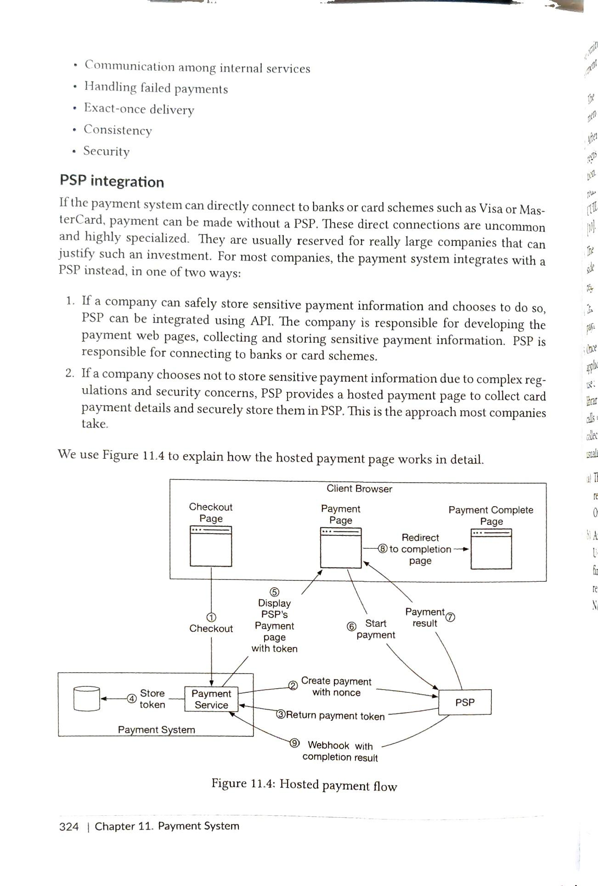

**Hình 11.4: Luồng thanh toán ủy quyền (Hosted payment flow)**

---

### Trang 326

Chúng tôi đã lược bỏ các thành phần *payment executor*, *ledger*, và *wallet* trong **Hình 11.4** để sơ đồ được trực quan, đơn giản. Luồng thực thi chi tiết diễn ra như sau:

1. Người dùng nhấp vào nút "Checkout" (Thanh toán) trên trình duyệt máy khách (*client browser*). Máy khách sẽ gọi dịch vụ thanh toán (*payment service*) kèm theo thông tin của lệnh thanh toán.
2. Sau khi nhận được thông tin lệnh thanh toán, dịch vụ thanh toán gửi một yêu cầu đăng ký thanh toán (*payment registration request*) đến PSP. Yêu cầu đăng ký này chứa các thông tin thanh toán như: số tiền (*amount*), loại tiền tệ (*currency*), thời gian hết hạn của yêu cầu thanh toán (*expiration date*), và URL điều hướng (*redirect URL*). Vì một lệnh thanh toán chỉ được phép đăng ký duy nhất một lần, hệ thống sử dụng một trường UUID để đảm bảo tính đăng ký chính xác một lần (*exactly-once registration*). UUID này còn được gọi là **nonce** [10]. Thông thường, UUID này chính là ID của lệnh thanh toán (*payment order ID*).
3. PSP trả về một mã token (*token*) cho dịch vụ thanh toán. Token này là một UUID từ phía PSP, có nhiệm vụ định danh duy nhất cho lượt đăng ký thanh toán đó. Về sau, chúng ta có thể kiểm tra lượt đăng ký thanh toán và trạng thái thực thi giao dịch thanh toán thông qua token này.
4. Dịch vụ thanh toán lưu trữ token vào cơ sở dữ liệu trước khi gọi trang thanh toán do PSP lưu trữ (*PSP-hosted payment page*).
5. Khi token đã được lưu bền vững (*persisted*), máy khách sẽ hiển thị trang thanh toán do PSP lưu trữ. Các ứng dụng di động thường sử dụng SDK tích hợp của PSP để triển khai tính năng này. Ở đây, chúng ta lấy ví dụ về việc tích hợp web của Stripe (**Hình 11.5**). Stripe cung cấp một thư viện JavaScript hiển thị giao diện người dùng thanh toán (UI), thu thập thông tin thanh toán nhạy cảm và gọi trực tiếp đến PSP để hoàn tất việc thanh toán. Thông tin thanh toán nhạy cảm do Stripe thu thập và xử lý; nó hoàn toàn không bao giờ chạm tới hay đi qua hệ thống thanh toán nội bộ của chúng ta. Trang thanh toán ủy quyền thông thường cần hai thông tin quan trọng:
   * **(a)** Mã token nhận được ở bước 4. Mã JavaScript của PSP sử dụng token này để truy xuất thông tin chi tiết về yêu cầu thanh toán từ backend của PSP. Một thông tin cực kỳ quan trọng trong số đó là số tiền cần phải thu.
   * **(b)** Một thông tin quan trọng khác là URL điều hướng (*redirect URL*). Đây là URL của trang web sẽ được gọi đến khi thanh toán hoàn tất. Khi mã JavaScript của PSP hoàn thành giao dịch thanh toán, nó sẽ điều hướng trình duyệt về URL điều hướng này. Thông thường, redirect URL là một trang web của sàn thương mại điện tử hiển thị trạng thái của đơn hàng thanh toán. Lưu ý rằng redirect URL hoàn toàn khác với URL Webhook [11] ở bước 9.

---

### Trang 327

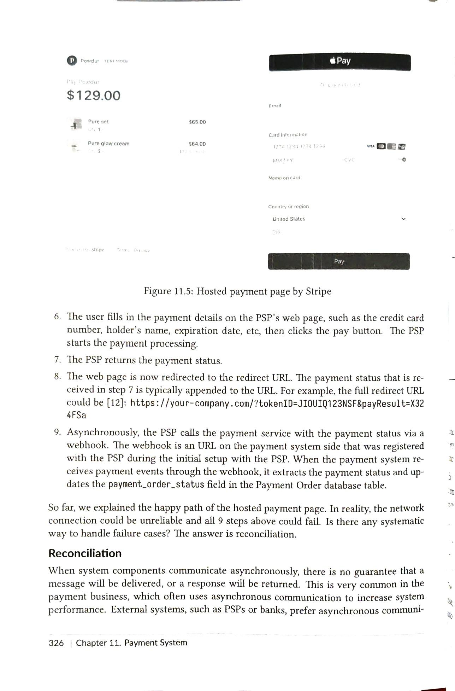

**Hình 11.5: Trang thanh toán ủy quyền cung cấp bởi Stripe (Hosted payment page by Stripe)**

6. Người dùng điền các thông tin thanh toán chi tiết trên trang web của PSP, chẳng hạn như số thẻ tín dụng, tên chủ thẻ, ngày hết hạn, v.v., sau đó nhấp vào nút thanh toán (*pay button*). PSP bắt đầu quá trình xử lý giao dịch thanh toán.
7. PSP trả về trạng thái thanh toán (*payment status*).
8. Trang web lúc này được điều hướng về URL điều hướng (*redirect URL*). Trạng thái thanh toán nhận được ở bước 7 thường được gắn kèm vào URL. Ví dụ, URL điều hướng hoàn chỉnh có thể có định dạng [12]:
   `https://your-company.com/?tokenID=JI0UIQ123NSF&payResult=X324FSa`
9. Một cách bất đồng bộ (*asynchronously*), PSP gọi dịch vụ thanh toán kèm theo trạng thái thanh toán thông qua một Webhook. Webhook là một URL ở phía hệ thống thanh toán đã được đăng ký trước với PSP trong quá trình thiết lập ban đầu. Khi hệ thống thanh toán nhận được các sự kiện thanh toán thông qua Webhook, nó sẽ trích xuất trạng thái thanh toán và cập nhật trường `payment_order_status` trong bảng cơ sở dữ liệu Lệnh Thanh Toán (*Payment Order*).

Cho đến thời điểm này, chúng ta mới chỉ giải thích kịch bản thuận lợi (*happy path*) của trang thanh toán ủy quyền. Trong thực tế, kết nối mạng hoàn toàn có thể không đáng tin cậy (*unreliable*) và tất cả 9 bước nêu trên đều có khả năng gặp lỗi thất bại. Liệu có phương pháp mang tính hệ thống nào để xử lý các tình huống lỗi này hay không? Câu trả lời chính là **đối soát (reconciliation)**.

#### Đối soát (Reconciliation)

Khi các thành phần trong hệ thống giao tiếp bất đồng bộ với nhau, không có gì đảm bảo rằng một thông điệp chắc chắn sẽ được chuyển phát tới đích (*message delivery*), hoặc một phản hồi chắc chắn sẽ được trả về. Tình huống này xảy ra rất phổ biến trong lĩnh vực thanh toán, nơi thường xuyên áp dụng giao tiếp bất đồng bộ (*asynchronous communication*) để nâng cao hiệu năng hệ thống (*system performance*). Các hệ thống bên ngoài, chẳng hạn như các PSP hoặc ngân hàng, cũng ưu tiên sử dụng giao tiếp bất đồng bộ...

# CHƯƠNG 11: HỆ THỐNG THANH TOÁN (PAYMENT SYSTEM)

---

### Trang 328

...cũng như giao tiếp (communication). Vậy làm thế nào chúng ta có thể đảm bảo tính đúng đắn (correctness) trong trường hợp này?

Câu trả lời chính là **đối soát (reconciliation)**. Đây là một thực hành định kỳ so sánh trạng thái giữa các dịch vụ liên quan nhằm xác minh rằng chúng hoàn toàn thống nhất với nhau. Nó thường là tuyến phòng thủ cuối cùng (last line of defense) trong hệ thống thanh toán.

Mỗi đêm, cổng cung cấp dịch vụ thanh toán (Payment Service Provider - PSP) hoặc các ngân hàng sẽ gửi một **tệp quyết toán (settlement file)** cho khách hàng của họ. Tệp quyết toán chứa số dư của tài khoản ngân hàng, cùng với tất cả các giao dịch đã diễn ra trên tài khoản ngân hàng này trong ngày. Hệ thống đối soát sẽ phân tích cú pháp (parse) tệp quyết toán và so sánh các chi tiết này với hệ thống sổ cái (ledger system). Hình 11.6 dưới đây minh họa vị trí của tiến trình đối soát trong hệ thống tổng thể.

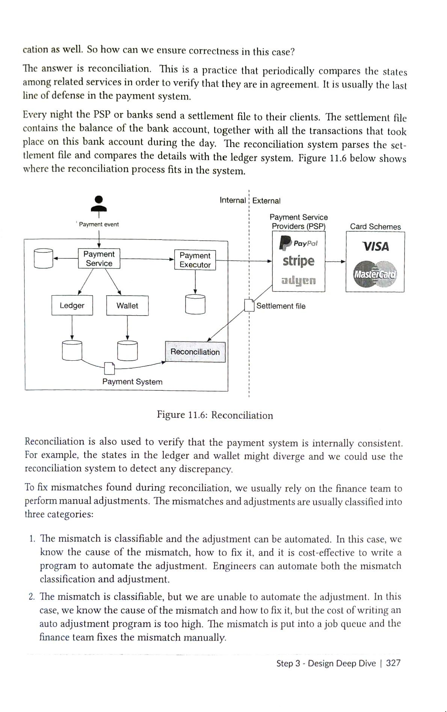
*Hình 11.6: Đối soát (Reconciliation)*

Đối soát cũng được sử dụng để xác minh rằng hệ thống thanh toán có tính nhất quán nội bộ (internally consistent). Ví dụ, các trạng thái trong sổ cái (ledger) và ví điện tử (wallet) có thể bị phân kỳ (diverge), và chúng ta có thể sử dụng hệ thống đối soát để phát hiện bất kỳ sự sai lệch (discrepancy) nào.

Để khắc phục các điểm không khớp (mismatches) được phát hiện trong quá trình đối soát, chúng ta thường dựa vào đội ngũ tài chính để thực hiện điều chỉnh thủ công (manual adjustments). Các điểm không khớp và các điều chỉnh thường được phân loại thành ba nhóm:

1. **Sai lệch có thể phân loại và việc điều chỉnh có thể tự động hóa (The mismatch is classifiable and the adjustment can be automated):** Trong trường hợp này, chúng ta biết nguyên nhân gây ra sự không khớp, biết cách khắc phục, và việc viết một chương trình để tự động hóa việc điều chỉnh là hiệu quả về mặt chi phí (cost-effective). Các kỹ sư có thể tự động hóa cả việc phân loại sai lệch lẫn quá trình điều chỉnh.
2. **Sai lệch có thể phân loại, nhưng chúng ta không thể tự động hóa việc điều chỉnh (The mismatch is classifiable, but we are unable to automate the adjustment):** Trong trường hợp này, chúng ta biết nguyên nhân sai lệch và cách khắc phục, nhưng chi phí viết một chương trình tự động điều chỉnh là quá cao. Điểm sai lệch sẽ được đưa vào một hàng đợi công việc (job queue) và đội ngũ tài chính sẽ xử lý, khắc phục sai lệch này một cách thủ công.

---

### Trang 329

3. **Sai lệch không thể phân loại (The mismatch is unclassifiable):** Trong trường hợp này, chúng ta không biết sai lệch xảy ra như thế nào. Sai lệch sẽ được đưa vào một hàng đợi công việc đặc biệt. Đội ngũ tài chính sẽ tiến hành điều tra thủ công.

---

### Xử lý sự chậm trễ trong xử lý thanh toán (Handling payment processing delays)

Như đã thảo luận trước đó, một yêu cầu thanh toán đầu-cuối (end-to-end payment request) luân chuyển qua nhiều thành phần và liên quan đến cả các bên nội bộ lẫn đối tác bên ngoài. Mặc dù trong hầu hết các trường hợp, một yêu cầu thanh toán sẽ hoàn tất trong vài giây, nhưng có những tình huống mà yêu cầu thanh toán bị đình trệ (stall) và đôi khi mất hàng giờ hoặc nhiều ngày trước khi nó được hoàn thành hoặc bị từ chối. Dưới đây là một số ví dụ mà một yêu cầu thanh toán có thể mất nhiều thời gian hơn bình thường:

- PSP đánh giá một yêu cầu thanh toán là có rủi ro cao (high risk) và yêu cầu con người xem xét, phê duyệt thủ công.
- Thẻ tín dụng yêu cầu lớp bảo vệ bổ sung như Xác thực 3D Secure (3D Secure Authentication [13]), đòi hỏi thêm thông tin chi tiết từ chủ thẻ để xác minh giao dịch mua hàng.

Dịch vụ thanh toán phải có khả năng xử lý các yêu cầu thanh toán mất nhiều thời gian xử lý này. Nếu trang thanh toán (buy page) được lưu trữ (hosted) bởi một PSP bên ngoài—điều vốn khá phổ biến hiện nay—thì PSP sẽ xử lý các yêu cầu thanh toán kéo dài này theo các cách sau:

- PSP sẽ trả về trạng thái **đang chờ xử lý (pending)** cho máy khách (client) của chúng ta. Client sẽ hiển thị trạng thái đó cho người dùng. Client của chúng ta cũng sẽ cung cấp một trang để khách hàng kiểm tra trạng thái thanh toán hiện tại.
- PSP thay mặt chúng ta theo dõi khoản thanh toán đang chờ xử lý, và thông báo cho dịch vụ thanh toán về bất kỳ cập nhật trạng thái nào thông qua **webhook** mà dịch vụ thanh toán đã đăng ký với PSP.

Khi yêu cầu thanh toán cuối cùng đã hoàn tất, PSP sẽ gọi webhook đã đăng ký nói trên. Dịch vụ thanh toán cập nhật hệ thống nội bộ của mình và tiến hành hoàn tất việc giao hàng cho khách hàng.

Ngoài ra, thay vì cập nhật dịch vụ thanh toán qua webhook, một số PSP lại đẩy gánh nặng sang dịch vụ thanh toán bằng cách yêu cầu hệ thống phải thực hiện thăm dò (poll) PSP định kỳ để lấy thông tin cập nhật trạng thái của bất kỳ yêu cầu thanh toán nào đang chờ xử lý.

---

### Giao tiếp giữa các dịch vụ nội bộ (Communication among internal services)

Có hai mẫu giao tiếp (communication patterns) mà các dịch vụ nội bộ sử dụng để trao đổi thông tin: **đồng bộ (synchronous)** và **bất đồng bộ (asynchronous)**. Cả hai đều được giải thích chi tiết dưới đây.

#### Giao tiếp đồng bộ (Synchronous communication)
Giao tiếp đồng bộ như HTTP hoạt động tốt đối với các hệ thống quy mô nhỏ, nhưng các nhược điểm của nó trở nên rõ ràng khi quy mô (scale) tăng lên. Nó tạo ra một chu kỳ yêu cầu - phản hồi (request - response cycle) kéo dài phụ thuộc vào nhiều dịch vụ. Các nhược điểm của cách tiếp cận này là:

- **Hiệu năng thấp (Low performance):** Nếu bất kỳ một dịch vụ nào trong chuỗi xử lý hoạt động kém, toàn bộ hệ thống sẽ bị ảnh hưởng.

---

### Trang 330

- **Cô lập lỗi kém (Poor failure isolation):** Nếu các PSP hoặc bất kỳ dịch vụ nào khác gặp sự cố, máy khách sẽ không còn nhận được phản hồi.
- **Ràng buộc chặt chẽ (Tight coupling):** Bên gửi yêu cầu cần phải biết rõ bên nhận yêu cầu.
- **Khó mở rộng (Hard to scale):** Nếu không sử dụng hàng đợi (queue) đóng vai trò như một bộ đệm (buffer), hệ thống sẽ không dễ dàng mở rộng (scale) để hỗ trợ lưu lượng truy cập tăng đột biến.

#### Giao tiếp bất đồng bộ (Asynchronous communication)
Giao tiếp bất đồng bộ có thể được chia thành hai nhóm:

- **Một bên nhận đơn lẻ (Single receiver):** Mỗi yêu cầu (thông điệp - message) được xử lý bởi một bên nhận hoặc một dịch vụ duy nhất. Nó thường được triển khai thông qua một hàng đợi thông điệp dùng chung (shared message queue). Hàng đợi thông điệp có thể có nhiều người tiêu thụ (consumers), nhưng mỗi thông điệp chỉ được xử lý bởi một consumer duy nhất.

Hãy xem một ví dụ cụ thể. Trong Hình 11.7, Service A và Service B đều đăng ký (subscribe) vào một hàng đợi thông điệp dùng chung. Khi thông điệp $m_1$ và $m_2$ lần lượt được tiêu thụ bởi Service A và Service B, cả hai thông điệp này đều bị xóa khỏi hàng đợi như được minh họa trong Hình 11.8.

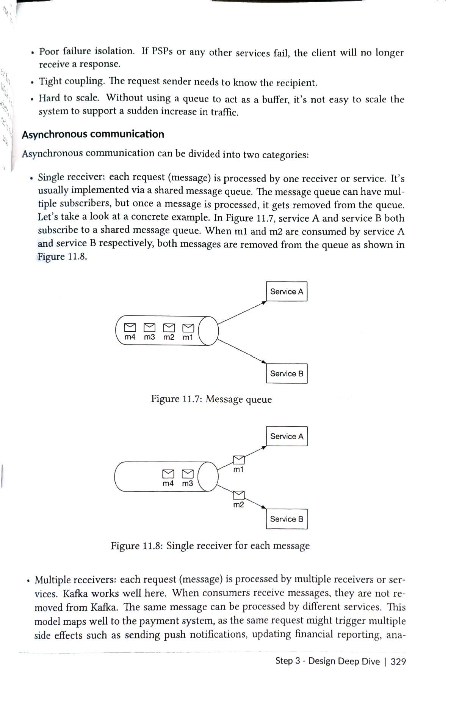
*Hình 11.7: Hàng đợi thông điệp (Message queue)*


*Hình 11.8: Một bên nhận duy nhất cho mỗi thông điệp (Single receiver for each message)*

- **Nhiều bên nhận (Multiple receivers):** Mỗi yêu cầu (thông điệp) được xử lý bởi nhiều bên nhận hoặc nhiều dịch vụ khác nhau. Apache Kafka hoạt động rất tốt cho trường hợp này. Khi các consumer nhận thông điệp, chúng không bị xóa khỏi Kafka. Cùng một thông điệp có thể được xử lý bởi các dịch vụ khác nhau. Mô hình này rất phù hợp với hệ thống thanh toán, vì cùng một yêu cầu thanh toán có thể kích hoạt nhiều tác dụng phụ (side effects) khác nhau, chẳng hạn như gửi thông báo đẩy (push notifications), cập nhật báo cáo tài chính, phân tích dữ liệu...

---

### Trang 331

...dịch vụ phân tích (analytics service), và dịch vụ thanh toán hóa đơn (billing service).

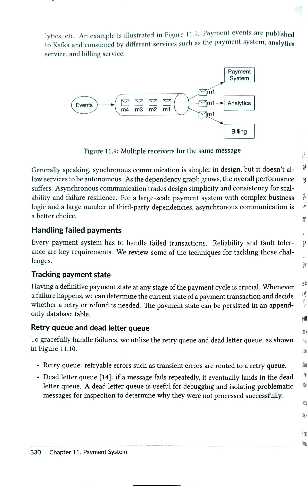
*Hình 11.9: Nhiều bên nhận cho cùng một thông điệp (Multiple receivers for the same message)*

Nhìn chung, giao tiếp đồng bộ có thiết kế đơn giản hơn, nhưng nó không cho phép các dịch vụ hoạt động một cách tự chủ (autonomous). Khi đồ thị phụ thuộc (dependency graph) phình to, hiệu năng tổng thể sẽ sụt giảm. Giao tiếp bất đồng bộ đánh đổi sự đơn giản trong thiết kế và tính nhất quán tức thời để lấy khả năng mở rộng (scalability) và khả năng phục hồi khi có lỗi (failure resilience). Đối với một hệ thống thanh toán quy mô lớn với logic nghiệp vụ phức tạp cùng số lượng lớn các phụ thuộc vào bên thứ ba, giao tiếp bất đồng bộ là một sự lựa chọn tốt hơn.

---

### Xử lý các khoản thanh toán thất bại (Handling failed payments)

Mọi hệ thống thanh toán đều phải xử lý các giao dịch thất bại. Độ tin cậy (reliability) và khả năng chịu lỗi (fault tolerance) là những yêu cầu cốt lõi. Chúng ta sẽ xem xét một số kỹ thuật để giải quyết các thách thức này.

#### Theo dõi trạng thái thanh toán (Tracking payment state)
Việc có một trạng thái thanh toán xác định (definitive payment state) tại bất kỳ giai đoạn nào của chu kỳ thanh toán là tối quan trọng. Bất cứ khi nào xảy ra sự cố, chúng ta có thể xác định trạng thái hiện tại của giao dịch thanh toán và quyết định xem có cần thực hiện thử lại (retry) hay hoàn tiền (refund) hay không. Trạng thái thanh toán có thể được lưu trữ bền vững (persisted) trong một bảng cơ sở dữ liệu chỉ ghi thêm (append-only database table).

#### Hàng đợi thử lại và hàng đợi thư chết (Retry queue and dead letter queue)
Để xử lý các sự cố một cách mềm dẻo (gracefully), chúng ta sử dụng hàng đợi thử lại (retry queue) và hàng đợi thư chết (dead letter queue - DLQ), như được minh họa trong Hình 11.10.

- **Hàng đợi thử lại (Retry queue):** Các lỗi có thể thử lại được (retryable errors) chẳng hạn như các lỗi tạm thời (transient errors) sẽ được định tuyến vào hàng đợi thử lại.
- **Hàng đợi thư chết (Dead letter queue [14]):** Nếu một thông điệp thất bại liên tục nhiều lần, cuối cùng nó sẽ rơi vào hàng đợi thư chết. Hàng đợi thư chết rất hữu ích cho việc gỡ lỗi (debugging) và cô lập các thông điệp có vấn đề để kiểm tra nhằm xác định nguyên nhân tại sao chúng không được xử lý thành công.

---

### Trang 332

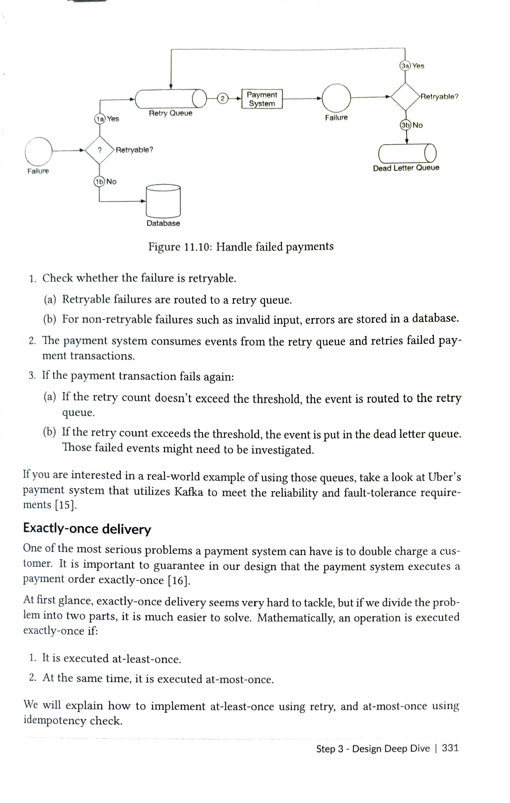
*Hình 11.10: Xử lý các khoản thanh toán thất bại (Handle failed payments)*

1. Kiểm tra xem lỗi đó có thể thử lại được hay không (Check whether the failure is retryable).
   - (a) Các lỗi có thể thử lại (retryable failures) được định tuyến đến một hàng đợi thử lại (retry queue).
   - (b) Đối với các lỗi không thể thử lại (non-retryable failures) chẳng hạn như đầu vào không hợp lệ (invalid input), các lỗi này được lưu trữ vào cơ sở dữ liệu.
2. Hệ thống thanh toán tiêu thụ các sự kiện từ hàng đợi thử lại và thực hiện thử lại các giao dịch thanh toán thất bại.
3. Nếu giao dịch thanh toán tiếp tục thất bại một lần nữa:
   - (a) Nếu số lần thử lại (retry count) chưa vượt quá ngưỡng quy định (threshold), sự kiện lại được đưa trở lại hàng đợi thử lại.
   - (b) Nếu số lần thử lại vượt quá ngưỡng quy định, sự kiện sẽ được đưa vào hàng đợi thư chết (dead letter queue). Những sự kiện thất bại này có thể cần phải được điều tra thủ công.

> [!NOTE]
> Nếu bạn quan tâm đến một ví dụ thực tế về việc áp dụng các hàng đợi này, hãy xem hệ thống thanh toán của Uber – nơi sử dụng Apache Kafka để đáp ứng các yêu cầu khắt khe về độ tin cậy (reliability) và khả năng chịu lỗi (fault-tolerance) [15].

---

### Phân phối chính xác một lần (Exactly-once delivery)

Một trong những vấn đề nghiêm trọng nhất mà một hệ thống thanh toán có thể gặp phải là trừ tiền hai lần của khách hàng (double charge a customer). Việc đảm bảo trong thiết kế rằng hệ thống thanh toán thực thi một lệnh thanh toán **chính xác một lần (exactly-once)** [16] là vô cùng quan trọng.

Thoạt nhìn, bài toán phân phối chính xác một lần (exactly-once delivery) có vẻ rất khó giải quyết, nhưng nếu chúng ta chia nhỏ bài toán thành hai phần, nó sẽ trở nên dễ giải quyết hơn nhiều. Về mặt toán học, một thao tác được thực thi chính xác một lần (exactly-once) nếu:

1. Nó được thực thi **ít nhất một lần (at-least-once)**.
2. Đồng thời, nó được thực thi **tối đa một lần (at-most-once)**.

Chúng tôi sẽ giải thích cách triển khai cơ chế **ít nhất một lần (at-least-once)** bằng cách sử dụng cơ chế **thử lại (retry)**, và cơ chế **tối đa một lần (at-most-once)** bằng cách sử dụng **kiểm tra tính lũy kế / tính bất biến (idempotency check)**.

---

### Trang 333

#### Thử lại (Retry)
Đôi khi, chúng ta cần phải thử lại một giao dịch thanh toán do lỗi mạng hoặc hết thời gian chờ (timeout). Cơ chế thử lại cung cấp sự đảm bảo **ít nhất một lần (at-least-once)**. 

Ví dụ, như minh họa trong Hình 11.11, máy khách (client) cố gắng thực hiện khoản thanh toán $10, nhưng yêu cầu thanh toán liên tục thất bại do kết nối mạng kém. Trong ví dụ này, kết nối mạng cuối cùng đã phục hồi và yêu cầu đã thành công ở lần thử thứ tư.

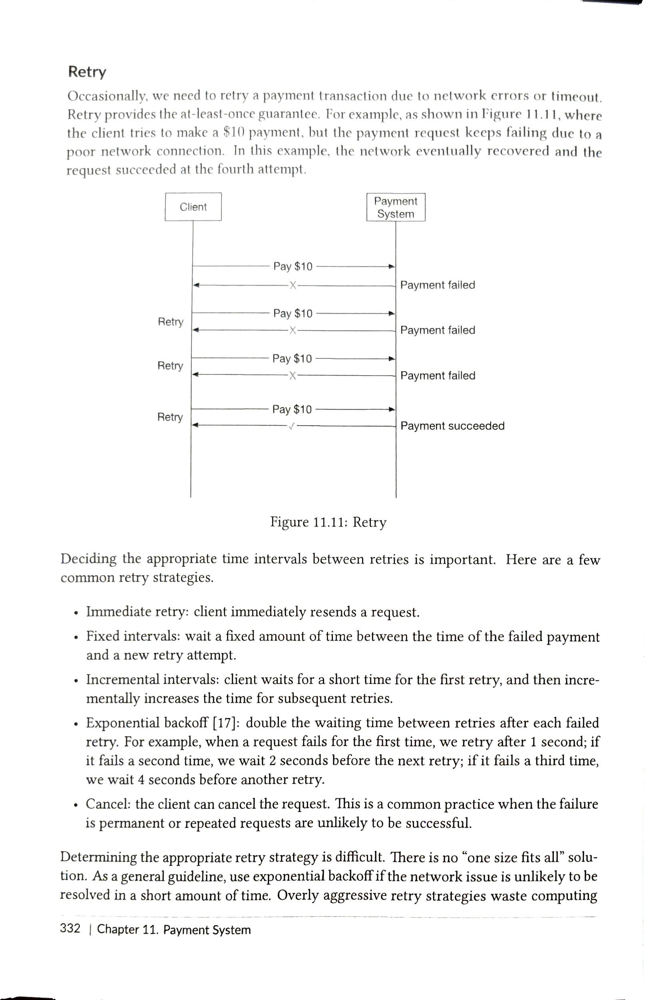
*Hình 11.11: Thử lại (Retry)*

Việc quyết định các khoảng thời gian thích hợp giữa các lần thử lại là vô cùng quan trọng. Dưới đây là một số chiến lược thử lại (retry strategies) phổ biến:

- **Thử lại ngay lập tức (Immediate retry):** Client ngay lập tức gửi lại một yêu cầu.
- **Khoảng thời gian cố định (Fixed intervals):** Chờ một khoảng thời gian cố định tính từ thời điểm thanh toán thất bại cho đến lần thử lại mới tiếp theo.
- **Khoảng thời gian tăng dần (Incremental intervals):** Client đợi một khoảng thời gian ngắn cho lần thử lại đầu tiên, sau đó tăng dần thời gian chờ đợi cho các lần thử lại tiếp theo.
- **Lùi theo hàm số mũ (Exponential backoff [17]):** Tăng gấp đôi thời gian chờ đợi giữa các lần thử lại sau mỗi lần thử thất bại. Ví dụ: khi một yêu cầu thất bại lần đầu tiên, chúng ta thử lại sau 1 giây; nếu nó thất bại lần thứ hai, chúng ta đợi 2 giây trước lần thử tiếp theo; nếu nó thất bại lần thứ ba, chúng ta đợi 4 giây trước khi thực hiện lần thử khác.
- **Hủy bỏ (Cancel):** Client có thể hủy yêu cầu. Đây là một thực hành phổ biến khi lỗi xảy ra là vĩnh viễn (permanent) hoặc các yêu cầu lặp lại khó có khả năng thành công.

> [!WARNING]
> Việc xác định chiến lược thử lại thích hợp là rất khó. Không có giải pháp nào là "một kích cỡ phù hợp cho tất cả" (one size fits all). Theo hướng dẫn chung, hãy sử dụng **exponential backoff** nếu sự cố mạng khó có thể được giải quyết trong một khoảng thời gian ngắn. Các chiến lược thử lại quá dồn dập (overly aggressive) sẽ gây lãng phí tài nguyên tính toán...

# Chương 11: Hệ Thống Thanh Toán (Payment System)

...tài nguyên và có thể dẫn đến tình trạng quá tải dịch vụ (service overload). Một phương pháp thực hành tốt (good practice) là cung cấp một mã lỗi (error code) kèm theo tiêu đề `Retry-After` trong HTTP header.

Một vấn đề tiềm ẩn của cơ chế thử lại (retry) là **thanh toán trùng lặp (double payments)**. Hãy cùng xem xét hai kịch bản sau:

- **Kịch bản 1 (Scenario 1):** Hệ thống thanh toán tích hợp với PSP (Payment Service Provider) sử dụng trang thanh toán lưu trữ ngoài (hosted payment page), và người dùng nhấn nút thanh toán hai lần.
- **Kịch bản 2 (Scenario 2):** Giao dịch thanh toán được xử lý thành công bởi PSP, nhưng phản hồi (response) không thể đến được hệ thống thanh toán của chúng ta do lỗi mạng (network errors). Người dùng nhấn lại nút "thanh toán" hoặc phía client tự động gửi lại yêu cầu thanh toán (retry).

Để tránh tình trạng thanh toán trùng lặp, giao dịch thanh toán bắt buộc phải được thực thi theo ngữ nghĩa **tối đa một lần (at-most-once execution)**. Đảm bảo at-most-once này còn được gọi là **tính bình thản / tính khả trùng (Idempotency)**.

---

### Tính Bình Thản (Idempotency)

Tính bình thản (Idempotency) là chìa khóa để đảm bảo ngữ nghĩa thực thi *at-most-once*. Theo Wikipedia, tính bình thản là thuộc tính của một số thao tác trong toán học và khoa học máy tính mà nhờ đó chúng có thể được áp dụng nhiều lần mà không làm thay đổi kết quả so với lần áp dụng đầu tiên [18]. Dưới góc độ API, tính bình thản có nghĩa là các client có thể thực hiện cùng một lời gọi API lặp đi lặp lại nhiều lần mà vẫn tạo ra cùng một kết quả duy nhất.

Đối với việc giao tiếp giữa client (ứng dụng web và di động) với máy chủ (servers), một **khóa bình thản (idempotency key)** thường là một giá trị duy nhất (unique value) được sinh ra bởi client và hết hạn sau một khoảng thời gian nhất định. UUID thường được sử dụng phổ biến làm idempotency key và được khuyến nghị bởi nhiều công ty công nghệ lớn như Stripe [19] và PayPal [20]. Để thực hiện một yêu cầu thanh toán bình thản, idempotency key sẽ được đính kèm vào HTTP header: `<idempotency-key: key_value>`.

Bây giờ khi đã hiểu những kiến thức cơ bản về tính bình thản, hãy xem xét cách nó giải quyết các vấn đề thanh toán trùng lặp đã nêu ở trên:

#### Kịch bản 1: Khách hàng nhấn nút "thanh toán" nhanh hai lần liên tiếp
Trong **Hình 11.12**, khi người dùng nhấn "thanh toán", một idempotency key được gửi đến hệ thống thanh toán như một phần của HTTP request. Trong một website thương mại điện tử, idempotency key thường là ID của giỏ hàng (shopping cart ID) ngay trước thời điểm tiến hành thanh toán (checkout).

Đối với yêu cầu thứ hai, nó được coi là một lần thử lại (retry) vì hệ thống thanh toán đã ghi nhận idempotency key này trước đó. Khi chúng ta gửi kèm một idempotency key đã từng được xác định trước đó trong request header, hệ thống thanh toán sẽ trả về ngay trạng thái mới nhất của yêu cầu trước đó.

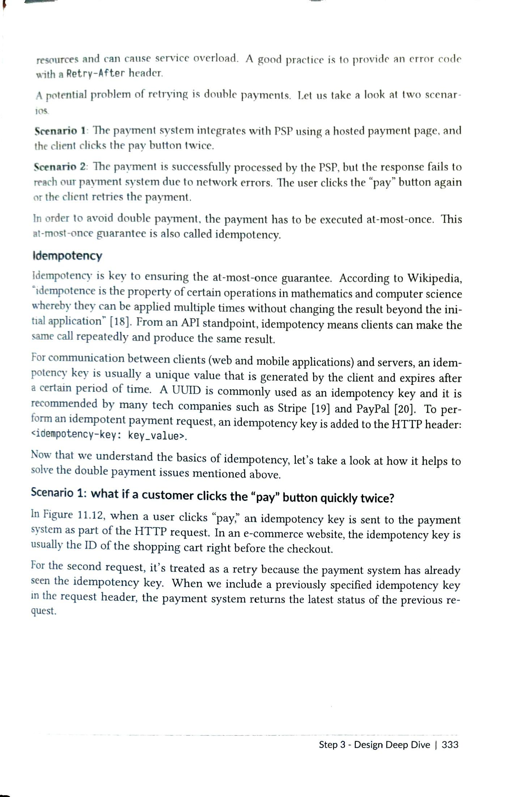

---

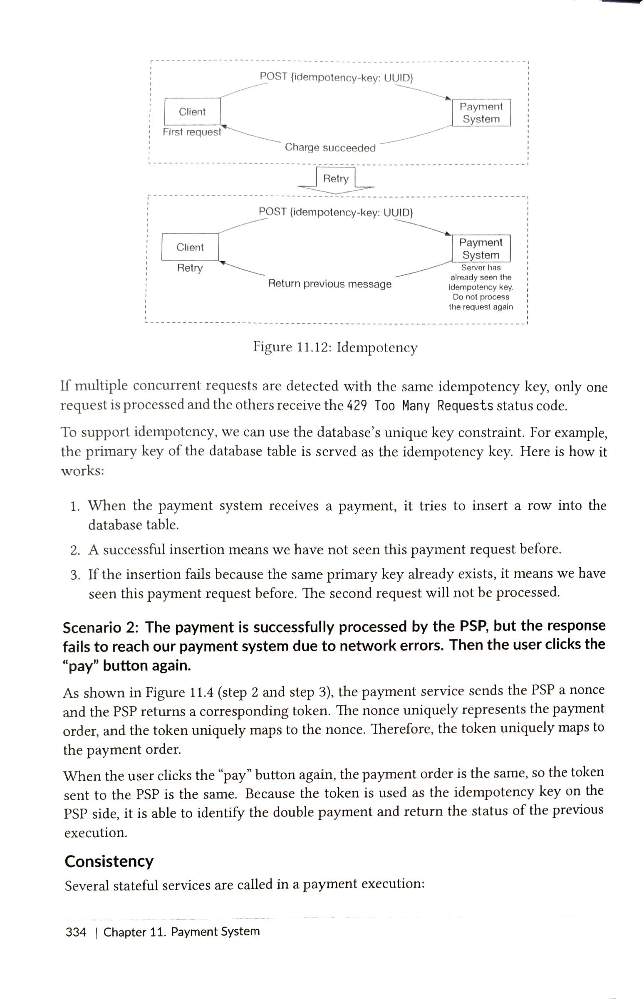

*Hình 11.12: Cơ chế đảm bảo tính bình thản (Idempotency)*

> [!NOTE]
> Nếu nhiều yêu cầu đồng thời (concurrent requests) được phát hiện có cùng một idempotency key, chỉ có một yêu cầu duy nhất được xử lý, các yêu cầu còn lại sẽ nhận về mã trạng thái HTTP `429 Too Many Requests`.

Để hỗ trợ tính bình thản, chúng ta có thể tận dụng **ràng buộc khóa duy nhất (unique key constraint)** của cơ sở dữ liệu. Ví dụ, khóa chính (primary key) của bảng cơ sở dữ liệu đóng vai trò là idempotency key. Quy trình hoạt động diễn ra như sau:

1. Khi hệ thống thanh toán nhận được một yêu cầu thanh toán, nó cố gắng chèn (insert) một hàng mới vào bảng cơ sở dữ liệu.
2. Việc chèn thành công đồng nghĩa với việc chúng ta chưa từng thấy yêu cầu thanh toán này trước đây.
3. Nếu thao tác chèn thất bại do cùng khóa chính đã tồn tại, điều đó có nghĩa là giao dịch đã được ghi nhận và đang/đã được xử lý.

#### Kịch bản 2: Thanh toán được xử lý thành công bởi PSP, nhưng phản hồi không tới được hệ thống do lỗi mạng, sau đó người dùng nhấn nút "thanh toán" lần nữa
Như thể hiện trong Hình 11.4 (bước 2 và bước 3), dịch vụ thanh toán gửi một giá trị số dùng một lần (nonce) đến PSP và PSP trả về một token tương ứng. Nonce đại diện duy nhất cho đơn hàng thanh toán (payment order), và token ánh xạ duy nhất 1-1 với nonce đó. Do đó, token này ánh xạ duy nhất tới đơn hàng thanh toán.

Khi người dùng nhấn lại nút "thanh toán", đơn hàng thanh toán vẫn giữ nguyên nên token gửi đến PSP cũng hoàn toàn giống nhau. Do token được sử dụng làm idempotency key phía PSP, PSP có khả năng nhận diện đây là yêu cầu thanh toán trùng lặp và chỉ trả về trạng thái của lần thực thi trước đó.

---

### Tính Nhất Quán (Consistency)

Nhiều dịch vụ có lưu trạng thái (stateful services) được gọi trong quá trình thực thi thanh toán:
1. **Dịch vụ thanh toán (Payment Service):** Lưu giữ dữ liệu liên quan đến thanh toán như nonce, token, đơn hàng thanh toán, trạng thái thực thi, v.v.
2. **Sổ cái (Ledger):** Lưu giữ toàn bộ dữ liệu kế toán (accounting data).
3. **Ví điện tử (Wallet):** Quản lý số dư tài khoản của người bán (merchant).
4. **Cổng thanh toán (PSP):** Lưu giữ trạng thái thực thi thanh toán bên ngoài.
5. Dữ liệu có thể được nhân bản qua các bản sao cơ sở dữ liệu (database replicas) khác nhau để tăng cường độ tin cậy (reliability).

Trong môi trường phân tán (distributed environment), giao tiếp giữa hai dịch vụ bất kỳ đều có thể gặp sự cố, gây ra tình trạng bất nhất dữ liệu (data inconsistency). Hãy cùng xem xét một số kỹ thuật để giải quyết tính không nhất quán của dữ liệu trong hệ thống thanh toán:

- Để duy trì tính nhất quán dữ liệu giữa các dịch vụ nội bộ (internal services), việc đảm bảo ngữ nghĩa xử lý **chính xác một lần (exactly-once processing)** là cực kỳ quan trọng.
- Để duy trì tính nhất quán dữ liệu giữa dịch vụ nội bộ và dịch vụ bên thứ ba bên ngoài (PSP), chúng ta thường dựa vào **tính bình thản (idempotency)** và **đối soát (reconciliation)**. Nếu dịch vụ bên ngoài hỗ trợ idempotency, chúng ta phải sử dụng cùng một idempotency key cho các thao tác thử lại thanh toán. Ngay cả khi dịch vụ bên ngoài hỗ trợ các API có tính bình thản, việc đối soát vẫn là bắt buộc vì chúng ta không bao giờ nên giả định rằng hệ thống bên ngoài luôn luôn chính xác.
- Nếu dữ liệu được nhân bản (replicated), **độ trễ nhân bản (Replication Lag)** có thể gây ra hiện tượng dữ liệu không nhất quán giữa cơ sở dữ liệu chính (Primary Database) và các bản sao (Replicas). Thường có hai phương án để giải quyết vấn đề này:
  1. **Chỉ phục vụ cả đọc và ghi từ cơ sở dữ liệu chính (Primary DB only):** Cách tiếp cận này đơn giản trong thiết lập, nhưng nhược điểm rõ ràng là khả năng mở rộng (Scalability). Các bản sao chỉ đóng vai trò bảo đảm an toàn dữ liệu mà không chia sẻ tải đọc, gây lãng phí tài nguyên.
  2. **Đảm bảo tất cả các bản sao luôn đồng bộ (Always in-sync):** Chúng ta có thể sử dụng các thuật toán đồng thuận (consensus algorithms) như Paxos [21] và Raft [22], hoặc sử dụng các cơ sở dữ liệu phân tán dựa trên cơ chế đồng thuận như YugabyteDB [23] hoặc CockroachDB [24].

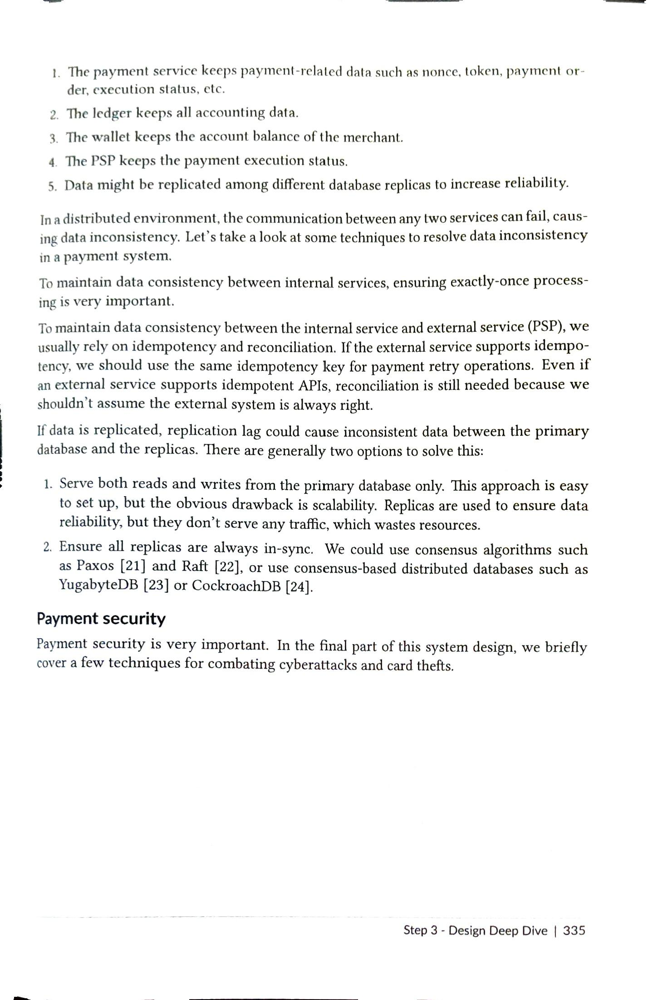

---

### An Ninh Thanh Toán (Payment Security)

An ninh thanh toán là vấn đề sống còn. Trong phần cuối của thiết kế hệ thống này, chúng ta sẽ đề cập ngắn gọn một số kỹ thuật nhằm ngăn chặn các cuộc tấn công mạng và đánh cắp thông tin thẻ.

| Vấn đề (Problem) | Giải pháp (Solution) |
| :--- | :--- |
| **Nghe lén yêu cầu/phản hồi (Request/response eavesdropping)** | Sử dụng giao thức HTTPS. |
| **Làm sai lệch dữ liệu (Data tampering)** | Thực thi mã hóa (encryption) và giám sát tính toàn vẹn (integrity monitoring). |
| **Tấn công kẻ đứng giữa (Man-in-the-middle attack)** | Sử dụng SSL kết hợp ghim chứng chỉ số (Certificate Pinning). |
| **Mất mát dữ liệu (Data loss)** | Nhân bản cơ sở dữ liệu đa vùng (Database replication across multiple regions) và sao lưu dữ liệu dạng ảnh chụp (snapshots). |
| **Tấn công từ chối dịch vụ phân tán (DDoS)** | Giới hạn tốc độ truy cập (Rate Limiting) và hệ thống tường lửa (Firewall) [25]. |
| **Đánh cắp thẻ (Card theft)** | Mã hóa định danh thẻ (Tokenization). Thay vì lưu trữ số thẻ thực tế, các token được lưu trữ và sử dụng trong toàn bộ quy trình thanh toán. |
| **Tuân thủ tiêu chuẩn PCI (PCI compliance)** | Tuân thủ PCI DSS - tiêu chuẩn an ninh thông tin áp dụng cho các tổ chức xử lý và quản lý thẻ tín dụng mang thương hiệu quốc tế. |
| **Gian lận (Fraud)** | Xác thực địa chỉ (AVS), mã bảo mật thẻ (CVV), phân tích hành vi người dùng (user behavior analysis), v.v. [26] [27]. |

*Bảng 11.6: An ninh thanh toán (Payment security)*

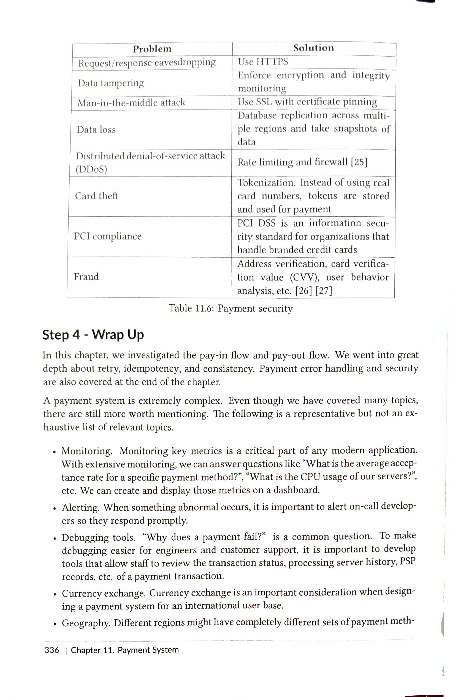

---

### Bước 4 - Tổng Kết (Step 4 - Wrap Up)

Trong chương này, chúng ta đã nghiên cứu sâu về luồng nhận tiền vào (pay-in flow) và luồng giải ngân chi tiền (pay-out flow). Chúng ta đã đi sâu phân tích về cơ chế thử lại (retry), tính bình thản (idempotency) và tính nhất quán (consistency). Việc xử lý lỗi thanh toán và an ninh thanh toán cũng đã được trình bày chi tiết ở phần cuối chương.

Một hệ thống thanh toán có mức độ phức tạp cực kỳ cao. Dù đã đề cập qua rất nhiều chủ đề, vẫn còn nhiều khía cạnh đáng lưu tâm khác. Dưới đây là danh sách tiêu biểu (nhưng chưa đầy đủ) về các chủ đề liên quan:

- **Giám sát (Monitoring):** Giám sát các chỉ số quan trọng (key metrics) là thành phần then chốt của bất kỳ ứng dụng hiện đại nào. Với hệ thống giám sát toàn diện, chúng ta có thể trả lời các câu hỏi như: *"Tỷ lệ chấp nhận trung bình cho một phương thức thanh toán cụ thể là bao nhiêu?"*, *"Mức sử dụng CPU của hệ thống máy chủ ra sao?"*, v.v. Chúng ta có thể tạo và trực quan hóa các số liệu đó trên bảng điều khiển (dashboard).
- **Cảnh báo (Alerting):** Khi có bất thường xảy ra, việc gửi cảnh báo ngay lập tức đến các kỹ sư trực vận hành (on-call engineers) là vô cùng quan trọng để có phản ứng kịp thời.
- **Công cụ gỡ lỗi (Debugging tools):** *"Tại sao một giao dịch thanh toán thất bại?"* là câu hỏi rất thường gặp. Để hỗ trợ các kỹ sư và đội ngũ chăm sóc khách hàng điều tra lỗi dễ dàng hơn, việc xây dựng các công cụ cho phép nhân sự kiểm tra trạng thái giao dịch, lịch sử máy chủ xử lý, bản ghi đối tác PSP, v.v. của một giao dịch là điều rất cần thiết.
- **Quy đổi ngoại tệ (Currency exchange):** Chuyển đổi tiền tệ là yếu tố quan trọng cần tính đến khi thiết kế hệ thống thanh toán cho tệp người dùng quốc tế.
- **Địa lý (Geography):** Các khu vực địa lý khác nhau có thể sử dụng các tập hợp phương thức thanh toán hoàn toàn khác nhau.
- **Thanh toán bằng tiền mặt (Cash payment):** Thanh toán tiền mặt vẫn rất phổ biến tại Ấn Độ, Brazil và một số quốc gia khác. Uber [28] và Airbnb [29] đã có các bài blog kỹ thuật chi tiết chia sẻ về cách họ xử lý phương thức thanh toán bằng tiền mặt.
- **Tích hợp Google / Apple Pay:** Bạn đọc có thể tham khảo thêm tài liệu tại [30] nếu quan tâm.

> Xin chúc mừng bạn đã đi được một chặng đường dài đến đây! Hãy tự thưởng cho bản thân một lời khen ngợi. Bạn đã làm rất tốt!

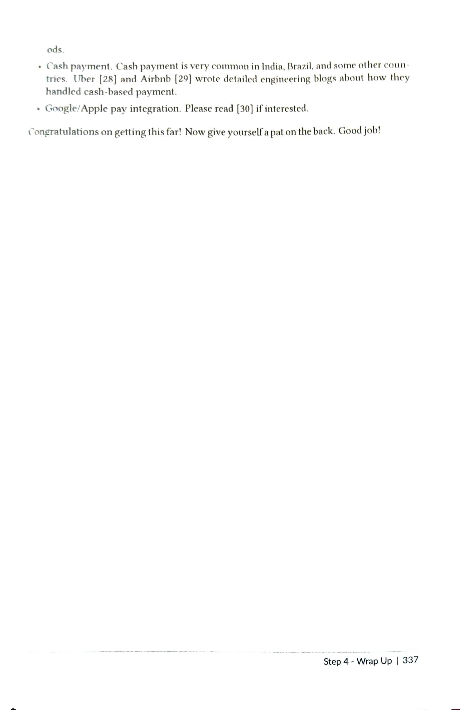

---

### Tóm Tắt Chương (Chapter Summary)

Dưới đây là sơ đồ tư duy tóm lược toàn bộ kiến trúc và các bước thiết kế của Chương 11:

```mermaid
flowchart TD
    Root["Chương 11: Hệ Thống Thanh Toán (Payment System)"]

    Step1["Bước 1: Hiểu bài toán & Xác định phạm vi"]
    Root --> Step1
    Step1 --> FReq["Yêu cầu chức năng (Functional Req)"]
    FReq --> FlowIn["Luồng thu tiền (Pay-in flow)"]
    FReq --> FlowOut["Luồng chi tiền (Pay-out flow)"]
    Step1 --> NFReq["Yêu cầu phi chức năng (Non-functional Req)"]
    NFReq --> Rel["Độ tin cậy: Xử lý thanh toán lỗi"]
    NFReq --> Rec["Đối soát dữ liệu (Reconciliation)"]
    Step1 --> Est["Ước tính quy mô (Estimation) ~ 10 TPS"]

    Step2["Bước 2: Thiết kế cấp cao (High-Level Design)"]
    Root --> Step2
    Step2 --> HPayIn["Luồng Pay-in"]
    HPayIn --> HPayInComp["Payment Service, Payment Executor, PSP, Card Scheme"]
    Step2 --> HPayOut["Luồng Pay-out"]
    HPayOut --> HPayOutComp["Ledger, Wallet, Dịch vụ bên thứ ba"]

    Step3["Bước 3: Đi sâu vào chi tiết thiết kế (Design Deep Dive)"]
    Root --> Step3
    Step3 --> D1["Dịch vụ thanh toán (Payment Service) & Tích hợp PSP"]
    Step3 --> D2["Đối soát dữ liệu (Reconciliation)"]
    Step3 --> D3["Xử lý độ trễ trong xử lý thanh toán"]
    Step3 --> D4["Giao tiếp giữa các dịch vụ nội bộ"]
    Step3 --> D5["Bảo đảm an toàn cho thanh toán"]
    Step3 --> D6["Xử lý các giao dịch thất bại"]
    D6 --> D6Queue["Hàng đợi thử lại (Retry Queue) & Dead Letter Queue (DLQ)"]
    Step3 --> D7["Cơ chế thử lại (Retry)"]
    Step3 --> D8["Chuyển giao chính xác một lần (Exactly-once delivery)"]
    D8 --> D8Idem["Tính bình thản (Idempotency)"]
    Step3 --> D9["Tính nhất quán dữ liệu (Consistency)"]
    Step3 --> D10["An ninh thanh toán (Payment Security)"]

    Step4["Bước 4: Tổng kết & Mở rộng (Wrap Up)"]
    Root --> Step4
    Step4 --> WMetrics["Giám sát, Cảnh báo & Công cụ Debug"]
    Step4 --> WExt["Đa tiền tệ, Địa lý, Tiền mặt & Ví điện tử (Apple/Google Pay)"]
```

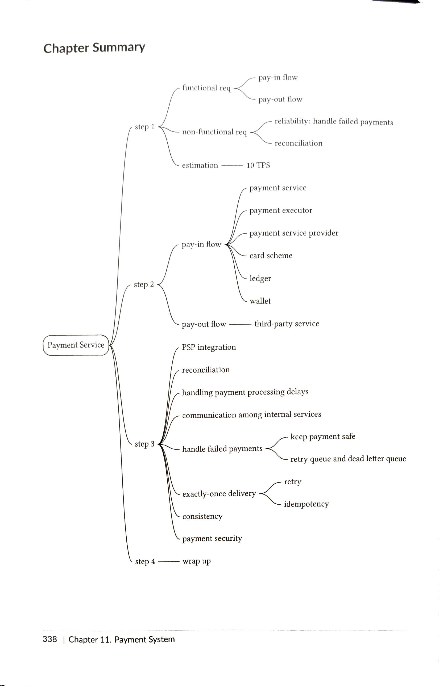

# Chương 11: Hệ Thống Thanh Toán (Payment System)

## Tài Liệu Tham Khảo (Reference Material)

> [!NOTE]
> Phần tài liệu tham khảo cung cấp các liên kết nền tảng quan trọng về kiến trúc xử lý thanh toán, quy chuẩn kế toán kép (double-entry bookkeeping), tính lũy đẳng (idempotency), cơ sở dữ liệu phân tán (distributed databases) và các nghiên cứu điển hình (case studies) trong thế giới thực từ các tập đoàn công nghệ lớn như Stripe, Uber, Airbnb, Square, Confluent, PayPal.

---

### Trang 340

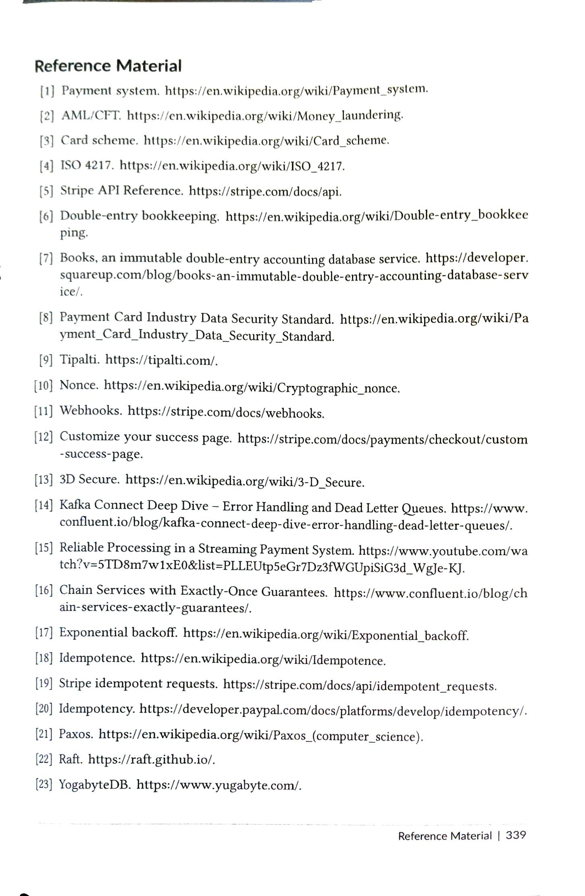

* **[1] Payment system** (Hệ thống thanh toán). [https://en.wikipedia.org/wiki/Payment_system](https://en.wikipedia.org/wiki/Payment_system)
* **[2] AML/CFT** (Chống rửa tiền và Chống tài trợ khủng bố - Anti-Money Laundering / Combating the Financing of Terrorism). [https://en.wikipedia.org/wiki/Money_laundering](https://en.wikipedia.org/wiki/Money_laundering)
* **[3] Card scheme** (Mạng lưới liên kết thẻ thanh toán / Tổ chức thẻ). [https://en.wikipedia.org/wiki/Card_scheme](https://en.wikipedia.org/wiki/Card_scheme)
* **[4] ISO 4217** (Tiêu chuẩn quốc tế định nghĩa mã tiền tệ). [https://en.wikipedia.org/wiki/ISO_4217](https://en.wikipedia.org/wiki/ISO_4217)
* **[5] Stripe API Reference** (Tài liệu tham chiếu giao diện lập trình ứng dụng Stripe API). [https://stripe.com/docs/api](https://stripe.com/docs/api)
* **[6] Double-entry bookkeeping** (Kế toán ghi sổ kép). [https://en.wikipedia.org/wiki/Double-entry_bookkeeping](https://en.wikipedia.org/wiki/Double-entry_bookkeeping)
* **[7] Books, an immutable double-entry accounting database service** (Books: Dịch vụ cơ sở dữ liệu kế toán ghi sổ kép bất biến - Square). [https://developer.squareup.com/blog/books-an-immutable-double-entry-accounting-database-service/](https://developer.squareup.com/blog/books-an-immutable-double-entry-accounting-database-service/)
* **[8] Payment Card Industry Data Security Standard (PCI DSS)** (Tiêu chuẩn an toàn dữ liệu ngành thẻ thanh toán). [https://en.wikipedia.org/wiki/Payment_Card_Industry_Data_Security_Standard](https://en.wikipedia.org/wiki/Payment_Card_Industry_Data_Security_Standard)
* **[9] Tipalti** (Nền tảng tự động hóa thanh toán toàn cầu). [https://tipalti.com/](https://tipalti.com/)
* **[10] Nonce** (Chuỗi ký tự mật mã dùng một lần - Cryptographic nonce). [https://en.wikipedia.org/wiki/Cryptographic_nonce](https://en.wikipedia.org/wiki/Cryptographic_nonce)
* **[11] Webhooks** (Cơ chế phản hồi sự kiện tự động theo thời gian thực). [https://stripe.com/docs/webhooks](https://stripe.com/docs/webhooks)
* **[12] Customize your success page** (Tùy biến trang thanh toán thành công). [https://stripe.com/docs/payments/checkout/custom-success-page](https://stripe.com/docs/payments/checkout/custom-success-page)
* **[13] 3D Secure** (Giao thức bảo mật xác thực danh tính thẻ ngân hàng 3D Secure). [https://en.wikipedia.org/wiki/3-D_Secure](https://en.wikipedia.org/wiki/3-D_Secure)
* **[14] Kafka Connect Deep Dive - Error Handling and Dead Letter Queues** (Chuyên sâu về Kafka Connect - Xử lý lỗi và hàng đợi thông báo lỗi chết DLQ). [https://www.confluent.io/blog/kafka-connect-deep-dive-error-handling-dead-letter-queues/](https://www.confluent.io/blog/kafka-connect-deep-dive-error-handling-dead-letter-queues/)
* **[15] Reliable Processing in a Streaming Payment System** (Xử lý tin cậy và chuẩn xác trong một hệ thống thanh toán dạng luồng). [https://www.youtube.com/watch?v=5TD8m7w1xE0&list=PLLEUtp5eGr7Dz3fWGUpiSiG3d_WgJe-KJ](https://www.youtube.com/watch?v=5TD8m7w1xE0&list=PLLEUtp5eGr7Dz3fWGUpiSiG3d_WgJe-KJ)
* **[16] Chain Services with Exactly-Once Guarantees** (Chuỗi các dịch vụ với cam kết xử lý chính xác một lần - Exactly-Once Guarantees). [https://www.confluent.io/blog/chain-services-exactly-guarantees/](https://www.confluent.io/blog/chain-services-exactly-guarantees/)
* **[17] Exponential backoff** (Thuật toán lùi lũy thừa). [https://en.wikipedia.org/wiki/Exponential_backoff](https://en.wikipedia.org/wiki/Exponential_backoff)
* **[18] Idempotence** (Tính lũy đẳng trong khoa học máy tính). [https://en.wikipedia.org/wiki/Idempotence](https://en.wikipedia.org/wiki/Idempotence)
* **[20] Idempotency** (Triển khai tính lũy đẳng trong hệ thống PayPal). [https://developer.paypal.com/docs/platforms/develop/idempotency/](https://developer.paypal.com/docs/platforms/develop/idempotency/)
* **[21] Paxos** (Thuật toán đồng thuận phân tán Paxos). [https://en.wikipedia.org/wiki/Paxos_(computer_science)](https://en.wikipedia.org/wiki/Paxos_(computer_science))
* **[22] Raft** (Thuật toán đồng thuận phân tán Raft - Raft Consensus Algorithm). [https://raft.github.io/](https://raft.github.io/)
* **[23] YugabyteDB** (Cơ sở dữ liệu phân tán chuẩn SQL hỗ trợ ACID toàn cầu). [https://www.yugabyte.com/](https://www.yugabyte.com/)

---

### Trang 341

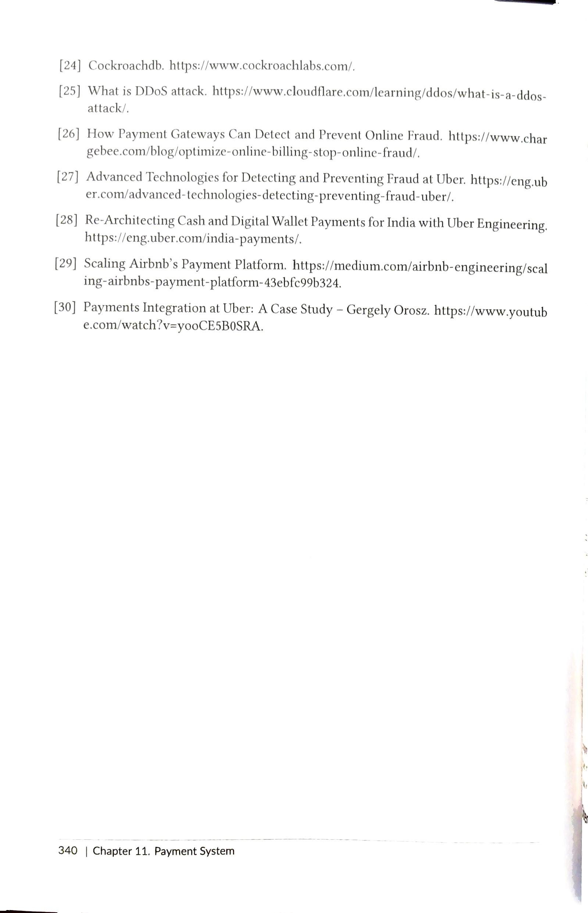

* **[24] CockroachDB** (Cơ sở dữ liệu SQL phân tán có khả năng co giãn linh hoạt và đảm bảo tính nhất quán cao). [https://www.cockroachlabs.com/](https://www.cockroachlabs.com/)
* **[25] What is DDoS attack** (Tấn công từ chối dịch vụ phân tán DDoS là gì). [https://www.cloudflare.com/learning/ddos/what-is-a-ddos-attack/](https://www.cloudflare.com/learning/ddos/what-is-a-ddos-attack/)
* **[26] How Payment Gateways Can Detect and Prevent Online Fraud** (Cách các cổng thanh toán phát hiện và ngăn chặn gian lận trực tuyến). [https://www.chargebee.com/blog/optimize-online-billing-stop-online-fraud/](https://www.chargebee.com/blog/optimize-online-billing-stop-online-fraud/)
* **[27] Advanced Technologies for Detecting and Preventing Fraud at Uber** (Các công nghệ tiên tiến nhằm phát hiện và ngăn chặn gian lận tại Uber). [https://eng.uber.com/advanced-technologies-detecting-preventing-fraud-uber/](https://eng.uber.com/advanced-technologies-detecting-preventing-fraud-uber/)
* **[28] Re-Architecting Cash and Digital Wallet Payments for India with Uber Engineering** (Tái cấu trúc kiến trúc thanh toán tiền mặt và ví điện tử cho thị trường Ấn Độ bởi đội ngũ Uber Engineering). [https://eng.uber.com/india-payments/](https://eng.uber.com/india-payments/)
* **[29] Scaling Airbnb's Payment Platform** (Mở rộng quy mô nền tảng thanh toán của Airbnb). [https://medium.com/airbnb-engineering/scaling-airbnbs-payment-platform-43ebfc99b324](https://medium.com/airbnb-engineering/scaling-airbnbs-payment-platform-43ebfc99b324)
* **[30] Payments Integration at Uber: A Case Study - Gergely Orosz** (Tích hợp hệ thống thanh toán tại Uber: Nghiên cứu điển hình - Gergely Orosz). [https://www.youtube.com/watch?v=yooCE5BoSRA](https://www.youtube.com/watch?v=yooCE5BoSRA)

> [!IMPORTANT]
> Toàn bộ các công nghệ và mô hình trên (tính lũy đẳng Idempotency, Kế toán kép Double-entry bookkeeping, thuật toán đồng thuận Raft/Paxos, hàng đợi thông báo lỗi DLQ, kiến trúc xử lý chính xác một lần Exactly-Once, và hệ quản trị phân tán CockroachDB / YugabyteDB) là các khối kiến trúc cốt lõi để đảm bảo **Độ khả dụng cao (High Availability)**, **Khả năng chịu lỗi (Fault Tolerance)**, **Khả năng mở rộng (Scalability)** và đặc biệt là **Tính toàn vẹn dữ liệu tài chính (Financial Data Integrity)** tuyệt đối trong hệ thống thanh toán.

---

## Điều hướng

- [chuong-10-real-time-gaming-leaderboard.md](chuong-10-real-time-gaming-leaderboard.md)
- [Mục lục](README.md)
- [chuong-12-digital-wallet.md](chuong-12-digital-wallet.md)
