[← Chương trước](chuong-11-payment-system.md) | [Mục lục](README.md) | [Chương tiếp theo →](chuong-13-stock-exchange.md)

---

# Chương 12: Ví Điện Tử (Digital Wallet)

Các nền tảng thanh toán thường cung cấp dịch vụ ví điện tử (*digital wallet service*) cho khách hàng, cho phép họ lưu trữ tiền trong ví và chi tiêu sau đó. Ví dụ, bạn có thể nạp tiền vào ví điện tử từ thẻ ngân hàng của mình và khi mua sắm sản phẩm trực tuyến, bạn được cung cấp tùy chọn thanh toán bằng số tiền có trong ví. **Hình 12.1** minh họa quy trình này.

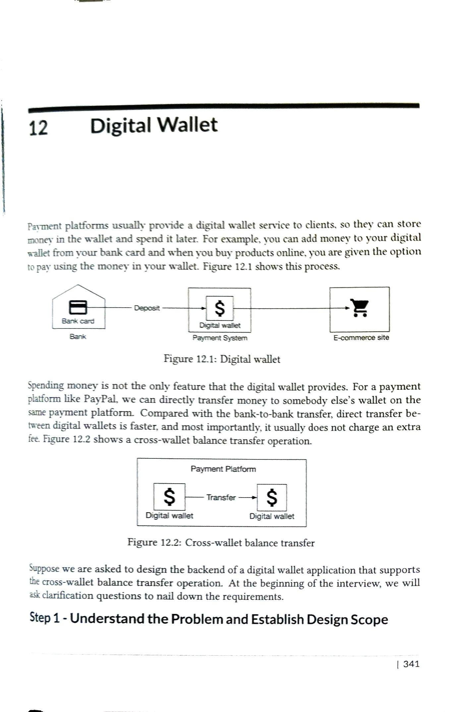
*Hình 12.1: Ví điện tử (Digital wallet)*

Chi tiêu tiền không phải là tính năng duy nhất mà ví điện tử cung cấp. Đối với một nền tảng thanh toán như PayPal, chúng ta có thể chuyển tiền trực tiếp đến ví của một người khác trên cùng nền tảng thanh toán đó. So với hình thức chuyển khoản liên ngân hàng (*bank-to-bank transfer*), chuyển khoản trực tiếp giữa các ví điện tử diễn ra nhanh hơn và quan trọng nhất là thường không tính thêm phí. **Hình 12.2** minh họa thao tác chuyển số dư liên ví (*cross-wallet balance transfer*).

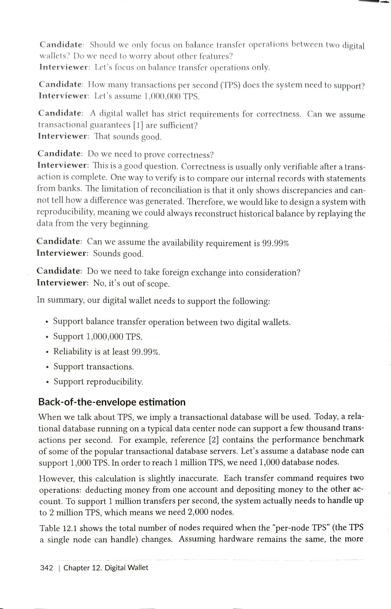
*Hình 12.2: Chuyển số dư liên ví (Cross-wallet balance transfer)*

Giả sử chúng ta được yêu cầu thiết kế hệ thống *backend* cho một ứng dụng ví điện tử hỗ trợ thao tác chuyển số dư liên ví. Khi bắt đầu buổi phỏng vấn, chúng ta sẽ đặt các câu hỏi làm rõ để xác định phạm vi yêu cầu kỹ thuật.

---

## Bước 1 - Hiểu Rõ Vấn Đề Và Thiết Lập Phạm Vi Thiết Kế (Understand the Problem and Establish Design Scope)

* **Ứng viên:** Chúng ta chỉ nên tập trung vào các thao tác chuyển số dư giữa hai ví điện tử thôi đúng không? Chúng ta có cần quan tâm đến các tính năng khác không?
* **Người phỏng vấn:** Hãy chỉ tập trung vào các thao tác chuyển số dư (*balance transfer operations*).
* **Ứng viên:** Hệ thống cần hỗ trợ bao nhiêu giao dịch mỗi giây (*Transactions Per Second - TPS*)?
* **Người phỏng vấn:** Giả sử hệ thống cần 1.000.000 TPS.
* **Ứng viên:** Một ví điện tử có các yêu cầu rất nghiêm ngặt về tính chính xác (*correctness*). Chúng ta có thể giả định rằng các đảm bảo tính toàn vẹn giao dịch (*transactional guarantees* [1]) là đủ không?
* **Người phỏng vấn:** Nghe hợp lý đấy.
* **Ứng viên:** Chúng ta có cần chứng minh tính chính xác (*prove correctness*) không?
* **Người phỏng vấn:** Đây là một câu hỏi hay. Tính chính xác thường chỉ có thể kiểm chứng được sau khi giao dịch đã hoàn tất. Một cách để kiểm chứng là đối soát (*reconciliation*) dữ liệu nội bộ của chúng ta với sao kê từ phía ngân hàng. Hạn chế của việc đối soát là nó chỉ chỉ ra sự sai lệch mà không thể cho biết sự khác biệt đó đã được tạo ra như thế nào. Do đó, chúng ta muốn thiết kế một hệ thống có khả năng tái hiện dữ liệu (*reproducibility*), nghĩa là chúng ta luôn có thể tái cấu trúc số dư trong lịch sử bằng cách phát lại (*replay*) dữ liệu từ thời điểm bắt đầu.
* **Ứng viên:** Chúng ta có thể giả định yêu cầu về tính sẵn sàng (*Availability*) là 99.99% không?
* **Người phỏng vấn:** Nghe rất tốt.
* **Ứng viên:** Chúng ta có cần tính đến nghiệp vụ chuyển đổi ngoại tệ (*foreign exchange*) không?
* **Người phỏng vấn:** Không, phần đó nằm ngoài phạm vi (*out of scope*).

**Tóm lại, ví điện tử của chúng ta cần hỗ trợ các yêu cầu sau:**
* Hỗ trợ thao tác chuyển số dư giữa hai ví điện tử.
* Hỗ trợ 1.000.000 TPS.
* Độ tin cậy / Tính sẵn sàng (*Reliability/Availability*) đạt tối thiểu 99.99%.
* Hỗ trợ tính toàn vẹn giao dịch (*Transactions*).
* Hỗ trợ khả năng tái hiện dữ liệu (*Reproducibility*).

---

### Ước Tính Sơ Bộ (Back-of-the-envelope estimation)

Khi nói về TPS, chúng ta ngụ ý rằng một cơ sở dữ liệu hỗ trợ giao dịch (*transactional database*) sẽ được sử dụng. Ngày nay, một cơ sở dữ liệu quan hệ (*relational database*) chạy trên một nút trung tâm dữ liệu điển hình (*datacenter node*) có thể hỗ trợ vài nghìn giao dịch mỗi giây. Ví dụ, tài liệu tham khảo [2] cung cấp điểm chuẩn hiệu năng (*benchmark*) của một số máy chủ cơ sở dữ liệu giao dịch phổ biến. Giả sử một nút cơ sở dữ liệu có thể hỗ trợ 1.000 TPS. Để đạt được 1 triệu TPS, chúng ta cần 1.000 nút cơ sở dữ liệu.

Tuy nhiên, phép tính này có một chút chưa chuẩn xác. Mỗi lệnh chuyển tiền đòi hỏi hai thao tác: trừ tiền từ một tài khoản (*debit*) và cộng tiền vào tài khoản còn lại (*credit*). Để hỗ trợ 1 triệu giao dịch chuyển tiền mỗi giây, hệ thống thực tế cần xử lý lên tới 2 triệu TPS, điều đó đồng nghĩa với việc chúng ta cần 2.000 nút.

**Bảng 12.1** thể hiện tổng số nút cần thiết khi "TPS trên mỗi nút" (*per-node TPS* - mức TPS mà một nút đơn lẻ có thể xử lý) thay đổi. Giả định phần cứng giữ nguyên, số lượng giao dịch mà một nút đơn lẻ có thể xử lý càng cao thì số nút cần thiết càng giảm.

| TPS trên mỗi nút (*Per-node TPS*) | Số lượng nút (*Node Number*) |
| :--- | :--- |
| 100 | 20.000 |
| 1.000 | 2.000 |
| 10.000 | 200 |

*Bảng 12.1: Mối tương quan giữa TPS trên mỗi nút và số lượng nút*

---

## Bước 2 - Đề Xuất Thiết Kế Cấp Cao Và Thống Nhất Ý Kiến (Step 2 - Propose High-level Design and Get Buy-in)

Trong phần này, chúng ta sẽ thảo luận các nội dung sau:
* Thiết kế API (*API design*)
* Ba phương án thiết kế cấp cao (*Three high-level designs*):
  1. Giải pháp lưu trữ toàn bộ trên bộ nhớ (*Simple in-memory solution*)
  2. Giải pháp giao dịch phân tán dựa trên cơ sở dữ liệu (*Database-based distributed transaction solution*)
  3. Giải pháp Event Sourcing với khả năng tái hiện (*Event sourcing solution with reproducibility*)

---

### Thiết Kế API (API design)

Chúng ta sẽ sử dụng quy ước RESTful API. Đối với phạm vi bài phỏng vấn này, chúng ta chỉ cần hỗ trợ một API duy nhất:

| API | Chi tiết (*Detail*) |
| :--- | :--- |
| `POST /v1/wallet/balance_transfer` | Chuyển số dư từ ví này sang ví khác (*Transfer balance from one wallet to another*) |

**Các tham số yêu cầu (*Request parameters*) bao gồm:**

| Trường dữ liệu (*Field*) | Mô tả (*Description*) | Kiểu dữ liệu (*Type*) |
| :--- | :--- | :--- |
| `from_account` | Tài khoản ghi nợ (*The debit account*) | `string` |
| `to_account` | Tài khoản ghi có (*The credit account*) | `string` |
| `amount` | Số tiền giao dịch (*The amount of money*) | `string` |
| `currency` | Loại tiền tệ (*The currency type*) | `string` (theo chuẩn ISO 4217 [3]) |
| `transaction_id` | Mã định danh dùng để khử trùng lặp (*ID used for deduplication / Idempotency*) | `uuid` |

**Nội dung phản hồi mẫu (*Sample response body*):**

```json
{
  "status": "success",
  "transaction_id": "81589980-2664-11ec-9621-0242ac138002"
}
```

> [!NOTE]
> Một điểm đáng lưu ý là kiểu dữ liệu của trường `amount` là `string` thay vì `double`. Chúng tôi đã giải thích lý do kỹ thuật cho việc này trong Chương 11 (Payment System) tại trang 320.
> 
> Trong thực tế, nhiều người vẫn chọn biểu diễn số dạng số thực `float` hoặc `double` vì nó được hầu hết mọi ngôn ngữ lập trình và cơ sở dữ liệu hỗ trợ. Đó là một lựa chọn chấp nhận được miễn là chúng ta nhận thức rõ rủi ro tiềm ẩn về việc mất độ chính xác (*loss of precision* do lỗi làm tròn số học dấu phẩy động).

---

### Giải Pháp Phân Mảnh Dữ Liệu Trong Bộ Nhớ (In-memory sharding solution)

Ứng dụng ví duy trì số dư tài khoản cho mỗi tài khoản người dùng. Một cấu trúc dữ liệu thích hợp để biểu diễn mối quan hệ `<user, balance>` này là một `map`, còn được gọi là bảng băm (*hash table*) hoặc kho lưu trữ khóa - giá trị (*key-value store*).

Đối với các kho lưu trữ trong bộ nhớ (*in-memory stores*), một lựa chọn phổ biến là **Redis**. Một nút Redis đơn lẻ không đủ khả năng xử lý mức tải 1 triệu TPS. Chúng ta cần thiết lập một cụm các nút Redis (*cluster of Redis nodes*) và phân phối đều các tài khoản người dùng giữa các nút này. Quá trình này được gọi là phân vùng (*partitioning*) hoặc phân mảnh (*sharding*).

Để phân phối dữ liệu khóa - giá trị trên $n$ phân vùng (*partitions*), chúng ta có thể tính toán giá trị băm (*hash value*) của khóa và chia lấy phần dư cho $n$. Số dư thu được chính là đích đến của phân vùng. Đoạn mã giả dưới đây minh họa quá trình phân mảnh (*sharding process*):

```java
String accountID = "A";
int partitionNumber = 7;
int myPartition = accountID.hashCode() % partitionNumber;
```

Số lượng phân vùng và địa chỉ mạng của tất cả các nút Redis có thể được lưu trữ tại một nơi tập trung. Chúng ta có thể sử dụng **ZooKeeper** [4] như một giải pháp lưu trữ cấu hình có tính sẵn sàng cao (*highly-available configuration storage solution*).

Thành phần cuối cùng của giải pháp này là một dịch vụ chuyên xử lý các lệnh chuyển tiền. Chúng ta gọi nó là **Dịch vụ ví** (*Wallet Service*) và nó đảm nhận một số trách nhiệm cốt lõi:
1. Tiếp nhận lệnh chuyển tiền (*Receives the transfer command*).
2. Xác thực tính hợp lệ của lệnh chuyển tiền (*Validates the transfer command*).
3. Nếu lệnh hợp lệ, dịch vụ sẽ cập nhật số dư tài khoản cho hai người dùng tham gia vào giao dịch. Trong một cụm (*cluster*), số dư tài khoản của hai người này rất có thể nằm trên các nút Redis khác nhau.

Dịch vụ ví là dịch vụ phi trạng thái (*stateless*). Do đó, nó rất dễ mở rộng theo chiều ngang (*horizontal scaling*). **Hình 12.3** thể hiện kiến trúc giải pháp trong bộ nhớ này.

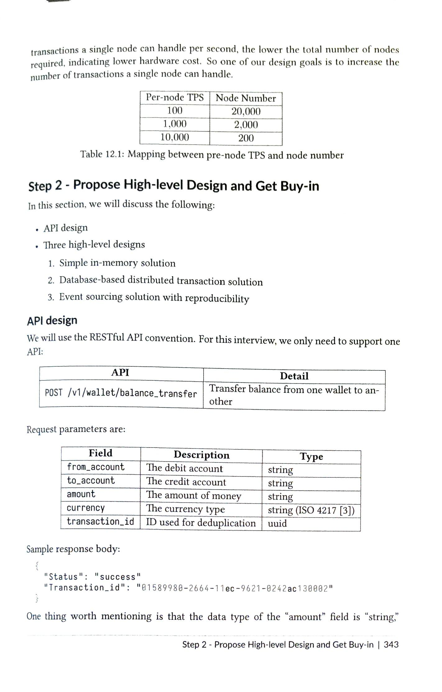
*Hình 12.3: Giải pháp phân mảnh trong bộ nhớ (In-memory solution)*

Trong ví dụ này, chúng ta có 3 nút Redis. Có ba máy khách (khách hàng): A, B và C. Số dư tài khoản của họ được phân bổ đều trên 3 nút Redis này. Có 2 nút Wallet Service trong ví dụ chịu trách nhiệm xử lý các yêu cầu chuyển số dư. Khi một trong các nút Wallet Service nhận được lệnh chuyển tiền (yêu cầu chuyển $1 từ khách hàng A sang khách hàng B), nó phát ra hai lệnh tới hai nút Redis tương ứng. Đối với nút Redis chứa tài khoản của khách hàng A, Wallet Service trừ $1 khỏi tài khoản. Đối với khách hàng B, Wallet Service cộng thêm $1 vào tài khoản.

* **Ứng viên:** Trong thiết kế này, số dư tài khoản được phân tán trên nhiều nút Redis. ZooKeeper được sử dụng để duy trì thông tin phân mảnh (*sharding information*). Dịch vụ ví phi trạng thái (*stateless wallet service*) sử dụng thông tin phân mảnh này để định vị các nút Redis tương ứng cho các khách hàng và cập nhật số dư tài khoản theo đó.
* **Người phỏng vấn:** Thiết kế này hoạt động được, nhưng nó không đáp ứng được yêu cầu về tính chính xác (*correctness requirement*) của chúng ta. Dịch vụ ví phải cập nhật hai nút Redis khác nhau cho mỗi giao dịch chuyển tiền. Hoàn toàn không có gì đảm bảo rằng cả hai thao tác cập nhật này đều sẽ thành công. Ví dụ: nếu nút Wallet Service bị sập (*crash*) sau khi thao tác cập nhật đầu tiên đã thực hiện xong nhưng trước khi thao tác cập nhật thứ hai được hoàn tất, điều đó sẽ dẫn đến một giao dịch chuyển tiền dang dở (*incomplete transfer*). Hai thao tác cập nhật này bắt buộc phải nằm trong một giao dịch nguyên tử duy nhất (*atomic transaction*).

---

### Giao Dịch Phân Tán (Distributed transactions)

#### Phân Mảnh Cơ Sở Dữ Liệu (Database sharding)

Làm thế nào để đảm bảo tính nguyên tử (*atomic*) cho các thao tác cập nhật trên hai nút lưu trữ hoàn toàn khác nhau? Bước đầu tiên là thay thế mỗi nút Redis bằng một nút cơ sở dữ liệu quan hệ hỗ trợ giao dịch (*transactional relational database node*). **Hình 12.4** thể hiện kiến trúc này. Lần này, tài khoản của các khách hàng A, B và C được phân mảnh vào 3 cơ sở dữ liệu quan hệ, thay vì đặt trong 3 nút Redis.

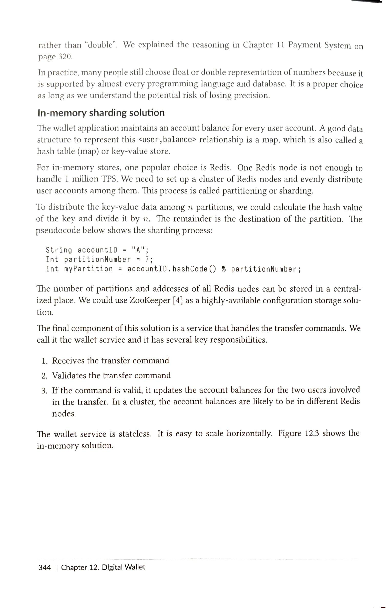
*Hình 12.4: Phân mảnh cơ sở dữ liệu quan hệ (Relational database)*

Việc sử dụng các cơ sở dữ liệu giao dịch chỉ mới giải quyết được một phần của vấn đề. Như đã đề cập ở phần trước, rất có khả năng một lệnh chuyển tiền sẽ cần cập nhật hai tài khoản nằm ở hai cơ sở dữ liệu độc lập khác nhau. Không có gì đảm bảo rằng hai thao tác cập nhật này sẽ được xử lý tại cùng một thời điểm chính xác. Nếu Dịch vụ ví bị khởi động lại ngay sau khi nó vừa cập nhật xong số dư tài khoản thứ nhất, làm thế nào chúng ta có thể đảm bảo chắc chắn rằng tài khoản thứ hai cũng sẽ được cập nhật?

---

#### Giao Dịch Phân Tán: Cam Kết Hai Pha (Distributed transaction: Two-phase commit - 2PC)

Trong một hệ thống phân tán, một giao dịch có thể liên quan đến nhiều tiến trình trên nhiều nút mạng. Để biến một giao dịch trở thành nguyên tử (*atomic*), giao dịch phân tán (*distributed transaction*) có thể là câu trả lời. Có hai cách để triển khai một giao dịch phân tán: giải pháp cấp thấp (*low-level solution*) và giải pháp cấp cao (*high-level solution*). Chúng ta sẽ xem xét kỹ lưỡng từng giải pháp.

Giải pháp cấp thấp dựa vào chính bản thân cơ sở dữ liệu. Thuật toán được sử dụng phổ biến nhất có tên là **Cam kết hai pha** (*Two-Phase Commit - 2PC*). Đúng như tên gọi, thuật toán này bao gồm hai pha, như được mô tả trong **Hình 12.5**.

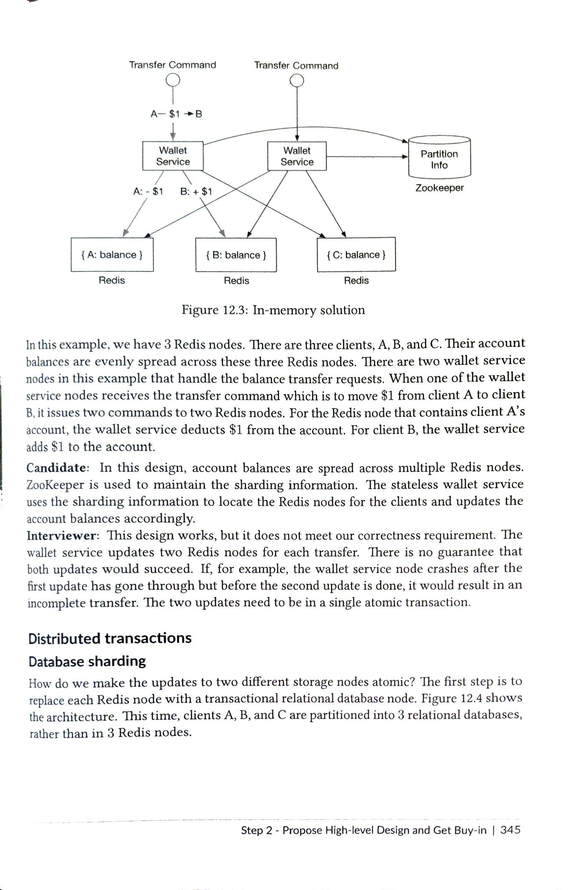
*Hình 12.5: Cam kết hai pha (Two-phase commit - nguồn [5])*

> [!IMPORTANT]
> **Cơ chế hoạt động của Two-Phase Commit (2PC):**
> 1. **Pha 1: Pha chuẩn bị (Prepare Phase):** Tiến trình điều phối (*Coordinator* - ở đây là Wallet Service) gửi yêu cầu ghi dữ liệu (*write data*) đến tất cả các cơ sở dữ liệu tham gia (Database A và Database C). Mỗi cơ sở dữ liệu sẽ khóa tài nguyên tương ứng (`lock A`, `lock C`) và phản hồi lại (`yes` hoặc `ok`) nếu đã sẵn sàng cam kết.
> 2. **Pha 2: Pha cam kết (Commit Phase):** Nếu tất cả các nút cơ sở dữ liệu đều đồng thuận trả lời `yes` trong Pha 1, Coordinator sẽ gửi lệnh `commit` để các cơ sở dữ liệu chính thức ghi nhận dữ liệu và giải phóng khóa (`unlock A`, `unlock C`). Nếu có bất kỳ nút nào phản hồi thất bại hoặc hết thời gian chờ (*timeout*), Coordinator sẽ phát lệnh hủy bỏ (*abort/rollback*) giao dịch trên toàn bộ các nút tham gia.

# Chương 12: Ví Điện Tử (Digital Wallet)

### Bước 2: Đề xuất Thiết kế Cấp cao và Thống nhất Giải pháp (Tiếp theo)

#### Cơ chế Two-Phase Commit (2PC)

1. **Điều phối viên (Coordinator)** — trong ngữ cảnh bài toán là **Wallet Service** — thực thi các thao tác đọc và ghi (Read/Write operations) trên nhiều cơ sở dữ liệu (heterogeneous databases) như bình thường. Tương tự minh họa trong Hình 12.5, cả cơ sở dữ liệu A và C đều bị khóa tài nguyên (locked).
2. Khi tầng ứng dụng chuẩn bị xác nhận giao dịch (Commit transaction), điều phối viên gửi yêu cầu chuẩn bị (**Prepare**) đến toàn bộ các cơ sở dữ liệu tham gia.
3. Trong pha thứ hai (**Commit/Abort Phase**), điều phối viên tổng hợp phản hồi từ tất cả các cơ sở dữ liệu và xử lý theo các nhánh sau:
   - **(a)** Nếu **toàn bộ cơ sở dữ liệu phản hồi "Yes" (sẵn sàng)**, điều phối viên gửi lệnh yêu cầu tất cả các cơ sở dữ liệu commit giao dịch đã chuẩn bị.
   - **(b)** Nếu **bất kỳ cơ sở dữ liệu nào phản hồi "No" (hoặc timeout)**, điều phối viên gửi lệnh yêu cầu tất cả các cơ sở dữ liệu hủy bỏ (**Abort**) giao dịch.

> [!NOTE]  
> 2PC được xem là giải pháp tầng thấp (**Low-level solution**) bởi vì bước *Prepare* đòi hỏi sự can thiệp và hỗ trợ đặc thù từ chính cơ chế transaction nội tại của cơ sở dữ liệu (ví dụ: tiêu chuẩn **X/Open XA** [6] dùng để điều phối các cơ sở dữ liệu không đồng nhất nhằm đạt được 2PC).

> [!WARNING]  
> Vấn đề nghiêm trọng nhất của **Two-Phase Commit (2PC)** nằm ở khía cạnh hiệu năng (**Performance**) và thông lượng (**Throughput**): các khóa tài nguyên (**Locks**) có thể bị giữ trong thời gian rất dài trong khi chờ thông điệp mạng từ các node khác (gây suy giảm nghiêm trọng độ trễ - Latency).  
> Ngoài ra, điều phối viên đóng vai trò là một điểm lỗi đơn lẻ (**Single Point of Failure - SPOF**). Nếu điều phối viên gặp sự cố sập nguồn (Crash) giữa chu trình chuẩn bị, hệ thống sẽ rơi vào trạng thái bế tắc như mô tả dưới đây.

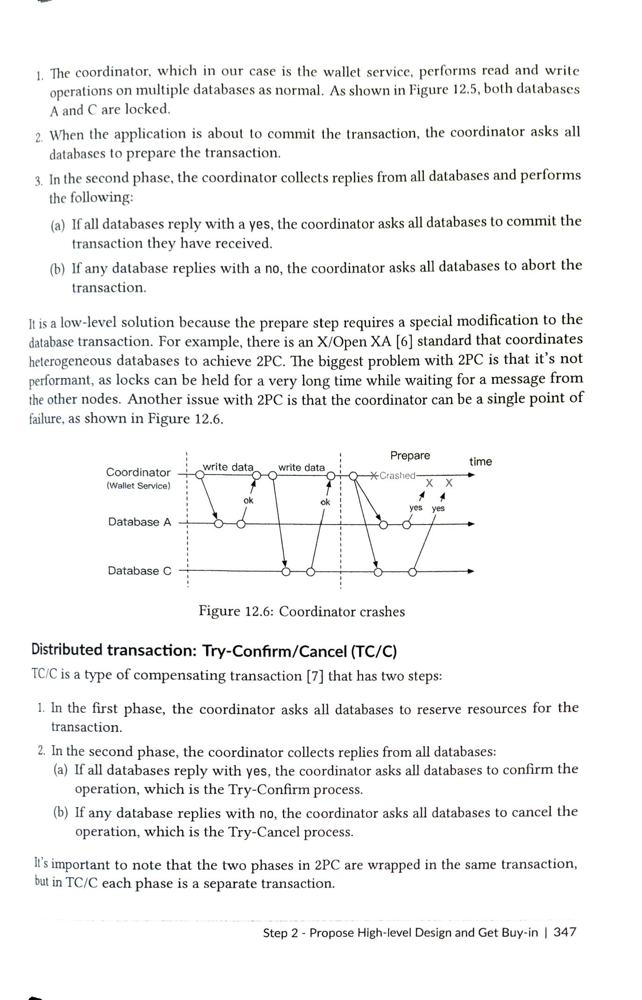
*Hình 12.6: Điều phối viên (Coordinator) gặp sự cố sập nguồn (Crash)*

---

### Giao dịch Phân tán: Try-Confirm/Cancel (TC/C)

**Try-Confirm/Cancel (TC/C)** là một biến thể của mô hình giao dịch bù trừ (**Compensating Transaction** [7]), được thực thi qua hai pha độc lập:

1. **Pha 1 (Try Phase):** Điều phối viên gửi yêu cầu đến tất cả cơ sở dữ liệu để thực hiện giữ trước / đặt trước tài nguyên (**Reserve resources**) phục vụ giao dịch.
2. **Pha 2 (Confirm / Cancel Phase):** Điều phối viên thu thập kết quả phản hồi:
   - **(a)** Nếu tất cả cơ sở dữ liệu phản hồi **"Yes"**, điều phối viên phát lệnh yêu cầu xác nhận thao tác (**Confirm**), hoàn tất chu trình **Try-Confirm**.
   - **(b)** Nếu có bất kỳ cơ sở dữ liệu nào phản hồi **"No"**, điều phối viên gửi lệnh hủy bỏ thao tác (**Cancel**), hoàn tất chu trình **Try-Cancel**.

> [!IMPORTANT]  
> **Điểm khác biệt cốt lõi:**  
> Trong **2PC**, cả hai pha được đóng gói trong **cùng một transaction kéo dài** (giữ lock liên tục). Ngược lại, trong **TC/C**, mỗi pha cấu thành một **local transaction hoàn toàn riêng biệt** (mỗi bước tự commit và giải phóng lock ngay lập tức).

---

### Ví dụ Vận hành TC/C (TC/C Example)

Giả sử hệ thống cần chuyển khoản **$1** từ tài khoản **A** sang tài khoản **C**. Bảng 12.2 tóm tắt cách thức TC/C được thực thi qua từng pha:

| Pha (Phase) | Thao tác trên Tài khoản A | Thao tác trên Tài khoản C |
| :--- | :--- | :--- |
| **Try** | Biến động số dư: -$1 | Không thao tác (**NoP** - No Operation) |
| **Confirm** | Không thao tác (**NoP**) | Biến động số dư: +$1 |
| **Cancel** | Biến động số dư: +$1 (Bù trừ) | Không thao tác (**NoP**) |

*Bảng 12.2: Ví dụ luồng xử lý TC/C*

Giả định **Wallet Service** đóng vai trò là điều phối viên của giao dịch TC/C. Tại thời điểm bắt đầu giao dịch phân tán, số dư tài khoản A là **$1**, và số dư tài khoản C là **$0**.

#### Pha 1: Thử nghiệm (Try Phase)
Trong pha **Try**, Wallet Service gửi hai lệnh giao dịch đến hai cơ sở dữ liệu tương ứng:
1. Đối với cơ sở dữ liệu chứa tài khoản **A**, điều phối viên khởi tạo một giao dịch cục bộ (*local transaction*) để trừ số dư của A đi **$1**.
2. Đối với cơ sở dữ liệu chứa tài khoản **C**, điều phối viên gửi lệnh **NoP** (*No Operation* - không thao tác). Việc gửi lệnh NoP giúp mô hình chuẩn hóa cho các kịch bản mở rộng; cơ sở dữ liệu không cần thực hiện logic nào và luôn phản hồi trạng thái thành công (*Success*) về cho điều phối viên.

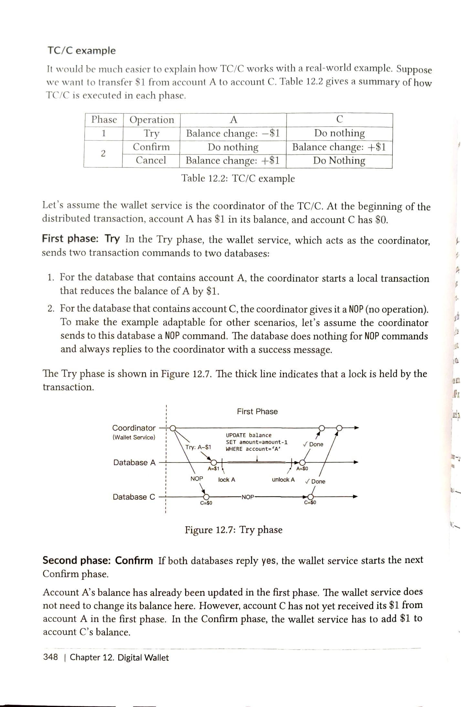
*Hình 12.7: Pha Try (Try Phase) — Đường nét đậm thể hiện lock được giữ trong phạm vi local transaction*

---

#### Pha 2: Xác nhận thành công (Confirm Phase)
Nếu cả hai cơ sở dữ liệu đều phản hồi thành công (*Yes*), Wallet Service bước vào pha **Confirm**:
- Số dư tài khoản A đã được khấu trừ dứt điểm từ pha *Try*, do đó Wallet Service không cần thực hiện thêm thay đổi nào trên A.
- Tài khoản C chưa nhận được $1 ở pha trước; do đó trong pha Confirm, Wallet Service sẽ thực thi cộng thêm **$1** vào số dư của C.

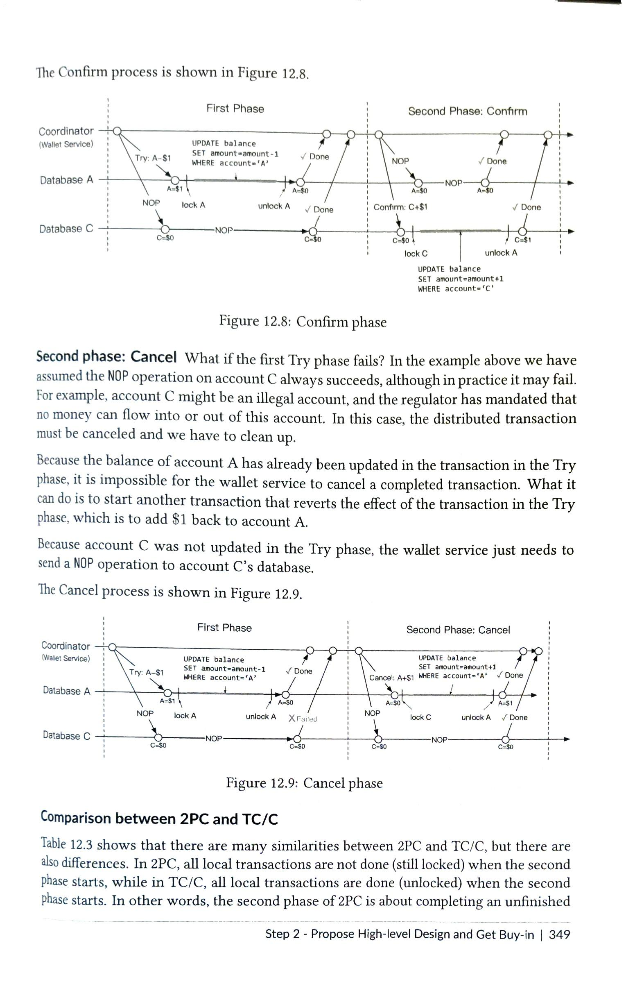
*Hình 12.8: Pha Confirm (Confirm Phase)*

---

#### Pha 2: Hủy bỏ và Bù trừ (Cancel Phase)
Trường hợp pha **Try** thất bại: Mặc dù trong ví dụ thao tác NoP trên tài khoản C được giả định luôn thành công, thực tế nó vẫn có thể thất bại (ví dụ: tài khoản C bị phong tỏa theo quy định pháp lý, cấm dòng tiền ra/vào). Khi đó, toàn bộ giao dịch phân tán phải được hủy bỏ và dọn dẹp trạng thái.

Do số dư của tài khoản A đã bị trừ và commit trong local transaction của pha Try, hệ thống không thể rollback theo cơ chế database thông thường. Thay vào đó, Wallet Service phải khởi tạo một giao dịch mới để **hoàn tác tác động (Undo / Compensate)** bằng cách cộng bù lại **$1** vào tài khoản A.

Đối với tài khoản C, vì chưa có thay đổi nào xảy ra ở pha Try, Wallet Service chỉ cần gửi lệnh **NoP**.


*Hình 12.9: Pha Cancel (Cancel Phase)*

---

### So sánh giữa 2PC và TC/C

Bảng 12.3 phân tích các điểm tương đồng và khác biệt cốt lõi giữa hai kiến trúc:

| Tiêu chí so sánh | Pha 1 (First Phase) | Pha 2: Thành công (Success) | Pha 2: Thất bại (Fail) |
| :--- | :--- | :--- | :--- |
| **2PC** | Các local transaction **chưa kết thúc** (tài nguyên vẫn bị khóa - locked). | **Commit** toàn bộ các local transaction. | **Abort / Cancel** toàn bộ các local transaction. |
| **TC/C** | Tất cả local transaction **đã kết thúc dứt điểm** (đã commit hoặc cancel, tài nguyên giải phóng). | Thực thi các local transaction mới bổ sung nếu cần thiết. | **Đảo ngược tác dụng phụ (Undo)** của các transaction đã commit thông qua giao dịch bù trừ (**Compensating Transaction**). |

*Bảng 12.3: So sánh chi tiết 2PC vs TC/C*

> [!NOTE]  
> TC/C bản chất là cơ chế giao dịch phân tán dựa trên **bù trừ (Distributed Transaction by Compensation)** và là một giải pháp tầng cao (**High-level solution**):  
> - **Ưu điểm:** Hoàn toàn độc lập với công nghệ cơ sở dữ liệu (**Database-agnostic**). Bất kỳ hệ thống lưu trữ nào hỗ trợ local ACID transaction đều áp dụng được TC/C.  
> - **Nhược điểm:** Toàn bộ độ phức tạp về quản lý trạng thái, xử lý lỗi mạng và logic bù trừ phải chuyển giao và giải quyết trực tiếp tại tầng ứng dụng (**Application Layer Business Logic**).

---

### Bảng Trạng Thái Pha (Phase Status Table)

Một bài toán thiết yếu đặt ra: **Điều gì xảy ra nếu Wallet Service bị crash / restart đột ngột giữa chu trình TC/C?** Toàn bộ ngữ cảnh đang xử lý trong bộ nhớ sẽ biến mất, khiến hệ thống không thể tự phục hồi.

Giải pháp là lưu vết tiến trình TC/C dưới dạng **bảng trạng thái pha (Phase Status Table)** đặt trực tiếp trong cơ sở dữ liệu quan hệ có hỗ trợ transactional. Bảng này tối thiểu phải bao gồm các thông tin sau:
1. **ID và nội dung chi tiết** của giao dịch phân tán.
2. **Trạng thái pha Try** của từng cơ sở dữ liệu tham gia (*Chưa gửi - Not sent yet*, *Đã gửi - Has been sent*, *Đã nhận phản hồi - Response received*).
3. **Tên pha thứ hai**, được xác định dựa trên kết quả pha Try (*Confirm* hoặc *Cancel*).
4. **Trạng thái thực thi** của pha thứ hai.
5. **Cờ đánh dấu thực thi sai thứ tự (Out-of-order flag)**.

> [!TIP]  
> **Vị trí đặt Phase Status Table:** Thông thường, bảng này được đặt cùng trong phân vùng cơ sở dữ liệu của tài khoản bị khấu trừ tiền (tài khoản nguồn), đảm bảo việc cập nhật trạng thái có thể chạy chung atomic local transaction với thao tác trừ tiền.

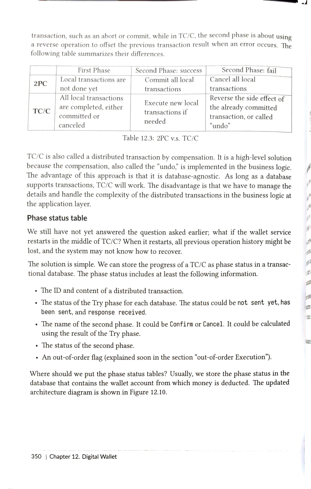
*Hình 12.10: Kiến trúc bảng trạng thái pha (Phase Status Table)*

---

### Trạng Thái Mất Cân Bằng Dòng Tiền (Unbalanced State)

Khi quan sát tiến trình, tại thời điểm kết thúc pha Try, **$1 tạm thời biến mất khỏi hệ thống** (Hình 12.11):
- Số dư tài khoản A đã bị trừ $1, trong khi tài khoản C vẫn giữ nguyên $0. Tổng tài sản $(A + C)$ tạm thời giảm từ $1 xuống $0, vi phạm nguyên lý kế toán bảo toàn dòng tiền tức thời.

Tuy nhiên, tính toàn vẹn giao dịch (**Transactional Guarantee**) vẫn được đảm bảo thông qua tính nhất quán cuối cùng (**Eventual Consistency**):
- TC/C được điều phối ở tầng ứng dụng, do đó ứng dụng nhìn thấy được các trạng thái trung gian giữa các local transaction.
- Ngược lại, trong 2PC, trạng thái trung gian được che giấu ở tầng database engine và vô hình đối với ứng dụng.
- Hiện tượng sai lệch số liệu tạm thời (**Data Discrepancies**) luôn tồn tại trong các hệ thống phân tán. Khi cơ sở dữ liệu không tự giải quyết được ở tầng vật lý, ứng dụng phải chấp nhận và tự kiểm soát trạng thái trung gian này một cách minh bạch.

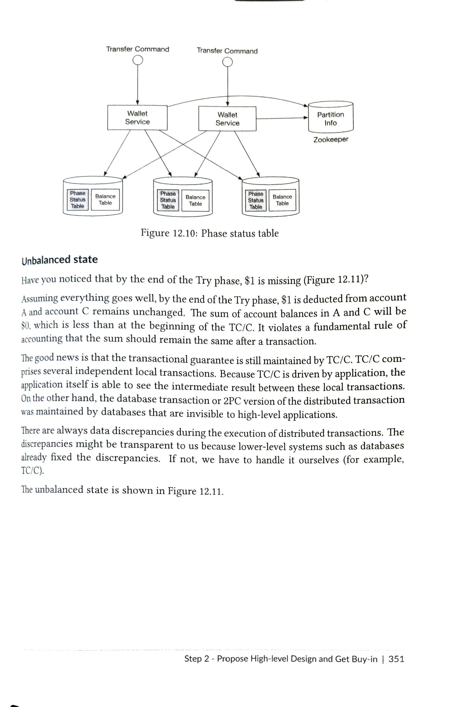
*Hình 12.11: Hiện tượng trạng thái mất cân bằng dòng tiền (Unbalanced State)*

---

### Thứ Tự Thực Thi Hợp Lệ (Valid Operation Orders)

Trong pha **Try**, có 3 phương án sắp xếp thao tác giữa tài khoản A và C:

| Phương án lựa chọn | Tài khoản A | Tài khoản C | Đánh giá kiến trúc |
| :--- | :--- | :--- | :--- |
| **Lựa chọn 1 (Choice 1)** | -$1 | NoP | **Hợp lệ (Valid)** |
| **Lựa chọn 2 (Choice 2)** | NoP | +$1 | **Không hợp lệ (Flawed)** |
| **Lựa chọn 3 (Choice 3)** | -$1 | +$1 | **Không hợp lệ (Flawed)** |

*Bảng 12.4: Các phương án lựa chọn trong pha Try*

#### Phân tích lý do loại bỏ Choice 2 và Choice 3:
- **Lựa chọn 2:** Nếu pha Try trên C thành công (cộng tiền vào C) nhưng Try trên A thất bại, hệ thống phải bước vào pha *Cancel*. Trong khoảng trễ đó, người dùng C hoặc một tiến trình song song khác có thể đã chuyển hoặc rút toàn bộ khoản tiền vừa được cộng. Khi Wallet Service đến thu hồi -$1 từ C, số dư khả dụng không còn đủ, gây phá vỡ tính đảm bảo của giao dịch phân tán.
- **Lựa chọn 3:** Nếu đồng thời trừ tiền A và cộng tiền C ngay tại pha Try, độ phức tạp phân tán tăng vọt: nếu tài khoản C cộng thành công nhưng tài khoản A trừ thất bại, hệ thống rơi vào trạng thái xử lý ngoại lệ và bù trừ cực kỳ phức tạp và rủi ro.

> [!IMPORTANT]  
> Do đó, **Lựa chọn 1 là phương án hợp lệ duy nhất**: Luôn trừ tiền từ tài khoản nguồn ở pha Try và chỉ giải ngân vào tài khoản đích ở pha Confirm.

---

### Xử Lý Thực Thi Sai Thứ Tự (Out-of-order Execution)

Một hiệu ứng phụ nghiêm trọng trong môi trường mạng phân tán khi dùng TC/C là vấn đề **thực thi sai thứ tự (Out-of-order execution)** do độ trễ mạng (**Network Latency/Packet reordering**):

Xét kịch bản chuyển $1 từ A sang C:
1. Trong pha Try, thao tác trên tài khoản A thất bại.
2. Wallet Service lập tức bước vào pha Cancel và đồng loạt phát lệnh hủy đến cả A và C.
3. Do sự cố nghẽn mạng hoặc định tuyến, thông điệp *Cancel* có thể đến cơ sở dữ liệu của C **trước** khi thông điệp *Try* (vốn đang bị kẹt trên đường truyền) chạm tới C.

*(Nội dung tiếp tục được phân tích giải pháp khắc phục bằng cơ chế cờ Out-of-order flag trong các trang tiếp theo).*

# Chương 12: Ví Điện Tử (Digital Wallet)

### Xử lý thực thi lệch thứ tự trong TC/C

Trường hợp thực thi lệch thứ tự (out-of-order execution) được minh họa trong **Hình 12.12**.

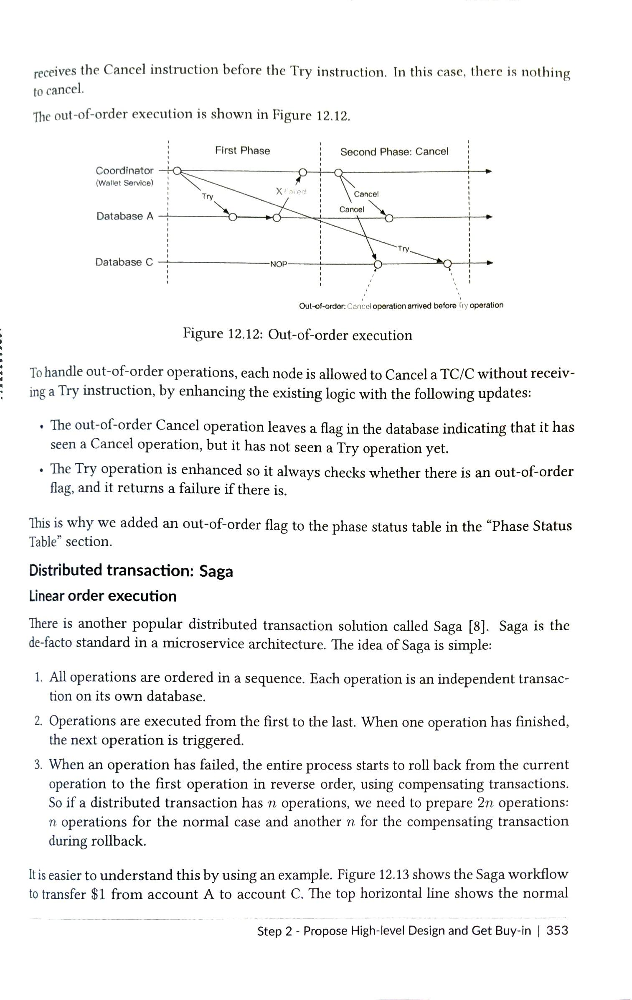
*Hình 12.12: Thực thi lệch thứ tự (Out-of-order execution)*

Để xử lý các thao tác bị lệch thứ tự, mỗi node được phép thực hiện thao tác **Hủy (Cancel)** một giao dịch TC/C mà không cần nhận chỉ thị **Thử (Try)** trước đó, bằng cách nâng cấp logic hiện tại với các cải tiến sau:

- Thao tác `Cancel` bị lệch thứ tự sẽ ghi lại một cờ (flag) trong cơ sở dữ liệu để biểu thị rằng nó đã nhận thao tác `Cancel`, nhưng chưa từng nhận thao tác `Try`.
- Thao tác `Try` được cải tiến để luôn kiểm tra xem cờ lệch thứ tự (out-of-order flag) này có tồn tại hay không; nếu cờ tồn tại, thao tác `Try` sẽ trả về kết quả thất bại.

Đây chính là lý do vì sao chúng ta thêm cờ lệch thứ tự vào bảng trạng thái pha (phase status table) trong phần *"Phase Status Table"*.

---

## Giao dịch phân tán: Saga (Distributed Transaction: Saga)

### Thực thi theo thứ tự tuyến tính (Linear order execution)

Mô hình Saga là tiêu chuẩn thực tế (de-facto standard) trong kiến trúc microservice. Ý tưởng của Saga rất đơn giản:

1. Tất cả các thao tác được sắp xếp theo một trình tự xác định. Mỗi thao tác là một giao dịch độc lập trên cơ sở dữ liệu riêng của nó.
2. Các thao tác được thực thi tuần tự từ đầu đến cuối. Khi một thao tác hoàn tất, thao tác tiếp theo sẽ được kích hoạt.
3. Khi một thao tác gặp lỗi, toàn bộ tiến trình bắt đầu rollback từ thao tác hiện tại ngược về thao tác đầu tiên theo thứ tự đảo ngược, sử dụng các **giao dịch bù trừ (compensating transactions)**.

Do đó, nếu một giao dịch phân tán gồm $n$ thao tác, chúng ta cần chuẩn bị $2n$ thao tác:
- $n$ thao tác cho trường hợp hoạt động bình thường (normal case).
- $n$ thao tác bù trừ phục vụ quá trình rollback khi có lỗi xảy ra.

> [!NOTE]
> Như đã đề cập ở trang 352, chúng ta bắt buộc phải đặt thao tác khấu trừ (deduction) trước thao tác cộng tiền (addition).

Quy trình làm việc của Saga đối với giao dịch chuyển $1 từ tài khoản A sang tài khoản C được minh họa trong **Hình 12.13**.

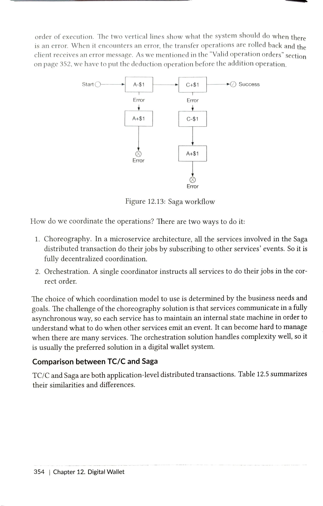
*Hình 12.13: Luồng hoạt động của Saga (Saga workflow)*

Đường nằm ngang phía trên biểu diễn luồng thực thi bình thường:
$$\text{Start} \rightarrow \text{A} - \$1 \rightarrow \text{C} + \$1 \rightarrow \text{Success}$$

Nếu bước $\text{C} + \$1$ thất bại, hệ thống sẽ kích hoạt giao dịch bù trừ $\text{A} + \$1$ để hoàn lại tiền cho tài khoản A.

---

### Mô hình điều phối (Coordination Models)

Có hai phương thức điều phối các thao tác trong Saga:

1. **Vũ đạo (Choreography):** Trong kiến trúc microservice, tất cả các dịch vụ tham gia vào giao dịch phân tán Saga thực hiện nhiệm vụ của mình bằng cách đăng ký nhận sự kiện (subscribe to events) từ các dịch vụ khác. Đây là mô hình điều phối phi tập trung hoàn toàn (fully decentralized coordination).
2. **Chỉ huy (Orchestration):** Một bộ điều phối duy nhất (single coordinator) sẽ ra chỉ thị cho tất cả các dịch vụ thực hiện nhiệm vụ theo đúng thứ tự quy định.

Việc lựa chọn mô hình điều phối phụ thuộc vào yêu cầu và mục tiêu nghiệp vụ:
- **Thách thức của Choreography:** Các dịch vụ giao tiếp hoàn toàn bất đồng bộ (asynchronous), đòi hỏi mỗi dịch vụ phải duy trì một máy trạng thái nội bộ (internal state machine) để xác định hành vi cần thực hiện khi nhận sự kiện từ dịch vụ khác. Kiến trúc này trở nên rất phức tạp và khó kiểm soát khi số lượng dịch vụ tăng cao.
- **Ưu thế của Orchestration:** Xử lý tốt độ phức tạp tập trung, do đó nó thường là giải pháp được ưu tiên hàng đầu trong các hệ thống ví điện tử.

---

### So sánh giữa TC/C và Saga

Cả TC/C và Saga đều là các giải pháp giao dịch phân tán ở tầng ứng dụng (application-level distributed transactions). **Bảng 12.5** tóm tắt các điểm tương đồng và khác biệt giữa chúng:

| Tiêu chí so sánh | TC/C | Saga |
| :--- | :--- | :--- |
| **Hành động bù trừ (Compensating action)** | Trong pha Cancel (In Cancel phase) | Trong pha Rollback (In rollback phase) |
| **Điều phối trung tâm (Central coordination)** | Có | Có (ở chế độ Orchestration) |
| **Thứ tự thực thi thao tác (Operation execution order)** | Bất kỳ (Any) | Tuyến tính (Linear) |
| **Khả năng thực thi song song (Parallel execution possibility)** | Có | Không (thực thi tuyến tính) |
| **Có thể thấy trạng thái bất nhất tạm thời (Could see partial inconsistent status)** | Có | Có |
| **Logic ứng dụng hay cơ sở dữ liệu (Application or database logic)** | Ứng dụng (Application) | Ứng dụng (Application) |

*Bảng 12.5: So sánh TC/C và Saga*

---

### Lựa chọn kiến trúc trong thực tế

Việc lựa chọn giải pháp nào trong thực tế phụ thuộc lớn vào yêu cầu về độ trễ (latency requirement):

- Thao tác trong Saga bắt buộc phải thực thi theo thứ tự tuyến tính (linear order), trong khi TC/C cho phép thực thi song song (parallel execution).
- **Trường hợp 1:** Nếu hệ thống không có yêu cầu khắt khe về độ trễ, hoặc quy trình chỉ gồm rất ít dịch vụ (như ví dụ chuyển tiền giữa hai tài khoản), ta có thể chọn bất kỳ giải pháp nào. Nếu muốn theo xu hướng phổ biến trong kiến trúc microservice, hãy ưu tiên chọn **Saga**.
- **Trường hợp 2:** Nếu hệ thống nhạy cảm với độ trễ (latency-sensitive) và bao gồm nhiều dịch vụ/thao tác cần xử lý đồng thời, **TC/C** là phương án tối ưu hơn.

---

> [!NOTE]
> **Ứng viên:** Để đảm bảo tính chất giao dịch (transactional) cho quá trình chuyển số dư, chúng ta thay thế Redis bằng cơ sở dữ liệu quan hệ (RDBMS), đồng thời áp dụng TC/C hoặc Saga để triển khai giao dịch phân tán.
>
> **Người phỏng vấn:** Rất tốt! Giải pháp giao dịch phân tán hoạt động hiệu quả, tuy nhiên vẫn có những trường hợp phát sinh sự cố. Ví dụ, người dùng hoặc hệ thống nhập sai thao tác ở tầng ứng dụng dẫn đến số tiền xác định bị sai lệch. Khi đó, chúng ta cần truy vết nguyên nhân gốc rễ (root cause) và kiểm toán (audit) toàn bộ lịch sử thao tác tài khoản. Chúng ta sẽ giải quyết bài toán này như thế nào?

---

## Event Sourcing

### Bối cảnh (Background)

Trong thực tế, một đơn vị cung cấp dịch vụ ví điện tử thường xuyên phải chịu các đợt kiểm toán độc lập. Các kiểm toán viên bên ngoài có thể đưa ra những câu hỏi hóc búa như:

1. Hệ thống có thể cho biết chính xác số dư tài khoản tại bất kỳ thời điểm nào trong quá khứ hay không?
2. Làm thế nào để chứng minh số dư tài khoản trong quá khứ và hiện tại là hoàn toàn chính xác?
3. Làm thế nào để chứng minh tính đúng đắn của logic hệ thống sau khi triển khai thay đổi mã nguồn (code change)?

Một triết lý thiết kế giúp giải quyết triệt để và có hệ thống các bài toán trên là **Event Sourcing** – kỹ thuật được phát triển từ phương pháp Thiết kế hướng miền (Domain-Driven Design - DDD).

---

### Các định nghĩa cốt lõi (Definitions)

Kiến trúc Event Sourcing xoay quanh 4 khái niệm quan trọng:

1. **Lệnh (Command)**
2. **Sự kiện (Event)**
3. **Trạng thái (State)**
4. **Máy trạng thái (State machine)**

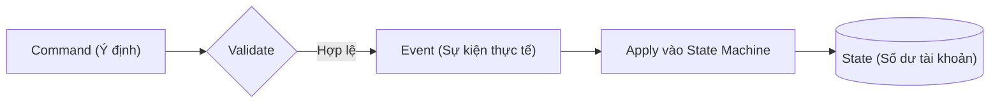

#### 1. Lệnh (Command)
- Lệnh là một hành động dự định thực hiện từ thế giới bên ngoài gửi vào hệ thống. Ví dụ: yêu cầu *"chuyển $1 từ khách hàng A sang khách hàng C"* là một lệnh.
- Trong Event Sourcing, việc bảo toàn thứ tự là tối quan trọng. Do đó, các Command thường được đưa vào một hàng đợi **FIFO (First-In, First-Out)**.

#### 2. Sự kiện (Event)
- Command là một ý định (intention), không phải là một sự thật (fact), vì một số command có thể không hợp lệ và không thể thực hiện (ví dụ: lệnh chuyển tiền sẽ thất bại nếu số dư tài khoản nguồn bị âm sau giao dịch).
- Mọi command phải được xác thực (validate) trước khi xử lý. Khi command vượt qua bước xác thực, nó trở thành hợp lệ và bắt buộc phải được hoàn tất. Kết quả của việc hoàn tất đó được gọi là một **Sự kiện (Event)**.

**Hai điểm khác biệt cốt lõi giữa Command và Event:**
- **Tính bắt buộc:** Event đại diện cho một sự thật đã được kiểm chứng nên bắt buộc phải thực thi. Trong thực tế, Event luôn được đặt tên ở thì quá khứ (past tense). Ví dụ: nếu command là *"chuyển $1 từ A sang C"*, thì event tương ứng sẽ là *"đã chuyển $1 từ A sang C"*.
- **Tính tiền định:** Command có thể chứa yếu tố ngẫu nhiên hoặc thao tác I/O, nhưng Event phải hoàn toàn **tiền định (deterministic)** vì Event phản ánh sự thật lịch sử bất biến.

**Hai đặc tính quan trọng của quá trình sinh sự kiện (Event Generation):**
1. Một command có thể sinh ra số lượng event bất kỳ (có thể là $0$, $1$ hoặc nhiều event).
2. Quá trình sinh event có thể chứa tính bất định/ngẫu nhiên (chưa đảm bảo cùng một command luôn sinh ra cùng các event giống hệt nhau, do quá trình sinh event có thể phụ thuộc vào I/O bên ngoài hoặc số ngẫu nhiên).

> [!IMPORTANT]
> Thứ tự của các Event bắt buộc phải tuân theo thứ tự của các Command. Do đó, các Event cũng được lưu trữ trong một hàng đợi FIFO.

---

### Trạng thái (State) và Máy trạng thái (State Machine)

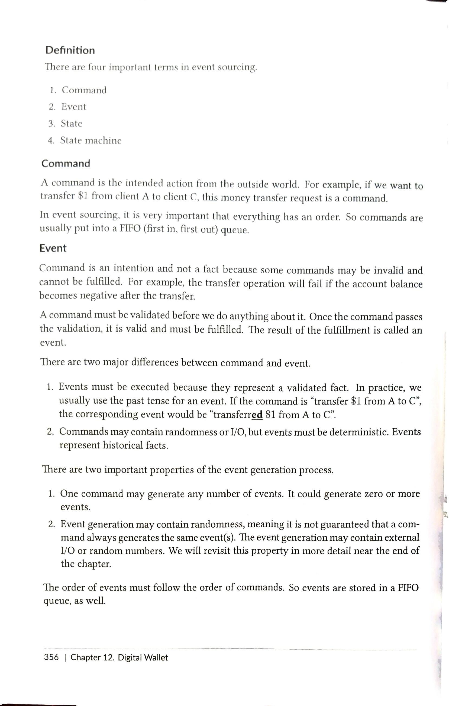
*Minh họa trang 357*

**Máy trạng thái (State Machine)** là thành phần điều phối toàn bộ tiến trình Event Sourcing. Nó đảm nhận hai chức năng chính:
1. **Xác thực Command và sinh Event** (Validate commands and generate events).
2. **Áp dụng Event để cập nhật State** (Apply events to update state).

Kiến trúc Event Sourcing yêu cầu hành vi của State Machine phải mang tính **tiền định tuyệt đối (deterministic)**:
- Bản thân State Machine không bao giờ được phép chứa yếu tố ngẫu nhiên (không đọc dữ liệu ngẫu nhiên từ bên ngoài qua I/O, không sinh số ngẫu nhiên).
- Khi áp dụng cùng một Event vào một State, kết quả đầu ra luôn luôn phải đồng nhất.

**Hình 12.14** mô tả góc nhìn tĩnh (static view) của kiến trúc Event Sourcing. Vì State Machine có hai chức năng chính, chúng ta thường tách thành hai thành phần logic: một dùng để xác thực Command và một dùng để áp dụng Event.

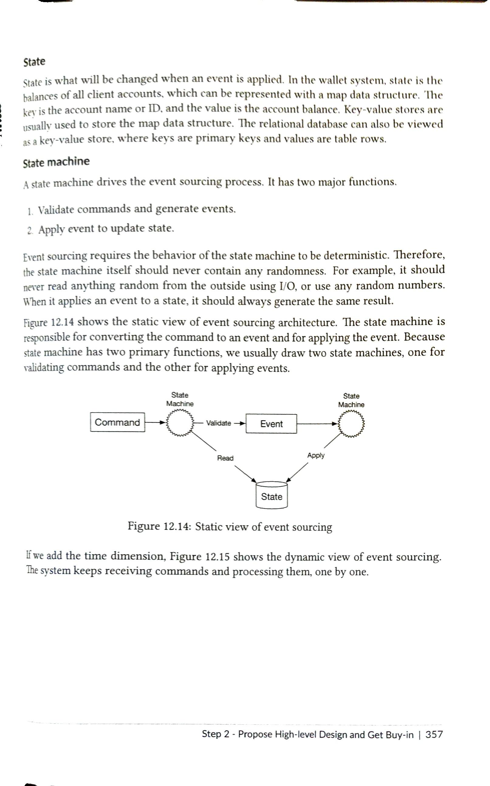
*Hình 12.14: Góc nhìn tĩnh của kiến trúc Event Sourcing (Static view)*

Khi đưa thêm trục thời gian vào, **Hình 12.15** biểu diễn góc nhìn động (dynamic view): hệ thống tiếp nhận các Command và xử lý tuần tự từng lệnh một theo thời gian.

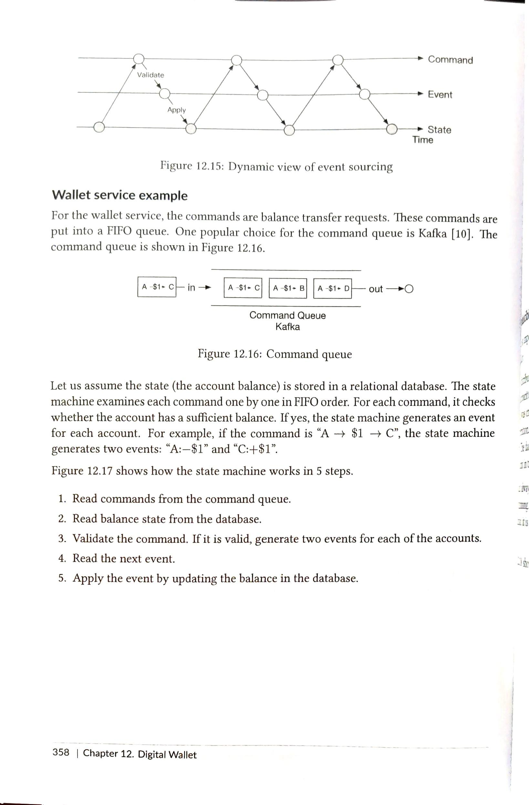
*Hình 12.15: Góc nhìn động của kiến trúc Event Sourcing (Dynamic view)*

---

### Ví dụ về dịch vụ ví điện tử (Wallet Service Example)

Trong dịch vụ ví điện tử, các Command chính là các yêu cầu chuyển số dư. Những Command này được đẩy vào một hàng đợi FIFO. Một giải pháp phổ biến cho hàng đợi Command là **Apache Kafka**.

Hàng đợi lệnh (Command Queue) được minh họa trong **Hình 12.16**:

```
Đầu vào (In)  ---> [ A -$1+ C ] [ A -$1+ B ] [ A -$1+ D ] ---> Đầu ra (Out)
```
*(Command Queue trên nền tảng Kafka)*

Giả sử State (số dư tài khoản) được lưu trữ trong một cơ sở dữ liệu quan hệ (RDBMS). Máy trạng thái duyệt qua từng Command theo đúng thứ tự FIFO:
- Đối với mỗi Command, hệ thống kiểm tra xem tài khoản nguồn có đủ số dư hay không.
- Nếu đủ điều kiện, máy trạng thái sẽ sinh ra các Event tương ứng cho từng tài khoản (ví dụ với command `A → $1 → C`, máy trạng thái sinh ra 2 event: trừ $1 ở A và cộng $1 ở C).

Quy trình hoạt động 5 bước của State Machine (minh họa trong Hình 12.17):
1. **Đọc Command** từ hàng đợi lệnh (Command Queue).
2. **Đọc trạng thái số dư** hiện tại từ cơ sở dữ liệu.
3. **Xác thực Command:** Nếu hợp lệ, sinh ra hai sự kiện cho hai tài khoản liên quan.
4. **Đọc Event tiếp theo.**
5. **Áp dụng Event** bằng cách cập nhật biến động số dư tương ứng vào cơ sở dữ liệu.

# CHƯƠNG 12: VÍ ĐIỆN TỬ (DIGITAL WALLET)

---

### Trang 360

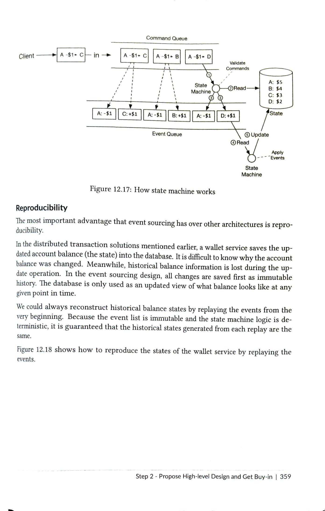

*Hình 12.17: Cách thức máy trạng thái (state machine) hoạt động (How state machine works)*

#### Khả năng tái tạo (Reproducibility)

Ưu điểm quan trọng nhất mà kiến trúc **Event Sourcing** vượt trội hơn so với các kiến trúc khác chính là **khả năng tái tạo (reproducibility)**.

Trong các giải pháp giao dịch phân tán (*distributed transactions*) đã đề cập trước đó, dịch vụ ví (*wallet service*) lưu số dư tài khoản đã cập nhật (trạng thái - *state*) trực tiếp vào cơ sở dữ liệu (*database*). Khi đó, rất khó để biết chính xác lý do tại sao số dư tài khoản lại bị thay đổi. Đồng thời, thông tin số dư lịch sử sẽ bị mất đi trong quá trình thực hiện thao tác cập nhật (*update operation*). 

Ngược lại, trong thiết kế **Event Sourcing**, tất cả các thay đổi trước tiên đều được lưu lại dưới dạng một **lịch sử bất biến (immutable history)**. Cơ sở dữ liệu lúc này chỉ được sử dụng như một khung nhìn cập nhật (*updated view*) biểu diễn trạng thái số dư trông như thế nào tại bất kỳ thời điểm cụ thể nào.

Chúng ta luôn có thể tái cấu trúc (*reconstruct*) lại các trạng thái số dư lịch sử bằng cách phát lại (*replay*) các sự kiện từ điểm khởi đầu. Bởi vì danh sách sự kiện (*event list*) là bất biến (*immutable*) và logic của máy trạng thái (*state machine*) là tất định (*deterministic*), nên hệ thống hoàn toàn đảm bảo rằng các trạng thái lịch sử được tạo ra từ mỗi lần phát lại đều hoàn toàn đồng nhất.

*Hình 12.18* mô tả cách tái tạo các trạng thái của dịch vụ ví bằng cách phát lại các sự kiện.

> **Bước 2 - Đề xuất thiết kế cấp cao và đạt được sự đồng thuận (Step 2 - Propose High-level Design and Get Buy-in) | Trang 359**

---

### Trang 361

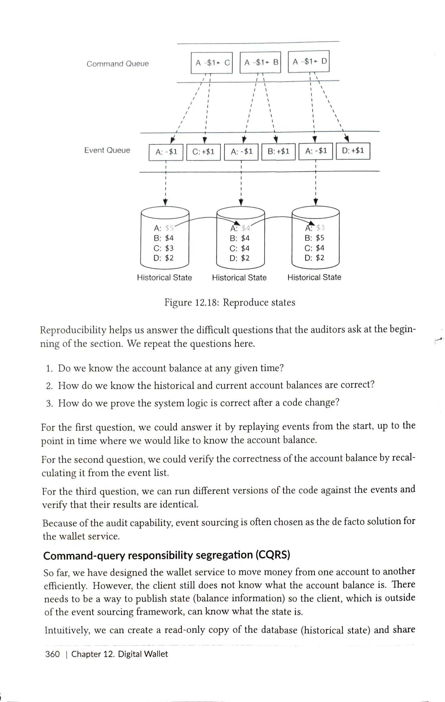

*Hình 12.18: Tái tạo các trạng thái (Reproduce states)*

Khả năng tái tạo (*reproducibility*) giúp chúng ta giải quyết các câu hỏi hóc búa mà các kiểm toán viên (*auditors*) đã đặt ra ở đầu phần này. Chúng ta nhắc lại các câu hỏi đó tại đây:

1. Chúng ta có biết số dư tài khoản tại bất kỳ thời điểm nào hay không?
2. Làm thế nào để chúng ta biết được số dư tài khoản hiện tại và trong lịch sử là chính xác?
3. Làm thế nào để chứng minh logic hệ thống vẫn chính xác sau khi có sự thay đổi mã nguồn (*code change*)?

- Đối với câu hỏi thứ nhất, chúng ta có thể trả lời bằng cách phát lại (*replay*) các sự kiện từ đầu cho đến đúng thời điểm mà chúng ta muốn biết số dư tài khoản.
- Đối với câu hỏi thứ hai, chúng ta có thể xác minh tính chính xác của số dư tài khoản bằng cách tính toán lại từ danh sách sự kiện (*event list*).
- Đối với câu hỏi thứ ba, chúng ta có thể chạy các phiên bản mã nguồn khác nhau trên cùng một chuỗi sự kiện và xác minh xem kết quả đầu ra của chúng có hoàn toàn đồng nhất hay không.

Nhờ vào năng lực kiểm toán (*audit capability*) vượt trội này, **Event Sourcing** thường được lựa chọn làm giải pháp tiêu chuẩn mặc định (*de facto solution*) cho dịch vụ ví điện tử.

---

#### Phân tách trách nhiệm lệnh và truy vấn - CQRS (Command-Query Responsibility Segregation)

Cho đến lúc này, chúng ta đã thiết kế dịch vụ ví để chuyển tiền từ tài khoản này sang tài khoản khác một cách hiệu quả. Tuy nhiên, phía máy khách (*client*) vẫn chưa biết số dư tài khoản là bao nhiêu. Cần phải có một cơ chế để công bố trạng thái (thông tin số dư) để máy khách — vốn nằm ngoài khuôn khổ (*framework*) của Event Sourcing — có thể nắm bắt được trạng thái này.

Theo trực giác, chúng ta có thể tạo một bản sao chỉ đọc (*read-only copy*) của cơ sở dữ liệu (trạng thái lịch sử) và chia sẻ nó...

> **Trang 360 | Chương 12: Ví Điện Tử (Chapter 12. Digital Wallet)**

---

### Trang 362

...theo cách này. 

Triết lý này được gọi là **CQRS** (Command-Query Responsibility Segregation) [11].

Trong kiến trúc CQRS, có một máy trạng thái ghi (*write state machine*) duy nhất chịu trách nhiệm xử lý các lệnh thay đổi trạng thái, nhưng có thể tồn tại nhiều máy trạng thái chỉ đọc (*read-only state machines*). Các máy trạng thái chỉ đọc này có thể tạo ra các khung nhìn trạng thái (*state views*) khác nhau từ các sự kiện. Những khung nhìn này có thể được sử dụng để phục vụ các truy vấn (*queries*).

Các máy trạng thái chỉ đọc này có thể trích xuất các biểu diễn trạng thái (*state representations*) khác nhau từ chuỗi sự kiện, chẳng hạn như có thể xây dựng trạng thái cho một khoảng thời gian cụ thể nhằm hỗ trợ điều tra các sự cố như nghi ngờ bị trừ tiền hai lần (*double charges*). Thông tin trạng thái này là một dấu vết kiểm toán (*audit trail*) giúp đối soát (*reconcile*) các hồ sơ tài chính.

Các máy trạng thái chỉ đọc này có thể có một độ trễ nhất định (*lag behind*), nhưng chúng sẽ luôn luôn đuổi kịp (*catch up*). Bản thiết kế kiến trúc này đạt được tính nhất quán cuối cùng (**Eventual Consistency**).

*Hình 12.19* minh họa một kiến trúc CQRS kinh điển.

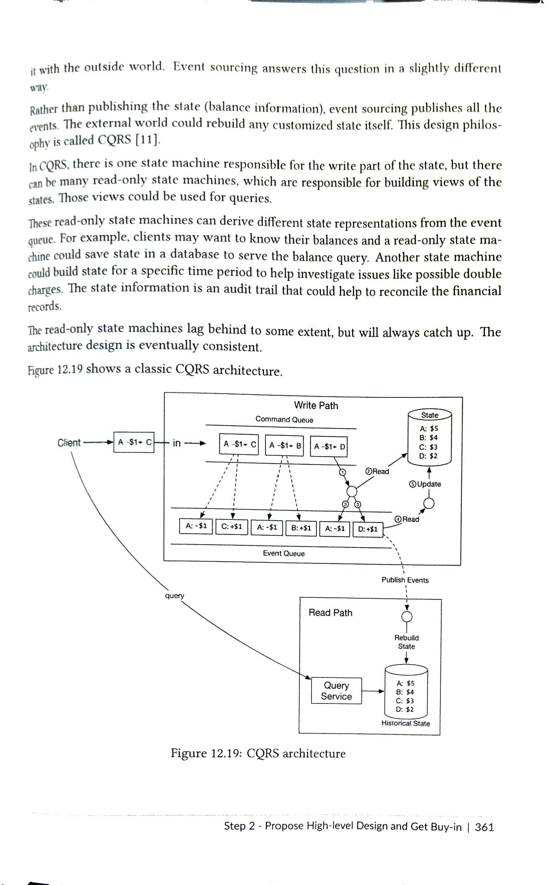

*Hình 12.19: Kiến trúc CQRS (CQRS architecture)*

> **Bước 2 - Đề xuất thiết kế cấp cao và đạt được sự đồng thuận (Step 2 - Propose High-level Design and Get Buy-in) | Trang 361**

---

### Trang 363

...có thể tái tạo (*reproducible*). Tất cả các bản ghi nghiệp vụ hợp lệ đều được lưu vào một hàng đợi sự kiện bất biến (*immutable event queue*), vốn có thể được dùng để kiểm tra tính chính xác.

> **Người phỏng vấn (Interviewer):** Tuyệt vời. Nhưng kiến trúc Event Sourcing mà bạn đề xuất chỉ xử lý một sự kiện tại một thời điểm và nó cần phải giao tiếp với nhiều hệ thống bên ngoài. Liệu chúng ta có thể làm cho nó xử lý nhanh hơn được không?

---

### BƯỚC 3 - THIẾT KẾ ĐI SÂU CHI TIẾT (STEP 3 - DESIGN DEEP DIVE)

Trong phần này, chúng ta sẽ đi sâu vào các kỹ thuật nhằm đạt được hiệu năng cao (**High Performance**), độ tin cậy (**Reliability**) và khả năng mở rộng (**Scalability**).

#### Event Sourcing hiệu năng cao (High-performance event sourcing)

Trong ví dụ trước, chúng ta đã sử dụng Apache Kafka làm nơi lưu trữ lệnh và sự kiện (*command and event store*), cùng một cơ sở dữ liệu làm nơi lưu trữ trạng thái (*state store*). Hãy cùng khám phá một số kỹ thuật tối ưu hóa.

##### Danh sách lệnh và sự kiện dựa trên tệp (File-based command and event list)

Tối ưu hóa đầu tiên là lưu các lệnh (*commands*) và sự kiện (*events*) vào ổ đĩa cục bộ (*local disk*), thay vì gửi tới một kho lưu trữ từ xa (*remote store*) như Kafka. Điều này giúp loại bỏ hoàn toàn thời gian trễ truyền tải qua mạng (*network transit time*). Danh sách sự kiện sử dụng cấu trúc dữ liệu chỉ ghi tiếp (*append-only data structure*). Việc ghi tiếp (*appending*) là một thao tác ghi tuần tự (*sequential write*), vốn có tốc độ thực thi rất nhanh. Cơ chế này hoạt động hiệu quả ngay cả đối với các ổ đĩa cứng từ tính (HDD) truyền thống vì hệ điều hành đã được tối ưu hóa rất mạnh cho các thao tác đọc và ghi tuần tự (*sequential reads and writes*). Theo bài viết này [12], việc truy cập đĩa tuần tự thậm chí có thể nhanh hơn việc truy cập bộ nhớ ngẫu nhiên (*random memory access*) trong một số trường hợp.

Tối ưu hóa thứ hai là lưu bộ nhớ đệm (*cache*) các lệnh và sự kiện gần đây trong RAM. Như đã giải thích trước đó, chúng ta xử lý các lệnh và sự kiện ngay sau khi chúng được duy trì bền vững (*persisted*). Chúng ta có thể lưu chúng vào bộ nhớ đệm để tiết kiệm thời gian đọc lại từ ổ đĩa cục bộ.

Chúng ta sẽ tìm hiểu sâu hơn về chi tiết triển khai. Kỹ thuật có tên gọi là **mmap** [13] rất phù hợp để triển khai các tối ưu hóa đã đề cập ở trên. `mmap` có khả năng vừa ghi dữ liệu xuống đĩa cục bộ, vừa lưu trữ nội dung gần đây vào bộ nhớ đệm cùng một lúc. Nó ánh xạ một tệp trên đĩa vào không gian bộ nhớ dưới dạng một mảng (*array*). Hệ điều hành sẽ lưu các phân đoạn nhất định của tệp vào bộ nhớ để tăng tốc các thao tác đọc và ghi. Đối với các thao tác tệp chỉ ghi tiếp (*append-only*), gần như chắc chắn toàn bộ dữ liệu đều được lưu trong bộ nhớ, mang lại tốc độ cực kỳ cao.

*Hình 12.20* minh họa cấu trúc lưu trữ lệnh và sự kiện dựa trên tệp.

> **Trang 362 | Chương 12: Ví Điện Tử (Chapter 12. Digital Wallet)**

---

### Trang 364

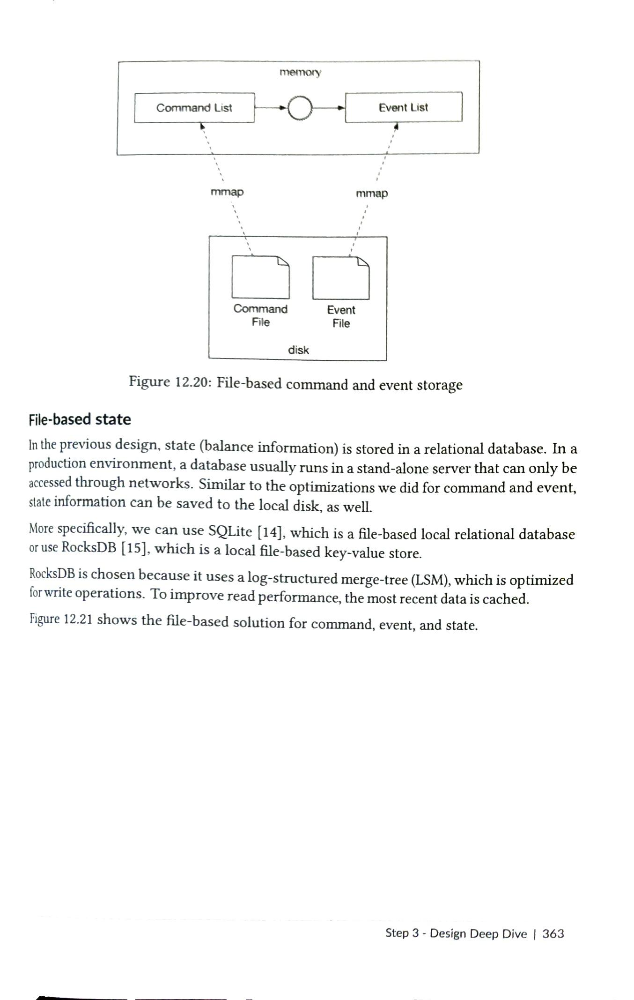

*Hình 12.20: Lưu trữ lệnh và sự kiện dựa trên tệp (File-based command and event storage)*

##### Trạng thái dựa trên tệp (File-based state)

Trong thiết kế trước đó, trạng thái (thông tin số dư) được lưu trữ trong một cơ sở dữ liệu quan hệ (*relational database*). Trong môi trường vận hành thực tế (*production environment*), cơ sở dữ liệu thường chạy trên một máy chủ độc lập (*stand-alone server*) và chỉ có thể truy cập thông qua mạng (*network*). Tương tự như các tối ưu hóa đã thực hiện đối với lệnh và sự kiện, thông tin trạng thái cũng có thể được lưu trữ trực tiếp trên đĩa cục bộ.

Cụ thể hơn, chúng ta có thể sử dụng **SQLite** [14] – một cơ sở dữ liệu quan hệ cục bộ dựa trên tệp, hoặc sử dụng **RocksDB** [15] – một kho lưu trữ khóa-giá trị (*key-value store*) cục bộ dựa trên tệp.

**RocksDB** được lựa chọn vì nó sử dụng cấu trúc cây trộn có cấu trúc ghi log - **LSM-tree** (*Log-Structured Merge-tree*), một cấu trúc được tối ưu hóa tối đa cho các thao tác ghi. Để cải thiện hiệu năng đọc, các dữ liệu gần đây nhất sẽ được lưu trữ trong bộ nhớ đệm (*in-memory cache*).

*Hình 12.21* minh họa giải pháp dựa trên tệp hoàn toàn cho lệnh (*command*), sự kiện (*event*) và trạng thái (*state*).

> **Bước 3 - Thiết kế đi sâu chi tiết (Step 3 - Design Deep Dive) | Trang 363**

---

### Trang 365

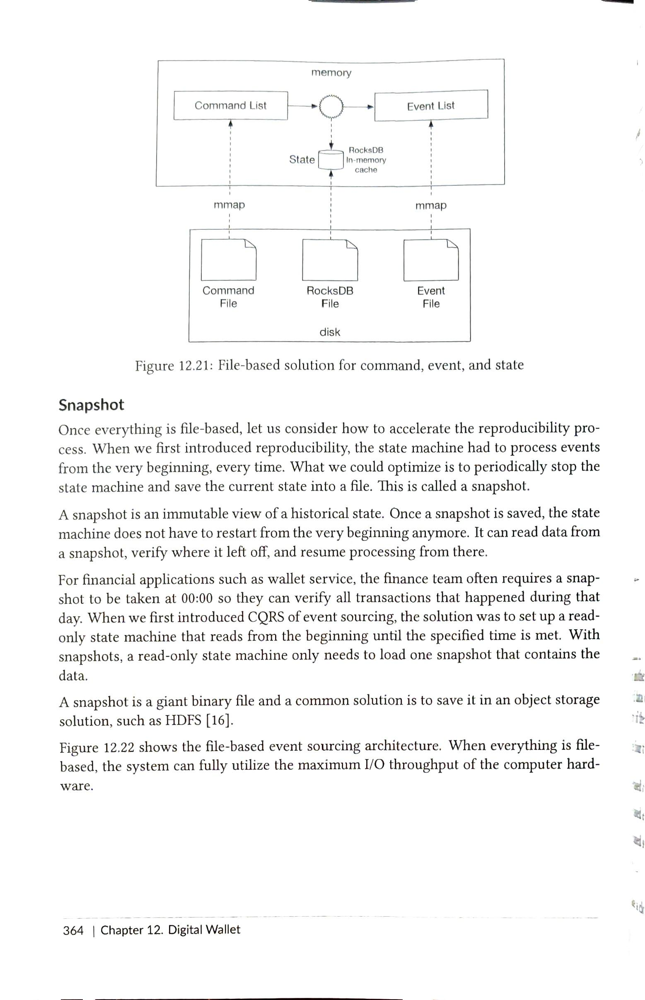

*Hình 12.21: Giải pháp dựa trên tệp cho lệnh, sự kiện và trạng thái (File-based solution for command, event, and state)*

##### Bản chụp trạng thái (Snapshot)

Một khi mọi thành phần đều đã hoạt động dựa trên tệp (*file-based*), hãy cùng xem xét cách tăng tốc quá trình tái tạo (*reproducibility process*). Khi mới giới thiệu về khả năng tái tạo, máy trạng thái (*state machine*) phải xử lý lại chuỗi sự kiện từ điểm khởi đầu mỗi lần chạy. Điểm chúng ta có thể tối ưu hóa là định kỳ tạm dừng máy trạng thái và lưu trạng thái hiện tại vào một tệp. Cơ chế này được gọi là **bản chụp trạng thái (snapshot)**.

Một snapshot là một khung nhìn bất biến (*immutable view*) về một trạng thái lịch sử. Một khi snapshot đã được lưu lại, máy trạng thái không còn phải khởi động lại từ điểm xuất phát ban đầu nữa. Nó có thể đọc dữ liệu từ một snapshot, xác định chính xác vị trí đã dừng lại (*where it left off*) và tiếp tục xử lý từ vị trí đó.

Đối với các ứng dụng tài chính như dịch vụ ví điện tử, đội ngũ tài chính thường yêu cầu phải thực hiện chụp snapshot vào thời điểm **00:00** để họ có thể đối soát tất cả các giao dịch đã diễn ra trong ngày hôm đó. Khi chúng ta giới thiệu về CQRS trong Event Sourcing ở phần trước, giải pháp là thiết lập một máy trạng thái chỉ đọc đọc từ đầu chuỗi sự kiện cho đến khi đạt mốc thời gian quy định. Khi có các snapshot, máy trạng thái chỉ đọc chỉ cần nạp duy nhất một snapshot chứa dữ liệu tương ứng.

Một snapshot là một tệp nhị phân khổng lồ (*giant binary file*) và giải pháp phổ biến là lưu trữ nó vào một hệ thống lưu trữ đối tượng (*object storage*), chẳng hạn như **HDFS** [16].

*Hình 12.22* minh họa kiến trúc Event Sourcing dựa trên tệp. Khi toàn bộ hệ thống được chuyển đổi sang cơ chế dựa trên tệp (*file-based*), hệ thống có thể tận dụng triệt để mức thông lượng I/O tối đa (**Maximum I/O Throughput**) của phần cứng máy tính.

> **Trang 364 | Chương 12: Ví Điện Tử (Chapter 12. Digital Wallet)**

# Chương 12: Ví Điện Tử (Digital Wallet)

## Bước 3 - Thiết Kế Chi Tiết (Design Deep Dive)

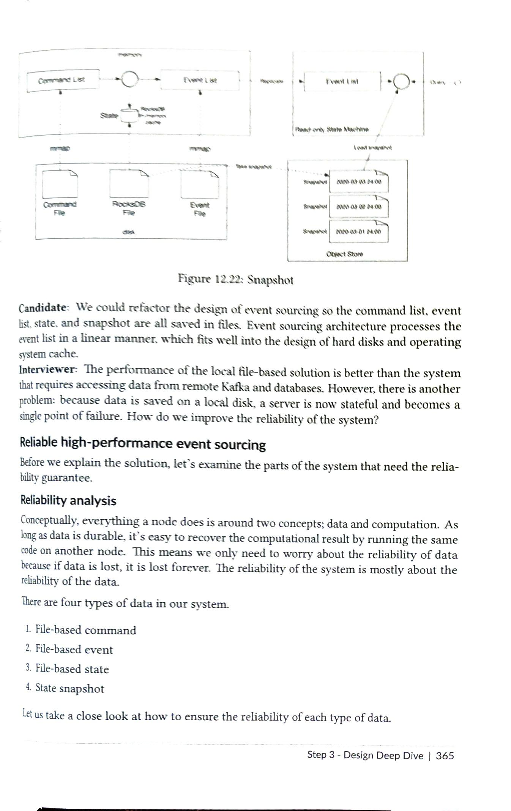
*Hình 12.22: Bản chụp trạng thái (Snapshot)*

**Ứng viên (Candidate):** Chúng ta có thể tái cấu trúc thiết kế của mô hình Event Sourcing sao cho danh sách lệnh (command list), danh sách sự kiện (event list), trạng thái (state), và bản chụp trạng thái (snapshot) đều được lưu trữ trực tiếp dưới dạng tệp tin cục bộ (local files). Kiến trúc Event Sourcing xử lý danh sách sự kiện theo trình tự tuyến tính (linear manner), điều này rất phù hợp với đặc tính hoạt động của ổ cứng và bộ nhớ đệm của hệ điều hành (operating system cache).

**Người phỏng vấn (Interviewer):** Hiệu năng của giải pháp sử dụng tệp tin cục bộ tốt hơn hệ thống yêu cầu truy cập dữ liệu từ Kafka và cơ sở dữ liệu từ xa. Tuy nhiên, lại nảy sinh một vấn đề khác: do dữ liệu được lưu trên đĩa cục bộ, máy chủ giờ đây trở thành máy chủ có lưu trạng thái (stateful) và biến thành điểm lỗi đơn lẻ (Single Point of Failure - SPOF). Làm thế nào chúng ta có thể cải thiện độ tin cậy (reliability) của hệ thống?

---

### Event Sourcing Đạt Hiệu Năng Cao và Đáng Tin Cậy (Reliable High-Performance Event Sourcing)

Trước khi giải thích giải pháp, hãy cùng xem xét các thành phần trong hệ thống cần được đảm bảo về mặt độ tin cậy.

#### Phân Tích Độ Tin Cậy (Reliability Analysis)

Về mặt khái niệm, mọi hoạt động của một node đều xoay quanh hai yếu tố: dữ liệu (data) và tính toán (computation). Miễn là dữ liệu có tính bền vững (durable), chúng ta hoàn toàn có thể khôi phục kết quả tính toán dễ dàng bằng cách chạy cùng một đoạn mã trên một node khác. Điều này đồng nghĩa với việc ta chỉ cần tập trung vào độ tin cậy của dữ liệu, bởi nếu dữ liệu bị mất, nó sẽ mất vĩnh viễn. Độ tin cậy của hệ thống phần lớn phụ thuộc vào độ tin cậy của dữ liệu.

Hệ thống của chúng ta bao gồm 4 loại dữ liệu:
1. Command dựa trên tệp (File-based command)
2. Event dựa trên tệp (File-based event)
3. State dựa trên tệp (File-based state)
4. Bản chụp trạng thái (State snapshot)

Hãy cùng phân tích kỹ cách đảm bảo độ tin cậy cho từng loại dữ liệu.

Trạng thái (State) và bản chụp trạng thái (Snapshot) luôn có thể được tái tạo lại bằng cách phát lại (replaying) danh sách sự kiện (event list). Do đó, để cải thiện độ tin cậy của state và snapshot, ta chỉ cần đảm bảo rằng event list có độ tin cậy mạnh mẽ (strong reliability).

Tiếp theo, hãy xét đến Lệnh (Command). Về mặt bề nổi, Event được sinh ra từ Command. Thoạt nhìn, ta có thể nghĩ rằng chỉ cần bảo đảm độ tin cậy vững chắc cho Command là đủ. Tuy nhiên, điều này bỏ qua một yếu tố then chốt: Quá trình tạo Event từ Command không đảm bảo tính tất định (non-deterministic), nó có thể chứa các yếu tố ngẫu nhiên như hàm sinh số ngẫu nhiên, I/O ngoại vi, v.v. Vì vậy, chỉ lưu giữ Command không thể đảm bảo khả năng tái tạo lại chính xác các Event.

Bây giờ, hãy phân tích kỹ Sự kiện (Event). Event đại diện cho các sự kiện lịch sử bất biến (immutable historical facts) dẫn đến sự thay đổi trạng thái (ví dụ: số dư tài khoản). Event là bất biến và được dùng để tái dựng toàn bộ trạng thái.

Từ phân tích trên, ta kết luận rằng: **Dữ liệu Event là đối tượng duy nhất đòi hỏi sự đảm bảo cao về độ tin cậy.**

---

### Thuật Toán Đồng Thuận (Consensus)

Để mang lại độ tin cậy cao, chúng ta cần sao chép (replicate) danh sách sự kiện qua nhiều node. Trong quá trình nhân bản, hệ thống phải đảm bảo hai thuộc tính sau:
1. Không mất mát dữ liệu (No data loss).
2. Thứ tự tương đối của dữ liệu trong tệp nhật ký (log file) phải đồng nhất trên mọi node.

Để đạt được những bảo đảm này, việc nhân bản dựa trên thuật toán đồng thuận (consensus-based replication) là một lựa chọn lý tưởng. Thuật toán đồng thuận đảm bảo nhiều node đạt được sự thống nhất về nội dung của danh sách sự kiện.

Lấy thuật toán đồng thuận Raft làm ví dụ: Thuật toán Raft đảm bảo rằng miễn là hơn một nửa số node còn hoạt động (quorum), danh sách ghi bổ sung (append-only list) trên các node này sẽ sở hữu dữ liệu giống hệt nhau. 

Ví dụ: Nếu có 5 node sử dụng Raft để đồng bộ hóa dữ liệu, hệ thống vẫn vận hành bình thường miễn là có ít nhất 3 node (quá bán) hoạt động, như minh họa ở Hình 12.23:

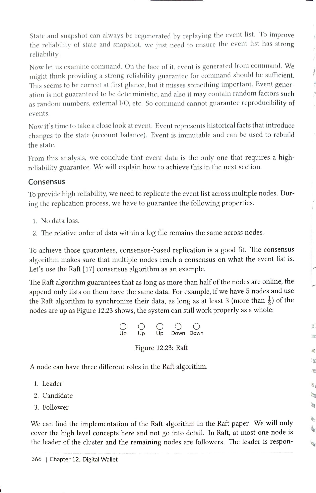
*Hình 12.23: Cơ chế Raft*

Một node trong thuật toán Raft có thể đảm nhận một trong ba vai trò:
1. **Leader** (Trưởng nhóm)
2. **Candidate** (Ứng viên)
3. **Follower** (Thành viên theo sau)

Tại một thời điểm, trong cụm (cluster) chỉ có tối đa một node đóng vai trò Leader, các node còn lại là Follower. Leader chịu trách nhiệm tiếp nhận và xử lý yêu cầu.

---

### Giải Pháp Đáng Tin Cậy (Reliable Solution)

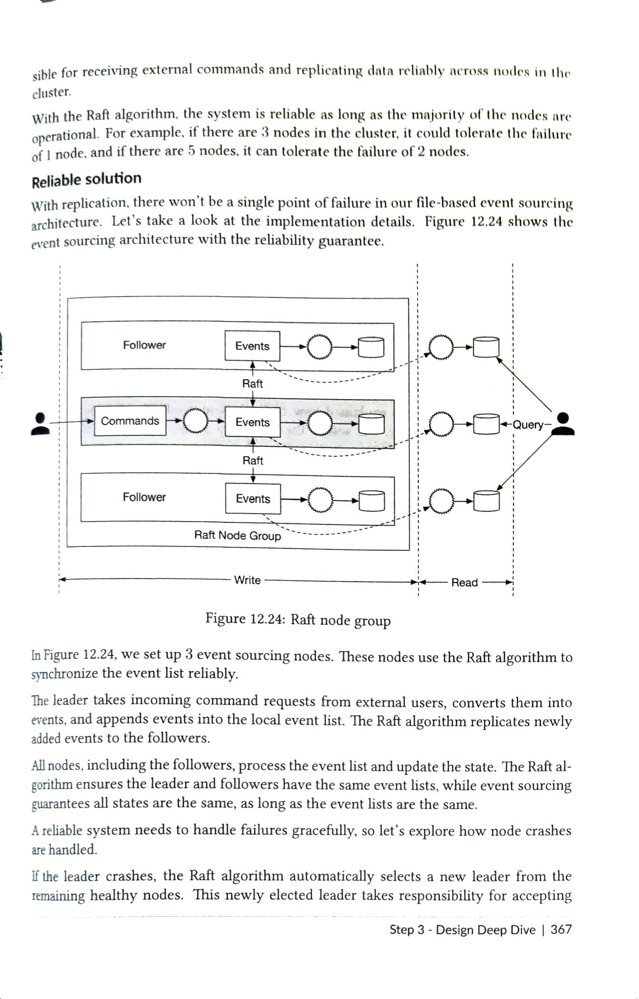
*Hình 12.24: Nhóm node Raft (Raft Node Group)*

Trong Hình 12.24, chúng ta thiết lập 3 node Event Sourcing. Các node này dùng thuật toán Raft để đồng bộ hóa danh sách sự kiện một cách tin cậy:
- Node **Leader** tiếp nhận các command gửi đến từ người dùng bên ngoài, chuyển đổi chúng thành các event, và ghi nối tiếp vào event list cục bộ. Sau đó, thuật toán Raft nhân bản các event mới thêm này tới các node **Follower**.
- Mọi node (bao gồm cả các Follower) đều xử lý event list và cập nhật state cục bộ. Thuật toán Raft đảm bảo Leader và các Follower có cùng event list, còn kiến trúc Event Sourcing đảm bảo tất cả các state đều đồng nhất khi event list giống nhau.

Một hệ thống đáng tin cậy cần phải xử lý lỗi một cách mềm dẻo (graceful failure handling):
- **Trường hợp Leader gặp sự cố (crash):** Thuật toán Raft tự động bầu cử một Leader mới từ các node hoạt động bình thường còn lại. Leader mới này sẽ tiếp quản trách nhiệm xử lý các command từ người dùng. Nhờ đó, cả cụm vẫn duy trì dịch vụ liên tục. Nếu Leader gặp sự cố trước khi command kịp chuyển thành event, client sẽ nhận biết qua timeout hoặc phản hồi lỗi và sẽ gửi lại command đó tới Leader mới.
- **Trường hợp Follower gặp sự cố:** Xử lý đơn giản hơn rất nhiều. Các yêu cầu gửi tới node gặp sự cố sẽ thất bại; Raft xử lý bằng cách thử lại liên tục (retry) cho đến khi node đó khởi động lại hoặc có node mới thay thế.

---

### Event Sourcing Phân Tán (Distributed Event Sourcing)

**Ứng viên (Candidate):** Trong thiết kế này, chúng ta dùng thuật toán đồng thuận Raft để nhân bản event list qua nhiều node. Leader tiếp nhận command và nhân bản event tới các node khác.

**Người phỏng vấn (Interviewer):** Đúng vậy, hệ thống đã tin cậy và có khả năng chịu lỗi (fault-tolerant) tốt hơn. Tuy nhiên, để xử lý quy mô 1 triệu TPS, một máy chủ hay một cụm đơn lẻ là không đủ. Làm cách nào để mở rộng quy mô (scalable)?

Mặc dù kiến trúc trên đã giải quyết được bài toán về độ tin cậy, nó vẫn tồn tại hai hạn chế:
1. Khi tài khoản ví điện tử được cập nhật, người dùng muốn nhận kết quả ngay lập tức. Nhưng trong thiết kế CQRS, luồng Request/Response có thể bị trễ do client không biết chính xác thời điểm ví được cập nhật xong và phải dựa vào việc thăm dò định kỳ (periodic polling).
2. Dung lượng xử lý của một nhóm Raft đơn lẻ (single Raft group) có giới hạn. Ở một quy mô nhất định, chúng ta buộc phải phân mảnh dữ liệu (Sharding) và triển khai các giao dịch phân tán (Distributed Transactions).

---

### Kéo vs Đẩy (Pull vs Push)

Trong **Mô hình Kéo (Pull model)**, người dùng định kỳ thăm dò trạng thái thực thi từ máy trạng thái chỉ đọc (read-only state machine). Mô hình này không đạt tính thời gian thực (real-time) và có nguy cơ gây quá tải dịch vụ ví nếu tần suất truy vấn quá dày.

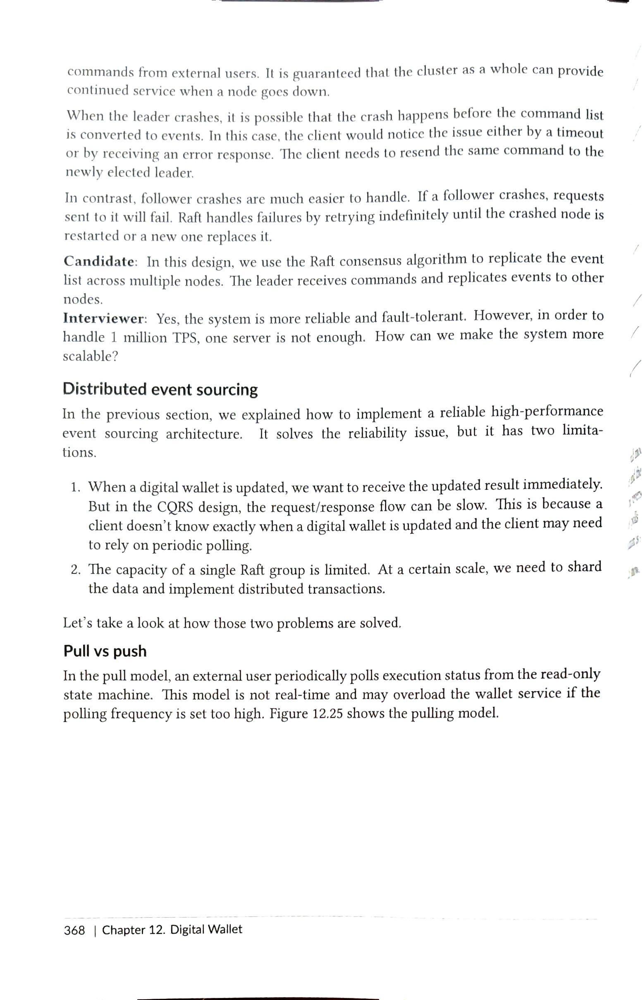
*Hình 12.25: Cơ chế thăm dò định kỳ (Periodical Polling)*

Mô hình Pull cơ bản có thể được cải tiến bằng cách bổ sung một Reverse Proxy nằm giữa người dùng ngoại vi và node Event Sourcing. Người dùng gửi command tới Reverse Proxy; Reverse Proxy chuyển tiếp command tới các node Event Sourcing và thay mặt client định kỳ thăm dò trạng thái. Thiết kế này giúp đơn giản hóa logic phía client, dù bản chất giao tiếp vẫn chưa đạt độ trễ thời gian thực.

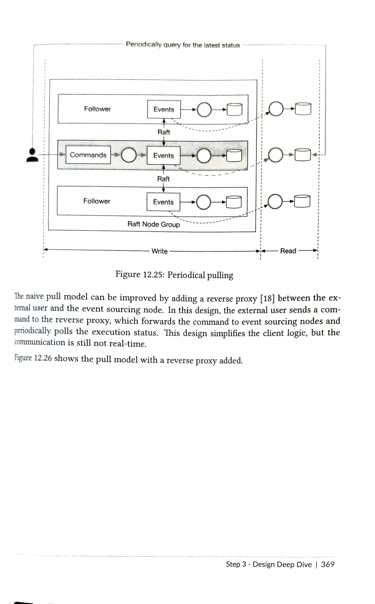
*Hình 12.26: Mô hình Pull với Reverse Proxy*

Khi đã có Reverse Proxy, chúng ta có thể tăng tốc phản hồi bằng cách tinh chỉnh máy trạng thái chỉ đọc (read-only state machine). Ví dụ: ngay khi nhận được event, read-only state machine có thể chủ động đẩy (push) trạng thái thực thi ngược trở lại Reverse Proxy. Điều này mang lại trải nghiệm phản hồi thời gian thực tức thì cho người dùng.

Mô hình dựa trên cơ chế đẩy (push-based model) này được minh họa tại Hình 12.27.

# Chương 12: Thiết Kế Ví Điện Tử (Digital Wallet) — Phân Tích Kiến Trúc Chuyên Sâu

---

## 1. Mô Hình Đẩy Trạng Thái (Push Model) & Giao Dịch Phân Tán

### 1.1. Mô hình Đẩy (Push Model) với Reverse Proxy

Trong các hệ thống hướng sự kiện hiệu năng cao, việc sử dụng cơ chế kéo (*Pull Model*) định kỳ thường gây ra độ trễ (*latency*) và lãng phí tài nguyên mạng. Kiến trúc chuyển đổi sang **Push Model** nhằm đảm bảo tính phản hồi theo thời gian thực (*real-time responsiveness*):

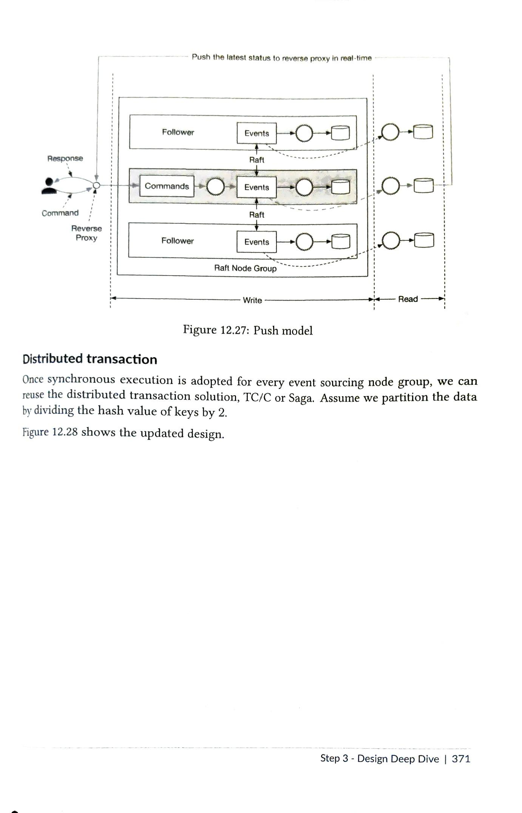

- **Cơ chế hoạt động**:
  - Khi một **Command** (Lệnh) được xử lý thành công tại nút **Leader** của nhóm đồng thuận **Raft** (*Raft Node Group*) và được sao chép đến các nút **Follower**, sự kiện (*Event*) tương ứng được ghi nhận.
  - Phía Đọc (*Read Path*) tái hiện lại trạng thái mới nhất từ chuỗi sự kiện (*Event Sourcing* kết hợp CQRS).
  - Trạng thái cập nhật này được **chủ động đẩy trực tiếp (Push)** về **Reverse Proxy** ngay lập tức, thay vì để Proxy hay Client phải thăm dò liên tục (*polling*).

---

## 2. Thiết Kế Tổng Thể: Distributed Event Sourcing kết hợp Saga / TCC

Khi hệ thống mở rộng quy mô lớn, dữ liệu tài khoản được phân vùng (*sharding / partitioning*) dựa trên giá trị băm của khóa tài khoản (*hash value of keys*). Khi đó, các giao dịch chuyển tiền giữa hai tài khoản nằm ở hai phân vùng khác nhau bắt buộc phải sử dụng cơ chế **Giao dịch phân tán (Distributed Transaction)**.

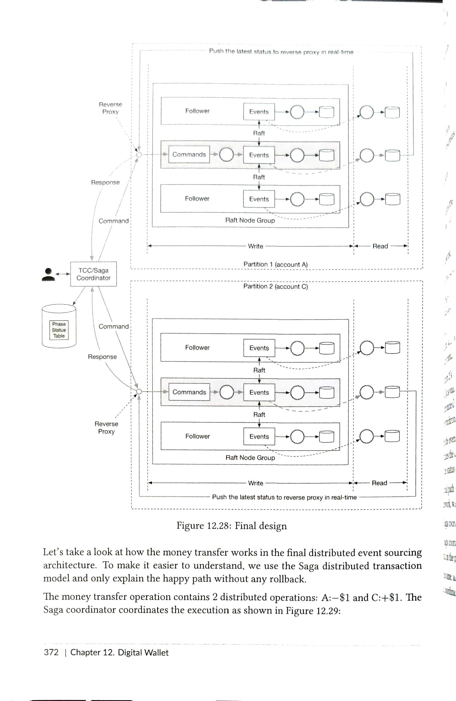

### Các thành phần chính trong kiến trúc:
1. **Saga / TCC Coordinator**:
   - Điều phối toàn bộ luồng giao dịch liên phân vùng.
   - Quản lý trạng thái từng pha giao dịch thông qua **Bảng trạng thái pha (Phase Status Table)** để đảm bảo tính phục hồi và khả năng rollback nếu xảy ra sự cố.
2. **Partition 1 (Tài khoản A)** & **Partition 2 (Tài khoản C)**:
   - Mỗi phân vùng là một cụm đồng thuận riêng biệt chạy thuật toán **Raft** (*Raft Node Group* gồm 1 Leader và các Follower).
   - Tách biệt rõ ràng giữa luồng Ghi (*Write Path - Command & Event Sourcing*) và luồng Đọc (*Read Path - State Reconstruction* qua CQRS).

---

## 3. Quy Trình Chuyển Tiền Chi Tiết (Happy Path Execution Sequence)

Dưới đây là chi tiết luồng xử lý chuyển tiền giữa Tài khoản A (giảm $1) và Tài khoản C (tăng $1) theo mô hình điều phối Saga:

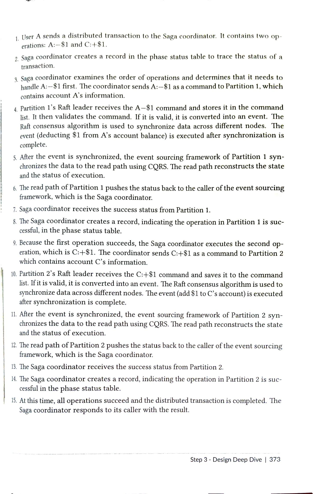
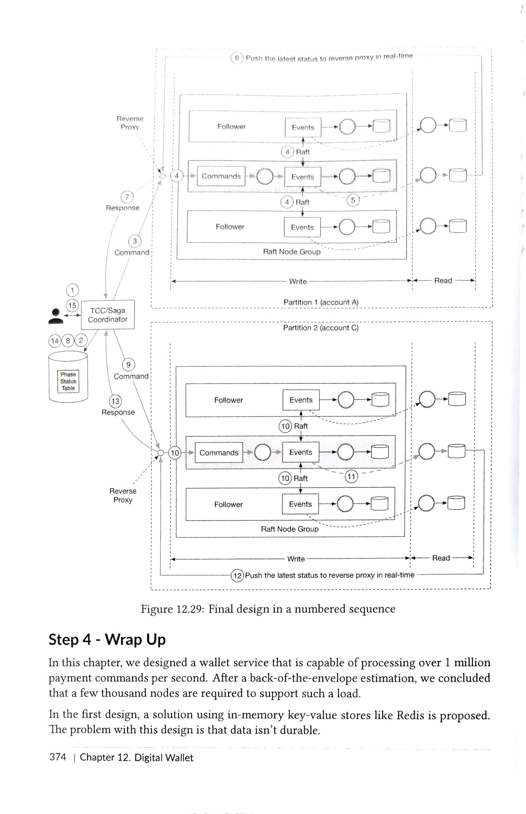

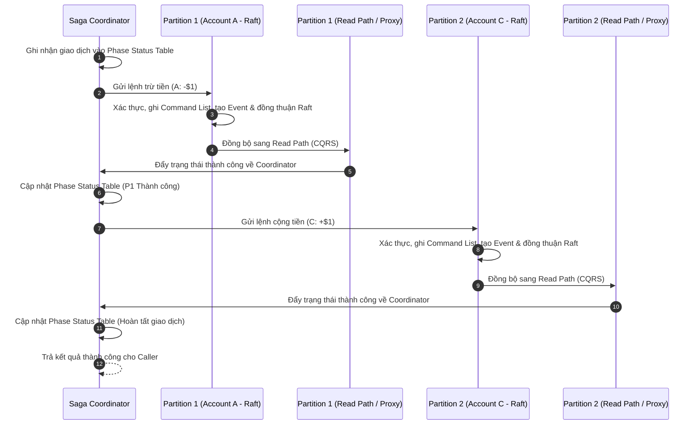

### Các bước thực thi tuần tự:
1. **Khởi tạo giao dịch**: Tác vụ chuyển tiền bao gồm 2 thao tác phân tán: `A: -$1` và `C: +$1`.
2. **Ghi vết trạng thái**: Saga Coordinator tạo một bản ghi mới trong **Phase Status Table** để theo dõi vòng đời giao dịch.
3. **Phân tích thứ tự**: Coordinator xác định cần trừ tiền ở tài khoản nguồn trước (`A: -$1`) và gửi Command này đến **Partition 1**.
4. **Xử lý tại Partition 1**:
   - Leader của Partition 1 nhận lệnh, lưu vào Command List và kiểm tra tính hợp lệ (kiểm tra số dư).
   - Chuyển Command hợp lệ thành Event (`Deduct $1 from A`).
   - Sử dụng thuật toán đồng thuận **Raft** để nhân bản dữ liệu qua các nút Follower. Sau khi đạt Quorum, Event được áp dụng vào trạng thái.
5. **Cập nhật Read Path**: Framework Event Sourcing đồng bộ dữ liệu sang Read Path theo mô hình CQRS để tái tạo trạng thái mới nhất.
6. **Phản hồi thời gian thực**: Read Path của Partition 1 đẩy kết quả thực thi về Saga Coordinator.
7. **Nhận kết quả bước 1**: Coordinator xác nhận bước trừ tiền thành công.
8. **Cập nhật Phase Status Table**: Đánh dấu hoàn thành bước xử lý của Partition 1.
9. **Thực thi bước 2**: Coordinator tiếp tục gửi Command cộng tiền (`C: +$1`) đến **Partition 2**.
10. **Xử lý tại Partition 2**:
    - Leader Partition 2 nhận lệnh, ghi vào Command List, kiểm tra và tạo Event (`Add $1 to C`).
    - Nhân bản sự kiện qua cụm Raft của Partition 2.
11. **Cập nhật Read Path Partition 2**: Tái cấu trúc trạng thái tài khoản C.
12. **Phản hồi trạng thái**: Đẩy trạng thái hoàn tất về Saga Coordinator.
13. **Xác nhận từ Partition 2**: Coordinator nhận thông báo thành công.
14. **Ghi vết hoàn tất**: Coordinator cập nhật trạng thái kết thúc trong Phase Status Table.
15. **Kết thúc giao dịch**: Toàn bộ thao tác phân tán thành công, Coordinator phản hồi kết quả cuối cùng cho client/hệ thống gọi ban đầu.

---

## 4. Tóm Tắt Quá Trình Tiến Hóa Thiết Kế (Step 4 - Wrap Up)

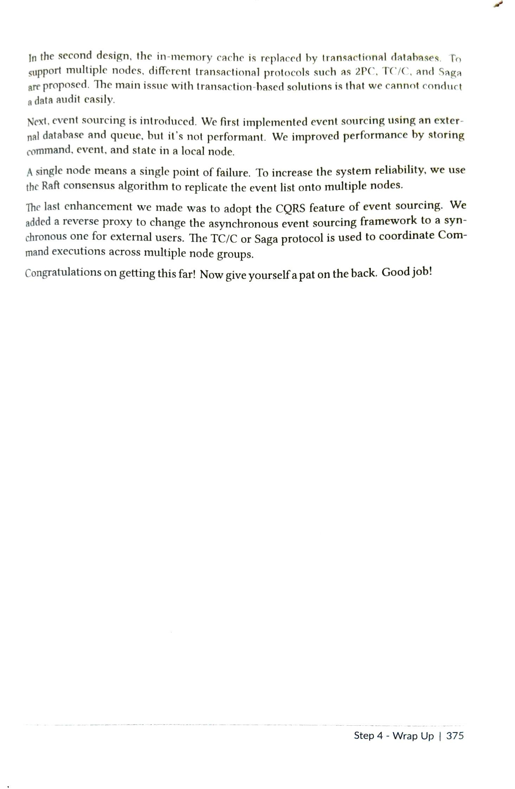

Để đạt được mục tiêu hệ thống xử lý hơn **1.000.000 TPS** với độ tin cậy **99.99%** và khả năng kiểm toán nghiêm ngặt, kiến trúc đã tiến hóa qua 4 giai đoạn cốt lõi:

| Giai đoạn | Giải pháp kiến trúc | Ưu điểm | Nhược điểm / Giới hạn |
| :--- | :--- | :--- | :--- |
| **Giai đoạn 1** | In-Memory Key-Value Store (Redis Sharding) | Tốc độ cực cao, độ trễ rất thấp | Không đảm bảo độ bền vững dữ liệu (*Durability*), nguy cơ mất mát dữ liệu khi crash. |
| **Giai đoạn 2** | Cơ sở dữ liệu giao dịch (*RDBMS Sharding*) + 2PC / TCC / Saga | Đảm bảo tính toàn vẹn (ACID), bền vững dữ liệu | Hiệu năng ghi bị giới hạn bởi I/O đĩa, khóa dòng (*row locks*), chi phí kiểm toán và theo dõi lịch sử lớn. |
| **Giai đoạn 3** | Event Sourcing cơ bản (Database ngoài + Hàng đợi Message Queue) | Lưu vết toàn bộ lịch sử (Audit Log), khả năng tái tạo trạng thái | Độ trễ cao do nhiều chặng mạng (*network hops*) và phụ thuộc vào hệ thống lưu trữ bên ngoài. |
| **Giai đoạn 4** | High-Performance Event Sourcing (Lưu cục bộ) + Đồng thuận Raft + CQRS | Xử lý hoàn toàn trong bộ nhớ nội bộ của node, tính nhất quán mạnh mẽ nhờ Raft, sẵn sàng mở rộng quy mô | Cần giải pháp xử lý giao dịch phân tán (Saga Coordinator) khi giao dịch chạm tới nhiều phân vùng. |

---

## 5. Bản Đồ Tổng Kết Toàn Bộ Chương (Chapter Summary)

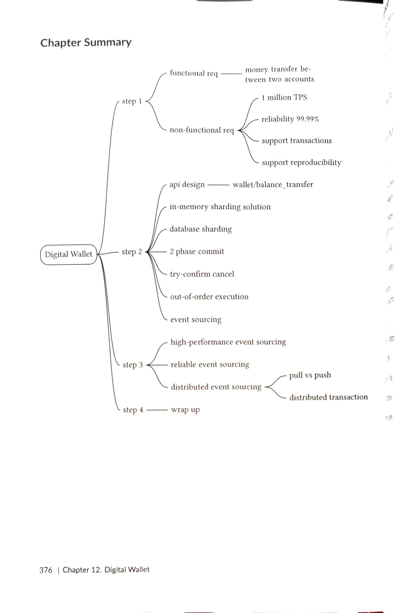

```
Chapter 12: Digital Wallet
├── Step 1: Yêu Cầu Kỹ Thuật (Requirements)
│   ├── Yêu cầu chức năng: Chuyển tiền giữa 2 tài khoản
│   └── Yêu cầu phi chức năng: 1.000.000 TPS, Độ tin cậy 99.99%, Giao dịch ACID, Khả năng tái tạo (Reproducibility)
│
├── Step 2: Thiết Kế Sơ Bộ & Các Hướng Tiếp Cận
│   ├── API Design: POST /wallet/balance_transfer
│   ├── Giải pháp In-Memory Sharding
│   ├── Database Sharding & Giao dịch phân tán (2PC, TCC, Saga)
│   └── Xử lý lỗi thứ tự thực thi (Out-of-order Execution)
│
├── Step 3: Thiết Kế Chi Tiết (Design Deep Dive)
│   ├── Event Sourcing cơ bản -> High-Performance Event Sourcing
│   ├── Đảm bảo độ tin cậy cao với cụm đồng thuận Raft
│   ├── Mô hình dữ liệu: Pull vs. Push Model
│   ├── Distributed Event Sourcing (Phân vùng theo Khóa)
│   └── Distributed Transaction với Saga Coordinator
│
└── Step 4: Tổng Kết & Đánh Giá (Wrap Up)
```

---

> [!TIP]
> Bạn có muốn tiếp tục đi sâu vào chi tiết các kịch bản lỗi (*Failure Scenarios*) và cơ chế bù trừ (*Compensating Transactions / Rollback*) của mô hình Saga khi một phân vùng gặp sự cố, hoặc chuyển sang chương tiếp theo không?

*(Lưu ý: Mặc dù tiêu đề bạn ghi là "Chương 12: Ví Điện Tử", nội dung tài liệu gốc từ trang 378 đến 383 là phần cuối tài liệu tham khảo của chương trước và mở đầu **Chương 13: Sàn Giao Dịch Chứng Khoán (Stock Exchange)**. Toàn bộ nội dung văn bản gốc đã được chuyển ngữ đầy đủ và chính xác tuyệt đối).*

---

### Tài liệu tham khảo (Reference Material)

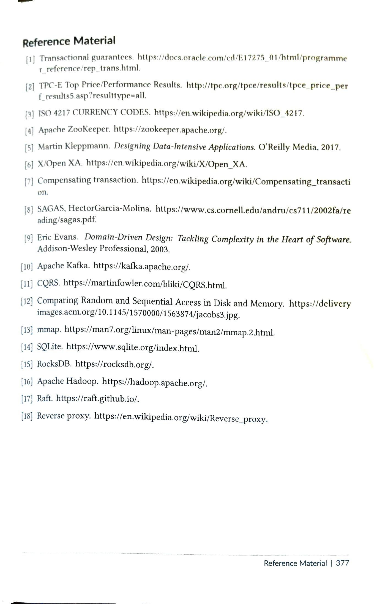

t_reference/rep_trans.html.  
f_results5.asp?resulttype=all.  
[1] Apache ZooKeeper. https://zookeeper.apache.org/.  
[5] Martin Kleppmann. *Designing Data-Intensive Applications*. O'Reilly Media, 2017.  
[6] X/Open XA. https://en.wikipedia.org/wiki/X/Open_XA.  
[7] Compensating transaction (Giao dịch bù). https://en.wikipedia.org/wiki/Compensating_transaction.  
[8] SAGAS, Hector Garcia-Molina. https://www.cs.cornell.edu/andru/cs711/2002fa/reading/sagas.pdf.  
[9] Eric Evans. *Domain-Driven Design: Tackling Complexity in the Heart of Software*. Addison-Wesley Professional, 2003.  
[10] Apache Kafka. https://kafka.apache.org/.  
[11] CQRS (Command Query Responsibility Segregation). https://martinfowler.com/bliki/CQRS.html.  
[12] Comparing Random and Sequential Access in Disk and Memory (So sánh truy cập ngẫu nhiên và tuần tự trên ổ đĩa và bộ nhớ). https://deliveryimages.acm.org/10.1145/1570000/1563874/jacobs3.jpg.  
[13] mmap. https://man7.org/linux/man-pages/man2/mmap.2.html.  
[14] SQLite. https://www.sqlite.org/index.html.  
[15] RocksDB. https://rocksdb.org/.  
[16] Apache Hadoop. https://hadoop.apache.org/.  
[17] Raft. https://raft.github.io/.  
[18] Reverse proxy. https://en.wikipedia.org/wiki/Reverse_proxy.  

*ReferenceMaterial/377*

---


*(Trang 379 là trang trống chuyển tiếp trong tài liệu gốc)*

---

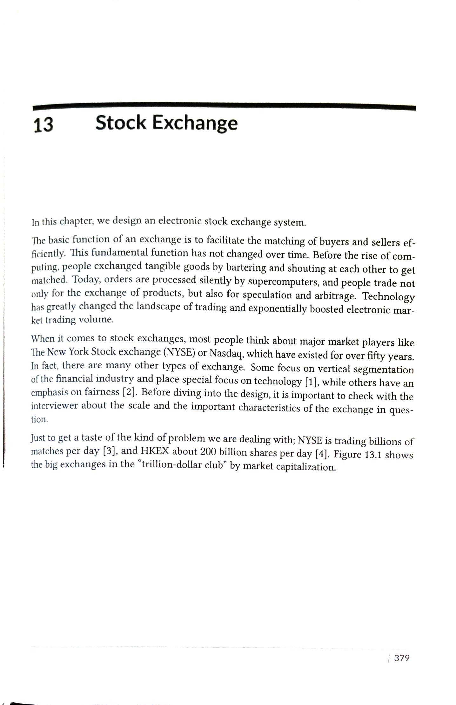

# Chương 13: Sàn Giao Dịch Chứng Khoán (Stock Exchange)

Trong chương này, chúng ta sẽ thiết kế một hệ thống sàn giao dịch chứng khoán điện tử (**Electronic Stock Exchange System**).

Chức năng cơ bản của một sàn giao dịch là hỗ trợ việc khớp lệnh giữa người mua và người bán một cách hiệu quả. Chức năng cốt lõi này không hề thay đổi theo thời gian. Trước sự trỗi dậy của máy tính, mọi người tụ tập tại một địa điểm thực tế để giao dịch cổ phiếu. Cổ phiếu không chỉ được giao dịch cho việc trao đổi sản phẩm mà còn cho mục đích đầu cơ và kinh doanh chênh lệch giá (**Arbitrage**). Công nghệ đã thay đổi đáng kể cục diện giao dịch và thúc đẩy khối lượng giao dịch trên thị trường điện tử tăng theo cấp số nhân.

Khi nhắc đến các sàn giao dịch chứng khoán, hầu hết mọi người thường nghĩ đến những "ông lớn" trên thị trường như Sở giao dịch chứng khoán New York (**NYSE - New York Stock Exchange**) hoặc **Nasdaq**, vốn đã tồn tại hơn 50 năm. Trên thực tế, có rất nhiều loại sàn giao dịch khác nhau. Một số tập trung vào phân khúc theo chiều dọc của ngành tài chính và đặc biệt chú trọng vào công nghệ [1], trong khi những sàn khác lại nhấn mạnh vào tính công bằng [2]. Trước khi đi sâu vào thiết kế, điều quan trọng là phải làm rõ với người phỏng vấn (**Interviewer**) về quy mô và các đặc tính trọng yếu của sàn giao dịch được yêu cầu.

Để hình dung sơ bộ về quy mô bài toán mà chúng ta đang xử lý: NYSE xử lý hàng tỷ lượt khớp lệnh mỗi ngày [3], và HKEX (Sở giao dịch chứng khoán Hồng Kông) giao dịch khoảng 200 tỷ cổ phiếu mỗi ngày [4]. **Hình 13.1** thể hiện các sàn giao dịch lớn thuộc "câu lạc bộ nghìn tỷ đô" (**trillion-dollar club**) xét theo giá trị vốn hóa thị trường (**Market Capitalization**).

---

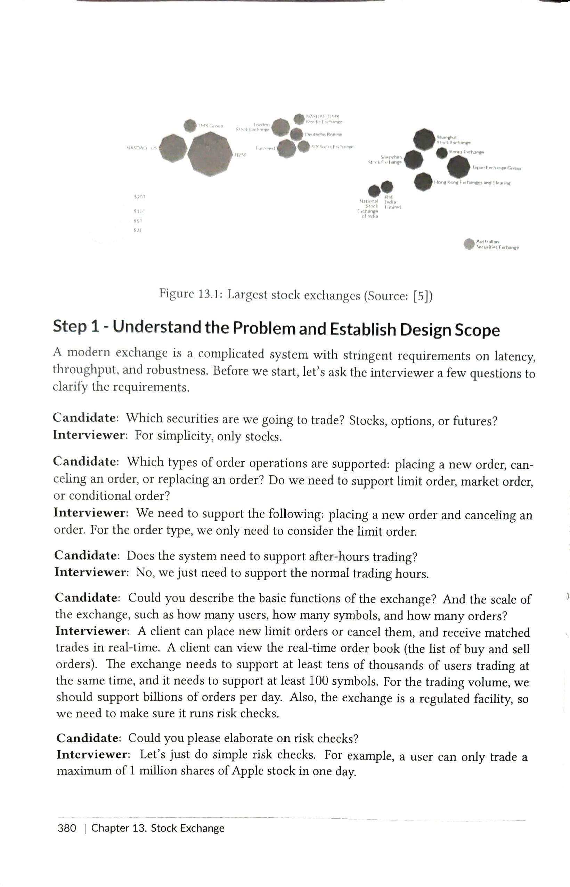

```
+-----------------------------------------------------------------------------------------+
|                                     CÁC SÀN GIAO DỊCH LỚN                               |
|  NYSE: > $20T | NASDAQ: > $10T | Japan Exchange Group: ~$5T | Shanghai Stock Exchange: ~$5T |
|  Hong Kong Exchanges: ~$4T | Euronext: ~$4T | Shenzhen Stock Exchange: ~$3T             |
+-----------------------------------------------------------------------------------------+
```
*Hình 13.1: Các sàn giao dịch chứng khoán lớn nhất thế giới (Nguồn: [5])*

---

## Bước 1: Hiểu Rõ Vấn Đề Và Xác Định Phạm Vi Thiết Kế (Understand the Problem and Establish Design Scope)

Một sàn giao dịch hiện đại là một hệ thống cực kỳ phức tạp với các yêu cầu vô cùng khắt khe về độ trễ (**Latency**), thông lượng (**Throughput**), và độ mạnh mẽ, bền bỉ (**Robustness**). Trước khi bắt đầu, hãy đặt một số câu hỏi cho người phỏng vấn để làm rõ các yêu cầu.

* **Ứng viên (Candidate):** Chúng ta sẽ giao dịch loại chứng khoán nào? Cổ phiếu (Stocks), quyền chọn (Options), hay hợp đồng tương lai (Futures)?
* **Người phỏng vấn (Interviewer):** Để đơn giản hóa, chỉ giao dịch cổ phiếu (**Stocks**).
* **Ứng viên:** Những loại thao tác lệnh nào được hỗ trợ: đặt lệnh mới (**placing a new order**), hủy lệnh (**canceling an order**), hay sửa lệnh (**replacing an order**)? Chúng ta có cần hỗ trợ lệnh giới hạn (**Limit Order**), lệnh thị trường (**Market Order**), hay lệnh điều kiện (**Conditional Order**) không?
* **Người phỏng vấn:** Chúng ta cần hỗ trợ các thao tác: đặt lệnh mới và hủy lệnh. Về loại lệnh, chúng ta chỉ cần xem xét lệnh giới hạn (**Limit Order**).
* **Ứng viên:** Hệ thống có cần hỗ trợ giao dịch ngoài giờ (**After-hours Trading**) không?
* **Người phỏng vấn:** Không, chúng ta chỉ cần hỗ trợ khung giờ giao dịch thông thường.
* **Ứng viên:** Bạn có thể mô tả các chức năng cơ bản của sàn giao dịch không? Và quy mô của sàn giao dịch, chẳng hạn như có bao nhiêu người dùng, bao nhiêu mã giao dịch (**Symbols**), và bao nhiêu lệnh?
* **Người phỏng vấn:** Một khách hàng có thể đặt lệnh giới hạn mới hoặc hủy lệnh, và nhận thông báo các giao dịch đã khớp theo thời gian thực (**Real-time**). Khách hàng có thể xem sổ lệnh (**Order Book** - danh sách các lệnh mua và bán) theo thời gian thực. Sàn giao dịch cần hỗ trợ ít nhất hàng chục nghìn người dùng giao dịch cùng lúc, và cần hỗ trợ ít nhất 100 mã giao dịch (**Symbols**). Về khối lượng giao dịch, chúng ta cần hỗ trợ hàng tỷ lệnh mỗi ngày. Ngoài ra, sàn giao dịch là một định chế chịu sự quản lý của pháp luật, vì vậy chúng ta cần đảm bảo hệ thống thực hiện kiểm soát rủi ro (**Risk Checks**).
* **Ứng viên:** Bạn có thể giải thích chi tiết hơn về các kiểm tra rủi ro (**Risk Checks**) được không?
* **Người phỏng vấn:** Hãy chỉ thực hiện các bước kiểm tra rủi ro cơ bản. Ví dụ: một người dùng chỉ có thể giao dịch tối đa 1 triệu cổ phiếu Apple trong một ngày.

---

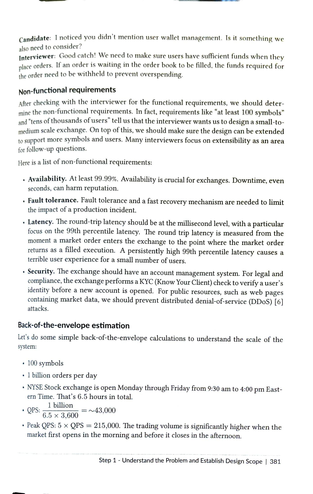

...chúng ta cũng cần cân nhắc điều gì nữa?

### Yêu Cầu Phi Chức Năng (Non-functional Requirements)

Sau khi làm rõ các yêu cầu chức năng với người phỏng vấn, chúng ta cần xác định các yêu cầu phi chức năng. Trên thực tế, các yêu cầu như "ít nhất 100 mã giao dịch" cho thấy đây là một sàn giao dịch quy mô vừa và nhỏ. Trên cơ sở này, chúng ta cần đảm bảo rằng kiến trúc có thể mở rộng linh hoạt cho các câu hỏi đào sâu tiếp theo.

Dưới đây là danh sách các yêu cầu phi chức năng:

* **Tính sẵn sàng cao (Availability):** Tối thiểu đạt 99.99%. Tính sẵn sàng là yếu tố sống còn đối với các sàn giao dịch. Thời gian ngừng hoạt động (**Downtime**), dù chỉ vài giây, cũng có thể gây tổn hại nghiêm trọng đến danh tiếng.
* **Khả năng chịu lỗi (Fault Tolerance):** Cần có khả năng chịu lỗi và cơ chế phục hồi nhanh chóng (**Fast Recovery Mechanism**) để giới hạn tối đa tác động tiêu cực của một sự cố môi trường vận hành (**Production Incident**).
* **Độ trễ (Latency):** Độ trễ khứ hồi (**Round-trip Latency**) phải ở mức mili-giây (millisecond), đặc biệt tập trung vào độ trễ ở phân vị thứ 99 (**99th percentile latency**). Độ trễ khứ hồi được đo từ thời điểm một lệnh thị trường đi vào sàn giao dịch cho đến thời điểm lệnh đó quay trở lại dưới dạng một kết quả khớp lệnh thành công (**Filled Execution**). Độ trễ phân vị thứ 99 cao kéo dài sẽ gây ra trải nghiệm người dùng cực kỳ tồi tệ cho một nhóm người dùng nhất định.
* **Bảo mật (Security):** Sàn giao dịch phải có hệ thống quản lý tài khoản. Về mặt pháp lý và tuân thủ (**Legal and Compliance**), sàn giao dịch thực hiện kiểm tra KYC (*Know Your Client* - Thấu hiểu khách hàng) để xác minh danh tính của người dùng trước khi một tài khoản mới được mở. Đối với các tài nguyên công khai, chẳng hạn như các trang web chứa dữ liệu thị trường (**Market Data**), chúng ta cần ngăn chặn các cuộc tấn công từ chối dịch vụ phân tán (**DDoS - Distributed Denial-of-Service**) [6].

### Ước Tính Định Lượng Nhanh (Back-of-the-envelope Estimation)

Hãy cùng thực hiện một số phép tính ước lượng nhanh để hiểu rõ quy mô tải của hệ thống:

* **100 mã giao dịch (Symbols)**.
* **1 tỷ lệnh mỗi ngày (1 billion orders/day)**.
* Sàn giao dịch chứng khoán NYSE mở cửa từ Thứ Hai đến Thứ Sáu, từ 9:30 sáng đến 4:00 chiều theo Giờ miền Đông nước Mỹ (ET). Tổng thời gian giao dịch là **6.5 giờ**.
* **QPS (Queries Per Second - Số truy vấn/lệnh mỗi giây trung bình):**
  $$\text{QPS} = \frac{1\text{ tỷ}}{6.5 \times 3,600\text{ giây}} \approx 43,000$$
* **QPS đỉnh (Peak QPS):**  
  $$\text{Peak QPS} = 5 \times \text{QPS} = 215,000$$
  
> [!NOTE]
> Khối lượng giao dịch thực tế sẽ tăng vọt đáng kể khi thị trường vừa mở cửa vào buổi sáng và ngay trước khi đóng cửa vào buổi chiều.

---

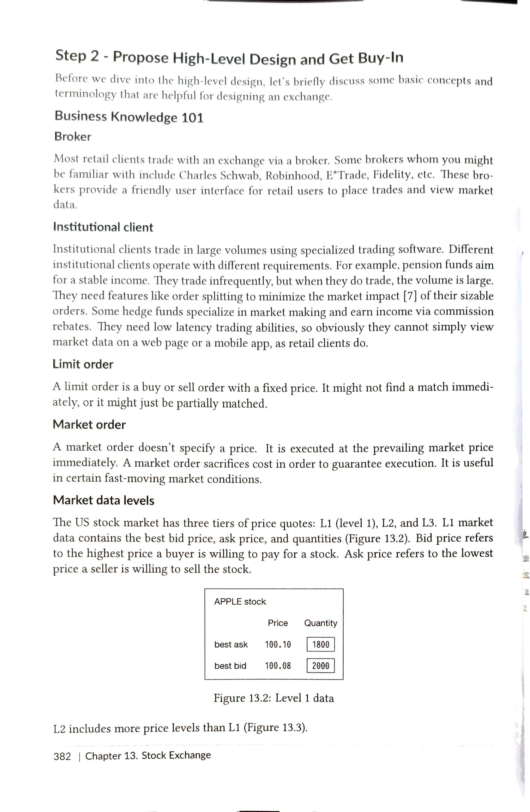

## Bước 2: Đề Xuất Thiết Kế Cấp Cao Và Thống Nhất Ý Tưởng (Step 2 - Propose High-Level Design and Get Buy-In)

Trước khi đi sâu vào thiết kế kiến trúc kỹ thuật chi tiết, chúng ta cần nắm vững các thuật ngữ và kiến thức nghiệp vụ nền tảng hỗ trợ cho việc thiết kế sàn giao dịch.

### Kiến Thức Nghiệp Vụ Căn Bản (Business Knowledge 101)

#### Nhà môi giới (Broker)
Hầu hết các khách hàng cá nhân (**Retail Clients**) giao dịch với sàn giao dịch thông qua một nhà môi giới (**Broker**). Một số nhà môi giới quen thuộc bao gồm Charles Schwab, Robinhood, E\*Trade, Fidelity, v.v. Các nhà môi giới này cung cấp giao diện người dùng thân thiện để các nhà đầu tư cá nhân đặt lệnh giao dịch và theo dõi dữ liệu thị trường.

#### Khách hàng tổ chức (Institutional Client)
Các khách hàng tổ chức giao dịch với khối lượng cực lớn thông qua các phần mềm giao dịch chuyên dụng. Mỗi nhóm khách hàng tổ chức hoạt động với những yêu cầu rất khác nhau:
* Ví dụ: các quỹ hưu trí (**Pension Funds**) hướng tới thu nhập ổn định. Họ giao dịch không thường xuyên, nhưng mỗi khi giao dịch, khối lượng lại rất lớn. Họ cần các tính năng như chia nhỏ lệnh (**Order Splitting**) để giảm thiểu tác động đến giá thị trường (**Market Impact**) [7] từ các lệnh có quy mô lớn của họ.
* Ngược lại, một số quỹ phòng hộ (**Hedge Funds**) chuyên về tạo lập thị trường (**Market Making**) và kiếm lợi nhuận từ các khoản hoàn phí hoa hồng (**Commission Rebates**). Họ đòi hỏi năng lực giao dịch với độ trễ cực thấp (**Low Latency Trading**), do đó hiển nhiên họ không thể chỉ đơn thuần xem dữ liệu thị trường qua trang web hay ứng dụng di động như các nhà đầu tư cá nhân.

#### Lệnh giới hạn (Limit Order)
Lệnh giới hạn là lệnh mua hoặc bán ở một mức giá cố định xác định. Lệnh này có thể không tìm thấy đối ứng để khớp ngay lập tức, hoặc có thể chỉ được khớp một phần (**Partially Matched**).

#### Lệnh thị trường (Market Order)
Lệnh thị trường không chỉ định mức giá cụ thể. Lệnh này được thực thi ngay lập tức theo mức giá hiện hành trên thị trường. Một lệnh thị trường chấp nhận đánh đổi về mặt chi phí giá để đảm bảo chắc chắn khả năng khớp lệnh (**Guaranteed Execution**). Loại lệnh này rất hữu ích trong các điều kiện thị trường biến động nhanh.

#### Các cấp độ dữ liệu thị trường (Market Data Levels)
Thị trường chứng khoán Hoa Kỳ có ba cấp độ báo giá: L1 (Level 1), L2 (Level 2), và L3 (Level 3).
* Dữ liệu thị trường **L1** bao gồm mức giá chào mua tốt nhất (**Best Bid Price**), giá chào bán tốt nhất (**Best Ask Price**) và khối lượng tương ứng (**Quantities**) (xem **Hình 13.2**).
  * **Giá chào mua (Bid price):** Mức giá cao nhất mà người mua sẵn sàng trả cho một cổ phiếu.
  * **Giá chào bán (Ask price):** Mức giá thấp nhất mà người bán sẵn sàng bán cổ phiếu đó.

```
+------------------------------------+
|            APPLE stock             |
+------------------------------------+
|  Price      |  Quantity            |
+-------------+----------------------+
|  100.10     |  1800  (best ask)    |
|  100.08     |  2000  (best bid)    |
+------------------------------------+
```
*Hình 13.2: Dữ liệu cấp độ 1 (Level 1 Data)*

* Dữ liệu thị trường **L2** hiển thị nhiều bước giá và độ sâu lệnh hơn so với L1 (xem **Hình 13.3**).

# CHƯƠNG 13: SÀN GIAO DỊCH CHỨNG KHOÁN (STOCK EXCHANGE)

> [!NOTE]
> *Lưu ý*: Đoạn trích tài liệu kỹ thuật từ trang 384 đến trang 385 thuộc **Chương 13: Sàn Giao Dịch Chứng Khoán (Stock Exchange)**, tiếp nối phần giải thích các khái niệm dữ liệu thị trường (Market Data Levels), biểu đồ nến (Candlestick Chart), giao thức FIX Protocol và bước sang **Bước 2: Đề Xuất Thiết Kế Cấp Cao (High-Level Design)**.

---

### Dữ liệu Cấp độ 2 (Level 2 Data)

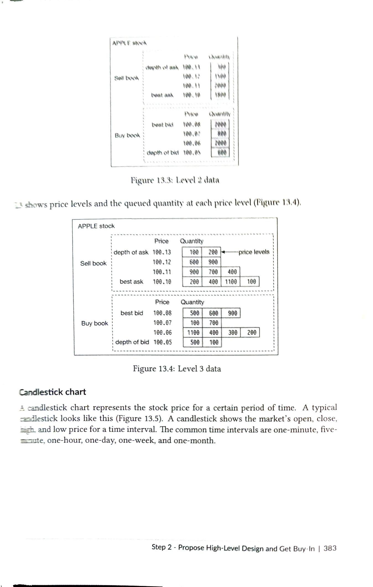

*Hình 13.3: Dữ liệu Cấp độ 2 (Level 2 data)*

Dữ liệu hiển thị các mức giá (price levels) và khối lượng/số lượng đang chờ khớp (queued quantity) tại từng mức giá (*Hình 13.4*):

#### Cổ phiếu APPLE (APPLE stock)

* **Sổ Lệnh Bán (Sell book / Asks):**
  - Mức giá `100.13`: Khối lượng `100` *(Độ sâu phe bán / depth of ask: 100.13)*
  - Mức giá `100.12`: Khối lượng `200`
  - Mức giá `100.11`: Khối lượng `600`, `980`, `900`, `700`, `400`, `200`, `400`, `1100`
  - Mức giá `100.10`: Khối lượng `100` *(Giá bán tốt nhất / Best Ask)*

* **Sổ Lệnh Mua (Buy book / Bids):**
  - Mức giá `109.08` (hoặc `100.08`): Khối lượng `608`, `500` *(Giá mua tốt nhất / Best Bid)*
  - Mức giá `100.07`: Khối lượng `900`, `100`, `700`, `1100`, `400`, `300`
  - Mức giá `100.06`: Khối lượng `200`
  - Mức giá `100.05` (hoặc `108.05`): Khối lượng `500`, `100` *(Độ sâu phe mua / depth of bid)*

*Hình 13.4: Dữ liệu Cấp độ 3 (Level 3 data)*

---

### Biểu đồ Nến (Candlestick Chart)

Một biểu đồ nến (candlestick chart) đại diện cho giá cổ phiếu trong một khoảng thời gian nhất định. Một cây nến điển hình có cấu trúc như sau (*Hình 13.5*). Một cây nến thể hiện giá mở cửa (Open), giá đóng cửa (Close), giá cao nhất (High), và giá thấp nhất (Low) của thị trường trong một khoảng thời gian (time interval). Các khung thời gian phổ biến bao gồm 1 phút, 5 phút, 1 giờ, 1 ngày, 1 tuần, và 1 tháng.

---

**Bước 2 - Đề Xuất Thiết Kế Cấp Cao và Đạt Được Sự Đồng Thuận (Step 2 - Propose High-Level Design and Get Buy-In) | 383**

---

--- Trang 385 ---

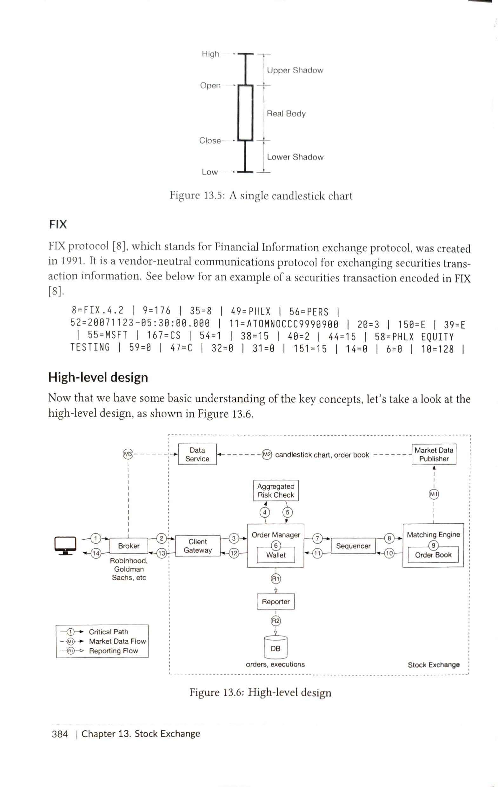

* **Giá Cao Nhất (High)**
* **Bóng Nến Trên (Upper Shadow)**
* **Giá Mở Cửa (Open)**
* **Thân Nến (Real Body)**
* **Giá Đóng Cửa (Close)**
* **Bóng Nến Dưới (Lower Shadow)**
* **Giá Thấp Nhất (Low)**

*Hình 13.5: Cấu trúc một cây nến đơn lẻ (A single candlestick chart)*

---

### Giao thức FIX (Financial Information eXchange)

Giao thức FIX [8] — viết tắt của **Financial Information eXchange protocol** — được sáng lập vào năm 1991. Đây là một giao thức truyền thông độc lập với nhà cung cấp (vendor-neutral communications protocol) dùng để trao đổi thông tin giao dịch chứng khoán. Xem ví dụ bên dưới về một giao dịch chứng khoán được mã hóa bằng giao thức FIX [8]:

```text
8=FIX.4.2 | 9=176 | 35=8 | 49=PHLX | 56=PERS
52=20071123-05:30:00.000 | 11=AT0MN0CCC9990900 | 20=3 | 150=E | 139=E
```

---

## Thiết Kế Cấp Cao (High-Level Design)

Sau khi đã nắm vững một số khái niệm cốt lõi, chúng ta hãy cùng xem xét thiết kế tổng thể cấp cao (high-level design), như được minh họa trong *Hình 13.6*.

```
Client (Broker: Robinhood, Goldman Sachs, v.v.)
  │
  ▼
[Gateway] ──► [Risk Check] ──► [Sequencer] ──► [Order Manager] ──► [Matching Engine (OrderBook)]
                                                      │                      │
                                                      ▼                      ▼
                                              [Reporter]             [Market Data Publisher]
                                                      │                      │
                                                      ▼                      ▼
                                                [DB: Orders,          [Data Service]
                                                 Executions]                 │
                                                                             ▼
                                                                     (Candlestick chart,
                                                                      Aggregated orderbook)
```

### Các Luồng Dữ Liệu Trong Sàn Giao Dịch Chứng Khoán (Stock Exchange):

* ❶ **Đường Dẫn Trọng Yếu (Critical Path):**
  - **Client (Broker)**: Nhà môi giới chứng khoán (như Robinhood, Goldman Sachs, v.v.).
  - **Gateway**: Điểm tiếp nhận kết nối và định tuyến lệnh từ các Broker vào sàn.
  - **Risk Check**: Thành phần kiểm soát rủi ro (kiểm tra hạn mức tài khoản, tính hợp lệ của lệnh trước khi đưa vào luồng giao dịch).
  - **Sequencer**: Bộ đánh số thứ tự tuần tự xác định (cung cấp cơ chế deterministic ordering cho toàn bộ sự kiện giao dịch).
  - **Order Manager**: Bộ quản lý trạng thái lệnh và vị thế giao dịch.
  - **Matching Engine (Sổ lệnh - OrderBook)**: Khối khớp lệnh hạt nhân tốc độ cao (In-Memory Order Matching Engine).

* ❷ **Luồng Dữ Liệu Thị Trường (Market Data Flow):**
  - **Market Data Publisher**: Bộ phát tán dữ liệu thị trường theo thời gian thực (Level 1, Level 2, Level 3 stream).
  - **Data Service**: Dịch vụ dữ liệu tổng hợp (Aggregated Data Service) tính toán và phục vụ biểu đồ nến (Candlestick chart) và sổ lệnh tổng hợp (Aggregated orderbook).

* ❸ **Luồng Báo Cáo (Reporting Flow):**
  - **Reporter**: Khối xử lý dữ liệu báo cáo phi đồng bộ tách khỏi Critical Path.
  - **Database (DB)**: Cơ sở dữ liệu lưu trữ bền vững các lệnh (Orders) và kết quả khớp lệnh (Executions).

*Hình 13.6: Thiết kế cấp cao (High-level design)*

**384 | Chương 13: Sàn Giao Dịch Chứng Khoán (Chapter 13. Stock Exchange)**

---

## Điều hướng

- [chuong-11-payment-system.md](chuong-11-payment-system.md)
- [Mục lục](README.md)
- [chuong-13-stock-exchange.md](chuong-13-stock-exchange.md)
