[← Chương trước](chuong-12-digital-wallet.md) | [Mục lục](README.md) | [Chương tiếp theo →](14-loi-ket-va-index.md)

---

# Chương 13: Sàn Giao Dịch Chứng Khoán (Stock Exchange)

---

### [Trang 386]

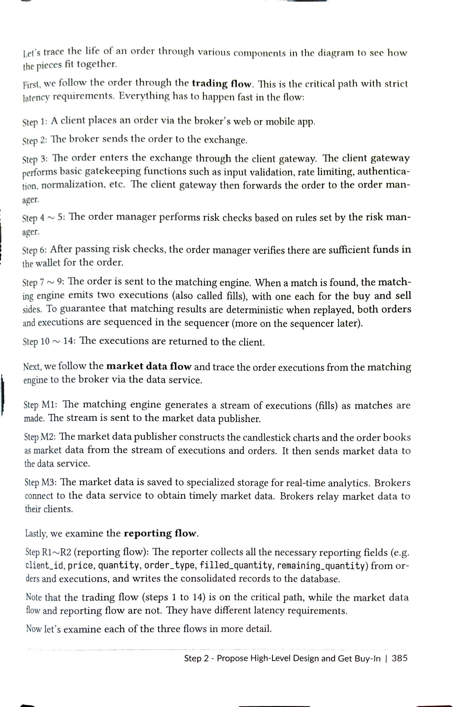

Hãy cùng lần theo vòng đời của một lệnh (order) qua các thành phần khác nhau trong sơ đồ để xem các mảnh ghép kết hợp với nhau như thế nào.

Đầu tiên, chúng ta theo dõi lệnh qua **luồng giao dịch (trading flow)**. Đây là **đường dẫn tới hạn (critical path)** với các yêu cầu cực kỳ khắt khe về **độ trễ (latency)**. Mọi thứ trong luồng này đều phải diễn ra cực nhanh:

* **Bước 1:** Khách hàng đặt lệnh (place an order) thông qua ứng dụng web hoặc di động của công ty môi giới (broker).
* **Bước 2:** Broker chuyển lệnh này tới sàn giao dịch (exchange).
* **Bước 3:** Lệnh đi vào sàn giao dịch qua **cổng kết nối máy khách (client gateway)**. Client gateway thực hiện các chức năng kiểm soát cơ bản (gatekeeping) như kiểm tra tính hợp lệ của dữ liệu đầu vào (input validation), giới hạn tần suất gọi (rate limiting), xác thực (authentication), chuẩn hóa dữ liệu (normalization), v.v. Sau đó, client gateway chuyển tiếp lệnh tới **bộ quản lý lệnh (order manager)**.
* **Bước 4 ~ 5:** Order manager thực hiện các bước kiểm tra rủi ro (risk checks) dựa trên các quy tắc được thiết lập bởi bộ quản lý rủi ro (risk manager).
* **Bước 6:** Sau khi vượt qua các bước kiểm tra rủi ro, order manager xác minh rằng có đủ tiền trong ví (wallet) để thực hiện lệnh.
* **Bước 7 ~ 9:** Lệnh được gửi tới **công cụ khớp lệnh (matching engine)**. Khi tìm thấy lệnh đối ứng (match), matching engine sẽ phát ra hai kết quả khớp lệnh (executions - còn được gọi là **fills**), gồm một kết quả cho bên mua (buy side) và một cho bên bán (sell side). Để đảm bảo rằng kết quả khớp lệnh có **tính tiền định (deterministic)** khi phát lại (replayed), cả hai lệnh...
* **Bước 10 ~ 14:** Các kết quả khớp lệnh (executions) được trả về cho khách hàng.

Tiếp theo, chúng ta theo dõi **luồng dữ liệu thị trường (market data flow)** và lần theo các kết quả khớp lệnh (executions) từ matching engine tới broker thông qua dịch vụ dữ liệu (data service):

* **Bước M1:** Matching engine tạo ra một luồng dữ liệu (stream) chứa các kết quả khớp lệnh (executions/fills) ngay khi các cặp lệnh được khớp. Luồng này được gửi tới **bộ xuất bản dữ liệu thị trường (market data publisher)**.
* **Bước M2:** Market data publisher xây dựng các biểu đồ nến (candlestick charts) và sổ lệnh (order books) dưới dạng dữ liệu thị trường (market data) từ luồng các kết quả khớp lệnh và các lệnh. Sau đó, nó gửi market data tới dịch vụ dữ liệu (data service).
* **Bước M3:** Dữ liệu thị trường được lưu trữ vào hệ thống lưu trữ chuyên dụng dành cho phân tích thời gian thực (real-time analytics). Các broker kết nối tới data service để nhận dữ liệu thị trường kịp thời, sau đó chuyển tiếp (relay) dữ liệu thị trường này tới các khách hàng của họ.

Cuối cùng, chúng ta xem xét **luồng báo cáo (reporting flow)**:

* **Bước R1 ~ R2 (luồng báo cáo):** Bộ phận báo cáo (reporter) thu thập tất cả các trường dữ liệu báo cáo cần thiết (ví dụ: `client_id`, `price`, `quantity`, `order_type`, `filled_quantity`, `remaining_quantity`) từ các lệnh (orders) và kết quả khớp lệnh (executions), sau đó ghi các bản ghi hợp nhất (consolidated records) này vào cơ sở dữ liệu.

> [!NOTE]
> Lưu ý rằng **luồng giao dịch (trading flow - các bước từ 1 đến 14)** nằm trên **đường dẫn tới hạn (critical path)**, trong khi **luồng dữ liệu thị trường (market data flow)** và **luồng báo cáo (reporting flow)** thì không. Chúng có các yêu cầu về **độ trễ (latency requirements)** hoàn toàn khác nhau.

Bây giờ chúng ta hãy xem xét chi tiết hơn từng luồng trong số ba luồng này.

*Bước 2 - Đề xuất Thiết kế Cấp cao và Đạt được Sự đồng thuận / 385*

---

### [Trang 387]

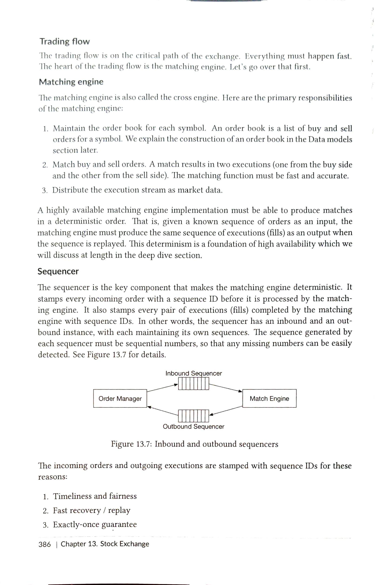

## Luồng giao dịch (Trading flow)

Luồng giao dịch nằm trên **đường dẫn tới hạn (critical path)** của sàn giao dịch. Mọi thứ phải diễn ra cực kỳ nhanh chóng. Trái tim của luồng giao dịch chính là **công cụ khớp lệnh (matching engine)**. Chúng ta hãy xem xét thành phần đó trước.

### Công cụ khớp lệnh (Matching engine)

Matching engine còn được gọi là **công cụ khớp chéo (cross engine)**. Dưới đây là các trách nhiệm chính của matching engine:

1. **Duy trì sổ lệnh (order book) cho từng mã chứng khoán (symbol):** Sổ lệnh là một danh sách chứa các lệnh mua và bán cho một mã chứng khoán. Chúng tôi sẽ giải thích cấu trúc xây dựng của một sổ lệnh trong phần Mô hình dữ liệu (Data models) sau.
2. **Khớp các lệnh mua và bán (Match buy and sell orders):** Một lần khớp thành công sẽ tạo ra hai kết quả thực thi (executions) — một cho bên mua và một cho bên bán. Hàm khớp lệnh phải đảm bảo nhanh chóng và chính xác tuyệt đối.
3. **Phân phối luồng kết quả thực thi dưới dạng dữ liệu thị trường (market data).**

Một kiến trúc matching engine có **tính sẵn sàng cao (High Availability)** bắt buộc phải có khả năng tạo ra các kết quả khớp lệnh theo một **thứ tự tiền định (deterministic order)**. Nghĩa là, khi nhận một chuỗi các lệnh đã biết làm đầu vào (input), matching engine phải tạo ra cùng một chuỗi các kết quả khớp lệnh (fills) làm đầu ra (output) khi chuỗi lệnh đó được phát lại (replayed). **Tính tiền định (determinism)** này chính là nền tảng cốt lõi của tính sẵn sàng cao (High Availability), điều mà chúng ta sẽ thảo luận kỹ lưỡng trong phần đi sâu vào chi tiết (deep dive).

### Bộ tạo chuỗi tuần tự (Sequencer)

**Sequencer** là thành phần then chốt mang lại **tính tiền định (determinism)** cho matching engine. Nó đóng dấu mỗi lệnh đến bằng một mã định danh tuần tự (**Sequence ID**) trước khi lệnh đó được xử lý bởi matching engine. Nó cũng đóng dấu mã định danh tuần tự (Sequence ID) cho mỗi cặp kết quả khớp lệnh (executions/fills) được hoàn thành bởi matching engine. 

Nói cách khác, sequencer có một thực thể đầu vào (**Inbound Sequencer**) và một thực thể đầu ra (**Outbound Sequencer**), mỗi thực thể tự duy trì chuỗi tuần tự riêng biệt của mình. Chuỗi số được tạo ra bởi mỗi sequencer phải là các **số tăng tuần tự liên tục (sequential numbers)**, giúp mọi số bị thiếu (missing numbers) đều có thể được phát hiện dễ dàng. Xem Hình 13.7 để biết thêm chi tiết.

```
+------------------+         +------------------+
| InboundSequencer | ------> |   Match Engine   |
+------------------+         +------------------+
         ^                            |
         |                            v
+------------------+         +--------------------+
|  Order Manager   | <------ | Outbound Sequencer |
+------------------+         +--------------------+
```
*Hình 13.7: Bộ tạo chuỗi tuần tự đầu vào và đầu ra (Inbound and outbound sequencers)*

Các lệnh gửi đến và các kết quả khớp lệnh xuất ra được đóng dấu bằng Sequence ID vì những lý do sau:

1. **Tính kịp thời và công bằng (Timeliness and fairness)**
2. **Khôi phục nhanh / Phát lại (Fast recovery / replay)**
3. **Đảm bảo xử lý chính xác một lần (Exactly-once guarantee)**

*386 / Chương 13: Sàn Giao Dịch Chứng Khoán*

---

### [Trang 388]

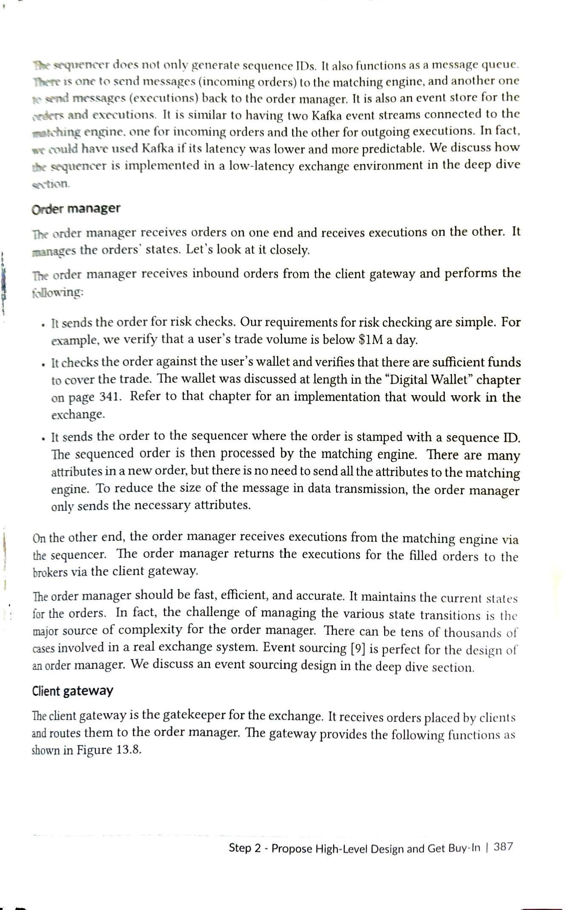

Sequencer không chỉ đơn thuần tạo ra các Sequence ID. Nó còn hoạt động như một **hàng đợi thông điệp (message queue)**. Có một hàng đợi để gửi các thông điệp (các lệnh đến) tới matching engine, và một hàng đợi khác để gửi các thông điệp (các kết quả khớp lệnh) ngược trở lại cho order manager. 

Nó cũng đóng vai trò như một **kho lưu trữ sự kiện (event store)** cho các lệnh và các kết quả thực thi. Điều này tương tự như việc có hai luồng sự kiện Kafka (Kafka event streams) kết nối tới matching engine: một luồng cho các lệnh đến và luồng kia cho các kết quả khớp lệnh đi ra. Trên thực tế, chúng ta đã có thể sử dụng Kafka nếu như **độ trễ (latency)** của nó thấp hơn và có thể dự đoán được nhiều hơn (predictable). Chúng ta sẽ thảo luận về cách hiện thực hóa sequencer trong môi trường sàn giao dịch có độ trễ cực thấp (**low-latency exchange environment**) trong phần đi sâu chi tiết.

### Bộ quản lý lệnh (Order manager)

Order manager tiếp nhận các lệnh ở một đầu và nhận các kết quả khớp lệnh (executions) ở đầu kia. Nó quản lý trạng thái của các lệnh. Hãy cùng xem xét kỹ hơn.

Order manager tiếp nhận các lệnh gửi đến từ client gateway và thực hiện các tác vụ sau:

* **Gửi lệnh đi kiểm tra rủi ro (risk checks):** Các yêu cầu kiểm tra rủi ro của chúng ta khá đơn giản. Ví dụ: xác minh khối lượng giao dịch trong ngày của một người dùng phải dưới 1 triệu USD ($1M a day).
* **Kiểm tra lệnh đối chiếu với ví của người dùng (user's wallet):** Xác minh rằng có đủ số dư để chi trả cho giao dịch. Ví điện tử đã được thảo luận chi tiết trong chương "Digital Wallet" (Ví kỹ thuật số) ở trang 341. Hãy tham khảo chương đó để biết một giải pháp triển khai phù hợp cho sàn giao dịch.
* **Gửi lệnh tới sequencer:** Tại đây lệnh được đóng dấu một Sequence ID. Lệnh đã được gán số thứ tự này sau đó sẽ được xử lý bởi matching engine. Có rất nhiều thuộc tính trong một lệnh mới, nhưng không cần thiết phải gửi tất cả các thuộc tính đó tới matching engine. Để giảm kích thước gói tin (message size) trong quá trình truyền dữ liệu mạng, order manager chỉ gửi đi các thuộc tính thật sự cần thiết.

Ở chiều ngược lại, order manager nhận các kết quả thực thi (executions) từ matching engine thông qua sequencer. Order manager trả kết quả thực thi của các lệnh đã khớp về cho các broker thông qua client gateway.

Order manager phải **nhanh chóng, hiệu quả và chính xác**. Nó duy trì các trạng thái hiện tại của các lệnh. Trên thực tế, thách thức trong việc quản lý các chuyển đổi trạng thái (state transitions) khác nhau chính là nguồn cơn phức tạp lớn nhất của order manager. Có thể có hàng chục nghìn trường hợp biến thể phát sinh trong một hệ thống sàn giao dịch thực tế. **Mô hình truy vết sự kiện (Event Sourcing)** [9] là sự lựa chọn hoàn hảo cho thiết kế của một order manager. Chúng ta sẽ thảo luận chi tiết về thiết kế Event Sourcing trong phần phân tích chuyên sâu.

### Cổng kết nối máy khách (Client gateway)

Client gateway đóng vai trò là "người gác cổng" (gatekeeper) cho sàn giao dịch. Nó tiếp nhận các lệnh do khách hàng đặt và định tuyến chúng tới order manager. Gateway cung cấp các chức năng sau như minh họa trong Hình 13.8.

*Bước 2 - Đề xuất Thiết kế Cấp cao và Đạt được Sự đồng thuận / 387*

---

### [Trang 389]

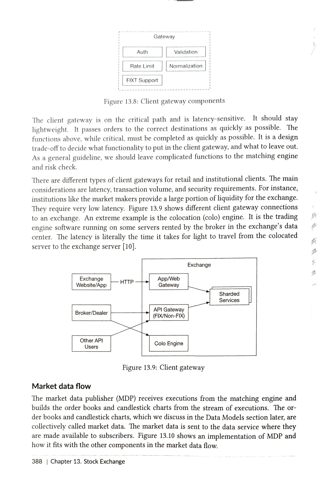

```
+---------------------------------------------------------+
|                         Gateway                         |
|  +-------+  +------------+  +------------+  +--------+  |
|  | Auth  |  | Validation |  | Rate Limit |  | Normal-|  |
|  +-------+  +------------+  +------------+  | ization|  |
|  +---------------------------------------+  +--------+  |
|  |              FIX Support              |              |
|  +---------------------------------------+              |
+---------------------------------------------------------+
```
*Hình 13.8: Các thành phần của cổng kết nối máy khách (Client gateway components)*

Client gateway nằm trên **đường dẫn tới hạn (critical path)** và rất **nhạy cảm với độ trễ (latency-sensitive)**. Nó phải giữ được tính chất **tinh gọn, nhẹ tải (lightweight)**. Nó chuyển tiếp các lệnh tới đúng điểm đến càng nhanh càng tốt. Các chức năng kể trên, dù rất quan trọng, đều phải hoàn thành trong thời gian ngắn nhất có thể. 

Đây là một bài toán **đánh đổi thiết kế (design trade-off)** khi quyết định nên đưa chức năng nào vào client gateway và nên lược bỏ những gì. Theo nguyên tắc chung, chúng ta nên để các chức năng phức tạp lại cho matching engine và quy trình kiểm tra rủi ro (risk check).

Có nhiều loại client gateway khác nhau dành cho khách hàng cá nhân (retail) và khách hàng tổ chức (institutional clients). Các yếu tố cân nhắc chính bao gồm **độ trễ (latency)**, **khối lượng giao dịch (transaction volume)** và các **yêu cầu bảo mật (security requirements)**. 

Chẳng hạn, các tổ chức như các nhà tạo lập thị trường (market makers) cung cấp một phần thanh khoản (liquidity) rất lớn cho sàn giao dịch. Họ đòi hỏi độ trễ cực thấp (ultra-low latency). 

Hình 13.9 thể hiện các kết nối client gateway khác nhau vào một sàn giao dịch. Một ví dụ điển hình mang tính tối thượng là **công cụ đặt máy chủ tập trung (colocation / colo engine)**. Đây là phần mềm giao dịch chạy trên các máy chủ do chính broker thuê đặt ngay trong trung tâm dữ liệu (data center) của sàn giao dịch. Độ trễ lúc này chỉ đơn giản là thời gian ánh sáng truyền từ máy chủ đặt cùng vị trí (colocated server) tới máy chủ của sàn giao dịch [10].

*Hình 13.9: Cổng kết nối máy khách (Client gateway)*

### Luồng dữ liệu thị trường (Market data flow)

**Bộ xuất bản dữ liệu thị trường (Market Data Publisher - MDP)** nhận các kết quả thực thi (executions) từ matching engine và xây dựng các sổ lệnh (order books) cùng các biểu đồ nến (candlestick charts) từ luồng các kết quả khớp lệnh này. 

Sổ lệnh và biểu đồ nến — điều mà chúng ta sẽ thảo luận trong phần Mô hình dữ liệu (Data Models) tiếp theo — được gọi chung là **dữ liệu thị trường (market data)**. Dữ liệu thị trường được gửi tới dịch vụ dữ liệu (data service), nơi chúng sẵn sàng phục vụ cho các đối tượng đăng ký nhận dữ liệu (subscribers). 

Hình 13.10 minh họa cách triển khai của MDP và cách nó kết hợp với các thành phần khác trong luồng dữ liệu thị trường.

*388 / Chương 13: Sàn Giao Dịch Chứng Khoán*

---

### [Trang 390]

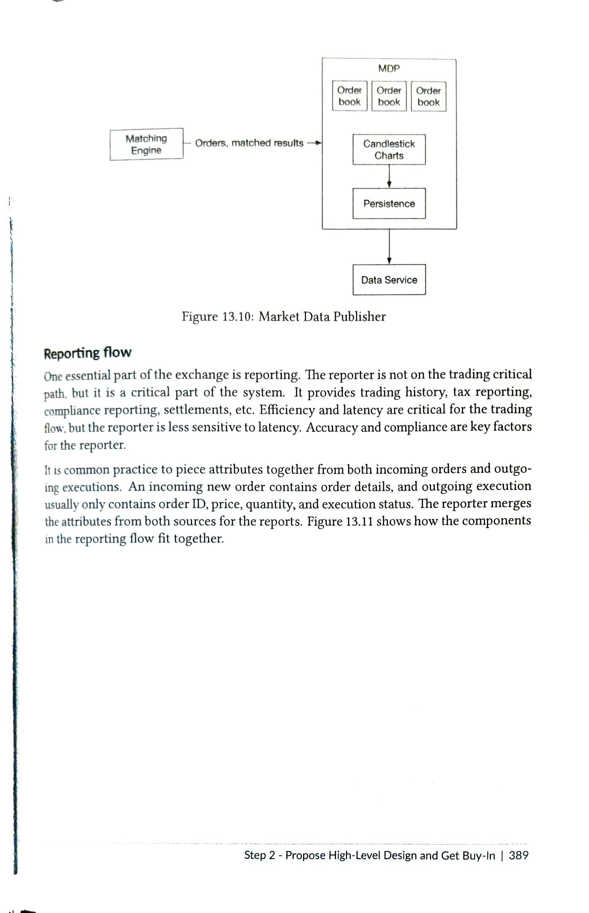

```
                 +-----------------------------------+
                 |                MDP                |
                 |  +------------+  +-------------+  |
                 |  | Order book |  | Order book  |  |
                 |  +------------+  +-------------+  |
                 |  +------------+  +-------------+  |
                 |  | Order book |  | Candlestick |  |
                 |  +------------+  |   Charts    |  |
                 |                  +-------------+  |
                 +-----------------------------------+
                                  ^
                                  |
+-----------------+   Orders,     |
| Matching Engine | ------------->+
+-----------------+ matched results
                                  |
                                  v
                 +-----------------------------------+
                 |    Persistence / Data Service     |
                 +-----------------------------------+
```
*Hình 13.10: Bộ xuất bản dữ liệu thị trường (Market Data Publisher - MDP)*

## Luồng báo cáo (Reporting flow)

Một phần thiết yếu khác của sàn giao dịch là báo cáo. Bộ phận báo cáo (reporter) không nằm trên **đường dẫn tới hạn (trading critical path)** của giao dịch, nhưng lại là một phần tối quan trọng của hệ thống. Nó cung cấp lịch sử giao dịch (trading history), báo cáo thuế (tax reporting), báo cáo tuân thủ (compliance reporting), thanh quyết toán (settlements), v.v. 

Tính hiệu quả và độ trễ cực thấp là cốt tử đối với luồng giao dịch, nhưng bộ phận báo cáo thì ít nhạy cảm hơn với độ trễ. **Độ chính xác (accuracy)** và **tính tuân thủ (compliance)** mới là những yếu tố then chốt hàng đầu của reporter.

Thực tiễn phổ biến là ghép nối các thuộc tính từ cả hai nguồn: các lệnh gửi đến (incoming orders) và các kết quả khớp lệnh gửi ra (outgoing executions). Một lệnh mới gửi đến chứa đầy đủ các chi tiết lệnh, trong khi một kết quả khớp lệnh xuất ra thường chỉ chứa ID của lệnh (order ID), giá (price), khối lượng (quantity) và trạng thái thực thi (execution status). Reporter hợp nhất các thuộc tính từ cả hai nguồn này để lập báo cáo. 

Hình 13.11 minh họa cách các thành phần trong luồng báo cáo khớp nối với nhau.

*Bước 2 - Đề xuất Thiết kế Cấp cao và Đạt được Sự đồng thuận / 389*

---

### [Trang 391]

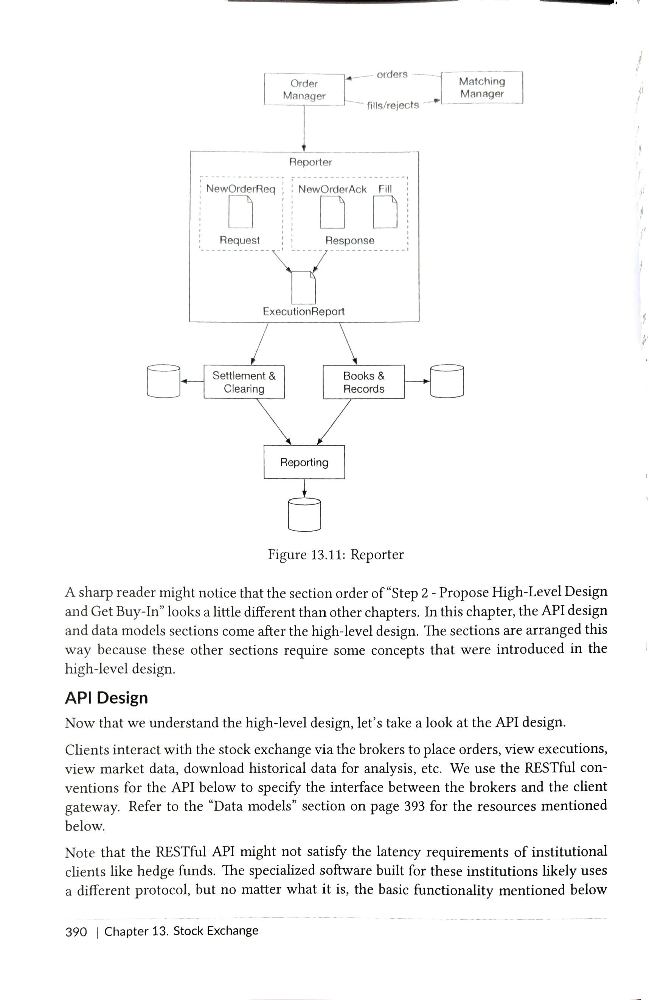

```
                        orders
             +--------------------------+
             |                          v
+------------------+  fills/rejects   +-------------------+
|  Order Manager   | ---------------> |  Matching Engine  |
+------------------+                  +-------------------+
         |                                      |
         v                                      v
+---------------------------------------------------------+
|                        Reporter                         |
|  +---------------+  +---------------+  +-------------+  |
|  | NewOrderReq   |  | NewOrderAck   |  |    Fill     |  |
|  |    Request    |  |   Response    |  |  Execution  |  |
|  |               |  |               |  |   Report    |  |
|  +---------------+  +---------------+  +-------------+  |
+---------------------------------------------------------+
       |                        |                      |
       v                        v                      v
+--------------+      +------------------+      +---------------+
| Settlement & |      | Books & Records  |      |   Reporting   |
|   Clearing   |      +------------------+      +---------------+
+--------------+
```
*Hình 13.11: Bộ phận báo cáo (Reporter)*

Một độc giả tinh ý có thể nhận thấy rằng thứ tự các phần trong *"Bước 2 - Đề xuất Thiết kế Cấp cao và Đạt được Sự đồng thuận"* trông có vẻ hơi khác so với các chương khác. Trong chương này, các phần Thiết kế API (API design) và Mô hình dữ liệu (Data models) được đặt sau phần Thiết kế cấp cao (High-level design). Các phần được sắp xếp theo cách này bởi vì những phần sau đòi hỏi một số khái niệm đã được giới thiệu trong phần thiết kế cấp cao.

## Thiết kế API (API Design)

Bây giờ chúng ta đã hiểu rõ thiết kế cấp cao, hãy cùng xem xét thiết kế API.

Khách hàng tương tác với sàn giao dịch chứng khoán thông qua các broker để đặt lệnh, xem kết quả khớp lệnh, xem dữ liệu thị trường, tải dữ liệu lịch sử để phân tích, v.v. Chúng ta sử dụng quy chuẩn RESTful cho API bên dưới để xác định giao diện (interface) giữa các broker và client gateway. Hãy tham khảo phần "Mô hình dữ liệu" (Data models) ở trang 393 để biết thêm chi tiết về các tài nguyên (resources) được đề cập dưới đây.

> [!IMPORTANT]
> Lưu ý rằng RESTful API có thể không đáp ứng được các yêu cầu khắt khe về **độ trễ (latency requirements)** của các khách hàng tổ chức như các quỹ phòng hộ (hedge funds). Phần mềm chuyên dụng được xây dựng cho các tổ chức này có thể sử dụng một giao thức khác (chẳng hạn như FIX protocol), nhưng bất kể giao thức đó là gì, các chức năng cơ bản được đề cập dưới đây vẫn là tương tự.

*390 / Chương 13: Sàn Giao Dịch Chứng Khoán*

# Chương 13: Sàn Giao Dịch Chứng Khoán (Stock Exchange)

---

## Bước 2 - Đề Xuất Thiết Kế Cấp Cao và Đạt Được Sự Thống Nhất (Step 2 - Propose High-Level Design and Get Buy-In)

---

### [Trang 392]

cần phải được hỗ trợ.

---

### Lệnh Giao Dịch (Order)

```http
POST /v1/order
```

#### Tham số đầu vào (Parameters):
* **`symbol`**: Mã chứng khoán (stock symbol). Kiểu dữ liệu: `String`
* **`side`**: Mua (`buy`) hoặc bán (`sell`). Kiểu dữ liệu: `String`
* **`price`**: Mức giá của lệnh giới hạn (limit order). Kiểu dữ liệu: `Long`
* **`quantity`**: Khối lượng/Số lượng của lệnh. Kiểu dữ liệu: `Long`

#### Phản hồi (Response):
* **Thân phản hồi (Body):**
  * **`id`**: Định danh duy nhất (ID) của lệnh. Kiểu dữ liệu: `Long`
  * **`creationTime`**: Thời gian hệ thống tạo lệnh (system creation time). Kiểu dữ liệu: `Long`
  * **`filledQuantity`**: Khối lượng đã được khớp/thực thi thành công (successfully executed). Kiểu dữ liệu: `Long`
  * **`remainingQuantity`**: Khối lượng còn lại chờ được thực thi. Kiểu dữ liệu: `Long`
  * **`status`**: Trạng thái lệnh (`new` / `canceled` / `filled`). Kiểu dữ liệu: `String`
  * Các thuộc tính còn lại giống hệt như các tham số đầu vào (input parameters).
* **Mã trạng thái HTTP (Code):**
  * `200`: Thành công (successful)
  * `40x`: Lỗi tham số / Bị từ chối truy cập / Không có thẩm quyền xác thực (parameter error / access denied / unauthorized)
  * `500`: Lỗi máy chủ nội bộ (server error)

---

### Khớp Lệnh / Thực Thi (Execution)

```http
GET /v1/execution?symbol={:symbol}&orderId={:orderId}&startTime={:startTime}&endTime={:endTime}
```

Endpoint này dùng để truy vấn thông tin khớp lệnh (execution info). Yêu cầu bắt buộc phải xác thực danh tính (authentication).

#### Tham số đầu vào (Parameters):
* **`symbol`**: Mã chứng khoán (stock symbol). Kiểu dữ liệu: `String`
* **`orderId`**: ID của lệnh. Tham số tùy chọn (Optional). Kiểu dữ liệu: `String`
* **`startTime`**: Thời gian bắt đầu truy vấn tính theo kỷ nguyên Epoch (epoch) [11]. Kiểu dữ liệu: `Long`
* **`endTime`**: Thời gian kết thúc truy vấn tính theo kỷ nguyên Epoch. Kiểu dữ liệu: `Long`

#### Phản hồi (Response):
* **Thân phản hồi (Body):**

---

### [Trang 393]

  * **`executions`**: Mảng chứa từng lượt khớp lệnh (each execution) trong phạm vi truy vấn (xem các thuộc tính chi tiết bên dưới). Kiểu dữ liệu: `Array`
    * **`id`**: ID của lượt khớp lệnh. Kiểu dữ liệu: `Long`
    * **`orderId`**: ID của lệnh gốc. Kiểu dữ liệu: `Long`
    * **`symbol`**: Mã chứng khoán. Kiểu dữ liệu: `String`
    * **`side`**: Mua (`buy`) hoặc bán (`sell`). Kiểu dữ liệu: `String`
    * **`price`**: Mức giá khớp lệnh (execution price). Kiểu dữ liệu: `Long`
    * **`orderType`**: Loại lệnh: lệnh giới hạn (`limit`) hoặc lệnh thị trường (`market`). Kiểu dữ liệu: `String`
    * **`quantity`**: Khối lượng đã khớp (filled quantity). Kiểu dữ liệu: `Long`
* **Mã trạng thái HTTP (Code):**
  * `200`: Thành công (successful)
  * `40x`: Lỗi tham số / Không tìm thấy / Bị từ chối truy cập / Không có thẩm quyền xác thực (parameter error / not found / access denied / unauthorized)
  * `500`: Lỗi máy chủ nội bộ (server error)

---

### Sổ Lệnh (Orderbook)

```http
GET /v1/marketdata/orderBook/L2?symbol={:symbol}&depth={:depth}
```

Endpoint này truy vấn thông tin sổ lệnh Cấp 2 (L2 order book) cho một mã chứng khoán cụ thể với độ sâu (depth) được chỉ định.

#### Tham số đầu vào (Parameters):
* **`symbol`**: Mã chứng khoán. Kiểu dữ liệu: `String`
* **`depth`**: Độ sâu của sổ lệnh trên mỗi phía (order book depth per side: mua/bán). Kiểu dữ liệu: `Int`
* **`startTime`**: Thời gian bắt đầu truy vấn tính theo kỷ nguyên Epoch. Kiểu dữ liệu: `Long`
* **`endTime`**: Thời gian kết thúc truy vấn tính theo kỷ nguyên Epoch. Kiểu dữ liệu: `Long`

#### Phản hồi (Response):
* **Thân phản hồi (Body):**
  * **`bids`**: Mảng các lệnh chào mua (bids) kèm theo mức giá (price) và khối lượng (size). Kiểu dữ liệu: `Array`
  * **`asks`**: Mảng các lệnh chào bán (asks) kèm theo mức giá (price) và khối lượng (size). Kiểu dữ liệu: `Array`
* **Mã trạng thái HTTP (Code):**
  * `200`: Thành công (successful)
  * `40x`: Lỗi tham số / Không tìm thấy / Bị từ chối truy cập / Không có thẩm quyền xác thực (parameter error / not found / access denied / unauthorized)
  * `500`: Lỗi máy chủ nội bộ (server error)

---

### Dữ Liệu Giá Lịch Sử / Biểu Đồ Nến (Historical Prices - Candlestick Charts)

```http
GET /v1/marketdata/candles?symbol={:symbol}&resolution={:resolution}&startTime={:startTime}&endTime={:endTime}
```

Endpoint này truy vấn dữ liệu biểu đồ nến (candlestick chart data - xem mục biểu đồ nến trong phần các mô hình dữ liệu) cho một mã chứng khoán theo một khoảng thời gian (time range) và độ phân giải thời gian (resolution) nhất định.

#### Tham số đầu vào (Parameters):

---

### [Trang 394]

* **`symbol`**: Mã chứng khoán. Kiểu dữ liệu: `String`
* **`resolution`**: Độ dài cửa sổ thời gian (window length) của biểu đồ nến tính bằng giây. Kiểu dữ liệu: `Long`
* **`startTime`**: Thời điểm bắt đầu của cửa sổ thời gian tính theo kỷ nguyên Epoch. Kiểu dữ liệu: `Long`
* **`endTime`**: Thời điểm kết thúc của cửa sổ thời gian tính theo kỷ nguyên Epoch. Kiểu dữ liệu: `Long`

#### Phản hồi (Response):
* **Thân phản hồi (Body):**
  * **`candles`**: Mảng chứa dữ liệu của từng cây nến (candlestick data) với các thuộc tính liệt kê bên dưới. Kiểu dữ liệu: `Array`
    * **`open`**: Giá mở cửa (open price) của từng cây nến. Kiểu dữ liệu: `Double`
    * **`close`**: Giá đóng cửa (close price) của từng cây nến. Kiểu dữ liệu: `Double`
    * **`high`**: Mức giá cao nhất (high price) của từng cây nến. Kiểu dữ liệu: `Double`
    * **`low`**: Mức giá thấp nhất (low price) của từng cây nến. Kiểu dữ liệu: `Double`
* **Mã trạng thái HTTP (Code):**
  * `200`: Thành công (successful)
  * `40x`: Lỗi tham số / Không tìm thấy / Bị từ chối truy cập / Không có thẩm quyền xác thực (parameter error / not found / access denied / unauthorized)
  * `500`: Lỗi máy chủ nội bộ (server error)

---

## Các Mô Hình Dữ Liệu (Data Models)

Có ba loại dữ liệu chính trong một sàn giao dịch chứng khoán. Hãy cùng khám phá từng loại một:

1. **Sản phẩm (Product), Lệnh giao dịch (Order), và Khớp lệnh (Execution)**
2. **Sổ lệnh (Order book)**
3. **Biểu đồ nến (Candlestick chart)**

---

### Sản phẩm (Product), Lệnh giao dịch (Order), Khớp lệnh (Execution)

* **Sản phẩm (Product)**: Mô tả các thuộc tính của một mã giao dịch, chẳng hạn như loại sản phẩm (product type), mã giao dịch (trading symbol), ký hiệu hiển thị trên giao diện người dùng (UI display symbol), đồng tiền thanh toán (settlement currency), quy mô lô giao dịch (lot size), bước giá tối thiểu (tick size), v.v. Dữ liệu này **không thay đổi thường xuyên**, chủ yếu dùng cho mục đích hiển thị trên UI. Dữ liệu này có thể lưu trữ trong bất kỳ cơ sở dữ liệu (Database) nào và có khả năng lưu bộ nhớ đệm rất cao (highly cacheable).
* **Lệnh giao dịch (Order)**: Đại diện cho chỉ thị đầu vào (inbound instruction) đối với một lệnh mua hoặc lệnh bán.
* **Khớp lệnh (Execution)**: Đại diện cho kết quả khớp lệnh đầu ra (outbound matched result). Một lượt khớp lệnh còn được gọi là một **fill**. Không phải mọi lệnh đều khớp; mỗi lượt khớp lệnh sẽ liên kết cả hai phía mua và bán (buy and sell sides) của một cặp lệnh đã khớp.

Xem **Hình 13.12** để thấy sơ đồ mô hình logic (logical model diagram) thể hiện mối quan hệ giữa ba thực thể này. *Lưu ý rằng đây không phải là một lược đồ cơ sở dữ liệu vật lý (database schema).*

---

### [Trang 395]

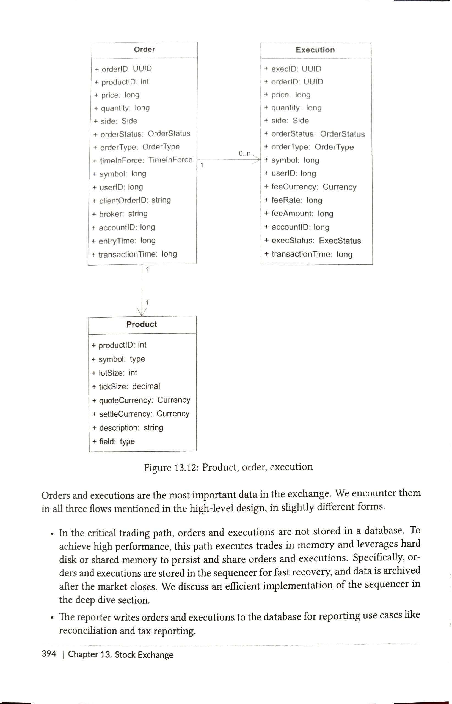

*Hình 13.12: Sản phẩm, Lệnh giao dịch, Khớp lệnh (Product, order, execution)*

#### Chi tiết các trường dữ liệu thực thể (Entity Attributes):

| Thực thể: **Order** (Lệnh) | Thực thể: **Execution** (Khớp lệnh) | Thực thể: **Product** (Sản phẩm) |
| :--- | :--- | :--- |
| `+ orderID: UUID`<br>`+ price: long`<br>`+ quantity: long`<br>`+ side: Side`<br>`+ orderStatus: OrderStatus`<br>`+ orderType: OrderType`<br>`+ timeInForce: TimeInForce`<br>`+ symbol: long`<br>`+ userID: long`<br>`+ clientOrderID: string`<br>`+ broker: string`<br>`+ accountID: long`<br>`+ entryTime: long`<br>`+ transactionTime: long` | `+ execID: UUID`<br>`+ productID: int`<br>`+ orderID: UUID`<br>`+ price: long`<br>`+ quantity: long`<br>`+ side: Side`<br>`+ orderStatus: OrderStatus`<br>`+ orderType: OrderType`<br>`+ symbol: long`<br>`+ userID: long`<br>`+ feeCurrency: Currency`<br>`+ feeRate: long`<br>`+ feeAmount: long`<br>`+ accountID: long`<br>`+ execStatus: ExecStatus`<br>`+ transactionTime: long` | `+ productID: int`<br>`+ symbol: type`<br>`+ lotSize: int`<br>`+ tickSize: decimal`<br>`+ quoteCurrency: Currency`<br>`+ settleCurrency: Currency`<br>`+ description: string`<br>`+ field: type` |

> [!NOTE]
> **Quan hệ giữa các thực thể:** Một `Order` có thể sinh ra từ `0..n` bản ghi `Execution`.

**Lệnh (Orders)** và **Khớp lệnh (Executions)** là những dữ liệu quan trọng bậc nhất trong sàn giao dịch. Chúng ta bắt gặp chúng trong cả ba luồng nghiệp vụ (flows) đã đề cập trong phần thiết kế cấp cao (high-level design), dưới các định dạng hơi khác nhau:

* **Trên đường dẫn giao dịch trọng yếu (Critical Trading Path)**: Lệnh và Khớp lệnh **không được lưu vào cơ sở dữ liệu**. Để đạt được hiệu năng cực cao (High Performance) và độ trễ cực thấp (Ultra-low Latency), đường dẫn này thực thi các giao dịch hoàn toàn trên bộ nhớ RAM (in-memory) và tận dụng ổ đĩa cứng (hard disk) hoặc bộ nhớ dùng chung (shared memory) để lưu bền vững (persist) và chia sẻ lệnh cũng như kết quả khớp lệnh. Cụ thể, các lệnh và khớp lệnh được lưu trữ trong **Bộ định tuần tự (Sequencer)** để phục hồi nhanh (Fast Recovery), và dữ liệu sẽ được lưu trữ lưu trữ dài hạn (archived) sau khi thị trường đóng cửa. Chúng ta sẽ thảo luận về việc hiện thực hóa tối ưu bộ định tuần tự (Sequencer) trong phần phân tích chuyên sâu (Deep Dive).
* **Bộ báo cáo (Reporter)**: Ghi các lệnh và khớp lệnh vào cơ sở dữ liệu phục vụ cho các trường hợp báo cáo như đối soát (reconciliation) và báo cáo thuế (tax reporting).

---

### [Trang 396]

* **Khớp lệnh (Executions)** được chuyển tiếp tới **Bộ xử lý dữ liệu thị trường (Market Data Processor)** để tái cấu trúc lại sổ lệnh (order book) và dữ liệu biểu đồ nến (candlestick chart). Chúng ta sẽ thảo luận về các kiểu dữ liệu này ngay sau đây.

---

### Sổ Lệnh (Order Book)

**Sổ lệnh (Order book)** là một danh sách các lệnh mua và bán cho một chứng khoán hoặc công cụ tài chính cụ thể, được tổ chức theo từng mức giá (price level) [12] [13]. Đây là cấu trúc dữ liệu cốt lõi bên trong **Bộ máy khớp lệnh (Matching Engine)** phục vụ cho việc khớp lệnh tốc độ cao. Một cấu trúc dữ liệu hiệu quả dành cho sổ lệnh phải thỏa mãn các yêu cầu khắt khe sau:

* **Thời gian tìm kiếm hằng số - $O(1)$ constant lookup time**: Các thao tác bao gồm: lấy tổng khối lượng tại một mức giá hoặc giữa các mức giá.
* **Thao tác Thêm / Hủy / Thực thi nhanh - ưu tiên độ phức tạp thời gian $O(1)$ (Fast add/cancel/execute operations)**: Các thao tác bao gồm: đặt một lệnh mới (placing a new order), hủy một lệnh (canceling an order), và khớp một lệnh (matching an order).
* **Cập nhật nhanh (Fast update)**: Thao tác: thay thế một lệnh (replacing an order).
* **Truy vấn giá mua tốt nhất / giá bán tốt nhất (Query best bid/ask)**.
* **Duyệt qua các mức giá tuần tự (Iterate through price levels)**.

Hãy cùng xem qua một ví dụ về việc thực thi một lệnh khớp với sổ lệnh, như minh họa trong **Hình 13.13**.

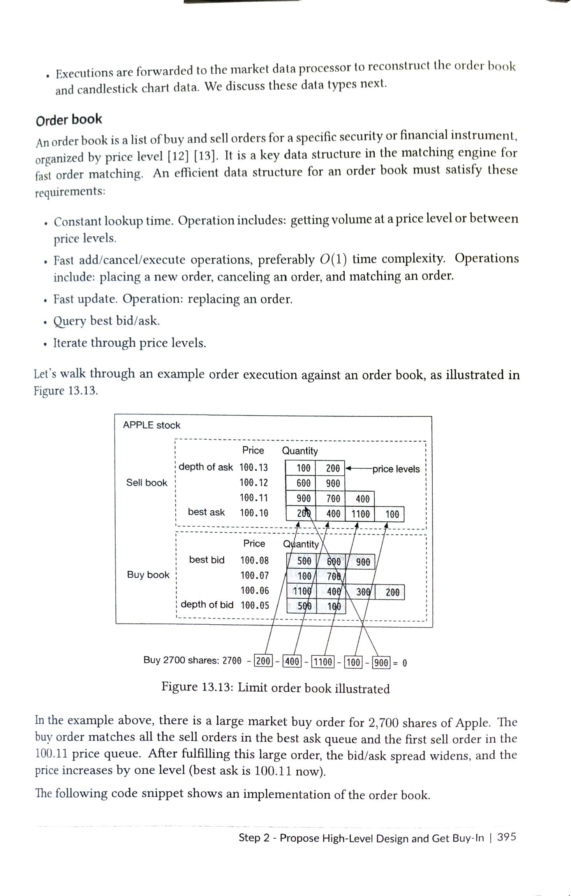

*Hình 13.13: Minh họa sổ lệnh giới hạn (Limit order book illustrated)*

#### Diễn giải ví dụ cấu trúc sổ lệnh cổ phiếu APPLE:

* **Sổ Bán (Sell book / Asks):**
  * `100.13` (Mức độ sâu - Depth of ask): `100`, `200`
  * `100.12`: `600`, `900`
  * `100.11`: `900`, `700`, `400`
  * `100.10` (**Best ask - Giá bán tốt nhất**): `200`, `400`, `1100`, `100`
* **Sổ Mua (Buy book / Bids):**
  * `100.08` (**Best bid - Giá mua tốt nhất**): `500`, `600`, `900`
  * `100.07`: `100`, `700`
  * `100.06`: `1100`, `400`, `300`, `200`
  * `100.05` (Mức độ sâu - Depth of bid): `500`, `100`

> **Kịch bản Khớp lệnh:**
> Thực hiện lệnh Mua theo thị trường (Market buy order) với khối lượng **2.700 cổ phiếu**:
> $$\text{Số cổ phiếu cần khớp còn lại: } 2700 - 200 - 400 - 1100 - 100 - 900 = 0$$

Trong ví dụ trên, có một lệnh thị trường lớn đặt mua 2.700 cổ phiếu Apple. Lệnh mua này quét khớp toàn bộ các lệnh bán nằm trong hàng đợi của mức giá bán tốt nhất (**best ask**: `100.10` gồm các lô: `200`, `400`, `1100`, `100`) và khớp tiếp lệnh bán đầu tiên (`900` cổ phiếu) trong hàng đợi của mức giá `100.11`. Sau khi hoàn tất lệnh lớn này, khoảng chênh lệch giá mua/bán (bid/ask spread) giãn rộng ra, và mức giá tăng lên một nấc (lúc này giá bán tốt nhất - best ask mới là `100.11`).

Đoạn mã (code snippet) sau đây thể hiện một hiện thực sơ khởi của sổ lệnh:

---

### [Trang 397]

```java
class PriceLevel {
    private Price limitPrice;
    private long totalVolume;
    private List<Order> orders;
}

class Book<Side> {
    private Side side;
    private Map<Price, PriceLevel> limitMap;
}

class OrderBook {
    private Book<Buy> buyBook;
    private Book<Sell> sellBook;
    private PriceLevel bestBid;
    private PriceLevel bestOffer;
    private Map<OrderID, Order> orderMap;
}
```

Liệu đoạn mã trên có đáp ứng được toàn bộ các yêu cầu thiết kế đã nêu ở trước hay không? Ví dụ, khi thêm hoặc hủy một lệnh giới hạn (limit order), độ phức tạp thời gian có phải là $O(1)$ không? 

**Câu trả lời là KHÔNG**, bởi vì chúng ta đang dùng một danh sách tuần tự thông thường (`private List<Order> orders`). Để xây dựng một sổ lệnh hiệu năng cao và tối ưu hơn, hãy chuyển đổi cấu trúc dữ liệu của `orders` thành một **Danh sách liên kết đôi (Doubly-Linked List)** để các thao tác xóa (hủy lệnh và khớp lệnh) đều đạt độ phức tạp $O(1)$. 

Hãy cùng xem xét cách chúng ta đạt được độ phức tạp thời gian $O(1)$ cho các thao tác này:

1. **Đặt một lệnh mới (Placing a new order)**: Đồng nghĩa với việc thêm một đối tượng `Order` mới vào đuôi (tail) của `PriceLevel`. Thao tác này có độ phức tạp thời gian là **$O(1)$** đối với một danh sách liên kết đôi (Doubly-Linked List).
2. **Khớp một lệnh (Matching an order)**: Đồng nghĩa với việc xóa một đối tượng `Order` ở đầu (head) của `PriceLevel`. Thao tác này có độ phức tạp thời gian là **$O(1)$** đối với một danh sách liên kết đôi.
3. **Hủy một lệnh (Canceling an order)**: Đồng nghĩa với việc xóa một đối tượng `Order` khỏi `OrderBook`. Chúng ta tận dụng cấu trúc dữ liệu phụ trợ `Map<OrderID, Order> orderMap` trong `OrderBook` để định vị đối tượng `Order` cần hủy trong thời gian **$O(1)$**. 

> [!IMPORTANT]
> **Tầm quan trọng của Danh sách liên kết đôi (Doubly-Linked List):**
> Sau khi đã tìm thấy lệnh, nếu danh sách `orders` chỉ là một danh sách liên kết đơn (Singly-Linked List), mã nguồn sẽ buộc phải duyệt tuần tự qua toàn bộ danh sách để tìm ra con trỏ của phần tử liền trước (`previous` pointer) nhằm thực hiện thao tác xóa. Việc duyệt tuần tự đó sẽ tiêu tốn thời gian **$O(n)$**. 
> 
> Nhờ chuyển sang **Danh sách liên kết đôi (Doubly-Linked List)**, bản thân mỗi phần tử lệnh (order node) đã lưu sẵn con trỏ trỏ trực tiếp đến phần tử liền kề trước nó (`prev`) và sau nó (`next`), cho phép mã nguồn ngắt kết nối và xóa bỏ node lệnh ngay lập tức mà không cần phải duyệt qua toàn bộ danh sách.

**Hình 13.14** giải thích cách thức vận hành chi tiết của ba thao tác này.

# CHƯƠNG 13: SÀN GIAO DỊCH CHỨNG KHOÁN (STOCK EXCHANGE)

---

### [Trang 398]

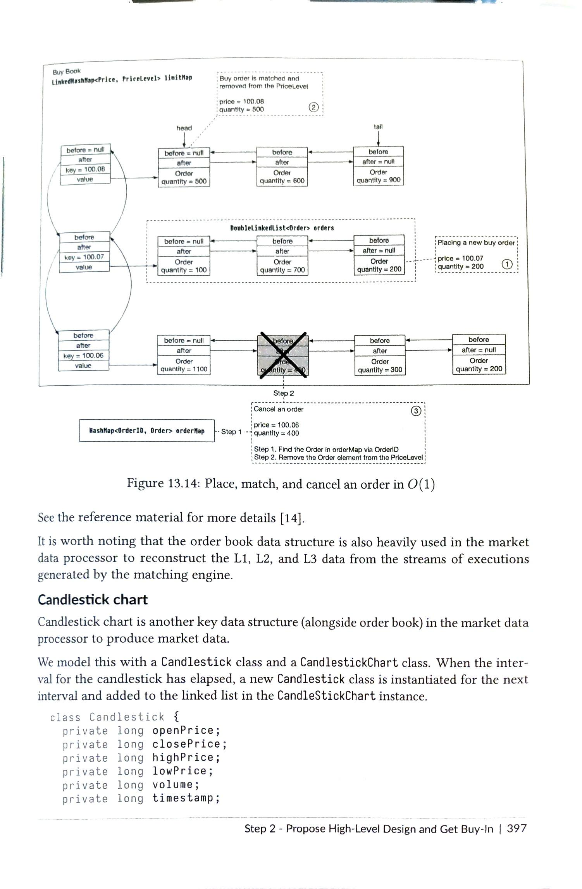

**Sổ lệnh Mua (Buy Book)**
- `LinkedHashMap<Price, PriceLevel> limitMap`
- **Khớp lệnh mua và loại bỏ khỏi mức giá (Buy order is matched and removed from the PriceLevel):**
  - `price = 100.08`
  - `quantity = 500`
- **Con trỏ đầu/cuối (head / tail):**
  - `before = null`
  - `before`
  - `before = null`
  - `before`
  - `after`
  - `after`
  - `after`
  - `after = null`
- `key = 100.08` (Mức giá / Price Level):
  - Giá trị (`value`): Danh sách liên kết kép các lệnh `DoubleLinkedList<Order> orders`
  - `Order (quantity = 600)` $\rightarrow$ `Order (quantity = 500)` $\rightarrow$ `Order (quantity = 900)`
- **Đặt một lệnh mua mới (Placing a new buy order):**
  - `price = 100.07`
  - `quantity = 200`
- `key = 100.07`:
  - `value`: `Order (quantity = 200)` $\rightarrow$ `Order (quantity = 100)` $\rightarrow$ `Order (quantity = 700)` $\rightarrow$ `Order (quantity = 200)`
- `key = 100.06`:
  - `value`: `Order (quantity = 1100)` $\rightarrow$ `Order (quantity = 300)` $\rightarrow$ `Order (quantity = 200)`
- **Hủy một lệnh (Cancel an order):**
  - `price = 100.06`
  - `quantity = 400`
  - Bảng băm tra cứu lệnh: `HashMap<OrderID, Order> orderMap`
  - **Bước 1 (Step 1):** Tìm kiếm `Order` trong `orderMap` thông qua `OrderID` (`Find the Order in orderMap via OrderID`).
  - **Bước 2 (Step 2):** Xóa phần tử `Order` khỏi mức giá tương ứng (`Remove the Order element from the PriceLevel`).

*Hình 13.14: Đặt lệnh, khớp lệnh và hủy lệnh với độ phức tạp $O(1)$ (Figure 13.14: Place, match, and cancel an order in O(1))*

Xem tài liệu tham khảo để biết thêm chi tiết [14].

Cần lưu ý rằng cấu trúc dữ liệu sổ lệnh (Order Book) cũng được sử dụng rất nhiều trong bộ xử lý dữ liệu thị trường (Market Data Processor) để tái cấu trúc dữ liệu L1, L2 và L3 từ các luồng thực thi (streams of executions) do bộ máy khớp lệnh (Matching Engine) sinh ra.

#### Biểu Đồ Nến (Candlestick chart)
Biểu đồ nến là một cấu trúc dữ liệu then chốt khác (bên cạnh sổ lệnh - Order Book) trong bộ xử lý dữ liệu thị trường nhằm tạo ra dữ liệu thị trường (Market Data).

Chúng ta mô hình hóa điều này bằng một lớp `Candlestick` và một lớp `CandlestickChart`. Khi khoảng thời gian (interval) của cây nến đã trôi qua, một lớp `Candlestick` mới sẽ được khởi tạo cho khoảng thời gian tiếp theo và được thêm vào danh sách liên kết (linked list) trong thực thể `CandlestickChart`.

```java
class Candlestick {
    private long openPrice;
    private long closePrice;
    private long highPrice;
    private long lowPrice;
    private long volume;
    private long timestamp;
```

---
*Bước 2 - Đề xuất Thiết kế Mức cao và Đạt được Đồng thuận | 397 (Step 2 - Propose High-Level Design and Get Buy-In | 397)*

---

### [Trang 399]

```java
    private int interval;
}

class CandlestickChart {
    private LinkedList<Candlestick> sticks;
}
```

Việc theo dõi lịch sử giá trong các biểu đồ nến cho nhiều mã chứng khoán (symbols) tại nhiều khung thời gian (time intervals) tiêu tốn rất nhiều bộ nhớ. Chúng ta có thể tối ưu hóa nó như thế nào? Dưới đây là hai phương pháp:

1. Sử dụng các bộ đệm vòng được cấp phát trước (pre-allocated ring buffers) để chứa các cây nến (sticks) nhằm giảm số lượng cấp phát đối tượng mới (new object allocations).
2. Giới hạn số lượng cây nến lưu trong bộ nhớ (memory) và lưu trữ bền vững (persist) phần còn lại xuống đĩa cứng (disk).

Chúng ta sẽ khảo sát các tối ưu hóa này trong phần "Bộ phát hành dữ liệu thị trường" (Market data publisher) ở mục đi sâu vào chi tiết (Deep Dive) tại trang 409.

Dữ liệu thị trường thường được lưu trữ bền vững trong một cơ sở dữ liệu dạng cột trong bộ nhớ (in-memory columnar database, ví dụ: KDB [15]) để phục vụ phân tích thời gian thực (real-time analytics). Sau khi thị trường đóng cửa, dữ liệu sẽ được lưu trữ bền vững vào cơ sở dữ liệu lịch sử (historical database).

---

### Bước 3 - Đi Sâu Vào Thiết Kế Chi Tiết (Step 3 - Design Deep Dive)

Bây giờ khi chúng ta đã hiểu cách một sàn giao dịch vận hành ở mức tổng quan (high level), hãy cùng khảo sát xem một sàn giao dịch hiện đại đã tiến hóa như thế nào để trở thành như ngày hôm nay. Một sàn giao dịch hiện đại trông như thế nào? Câu trả lời có thể làm nhiều độc giả bất ngờ: Một số sàn giao dịch lớn chạy gần như toàn bộ hệ thống trên một máy chủ khổng lồ duy nhất (single gigantic server). Mặc dù nghe có vẻ cực đoan, chúng ta có thể rút ra rất nhiều bài học quý giá từ thiết kế này.

Hãy cùng đi sâu vào chi tiết.

#### Hiệu Năng (Performance)

Như đã thảo luận trong phần yêu cầu phi chức năng (non-functional requirements), độ trễ (Latency) là yếu tố tối quan trọng đối với một sàn giao dịch. Không chỉ độ trễ trung bình cần phải thấp, mà độ trễ tổng thể còn phải cực kỳ ổn định. Một thước đo chuẩn xác cho mức độ ổn định là độ trễ phân vị thứ 99 (99th percentile latency).

Độ trễ có thể được phân tách thành các thành phần cấu thành như biểu diễn trong công thức dưới đây:

$$\text{Latency} = \sum \text{executionTimeAlongCriticalPath}$$

*(Độ trễ = Tổng thời gian thực thi dọc theo đường dẫn xung yếu)*

Có hai cách để giảm độ trễ (Latency):
1. Giảm bớt số lượng tác vụ (tasks) nằm trên đường dẫn xung yếu (Critical Path).
2. Rút ngắn thời gian tiêu tốn cho mỗi tác vụ:
   - **a.** Bằng cách giảm thiểu hoặc loại bỏ việc sử dụng mạng (network) và đĩa cứng (disk).
   - **b.** Bằng cách giảm thời gian thực thi (execution time) cho từng tác vụ.

---
*398 / Chương 13. Sàn Giao Dịch Chứng Khoán (398 / Chapter 13. Stock Exchange)*

---

### [Trang 400]

bao gồm những điểm sau:

Đường dẫn xung yếu (Critical Path) chỉ chứa các thành phần thiết yếu; ngay cả việc ghi nhật ký (logging) cũng được loại bỏ khỏi đường dẫn xung yếu để đạt được độ trễ thấp (low latency).

Bây giờ hãy xem xét điểm thứ hai. Trong thiết kế mức cao (high-level design), các thành phần trên đường dẫn xung yếu giao tiếp qua mạng: độ trễ mạng trong cùng một trung tâm dữ liệu (round-trip network latency) vào khoảng 500 microgiây ($\mu\text{s}$). Khi có nhiều thành phần cùng giao tiếp qua mạng trên đường dẫn xung yếu, tổng độ trễ mạng sẽ cộng dồn lên tới hàng mili-giây (single-digit milliseconds). Ngoài ra, bộ tuần tự (Sequencer) là một kho lưu trữ sự kiện (Event Store) thực hiện ghi bền vững các sự kiện xuống đĩa cứng. Ngay cả khi giả định một thiết kế hiệu quả tận dụng lợi thế hiệu năng của việc ghi tuần tự (sequential writes), độ trễ ghi đĩa vẫn là một nút thắt cổ chai lớn. Để tìm hiểu thêm về độ trễ truy cập mạng và đĩa, xem "Các con số độ trễ mà mọi lập trình viên nên biết" (*Latency Numbers Every Programmer Should Know* [16]).

Khi tính đến cả độ trễ truy cập mạng lẫn truy cập đĩa, tổng độ trễ đầu-cuối (end-to-end latency) tăng lên đáng kể. Trong khi mức độ trễ này có thể chấp nhận được đối với một sàn giao dịch thông thường, nó không còn đủ đáp ứng khi các sàn giao dịch cạnh tranh khốc liệt về độ trễ siêu thấp (ultra-low latency).

Để duy trì vị thế dẫn đầu trong cuộc đua cạnh tranh, các sàn giao dịch theo thời gian đã cải tiến thiết kế của họ nhằm giảm độ trễ đầu-cuối trên đường dẫn xung yếu xuống chỉ còn vài chục microgiây (tens of microseconds), chủ yếu bằng cách khám phá các phương án nhằm giảm thiểu hoặc triệt tiêu hoàn toàn độ trễ truy cập mạng và đĩa cứng. Một thiết kế đã qua kiểm chứng thời gian là loại bỏ các bước nhảy mạng (network hops) bằng cách đặt toàn bộ mọi thành phần trên cùng một máy chủ vật lý (same server). Khi tất cả các thành phần nằm trên cùng một máy chủ, chúng có thể giao tiếp thông qua `mmap` [17] như một kho lưu trữ sự kiện (Event Store) — chúng ta sẽ tìm hiểu kỹ hơn về điều này ở phần sau.

Hình 13.15 minh họa một thiết kế độ trễ thấp với tất cả các thành phần được gom trên một máy chủ duy nhất:

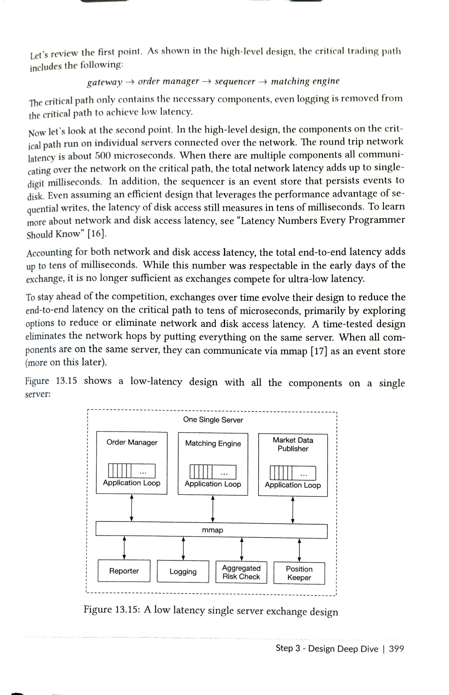

**Một Máy Chủ Duy Nhất (One Single Server)**
- **Quản lý lệnh (Order Manager):** Vòng lặp ứng dụng (`Application Loop`)
- **Bộ máy khớp lệnh (Matching Engine):** Vòng lặp ứng dụng (`Application Loop`)
- **Bộ phát hành dữ liệu thị trường (Market Data Publisher):** Vòng lặp ứng dụng (`Application Loop`)
- **Giao tiếp liên tiến trình:** `mmap`
- **Bộ tổng hợp báo cáo (Aggregated Reporter)**
- **Ghi nhật ký (Logging)**
- **Kiểm tra rủi ro vị thế (Position Risk Check)**
- **Quản lý vị thế (Position Keeper)**

*Hình 13.15: Thiết kế sàn giao dịch độ trễ thấp trên một máy chủ duy nhất (Figure 13.15: A low latency single server exchange design)*

---
*Bước 3 - Đi Sâu Vào Thiết Kế Chi Tiết / 399 (Step 3 - Design Deep Dive / 399)*

---

### [Trang 401]

Có một số quyết định thiết kế thú vị rất đáng để xem xét kỹ lưỡng hơn.

Trước tiên, hãy tập trung vào các **vòng lặp ứng dụng (Application Loops)** trong sơ đồ trên. Vòng lặp ứng dụng là một khái niệm rất thú vị. Nó liên tục thăm dò (polling) các tác vụ cần thực thi bên trong một vòng lặp `while` và là cơ chế thực thi tác vụ chính yếu. Để đáp ứng ngân sách độ trễ khắt khe (strict latency budget), chỉ những tác vụ tối quan trọng sống còn (mission-critical) mới được xử lý bởi vòng lặp ứng dụng. Mục tiêu của nó là giảm thời gian thực thi cho từng thành phần và đảm bảo thời gian thực thi có tính dự đoán rất cao (tức là độ trễ phân vị thứ 99 - 99th percentile latency - ở mức thấp). Mỗi hộp trong sơ đồ đại diện cho một thành phần. Một thành phần là một tiến trình (process) trên máy chủ. Để tối đa hóa hiệu suất CPU, mỗi vòng lặp ứng dụng (hãy hình dung nó như vòng lặp xử lý chính - main processing loop) là đơn luồng (single-threaded), và luồng này được ghim chặt vào một nhân CPU cố định (**CPU core pinning**). Lấy bộ quản lý lệnh (Order Manager) làm ví dụ, kiến trúc của nó trông giống như sơ đồ dưới đây (Hình 13.16).

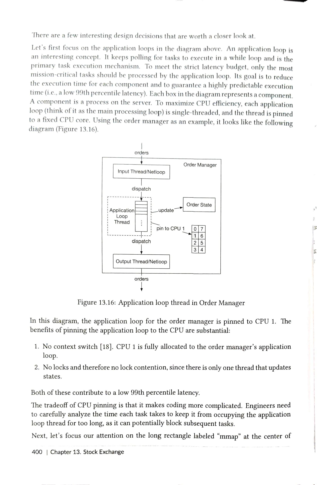

**Bộ Quản Lý Lệnh (Order Manager):**
- Lệnh đến (`orders`) $\rightarrow$ Luồng đầu vào / Vòng lặp mạng (`Input Thread / Netloop`) $\xrightarrow{\text{dispatch}}$ Luồng Vòng Lặp Ứng Dụng (`Application Loop Thread` - **ghim vào CPU 1 / pin to CPU 1**) $\xleftrightarrow{\text{update}}$ Trạng thái lệnh (`Order State`) $\xrightarrow{\text{dispatch}}$ Luồng đầu ra / Vòng lặp mạng (`Output Thread / Netloop`) $\rightarrow$ Lệnh ra (`orders`).

*Hình 13.16: Luồng vòng lặp ứng dụng trong Bộ quản lý lệnh (Figure 13.16: Application loop thread in Order Manager)*

Trong sơ đồ này, vòng lặp ứng dụng của bộ quản lý lệnh được ghim cố định vào **CPU 1**. Lợi ích của việc ghim vòng lặp ứng dụng vào CPU là rất lớn:

1. **Không chuyển đổi ngữ cảnh (No Context Switch [18]):** CPU 1 được phân bổ hoàn toàn 100% cho vòng lặp ứng dụng của bộ quản lý lệnh.
2. **Không khóa và do đó không có tranh chấp khóa (No locks and therefore no lock contention):** Vì chỉ có duy nhất một luồng thực hiện cập nhật các trạng thái.

Cả hai yếu tố này đóng góp trực tiếp vào việc duy trì độ trễ phân vị thứ 99 (99th percentile latency) ở mức cực thấp.

Sự đánh đổi (Tradeoff) của kỹ thuật ghim CPU (CPU pinning) là nó làm cho việc viết mã nguồn trở nên phức tạp hơn nhiều. Các kỹ sư cần phải phân tích tỉ mỉ thời gian tiêu tốn của từng tác vụ để tránh việc một tác vụ chiếm giữ luồng vòng lặp ứng dụng quá lâu, vì điều này có khả năng làm tắc nghẽn (block) tất cả các tác vụ theo sau.

Tiếp theo, hãy chuyển sự chú ý của chúng ta sang hình chữ nhật dài có nhãn **"mmap"** ở vị trí trung tâm của Hình 13.15.

---
*400 | Chương 13. Sàn Giao Dịch Chứng Khoán (400 | Chapter 13. Stock Exchange)*

---

### [Trang 402]

"mmap" đề cập đến một lời gọi hệ thống (system call) theo chuẩn POSIX của UNIX có tên là `mmap(2)`, cho phép ánh xạ (map) một tệp trực tiếp vào không gian bộ nhớ của một tiến trình.

`mmap(2)` cung cấp một cơ chế chia sẻ bộ nhớ hiệu năng cao giữa các tiến trình (High-Performance Inter-Process Shared Memory). Lợi thế hiệu năng này được nhân lên gấp bội khi tệp nền tảng (backing file) được đặt trong `/dev/shm`. `/dev/shm` là một hệ thống tệp hoạt động trên nền bộ nhớ RAM (memory-backed file system). Khi lời gọi `mmap(2)` được thực hiện trên một tệp nằm trong `/dev/shm`, việc truy cập vào bộ nhớ chia sẻ hoàn toàn không phát sinh bất kỳ thao tác truy xuất đĩa cứng (disk access) nào.

Các sàn giao dịch hiện đại tận dụng tối đa điều này để loại bỏ hoàn toàn các thao tác truy xuất đĩa ra khỏi đường dẫn xung yếu (Critical Path). Lời gọi `mmap(2)` được sử dụng trong máy chủ để hiện thực hóa một thanh ghi thông điệp (Message Bus) mà qua đó các thành phần trên đường dẫn xung yếu giao tiếp với nhau. Kênh truyền thông này hoàn toàn không có độ trễ mạng hay truy xuất đĩa, và việc gửi một thông điệp trên thanh ghi thông điệp `mmap` này chỉ tiêu tốn thời gian dưới một microgiây (sub-microsecond). Bằng cách khai thác `mmap` để xây dựng một kho lưu trữ sự kiện (Event Store), kết hợp cùng mô hình kiến trúc hướng nguồn sự kiện (Event Sourcing) mà chúng ta sẽ thảo luận ngay sau đây, các sàn giao dịch hiện đại có thể xây dựng các vi dịch vụ độ trễ thấp (low-latency microservices) ngay bên trong một máy chủ vật lý duy nhất.

#### Kiến Trúc Hướng Nguồn Sự Kiện (Event Sourcing)

Chúng ta đã thảo luận về Event Sourcing trong chương "Ví Điện Tử" (Digital Wallet) tại trang 341. Vui lòng tham khảo chương đó để xem lại chuyên sâu về Event Sourcing.

Khái niệm Event Sourcing không hề khó hiểu. Trong một ứng dụng truyền thống, các trạng thái được lưu trữ bền vững trong cơ sở dữ liệu. Khi có sự cố xảy ra, rất khó để truy vết được căn nguyên của vấn đề. Cơ sở dữ liệu chỉ lưu giữ trạng thái hiện tại (current states), và hoàn toàn không có bản ghi nào về chuỗi các sự kiện đã dẫn đến trạng thái hiện tại đó.

Trong Event Sourcing, thay vì lưu trữ các trạng thái hiện tại, hệ thống duy trì một nhật ký bất biến (Immutable Log) ghi lại tất cả các sự kiện làm thay đổi trạng thái. Những sự kiện này chính là nguồn chân lý chuẩn mực (Golden Source of Truth). Xem Hình 13.17 để thấy sự so sánh.

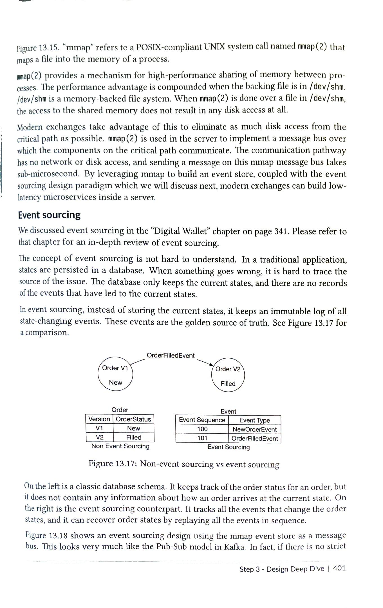

**Mô hình Không dùng Event Sourcing (Non Event Sourcing):**
- Bảng trạng thái `Order`:
  - `Version`: `V1` $\rightarrow$ `OrderStatus`: `New`
  - `Version`: `V2` $\rightarrow$ `OrderStatus`: `Filled`

**Mô hình Dùng Event Sourcing (Event Sourcing):**
- Chuỗi sự kiện bất biến:
  - `EventSequence`: `100` $\rightarrow$ `EventType`: `NewOrderEvent`
  - `EventSequence`: `101` $\rightarrow$ `EventType`: `OrderFilledEvent`

*Hình 13.17: Không sử dụng Event Sourcing so với Sử dụng Event Sourcing (Figure 13.17: Non-event sourcing vs event sourcing)*

Ở bên trái là một lược đồ cơ sở dữ liệu cổ điển. Nó theo dõi trạng thái lệnh (`OrderStatus`) cho một lệnh, nhưng nó không chứa bất kỳ thông tin nào về việc làm thế nào mà một lệnh có thể đi đến trạng thái hiện tại. Ở bên phải là mô hình Event Sourcing tương ứng. Nó theo dõi tất cả các sự kiện làm thay đổi trạng thái lệnh, và nó có thể khôi phục lại toàn bộ trạng thái lệnh bằng cách phát lại (replaying) tuần tự tất cả các sự kiện theo đúng thứ tự.

Hình 13.18 minh họa một thiết kế Event Sourcing sử dụng kho lưu trữ sự kiện `mmap` làm thanh ghi thông điệp (Message Bus). Kiến trúc này trông rất giống với mô hình Xuất bản - Đăng ký (Pub-Sub) trong Apache Kafka. Trên thực tế, nếu không có yêu cầu khắt khe về độ trễ siêu thấp,

---
*Bước 3 - Đi Sâu Vào Thiết Kế Chi Tiết / 401 (Step 3 - Design Deep Dive / 401)*

---

### [Trang 403]

thì Kafka hoàn toàn có thể được sử dụng.

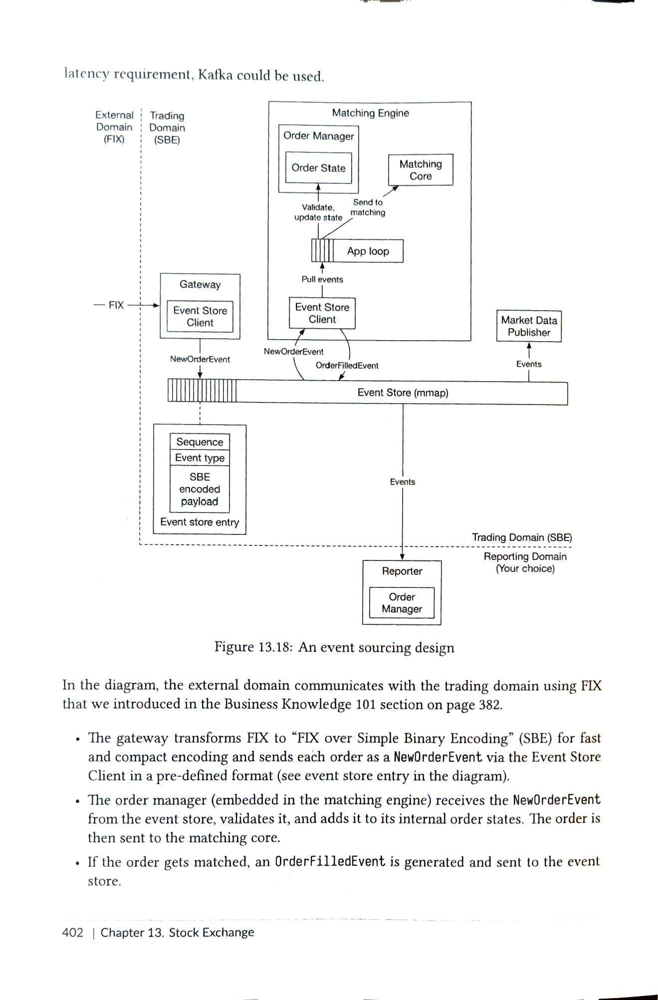

*Hình 13.18: Thiết kế kiến trúc Event Sourcing (Figure 13.18: An event sourcing design)*

**Chi tiết luồng kiến trúc trong Hình 13.18:**
- **Miền bên ngoài (External Domain):** Giao tiếp qua giao thức `FIX`.
- **Cổng giao tiếp (Gateway):** Chuyển đổi từ `FIX` sang `FIX over Simple Binary Encoding` (SBE).
- **Miền Giao Dịch (Trading Domain) - Sử dụng SBE:**
  - **Kho lưu trữ sự kiện (Event Store - mmap):** Hoạt động như thanh ghi thông điệp.
    - Cấu trúc một mục nhập trong kho lưu trữ sự kiện (Event store entry):
      - Số thứ tự tuần tự (`Sequence`)
      - Loại sự kiện (`Event type`)
      - Tải dữ liệu mã hóa SBE (`SBE encoded payload`)
    - Chuỗi sự kiện: `NewOrderEvent` $\rightarrow$ `NewOrderEvent` $\rightarrow$ `OrderFilledEvent` $\rightarrow$ `...`
  - **Bộ máy khớp lệnh (Matching Engine):**
    - Chứa **Bộ quản lý lệnh (Order Manager)**:
      - Máy khách kho sự kiện (`EventStore Client`) kéo sự kiện (`Pull events`).
      - Vòng lặp ứng dụng (`App loop`): Thực hiện kiểm tra tính hợp lệ và cập nhật trạng thái (`Validate, update state`) $\rightarrow$ Lưu vào Trạng thái lệnh (`Order State`).
      - Chuyển lệnh vào Lõi khớp lệnh (`Send to matching core`).
    - Lõi khớp lệnh (`Matching Core`).
  - **Bộ phát hành dữ liệu thị trường (Market Data Publisher):** Đọc các sự kiện khớp lệnh từ `Event Store`.
- **Miền Báo Cáo (Reporting Domain) - Tùy chọn công nghệ (Your choice):**
  - Đọc sự kiện từ kho lưu trữ sự kiện để phục vụ bộ báo cáo (`Reporter`), phân tích và đồng bộ trạng thái quản lý lệnh (`Order Manager`).

Trong sơ đồ, miền bên ngoài giao tiếp với miền giao dịch bằng giao thức **FIX** mà chúng ta đã giới thiệu trong phần "Kiến Thức Nghiệp Vụ Cơ Bản 101" (Business Knowledge 101) tại trang 382.

- **Cổng giao tiếp (Gateway)** chuyển đổi định dạng FIX thành **"FIX over Simple Binary Encoding" (SBE)** để đạt tốc độ mã hóa cực nhanh và kích thước dữ liệu nén gọn tối đa, sau đó gửi mỗi lệnh dưới dạng một sự kiện tạo lệnh mới `NewOrderEvent` qua Kho lưu trữ sự kiện (Event Store).
- **Bộ quản lý lệnh (Order Manager)** (được nhúng trực tiếp bên trong bộ máy khớp lệnh) nhận sự kiện `NewOrderEvent` từ kho lưu trữ sự kiện, kiểm tra tính hợp lệ của lệnh, và ghi nhận nó vào cấu trúc trạng thái lệnh nội bộ (internal order states). Lệnh sau đó được chuyển tiếp vào **Lõi khớp lệnh (Matching Core)**.
- Nếu lệnh được khớp thành công, một sự kiện khớp lệnh `OrderFilledEvent` sẽ được tạo ra và ghi ngược trở lại vào kho lưu trữ sự kiện (Event Store).

---
*402 / Chương 13. Sàn Giao Dịch Chứng Khoán (402 / Chapter 13. Stock Exchange)*

# CHƯƠNG 13: SÀN GIAO DỊCH CHỨNG KHOÁN (STOCK EXCHANGE)

---

### Trang 404

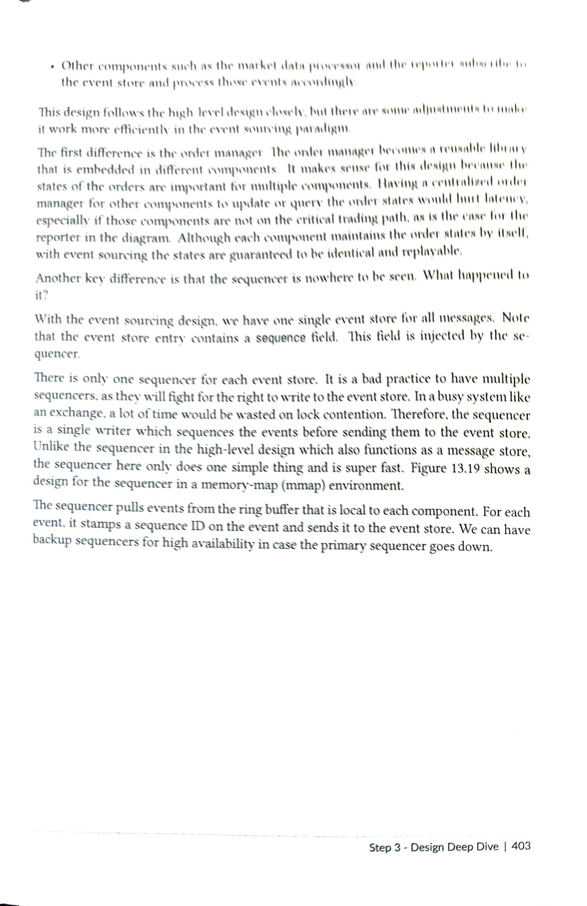

Các thành phần khác như bộ xử lý dữ liệu thị trường (**Market Data Processor**) và bộ báo cáo (**Reporter**) đăng ký (*subscribe*) vào kho lưu trữ sự kiện (**Event Store**) và xử lý các sự kiện đó một cách bất đồng bộ (*asynchronously*).

Thiết kế này bám sát thiết kế mức cao (**High-Level Design**), tuy nhiên có một số điều chỉnh để vận hành hiệu quả hơn trong mô hình **Event Sourcing** (nguồn sự kiện).

Sự khác biệt đầu tiên là **Bộ quản lý lệnh (Order Manager)**. Bộ quản lý lệnh trở thành một thư viện có thể tái sử dụng (*reusable library*) được nhúng trực tiếp vào các thành phần khác nhau. Điều này hoàn toàn hợp lý đối với thiết kế này bởi vì trạng thái của các lệnh đóng vai trò quan trọng đối với nhiều thành phần. Việc duy trì một bộ quản lý lệnh tập trung (*centralized order manager*) để các thành phần khác cập nhật hoặc truy vấn trạng thái lệnh sẽ làm suy giảm độ trễ (**Latency**), đặc biệt nếu các thành phần đó không nằm trên đường dẫn giao dịch trọng yếu (**Critical Trading Path**), ví dụ điển hình là bộ báo cáo (**Reporter**) trong sơ đồ. Mặc dù mỗi thành phần tự duy trì trạng thái lệnh cục bộ, nhưng với **Event Sourcing**, các trạng thái được đảm bảo sẽ đồng nhất hoàn toàn và có khả năng phát lại (**Replayable**).

Một điểm khác biệt then chốt nữa là **Bộ định tự (Sequencer)** dường như không còn xuất hiện. Chuyện gì đã xảy ra với nó?

Với thiết kế **Event Sourcing**, chúng ta có một kho lưu trữ sự kiện (**Event Store**) duy nhất cho tất cả các thông điệp. Lưu ý rằng mỗi bản ghi trong kho lưu trữ sự kiện đều chứa một trường số thứ tự (**Sequence Field**). Trường này được chèn vào bởi chính bộ định tự (**Sequencer**).

Chỉ có duy nhất một bộ định tự (**Sequencer**) cho mỗi kho lưu trữ sự kiện (**Event Store**). Việc có nhiều bộ định tự là một phản mẫu (**Bad Practice**), vì chúng sẽ tranh chấp quyền ghi vào kho lưu trữ sự kiện. Trong một hệ thống bận rộn với lưu lượng cực lớn như sàn giao dịch, rất nhiều thời gian sẽ bị lãng phí do tranh chấp khóa (**Lock Contention**). Do đó, bộ định tự là một tác nhân ghi duy nhất (**Single Writer**) thực hiện việc đánh số thứ tự các sự kiện trước khi đẩy chúng vào kho lưu trữ sự kiện.

Khác với bộ định tự trong thiết kế mức cao (vốn kiêm nhiệm luôn vai trò của một kho lưu trữ thông điệp), bộ định tự ở đây chỉ thực hiện một nhiệm vụ đơn giản duy nhất và đạt tốc độ cực nhanh. **Hình 13.19** minh họa một thiết kế cho bộ định tự trong môi trường ánh xạ bộ nhớ (**Memory-Map - mmap**).

Bộ định tự thực hiện kéo (*pull*) các sự kiện từ bộ đệm vòng (**Ring Buffer**) nằm cục bộ tại từng thành phần. Đối với mỗi sự kiện, nó đóng dấu một mã định danh thứ tự (**Sequence ID**) lên sự kiện đó rồi gửi đến kho lưu trữ sự kiện (**Event Store**). Chúng ta có thể cấu hình các bộ định tự dự phòng để đảm bảo tính sẵn sàng cao (**High Availability**) trong trường hợp bộ định tự chính (**Primary Sequencer**) gặp sự cố.

*Step 3 - Design Deep Dive / 403*

---

### Trang 405

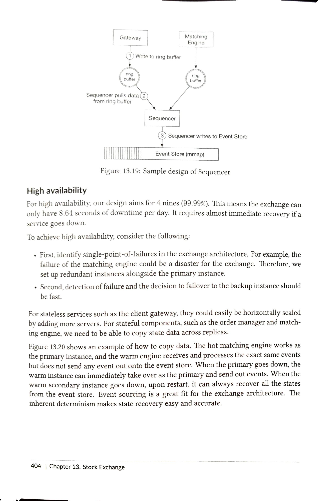

```
[Gateway] ---> (Ghi vào Ring Buffer) ---> [Ring Buffer] \
                                                          ---> [Sequencer] ---> (Ghi vào Event Store) ---> [Event Store (mmap)]
[Matching Engine] ---> (Ghi vào Ring Buffer) -> [Ring Buffer] /        ^
                                                                       | (Kéo dữ liệu từ Ring Buffer)
```
**Hình 13.19: Thiết kế mẫu của Bộ định tự (Sequencer)**

---

### Tính sẵn sàng cao (High Availability)

Để đạt được tính sẵn sàng cao (**High Availability**), thiết kế của chúng ta nhắm tới mục tiêu 4 số 9 (**99.99%**). Điều này đồng nghĩa với việc sàn giao dịch chỉ được phép có tối đa 8,64 giây thời gian chết (**Downtime**) mỗi ngày. Điều này đòi hỏi khả năng phục hồi gần như tức thì nếu một dịch vụ gặp sự cố ngừng hoạt động.

Để đạt được tính sẵn sàng cao (**High Availability**), cần xem xét các yếu tố sau:
* Thứ nhất, xác định các điểm lỗi đơn lẻ (**Single-Point-of-Failures - SPOF**) trong kiến trúc sàn giao dịch. Ví dụ, sự cố sập bộ khớp lệnh (**Matching Engine**) có thể là một thảm họa đối với sàn giao dịch. Vì vậy, chúng ta thiết lập các thực thể dự phòng song song bên cạnh thực thể chính (**Primary Instance**).
* Thứ hai, việc phát hiện lỗi và quyết định chuyển đổi dự phòng (**Failover**) sang thực thể dự phòng phải diễn ra nhanh chóng.

Đối với các dịch vụ không trạng thái (**Stateless Services**) như cổng giao tiếp máy khách (**Client Gateway**), chúng có thể dễ dàng mở rộng theo chiều ngang (**Horizontally Scaled**) bằng cách bổ sung thêm máy chủ. Đối với các thành phần có trạng thái (**Stateful Components**), chẳng hạn như bộ quản lý lệnh (**Order Manager**) và bộ khớp lệnh (**Matching Engine**), chúng ta cần có khả năng sao chép dữ liệu trạng thái qua các bản sao (**Replicas**).

**Hình 13.20** minh họa một ví dụ về cách thức sao chép dữ liệu. Bộ khớp lệnh trạng thái nóng (**Hot Matching Engine**) hoạt động với tư cách là thực thể chính (**Primary Instance**), còn bộ khớp lệnh trạng thái ấm (**Warm Matching Engine**) tiếp nhận và xử lý các sự kiện giống hệt nhau nhưng không phát ra bất kỳ sự kiện nào vào kho lưu trữ sự kiện (**Event Store**). Khi thực thể chính gặp sự cố, thực thể ấm có thể ngay lập tức tiếp quản vai trò của thực thể chính và bắt đầu gửi các sự kiện ra ngoài. Khi thực thể phụ ấm gặp sự cố, khi khởi động lại, nó luôn có thể khôi phục lại toàn bộ trạng thái từ kho lưu trữ sự kiện (**Event Store**). **Event Sourcing** là một sự kết hợp hoàn hảo cho kiến trúc sàn giao dịch. Tính tiền định cố hữu (**Inherent Determinism**) giúp việc phục hồi trạng thái trở nên dễ dàng và chuẩn xác.

*404 | Chapter 13. Stock Exchange*

---

### Trang 406

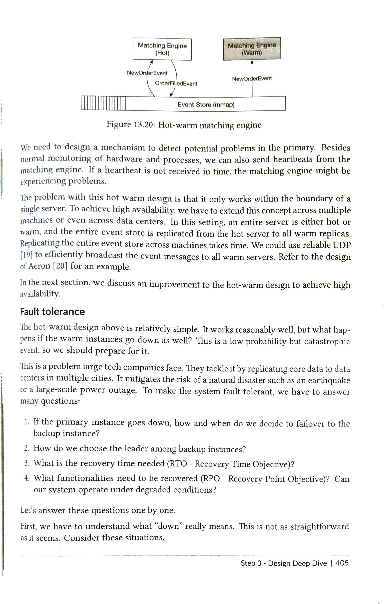

**Hình 13.20: Bộ khớp lệnh dạng Hot-Warm (Hot-warm matching engine)**

Chúng ta cần thiết kế một cơ chế để phát hiện các sự cố tiềm ẩn trong thực thể chính (**Primary**). Ngoài việc giám sát phần cứng và tiến trình theo tiêu chuẩn thông thường, chúng ta cũng có thể gửi các tín hiệu nhịp tim (**Heartbeats**) từ bộ khớp lệnh. Nếu tín hiệu nhịp tim không được nhận đúng thời hạn, bộ khớp lệnh có thể đang gặp phải sự cố.

Vấn đề với thiết kế nóng - ấm (**Hot-Warm Design**) này là nó chỉ hoạt động trong phạm vi ranh giới của một máy chủ đơn lẻ. Để đạt được tính sẵn sàng cao (**High Availability**), chúng ta phải mở rộng khái niệm này qua nhiều máy chủ khác nhau hoặc thậm chí xuyên suốt các trung tâm dữ liệu (**Data Centers**). Trong thiết lập này, toàn bộ một máy chủ sẽ đóng vai trò là nóng (*hot*) hoặc ấm (*warm*), và toàn bộ kho lưu trữ sự kiện (**Event Store**) được sao chép (*replicated*) từ máy chủ nóng sang tất cả các bản sao ấm.

Việc sao chép toàn bộ kho lưu trữ sự kiện qua các máy chủ sẽ tiêu tốn thời gian. Chúng ta có thể sử dụng giao thức **Reliable UDP** [19] để phát quảng bá (**Broadcast**) các thông điệp sự kiện một cách hiệu quả đến tất cả các máy chủ ấm. Bạn có thể tham khảo thiết kế của **Aeron** [20] như một ví dụ thực tế.

Trong phần tiếp theo, chúng ta sẽ thảo luận về một cải tiến đối với thiết kế nóng - ấm (**Hot-Warm Design**) nhằm đạt được tính sẵn sàng cao (**High Availability**).

---

### Khả năng chịu lỗi (Fault Tolerance)

Thiết kế nóng - ấm (**Hot-Warm Design**) ở trên tương đối đơn giản. Nó hoạt động khá ổn định, nhưng điều gì sẽ xảy ra nếu các thực thể ấm (*warm instances*) cũng đồng thời ngừng hoạt động? Đây là một sự cố có xác suất xảy ra thấp nhưng mang tính thảm họa, vì vậy chúng ta phải chuẩn bị sẵn sàng cho kịch bản này.

Đây là bài toán mà các công ty công nghệ lớn phải đối mặt. Họ giải quyết bằng cách sao chép dữ liệu cốt lõi tới các trung tâm dữ liệu (**Data Centers**) đặt tại nhiều thành phố khác nhau. Phương thức này giúp giảm thiểu rủi ro từ thiên tai như động đất hoặc sự cố mất điện trên diện rộng. Để xây dựng một hệ thống có khả năng chịu lỗi (**Fault-Tolerant**), chúng ta phải trả lời nhiều câu hỏi:

1. Nếu thực thể chính (**Primary Instance**) gặp sự cố, chúng ta quyết định chuyển đổi dự phòng (**Failover**) sang thực thể sao lưu (**Backup Instance**) như thế nào và vào thời điểm nào?
2. Làm thế nào để bầu chọn một nút lãnh đạo (**Leader**) trong số các thực thể sao lưu?
3. Thời gian phục hồi yêu cầu là bao lâu (**RTO - Recovery Time Objective**)?
4. Những chức năng nào cần phải được phục hồi (**RPO - Recovery Point Objective**)? Liệu hệ thống của chúng ta có thể vận hành trong điều kiện suy thoái hiệu năng (**Degraded Conditions**) được không?

Hãy lần lượt giải quyết từng câu hỏi trên.

Đầu tiên, chúng ta phải hiểu được trạng thái "ngừng hoạt động" (**Down**) thực sự có nghĩa là gì. Điều này không hề đơn giản như bề ngoài. Hãy xem xét các tình huống sau:

*Step 3 - Design Deep Dive / 405*

---

### Trang 407

1. Hệ thống có thể phát ra các cảnh báo giả (**False Alarms**), dẫn đến các đợt chuyển đổi dự phòng (**Failovers**) không cần thiết.
2. Lỗi trong mã nguồn (*bugs*) có thể khiến thực thể chính gặp sự cố sập. Chính lỗi đó cũng có thể làm sập thực thể sao lưu ngay sau khi chuyển đổi dự phòng. Khi tất cả các thực thể sao lưu đều bị đánh gục bởi cùng một lỗi, hệ thống sẽ hoàn toàn mất tính sẵn sàng (**No Longer Available**).

Đây là những vấn đề nan giải cần giải quyết. Dưới đây là một số đề xuất: Khi mới phát hành một hệ thống mới, chúng ta có thể cần thực hiện các thao tác chuyển đổi dự phòng bằng tay (**Manual Failover**). Chỉ khi đã thu thập đủ tín hiệu, tích lũy đủ kinh nghiệm vận hành và có sự tin tưởng vững chắc hơn vào hệ thống, chúng ta mới tự động hóa quy trình phát hiện sự cố. Kỹ thuật thử nghiệm hỗn loạn (**Chaos Engineering**) [21] là một phương pháp thực hành hữu ích để làm lộ diện các trường hợp ngoại lệ biên (**Edge Cases**) và tích lũy kinh nghiệm vận hành nhanh hơn.

Khi quyết định chuyển đổi dự phòng (**Failover**) đã được đưa ra một cách chính xác, làm thế nào để xác định máy chủ nào sẽ đứng ra tiếp quản? May mắn thay, đây là một bài toán đã được nghiên cứu kỹ lưỡng. Đã có rất nhiều thuật toán bầu chọn lãnh đạo (**Leader-Election Algorithms**) đã qua thực chiến. Chúng ta sử dụng **Raft** [22] làm ví dụ.

**Hình 13.21** minh họa một cụm **Raft** gồm 5 máy chủ với các kho lưu trữ sự kiện (**Event Stores**) riêng biệt. Nút lãnh đạo (**Leader**) hiện tại gửi dữ liệu tới tất cả các thực thể khác (các nút đi theo - **Followers**). Số phiếu tối thiểu cần thiết để thực hiện một hoạt động trong **Raft** (Túc số - **Quorum**) là:

$$\lfloor n / 2 \rfloor + 1$$

trong đó $n$ là số lượng thành viên trong cụm.

Sơ đồ sau đây (**Hình 13.21**) mô tả các nút đi theo (**Followers**) tiếp nhận các sự kiện mới từ nút lãnh đạo (**Leader**) qua giao thức RPC. Các sự kiện sau đó được lưu vào kho lưu trữ sự kiện `mmap` cục bộ của chính mỗi nút đi theo.

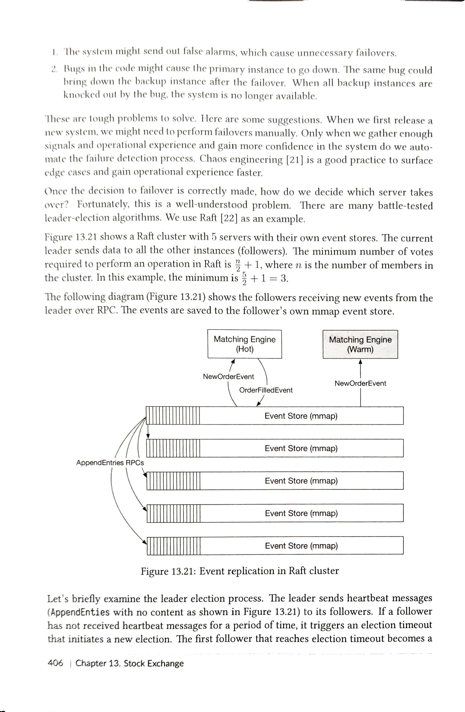

**Hình 13.21: Sao chép sự kiện trong cụm Raft (Event replication in Raft cluster)**

Hãy cùng xem xét ngắn gọn quy trình bầu chọn lãnh đạo (**Leader Election**). Nút lãnh đạo gửi các thông điệp nhịp tim (**Heartbeat Messages**) (chính là `AppendEntries` không chứa nội dung như thể hiện trong **Hình 13.21**) tới các nút đi theo của nó. Nếu một nút đi theo không nhận được thông điệp nhịp tim trong một khoảng thời gian nhất định, nó sẽ kích hoạt bộ đếm thời gian hết hạn bầu cử (**Election Timeout**) để khởi xướng một cuộc bầu cử mới. Nút đi theo đầu tiên chạm mốc thời gian hết hạn bầu cử sẽ trở thành...

*406 | Chapter 13. Stock Exchange*

---

### Trang 408

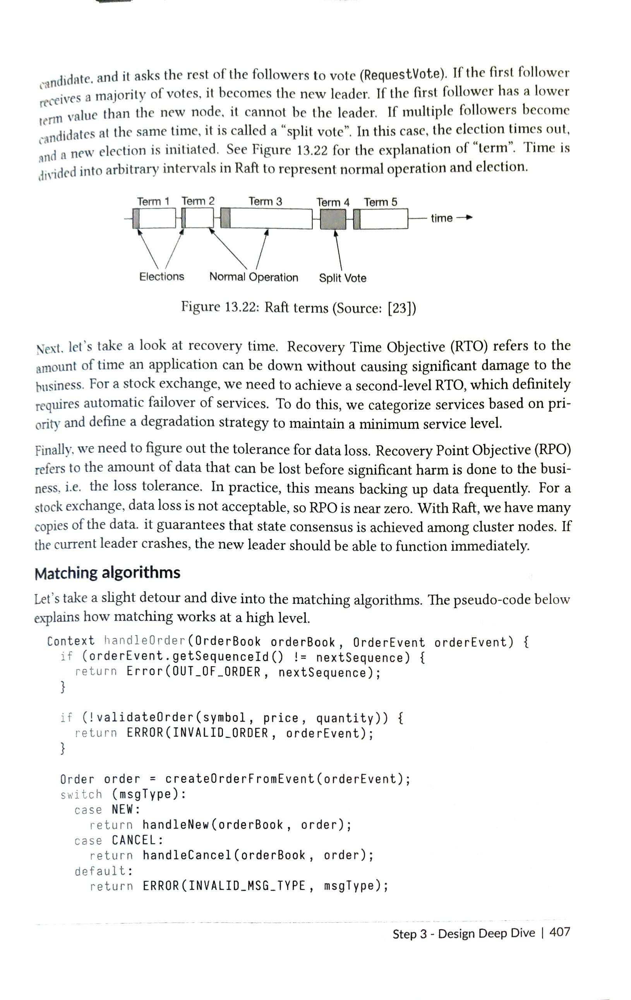

**Hình 13.22: Các nhiệm kỳ trong Raft (Raft terms) (Nguồn: [23])**

Tiếp theo, hãy cùng xem xét thời gian phục hồi. **Mục tiêu thời gian phục hồi (Recovery Time Objective - RTO)** đề cập đến khoảng thời gian tối đa mà một ứng dụng có thể ngừng hoạt động mà không gây ra thiệt hại nghiêm trọng cho doanh nghiệp. Đối với một sàn giao dịch chứng khoán, chúng ta cần đạt được mức RTO tính bằng giây (**Second-Level RTO**), điều này chắc chắn đòi hỏi việc chuyển đổi dự phòng tự động (**Automatic Failover**). Chúng ta cũng cần thiết lập thứ tự ưu tiên cho các dịch vụ và xác định chiến lược suy giảm hiệu năng có kiểm soát (**Degradation Strategy**) để duy trì một mức độ dịch vụ tối thiểu.

Cuối cùng, chúng ta cần xác định mức độ chấp nhận mất mát dữ liệu. **Mục tiêu điểm phục hồi (Recovery Point Objective - RPO)** đề cập đến khối lượng dữ liệu tối đa có thể bị mất trước khi gây ra tổn hại nghiêm trọng cho doanh nghiệp, tức là mức dung sai đối với việc mất dữ liệu (**Loss Tolerance**). Trong thực tế, điều này đồng nghĩa với việc phải sao lưu dữ liệu thường xuyên. Đối với một sàn giao dịch chứng khoán, việc mất dữ liệu là hoàn toàn không thể chấp nhận được, do đó RPO phải tiệm cận mức 0 (**Near Zero**). Với **Raft**, chúng ta sở hữu nhiều bản sao dữ liệu, đảm bảo đạt được sự đồng thuận trạng thái (**State Consensus**) giữa các nút trong cụm. Nếu nút lãnh đạo (**Leader**) hiện tại gặp sự cố sập (*crash*), nút lãnh đạo mới phải có khả năng hoạt động ngay lập tức.

---

### Các thuật toán khớp lệnh (Matching Algorithms)

Chúng ta hãy đi chệch hướng một chút để đào sâu vào các thuật toán khớp lệnh. Đoạn mã giả (**Pseudocode**) dưới đây giải thích cách thức hoạt động của quá trình khớp lệnh ở mức cao.

```java
Context handleOrder(OrderBook orderBook, OrderEvent orderEvent) {
    if (orderEvent.getSequenceId() != nextSequence)
        return ERROR(OUT_OF_ORDER, nextSequence);
    if (!validateOrder(symbol, price, quantity))
        return ERROR(INVALID_ORDER, orderEvent);
    
    Order order = createOrderFromEvent(orderEvent);
    switch(msgType):
        case NEW:
            return handleNew(orderBook, order);
        case CANCEL:
            return handleCancel(orderBook, order);
        default:
            return ERROR(INVALID_MSG_TYPE, msgType);
}
```

*Step 3 - Design Deep Dive / 407*

---

### Trang 409

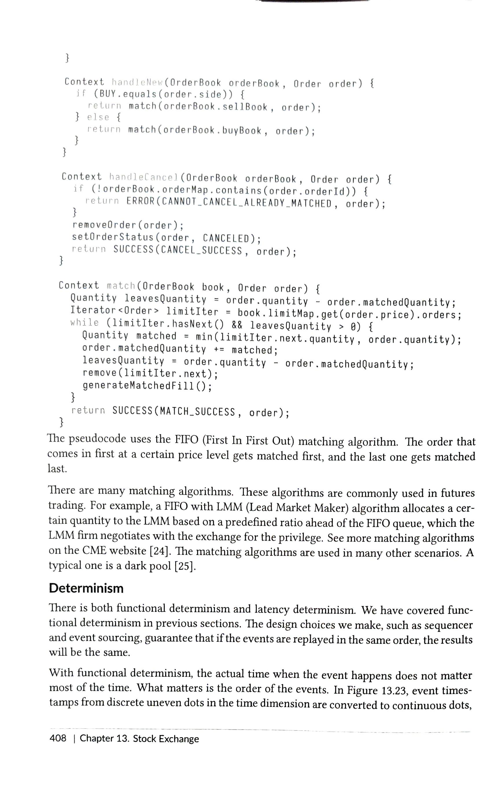

```java
Context handleNew(OrderBook orderBook, Order order) {
    if (BUY.equals(order.side))
        return match(orderBook.sellBook, order);
    else 
        return match(orderBook.buyBook, order);
}

Context handleCancel(OrderBook orderBook, Order order) {
    if (!orderBook.orderMap.contains(order.orderId))
        return ERROR(CANNOT_CANCEL_ALREADY_MATCHED, order);
    
    removeOrder(order);
    setOrderStatus(order, CANCELED);
    return SUCCESS(CANCEL_SUCCESS, order);
}

Context match(OrderBook book, Order order) {
    Quantity leavesQuantity = order.quantity - order.matchedQuantity;
    Iterator<Order> limitIter = book.limitMap.get(order.price).orders;
    while (limitIter.hasNext() && leavesQuantity > 0) {
        Quantity matched = min(limitIter.next.quantity, order.quantity);
        order.matchedQuantity += matched;
        leavesQuantity = order.quantity - order.matchedQuantity;
        remove(limitIter.next);
        generateMatchedFill();
    }
    return SUCCESS(MATCH_SUCCESS, order);
}
```

Đoạn mã giả trên sử dụng thuật toán khớp lệnh **FIFO (First In First Out - Vào trước Ra trước)**. Lệnh nào vào trước ở một mức giá nhất định sẽ được khớp trước, và lệnh vào sau cùng sẽ được khớp sau cùng.

Có rất nhiều thuật toán khớp lệnh khác nhau. Những thuật toán này thường được sử dụng phổ biến trong giao dịch hợp đồng tương lai (**Futures Trading**). Ví dụ, thuật toán **FIFO kết hợp LMM (Lead Market Maker - Nhà tạo lập thị trường dẫn dắt)** sẽ phân bổ một khối lượng nhất định cho LMM dựa trên một tỷ lệ được định sẵn ưu tiên phía trước hàng đợi FIFO, điều mà công ty LMM đàm phán với sàn giao dịch để đổi lấy đặc quyền này. Bạn có thể xem thêm các thuật toán khớp lệnh khác trên trang web của CME [24]. Các thuật toán khớp lệnh còn được áp dụng trong nhiều kịch bản khác, một kịch bản điển hình là bể thanh khoản tối (**Dark Pool**) [25].

---

### Tính tiền định (Determinism)

Tồn tại cả **Tính tiền định chức năng (Functional Determinism)** và **Tính tiền định độ trễ (Latency Determinism)**. Chúng ta đã đề cập đến tính tiền định chức năng trong các phần trước. Những quyết định thiết kế mà chúng ta đưa ra, chẳng hạn như bộ định tự (**Sequencer**) và mô hình **Event Sourcing**, đảm bảo rằng nếu các sự kiện được phát lại (*replayed*) theo đúng thứ tự ban đầu, kết quả tạo ra sẽ luôn hoàn toàn giống nhau.

Với tính tiền định chức năng, thời gian thực tế diễn ra sự kiện phần lớn không quan trọng. Điều quan trọng cốt lõi là **thứ tự của các sự kiện**. Trong **Hình 13.23**, các mốc thời gian sự kiện (*timestamps*) từ các điểm rời rạc không đều trên chiều kích thời gian được quy đổi thành các điểm liên tục...

*408 | Chapter 13. Stock Exchange*

# Chương 13: Sàn Giao Dịch Chứng Khoán (Stock Exchange)

---

### [Trang 410]

... và thời gian dành cho việc phát lại/phục hồi (**Replay/Recovery**) có thể được giảm thiểu đáng kể.

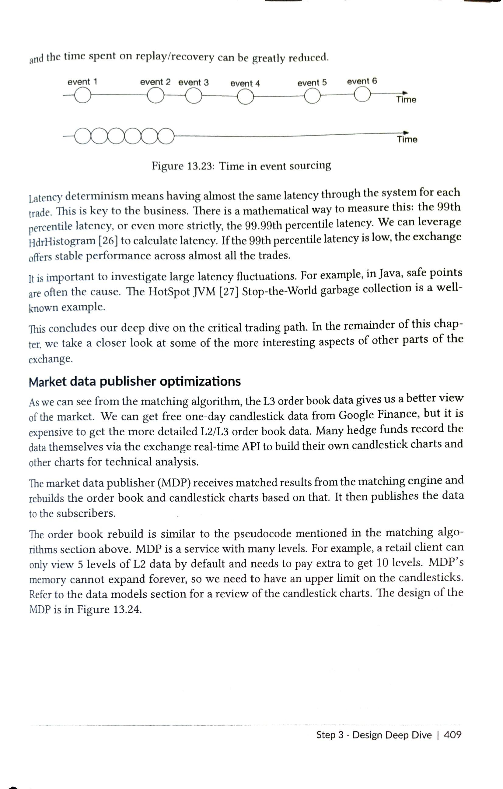

**Hình 13.23: Trục thời gian trong Event Sourcing (Time in Event Sourcing)**

Tính tiền định về độ trễ (**Latency Determinism**) có nghĩa là duy trì mức độ trễ gần như tương đương nhau xuyên suốt hệ thống đối với mỗi giao dịch được thực hiện. Đây là yếu tố sống còn đối với hoạt động kinh doanh của sàn. Có một phương pháp toán học để đo lường điều này: độ trễ phân vị thứ 99 (**99th percentile latency**), hoặc thậm chí nghiêm ngặt hơn là độ trễ phân vị thứ 99.99 (**99.99th percentile latency**). Chúng ta có thể tận dụng **HdrHistogram** [26] để tính toán độ trễ. Nếu độ trễ ở phân vị thứ 99 ở mức thấp, sàn giao dịch cung cấp một hiệu năng ổn định xuyên suốt hầu như toàn bộ các giao dịch.

Việc điều tra các biến động lớn về độ trễ (**latency fluctuations**) là vô cùng quan trọng. Ví dụ, trong Java, các điểm an toàn (**safe points**) thường là nguyên nhân gốc rễ. Hiện tượng dừng toàn bộ ứng dụng để dọn rác (**Stop-the-World garbage collection**) của máy ảo **HotSpot JVM** [27] là một ví dụ điển hình đã được biết đến rộng rãi.

Phần này khép lại bài phân tích chuyên sâu của chúng ta về đường dẫn giao dịch trọng yếu (**critical trading path**). Trong phần còn lại của chương này, chúng ta sẽ xem xét kỹ hơn một số khía cạnh thú vị khác thuộc các bộ phận còn lại của sàn giao dịch.

---

### Tối ưu hóa Bộ xuất bản dữ liệu thị trường (Market Data Publisher Optimizations)

Như chúng ta có thể thấy từ thuật toán khớp lệnh (**matching algorithm**), dữ liệu sổ lệnh cấp độ 3 (**L3 order book**) cung cấp cho chúng ta một góc nhìn toàn diện và sâu sắc hơn về thị trường. Chúng ta có thể lấy dữ liệu biểu đồ nến (**candlestick chart**) khung thời gian 1 ngày miễn phí từ Google Finance, nhưng sẽ rất tốn kém nếu muốn tiếp cận dữ liệu sổ lệnh L2/L3 chi tiết hơn. Rất nhiều quỹ phòng hộ (**hedge funds**) tự ghi nhận dữ liệu này thông qua giao diện lập trình ứng dụng thời gian thực (**real-time API**) của sàn giao dịch nhằm tự xây dựng biểu đồ nến và các đồ thị kỹ thuật khác phục vụ phân tích kỹ thuật (**technical analysis**).

Bộ xuất bản dữ liệu thị trường (**Market Data Publisher - MDP**) tiếp nhận các kết quả khớp lệnh từ công cụ khớp lệnh (**matching engine**), sau đó tái thiết lập sổ lệnh (**order book**) cùng các biểu đồ nến dựa trên dữ liệu đó. Tiếp theo, nó xuất bản dữ liệu này tới các bên đăng ký nhận tin (**subscribers**).

Quá trình tái thiết lập sổ lệnh tương tự như mã giả đã được đề cập trong phần thuật toán khớp lệnh ở trên. MDP là một dịch vụ có nhiều cấp bậc. Ví dụ: một khách hàng cá nhân (**retail client**) theo mặc định chỉ có thể xem 5 mức giá của dữ liệu L2, và cần phải trả thêm phí để xem được 10 mức giá.

> [!NOTE]
> Vui lòng tham khảo lại phần mô hình dữ liệu (**data models**) để ôn lại về các biểu đồ nến (**candlestick charts**). Bản thiết kế kiến trúc của MDP được thể hiện trong **Hình 13.24**.

---

### [Trang 411]

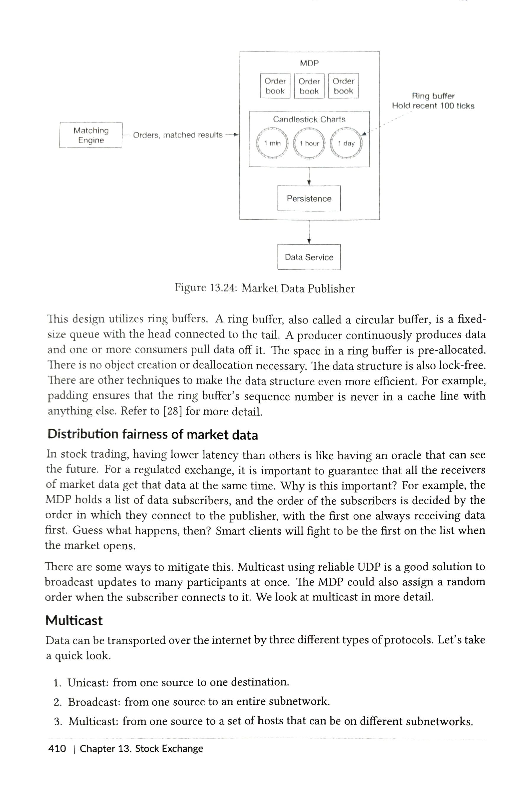

**Hình 13.24: Bộ xuất bản dữ liệu thị trường (Market Data Publisher - MDP)**

Thiết kế này sử dụng các bộ đệm vòng (**ring buffers**). Bộ đệm vòng, hay còn gọi là bộ đệm tròn (**circular buffer**), là một hàng đợi có kích thước cố định (**fixed-size queue**) với phần đầu kết nối khép kín vào phần đuôi. Một tiến trình sản xuất (**producer**) liên tục tạo ra dữ liệu và một hoặc nhiều tiến trình tiêu thụ (**consumers**) sẽ kéo dữ liệu ra khỏi đó. Vùng nhớ trong bộ đệm vòng được cấp phát trước (**pre-allocated**). Do đó, hoàn toàn không cần khởi tạo hoặc giải phóng đối tượng trong quá trình thực thi. Cấu trúc dữ liệu này cũng hoàn toàn không khóa (**lock-free**).

Ngoài ra còn có các kỹ thuật khác để làm cho cấu trúc dữ liệu này đạt hiệu quả cao hơn nữa. Ví dụ: đệm vùng nhớ (**cache line padding**) đảm bảo rằng số thứ tự tuần tự (**sequence number**) của bộ đệm vòng không bao giờ nằm chung trên cùng một dòng nhớ đệm (**cache line**) với bất kỳ biến nào khác (tránh hiện tượng **False Sharing**). Hãy tham khảo [28] để biết thêm chi tiết.

---

### Tính công bằng trong phân phối dữ liệu thị trường (Distribution fairness of market data)

Trong giao dịch chứng khoán, việc sở hữu độ trễ thấp hơn đối thủ cũng giống như việc nắm giữ một nhà tiên tri có thể thấy trước tương lai. Đối với một sàn giao dịch chịu sự quản lý của cơ quan chức năng (**regulated exchange**), điều tối quan trọng là phải đảm bảo rằng tất cả các bên nhận dữ liệu thị trường đều nhận được dữ liệu tại cùng một thời điểm. Tại sao điều này lại quan trọng?

Ví dụ: nếu MDP lưu giữ một danh sách các bên đăng ký dữ liệu (**data subscribers**), và thứ tự phân phối cho các bên đăng ký được quyết định dựa trên thứ tự thời gian mà họ kết nối tới bộ xuất bản, với bên kết nối đầu tiên sẽ luôn nhận được dữ liệu trước. Thử đoán xem điều gì sẽ xảy ra? Các khách hàng tinh vi sẽ cạnh tranh quyết liệt để giành vị trí đầu tiên trong danh sách khi thị trường mở cửa.

Có một số phương pháp để giảm thiểu vấn đề này. Truyền đa hướng (**Multicast**) sử dụng giao thức UDP tin cậy (**Reliable UDP**) là một giải pháp tối ưu nhằm triệt tiêu sự phụ thuộc vào thứ tự kết nối của bên đăng ký. Chúng ta sẽ xem xét kỹ hơn về kỹ thuật Multicast.

---

### Truyền đa hướng (Multicast)

Dữ liệu có thể được vận chuyển qua mạng Internet bằng ba loại giao thức khác nhau. Hãy cùng điểm qua nhanh:

1. **Unicast (Truyền đơn hướng):** Từ một nguồn duy nhất đến một đích đến duy nhất.
2. **Broadcast (Truyền quảng bá):** Từ một nguồn duy nhất đến toàn bộ mạng con (**subnetwork**).
3. **Multicast (Truyền đa hướng):** Từ một nguồn duy nhất đến một tập hợp các máy chủ đích (**hosts**) có thể nằm trên các mạng con khác nhau.

---

### [Trang 412]

Multicast là giao thức được sử dụng rất phổ biến trong thiết kế sàn giao dịch chứng khoán bằng cách định cấu hình nhiều máy thu. Đã có các giải pháp kỹ thuật chuyên biệt để xử lý việc truyền lại gói tin khi xảy ra thất thoát (**retransmission**) [29].

---

### Đặt máy chủ đồng vị trí (Colocation)

Nhân tiện bàn về chủ đề tính công bằng, thực tế là có rất nhiều sàn giao dịch cung cấp dịch vụ đặt máy chủ đồng vị trí (**colocation services**). Dịch vụ này đặt các máy chủ của quỹ phòng hộ (**hedge funds**) hoặc công ty môi giới chứng khoán (**brokers**) vào trong cùng một trung tâm dữ liệu (**data center**) với sàn giao dịch. Độ trễ khi gửi lệnh vào công cụ khớp lệnh (**matching engine**) lúc này tỷ lệ thuận với chiều dài vật lý của sợi cáp mạng. Dịch vụ Colocation không phá vỡ tính công bằng; nó được xem như một gói dịch vụ VIP trả phí cao cấp.

---

### An ninh mạng (Network Security)

Một sàn giao dịch thường cung cấp các giao diện kết nối công khai (**public interfaces**), và các cuộc tấn công từ chối dịch vụ phân tán (**DDoS attack**) là một thách thức hiện hữu. Dưới đây là một số kỹ thuật để phòng chống DDoS:

1. **Cô lập các dịch vụ và dữ liệu công khai khỏi các dịch vụ nội bộ (private services)**, để các đòn tấn công DDoS không làm ảnh hưởng đến các khách hàng quan trọng nhất. Trong trường hợp dữ liệu công khai và nội bộ giống nhau, chúng ta có thể triển khai nhiều bản sao chỉ đọc (**read-only copies**) để cô lập sự cố.
2. **Sử dụng tầng nhớ đệm (caching layer)** để lưu trữ các dữ liệu ít khi cập nhật. Với cơ chế lưu bộ nhớ đệm hiệu quả, hầu hết các truy vấn sẽ không chạm tới cơ sở dữ liệu (**databases**).
3. **Gia cố các đường dẫn URL chống lại các đòn tấn công DDoS**. Ví dụ: với URL dạng `https://my.website.com/data?from=123&to=456`, kẻ tấn công có thể dễ dàng tạo ra vô số các yêu cầu khác nhau bằng cách liên tục thay đổi chuỗi truy vấn (**query string**). Thay vào đó, thiết kế URL như sau sẽ hiệu quả hơn nhiều: `https://my.website.com/data/recent`. Dạng URL này cũng có thể dễ dàng được lưu bộ nhớ đệm ở tầng mạng phân phối nội dung (**CDN layer**).
4. **Xây dựng cơ chế danh sách cho phép / danh sách chặn (safelist/blocklist) hiệu quả.** Rất nhiều sản phẩm cổng kết nối mạng (**network gateway**) cung cấp sẵn loại tính năng bảo mật này.
5. **Giới hạn tốc độ (Rate Limiting)** là kỹ thuật được sử dụng thường xuyên để phòng vệ chống lại các cuộc tấn công DDoS.

---

### Bước 4 - Tổng kết chương (Step 4 - Wrap Up)

Sau khi đọc chương này, bạn có thể rút ra kết luận rằng mô hình triển khai lý tưởng cho một sàn giao dịch quy mô lớn là gom toàn bộ hệ thống lên một máy chủ vật lý khổng lồ (**gigantic server**), hoặc thậm chí gói gọn trong duy nhất một tiến trình (**single process**). Thật vậy, đây chính xác là cách mà một số sàn giao dịch lớn trên thế giới được thiết kế!

Với sự phát triển mạnh mẽ gần đây của ngành công nghiệp tiền điện tử (**cryptocurrency**), nhiều sàn giao dịch tiền mã hóa đã ứng dụng hạ tầng điện toán đám mây (**cloud infrastructure**) để triển khai dịch vụ của họ [30]. Một số dự án tài chính phi tập trung (**Decentralized Finance - DeFi**) dựa trên khái niệm Tạo lập thị trường tự động (**Automated Market Making - AMM**) thậm chí không cần sử dụng đến sổ lệnh (**order book**).

Sự tiện lợi từ hệ sinh thái đám mây mang lại đã thay đổi một số mô hình thiết kế và hạ thấp rào cản gia nhập thị trường tài chính. Điều này chắc chắn sẽ bơm thêm nguồn năng lượng đổi mới sáng tạo mạnh mẽ vào thế giới tài chính tương lai.

> [!TIP]
> Xin chúc mừng bạn đã hoàn thành chặng đường dài đến đây! Hãy tự thưởng cho bản thân một tràng pháo tay. Bạn đã làm rất xuất sắc!

---

### [Trang 413]

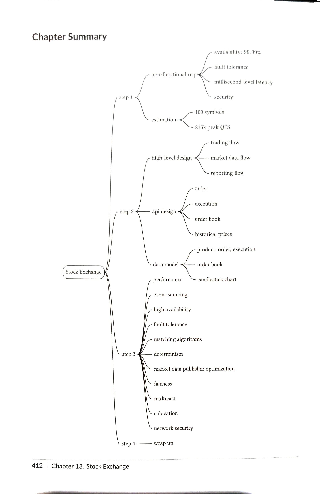

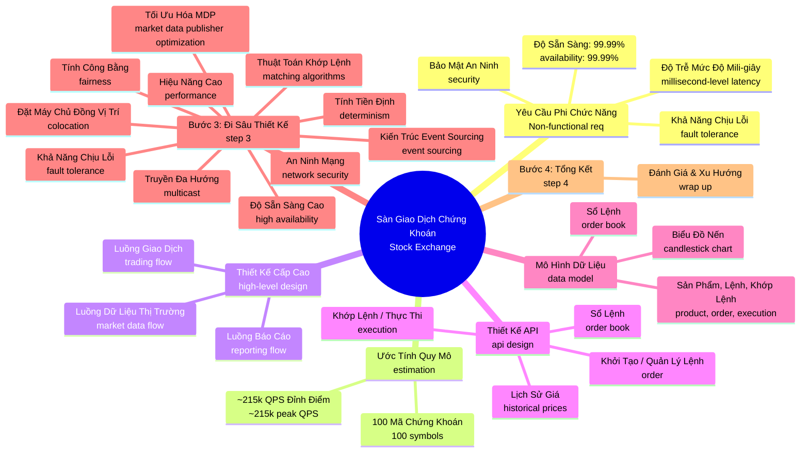

---

### [Trang 414]

### Tài liệu tham khảo (Reference Material)

* **[1]** Sàn giao dịch LMAX nổi tiếng với thư viện mã nguồn mở Disruptor: [https://www.lmax.com/exchange](https://www.lmax.com/exchange).
* **[2]** Sàn IEX thu hút nhà đầu tư bằng việc "chơi công bằng", đồng thời là "Sàn giao dịch của Flash Boys": [https://en.wikipedia.org/wiki/IEX](https://en.wikipedia.org/wiki/IEX).
* **[3]** Khối lượng giao dịch khớp lệnh tại sàn NYSE: [https://www.nyse.com/markets/us-equity-volumes](https://www.nyse.com/markets/us-equity-volumes).
* **[4]** Khối lượng giao dịch hàng ngày của sàn HKEX: [https://www.hkex.com.hk/Market-Data/Statistics/Consolidated-Reports/Securities-Statistics-Archive/Trading_Value_Volume_And_Number_Of_Deals?sc_lang=en#select1=0](https://www.hkex.com.hk/Market-Data/Statistics/Consolidated-Reports/Securities-Statistics-Archive/Trading_Value_Volume_And_Number_Of_Deals?sc_lang=en#select1=0).
* **[5]** Bảng xếp hạng quy mô tất cả các sàn giao dịch chứng khoán trên thế giới: [http://money.visualcapitalist.com/all-of-the-worlds-stock-exchanges-by-size/](http://money.visualcapitalist.com/all-of-the-worlds-stock-exchanges-by-size/).
* **[6]** Tấn công từ chối dịch vụ (Denial of service attack): [https://en.wikipedia.org/wiki/Denial-of-service_attack](https://en.wikipedia.org/wiki/Denial-of-service_attack).
* **[7]** Tác động thị trường (Market impact): [https://en.wikipedia.org/wiki/Market_impact](https://en.wikipedia.org/wiki/Market_impact).
* **[8]** Giao thức giao dịch FIX (Fix trading): [https://www.fixtrading.org/](https://www.fixtrading.org/).
* **[9]** Mô hình nguồn sự kiện (Event Sourcing): [https://martinfowler.com/eaaDev/EventSourcing.html](https://martinfowler.com/eaaDev/EventSourcing.html).
* **[10]** Dịch vụ trung tâm dữ liệu và đặt máy chủ đồng vị trí của CME (CME Co-Location and Data Center Services): [https://www.cmegroup.com/trading/colocation/co-location-services.html](https://www.cmegroup.com/trading/colocation/co-location-services.html).
* **[11]** Kỷ nguyên số / Thời gian hệ thống (Epoch): [https://www.epoch101.com/](https://www.epoch101.com/).
* **[12]** Khái niệm sổ lệnh (Order book): [https://www.investopedia.com/terms/o/order-book.asp](https://www.investopedia.com/terms/o/order-book.asp).
* **[13]** Sổ lệnh chứng khoán (Order book): [https://en.wikipedia.org/wiki/Order_book](https://en.wikipedia.org/wiki/Order_book).
* **[14]** Hướng dẫn xây dựng sổ lệnh giới hạn tốc độ cao (How to Build a Fast Limit Order Book): [https://bit.ly/3ngMtEO](https://bit.ly/3ngMtEO).
* **[15]** Phát triển hệ thống với kdb+ và ngôn ngữ lập trình q (Developing with kdb+ and the q language): [https://code.kx.com/q/](https://code.kx.com/q/).
* **[16]** Các chỉ số độ trễ mà mọi lập trình viên đều cần phải biết (Latency Numbers Every Programmer Should Know): [https://gist.github.com/jboner/2841832](https://gist.github.com/jboner/2841832).
* **[17]** Cơ chế ánh xạ bộ nhớ (mmap - Memory map): [https://en.wikipedia.org/wiki/Memory_map](https://en.wikipedia.org/wiki/Memory_map).
* **[18]** Chuyển đổi ngữ cảnh CPU (Context switch): [https://bit.ly/3pva7A6](https://bit.ly/3pva7A6).
* **[19]** Giao thức UDP tin cậy (Reliable User Datagram Protocol): [https://en.wikipedia.org/wiki/Reliable_User_Datagram_Protocol](https://en.wikipedia.org/wiki/Reliable_User_Datagram_Protocol).
* **[20]** Tổng quan kiến trúc thư viện Aeron: [https://github.com/real-logic/aeron/wiki/Design-Overview](https://github.com/real-logic/aeron/wiki/Design-Overview).
* **[21]** Kỹ nghệ hỗn loạn (Chaos engineering): [https://en.wikipedia.org/wiki/Chaos_engineering](https://en.wikipedia.org/wiki/Chaos_engineering).
* **[22]** Thuật toán đồng thuận Raft: [https://raft.github.io/](https://raft.github.io/).
* **[23]** Thiết kế hướng tính khả tri: Thuật toán đồng thuận Raft (Designing for Understandability: the Raft Consensus Algorithm): [https://raft.github.io/slides/uiuc2016.pdf](https://raft.github.io/slides/uiuc2016.pdf).

---

### [Trang 415]

* **[24]** Các thuật toán khớp lệnh được hỗ trợ (Supported Matching Algorithms): [https://bit.ly/3aYoCEo](https://bit.ly/3aYoCEo).
* **[25]** Bể thanh khoản tối (Dark pool): [https://www.investopedia.com/terms/d/dark-pool.asp](https://www.investopedia.com/terms/d/dark-pool.asp).
* **[26]** HdrHistogram: Biểu đồ tần suất phạm vi động cao (A High Dynamic Range Histogram): [http://hdrhistogram.org/](http://hdrhistogram.org/).
* **[27]** Máy ảo HotSpot (HotSpot virtual machine): [https://en.wikipedia.org/wiki/HotSpot_(virtual_machine)](https://en.wikipedia.org/wiki/HotSpot_(virtual_machine)).
* **[28]** Đệm dòng nhớ đệm CPU (Cache line padding): [https://bit.ly/31ZTFWz](https://bit.ly/31ZTFWz).
* **[29]** Giao thức Multicast tin cậy hướng NACK (NACK-Oriented Reliable Multicast): [https://en.wikipedia.org/wiki/NACK-Oriented_Reliable_Multicast](https://en.wikipedia.org/wiki/NACK-Oriented_Reliable_Multicast).
* **[30]** Nghiên cứu điển hình sàn Coinbase trên nền tảng AWS (AWS Coinbase Case Study): [https://aws.amazon.com/solutions/case-studies/coinbase/](https://aws.amazon.com/solutions/case-studies/coinbase/).

---

## Điều hướng

- [chuong-12-digital-wallet.md](chuong-12-digital-wallet.md)
- [Mục lục](README.md)
- [14-loi-ket-va-index.md](14-loi-ket-va-index.md)
