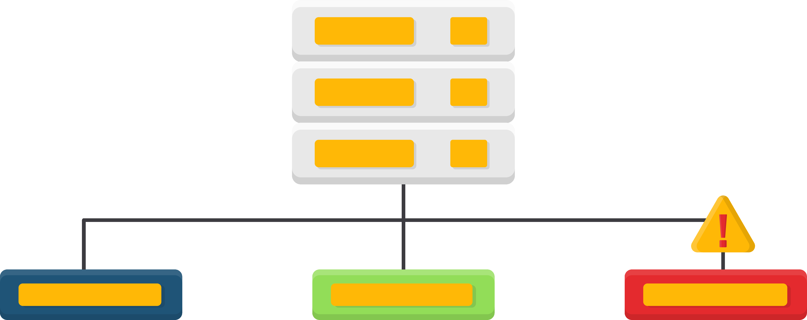

# 004 - Các Đặc Tính Phi Chức Năng Của Hệ Thống

[← Bài trước](003-cac-tang-truu-tuong-abstractions.md) | [Mục lục](README.md) | [Bài tiếp theo →](005-uoc-tinh-back-of-the-envelope.md)

---

# Tính sẵn sàng (Availability)

Tìm hiểu về **tính sẵn sàng (availability)**, cách đo lường và tầm quan trọng của nó.

Chúng ta sẽ tìm hiểu các nội dung sau:
* Tính sẵn sàng (Availability) là gì?
* Đo lường tính sẵn sàng (Measuring availability)
* Tính sẵn sàng và các nhà cung cấp dịch vụ (Availability and service providers)

---

### Tính sẵn sàng (Availability) là gì?

**Tính sẵn sàng (Availability)** là tỷ lệ phần trăm thời gian mà một dịch vụ hoặc hạ tầng có thể truy cập được đối với các client và vận hành trong các điều kiện bình thường. Ví dụ, nếu một dịch vụ đạt 100% tính sẵn sàng, điều đó có nghĩa là dịch vụ đó hoạt động và phản hồi đúng như dự kiến (vận hành bình thường) ở mọi thời điểm.

---

### Đo lường tính sẵn sàng (Measuring availability)

Về mặt toán học, tính sẵn sàng ($A$) là một tỷ lệ. Giá trị $A$ càng cao thì càng tốt. Chúng ta có thể viết thành công thức như sau:

$$A\text{ (tính theo phần trăm)} = \frac{\text{Tổng thời gian (Total Time)} - \text{Thời gian dịch vụ bị sập (Amount Of Time Service Was Down)}}{\text{Tổng thời gian (Total Time)}} \times 100$$

Chúng ta đo lường tính sẵn sàng bằng **"số lượng số 9" (number of nines)**. Bảng sau đây cho thấy mức thời gian ngừng hoạt động cho phép (**downtime**) tương ứng với một số lượng số 9 nhất định:

#### Các con số 9 của tính sẵn sàng (The Nines of Availability)
*Tỷ lệ phần trăm tính sẵn sàng so với thời gian ngừng hoạt động của dịch vụ (Availability Percentages versus Service Downtime)*

| Tỷ lệ sẵn sàng (Availability %) | Downtime mỗi năm (Downtime per Year) | Downtime mỗi tháng (Downtime per Month) | Downtime mỗi tuần (Downtime per Week) |
| :--- | :--- | :--- | :--- |
| **90% (1 số 9 / 1 nine)** | 36.5 ngày | 72 giờ | 16.8 giờ |
| **99% (2 số 9 / 2 nines)** | 3.65 ngày | 7.20 giờ | 1.68 giờ |
| **99.5% (2 số 9 / 2 nines)** | 1.83 ngày | 3.60 giờ | 50.4 phút |
| **99.9% (3 số 9 / 3 nines)** | 8.76 giờ | 43.8 phút | 10.1 phút |
| **99.99% (4 số 9 / 4 nines)** | 52.56 phút | 4.32 phút | 1.01 phút |
| **99.999% (5 số 9 / 5 nines)** | 5.26 phút | 25.9 giây | 6.05 giây |
| **99.9999% (6 số 9 / 6 nines)** | 31.5 giây | 2.59 giây | 0.605 giây |
| **99.99999% (7 số 9 / 7 nines)** | 3.15 giây | 0.259 giây | 0.0605 giây |

---

### Tính sẵn sàng và các nhà cung cấp dịch vụ (Availability and service providers)

Mỗi nhà cung cấp dịch vụ có thể bắt đầu đo lường tính sẵn sàng tại các thời điểm khác nhau:
* Một số nhà cung cấp dịch vụ đám mây (cloud providers) bắt đầu đo lường ngay khi họ lần đầu tiên cung cấp dịch vụ.
* Trong khi một số bên khác lại đo lường riêng cho từng client cụ thể khi các client đó bắt đầu sử dụng dịch vụ.
* Một số nhà cung cấp có thể không trừ bớt con số sẵn sàng được báo cáo nếu dịch vụ của họ không bị sập đối với toàn bộ tất cả client.
* Các khoảng thời gian ngừng hoạt động theo kế hoạch trước (**planned downtimes**) thường được loại trừ.
* Thời gian ngừng hoạt động do các cuộc tấn công mạng (**cyberattacks**) có thể không được tính vào công thức tính toán tính sẵn sàng.

> [!IMPORTANT]
> Do đó, chúng ta cần phải tìm hiểu và nắm thật kỹ cách mà một nhà cung cấp cụ thể tính toán các chỉ số sẵn sàng của họ.

---

# Độ tin cậy (Reliability)

Tìm hiểu về **độ tin cậy (reliability)**, cách đo lường và tầm quan trọng của nó.

Chúng ta sẽ tìm hiểu các nội dung sau:
* Độ tin cậy (Reliability) là gì?
* Độ tin cậy và tính sẵn sàng (Reliability and availability)

---

### Độ tin cậy (Reliability) là gì?

**Độ tin cậy (Reliability - $R$)** là xác suất để dịch vụ thực hiện chính xác các chức năng của nó trong một khoảng thời gian xác định. $R$ đo lường cách thức dịch vụ vận hành dưới các điều kiện hoạt động thay đổi khác nhau.

Chúng ta thường sử dụng hai chỉ số: **Thời gian trung bình giữa các lần hỏng hóc (Mean Time Between Failures - MTBF)** và **Thời gian sửa chữa trung bình (Mean Time To Repair - MTTR)** để đo lường $R$.

*(Chúng ta luôn nỗ lực để đạt giá trị MTBF cao hơn và giá trị MTTR thấp hơn).*

$$\text{MTBF} = \frac{\text{Tổng thời gian trôi qua (Total Elapsed Time)} - \text{Tổng thời gian downtime (Sum of Downtime)}}{\text{Tổng số lần xảy ra sự cố (Total Number of Failures)}}$$

$$\text{MTTR} = \frac{\text{Tổng thời gian bảo trì (Total Maintenance Time)}}{\text{Tổng số lần sửa chữa (Total Number of Repairs)}}$$

---

### Độ tin cậy và tính sẵn sàng (Reliability and availability)

Độ tin cậy (**Reliability**) và tính sẵn sàng (**Availability**) là hai chỉ số quan trọng dùng để đo lường mức độ tuân thủ của dịch vụ đối với các mục tiêu mức dịch vụ đã thỏa thuận (**Service Level Objectives - SLO**).

* Việc đo lường tính sẵn sàng được thúc đẩy bởi **sự tổn thất thời gian (time loss)**.
* Trong khi đó, **tần suất và mức độ ảnh hưởng của các sự cố hỏng hóc** lại quyết định việc đo lường độ tin cậy.
* Tính sẵn sàng và độ tin cậy là tối quan trọng vì chúng cho phép các bên liên quan (**stakeholders**) đánh giá được tình trạng sức khỏe (health) của dịch vụ.

Độ tin cậy ($R$) và tính sẵn sàng ($A$) là hai khái niệm riêng biệt, nhưng chúng có mối quan hệ tương hỗ với nhau.

Về mặt toán học, $A$ là một hàm số phụ thuộc vào $R$ ($A$ is a function of $R$). Điều này có nghĩa là giá trị của $R$ có thể thay đổi độc lập, còn giá trị của $A$ thì phụ thuộc vào $R$. Do đó, có thể xuất hiện các tình huống sau:
* $A$ thấp, $R$ thấp (low $A$, low $R$)
* $A$ thấp, $R$ cao (low $A$, high $R$)
* $A$ cao, $R$ thấp (high $A$, low $R$)
* $A$ cao, $R$ cao (high $A$, high $R$ - **trạng thái lý tưởng mong muốn**)

#### Tính sẵn sàng là một hàm số của độ tin cậy (Availability as a function of reliability)
* **Độ tin cậy ($R$)**: đo lường dưới dạng xác suất (từ thấp đến cao).
* **Tính sẵn sàng ($A$)**: đo lường dưới dạng tỷ lệ phần trăm thời gian (từ thấp đến cao).
* **Vùng mong muốn (Desirable region)**: Góc phần tư có $A$ cao và $R$ cao.

---

### Điểm cần suy ngẫm (Point to ponder)

**Câu hỏi:**
Sự khác biệt giữa độ tin cậy (Reliability) và tính sẵn sàng (Availability) là gì?

> [!TIP]
> **Giải đáp:**
> * **Độ tin cậy (Reliability)** đo lường mức độ hệ thống thực hiện tốt các thao tác dự kiến của nó (**yêu cầu chức năng - functional requirements**). Chúng ta sử dụng các giá trị trung bình để đo lường điều đó (Thời gian trung bình đến khi gặp sự cố - *Mean Time to Failure/MTTF*, Thời gian sửa chữa trung bình - *Mean Time to Repair/MTTR*, v.v.).
> * **Tính sẵn sàng (Availability)** đo lường tỷ lệ phần trăm thời gian mà một hệ thống chấp nhận các yêu cầu (requests) và phản hồi lại cho các client.
> 
> **Ví dụ 1:** Một hệ thống nhất định có thể đạt mức sẵn sàng 90% (90% available) nhưng chỉ tin cậy trong 80% thời gian (reliable 80% of the time).
> 
> **Ví dụ 2:** Giả sử chúng ta coi "hệ thống" của mình là toàn bộ những thành phần bên trong một trung tâm dữ liệu (**data center** bao gồm phần cứng + phần mềm). Giả định data center này gặp phải sự cố mất mạng (network failure) khiến cho không có lưu lượng truy cập bên ngoài nào đi vào được và không có lưu lượng bên trong nào đi ra được. Trong trường hợp này, tính sẵn sàng tức thời có thể bằng 0 (vì các client không thể tiếp cận được dịch vụ) cho dù bên trong data center, toàn bộ hệ thống vẫn đang vận hành hoàn hảo (độ tin cậy tức thời đạt 100%).
> 
> Chúng ta sử dụng cả hai chỉ số (độ tin cậy và tính sẵn sàng) trong các ngữ cảnh khác nhau. Ví dụ: Các nhà cung cấp phần cứng lưu trữ thường báo giá trị MTTF cho các ổ đĩa của họ. Hầu hết các dịch vụ trực tuyến đều sử dụng thời gian hoạt động liên tục (**uptime** - như một thước đo của tính sẵn sàng) trong các cam kết mức dịch vụ (**SLA** - Service Level Agreements) của họ. Ví dụ: thời gian uptime của các máy ảo EC2 là 99.95%.

---

# Khả năng mở rộng (Scalability)

Tìm hiểu về **khả năng mở rộng (scalability)** và tầm quan trọng của nó trong thiết kế hệ thống (**System Design**).

Chúng ta sẽ tìm hiểu các nội dung sau:
* Khả năng mở rộng (Scalability) là gì?
* Các chiều kích thước (Dimensions)
* Các cách tiếp cận mở rộng khác nhau (Different approaches of scalability)
* Mở rộng theo chiều dọc—scale up (Vertical scalability—scaling up)
* Mở rộng theo chiều ngang—scale out (Horizontal scalability—scaling out)

---

### Khả năng mở rộng (Scalability) là gì?

**Khả năng mở rộng (Scalability)** là năng lực của một hệ thống có thể xử lý khối lượng công việc (**workload**) ngày càng tăng mà không làm suy giảm hiệu năng (**performance**). Ví dụ: một công cụ tìm kiếm (search engine) phải đáp ứng được số lượng người dùng ngày càng tăng, cũng như khối lượng dữ liệu mà nó lập chỉ mục (index).

Khối lượng công việc (**workload**) có thể bao gồm nhiều dạng khác nhau, bao gồm:
* **Khối lượng công việc theo yêu cầu (Request workload):** Đây là số lượng yêu cầu (requests) được hệ thống phục vụ.
* **Khối lượng công việc theo dữ liệu/lưu trữ (Data/storage workload):** Đây là lượng dữ liệu được lưu trữ bởi hệ thống.

---

### Các chiều kích thước (Dimensions)

Dưới đây là các chiều kích thước khác nhau của khả năng mở rộng:
* **Mở rộng về quy mô kích thước (Size scalability):** Một hệ thống có khả năng mở rộng về kích thước nếu chúng ta có thể dễ dàng bổ sung thêm người dùng và tài nguyên vào hệ thống đó.
* **Mở rộng về mặt quản trị (Administrative scalability):** Đây là năng lực cho phép một số lượng ngày càng tăng các tổ chức hoặc người dùng có thể cùng chia sẻ một hệ thống phân tán (**distributed system**) duy nhất một cách dễ dàng.

---

# Các Đặc Tính Phi Chức Năng Của Hệ Thống (Non-Functional System Characteristics)

---

### Khả năng mở rộng theo khu vực địa lý (Geographical Scalability)

**Khả năng mở rộng theo khu vực địa lý (Geographical scalability):** Khái niệm này liên quan đến mức độ dễ dàng mà chương trình có thể phục vụ các khu vực khác nhau trong khi vẫn duy trì được các ràng buộc hiệu năng (performance constraints) ở mức chấp nhận được. Nói cách khác, hệ thống có thể sẵn sàng phục vụ một vùng địa lý rộng lớn cũng như một khu vực nhỏ hơn.

---

### Các phương pháp tiếp cận khả năng mở rộng khác nhau (Different Approaches of Scalability)

Dưới đây là các phương pháp khác nhau để triển khai khả năng mở rộng (scalability):

#### 1. Mở rộng theo chiều dọc — Nâng cấp cấu hình (Vertical Scalability — Scaling Up)

Mở rộng theo chiều dọc (Vertical scaling), còn được gọi là **“scaling up”**, đề cập đến việc mở rộng quy mô bằng cách cung cấp thêm các năng lực xử lý bổ sung (ví dụ: thêm CPU hoặc RAM) cho một thiết bị/máy chủ hiện có. Mở rộng theo chiều dọc cho phép chúng ta tăng dung lượng phần cứng hoặc phần mềm hiện tại, nhưng chúng ta chỉ có thể phát triển nó đến các giới hạn phần cứng tối đa của máy chủ đó. Chi phí tài chính (dollar cost) của việc mở rộng theo chiều dọc thường rất cao vì chúng ta có thể cần đến các linh kiện chuyên biệt, đắt đỏ (exotic components) để nâng cấp.

#### 2. Mở rộng theo chiều ngang — Mở rộng số lượng nút (Horizontal Scalability — Scaling Out)

Mở rộng theo chiều ngang (Horizontal scaling), còn được gọi là **“scaling out”**, đề cập đến việc gia tăng số lượng máy tính (nodes) trong mạng lưới. Chúng ta sử dụng các nút phần cứng phổ thông thương mại (commodity nodes) cho mục đích này vì lợi ích chi phí tài chính vô cùng hấp dẫn của chúng. Điểm mấu chốt cần lưu ý ở đây là chúng ta cần phải xây dựng hệ thống sao cho nhiều nút có thể phối hợp làm việc cùng nhau như thể chúng ta chỉ đang vận hành một máy chủ duy nhất khổng lồ.

| Tiêu chí so sánh | Mở rộng theo chiều dọc (Vertical Scaling / Scaling Up) | Mở rộng theo chiều ngang (Horizontal Scaling / Scaling Out) |
| :--- | :--- | :--- |
| **Bản chất** | Nâng cấp cấu hình phần cứng (CPU, RAM, Disk) trên máy hiện tại | Bổ sung thêm nhiều máy chủ phổ thông (commodity nodes) vào cụm |
| **Chi phí phần cứng** | Thường rất cao khi đạt ngưỡng cao cấp (exotic components) | Tiết kiệm chi phí hơn nhờ dùng máy chủ phổ thông (commodity hardware) |
| **Giới hạn mở rộng** | Bị chặn bởi giới hạn vật lý tối đa của một máy chủ (hardware limit) | Khả năng mở rộng gần như vô hạn (theoretically unlimited) |
| **Độ phức tạp kiến trúc** | Đơn giản, không thay đổi kiến trúc ứng dụng | Cao, yêu cầu hệ thống phân tán, chia sẻ tải và đồng bộ dữ liệu |

---

> [!NOTE]
> **Điều hướng tài liệu:**
> - [Quay lại] **Độ tin cậy (Reliability)**
> - [Đánh dấu hoàn thành]
> - [Tiếp theo] **Khả năng bảo trì (Maintainability)**
> - *So sánh mở rộng theo chiều dọc và mở rộng theo chiều ngang (Vertical scaling versus horizontal scaling)*

---

# Khả Năng Bảo Trì (Maintainability)

Tìm hiểu về khả năng bảo trì (maintainability), cách thức đo lường nó và mối quan hệ của nó với độ tin cậy (reliability).

### Chúng ta sẽ tìm hiểu các nội dung sau:
- Khả năng bảo trì là gì? (What is maintainability?)
- Đo lường khả năng bảo trì (Measuring maintainability)
- Khả năng bảo trì và độ tin cậy (Maintainability and reliability)

---

### Khả năng bảo trì là gì? (What is Maintainability?)

Bên cạnh việc xây dựng hệ thống, một trong những nhiệm vụ chính sau đó là giữ cho hệ thống luôn hoạt động ổn định (up and running) bằng cách tìm kiếm và sửa lỗi (bugs), bổ sung thêm các tính năng mới, duy trì cập nhật nền tảng (platform) của hệ thống và đảm bảo hệ thống vận hành trơn tru. Một trong những đặc tính nổi bật để xác định các yêu cầu như vậy của một thiết kế hệ thống mẫu mực chính là **khả năng bảo trì (maintainability)**. Chúng ta có thể chia nhỏ khái niệm khả năng bảo trì thành ba khía cạnh nền tảng sau:

1. **Khả năng vận hành (Operability):** Đây là mức độ dễ dàng mà chúng ta có thể đảm bảo cho hệ thống vận hành trơn tru trong các điều kiện bình thường và nhanh chóng khôi phục lại trạng thái bình thường khi xảy ra sự cố (fault).
2. **Tính sáng sủa / rõ ràng (Lucidity):** Điều này đề cập đến tính đơn giản của mã nguồn (simplicity of code). Mã nguồn (code base) càng đơn giản thì việc hiểu và bảo trì càng dễ dàng, và ngược lại.
3. **Khả năng sửa đổi (Modifiability):** Đây là năng lực của hệ thống trong việc tích hợp các tính năng đã sửa đổi, các tính năng mới và các tính năng phát sinh ngoài dự kiến mà không gặp phải bất kỳ trở ngại nào.

---

### Đo lường khả năng bảo trì (Measuring Maintainability)

Khả năng bảo trì, ký hiệu là $M$, là xác suất mà dịch vụ sẽ khôi phục lại đầy đủ các chức năng của nó trong một khoảng thời gian xác định kể từ thời điểm sự cố (fault) xảy ra. $M$ đo lường mức độ thuận tiện và nhanh chóng mà dịch vụ lấy lại các điều kiện vận hành bình thường.

**Ví dụ:** Giả sử một thành phần có giá trị khả năng bảo trì được xác định là $95\%$ trong vòng nửa giờ. Trong trường hợp đó, xác suất để khôi phục thành phần đó về trạng thái hoạt động đầy đủ trong vòng nửa giờ là $0{,}95$.

> [!NOTE]
> **Lưu ý:** Khả năng bảo trì (maintainability) cung cấp cho chúng ta cái nhìn sâu sắc về năng lực của hệ thống trong việc thực hiện sửa chữa và sửa đổi ngay trong khi nó vẫn đang hoạt động.

Chúng ta sử dụng **Thời gian trung bình để sửa chữa — MTTR (Mean Time To Repair)** làm chỉ số đo lường cho $M$.

Nói cách khác, MTTR là lượng thời gian trung bình cần thiết để sửa chữa và khôi phục một thành phần bị lỗi (failed component). Mục tiêu của chúng ta là đạt được giá trị MTTR càng thấp càng tốt.

$$\text{MTTR} = \frac{\text{Tổng thời gian bảo trì (Total Maintenance Time)}}{\text{Tổng số lần sửa chữa (Total Number of Repairs)}}$$

---

### Khả năng bảo trì và độ tin cậy (Maintainability and Reliability)

Khả năng bảo trì có thể được định nghĩa rõ ràng hơn khi đặt trong mối quan hệ chặt chẽ với độ tin cậy (reliability). Sự khác biệt duy nhất giữa chúng là biến số được quan tâm (variable of interest):
- **Khả năng bảo trì (Maintainability)** đề cập đến *thời gian sửa chữa (time-to-repair)*.
- **Độ tin cậy (Reliability)** đề cập đến cả *thời gian sửa chữa (time-to-repair)* lẫn *thời gian hoạt động trước khi hỏng hóc (time-to-failure)*.

Việc kết hợp phân tích khả năng bảo trì và độ tin cậy có thể giúp chúng ta nắm bắt được các thông tin chuyên sâu về tính sẵn sàng (availability), thời gian chết (downtime), và thời gian hoạt động ổn định (uptime).

---

> [!NOTE]
> **Điều hướng tài liệu:**
> - [Quay lại] **Khả năng mở rộng (Scalability)**
> - [Đánh dấu hoàn thành]
> - [Tiếp theo] **Khả năng chịu lỗi (Fault Tolerance)**

---

# Khả Năng Chịu Lỗi (Fault Tolerance)

Tìm hiểu về khả năng chịu lỗi (fault tolerance), cách thức đo lường nó và tầm quan trọng của nó.

### Chúng ta sẽ tìm hiểu các nội dung sau:
- Khả năng chịu lỗi là gì? (What is fault tolerance?)
- Các kỹ thuật chịu lỗi (Fault tolerance techniques)
  - Sao chép / Nhân bản (Replication)
  - Thiết lập điểm kiểm tra / Điểm lưu trạng thái (Checkpointing)

---

### Khả năng chịu lỗi là gì? (What is Fault Tolerance?)

Các ứng dụng quy mô lớn trong thế giới thực vận hành hàng trăm máy chủ và cơ sở dữ liệu để đáp ứng hàng tỷ yêu cầu của người dùng cũng như lưu trữ lượng dữ liệu khổng lồ. Các ứng dụng này cần một cơ chế giúp đảm bảo an toàn dữ liệu và tránh việc phải tính toán lại các tác vụ tiêu tốn nhiều tài nguyên xử lý (computationally intensive tasks) bằng cách loại bỏ điểm lỗi đơn lẻ (Single Point of Failure - SPOF).

> [!IMPORTANT]
> **Định nghĩa:**
> **Khả năng chịu lỗi (Fault tolerance)** đề cập đến khả năng của một hệ thống có thể tiếp tục thực thi liên tục, bền bỉ ngay cả khi một hoặc nhiều thành phần của nó gặp sự cố hư hỏng (fail). Ở đây, các thành phần có thể là phần mềm (software) hoặc phần cứng (hardware). Việc thiết kế một hệ thống có khả năng chịu lỗi $100\%$ trong thực tế là vô cùng khó khăn.

Hãy cùng thảo luận về một số đặc tính quan trọng mà đối với chúng, khả năng chịu lỗi (fault-tolerance) trở thành một yêu cầu bắt buộc:

- **Tính sẵn sàng (Availability):** Tập trung vào việc tiếp nhận mọi yêu cầu của máy khách (client) bằng cách duy trì khả năng truy cập $24/7$.
- **Độ tin cậy (Reliability):** Quan tâm đến việc phản hồi bằng cách thực hiện hành động đã được chỉ định đối với mọi... *(còn tiếp theo tài liệu gốc)*

---

# Các Kỹ Thuật Dung Lỗi (Fault Tolerance Techniques)

Lỗi hỏng hóc (failure) có thể xảy ra ở tầng phần cứng (hardware) hoặc phần mềm (software), và cuối cùng sẽ ảnh hưởng trực tiếp đến dữ liệu. Khả năng dung lỗi (**Fault Tolerance**) có thể đạt được thông qua nhiều phương pháp tiếp cận khác nhau, tùy thuộc vào cấu trúc tổng thể của hệ thống. Dưới đây là các kỹ thuật trọng yếu và phù hợp với phần lớn các thiết kế hệ thống phân tán hiện đại.

---

## 1. Kỹ Thuật Nhân Bản (Replication)

Một trong những kỹ thuật được áp dụng rộng rãi nhất là kỹ thuật dung lỗi dựa trên nhân bản (**Replication-based Fault Tolerance**). Với kỹ thuật này, chúng ta có thể nhân bản (sao chép) cả các dịch vụ (services) lẫn dữ liệu (data). 

* Chúng ta có thể tráo đổi các node gặp sự cố bằng các node khỏe mạnh (healthy nodes).
* Thay thế kho lưu trữ dữ liệu (data store) bị hỏng bằng bản sao (**replica**) của nó.
* Một dịch vụ quy mô lớn có thể thực hiện quá trình chuyển đổi dự phòng (**failover**) này một cách hoàn toàn trong suốt (transparently) mà không gây gián đoạn hay ảnh hưởng tới người dùng cuối.

Chúng ta tạo ra nhiều bản sao của dữ liệu trên các vùng lưu trữ độc lập. Tất cả các bản sao cần phải được cập nhật thường xuyên để duy trì tính nhất quán (**consistency**) mỗi khi có bất kỳ thay đổi nào xảy ra đối với dữ liệu.

> [!IMPORTANT]
> **Thách thức trong việc cập nhật dữ liệu trên các Replicas:**
> * **Cập nhật đồng bộ (Synchronous Updates):** Khi hệ thống yêu cầu tính nhất quán mạnh (**Strong Consistency**), chúng ta có thể cập nhật dữ liệu đồng bộ tới tất cả các bản sao. Tuy nhiên, điều này sẽ làm giảm tính sẵn sàng (**Availability**) của hệ thống và tăng độ trễ ghi (**Write Latency**).
> * **Cập nhật bất đồng bộ (Asynchronous Updates):** Khi hệ thống có thể chấp nhận tính nhất quán cuối cùng (**Eventual Consistency**), chúng ta cập nhật dữ liệu bất đồng bộ tới các bản sao. Hệ thống sẽ có nguy cơ gặp hiện tượng đọc dữ liệu cũ/lỗi thời (**stale reads**) trong khoảng thời gian dữ liệu chưa được đồng bộ hoàn toàn giữa các bản sao (**replication lag**), cho đến khi tất cả các bản sao hội tụ (converge).
> 
> Do đó, luôn tồn tại một sự đánh đổi (**trade-off**) giữa hai hướng tiếp cận nhất quán này. Chúng ta buộc phải thỏa hiệp hoặc về **Tính sẵn sàng (Availability)** hoặc về **Tính nhất quán (Consistency)** khi xảy ra lỗi phân vùng mạng — một thực tế cốt lõi đã được định nghĩa trong **Định lý CAP (CAP Theorem)**.

---

### Sơ Đồ Cơ Chế Dung Lỗi Dựa Trên Nhân Bản (Replication-Based Fault Tolerance)

*Cơ chế hoạt động tổng quát theo sơ đồ:*
* **Application server / Load balancer (Bộ cân bằng tải):** Tiếp nhận yêu cầu từ client và điều phối traffic.
* **Database A, Database B, Database C:** Các cụm cơ sở dữ liệu chính xử lý nghiệp vụ.
* **Replica (Bản sao dự phòng):** Nhận dữ liệu sao chép liên tục từ các cơ sở dữ liệu chính.
* **Failover (Cơ chế chuyển đổi dự phòng):** Khi node chính gặp sự cố, hệ thống sẽ tự động kích hoạt tiến trình chuyển đổi sang replica để tiếp tục phục vụ tải mà không làm gián đoạn dịch vụ.

---

## 2. Kỹ Thuật Lưu Điểm Kiểm Tra (Checkpointing)

**Checkpointing** là kỹ thuật lưu lại trạng thái của hệ thống (**system’s state**) vào bộ lưu trữ bền vững (stable storage) khi trạng thái của hệ thống đang ở mức nhất quán (**consistent state**). Checkpointing được thực hiện qua nhiều giai đoạn tại các khoảng thời gian (time intervals) khác nhau.

* **Mục đích cốt lõi:** Lưu trữ trạng thái tính toán (**computational state**) tại một thời điểm xác định. 
* Khi xảy ra sự cố hỏng hóc trong hệ thống, chúng ta có thể khôi phục lại dữ liệu đã tính toán gần nhất từ điểm kiểm tra (**checkpoint**) trước đó và tiếp tục vận hành từ mốc thời gian đó.

> [!WARNING]
> Kỹ thuật **Checkpointing** cũng đối mặt với vấn đề tương tự như trong **Replication**:
> * Khi hệ thống thực hiện tạo checkpoint, nó phải đảm bảo toàn bộ hệ thống đang ở trạng thái nhất quán. Điều này đồng nghĩa với việc **tất cả các tiến trình ghi/thay đổi trạng thái phải tạm dừng**, chỉ cho phép các tiến trình đọc (read processes) không làm thay đổi trạng thái hệ thống tiếp tục chạy. Loại checkpointing này được gọi là **Checkpointing đồng bộ (Synchronous Checkpointing)**.
> * Ngược lại, nếu thực hiện checkpointing khi hệ thống đang ở trạng thái không nhất quán (**inconsistent state**), hệ thống sẽ gặp phải các vấn đề nghiêm trọng về mất nhất quán dữ liệu (**data inconsistency**).

---

### So Sánh Trạng Thái Nhất Quán (Consistent State) và Không Nhất Quán (Inconsistent State) Trong Checkpointing

*Trong đó:*
* $C$: Điểm kiểm tra (**Checkpoint**)
* $m$: Thông điệp (**Message**)
* $Process_i, Process_j, Process_k$: Các tiến trình song song trong hệ thống phân tán.

#### 1. Trạng Thái Nhất Quán (Consistent State)
* Minh họa phía bên trái cho thấy **không có bất kỳ sự giao tiếp nào giữa các tiến trình** tại thời điểm hệ thống đang thực hiện ghi điểm kiểm tra (checkpointing).
* Tất cả các tiến trình đều gửi hoặc nhận thông điệp trước và sau khi việc tạo checkpoint hoàn tất. Trạng thái này của hệ thống được gọi là **Consistent State**.
* Ở minh họa bên trái, việc gửi và nhận của bất kỳ thông điệp nào đều được ghi nhận đầy đủ, đồng bộ tại các checkpoint tương ứng. Ví dụ: Việc gửi và nhận của thông điệp $m_1$ đều được ghi lại sau mốc checkpoint.

#### 2. Trạng Thái Không Nhất Quán (Inconsistent State)
* Minh họa phía bên phải cho thấy các tiến trình đang thực hiện giao tiếp qua thông điệp (**messages**) ngay trong lúc hệ thống thực hiện checkpointing. Điều này thể hiện một trạng thái không nhất quán (**Inconsistent State**).
* Cụ thể, checkpoint đầu tiên tại tiến trình $Process_j$ ($C_{1,j}$) không ghi nhận thông tin gửi thông điệp $m_1$, trong khi checkpoint đầu tiên tại tiến trình $Process_i$ ($C_{1,i}$) lại ghi nhận việc đã nhận được thông điệp $m_1$.
* **Hệ quả khi xảy ra sự cố:** Nếu cả hai hệ thống cùng sập (fail) tại thời điểm đó và chúng ta sử dụng các checkpoint này để phục hồi dữ liệu:
  * Checkpoint tại $Process_i$ ghi nhận là đã nhận thông điệp $m_1$.
  * Trong khi đó, checkpoint tại $Process_j$ lại hoàn toàn không có bất kỳ bản ghi nào về việc đã gửi thông điệp $m_1$. 
  * Điều này dẫn đến nghịch lý dữ liệu: một thông điệp được nhận mà không hề có nguồn gốc gửi đi, phá vỡ tính nhân quả và tính toàn vẹn trạng thái của toàn bộ hệ thống phân tán.

---

[← Bài trước](003-cac-tang-truu-tuong-abstractions.md) | [Mục lục](README.md) | [Bài tiếp theo →](005-uoc-tinh-back-of-the-envelope.md)
