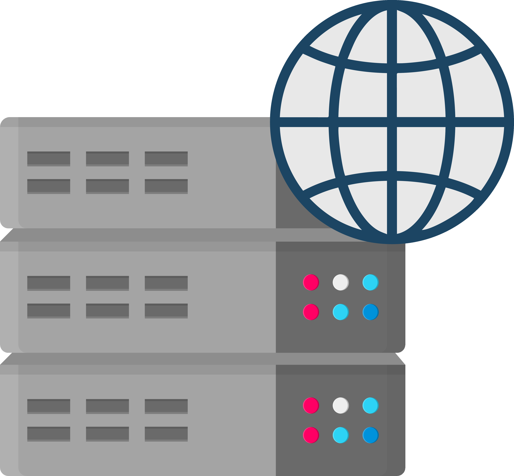
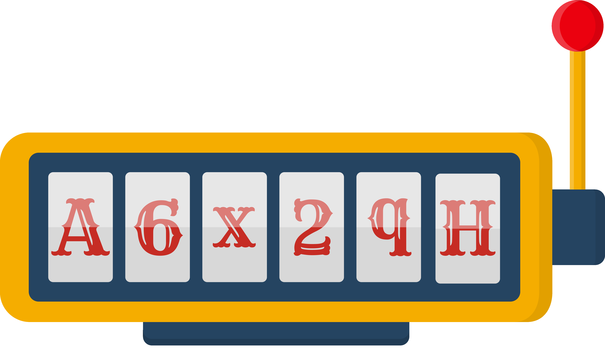
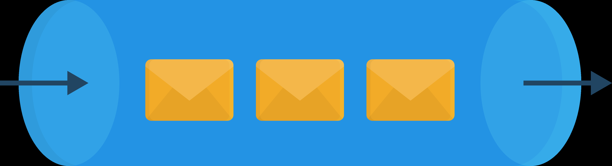
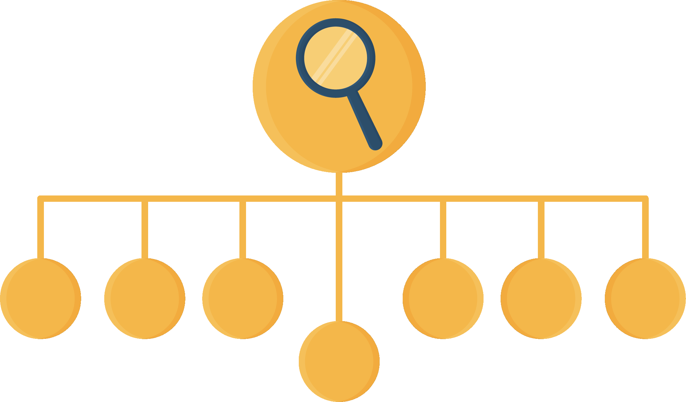
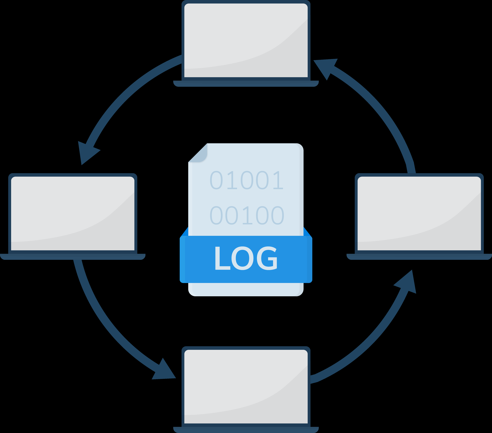

# 006 - Giới Thiệu Các Khối Xây Dựng Hệ Thống Hiện Đại

[← Bài trước](005-uoc-tinh-back-of-the-envelope.md) | [Mục lục](README.md) | [Bài tiếp theo →](007-domain-name-system-dns.md)

---

# Giới Thiệu Các Khối Xây Dựng Cho Thiết Kế Hệ Thống Hiện Đại (Introduction to Building Blocks for Modern System Design)

Tìm hiểu cách thiết kế hệ thống tương tự như việc sử dụng các mảnh ghép Lego để tạo nên những sản phẩm hoàn chỉnh lớn hơn và đầy ấn tượng.

Chúng ta sẽ tìm hiểu các nội dung sau:
* Phương pháp tiếp cận từ dưới lên (bottom-up approach) cho thiết kế hệ thống hiện đại
* Các quy ước (Conventions)

---

## Phương Pháp Tiếp Cận Từ Dưới Lên Cho Thiết Kế Hệ Thống Hiện Đại (The Bottom-Up Approach for Modern System Design)

Các bài toán thiết kế hệ thống (system design problems) thường có những điểm tương đồng nhất định, mặc dù các chi tiết cụ thể thường là duy nhất. Chúng tôi đã trích xuất các điểm tương đồng này qua các bài toán thiết kế để tạo thành các khối xây dựng cơ bản (basic building blocks) mà chúng ta sẽ tìm hiểu. Một ví dụ về khối xây dựng là thành phần cân bằng tải (load-balancing component), thành phần mà chúng ta có thể sẽ sử dụng trong mọi bài toán thiết kế theo cách này hay cách khác.

Mục đích của việc tách riêng các khối xây dựng là để thảo luận kỹ lưỡng về thiết kế của chúng **chỉ một lần duy nhất**. Điều này đồng nghĩa với việc sau này chúng ta có thể tái sử dụng chúng ở bất kỳ đâu mà không cần phải đi vào chi tiết lại từ đầu. Chúng ta có thể coi các khối xây dựng như những viên gạch để xây dựng nên các hệ thống hiệu quả hơn và mạnh mẽ hơn.

Nhiều khối xây dựng mà chúng ta thảo luận cũng có sẵn để sử dụng thực tế trên các nền tảng điện toán đám mây công cộng (public clouds) như Amazon Web Services (AWS), Azure và Google Cloud Platform (GCP). Chúng ta có thể sử dụng các cấu trúc (constructs) này để xây dựng một hệ thống nhằm củng cố sâu hơn sự hiểu biết của mình. *(Chúng tôi sẽ không xây dựng hệ thống thực tế trong khóa học này, nhưng đã để lại phần này như một bài tập thực hành cho những người học quan tâm).*

---

## Sử Dụng Các Khối Xây Dựng Để Xây Dựng Phương Pháp Tiếp Cận Từ Dưới Lên Cho Thiết Kế Hệ Thống (Using Building Blocks to Devise a Bottom-Up Approach for Designing Systems)

Chúng ta sẽ thảo luận chi tiết về các khối xây dựng sau đây:

### 1. Hệ Thống Phân Giải Tên Miền (Domain Name System - DNS)
Khối xây dựng này tập trung vào cách thiết kế các hệ thống đặt tên phân cấp (hierarchical) và phân tán (distributed) cho các máy tính kết nối Internet thông qua các giao thức Internet khác nhau.

---

### 2. Bộ Cân Bằng Tải (Load Balancers)
Tại đây, chúng ta sẽ tìm hiểu thiết kế của một bộ cân bằng tải (load balancer), thành phần được sử dụng để phân phối công bằng các yêu cầu (requests) gửi đến từ client giữa một nhóm các máy chủ khả dụng (pool of available servers). Nó cũng giúp giảm tải và có khả năng điều hướng bỏ qua các máy chủ bị lỗi (failed servers).

---

### 3. Cơ Sở Dữ Liệu (Databases)
Khối xây dựng này cho phép chúng ta lưu trữ (store), truy xuất (retrieve), sửa đổi (modify) và xóa (delete) dữ liệu liên quan đến các quy trình xử lý dữ liệu khác nhau. Tại đây, chúng ta sẽ thảo luận về các loại cơ sở dữ liệu, kỹ thuật nhân bản dữ liệu (replication), phân vùng dữ liệu (partitioning) và phân tích các cơ sở dữ liệu phân tán (distributed databases).

---

### 4. Kho Lưu Trữ Dữ Liệu Khóa - Giá Trị (Key-Value Store)
Đây là một cơ sở dữ liệu phi quan hệ (non-relational database) lưu trữ dữ liệu dưới dạng cặp khóa - giá trị (key-value pair). Tại đây, chúng ta sẽ giải thích thiết kế của một key-value store cùng với các khái niệm quan trọng như đạt được khả năng mở rộng (scalability), độ bền vững dữ liệu (durability), và khả năng cấu hình linh hoạt (configurability).

---

### 5. Mạng Phân Phối Nội Dung (Content Delivery Network - CDN)
Trong chương này, chúng ta sẽ thiết kế một mạng phân phối nội dung (CDN) được sử dụng để lưu giữ nội dung lan truyền (viral content) như video, hình ảnh, âm thanh và các trang web. Mạng này phân phối nội dung đến người dùng cuối một cách hiệu quả, đồng thời giảm độ trễ (latency) và giảm bớt gánh nặng tải cho các trung tâm dữ liệu (data centers).

---

### 6. Bộ Tạo Định Danh Tuần Tự (Sequencer / Unique IDs Generator)
Trong khối xây dựng này, chúng ta sẽ tập trung vào thiết kế của một bộ tạo định danh duy nhất (unique IDs generator) với trọng tâm chính là duy trì tính nhân quả / thứ tự trước sau (causality). Phần này cũng giải thích ba phương pháp khác nhau để sinh các ID duy nhất.

---

### 7. Giám Sát Dịch Vụ (Service Monitoring)
Hệ thống giám sát (monitoring systems) đóng vai trò sống còn trong các hệ thống phân tán vì chúng giúp phân tích hệ thống và cảnh báo cho các bên liên quan (stakeholders) nếu có sự cố xảy ra. Giám sát thường hữu ích để đóng vai trò như các hệ thống cảnh báo sớm, giúp các quản trị viên hệ thống có thể hành động đón đầu trước khi một sự cố tiềm ẩn trở thành một vấn đề nghiêm trọng. Tại đây, chúng ta sẽ xây dựng hai hệ thống giám sát: một cho lỗi phía máy chủ (server-side errors) và một cho lỗi phía máy khách (client-side errors).

---

### 8. Bộ Nhớ Đệm Phân Tán (Distributed Caching)
Trong khối xây dựng này, chúng ta sẽ thiết kế một hệ thống bộ nhớ đệm phân tán (distributed caching system), nơi nhiều máy chủ cache phối hợp với nhau để lưu trữ dữ liệu được truy cập thường xuyên.

---

### 9. Hàng Đợi Thông Điệp Phân Tán (Distributed Messaging Queue)
Trong khối xây dựng này, chúng ta sẽ tập trung vào thiết kế một hàng đợi gồm nhiều máy chủ, được sử dụng giữa các thực thể tương tác với nhau gọi là bên sản xuất (producers) và bên tiêu thụ (consumers). Nó giúp tách rời (decouple) producers và consumers, mang lại khả năng mở rộng độc lập (independent scalability) và tăng cường độ tin cậy (reliability).

---

### 10. Hệ Thống Xuất Bản - Đăng Ký (Publish-Subscribe System - Pub/Sub)
Trong khối xây dựng này, chúng ta sẽ tập trung vào thiết kế một phương thức giao tiếp dịch vụ - dịch vụ bất đồng bộ (asynchronous service-to-service communication method) gọi là hệ thống pub-sub. Phương thức này rất phổ biến trong kiến trúc không máy chủ (serverless), kiến trúc microservices và các hệ thống xử lý dữ liệu.

---

### 11. Bộ Giới Hạn Tốc Độ (Rate Limiter)
Tại đây, chúng ta sẽ thiết kế một hệ thống điều tiết (throttles) các yêu cầu gửi đến một dịch vụ dựa trên giới hạn được xác định trước. Hệ thống này thường được sử dụng như một lớp phòng thủ (defensive layer) cho các dịch vụ nhằm tránh việc sử dụng tài nguyên quá mức — dù là vô tình hay cố ý.

---

### 12. Kho Lưu Trữ Đối Tượng Lớn (Blob Store)
Khối xây dựng này tập trung vào giải pháp lưu trữ cho dữ liệu phi cấu trúc (unstructured data) — ví dụ: các tệp đa phương tiện (multimedia files) và các tệp nhị phân thực thi (binary executables).

---

### 13. Hệ Thống Tìm Kiếm Phân Tán (Distributed Search)
Một hệ thống tìm kiếm nhận truy vấn từ người dùng và trả về nội dung liên quan trong vài giây hoặc ít hơn. Khối xây dựng này tập trung vào ba thành phần không thể thiếu: thu thập dữ liệu (crawl), lập chỉ mục (index) và tìm kiếm (search).

---

### 14. Hệ Thống Ghi Log Phân Tán (Distributed Logging)
Ghi log là một thao tác tiêu tốn nhiều tài nguyên I/O (I/O intensive operation), tốn thời gian và chậm chạp. Tại đây, chúng ta sẽ thiết kế một hệ thống cho phép các dịch vụ trong một hệ thống phân tán có thể ghi lại các sự kiện của chúng một cách hiệu quả. Hệ thống sẽ được xây dựng để đảm bảo tính mở rộng (scalable) và độ tin cậy (reliable).

---

### 15. Điều Phối Tác Vụ Phân Tán (Distributed Task Scheduling)
Chúng ta sẽ thiết kế một hệ thống điều phối tác vụ phân tán (distributed task scheduler system) đóng vai trò trung gian giữa các tác vụ (tasks) và tài nguyên (resources). Hệ thống này phân bổ tài nguyên một cách thông minh cho các tác vụ để đáp ứng các mục tiêu ở cấp độ tác vụ (task-level) và cấp độ hệ thống (system-level). Nó thường được sử dụng để giảm tải các tác vụ xử lý ngầm (background processing) nhằm hoàn thành chúng một cách bất đồng bộ.

---

### 16. Bộ Đếm Phân Mảnh (Sharded Counters)
Khối xây dựng này trình bày một hệ thống đếm phân tán hiệu quả để xử lý hàng triệu yêu cầu đọc/ghi đồng thời (concurrent read/write requests), chẳng hạn như số lượt thích (likes) trên một dòng tweet của người nổi tiếng.

> [!NOTE]
> Chúng tôi đã sắp xếp các khối xây dựng theo thứ tự topo (topologically ordered) để các khối xây dựng phụ thuộc vào các khối khác sẽ xuất hiện ở phía sau.

---

## Các Quy Ước (Conventions)

Để làm rõ chi tiết, chúng tôi sẽ sử dụng một phần **“Yêu cầu” (Requirements)** bất cứ khi nào chúng ta thiết kế một khối xây dựng (và một bài toán thiết kế). Phần “Requirements” sẽ làm nổi bật các kết quả bàn giao (deliverables) mà chúng ta kỳ vọng từ bản thiết kế được phát triển. “Requirements” sẽ có hai danh mục con:

1. **Yêu cầu chức năng (Functional requirements):** Đại diện cho các tính năng mà người dùng của hệ thống được thiết kế sẽ có thể sử dụng. Ví dụ: hệ thống sẽ cho phép người dùng tìm kiếm nội dung bằng thanh tìm kiếm.
2. **Yêu cầu phi chức năng (Non-functional requirements - NFRs):** Các yêu cầu phi chức năng là các tiêu chí mà dựa vào đó người dùng của hệ thống sẽ đánh giá hệ thống có thể sử dụng được hay không. NFR có thể bao gồm các yêu cầu như tính sẵn sàng cao (High Availability), độ trễ thấp (Low Latency), khả năng mở rộng (Scalability), v.v.

Hãy cùng bắt đầu với các khối xây dựng của chúng ta!

---

[← Bài trước](005-uoc-tinh-back-of-the-envelope.md) | [Mục lục](README.md) | [Bài tiếp theo →](007-domain-name-system-dns.md)
