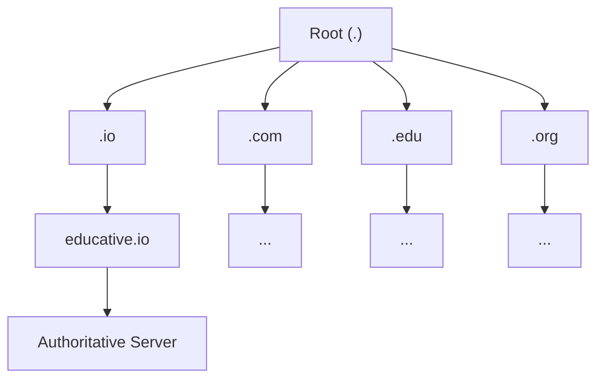
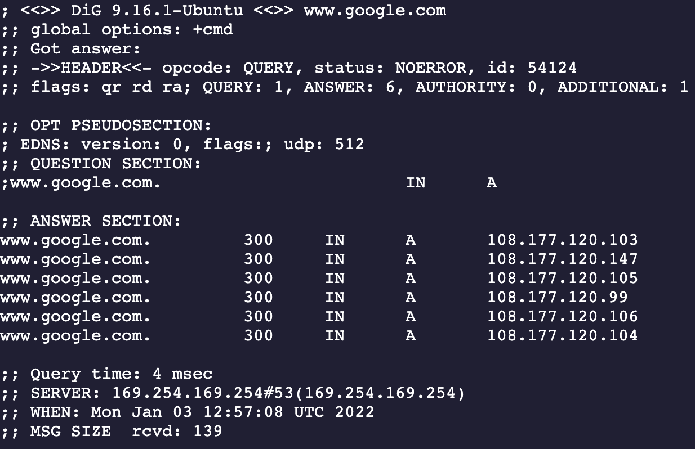
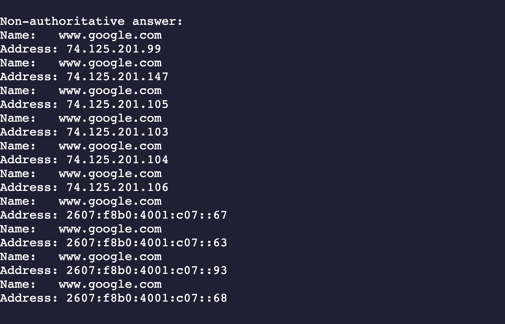

# 007 - Hệ Thống Phân Giải Tên Miền (Domain Name System - DNS)

[← Bài trước](006-gioi-thieu-building-blocks.md) | [Mục lục](README.md) | [Bài tiếp theo →](008-can-bang-tai-load-balancers.md)

---

# Giới Thiệu Về Hệ Thống Phân Giải Tên Miền (Introduction to Domain Name System - DNS)

Tìm hiểu cách các tên miền (domain names) được phân giải thành địa chỉ IP (IP addresses) thông qua hệ thống DNS.

**Chúng ta sẽ tìm hiểu các nội dung sau:**
* **Nguồn gốc ra đời của DNS (The origins of DNS)**
* **DNS là gì? (What is DNS?)**
* **Các chi tiết quan trọng (Important details)**

---

## Nguồn Gốc Ra Đời Của DNS (The Origins of DNS)

Hãy xem xét ví dụ về một chiếc điện thoại di động, nơi mỗi người dùng gắn liền với một số điện thoại duy nhất. Để gọi điện cho bạn bè, ban đầu chúng ta có thể cố gắng ghi nhớ một vài số điện thoại. Tuy nhiên, khi số lượng liên hệ ngày càng tăng lên, chúng ta bắt buộc phải sử dụng danh bạ điện thoại (phone book) để theo dõi và quản lý toàn bộ danh sách liên hệ của mình. Bằng cách này, bất cứ khi nào cần thực hiện cuộc gọi, chúng ta chỉ việc tra cứu danh bạ điện thoại và bấm số cần gọi.

Tương tự như vậy, các máy tính trên mạng được định danh duy nhất thông qua các **địa chỉ IP (IP addresses)** — ví dụ: `104.18.2.119` là một địa chỉ IP. Chúng ta sử dụng địa chỉ IP để truy cập vào một trang web được lưu trữ (hosted) trên một máy chủ cụ thể. Bởi vì con người không thể dễ dàng ghi nhớ các dãy địa chỉ IP để truy cập các tên miền (ví dụ tên miền là `educative.io`), chúng ta cần một kho lưu trữ tương tự như một cuốn danh bạ điện thoại để duy trì toàn bộ ánh xạ (mapping) từ tên miền sang địa chỉ IP. 

Trong chương này, chúng ta sẽ tìm hiểu cách thức DNS đóng vai trò như một cuốn "danh bạ điện thoại" của toàn bộ mạng Internet.

---

### Sử Dụng Phép Tương Ký Danh Bạ Điện Thoại Để Hiểu Về Hệ Thống Phân Giải Tên Miền (Using a phone book analogy to understand domain name system - DNS)

*Ghi (Write) / Đọc (Read) / Gọi (Call): Người A (`+123456789`) và Người B (`+234567890`). Sử dụng danh bạ điện thoại (phone book) để tra cứu số giữa Người gọi (Caller) và Người nhận (Callee).*

*Sử dụng danh bạ điện thoại để lấy số điện thoại (Using a phone book to get numbers).*

*Sử dụng DNS để lấy địa chỉ IP (Using DNS to obtain IP address).*

*Truy vấn (Query) và Phản hồi (Response) giữa Client và DNS.*

*Quy trình tương tác giữa Client, hệ thống DNS và Website đích.*

*Ánh xạ từ tên miền `www.educative.io` sang địa chỉ IP `104.18.2.119`.*

---

## DNS Là Gì? (What is DNS?)

**Hệ thống phân giải tên miền (Domain Name System - DNS)** là dịch vụ đặt tên của Internet, thực hiện nhiệm vụ ánh xạ các tên miền thân thiện với con người (human-friendly domain names) thành các địa chỉ IP mà máy móc có thể đọc và hiểu được (machine-readable IP addresses). 

> [!NOTE]
> Dịch vụ DNS hoạt động hoàn toàn **trong suốt đối với người dùng (transparent to users)**. 

Khi người dùng nhập một tên miền vào trình duyệt web, trình duyệt phải dịch tên miền đó sang địa chỉ IP tương ứng bằng cách gửi yêu cầu truy vấn tới **hạ tầng DNS (DNS infrastructure)**. Sau khi nhận được địa chỉ IP mong muốn, yêu cầu của người dùng mới được chuyển tiếp đến máy chủ web đích (destination web server).

---

### Quy Trình Hoạt Động Cấp Cao Của DNS (High-Level Working Flow of DNS)

Các slide dưới đây minh họa luồng hoạt động cấp cao của hệ thống DNS:

#### Bước 1: Người dùng gửi yêu cầu truy cập website
Người dùng yêu cầu truy cập một trang web bằng cách nhập địa chỉ URL của trang web đó vào trình duyệt.

*(Slide 1 of 7: The user requests to visit a website by entering its URL in the browser)*

*(Chi tiết các thành phần: User, Browser, URL `educative.io`)*

*(Các đối tượng tham gia: Trình duyệt, Nhà cung cấp dịch vụ mạng - ISP, Hạ tầng DNS và Web server đích)*

*(Tổng quan kiến trúc khởi tạo phiên yêu cầu)*

---

#### Bước 2: Trình duyệt gửi truy vấn DNS tới ISP
Trình duyệt yêu cầu Nhà cung cấp dịch vụ Internet (Internet Service Provider - ISP) chuyển tiếp truy vấn DNS (DNS query) để phân giải yêu cầu lấy địa chỉ IP tương ứng.

*(Slide 2 of 7: The browser requests the ISP to forward the DNS query to resolve the request for the IP address)*

*(Browser phát sinh gói tin DNS query chuyển tới ISP)*

---

#### Bước 3: ISP chuyển tiếp truy vấn đến hạ tầng DNS
ISP chuyển tiếp truy vấn DNS (DNS query) đến hạ tầng phân giải tên miền (DNS infrastructure).

*(Slide 3 of 7: The ISP forwards the DNS query to the DNS infrastructure)*

*(Quá trình chuyển tiếp Forwarding query từ ISP sang DNS infrastructure)*

---

#### Bước 4: Hạ tầng DNS phản hồi danh sách địa chỉ IP
Hạ tầng DNS phản hồi lại một danh sách các địa chỉ IP (List of IP addresses: IP 1, IP 2, IP 3) tương ứng với tên miền được truy vấn.

*(Slide 4 of 7: The DNS infrastructure responds with a list of IP addresses against the domain name)*

> [!TIP]
> Việc hạ tầng DNS trả về một **danh sách nhiều địa chỉ IP (List of IP addresses)** thay vì chỉ một địa chỉ duy nhất là một kỹ thuật phổ biến để thực hiện cân bằng tải (DNS Round-Robin Load Balancing) và tăng tính sẵn sàng cao (High Availability) cho hệ thống phân tán.

---

# Hệ Thống Phân Giải Tên Miền (Domain Name System - DNS)

---

### Trang 7

* **IP 1**
* **IP 2**
* **IP 3**
* **ISP** (Nhà cung cấp dịch vụ Internet - Internet Service Provider)
* **Người dùng** (User)
* **Truy vấn DNS** (DNS query)
* **Hạ tầng DNS** (DNS infrastructure)
* **Chuyển tiếp truy vấn** (Forwarding query)
* **Trình duyệt** (Browser)
* `educative.io`
* **Danh sách địa chỉ IP** (List of IP addresses)
* **Danh sách IP** (IP list)
* **Máy chủ Web** (Web server)

> **(Các) địa chỉ IP đến được trình duyệt**  
> *5 trên 7*

---

### Trang 8

* **IP 1**
* **IP 2**
* **IP 3**
* **ISP**
* **Người dùng** (User)
* **Truy vấn DNS** (DNS query)
* **Hạ tầng DNS** (DNS infrastructure)
* **Chuyển tiếp truy vấn** (Forwarding query)
* **Trình duyệt** (Browser)
* `educative.io`
* **Danh sách địa chỉ IP** (List of IP addresses)
* **Danh sách IP** (IP list)
* **Yêu cầu HTTP** (HTTP request)
* **Máy chủ Web** (Web server)

> **Trình duyệt gửi một yêu cầu HTTP (HTTP request) đến địa chỉ IP đã nhận được**  
> *6 trên 7*

---

### Trang 9

* **IP 1**
* **IP 2**
* **IP 3**
* **ISP**
* **Người dùng** (User)
* **Truy vấn DNS** (DNS query)
* **Hạ tầng DNS** (DNS infrastructure)
* **Chuyển tiếp truy vấn** (Forwarding query)
* **Trình duyệt** (Browser)
* `educative.io`
* **Danh sách địa chỉ IP** (List of IP addresses)
* **Danh sách IP** (IP list)
* **Yêu cầu HTTP** (HTTP request)
* **Máy chủ Web** (Web server)
* **Yêu cầu HTTP** (HTTP request)

> **ISP chuyển tiếp yêu cầu HTTP (HTTP request) đến máy chủ web**  
> *7 trên 7*

Toàn bộ hoạt động này được thực thi cực kỳ nhanh chóng. Do đó, người dùng cuối (end user) chỉ trải qua độ trễ tối thiểu (minimum delay). Chúng ta cũng sẽ tìm hiểu cách các trình duyệt lưu lại một số ánh xạ thường dùng để sử dụng lại sau này trong bài học tiếp theo.

### Các chi tiết quan trọng (Important details)

Hãy cùng điểm qua một số chi tiết quan trọng về **DNS**, một vài nội dung trong số này sẽ được trình bày sâu hơn ở bài học kế tiếp:

* **Máy chủ tên miền (Name servers):** Điều quan trọng cần hiểu là DNS không phải là một máy chủ đơn lẻ (single server). Nó là một hạ tầng hoàn chỉnh với vô số máy chủ. Các máy chủ DNS phản hồi truy vấn của người dùng được gọi là **name servers**.
* **Bản ghi tài nguyên (Resource records):** Cơ sở dữ liệu DNS lưu trữ các ánh xạ từ tên miền sang địa chỉ IP...

---

### Trang 10

...dưới dạng các **bản ghi tài nguyên (Resource Records - RR)**. RR là đơn vị thông tin nhỏ nhất mà người dùng yêu cầu từ các name server. Có nhiều loại RR khác nhau. Bảng dưới đây mô tả các RR phổ biến. Ba mẩu thông tin quan trọng nhất là **loại (type)**, **tên (name)**, và **giá trị (value)**. Tên và giá trị sẽ thay đổi tùy thuộc vào loại của RR.

#### Các loại bản ghi tài nguyên phổ biến (Common Types of Resource Records)

| Loại (Type) | Mô tả (Description) | Tên (Name) | Giá trị (Value) |
| :--- | :--- | :--- | :--- |
| **A** | Cung cấp ánh xạ từ hostname sang địa chỉ IP (hostname to IP address mapping) | Hostname | Địa chỉ IP (IP address) |
| **NS** | Cung cấp hostname là DNS có thẩm quyền (authoritative DNS) cho một tên miền | Tên miền (Domain name) | Hostname |
| **CNAME** | Cung cấp ánh xạ từ bí danh (alias) sang hostname chính danh (canonical hostname) | Hostname | Tên chính danh (Canonical name) |
| **MX** | Cung cấp ánh xạ của máy chủ thư điện tử (mail server) từ bí danh sang hostname chính danh | Hostname | Tên chính danh (Canonical name) |

* **Bộ nhớ đệm (Caching):** DNS sử dụng cơ chế lưu vào bộ nhớ đệm (**Caching**) ở các tầng khác nhau nhằm giảm độ trễ yêu cầu (**request latency**) cho người dùng. Caching đóng vai trò quan trọng trong việc giảm tải áp lực lên hạ tầng DNS, vì nó phải phục vụ các truy vấn của toàn bộ mạng Internet.
* **Cấu trúc phân cấp (Hierarchy):** Các máy chủ tên miền DNS được tổ chức theo mô hình phân cấp (**hierarchical form**). Cấu trúc phân tầng này cho phép DNS đạt khả năng mở rộng quy mô cao (**High Scalability**) trước kích thước dữ liệu và tải truy vấn ngày càng tăng. Trong bài học tiếp theo, chúng ta sẽ tìm hiểu cách cấu trúc dạng cây (tree-like structure) được sử dụng để quản lý toàn bộ cơ sở dữ liệu DNS.

Hãy cùng khám phá chi tiết hơn về các điểm nêu trên trong bài học tiếp theo để nắm bắt rõ ràng hơn.

---

### Trang 11

* **Quay lại** (Back): Giới thiệu về các Khối xây dựng (Building Blocks) cho... (Introduction to Building Blocks for M…)
* **Đánh dấu là hoàn thành** (Mark As Completed)
* **Tiếp theo** (Next): Cách Hệ Thống Phân Giải Tên Miền Hoạt Động (How the Domain Name System Wor…)

---

### Trang 12

# Cách Hệ Thống Phân Giải Tên Miền Hoạt Động (How the Domain Name System Works)

Hiểu rõ chi tiết nguyên lý hoạt động của hệ thống phân giải tên miền.

#### Chúng ta sẽ đề cập đến các nội dung sau:
* **Hệ thống phân cấp DNS (DNS hierarchy)**
* **Phân giải truy vấn lặp so với đệ quy (Iterative versus recursive query resolution)**
* **Bộ nhớ đệm (Caching)**
* **DNS dưới góc độ một hệ thống phân tán (DNS as a distributed system)**
  * Khả năng mở rộng cao (**Highly scalable**)
  * Độ tin cậy cao (**Reliable**)
  * Tính nhất quán (**Consistent**)
* **Thực hành kiểm tra (Test it out)**
  * Kết quả đầu ra của `nslookup` (The nslookup output)
  * Kết quả đầu ra của `dig` (The dig output)

#### Xuyên suốt bài học này, chúng ta sẽ trả lời các câu hỏi sau:
1. Hệ thống phân cấp DNS được hình thành như thế nào thông qua việc sử dụng các loại máy chủ tên miền DNS (DNS name servers) khác nhau?
2. Quá trình lưu bộ nhớ đệm (**caching**) được thực hiện như thế nào ở các cấp độ khác nhau của Internet để giảm tải truy vấn cho hạ tầng DNS?
3. Bản chất phân tán (**distributed nature**) của hạ tầng DNS hỗ trợ tính bền bỉ và vững chắc (**robustness**) của nó ra sao?

Hãy cùng bắt đầu.

### Hệ thống phân cấp DNS (DNS hierarchy)

Như đã đề cập trước đó, DNS không phải là một máy chủ đơn lẻ tiếp nhận các yêu cầu và phản hồi các truy vấn của người dùng. Nó là một cơ sở hạ tầng hoàn chỉnh bao gồm các máy chủ tên miền (name servers) được tổ chức ở các cấp phân bậc khác nhau.

---

# Hệ Thống Phân Giải Tên Miền (Domain Name System - DNS)

Chủ yếu có bốn loại máy chủ (servers) trong cấu trúc phân cấp DNS:

1. **DNS Resolver (Trình phân giải DNS):** Các Resolver khởi tạo chuỗi truy vấn và chuyển tiếp (forward) các yêu cầu đến các máy chủ tên miền DNS khác. Thông thường, DNS resolver nằm trong phạm vi mạng của người dùng. Tuy nhiên, DNS resolver cũng có thể phục vụ các truy vấn DNS của người dùng thông qua các kỹ thuật bộ nhớ đệm (caching techniques), như chúng ta sẽ thấy ngay sau đây. Các máy chủ này cũng có thể được gọi là máy chủ cục bộ (local servers) hoặc máy chủ mặc định (default servers).
2. **Root-level name servers (Máy chủ tên miền cấp gốc / Root Name Server):** Các máy chủ này nhận yêu cầu từ các máy chủ cục bộ. Root name server duy trì các máy chủ tên miền dựa trên tên miền cấp cao nhất (Top-Level Domain - TLD), chẳng hạn như `.com`, `.edu`, `.us`, v.v. Ví dụ: khi người dùng yêu cầu địa chỉ IP của `educative.io`, các root-level name server sẽ trả về một danh sách các máy chủ TLD nắm giữ các địa chỉ IP của tên miền `.io`.
3. **Top-level domain (TLD) name servers (Máy chủ tên miền cấp cao nhất):** Các máy chủ này nắm giữ địa chỉ IP của các máy chủ tên miền có thẩm quyền (authoritative name servers). Bên truy vấn sẽ nhận được một danh sách các địa chỉ IP thuộc về các máy chủ có thẩm quyền của tổ chức.
4. **Authoritative name servers (Máy chủ tên miền có thẩm quyền):** Đây là các máy chủ tên miền DNS của chính tổ chức đó, cung cấp địa chỉ IP của các máy chủ web (web servers) hoặc máy chủ ứng dụng (application servers).

---

### Phân cấp DNS để phân giải tên miền/tên máy chủ (DNS hierarchy for resolution of domain/host names)

* **Root (Gốc)**
* **TLD:** `.com`, `.edu`, `.io`, `.org`, ...
* **Authoritative (Có thẩm quyền):** `educative.io`, ...

---

> [!NOTE]
> ### Điểm Cần Suy Ngẫm (Point to Ponder)
> **Câu hỏi:**
> Các tên miền DNS được xử lý như thế nào? Ví dụ: `educative.io` sẽ được xử lý từ trái sang phải hay từ phải sang trái?
>
> **Trả lời:**
> Không giống như đường dẫn tệp UNIX được xử lý từ trái sang phải, tên DNS được **xử lý từ phải sang trái**. Trong trường hợp của `educative.io`, các bộ phân giải (resolvers) trước tiên sẽ phân giải phần `.io`, sau đó đến `educative`, và cứ tiếp tục như vậy. 
> Tuy nhiên, về mặt trực quan, cấu trúc phân cấp DNS có thể được xem như một cấu trúc cây (tree).

---

## Phân giải truy vấn lặp so với đệ quy (Iterative versus recursive query resolution)

Có hai cách để thực hiện một truy vấn DNS:

1. **Iterative (Truy vấn lặp):** Máy chủ cục bộ (local server) lần lượt gửi yêu cầu đến máy chủ Root, máy chủ TLD, và máy chủ Authoritative để lấy địa chỉ IP.
2. **Recursive (Truy vấn đệ quy):** Người dùng cuối (end user) gửi yêu cầu đến máy chủ cục bộ. Máy chủ cục bộ tiếp tục gửi yêu cầu đến các máy chủ tên miền Root DNS. Sau đó, các máy chủ Root DNS sẽ chuyển tiếp yêu cầu đến các máy chủ tên miền khác thay cho client.

Trong minh họa sau (ở bên trái), việc phân giải truy vấn DNS là lặp (iterative) theo góc nhìn của máy chủ local/ISP:

### Truy vấn Lặp so với Truy vấn Đệ quy (Iterative versus recursive query)

> [!TIP]
> **Lưu ý:** Thông thường, **truy vấn lặp (iterative query)** được ưu tiên hơn để giảm tải khối lượng truy vấn (query load) lên hạ tầng DNS cốt lõi.

Hiện nay, chúng ta sẽ thấy rất nhiều nhà cung cấp DNS resolver công cộng (public DNS resolvers) bên thứ ba được cung cấp bởi Google (8.8.8.8), Cloudflare (1.1.1.1), OpenDNS và nhiều bên khác. Một thực tế thú vị là các máy chủ DNS công cộng này có thể cung cấp phản hồi nhanh hơn các hạ tầng DNS của các nhà mạng ISP nội địa.

---

## Bộ Nhớ Đệm (Caching)

**Caching (Lưu bộ nhớ đệm)** đề cập đến việc lưu trữ tạm thời các bản ghi tài nguyên (resource records) được yêu cầu thường xuyên. Một bản ghi tài nguyên (resource record) là một đơn vị dữ liệu bên trong cơ sở dữ liệu DNS thể hiện liên kết giữa tên và giá trị (name-to-value binding). 

Caching giúp giảm thời gian phản hồi (Latency/Response time) tới người dùng và giảm lưu lượng mạng (Network traffic). Khi chúng ta sử dụng bộ nhớ đệm ở các tầng phân cấp khác nhau, nó có thể giảm tải rất nhiều gánh nặng truy vấn lên toàn bộ cơ sở hạ tầng DNS. Caching có thể được triển khai tại:
- Trình duyệt (Browser)
- Hệ điều hành (Operating Systems - OS)
- Máy chủ tên miền cục bộ (Local name server) bên trong mạng của người dùng
- Các bộ phân giải DNS của nhà cung cấp dịch vụ mạng (ISP's DNS resolvers)

---

### Cơ chế hoạt động của Caching trong DNS qua từng bước

Chuỗi hình ảnh dưới đây minh họa sức mạnh của cơ chế Caching trong DNS:

#### Bước 1: Cache Hit tại Trình duyệt (Browser)
Người dùng yêu cầu truy cập một URL, và trình duyệt đã lưu trong bộ nhớ đệm ánh xạ từ tên miền sang địa chỉ IP.

*Trạng thái: 1 of 7*

---

#### Bước 2: Cache Miss tại Trình duyệt, chuyển sang OS
Dưới đây là những gì xảy ra nếu trình duyệt chưa lưu bộ nhớ đệm ánh xạ tên miền sang địa chỉ IP (`Cache miss`). Tầng phân cấp tiếp theo có thể có ánh xạ này là Hệ điều hành (OS).

*Trạng thái: 2 of 7*

---

#### Bước 3: Cache Miss tại OS, chuyển sang Local DNS Resolver
Nếu OS không có ánh xạ (`Cache miss`), trình phân giải DNS cục bộ (Local DNS resolver) có thể có phản hồi được lưu trong bộ nhớ đệm (`Cache hit`).

*Trạng thái: 3 of 7*

---

#### Bước 4: Cache Miss tại Local DNS Resolver, chuyển sang ISP
Nếu trình phân giải DNS cục bộ không có ánh xạ (`Cache miss`), nhà mạng (ISP) có thể có phản hồi được lưu trong bộ nhớ đệm (`Cache hit`).

*Trạng thái: 4 of 7*

---

#### Bước 5: Cache Miss toàn bộ, truy vấn Hạ tầng DNS (DNS Infrastructure)
Cuối cùng, nếu tất cả các tầng đệm đều trượt (`Cache miss`), yêu cầu sẽ được chuyển đến cơ sở hạ tầng DNS (DNS infrastructure) và cơ sở hạ tầng DNS sẽ phản hồi với địa chỉ IP.

*Trạng thái: 5 of 7*

---

#### Bước 6: Cập nhật Cache tại tất cả các cấp bậc phân cấp (Update Cache)
Sau khi nhận được phản hồi địa chỉ IP từ hạ tầng DNS, bộ nhớ đệm sẽ được cập nhật (Update cache) tại từng cấp bậc phân cấp: ISP, Local DNS resolver, OS và Trình duyệt.

*Trạng thái: 6 of 7*

---

# 007 - Hệ Thống Phân Giải Tên Miền (Domain Name System - DNS)

### Cơ Chế Cache Tại Trình Duyệt (Browser Cache)

* **Trình duyệt (Browser)**: `educative.io`
* **Trúng bộ nhớ đệm (Cache hit)**
* **Gửi lại yêu cầu (Request again)**
* **Bộ nhớ đệm đã được cập nhật (Updated cache)**
* Trình duyệt hiện đã có bộ nhớ đệm được cập nhật, do đó yêu cầu của người dùng sẽ được xử lý trực tiếp tại cục bộ (locally).
* **7 trên 7 (7 of 7)**

> [!NOTE]
> Ngay cả khi không có sẵn bản ghi trong bộ nhớ đệm (cache) để giải quyết truy vấn của người dùng và bắt buộc phải truy cập vào hạ tầng DNS, việc lưu bộ nhớ đệm (caching) vẫn mang lại nhiều lợi ích. Máy chủ cục bộ (local server) hoặc máy chủ phân giải DNS của nhà cung cấp dịch vụ Internet (ISP DNS resolver) có thể lưu tạm địa chỉ IP của các máy chủ TLD (Top-Level Domain) hoặc máy chủ có thẩm quyền (authoritative servers), từ đó tránh được việc phải gửi yêu cầu lên máy chủ cấp gốc (root-level server).

---

## DNS Dưới Góc Nhìn Của Một Hệ Thống Phân Tán (DNS as a Distributed System)

Mặc dù cấu trúc phân cấp DNS tạo điều kiện thuận lợi cho mạng Internet phân tán mà chúng ta biết ngày nay, nhưng bản thân nó cũng chính là một **hệ thống phân tán (distributed system)**. Bản chất phân tán của DNS mang lại các ưu điểm sau:

* **Tránh trở thành điểm lỗi đơn lẻ (Single Point of Failure - SPOF).**
* **Đạt được độ trễ truy vấn thấp (Low Query Latency):** Nhờ đó người dùng có thể nhận được phản hồi từ các máy chủ ở gần về mặt địa lý.
* **Đạt mức độ linh hoạt cao hơn trong quá trình bảo trì và cập nhật hoặc nâng cấp:** Ví dụ, nếu một máy chủ DNS bị sập (down) hoặc quá tải (overburdened), một máy chủ DNS khác có thể đứng ra phản hồi các truy vấn của người dùng.

Hiện có **13 máy chủ tên miền gốc logic (logical root name servers)** (được đặt tên từ chữ cái A đến M) với hàng loạt phiên bản thực thi (instances) được phân bổ rộng khắp toàn cầu. Các máy chủ này được quản lý bởi **12 tổ chức khác nhau**.

Hãy cùng xem xét cách DNS đạt được các đặc tính: **Khả năng mở rộng cao (Scalability)**, **Độ tin cậy (Reliability)** và **Tính nhất quán (Consistency)**.

---

### Khả Năng Mở Rộng Cao (Highly Scalable)

Nhờ vào cấu trúc phân cấp, DNS là một hệ thống có khả năng mở rộng cực kỳ cao (highly scalable system). Khoảng 1.000 phiên bản nhân bản (replicated instances) của 13 máy chủ cấp gốc (root-level servers) được phân bổ chiến lược trên khắp thế giới để xử lý truy vấn của người dùng. 

Khối lượng công việc được phân chia giữa các máy chủ TLD và máy chủ Root để tiếp nhận xử lý truy vấn; cuối cùng là các máy chủ có thẩm quyền (authoritative servers) do chính các tổ chức tự quản lý để vận hành toàn bộ hệ thống. Như đã thể hiện trong cây phân cấp DNS ở trên, các dịch vụ khác nhau sẽ đảm nhiệm các phần khác nhau của cây phân cấp, mang lại khả năng mở rộng (scalability) và khả năng quản lý (manageability) cho toàn bộ hệ thống.

---

### Độ Tin Cậy Cao (Reliable)

Có ba lý do chính giúp DNS trở thành một hệ thống đáng tin cậy:

1. **Lưu bộ nhớ đệm (Caching):** Việc lưu cache được thực hiện tại trình duyệt, hệ điều hành và máy chủ tên miền cục bộ (local name server); bên cạnh đó, các bộ phân giải DNS của ISP (ISP DNS resolvers) cũng duy trì một lượng bộ nhớ đệm phong phú cho các dịch vụ thường xuyên được truy cập. Ngay cả khi một số máy chủ DNS tạm thời bị sập (down), các bản ghi đã lưu trong bộ nhớ đệm vẫn có thể được phục vụ, giúp DNS duy trì tính tin cậy.
2. **Nhân bản máy chủ (Server Replication):** DNS có các bản sao nhân bản của từng máy chủ logic được phân bổ một cách có hệ thống trên toàn cầu nhằm đáp ứng các yêu cầu của người dùng với độ trễ thấp (low latency). Các máy chủ dự phòng (redundant servers) giúp nâng cao độ tin cậy của toàn bộ hệ thống.
3. **Giao thức (Protocol):** Mặc dù nhiều client phụ thuộc vào giao thức UDP (User Datagram Protocol) vốn không đảm bảo độ tin cậy kết nối để gửi yêu cầu và nhận phản hồi DNS, nhưng điều quan trọng là phải thừa nhận rằng UDP mang lại những lợi thế rõ rệt:
   * UDP nhanh hơn rất nhiều, và do đó cải thiện hiệu năng của DNS.
   * Hơn nữa, độ tin cậy của dịch vụ mạng Internet đã được cải thiện đáng kể kể từ khi ra đời, vì vậy UDP thường được ưu tiên hơn TCP.
   * Bộ phân giải DNS (DNS resolver) có thể gửi lại yêu cầu UDP nếu không nhận được phản hồi cho yêu cầu trước đó.
   * Chu trình yêu cầu - phản hồi này chỉ cần **một vòng khứ hồi (one round trip)**, mang lại độ trễ ngắn hơn so với TCP - vốn yêu cầu quá trình bắt tay 3 bước (three-way handshake) trước khi truyền dữ liệu.

---

> [!IMPORTANT]
> **Điểm Cần Suy Ngẫm (Point to Ponder)**
> 
> **Câu hỏi:** Điều gì sẽ xảy ra nếu mạng bị tắc nghẽn (congested network)? Liệu DNS có nên tiếp tục sử dụng UDP hay không?
> 
> **Trả lời:**
> Thông thường, DNS sử dụng UDP. Tuy nhiên, DNS có thể chuyển sang sử dụng TCP khi kích thước thông điệp vượt quá kích thước gói tin ban đầu là **512 Bytes**. Điều này là do các gói tin có kích thước lớn dễ bị hư hại hoặc mất mát hơn trong các mạng bị nghẽn. 
> 
> Ngoài ra, DNS **luôn luôn sử dụng TCP** cho các tác vụ truyền vùng dữ liệu (zone transfers). 
> 
> Một số client cũng ưu tiên DNS qua TCP (DNS over TCP) để áp dụng cơ chế bảo mật tầng truyền tải (Transport Layer Security - TLS) vì lý do riêng tư.

---

### Tính Nhất Quán (Consistent)

DNS sử dụng nhiều giao thức khác nhau để cập nhật và truyền tải thông tin giữa các máy chủ nhân bản (replicated servers) trong hệ thống phân cấp. 

DNS đánh đổi tính nhất quán mạnh (strong consistency) để đạt được hiệu năng cao (high performance), bởi vì dữ liệu từ cơ sở dữ liệu DNS được **đọc thường xuyên hơn rất nhiều so với ghi**. 

Tuy nhiên, DNS cung cấp **tính nhất quán cuối cùng (eventual consistency)** và cập nhật các bản ghi trên các máy chủ nhân bản theo cơ chế lười (lazily update). Thông thường, có thể mất từ vài giây cho đến ba ngày để cập nhật xong các bản ghi trên các máy chủ DNS trên toàn mạng Internet. Thời gian lan truyền thông tin (propagation time) giữa các cụm DNS khác nhau phụ thuộc vào:
* Hạ tầng DNS.
* Kích thước của bản cập nhật.
* Phần nào của cây phân cấp DNS đang được cập nhật.

Tính nhất quán cũng có thể bị ảnh hưởng bởi cơ chế lưu bộ nhớ đệm (caching). Vì các máy chủ có thẩm quyền (authoritative servers) đặt tại nội bộ tổ chức, nên có khả năng một số bản ghi tài nguyên (resource records) nhất định đã được cập nhật trên máy chủ có thẩm quyền khi xảy ra lỗi máy chủ tại tổ chức. Do đó, các bản ghi được lưu tạm tại máy chủ mặc định/cục bộ (default/local servers) và máy chủ ISP có thể đã bị lỗi thời (outdated). 

Để giảm thiểu vấn đề này, mỗi bản ghi được lưu trong bộ nhớ đệm đều đi kèm với một khoảng thời gian hết hạn gọi là **thời gian sống (Time-To-Live - TTL)**.

---

> [!TIP]
> **Điểm Cần Suy Ngẫm (Point to Ponder)**
> 
> **Câu hỏi:** Để duy trì tính sẵn sàng cao (High Availability), giá trị TTL nên đặt lớn hay nhỏ?
> 
> **Trả lời:**
> Để duy trì tính sẵn sàng cao (High Availability), giá trị TTL **nên đặt nhỏ**. 
> 
> Nguyên nhân là vì nếu bất kỳ máy chủ hoặc cụm máy chủ nào gặp sự cố, tổ chức có thể cập nhật các bản ghi tài nguyên ngay lập tức. Người dùng sẽ chỉ gặp phải tình trạng không khả dụng trong khoảng thời gian TTL chưa hết hạn. 
> 
> Ngược lại, nếu giá trị TTL lớn, tổ chức đã cập nhật các bản ghi tài nguyên của mình nhưng người dùng vẫn tiếp tục ping/truy vấn tới máy chủ đã lỗi thời và bị sập từ lâu.
> 
> Các công ty hướng tới tính sẵn sàng cao (High Availability) thường duy trì giá trị TTL thấp ở mức **120 giây**. Do đó, ngay cả trong trường hợp xảy ra sự cố, thời gian chết (downtime) tối đa chỉ là vài phút.

---

## Thực Hành Thử Nghiệm (Test it out)

Hãy thực thi một vài câu lệnh. Nhấp vào terminal để chạy các lệnh bên dưới. Sao chép các lệnh sau vào terminal để chạy và quan sát kết quả đầu ra (output) của chúng:

1. `nslookup www.google.com`
2. `dig www.google.com`

### Terminal 1
* **Terminal**
* Bộ slide trình chiếu sau đây sẽ làm nổi bật một số khía cạnh quan trọng của kết quả đầu ra từ lệnh `nslookup` và `dig`.
* *Click to Connect...*

---

* **Phản hồi từ bộ nhớ đệm (Cached response)**
* Kết quả đầu ra của lệnh `nslookup www.google.com`
* **1 trên 2 (1 of 2)**

* **TTL (Time-To-Live)**
* **Thời gian phản hồi DNS (DNS response time)**
* Kết quả đầu ra của lệnh `dig www.google.com`

---

### **--- Trang 25 ---**

**2 trên 2**

Hãy cùng phân tích ý nghĩa của kết quả đầu ra:

#### **Kết quả đầu ra từ lệnh `nslookup` (The nslookup output)**

**Non-authoritative answer** (Câu trả lời không có thẩm quyền), đúng như tên gọi của nó, là câu trả lời được cung cấp bởi một máy chủ không phải là máy chủ có thẩm quyền (**authoritative server**) của Google. Máy chủ này không nằm trong danh sách các máy chủ định danh có thẩm quyền (**authoritative nameservers**) do Google duy trì. Vậy, câu trả lời này đến từ đâu? 

Câu trả lời được cung cấp bởi các máy chủ định danh trung gian thứ cấp, tam cấp và tứ cấp (second, third, and fourth-hand name servers) được cấu hình để phản hồi truy vấn **DNS** (*Domain Name System*) của chúng ta—ví dụ: **DNS resolver** của trường đại học hoặc cơ quan chúng ta, **nameserver** của nhà cung cấp dịch vụ Internet (**ISP** - *Internet Service Provider*), **nameserver** của nhà cung cấp cấp trên của ISP, v.v. Nói một cách ngắn gọn, nó có thể được coi là một bản sao lưu tạm (**cached version**) từ phản hồi của các máy chủ định danh có thẩm quyền của Google. Nếu thử nghiệm với nhiều tên miền (**domain names**) khác nhau, chúng ta sẽ nhận thấy rằng phần lớn thời gian chúng ta nhận được phản hồi từ bộ nhớ đệm (**cached response**).

Nếu chúng ta thực thi cùng một lệnh nhiều lần, chúng ta sẽ nhận được cùng một danh sách địa chỉ IP nhưng theo thứ tự khác nhau sau mỗi lần. Lý do cho điều này là **DNS** đang gián tiếp thực hiện cân bằng tải (**load balancing**). Đây là một thuật ngữ quan trọng mà chúng ta sẽ tìm hiểu kỹ hơn trong các bài học tiếp theo.

#### **Kết quả đầu ra từ lệnh `dig` (The dig output)**

* **`Query time: 4 msec`**: Đại diện cho khoảng thời gian trễ (**latency**) để nhận được phản hồi từ máy chủ **DNS**. Vì nhiều lý do khác nhau, những con số này có thể khác biệt trong trường hợp thử nghiệm thực tế của bạn.
* Giá trị **`300`** trong **`ANSWER SECTION`**: Đại diện cho số giây mà bộ nhớ đệm (**cache**) được duy trì trong **DNS resolver**. Điều này có nghĩa là máy chủ **ADNS** (*Authoritative DNS*) của Google thiết lập một giá trị thời gian tồn tại (**TTL** - *Time To Live*) là 5 phút:
  $$\frac{300\text{ sec}}{60} = 5\text{ phút}$$

> [!NOTE] 
> **Ghi chú:** Chúng tôi khuyến khích bạn thử nghiệm các dịch vụ khác nhau để kiểm tra giá trị **TTL** và thời gian truy vấn (**query times**) nhằm củng cố mức độ hiểu biết của mình. Bạn có thể sử dụng terminal ở trên cho mục đích này.

---

### **--- Trang 26 ---**

[ Quay lại ]  
**Giới thiệu về Hệ thống Phân giải Tên miền (Introduction to Domain Name System)…**  
[ Đánh dấu đã hoàn thành ]  
[ Tiếp theo ]  
**Giới thiệu về Bộ cân bằng tải (Introduction to Load Balancers)**  

---

#### **Vấn đề cần suy ngẫm (Point to Ponder)**

> [!IMPORTANT]
> **Câu hỏi (Question):**  
> Nếu chúng ta cần **DNS** để cho biết địa chỉ IP nào để truy cập một trang web hoặc dịch vụ, làm thế nào chúng ta biết được địa chỉ IP của chính **DNS resolver**? *(Điều này dường như là một bài toán con gà và quả trứng - chicken-and-egg problem!)*

<b>Ẩn câu trả lời (Hide Answer)</b>

 

Hệ điều hành của người dùng cuối (**End users’ operating systems**) có sẵn các tệp cấu hình (`/etc/resolv.conf` trong hệ điều hành Linux) chứa các địa chỉ IP của **DNS resolvers**, các resolver này sẽ lần lượt thu thập mọi thông tin cho người dùng. *(Thông thường, giao thức **DHCP** - Dynamic Host Configuration Protocol sẽ cung cấp địa chỉ IP mặc định của **DNS resolver** cùng với các tham số cấu hình mạng khác).* 

Các hệ thống đầu cuối (**end-systems**) sẽ gửi yêu cầu giải quyết phân giải tới các **DNS resolvers** cho bất kỳ truy vấn **DNS** nào. **DNS resolvers** được cài đặt phần mềm chuyên dụng để phân giải các truy vấn thông qua hạ tầng **DNS** (**DNS infrastructure**). Địa chỉ IP của các máy chủ gốc (**root servers**) đã được nhúng sẵn bên trong phần mềm chuyên dụng này. 

Thông thường, phần mềm **BIND** (*Berkeley Internet Name Domain*) được sử dụng trên các **DNS resolvers**. Tổ chức **InterNIC** chịu trách nhiệm duy trì danh sách cập nhật của 13 cụm máy chủ gốc (**13 root servers**).

Vì vậy, chúng ta giải quyết bài toán "con gà và quả trứng" bằng cách nạp sẵn dữ liệu khởi tạo (**seeding**) cho mỗi resolver với tri thức có sẵn từ trước về các máy chủ **root DNS** (vốn là các máy chủ có địa chỉ IP cực kỳ hiếm khi thay đổi).

---

[← Bài trước](006-gioi-thieu-building-blocks.md) | [Mục lục](README.md) | [Bài tiếp theo →](008-can-bang-tai-load-balancers.md)
