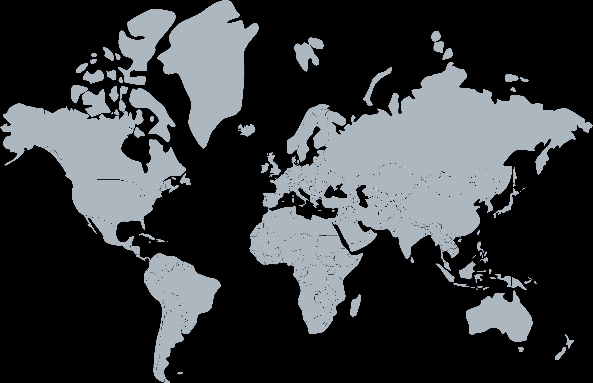

# 008 - Bộ Cân Bằng Tải (Load Balancers)

[← Bài trước](007-domain-name-system-dns.md) | [Mục lục](README.md) | [Bài tiếp theo →](009-co-so-du-lieu-databases.md)

---


# Giới Thiệu Về Bộ Cân Bằng Tải (Introduction to Load Balancers)

Tìm hiểu về các kiến thức cơ bản của bộ cân bằng tải (load balancers) và các dịch vụ mà chúng cung cấp.

Chúng ta sẽ tìm hiểu các nội dung sau:
* Cân bằng tải là gì? (What is load balancing?)
* Vị trí đặt bộ cân bằng tải (Placing load balancers)
* Các dịch vụ do bộ cân bằng tải cung cấp (Services offered by load balancers)

---

## Cân Bằng Tải Là Gì? (What is Load Balancing?)

Hàng triệu yêu cầu (requests) có thể gửi đến mỗi giây trong một trung tâm dữ liệu (data center) điển hình. Để phục vụ các yêu cầu này, hàng nghìn (hoặc hàng trăm nghìn) máy chủ (servers) cùng phối hợp hoạt động nhằm chia sẻ tải lượng (load) của các yêu cầu gửi đến.

> [!NOTE]
> Ở đây, điều quan trọng là chúng ta phải xem xét cách các yêu cầu gửi đến sẽ được phân chia như thế nào giữa tất cả các máy chủ hiện có sẵn (available servers).

Bộ cân bằng tải (**Load Balancer - LB**) chính là câu trả lời cho câu hỏi đó. Nhiệm vụ của bộ cân bằng tải là phân chia một cách công bằng tất cả các yêu cầu của máy khách (client requests) đến nhóm máy chủ khả dụng (**server pool**). Bộ cân bằng tải thực hiện nhiệm vụ này nhằm tránh tình trạng quá tải (**overloading**) hoặc làm sập máy chủ (**crashing servers**).

Tầng cân bằng tải (**load balancing layer**) là điểm tiếp xúc đầu tiên (first point of contact) bên trong một trung tâm dữ liệu sau tường lửa (**firewall**). Một bộ cân bằng tải có thể không cần thiết nếu dịch vụ chỉ tiếp nhận vài trăm hoặc thậm chí vài nghìn yêu cầu mỗi giây. Tuy nhiên, khi lượng yêu cầu của máy khách ngày càng gia tăng, bộ cân bằng tải mang lại các năng lực cốt lõi sau:

* **Khả năng mở rộng (Scalability):** Bằng cách bổ sung thêm máy chủ, dung lượng chịu tải của ứng dụng/dịch vụ có thể được tăng lên một cách liền mạch. Bộ cân bằng tải giúp cho việc mở rộng quy mô tăng lên (**upscaling**) hoặc giảm xuống (**downscaling**) diễn ra hoàn toàn trong suốt (transparent) đối với người dùng cuối.
* **Độ sẵn sàng (Availability):** Ngay cả khi một số máy chủ bị ngừng hoạt động (**go down**) hoặc gặp lỗi hỏng hóc (**suffer a fault**), hệ thống vẫn duy trì tính khả dụng (remains available). Một trong những nhiệm vụ trọng yếu của bộ cân bằng tải là che giấu các lỗi và sự cố sập của máy chủ (**faults and failures of servers**).
* **Hiệu năng (Performance):** Bộ cân bằng tải có thể chuyển tiếp yêu cầu đến các máy chủ có tải lượng thấp hơn để người dùng có thể nhận được thời gian phản hồi (**response time**) nhanh hơn. Điều này không chỉ nâng cao hiệu năng (**performance**) mà còn tối ưu hóa hiệu quả sử dụng tài nguyên (**resource utilization**).

Dưới đây là mô tả trừu tượng về cách hoạt động của bộ cân bằng tải:

### Nguyên Lý Hoạt Động Đơn Giản Hóa Của Bộ Cân Bằng Tải (Simplified Working of a Load Balancer)


```
[User 1] \
[User 2] --\
            --> [ Load Balancer ] ---> [ Server Pool: Server 1, Server 2, Server 3 ]
[User 3] --/
[User 4] /
```

---

## Vị Trí Đặt Bộ Cân Bằng Tải (Placing Load Balancers)

Thông thường, các bộ cân bằng tải (LBs) nằm giữa các máy khách (**clients**) và máy chủ (**servers**). Các yêu cầu đi tới máy chủ và phản hồi quay trở lại máy khách đều thông qua tầng cân bằng tải (**load balancing layer**). Tuy nhiên, đó không phải là vị trí duy nhất mà bộ cân bằng tải được triển khai.

Hãy cùng xem xét ba nhóm máy chủ kinh điển trong kiến trúc: đó là nhóm máy chủ Web (**web servers**), máy chủ ứng dụng (**application servers**), và máy chủ cơ sở dữ liệu (**database servers**). Để phân chia tải lượng lưu lượng truy cập (**traffic load**) giữa các máy chủ khả dụng, bộ cân bằng tải có thể được sử dụng giữa các phiên bản máy chủ (**server instances**) của ba dịch vụ này theo các vị trí sau:

1. **Đặt LB giữa người dùng cuối (end users) của ứng dụng và máy chủ Web / Cổng ứng dụng (application gateway):**
2. **Đặt LB giữa các máy chủ Web (web servers) và máy chủ ứng dụng (application servers)** chạy logic nghiệp vụ/ứng dụng (**business/application logic**).
3. **Đặt LB giữa các máy chủ ứng dụng (application servers) và các máy chủ cơ sở dữ liệu (database servers):**

---

### Khả Năng Ứng Dụng Bộ Cân Bằng Tải Trong Kiến Trúc Ba Tầng (Possible Usage of Load Balancers in a Three-Tier Architecture)


Trong thực tế thiết kế hệ thống, bộ cân bằng tải có tiềm năng được sử dụng giữa bất kỳ hai dịch vụ nào có triển khai nhiều phiên bản (**multiple instances**).

---

## Các Dịch Vụ Do Bộ Cân Bằng Tải Cung Cấp (Services Offered by Load Balancers)

Các bộ cân bằng tải (LBs) không chỉ giúp các dịch vụ đạt được khả năng mở rộng (**scalable**), tính sẵn sàng cao (**available**), và hiệu năng cao (**highly performant**), mà chúng còn cung cấp một số dịch vụ then chốt như sau:

* **Kiểm tra tình trạng sức khỏe (Health checking):** Bộ cân bằng tải sử dụng giao thức nhịp tim (**heartbeat protocol**) để giám sát tình trạng hoạt động và từ đó bảo đảm độ tin cậy (**reliability**) của các máy chủ đích (end-servers). Một ưu điểm khác của việc kiểm tra sức khỏe là nâng cao trải nghiệm người dùng (**user experience**).
* **Kết thúc TLS (TLS termination):** LBs giảm tải gánh nặng tính toán mã hóa cho các máy chủ đích bằng cách xử lý việc bắt tay và giải mã TLS (**TLS termination**) trực tiếp với máy khách (client).
* **Phân tích dự đoán (Predictive analytics):** LBs có thể dự đoán các mô hình lưu lượng truy cập (**traffic patterns**) thông qua các phân tích được thực hiện trên luồng lưu lượng chạy qua chúng hoặc sử dụng các số liệu thống kê lưu lượng thu thập được theo thời gian.
* **Giảm can thiệp thủ công của con người (Reduced human intervention):** Nhờ khả năng tự động hóa của LB, các nỗ lực quản trị hệ thống (**system administration efforts**) cần thiết để xử lý sự cố được giảm thiểu đáng kể.
* **Khám phá dịch vụ (Service discovery):** Một ưu thế của LBs là các yêu cầu của máy khách được chuyển tiếp đến đúng các máy chủ lưu trữ thích hợp bằng cách truy vấn sổ đăng ký dịch vụ (**service registry**).
* **Bảo mật (Security):** LBs cũng có thể nâng cao tính an toàn bảo mật bằng cách giảm thiểu các cuộc tấn công như từ chối dịch vụ (**DoS - Denial-of-Service**) tại các tầng khác nhau của mô hình OSI (tầng 3 - Network, tầng 4 - Transport, và tầng 7 - Application).

Nhìn chung, bộ cân bằng tải mang lại tính linh hoạt (**flexibility**), độ tin cậy (**reliability**), tính dự phòng (**redundancy**), và hiệu quả vận hành (**efficiency**) cho toàn bộ thiết kế kiến trúc của hệ thống.

---

## Câu Hỏi Tư Duy (Food for Thought)

> [!IMPORTANT]
> **Câu hỏi:** Điều gì sẽ xảy ra nếu chính các bộ cân bằng tải bị lỗi hỏng? Chúng có phải là điểm nghẽn chịu lỗi đơn lẻ (**Single Point of Failure - SPOF**) không?

> [!TIP]
> **Giải đáp:**
> Các bộ cân bằng tải thường được triển khai theo cặp (**in pairs**) như một giải pháp phục hồi sau thảm họa (**disaster recovery**). Nếu một bộ cân bằng tải gặp sự cố mà không có cơ chế dự phòng chuyển đổi dự phòng (**failover**), toàn bộ dịch vụ sẽ bị sập. 
> 
> Thông thường, để duy trì độ sẵn sàng cao (**High Availability - HA**), các doanh nghiệp sử dụng các cụm bộ cân bằng tải (**clusters of load balancers**) ứng dụng cơ chế giao tiếp nhịp tim (**heartbeat communication**) nhằm liên tục kiểm tra tình trạng sức khỏe của các bộ cân bằng tải tại mọi thời điểm. Khi bộ cân bằng tải chính (**Primary LB**) gặp sự cố, bộ cân bằng tải dự phòng (**Backup LB**) có thể tiếp quản ngay lập tức. Tuy nhiên, nếu toàn bộ cụm bộ cân bằng tải đều bị lỗi, việc định tuyến lại thủ công (**manual rerouting**) cũng có thể được thực hiện trong các trường hợp khẩn cấp.

Trong các bài học tiếp theo, chúng ta sẽ xem cách bộ cân bằng tải được sử dụng trong các ứng dụng phức tạp và loại bộ cân bằng tải nào phù hợp cho từng trường hợp sử dụng cụ thể.

---

# Cân Bằng Tải Toàn Cầu Và Cục Bộ (Global and Local Load Balancing)

Hiểu rõ cách thức thực hiện cân bằng tải toàn cầu (**global**) và cục bộ (**local**).

Chúng ta sẽ tìm hiểu các nội dung sau:
* Giới thiệu (Introduction)
* Cân bằng tải máy chủ toàn cầu (Global server load balancing - GSLB)
* Cân bằng tải trong DNS (Load balancing in DNS)
* Nhu cầu về các bộ cân bằng tải cục bộ (The need for local load balancers)
* Cân bằng tải cục bộ là gì? (What is local load balancing?)

---

## Giới Thiệu (Introduction)

Từ bài học trước, có vẻ như việc cân bằng tải chỉ được thực hiện bên trong trung tâm dữ liệu (data center). Tuy nhiên, cân bằng tải thực sự cần thiết ở cả quy mô toàn cầu (**global scale**) lẫn quy mô cục bộ (**local scale**). Hãy cùng tìm hiểu chức năng của từng loại:

* **Cân bằng tải máy chủ toàn cầu (Global Server Load Balancing - GSLB):** GSLB bao gồm việc phân phối tải lượng lưu lượng truy cập trên nhiều vùng địa lý khác nhau (**geographical regions**).
* **Cân bằng tải cục bộ (Local load balancing):** Đề cập đến kỹ thuật cân bằng tải đạt được bên trong nội bộ một trung tâm dữ liệu (data center). Loại cân bằng tải này tập trung vào việc nâng cao hiệu quả và tối ưu hóa việc sử dụng tài nguyên của các máy chủ lưu trữ (hosting servers) trong một trung tâm dữ liệu.

Hãy cùng tìm hiểu chi tiết từng kỹ thuật dưới đây.

---

## Cân Bằng Tải Máy Chủ Toàn Cầu (Global Server Load Balancing - GSLB)

GSLB đảm bảo rằng lưu lượng truy cập gửi đến từ phạm vi toàn cầu được chuyển tiếp một cách thông minh đến một trung tâm dữ liệu phù hợp. 

Ví dụ: Sự cố mất điện hoặc sự cố gián đoạn mạng tại một trung tâm dữ liệu đòi hỏi toàn bộ lưu lượng truy cập phải được định tuyến lại (**rerouted**) sang một trung tâm dữ liệu khác. GSLB đưa ra các quyết định chuyển tiếp dựa trên:
* Vị trí địa lý của người dùng (**users' geographic locations**).
* Số lượng máy chủ lưu trữ khả dụng tại các địa điểm khác nhau.
* Tình trạng sức khỏe của các trung tâm dữ liệu (**health of data centers**), và các yếu tố liên quan khác.

Trong bài học tiếp theo, chúng ta cũng sẽ tìm hiểu cách GSLB cung cấp khả năng tự động chuyển vùng dự phòng khi có sự cố (**automatic zonal failover**).

Dịch vụ GSLB có thể được cài đặt tại chỗ (**on-premises**) hoặc sử dụng dưới dạng Dịch vụ Cân bằng Tải (**Load Balancing as a Service - LBaaS**).

---

### Sử Dụng Cân Bằng Tải Toàn Cầu Để Gửi Yêu Cầu Người Dùng Đến Các Vùng Khác Nhau (Usage of Global Load Balancing to Send User Requests to Different Regions)

Minh họa dưới đây cho thấy GSLB có thể chuyển tiếp các yêu cầu đến ba trung tâm dữ liệu khác nhau. Mỗi tầng cân bằng tải cục bộ bên trong một trung tâm dữ liệu sẽ duy trì một kết nối tầng điều khiển (**control plane connection**) với GSLB để cung cấp thông tin liên tục về tình trạng sức khỏe của các LBs và trang trại máy chủ (**server farm**). 

GSLB sử dụng thông tin này để đưa ra các quyết định điều phối lưu lượng và chuyển tiếp tải dựa trên thông tin cấu hình và giám sát của từng khu vực.


```
                       [ Incoming Traffic ]
                                |
                             [ GSLB ]
                            /   |   \
        -------------------/    |    \-------------------
       /                        |                        \
      v                         v                         v
 [ Region A ]              [ Region B ]              [ Region C ]
 [ Local LB ]              [ Local LB ]              [ Local LB ]
```

Bây giờ, chúng ta sẽ thảo luận về cách Hệ thống Phân giải Tên miền (**Domain Name System - DNS**) có thể thực thi GSLB.

---

## Cân Bằng Tải Trong DNS (Load Balancing in DNS)

Chúng ta đều hiểu rằng DNS có thể phản hồi với nhiều địa chỉ IP cho một truy vấn DNS (**DNS query**). Trong bài học về DNS, chúng ta đã thảo luận rằng việc thực hiện cân bằng tải thông qua DNS là hoàn toàn khả thi khi quan sát kết quả đầu ra của lệnh `nslookup`. DNS sử dụng một cơ chế đơn giản...

---

# Cân Bằng Tải Toàn Cầu Dựa Trên DNS (DNS-based Global Server Load Balancing - GSLB)

Kỹ thuật sắp xếp lại thứ tự danh sách các địa chỉ IP phản hồi cho mỗi truy vấn DNS (DNS query). Do đó, những người dùng khác nhau sẽ nhận được danh sách địa chỉ IP có thứ tự khác nhau. Điều này dẫn đến việc người dùng sẽ truy cập vào một máy chủ (server) khác nhau để phục vụ các yêu cầu (requests) của họ. Bằng cách này, DNS phân phối tải của các request đến các trung tâm dữ liệu (data centers) khác nhau. Đây chính là việc thực hiện **Cân Bằng Tải Máy Chủ Toàn Cầu (Global Server Load Balancing - GSLB)**. 

Cụ thể, DNS sử dụng giải thuật **Xoay vòng (Round-Robin)** để thực hiện cân bằng tải như được minh họa dưới đây:

---

### Bước 1: Người dùng ISP 1 gửi truy vấn DNS

> [!NOTE]
> Người dùng từ **ISP 1** gửi yêu cầu tới hạ tầng DNS (**DNS infrastructure**) để lấy địa chỉ IP của một dịch vụ.


* **Hạ tầng DNS (DNS infrastructure)**
* **Người dùng ISP 1 (ISP 1 users)**: Đang thực hiện `Query` (Truy vấn)
* **Người dùng ISP 2 (ISP 2 users)**
* **Người dùng ISP 3 (ISP 3 users)**
* **Người dùng ISP 4 (ISP 4 users)**
* **Địa chỉ IP Trung tâm dữ liệu 1 (Data center IP 1)**
* **Địa chỉ IP Trung tâm dữ liệu 2 (Data center IP 2)**
* **Địa chỉ IP Trung tâm dữ liệu 3 (Data center IP 3)**

*Trang 1 / 16*

---

### Bước 2: DNS phản hồi địa chỉ IP của Data Center 1


* **Hạ tầng DNS (DNS infrastructure)**
* **Người dùng ISP 1 (ISP 1 users)**: Nhận phản hồi `Datacenter 1 IP`
* **Người dùng ISP 2 (ISP 2 users)**
* **Người dùng ISP 3 (ISP 3 users)**
* **Người dùng ISP 4 (ISP 4 users)**
* **Địa chỉ IP Trung tâm dữ liệu 1 (Data center IP 1)**
* **Địa chỉ IP Trung tâm dữ liệu 2 (Data center IP 2)**
* **Địa chỉ IP Trung tâm dữ liệu 3 (Data center IP 3)**

> **Mô tả:** DNS phản hồi lại với địa chỉ IP của trung tâm dữ liệu 1 (**Data center 1**).

*Trang 2 / 16*

---

### Bước 3: Người dùng ISP 1 gửi Request tới Data Center 1


* **Hạ tầng DNS (DNS infrastructure)**
* **Người dùng ISP 1 (ISP 1 users)**: Gửi `Request` (Yêu cầu) tới `Data center IP 1`
* **Người dùng ISP 2 (ISP 2 users)**
* **Người dùng ISP 3 (ISP 3 users)**
* **Người dùng ISP 4 (ISP 4 users)**
* **Địa chỉ IP Trung tâm dữ liệu 1 (Data center IP 1)**
* **Địa chỉ IP Trung tâm dữ liệu 2 (Data center IP 2)**
* **Địa chỉ IP Trung tâm dữ liệu 3 (Data center IP 3)**

> **Mô tả:** Người dùng gửi một request đến trung tâm dữ liệu 1 (**Data center 1**).

---

### Bước 4: Người dùng ISP 1 được phục vụ tại Data Center 1

*Trang 3 / 16*


* **Hạ tầng DNS (DNS infrastructure)**
* **Người dùng ISP 1 (ISP 1 users)**
* **Người dùng ISP 2 (ISP 2 users)**
* **Người dùng ISP 3 (ISP 3 users)**
* **Người dùng ISP 4 (ISP 4 users)**
* **Địa chỉ IP Trung tâm dữ liệu 1 (Data center IP 1)**
* **Địa chỉ IP Trung tâm dữ liệu 2 (Data center IP 2)**
* **Địa chỉ IP Trung tâm dữ liệu 3 (Data center IP 3)**

> **Mô tả:** Người dùng từ **ISP 1** được phục vụ tại trung tâm dữ liệu 1 (**Data center 1**).

*Trang 4 / 16*

---

### Bước 5: Người dùng ISP 2 gửi truy vấn DNS


* **Hạ tầng DNS (DNS infrastructure)**
* **Người dùng ISP 1 (ISP 1 users)**
* **Người dùng ISP 2 (ISP 2 users)**: Đang thực hiện `Query` (Truy vấn)
* **Người dùng ISP 3 (ISP 3 users)**
* **Người dùng ISP 4 (ISP 4 users)**
* **Địa chỉ IP Trung tâm dữ liệu 1 (Data center IP 1)**
* **Địa chỉ IP Trung tâm dữ liệu 2 (Data center IP 2)**
* **Địa chỉ IP Trung tâm dữ liệu 3 (Data center IP 3)**

---

> [!NOTE]
> Người dùng từ **ISP 2** gửi yêu cầu tới hạ tầng DNS để lấy địa chỉ IP của cùng một dịch vụ đó.

*Trang 5 / 16*

---

### Bước 6: DNS thực hiện GSLB và phản hồi IP của Data Center 2


* **Hạ tầng DNS (DNS infrastructure)**
* **Người dùng ISP 1 (ISP 1 users)**
* **Người dùng ISP 2 (ISP 2 users)**: Nhận phản hồi `Datacenter 2 IP`
* **Người dùng ISP 3 (ISP 3 users)**
* **Người dùng ISP 4 (ISP 4 users)**
* **Địa chỉ IP Trung tâm dữ liệu 1 (Data center IP 1)**
* **Địa chỉ IP Trung tâm dữ liệu 2 (Data center IP 2)**
* **Địa chỉ IP Trung tâm dữ liệu 3 (Data center IP 3)**

> [!IMPORTANT]
> **DNS phản hồi lại với địa chỉ IP của trung tâm dữ liệu 2 và thực hiện GSLB (Cân bằng tải máy chủ toàn cầu).**

*Trang 6 / 16*

---

### Bước 7: Người dùng ISP 2 gửi Request tới Data Center 2


* **Hạ tầng DNS (DNS infrastructure)**
* **Người dùng ISP 1 (ISP 1 users)**
* **Người dùng ISP 2 (ISP 2 users)**: Gửi `Request` (Yêu cầu) tới `Data center IP 2`
* **Người dùng ISP 3 (ISP 3 users)**
* **Người dùng ISP 4 (ISP 4 users)**
* **Địa chỉ IP Trung tâm dữ liệu 1 (Data center IP 1)**
* **Địa chỉ IP Trung tâm dữ liệu 2 (Data center IP 2)**
* **Địa chỉ IP Trung tâm dữ liệu 3 (Data center IP 3)**

> **Mô tả:** Người dùng gửi một request đến trung tâm dữ liệu 2 (**Data center 2**).

*Trang 7 / 16*

---

### Bước 8: Người dùng ISP 2 được phục vụ tại Data Center 2


* **Hạ tầng DNS (DNS infrastructure)**
* **Người dùng ISP 1 (ISP 1 users)**
* **Người dùng ISP 2 (ISP 2 users)**
* **Người dùng ISP 3 (ISP 3 users)**
* **Người dùng ISP 4 (ISP 4 users)**
* **Địa chỉ IP Trung tâm dữ liệu 1 (Data center IP 1)**
* **Địa chỉ IP Trung tâm dữ liệu 2 (Data center IP 2)**
* **Địa chỉ IP Trung tâm dữ liệu 3 (Data center IP 3)**

> **Mô tả:** Người dùng từ **ISP 2** được phục vụ tại trung tâm dữ liệu 2 (**Data center 2**).

---

### Bước 9: Người dùng ISP 3 gửi truy vấn DNS

*Trang 8 / 16*


* **Hạ tầng DNS (DNS infrastructure)**
* **Người dùng ISP 1 (ISP 1 users)**
* **Người dùng ISP 2 (ISP 2 users)**
* **Người dùng ISP 3 (ISP 3 users)**: Đang thực hiện `Query` (Truy vấn)
* **Người dùng ISP 4 (ISP 4 users)**
* **Địa chỉ IP Trung tâm dữ liệu 1 (Data center IP 1)**
* **Địa chỉ IP Trung tâm dữ liệu 2 (Data center IP 2)**
* **Địa chỉ IP Trung tâm dữ liệu 3 (Data center IP 3)**

> [!NOTE]
> Người dùng từ **ISP 3** gửi yêu cầu tới hạ tầng DNS để lấy địa chỉ IP của cùng một dịch vụ đó.

*Trang 9 / 16*

---

### Bước 10: DNS phản hồi IP của Data Center 3


* **Hạ tầng DNS (DNS infrastructure)**
* **Người dùng ISP 1 (ISP 1 users)**
* **Người dùng ISP 2 (ISP 2 users)**
* **Người dùng ISP 3 (ISP 3 users)**: Nhận phản hồi `Datacenter 3 IP`
* **Người dùng ISP 4 (ISP 4 users)**
* **Địa chỉ IP Trung tâm dữ liệu 1 (Data center IP 1)**
* **Địa chỉ IP Trung tâm dữ liệu 2 (Data center IP 2)**
* **Địa chỉ IP Trung tâm dữ liệu 3 (Data center IP 3)**

---

# BỘ CÂN BẰNG TẢI (LOAD BALANCERS) - PHẦN 2: CÂN BẰNG TẢI TOÀN CẦU QUA DNS VÀ NHU CẦU VỀ BỘ CÂN BẰNG TẢI CỤC BỘ

---

### Trang 13

DNS phản hồi với địa chỉ IP của Trung tâm dữ liệu 3 (Data center 3) và thực hiện GSLB (*Global Server Load Balancing* - Cân bằng tải máy chủ toàn cầu).

**10 / 16**


* **Data center IP 1** (IP Trung tâm dữ liệu 1)
* **DNS infrastructure** (Hạ tầng DNS)
* **ISP 3 users** (Người dùng thuộc nhà mạng ISP 3)
* **ISP 4 users** (Người dùng thuộc nhà mạng ISP 4)
* **Data center IP 2** (IP Trung tâm dữ liệu 2)
* **Data center IP 3** (IP Trung tâm dữ liệu 3)
* **ISP 2 users** (Người dùng thuộc nhà mạng ISP 2)
* **ISP 1 users** (Người dùng thuộc nhà mạng ISP 1)
* **Query** (Truy vấn)
* **Datacenter 3 IP** (IP Trung tâm dữ liệu 3)

---


* **Request** (Yêu cầu)

Người dùng gửi một yêu cầu (request) đến Trung tâm dữ liệu 3 (Data center 3).

**11 / 16**

---

### Trang 14

* **Data center IP 1** (IP Trung tâm dữ liệu 1)
* **DNS infrastructure** (Hạ tầng DNS)
* **ISP 3 users** (Người dùng thuộc nhà mạng ISP 3)
* **ISP 4 users** (Người dùng thuộc nhà mạng ISP 4)
* **Data center IP 2** (IP Trung tâm dữ liệu 2)
* **Data center IP 3** (IP Trung tâm dữ liệu 3)
* **ISP 2 users** (Người dùng thuộc nhà mạng ISP 2)
* **ISP 1 users** (Người dùng thuộc nhà mạng ISP 1)


Người dùng từ ISP 3 được phục vụ tại Trung tâm dữ liệu 3 (Data center 3).

**12 / 16**

---


* **Data center IP 1** (IP Trung tâm dữ liệu 1)
* **DNS infrastructure** (Hạ tầng DNS)
* **ISP 3 users** (Người dùng thuộc nhà mạng ISP 3)
* **ISP 4 users** (Người dùng thuộc nhà mạng ISP 4)
* **Data center IP 2** (IP Trung tâm dữ liệu 2)
* **Data center IP 3** (IP Trung tâm dữ liệu 3)
* **ISP 2 users** (Người dùng thuộc nhà mạng ISP 2)
* **ISP 1 users** (Người dùng thuộc nhà mạng ISP 1)
* **Query** (Truy vấn)

Người dùng từ ISP 4 gửi truy vấn đến hạ tầng DNS để yêu cầu địa chỉ IP của cùng một dịch vụ đó.

---

### Trang 15

**13 / 16**

* **Data center IP 1** (IP Trung tâm dữ liệu 1)
* **DNS infrastructure** (Hạ tầng DNS)
* **ISP 3 users** (Người dùng thuộc nhà mạng ISP 3)
* **ISP 4 users** (Người dùng thuộc nhà mạng ISP 4)
* **Data center IP 2** (IP Trung tâm dữ liệu 2)
* **Data center IP 3** (IP Trung tâm dữ liệu 3)
* **ISP 2 users** (Người dùng thuộc nhà mạng ISP 2)
* **ISP 1 users** (Người dùng thuộc nhà mạng ISP 1)
* **Query** (Truy vấn)
* **Datacenter 1 IP** (IP Trung tâm dữ liệu 1)

DNS phản hồi với địa chỉ IP của Trung tâm dữ liệu 1 (Data center 1) và thực hiện GSLB theo cơ chế xoay vòng vòng tròn (Round-Robin).

**14 / 16**

---


* **Data center IP 1** (IP Trung tâm dữ liệu 1)
* **DNS infrastructure** (Hạ tầng DNS)
* **ISP 3 users** (Người dùng thuộc nhà mạng ISP 3)
* **ISP 4 users** (Người dùng thuộc nhà mạng ISP 4)
* **Data center IP 2** (IP Trung tâm dữ liệu 2)
* **Data center IP 3** (IP Trung tâm dữ liệu 3)
* **ISP 2 users** (Người dùng thuộc nhà mạng ISP 2)
* **ISP 1 users** (Người dùng thuộc nhà mạng ISP 1)
* **Query** (Truy vấn)
* **Datacenter 1 IP** (IP Trung tâm dữ liệu 1)
* **Request** (Yêu cầu)

---

### Trang 16

Người dùng gửi một yêu cầu (request) đến Trung tâm dữ liệu 1 (Data center 1).

**15 / 16**

* **Data center IP 1** (IP Trung tâm dữ liệu 1)
* **DNS infrastructure** (Hạ tầng DNS)
* **ISP 3 users** (Người dùng thuộc nhà mạng ISP 3)
* **ISP 4 users** (Người dùng thuộc nhà mạng ISP 4)
* **Data center IP 2** (IP Trung tâm dữ liệu 2)
* **Data center IP 3** (IP Trung tâm dữ liệu 3)
* **ISP 2 users** (Người dùng thuộc nhà mạng ISP 2)
* **ISP 1 users** (Người dùng thuộc nhà mạng ISP 1)

Người dùng từ ISP 4 được phục vụ tại Trung tâm dữ liệu 1 (Data center 1).

**16 / 16**

Như được minh họa ở trên, kỹ thuật **Round-Robin trong DNS** chuyển tiếp các client (máy khách) tới các trung tâm dữ liệu theo một thứ tự tuần hoàn nghiêm ngặt. Tuy nhiên, Round-Robin tồn tại các hạn chế (*limitations*) sau:

1. **Sự chênh lệch về lượng người dùng giữa các ISP:** Các ISP khác nhau có số lượng người dùng khác nhau. Một ISP phục vụ lượng khách hàng lớn sẽ trả về cùng một địa chỉ IP đã lưu đệm (*cached IP*) cho tất cả các client của nó, dẫn đến việc phân phối tải không đồng đều trên các máy chủ đích (*end-servers*).
2. **Không nhận biết được sự cố của máy chủ:** Bởi vì thuật toán cân bằng tải Round-Robin không hề tính đến các sự cố sập máy chủ đầu cuối (*end-server crashes*), nó vẫn tiếp tục phân phối địa chỉ IP của các máy chủ đã bị sập cho đến khi thời gian tồn tại bản ghi đệm (TTL - *Time-To-Live*) của các mục lưu trong cache hết hạn. Trong trường hợp đó, độ sẵn sàng (*Availability*) của dịch vụ có thể bị ảnh hưởng nặng nề do việc cân bằng tải ở cấp độ DNS.

---

### Trang 17

Mặc dù có các hạn chế nêu trên, Round-Robin vẫn được sử dụng rộng rãi bởi nhiều nhà cung cấp dịch vụ DNS. Hơn nữa, DNS áp dụng giá trị **TTL ngắn** cho các mục được lưu trong bộ nhớ đệm để thực hiện cân bằng tải hiệu quả hơn giữa các trung tâm dữ liệu khác nhau.

> [!NOTE]
> DNS không phải là hình thức duy nhất để triển khai GSLB (*Global Server Load Balancing*). Các **Bộ điều khiển phân phối ứng dụng (ADCs - Application Delivery Controllers)** và **Cân bằng tải trên nền tảng đám mây (Cloud-based load balancing)** (sẽ được thảo luận ở phần sau) là những giải pháp tối ưu và hiệu quả hơn để thực hiện GSLB.

#### Bộ điều khiển phân phối ứng dụng (ADCs - Application Delivery Controllers) là gì?

#### Nhu cầu về các Bộ cân bằng tải cục bộ (Local Load Balancers)

DNS đóng một vai trò thiết yếu trong việc cân bằng tải, nhưng nó gặp phải các hạn chế sau:

* **Kích thước gói tin DNS nhỏ:** Kích thước hạn chế của gói tin DNS (512 Bytes) không đủ để chứa tất cả các địa chỉ IP khả dĩ của các máy chủ.
* **Quyền kiểm soát hạn chế đối với hành vi của client:** Client có thể tự ý lựa chọn ngẫu nhiên từ tập hợp các địa chỉ IP nhận được. Một vài địa chỉ IP trong số nhận được có thể thuộc về các trung tâm dữ liệu đang bị quá tải (*busy data centers*).
* **Client không thể xác định địa chỉ tối ưu nhất:** Client không thể tự xác định đâu là địa chỉ gần nhất về mặt mạng để thiết lập kết nối. Mặc dù các giải pháp như định vị địa lý qua DNS (*DNS geolocation*) và kỹ thuật định tuyến Anycast (*Anycasting-like solutions*) có thể được triển khai, nhưng chúng không phải là các giải pháp đơn giản hay tầm thường (*trivial solutions*).
* **Phục hồi sự cố chậm chạp:** Trong trường hợp xảy ra sự cố, quá trình khôi phục (*recovery*) thông qua DNS có thể diễn ra rất chậm do cơ chế lưu đệm (*caching mechanism*), đặc biệt là khi giá trị TTL được thiết lập quá dài.

Để giải quyết một số vấn đề nêu trên, chúng ta cần thêm một tầng cân bằng tải khác dưới dạng **Bộ cân bằng tải cục bộ (Local LB - Local Load Balancer)**. Trong bài học tiếp theo, chúng ta sẽ thảo luận chi tiết về các khía cạnh khác nhau của bộ cân bằng tải cục bộ.

#### Cân bằng tải cục bộ (Local Load Balancing) là gì?

Các bộ cân bằng tải cục bộ (*Local load balancers*) nằm bên trong một trung tâm dữ liệu (*data center*). Chúng hoạt động giống như một **Reverse Proxy** (proxy ngược) và nỗ lực tối đa để phân chia các yêu cầu gửi đến (*incoming requests*) đồng đều giữa các nhóm máy chủ sẵn sàng phục vụ (*pool of available servers*).

---

### Trang 18

[ Quay lại ]  
**Giới thiệu về Bộ cân bằng tải (Introduction to Load Balancers)**  
[ Đánh dấu đã hoàn thành ]  
[ Tiếp theo ]  
**Chi tiết nâng cao về Bộ cân bằng tải (Advanced Details of Load Balancers)**  

Các yêu cầu đến từ client kết nối một cách liền mạch và minh bạch tới Load Balancer thông qua việc sử dụng một **Địa chỉ IP ảo (VIP - Virtual IP address)**.

---

### Điểm Cần Suy Ngẫm (Point to Ponder)

> [!IMPORTANT]
> **Câu hỏi:**  
> Liệu DNS có thể được xem là một Bộ cân bằng tải máy chủ toàn cầu (GSLB - *Global Server Load Balancer*) hay không?

<details>
<summary><b>Ẩn câu trả lời (Hide Answer)</b></summary>

**Có**, thực tế có hai phương thức để thực hiện Quản lý Lưu lượng Toàn cầu (GTM - *Global Traffic Management*):

1. **GTM thông qua ADCs:** Một số ADC có triển khai tính năng GSLB. Trong trường hợp đó, các ADC có một góc nhìn thời gian thực (*real-time view*) về trạng thái của các máy chủ lưu trữ và sẽ chuyển tiếp các yêu cầu dựa trên sức khỏe (*health*) cũng như năng lực xử lý (*capacity*) thực tế của trung tâm dữ liệu.
2. **GTM thông qua DNS:** DNS thực hiện GSLB bằng cách phân tích vị trí IP (*IP location*) của máy khách (client). Đối với mỗi người dùng gửi yêu cầu phân giải IP cho một tên miền (ví dụ: `www.educative.io`), GSLB dựa trên DNS sẽ chuyển tiếp địa chỉ IP của trung tâm dữ liệu có vị trí địa lý gần nhất với vị trí IP đang gửi yêu cầu.

</details>

---

Trong bài học tiếp theo, chúng ta sẽ cùng khám phá một số chi tiết nâng cao chuyên sâu của các **Bộ cân bằng tải cục bộ (Local Load Balancers)**.

---

# Chi tiết nâng cao về Bộ cân bằng tải (Advanced Details of Load Balancers)

Thấu hiểu các bộ cân bằng tải (**Load Balancers - LBs**) và việc ứng dụng chúng bên trong một hệ thống.

### Nội dung bài học bao gồm:
* Các thuật toán của bộ cân bằng tải (**Algorithms of load balancers**)
* Thuật toán tĩnh so với thuật toán động (**Static versus dynamic algorithms**)
* Bộ cân bằng tải có trạng thái so với phi trạng thái (**Stateful versus stateless LBs**)
  * Cân bằng tải có trạng thái (**Stateful load balancing**)
  * Cân bằng tải phi trạng thái (**Stateless load balancing**)
* Các loại bộ cân bằng tải (**Types of load balancers**)
* Triển khai bộ cân bằng tải (**Load balancer deployment**)
  * LBs Tầng 0 và Tầng 1 (**Tier-0 and tier-1 LBs**)
  * LBs Tầng 2 (**Tier-2 LBs**)
  * LBs Tầng 3 (**Tier-3 LBs**)
* Ví dụ thực tế (**Practical example**)
* Hiện thực hóa bộ cân bằng tải (**Implementation of load balancers**)
  * Bộ cân bằng tải phần cứng (**Hardware load balancers**)
  * Bộ cân bằng tải phần mềm (**Software load balancers**)
  * Bộ cân bằng tải đám mây (**Cloud load balancers**)
* Kết luận (**Conclusion**)

Bài học này sẽ tập trung vào một số thuật toán nổi tiếng được sử dụng trong các bộ cân bằng tải cục bộ (**local load balancers**). Chúng ta cũng sẽ tìm hiểu cách các bộ cân bằng tải được kết nối để hình thành một hệ thống phân cấp (**hierarchy**), chia sẻ khối lượng công việc qua các tầng (**tiers**) khác nhau của LBs.

---

## Các thuật toán của bộ cân bằng tải (Algorithms of load balancers)

Các bộ cân bằng tải phân phối các yêu cầu (**requests**) từ máy khách (**client**) dựa theo một thuật toán. Dưới đây là một số thuật toán phổ biến:

* **Điều phối luân phiên (Round-robin scheduling):** Trong thuật toán này, mỗi yêu cầu được chuyển tiếp đến một máy chủ (**server**) trong nhóm máy chủ (**server pool**) theo thứ tự tuần hoàn lặp đi lặp lại.
* **Luân phiên có trọng số (Weighted round-robin):** Nếu một số máy chủ có năng lực phục vụ yêu cầu của máy khách cao hơn các máy chủ khác, thì việc sử dụng thuật toán luân phiên có trọng số sẽ được ưu tiên hơn. Trong thuật toán weighted round-robin, mỗi nút (**node**) được gán một trọng số (**weight**). LBs chuyển tiếp yêu cầu của client theo trọng số của node đó. Trọng số càng cao, số lượng phân bổ yêu cầu càng lớn.
* **Ít kết nối nhất (Least connections):** Trong một số trường hợp nhất định, ngay cả khi tất cả các máy chủ đều có năng lực phục vụ client như nhau, tải không đồng đều trên một số máy chủ vẫn có khả năng xảy ra. Ví dụ: một số client có thể gửi yêu cầu đòi hỏi thời gian xử lý lâu hơn. Hoặc một số client có các yêu cầu tiếp theo trên cùng một kết nối. Trong trường hợp đó, chúng ta có thể sử dụng các thuật toán như *least connections*, nơi các yêu cầu mới đến được chỉ định cho các máy chủ có ít kết nối hiện có hơn. LBs sẽ lưu giữ trạng thái (**state**) về số lượng và ánh xạ (**mapping**) của các kết nối hiện có trong kịch bản như vậy. Chúng ta sẽ thảo luận kỹ hơn về việc duy trì trạng thái (**state maintenance**) ở phần sau của bài học.
* **Thời gian phản hồi ít nhất (Least response time):** Trong các dịch vụ nhạy cảm về mặt hiệu năng (**performance-sensitive services**), các thuật toán như *least response time* là bắt buộc. Thuật toán này đảm bảo rằng máy chủ có thời gian phản hồi (**response time / latency**) thấp nhất sẽ được yêu cầu để phục vụ client.
* **Băm địa chỉ IP (IP hash):** Một số ứng dụng cung cấp các cấp độ dịch vụ khác nhau cho người dùng dựa trên địa chỉ IP của họ. Trong trường hợp đó, việc băm (**hashing**) địa chỉ IP được thực hiện để gán các yêu cầu của người dùng đến các máy chủ tương ứng.
* **Băm URL (URL hash):** Có khả năng một số dịch vụ bên trong ứng dụng chỉ được cung cấp bởi các máy chủ chuyên biệt. Trong trường hợp đó, một máy khách yêu cầu dịch vụ từ một URL cụ thể sẽ được chỉ định cho một cụm (**cluster**) hoặc tập hợp máy chủ nhất định. Thuật toán băm URL (**URL hashing algorithm**) được sử dụng trong các kịch bản này.

Ngoài ra còn có các thuật toán khác, chẳng hạn như thuật toán ngẫu nhiên (**randomized**) hoặc thuật toán ít kết nối nhất có trọng số (**weighted least connections**).

---

## Thuật toán tĩnh so với thuật toán động (Static versus dynamic algorithms)

Các thuật toán có thể là tĩnh (**static**) hoặc động (**dynamic**) tùy thuộc vào trạng thái của máy chủ. Hãy xem xét từng danh mục riêng lẻ:

* **Thuật toán tĩnh (Static algorithms):** Không xem xét đến trạng thái đang thay đổi của các máy chủ. Do đó, việc phân công tác vụ được thực hiện hoàn toàn dựa trên kiến thức đã biết từ trước về cấu hình của máy chủ. Một cách tự nhiên, các thuật toán này không phức tạp và chúng thường được triển khai trong một bộ định tuyến đơn lẻ (**single router**) hoặc một máy chủ phần cứng thông dụng (**commodity machine**) nơi tiếp nhận tất cả các yêu cầu.
* **Thuật toán động (Dynamic algorithms):** Là các thuật toán có xem xét đến trạng thái hiện tại hoặc gần đây của các máy chủ. Thuật toán động duy trì trạng thái bằng cách giao tiếp liên tục với máy chủ, điều này tạo ra chi phí truyền thông phụ trội (**communication overhead**). Việc duy trì trạng thái làm cho thiết kế của thuật toán trở nên phức tạp hơn nhiều.

Các thuật toán động đòi hỏi các máy chủ cân bằng tải khác nhau phải giao tiếp với nhau để trao đổi thông tin. Do đó, các thuật toán động có thể mang tính mô-đun (**modular**) vì không có một thực thể đơn lẻ nào đứng ra đưa ra toàn bộ quyết định. Mặc dù điều này làm tăng độ phức tạp cho các thuật toán động, nhưng nó mang lại các quyết định chuyển tiếp (**forwarding decisions**) tối ưu hơn. Cuối cùng, các thuật toán động liên tục giám sát tình trạng sức khỏe (**health check**) của các máy chủ và chỉ chuyển tiếp yêu cầu đến các máy chủ đang hoạt động (**active servers**).

> [!NOTE]
> **Lưu ý trong thực tế:** Các thuật toán động mang lại kết quả tốt hơn nhiều vì chúng duy trì trạng thái của các máy chủ đang phục vụ (**serving hosts**), và do đó hoàn toàn xứng đáng với công sức và độ phức tạp bỏ ra.

---

## Bộ cân bằng tải có trạng thái so với phi trạng thái (Stateful versus stateless LBs)

Trong khi các thuật toán tĩnh và động được yêu cầu để xem xét tình trạng hoạt động (**health**) của các máy chủ lưu trữ, thì một trạng thái (**state**) khác cũng được duy trì để lưu giữ thông tin phiên làm việc (**session information**) của các máy khách khác nhau với các máy chủ lưu trữ.

Nếu thông tin phiên không được lưu giữ ở tầng thấp hơn (bộ nhớ đệm phân tán - **distributed cache** hoặc cơ sở dữ liệu - **database**), các bộ cân bằng tải sẽ được sử dụng để lưu giữ thông tin phiên này. Dưới đây, chúng tôi mô tả hai cách xử lý duy trì phiên thông qua LBs:
* **Có trạng thái (Stateful)**
* **Phi trạng thái (Stateless)**

### Cân bằng tải có trạng thái (Stateful load balancing)

Đúng như tên gọi, cân bằng tải có trạng thái liên quan đến việc duy trì trạng thái của các phiên (**sessions**) được thiết lập giữa các máy khách và máy chủ lưu trữ. LB có trạng thái kết hợp thông tin trạng thái này vào thuật toán của nó để thực hiện cân bằng tải.

Về bản chất, các LBs có trạng thái lưu giữ một cấu trúc dữ liệu (**data structure**) dùng để ánh xạ (**map**) các máy khách gửi yêu cầu đến các máy chủ lưu trữ tương ứng. Các LBs có trạng thái làm tăng độ phức tạp và giới hạn khả năng mở rộng (**Scalability**) bởi vì thông tin phiên của tất cả các máy khách phải được duy trì đồng bộ trên toàn bộ các bộ cân bằng tải. Nghĩa là, các bộ cân bằng tải phải liên tục chia sẻ thông tin trạng thái của chúng với nhau để đưa ra quyết định chuyển tiếp.

#### Cân bằng tải có trạng thái (Stateful load balancing)


---

### Cân bằng tải phi trạng thái (Stateless load balancing)

Cân bằng tải phi trạng thái không duy trì trạng thái và do đó nhanh hơn cũng như nhẹ hơn (**lightweight**). Các LBs phi trạng thái sử dụng kỹ thuật băm nhất quán (**Consistent Hashing**) để đưa ra các quyết định chuyển tiếp.

Tuy nhiên, nếu cơ sở hạ tầng thay đổi (ví dụ: có một máy chủ ứng dụng mới tham gia vào hệ thống), các LBs phi trạng thái có thể không có khả năng phục hồi (**resilient / Fault Tolerance**) tốt như các LBs có trạng thái, vì chỉ riêng băm nhất quán là không đủ để định tuyến một yêu cầu đến chính xác máy chủ ứng dụng ban đầu. Do đó, một trạng thái cục bộ (**local state**) vẫn có thể cần thiết song song với băm nhất quán.

#### Bộ cân bằng tải phi trạng thái sử dụng các thùng chứa băm (hash buckets) để ánh xạ các yêu cầu đến máy chủ đích


> [!IMPORTANT]
> **Điểm cốt lõi cần phân biệt:** Một trạng thái được duy trì xuyên suốt qua các bộ cân bằng tải khác nhau được xem là **cân bằng tải có trạng thái (stateful load balancing)**. Trong khi đó, một trạng thái chỉ được duy trì cục bộ bên trong một bộ cân bằng tải phục vụ cho mục đích nội bộ được coi là **cân bằng tải phi trạng thái (stateless load balancing)**.

---

## Các loại bộ cân bằng tải (Types of load balancers)

Tùy thuộc vào các yêu cầu kỹ thuật, việc cân bằng tải có thể được thực hiện ở tầng mạng/giao vận (**Network / Transport layer**) hoặc tầng ứng dụng (**Application layer**) của mô hình kết nối các hệ thống mở (**OSI - Open Systems Interconnection**).

* **Bộ cân bằng tải Tầng 4 (Layer 4 load balancers):** Tầng 4 đề cập đến việc cân bằng tải được thực hiện dựa trên các giao thức giao vận (**transport protocols**) như TCP và UDP. Các loại LBs này duy trì kết nối/phiên (**connection/session**) với máy khách và đảm bảo rằng cùng một luồng truyền thông (TCP/UDP) sẽ được chuyển tiếp đến cùng một máy chủ phụ trợ (**back-end server**). Mặc dù quá trình kết thúc mã hóa TLS (**TLS termination**) thường được thực hiện tại các LBs Tầng 7, nhưng một số LBs Tầng 4 hiện nay cũng hỗ trợ tính năng này.

---

# Bộ Cân Bằng Tải Tầng 7 (Layer 7 Load Balancers)

**Bộ cân bằng tải tầng 7 (Layer 7 Load Balancers - L7 LBs)** hoạt động dựa trên dữ liệu của các giao thức tầng ứng dụng (*Application Layer*). L7 LB có khả năng đưa ra các quyết định điều hướng thông minh nhận biết ứng dụng (*application-aware forwarding decisions*) dựa trên HTTP headers, URL, cookies và các dữ liệu đặc thù khác của ứng dụng — ví dụ như mã định danh người dùng (*User ID*). 

Bên cạnh nhiệm vụ giải mã/kết thúc phiên mã hóa TLS (*TLS Termination / SSL Offloading*), các bộ cân bằng tải này còn có thể đảm nhận các trọng trách như giới hạn tốc độ người dùng (*Rate Limiting*), định tuyến HTTP (*HTTP Routing*) và ghi lại phần tiêu đề HTTP (*Header Rewriting*).

> [!NOTE]
> Bộ cân bằng tải tầng 7 (Layer 7 Load Balancers) vượt trội về mặt kiểm tra, phân tích gói tin (*inspection*). Tuy nhiên, bộ cân bằng tải tầng 4 (Layer 4 Load Balancers) lại có tốc độ xử lý (*processing speed*) và thông lượng (*Throughput*) nhanh hơn đáng kể.

---

## Triển Khai Bộ Cân Bằng Tải (Load Balancer Deployment)

Chúng ta đã thảo luận về sự đánh đổi (*trade-offs*) khi thực hiện cân bằng tải tại các tầng khác nhau trong mô hình OSI. Tuy nhiên, trong thực tế sản xuất (*production*), một bộ cân bằng tải đơn tầng (*single-layer LB*) là không đủ đáp ứng cho một trung tâm dữ liệu quy mô lớn (*large data center*). 

Trên thực tế, nhiều tầng cân bằng tải (*multiple layers of load balancers*) phải phối hợp nhịp nhàng với nhau để đưa ra các quyết định chuyển tiếp gói tin chuẩn xác. Một trung tâm dữ liệu truyền thống thường sử dụng kiến trúc cân bằng tải ba tầng (*three-tier LB*) như minh họa dưới đây:

### Kiến trúc bộ cân bằng tải 3 tầng trong một trung tâm dữ liệu điển hình
*(Three-tier load balancer in a typical data center)*


*Sơ đồ phân tầng luồng dữ liệu:*
- **Khách hàng (Clients)**
- **Tier 1 (Tầng 1):** Bộ định tuyến ECMP / Tầng 3 OSI (`Router 1`, `Router 2`)
- **Tier 2 (Tầng 2):** TCP, UDP / Tầng 4 OSI (`LB1`, `LB2`, `LB3`)
- **Tier 3 (Tầng 3):** Dữ liệu ứng dụng / Tầng 7 OSI (`LB4`, `LB5`, `LB6`, `LB7`)
- **Server pool:** Cụm máy chủ xử lý thực tế (*Backend Servers*)

---

### Bộ Cân Bằng Tải Tầng 0 và Tầng 1 (Tier-0 and Tier-1 LBs)

- Nếu xem **Hệ thống phân giải tên miền (DNS - Domain Name System)** là bộ cân bằng tải tầng 0 (*Tier-0 Load Balancer*), thì các bộ định tuyến **Đa đường chi phí bằng nhau (ECMP - Equal Cost Multipath Routers)** chính là các bộ cân bằng tải tầng 1 (*Tier-1 LBs*).
- Đúng như tên gọi của ECMP, tầng này phân chia lưu lượng truy cập đi vào (*incoming traffic*) dựa trên địa chỉ IP hoặc thông qua các thuật toán khác như **xoay vòng (Round-Robin)** hoặc **xoay vòng có trọng số (Weighted Round-Robin)**. 
- Tier-1 LBs sẽ cân bằng tải qua nhiều đường dẫn khác nhau (*paths*) dẫn đến các tầng cân bằng tải cao hơn.
- Các bộ định tuyến ECMP đóng vai trò sống còn trong việc đảm bảo khả năng **mở rộng theo chiều ngang (Horizontal Scalability)** cho các bộ cân bằng tải ở các tầng bên trên.

---

### Bộ Cân Bằng Tải Tầng 2 (Tier-2 LBs)

- Tầng cân bằng tải thứ hai bao gồm các **Bộ cân bằng tải tầng 4 (Layer 4 Load Balancers)**.
- Nhiệm vụ cốt lõi của Tier-2 LBs là đảm bảo rằng: đối với bất kỳ kết nối nào (*connection*), tất cả các gói tin đến (*incoming packets*) đều phải được chuyển tiếp nhất quán đến **cùng một bộ cân bằng tải Tier-3**.
- Để đạt được mục tiêu này, kỹ thuật **băm nhất quán (Consistent Hashing)** có thể được áp dụng. Tuy nhiên, trong trường hợp hạ tầng có sự biến động (như thêm bớt node, lỗi mạng), Consistent Hashing đơn thuần có thể là chưa đủ. Do đó, chúng ta cần phải duy trì trạng thái cục bộ (*local state*) hoặc trạng thái toàn cục (*global state*) như sẽ được phân tích ở các phần tiếp theo.
- Các bộ cân bằng tải Tier-2 được coi là "chất keo kết dính" giữa Tier-1 và Tier-3 LBs. Nếu loại bỏ Tier-2 LBs, hệ thống có thể đưa ra các quyết định điều hướng sai lệch trong các tình huống gặp lỗi (*failures*) hoặc khi thực hiện mở rộng quy mô động (*dynamic scaling*) các bộ cân bằng tải.

---

### Bộ Cân Bằng Tải Tầng 3 (Tier-3 LBs)

- Các **Bộ cân bằng tải tầng 7 (Layer 7 LBs)** cung cấp dịch vụ tại tầng Tier-3. 
- Vì các LB này tiếp xúc trực tiếp với các máy chủ phía sau (*back-end servers*), chúng thực hiện giám sát trạng thái hoạt động (*health monitoring*) của máy chủ ở cấp độ giao thức HTTP.
- Tầng này mang lại khả năng mở rộng (*Scalability*) bằng cách phân phối đồng đều các yêu cầu (*requests*) giữa tập hợp các máy chủ backend đang khỏe mạnh (*healthy servers*), đồng thời đảm bảo tính sẵn sàng cao (*High Availability*) thông qua việc trực tiếp kiểm tra sức khỏe hệ thống.
- Tier-3 LBs cũng giúp giảm tải cho các máy chủ ứng dụng cuối (*end-servers*) bằng cách xử lý thay các chi tiết kỹ thuật cấp thấp, chẳng hạn như:
  - Giao thức kiểm soát tắc nghẽn TCP (*TCP-congestion control protocols*).
  - Khám phá đơn vị truyền tối đa của đường truyền (*Path MTU - Maximum Transmission Unit discovery*).
  - Xử lý sự khác biệt về giao thức ứng dụng giữa client và backend servers, cùng nhiều tác vụ liên quan khác.

> [!TIP]
> Tư duy thiết kế cốt lõi ở đây là: Hãy giải phóng năng lực tính toán và phục vụ dữ liệu cho riêng các máy chủ ứng dụng (*application servers*), đồng thời tận dụng hiệu quả các máy chủ phần cứng phổ thông (*commodity machines*) chạy load balancing để gánh vác các tác vụ phụ trợ này. Trong một số mô hình kiến trúc, Layer 7 LBs được đặt ngang hàng cùng máy chủ dịch vụ (*service hosts*).

#### Tóm Tắt Vai Trò Các Tầng:
- **Tier 1:** Cân bằng tải giữa chính các bộ cân bằng tải cấp dưới.
- **Tier 2:** Tạo bước đệm chuyển tiếp mượt mà từ Tier 1 sang Tier 3 trong các trường hợp xảy ra sự cố lỗi (*failures*).
- **Tier 3:** Thực hiện việc cân bằng tải thực tế giữa các máy chủ phụ trợ (*back-end servers*).
- Mỗi tầng đều thực hiện thêm các nhiệm vụ phụ trợ khác nhằm giảm tối đa tải cho các máy chủ ứng dụng cuối (*end-servers*).

---

## Ví Dụ Thực Tế (Practical Example)

Hãy xem xét một ví dụ thực tế trong đó các yêu cầu từ phía client gửi tới và được chuyển tiếp tới các máy chủ ứng dụng khác nhau dựa trên chính dữ liệu ứng dụng nằm bên trong các gói tin mạng của client.

---

### Luồng Xử Lý Yêu Cầu 1 (Route for request 1 - R1)


*Mô tả chi tiết luồng xử lý R1:*
- **Clients:** Client IP ($IP_c$: `145.11.2.99`), gửi yêu cầu mã hóa tới IP máy chủ ($IP_s$: `221.4.3.55`) tại địa chỉ IP ảo (*VIP*).
- **Tier 1:** Gói tin đi qua bộ định tuyến ECMP (`Router 1`).
- **Tier 2:** Gói tin được chuyển tiếp tới `LB1`. Tại đây, thực hiện băm nhất quán dựa trên IP nguồn $IP_c$ (*Consistent hashing on $IP_c$*).
- **Tier 3:** Gói tin được định tuyến tới `LB4`. Tại đây, thực hiện giải mã/kết thúc TLS (*TLS termination*), duy trì phiên làm việc (*session maintenance*), đọc dữ liệu gói tin `[IPc | data | IPs]`.
- **Đích đến:** Yêu cầu gọi tới `https://docs.google.com/presentation/...` được giải mã (*Decrypted*) và chuyển tiếp chính xác tới máy chủ **Slides** trong Server Pool (gồm *Sheets, Documents, Slides*).
- **Trạng thái:** *Yêu cầu R1 được định tuyến tới máy chủ Slides (Request R1 being routed to the Slides server - 1 of 2).*

---

### Luồng Xử Lý Yêu Cầu 2 (Route for request 2 - R2)


*Mô tả chi tiết luồng xử lý R2:*
- **Clients:** Gửi yêu cầu với cùng $IP_c$ (`145.11.2.99`) tới $IP_s$ (`221.4.3.55`).
- **Tier 1 & Tier 2:** Gói tin vẫn đi qua `Router 1` và `LB1` (nhờ Consistent Hashing trên $IP_c$), chuyển tiếp sang `LB4` ở Tier 3.
- **Tier 3:** `LB4` giải mã phiên TLS và đọc đường dẫn URL. Lần này URL yêu cầu là `https://docs.google.com/document/...`.
- **Đích đến:** Yêu cầu được định tuyến tới máy chủ **Documents** thay vì Slides.
- **Trạng thái:** *Yêu cầu R2 được định tuyến tới máy chủ Documents (Request R2 being routed to the Documents server - 2 of 2).*

---

### Các Bước Cụ Thể Của Luồng Xử Lý:

1. **$R_1$** biểu thị Yêu cầu 1 (*Request 1*) đi qua một trong các bộ định tuyến ECMP (Tier-1 LBs).
2. Các bộ định tuyến ECMP chuyển tiếp **$R_1$** tới bất kỳ bộ cân bằng tải nào trong số ba Tier-2 LBs hiện có bằng thuật toán xoay vòng (*Round-Robin*). Tier-2 LBs tính toán giá trị băm (*hash*) của địa chỉ IP nguồn (**$IP_c$**) và chuyển tiếp gói tin tới tầng cân bằng tải tiếp theo.
3. Khi nhận được gói tin, Tier-3 LB tiến hành giải phóng tải mã hóa TLS (*offloads TLS*) và đọc dữ liệu HTTP(S). Bằng cách phân tích URL được yêu cầu, nó chuyển tiếp request tới máy chủ chịu trách nhiệm xử lý các yêu cầu cho ứng dụng trình chiếu (*slides*).
4. **$R_2$** đi theo cùng một lộ trình đường dẫn nhưng được chuyển tiếp tới một máy chủ cuối (*end-server*) khác vì URL được yêu cầu chứa từ khóa `document` thay vì `slides`.

Tier-3 LBs được cấu hình sẵn để chuyển tiếp các yêu cầu tới các máy chủ ứng dụng phù hợp dựa trên nội dung dữ liệu ứng dụng. Ví dụ, một máy chủ **HAProxy** điển hình có thể có cấu hình mẫu ở tầng Tier-3 LBs như sau:

#### Cấu hình mẫu HAProxy cho bộ cân bằng tải tầng 7 (HAProxy sample configuration for layer 7 load balancers)

```haproxy
mode HTTP                                // Xác định chế độ hoạt động của bộ cân bằng tải (HTTP mode)
acl slidesApp path_end -i /presentation // Định nghĩa danh mục ứng dụng dựa trên đuôi đường dẫn URL
use_backend slidesServers if slidesApp  // Sử dụng cụm backend tương ứng nếu khớp điều kiện slidesApp
backend slidesServers                   // Danh sách máy chủ phục vụ ứng dụng trình chiếu (slides)
server slides1 192.168.12.1:80          // Khai báo máy chủ slides1 tham gia phục vụ lưu lượng
```

---

## Câu Hỏi Ôn Tập (Quiz)

### Câu hỏi 1 (Question 1)
**Sau khi một yêu cầu đến được máy chủ phụ trợ (back-end server), phản hồi (response) có bắt buộc phải được định tuyến ngược trở lại qua từng tầng của các bộ cân bằng tải hay không?**
*(After a request reaches a back-end server, should the response be routed back through each tier of the load balancers?)*

*(Nhấn "Show Answer" để xem đáp án - 1 of 4)*

---

## Hiện Thực Hóa Bộ Cân Bằng Tải (Implementation of load balancers)

Nhiều loại bộ cân bằng tải khác nhau có thể được hiện thực hóa dựa trên số lượng yêu cầu đầu vào (*incoming requests*), quy mô tổ chức và các yêu cầu kỹ thuật đặc thù của ứng dụng:

### Bộ Cân Bằng Tải Phần Cứng (Hardware load balancers)
Bộ cân bằng tải ban đầu được giới thiệu vào những năm 1990 dưới dạng các thiết bị phần cứng chuyên dụng. Các bộ cân bằng tải phần cứng hoạt động như các thiết bị độc lập (*stand-alone devices*) và có chi phí đầu tư rất đắt đỏ.

---

Mặc dù vậy, chúng vẫn sở hữu những lợi thế vượt trội về mặt hiệu năng (*performance benefits*) và có khả năng xử lý một lượng lớn người dùng đồng thời (*concurrent users*). Việc cấu hình các giải pháp dựa trên phần cứng (*hardware-based solutions*) thường phức tạp và gặp nhiều trở ngại do đòi hỏi thêm nguồn nhân lực chuyên trách. Do đó, chúng không còn là giải pháp ưu tiên hàng đầu ngay cả đối với các doanh nghiệp lớn có đủ khả năng chi trả. Tính sẵn sàng (*Availability*) cũng có thể là một vấn đề đối với bộ cân bằng tải phần cứng (*hardware load balancers*), bởi hệ thống sẽ cần bổ sung thêm phần cứng dự phòng để thực hiện chuyển đổi dự phòng (*failover*) khi xảy ra sự cố. Cuối cùng, các bộ cân bằng tải phần cứng có thể phát sinh chi phí vận hành/bảo trì (*maintenance/operational costs*) cao hơn cùng các vấn đề về độ tương thích khiến chúng kém linh hoạt. Chưa kể, các bộ cân bằng tải phần cứng còn tiềm ẩn rủi ro bị khóa chặt vào một nhà cung cấp duy nhất (*vendor lock-in*).

### Bộ cân bằng tải phần mềm (Software load balancers)

Các bộ cân bằng tải phần mềm (*Software load balancers*) ngày càng trở nên phổ biến nhờ tính linh hoạt (*flexibility*), khả năng lập trình (*programmability*), và tính hiệu quả về chi phí (*cost-effectiveness*). Tất cả những điều đó có được là nhờ chúng được triển khai trên phần cứng thương mại phổ thông (*commodity hardware*). Các bộ cân bằng tải phần mềm có khả năng mở rộng quy mô (*scale*) rất tốt khi nhu cầu tải tăng cao. Tính sẵn sàng (*Availability*) sẽ không còn là trở ngại với bộ cân bằng tải phần mềm, vì chi phí phát sinh để triển khai các bộ cân bằng tải dự phòng bóng (*shadow load balancers*) trên phần cứng phổ thông là rất nhỏ. Ngoài ra, bộ cân bằng tải phần mềm còn có thể cung cấp khả năng phân tích dự đoán (*predictive analysis*), giúp chuẩn bị sẵn sàng cho các mô hình lưu lượng truy cập (*traffic patterns*) trong tương lai.

### Bộ cân bằng tải đám mây (Cloud load balancers)

Cùng với sự ra đời của lĩnh vực điện toán đám mây (*cloud computing*), mô hình Dịch vụ Cân bằng Tải (*Load Balancers as a Service - LBaaS*) đã được giới thiệu. Đây là nơi các nhà cung cấp dịch vụ đám mây cung cấp các dịch vụ cân bằng tải trọn gói. Người dùng sẽ chi trả dựa theo mức độ sử dụng thực tế hoặc theo thỏa thuận mức dịch vụ (*SLA - Service-Level Agreement*) với nhà cung cấp đám mây. Các bộ cân bằng tải trên nền tảng đám mây (*cloud-based LBs*) không nhất thiết phải thay thế hoàn toàn hạ tầng cân bằng tải cục bộ tại chỗ (*local on-premise load balancing*), nhưng chúng có thể thực hiện quản lý lưu lượng toàn cầu (*global traffic management*) giữa các vùng/khu vực (*zones*) khác nhau. 

Các ưu điểm cốt lõi của các bộ cân bằng tải dạng này bao gồm:
- Dễ sử dụng và quản trị (*ease of use & management*)
- Chi phí tính theo định lượng sử dụng (*metered cost*)
- Tính linh hoạt cao về mặt sử dụng
- Đi kèm các dịch vụ kiểm toán (*auditing*) và giám sát (*monitoring*) nhằm cải thiện các quyết định kinh doanh.

Một ví dụ minh họa về cách các bộ cân bằng tải trên nền tảng đám mây có thể cung cấp giải pháp Cân Bằng Tải Toàn Cầu (GSLB - Global Server Load Balancing) được trình bày dưới đây:




> **GSLB đạt được thông qua mô hình LBaaS, và các khu vực (regions) chứa các trung tâm dữ liệu (data centers) thuộc sở hữu của các nhà cung cấp ứng dụng (application providers)**
> 
> - **Preferred path** (Tuyến đường ưu tiên / Đường dẫn chính)
> - **Alternate path for recovery** (Tuyến đường dự phòng để phục hồi)
> - **Region A** (Khu vực A)
> - **Region B** (Khu vực B)
> - **Region C** (Khu vực C)
> - **Clients** (Máy khách)
> - **GSLB** (Bộ cân bằng tải toàn cầu)

> [!NOTE]  
> **Ghi chú:** Một triển khai thú vị khác của bộ cân bằng tải xuất hiện dưới dạng **Cân bằng tải phía máy khách (*client-side load balancing*)**. Cân bằng tải phía máy khách rất phù hợp trong các kiến trúc có vô số dịch vụ phân tán (*microservices*), trong đó mỗi dịch vụ lại sở hữu nhiều phiên bản thực thi (*instances*) (chẳng hạn như cơ chế cân bằng tải trong hạ tầng của Twitter). Tuy nhiên, trọng tâm nghiên cứu của chúng ta vẫn đặt vào các bộ cân bằng tải truyền thống, bởi vì phần lớn các ứng dụng ba tầng (*three-tier applications*) đều áp dụng chúng trong thiết kế kiến trúc.

### Kết luận (Conclusion)

Các bộ cân bằng tải (*LBs*) đã trải qua một chặng đường dài phát triển để trở thành một dịch vụ hoàn chỉnh trên đám mây (*LBaaS*), khởi nguồn từ những ngày đầu dưới dạng các thiết bị phần cứng chuyên dụng. Chúng là một thành phần then chốt (*key component*) không thể thiếu trong bất kỳ dịch vụ cấp doanh nghiệp (*enterprise-level service*) nào. Khả năng mở rộng theo chiều ngang (*horizontal scalability*) của các cụm máy chủ lưu trữ (*hosting servers*) sẽ luôn đòi hỏi một tầng cân bằng tải mạnh mẽ, có khả năng cung cấp:
- Cân bằng và phân phối tải (*load balancing*)
- Duy trì phiên làm việc (*session maintenance / session stickiness*)
- Giảm tải mã hóa TLS/SSL (*TLS offloading / TLS termination*)
- Khám phá dịch vụ (*service discovery*)
- Và nhiều tính năng chuyên sâu khác.

---

**Điều hướng nội dung:**
- **[Quay lại]** Cân Bằng Tải Toàn Cầu và Cục Bộ (*Global and Local Load Balancing*)
- **[Đánh dấu hoàn thành]** (*Mark As Completed*)
- **[Tiếp theo]** Giới thiệu về Cơ Sở Dữ Liệu (*Introduction to Databases*)


---

[← Bài trước](007-domain-name-system-dns.md) | [Mục lục](README.md) | [Bài tiếp theo →](009-co-so-du-lieu-databases.md)
