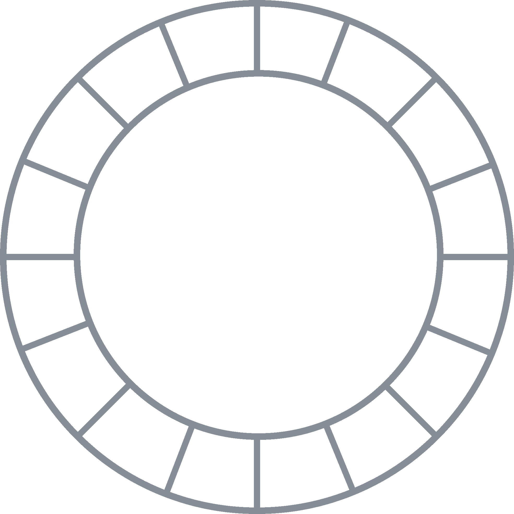

# 010 - Kho Lưu Trữ Key-Value (Key-Value Store)

[← Bài trước](009-co-so-du-lieu-databases.md) | [Mục lục](README.md) | [Bài tiếp theo →](011-mang-phan-phoi-noi-dung-cdn.md)

---


# Thiết Kế Hệ Thống: Kho Lưu Trữ Key-Value (System Design: The Key-Value Store)

Hãy cùng tìm hiểu những nguyên lý cơ bản trong thiết kế một kho lưu trữ key-value (**Key-Value Store**).

Chúng ta sẽ bao quát các nội dung sau:
* Giới thiệu về kho lưu trữ key-value
* Chúng ta sẽ thiết kế một kho lưu trữ key-value như thế nào?

---

## Giới thiệu về kho lưu trữ key-value (Introduction to key-value stores)

Kho lưu trữ key-value là các bảng băm phân tán (**Distributed Hash Tables - DHTs**). Một khóa (**key**) được tạo ra bởi hàm băm (**hash function**) và phải có tính duy nhất (**unique**). Trong một kho lưu trữ key-value, một key sẽ liên kết chặt chẽ với một giá trị (**value**) cụ thể và hệ thống hoàn toàn không đưa ra bất kỳ giả định nào về cấu trúc nội tại của giá trị đó. Một value có thể là một chuỗi nhị phân lớn (**blob**), hình ảnh, tên máy chủ, hoặc bất kỳ dữ liệu nào mà người dùng muốn lưu trữ tương ứng với một key duy nhất.

Thông thường, kích thước của value được khuyến nghị giữ ở mức tương đối nhỏ (từ **KB** đến **MB**). Chúng ta có thể lưu trữ dữ liệu dung lượng lớn trong kho lưu trữ blob (**blob store**) và chỉ đặt đường dẫn liên kết (**link**) trỏ tới dữ liệu đó vào trường value.

Kho lưu trữ key-value rất hữu ích trong nhiều kịch bản, chẳng hạn như lưu trữ phiên người dùng (**user sessions**) trong các ứng dụng web và làm nền tảng xây dựng các cơ sở dữ liệu phi quan hệ (**NoSQL databases**).

Việc mở rộng quy mô (**scale**) các cơ sở dữ liệu truyền thống nhưng vẫn phải đảm bảo tính nhất quán mạnh (**Strong Consistency**) cùng độ sẵn sàng cao (**High Availability**) trong một môi trường phân tán (**distributed environment**) là một bài toán vô cùng thách thức. Rất nhiều dịch vụ thực tế quy mô lớn như **Amazon, Facebook, Instagram, Netflix** và nhiều nền tảng khác đều sử dụng phương thức truy xuất kho dữ liệu thông qua khóa chính (**primary-key access**) thay vì phụ thuộc vào các cơ sở dữ liệu xử lý giao dịch trực tuyến truyền thống (**Online Transaction Processing - OLTP**). 

Các ví dụ điển hình về trường hợp sử dụng kho lưu trữ key-value bao gồm: danh sách bán chạy nhất (**bestseller lists**), giỏ hàng (**shopping carts**), tùy chọn cá nhân hóa của khách hàng (**customer preferences**), quản lý phiên làm việc (**session management**), xếp hạng doanh số (**sales rank**), và danh mục sản phẩm (**product catalogs**).


> [!NOTE]
> **Lưu ý:** Rất nhiều ứng dụng không đòi hỏi một mô hình lập trình phong phú, phức tạp như mô hình được cung cấp bởi hệ quản trị cơ sở dữ liệu quan hệ truyền thống (**Relational Database Management System - RDBMS**). Việc lạm dụng RDBMS cho những ứng dụng dạng này thường rất tốn kém cả về chi phí tài nguyên lẫn hiệu năng vận hành (**performance**).

---

## Chúng ta sẽ thiết kế một kho lưu trữ key-value như thế nào? (How will we design a key-value store?)

Chúng tôi đã phân chia lộ trình thiết kế hệ thống key-value thành 4 bài học cụ thể sau:

1. **Thiết kế một Kho Lưu Trữ Key-value (Design a Key-value Store):** Chúng ta sẽ xác định các yêu cầu của hệ thống key-value và thiết kế giao diện lập trình ứng dụng (**API design**).
2. **Đảm bảo Khả năng Mở rộng và Nhân bản Dữ liệu (Ensure Scalability and Replication):** Chúng ta sẽ học cách đạt được khả năng mở rộng (**Scalability**) bằng kỹ thuật băm nhất quán (**Consistent Hashing**) và cách nhân bản dữ liệu đã phân vùng (**Replication**).
3. **Quản lý Phiên bản Dữ liệu và Đạt được Khả năng Cấu hình Linh hoạt (Versioning Data and Achieving Configurability):** Chúng ta sẽ học cách giải quyết các xung đột (**conflict resolution**) phát sinh do nhiều thực thể cùng ghi dữ liệu, đồng thời cấu hình hệ thống linh hoạt để đáp ứng đa dạng các ca sử dụng khác nhau.
4. **Hỗ trợ Khả năng Chịu lỗi và Phát hiện Sự cố (Enable Fault Tolerance and Failure Detection):** Chúng ta sẽ học cách xây dựng kho lưu trữ key-value có khả năng chịu lỗi (**Fault Tolerance**) cao và cách thức phát hiện lỗi tự động trong toàn hệ thống.

---

# Thiết Kế Chi Tiết Kho Lưu Trữ Key-Value (Design of a Key-value Store)

Tìm hiểu chi tiết về các yêu cầu chức năng (**Functional Requirements**), yêu cầu phi chức năng (**Non-functional Requirements**), và thiết kế API của một kho lưu trữ key-value.

Chúng ta sẽ bao quát các nội dung sau:
* Các yêu cầu hệ thống (**Requirements**)
* Yêu cầu chức năng (**Functional requirements**)
* Yêu cầu phi chức năng (**Non-functional requirements**)
* Các giả định thiết kế (**Assumptions**)
* Thiết kế API (**API design**)
* Kiểu dữ liệu (**Data type**)

---

## Các yêu cầu hệ thống (Requirements)

Hãy cùng liệt kê các yêu cầu khi thiết kế kho lưu trữ key-value nhằm giải quyết triệt để các nhược điểm cố hữu của cơ sở dữ liệu truyền thống.

### Yêu cầu chức năng (Functional requirements)

Các yêu cầu chức năng bao gồm:

* **Dịch vụ có khả năng cấu hình linh hoạt (Configurable service):** Một số ứng dụng có xu hướng sẵn sàng đánh đổi tính nhất quán mạnh (**Strong Consistency**) để lấy độ sẵn sàng cao hơn (**High Availability**). Chúng ta cần cung cấp một dịch vụ có thể cấu hình linh hoạt để các ứng dụng khác nhau có thể lựa chọn nhiều mô hình nhất quán (**Consistency Models**) khác nhau. Chúng ta cần quyền kiểm soát chặt chẽ các yếu tố đánh đổi giữa: **Độ sẵn sàng (Availability)**, **Tính nhất quán (Consistency)**, **Hiệu quả chi phí (Cost-effectiveness)** và **Hiệu năng (Performance)**.
* **Khả năng luôn luôn ghi được dữ liệu (Ability to always write):** Ứng dụng phải luôn có khả năng thực hiện thao tác ghi vào hệ thống lưu trữ key-value. Nếu người dùng yêu cầu tính nhất quán mạnh tuyệt đối, yêu cầu này có thể không phải lúc nào cũng được đáp ứng trọn vẹn do các giới hạn ràng buộc của **định lý CAP (CAP theorem)**.
* **Tính dị thể của phần cứng (Hardware heterogeneity):** Hệ thống không nên phân biệt đối xử hay có các nút chuyên biệt đặc thù. Mọi nút (**node**) đều phải có năng lực chức năng để thực thi bất kỳ tác vụ nào trong cụm. Mặc dù các máy chủ có thể không đồng nhất về cấu hình phần cứng (các phần cứng đời mới hơn có thể có hiệu năng mạnh mẽ hơn các dòng máy cũ), hệ thống vẫn phải tương thích và hoạt động liền mạch.

### Yêu cầu phi chức năng (Non-functional requirements)

Các yêu cầu phi chức năng bao gồm:

* **Khả năng mở rộng quy mô (Scalable):** Kho lưu trữ key-value phải có khả năng vận hành ổn định trên quy mô hàng chục nghìn máy chủ phân tán trên toàn cầu. Khả năng mở rộng tiệm tiến từng bước (**Incremental Scalability**) là một tiêu chí tối quan trọng. Chúng ta cần có khả năng thêm mới hoặc loại bỏ các máy chủ khi cần thiết với mức độ gián đoạn dịch vụ là tối thiểu hoặc hoàn toàn không gián đoạn tính sẵn sàng của dịch vụ. Hơn nữa, hệ thống phải xử lý mượt mà lượng người dùng khổng lồ truy cập kho lưu trữ key-value cùng lúc.
* **Độ sẵn sàng cao (Available):** Chúng ta cần cung cấp dịch vụ liên tục không ngừng nghỉ, do đó tính sẵn sàng (**Availability**) là yếu tố sống còn. Đặc tính này có thể cấu hình được: nếu người dùng ưu tiên tính nhất quán mạnh (**Strong Consistency**), hệ thống sẽ phải chấp nhận giảm độ sẵn sàng và ngược lại.
* **Khả năng chịu lỗi (Fault tolerance):** Kho lưu trữ key-value phải tiếp tục vận hành liền mạch, không bị gián đoạn ngay cả khi xảy ra sự cố hỏng hóc ở cấp độ máy chủ vật lý hay từng thành phần phần cứng/phần mềm đơn lẻ bên trong chúng.

---

> [!NOTE]
> ### Điểm Cần Suy Ngẫm (Point to Ponder)
> **Câu hỏi:** Tại sao chúng ta cần phải chạy kho lưu trữ key-value trên nhiều máy chủ phân tán?

> [!IMPORTANT]
> ### Câu trả lời
> Một bảng băm hoạt động trên một nút duy nhất (**Single-node-based hash table**) sẽ nhanh chóng bộc lộ hạn chế và thất bại do một hoặc nhiều nguyên nhân sau:
> 1. Dù chúng ta có nâng cấp một máy chủ lớn đến đâu đi chăng nữa (**Vertical Scaling / Mega-server**), cấu hình của một máy chủ đơn lẻ cũng không thể nào đáp ứng nổi dung lượng lưu trữ khổng lồ và lưu lượng truy vấn (**Throughput / Queries**) ngày càng gia tăng.
> 2. Sự cố hỏng hóc xảy ra trên duy nhất cỗ máy chủ khổng lồ này sẽ ngay lập tức khiến toàn bộ dịch vụ sập hoàn toàn (**Single Point of Failure - SPOF**), gây gián đoạn dịch vụ (**downtime**) cho toàn bộ người dùng.
>
> Vì vậy, các kho lưu trữ key-value bắt buộc phải sử dụng rất nhiều máy chủ liên kết lại với nhau để phân tán lưu trữ và truy xuất dữ liệu.

---

## Các giả định thiết kế (Assumptions)

Chúng ta đưa ra các giả định sau nhằm giữ cho thiết kế hệ thống được tinh gọn và tập trung:

* Các trung tâm dữ liệu (**Data Centers**) lưu trữ và vận hành dịch vụ là các môi trường đáng tin cậy, an toàn (không có yếu tố thù địch nội bộ - *non-hostile*).
* Tất cả các bước xác thực (**Authentication**) và phân quyền truy cập (**Authorization**) cần thiết đều đã được hoàn tất trước đó.
* Mọi yêu cầu (**Requests**) và phản hồi (**Responses**) của người dùng đều được truyền tải an toàn qua giao thức **HTTPS**.

---

## Thiết kế API (API design)

Kho lưu trữ key-value, tương tự như các bảng băm thông thường, cung cấp hai hàm nguyên thủy cốt lõi là `get` và `put`.

Hãy cùng xem xét chi tiết thiết kế API:

### Hàm `get` (The get function)

Lời gọi API để lấy về một giá trị có dạng như sau:

```text
get(key)
```

Chúng ta trả về giá trị liên kết (**associated value**) tương ứng dựa trên tham số `key` đầu vào. Khi dữ liệu được nhân bản (**Replicated**), hệ thống sẽ tự động định vị bản sao của đối tượng (**Object Replica**) gắn liền với key cụ thể đó một cách hoàn toàn trong suốt đối với người dùng cuối (**End-user**). Quá trình này được hệ thống tự động xử lý ngầm nếu kho lưu trữ được cấu hình với...

---

# Thiết Kế Hệ Thống: Kho Lưu Trữ Key-Value (System Design: The Key-Value Store)

---

### --- Trang 7 ---

...mô hình tính nhất quán dữ liệu yếu hơn (**weaker data consistency model**). Ví dụ, trong mô hình tính nhất quán cuối cùng (**eventual consistency**), có thể có nhiều hơn một giá trị được trả về tương ứng với một khóa (**key**).

| Tham số (**Parameter**) | Mô tả (**Description**) |
| :--- | :--- |
| `key` | Là khóa mà dựa vào đó chúng ta muốn lấy giá trị (**value**). |

#### Hàm `put` (The `put` function)
Lời gọi API để đưa giá trị vào hệ thống sẽ có dạng như sau:

```text
put(key, value)
```

Hàm này lưu trữ giá trị (**value**) liên kết với khóa (**key**). Hệ thống sẽ tự động xác định vị trí dữ liệu cần được lưu đặt. Ngoài ra, hệ thống thường lưu trữ siêu dữ liệu (**metadata**) về đối tượng được lưu. Siêu dữ liệu như vậy có thể bao gồm phiên bản của đối tượng (**version of the object**).

| Tham số (**Parameter**) | Mô tả (**Description**) |
| :--- | :--- |
| `key` | Là khóa mà chúng ta cần lưu trữ giá trị (**value**) tương ứng. |
| `value` | Là đối tượng cần được lưu trữ tương ứng với khóa (**key**). |

> [!TIP]
> **Điểm Cần Suy Ngẫm (Point to Ponder)**
> 
> **Câu hỏi (Question):**  
> Chúng ta thường lưu trữ mã băm (**hash**) của giá trị (và đôi khi là giá trị + khóa liên kết) dưới dạng siêu dữ liệu (**metadata**) để kiểm tra tính toàn vẹn dữ liệu (**data integrity checks**). Mã băm như vậy nên được tính toán sau bất kỳ quá trình nén dữ liệu (**data compression**) hoặc mã hóa (**encryption**) nào, hay nên được tính toán trước đó?

---

### --- Trang 8 ---

*Quay lại (Back) | Thiết Kế Hệ Thống: Kho Lưu Trữ Key-Value (System Design: The Key-value Store) | Đánh Dấu Hoàn Thành (Mark As Completed) | Tiếp Theo (Next) | Đảm Bảo Khả Năng Mở Rộng và Sao Chép (Ensure Scalability and Replication)*

> [!NOTE]
> **Ẩn Câu Trả Lời (Hide Answer)**  
> Câu trả lời chính xác có thể phụ thuộc vào từng ứng dụng cụ thể. Tuy nhiên, chúng ta có thể sử dụng mã băm (**hash**) trước hoặc sau bất kỳ quá trình nén hoặc mã hóa nào. Nhưng chúng ta sẽ cần phải thực hiện điều đó một cách nhất quán (**consistently**) cho cả hai thao tác `put` và `get`.

#### Kiểu dữ liệu (Data type)
Khóa (**key**) thường là khóa chính (**primary key**) trong một kho lưu trữ key-value, trong khi giá trị (**value**) có thể là bất kỳ dữ liệu nhị phân tùy ý nào (**arbitrary binary data**).

> [!NOTE]
> Dynamo sử dụng thuật toán băm MD5 trên khóa (**key**) để tạo ra một định danh 128-bit (**128-bit identifier**). Các định danh này giúp hệ thống xác định nút máy chủ (**server node**) nào sẽ chịu trách nhiệm cho khóa cụ thể này.

Trong bài học tiếp theo, chúng ta sẽ học cách thiết kế kho lưu trữ key-value của mình. Trước tiên, chúng ta sẽ tập trung vào việc bổ sung khả năng mở rộng (**Scalability**), sao chép (**Replication**), và quản lý phiên bản (**Versioning**) dữ liệu vào hệ thống. Sau đó, chúng ta sẽ đảm bảo các yêu cầu chức năng (**Functional Requirements**) và giúp hệ thống có khả năng chịu lỗi (**Fault Tolerance**).

Chúng ta sẽ đáp ứng một vài yêu cầu phi chức năng (**Non-functional Requirements**) trước, bởi vì việc hiện thực hóa các yêu cầu chức năng phụ thuộc vào phương pháp được lựa chọn cho khả năng mở rộng (**Scalability**).

> [!NOTE]
> Chương này được xây dựng dựa trên Dynamo, một công trình có tầm ảnh hưởng lớn trong lĩnh vực lưu trữ key-value (**key-value stores**).

---

### --- Trang 9 ---

*(Trang trống trong tài liệu gốc)*

---

### --- Trang 10 ---

## Đảm Bảo Khả Năng Mở Rộng và Sao Chép (Ensure Scalability and Replication)

Tìm hiểu cách băm nhất quán (**Consistent Hashing**) kích hoạt khả năng mở rộng (**Scalability**) và cách chúng ta sao chép (**Replicate**) dữ liệu đã phân vùng (**Partitioned Data**) đó.

**Chúng ta sẽ tìm hiểu các nội dung sau:**
- Thêm khả năng mở rộng (**Add scalability**)
- Băm nhất quán (**Consistent hashing**)
- Sử dụng các nút ảo (**Use virtual nodes**)
- Lợi thế của các nút ảo (**Advantages of virtual nodes**)
- Sao chép dữ liệu (**Data replication**)
  - Tiếp cận Primary-secondary (**Primary-secondary approach**)
  - Tiếp cận Peer-to-peer (**Peer-to-peer approach**)

### Thêm khả năng mở rộng (Add scalability)

Hãy bắt đầu với một trong những yêu cầu thiết kế cốt lõi: khả năng mở rộng (**Scalability**). Chúng ta lưu trữ dữ liệu key-value trong các nút lưu trữ (**storage nodes**). Khi nhu cầu thay đổi, chúng ta có thể cần thêm vào hoặc loại bỏ các nút lưu trữ. Điều này có nghĩa là chúng ta cần phân vùng dữ liệu (**partition data**) trên các nút trong hệ thống để phân bổ tải đồng đều trên tất cả các nút.

Ví dụ, hãy xét trường hợp chúng ta có 4 nút, và chúng ta muốn 25% các yêu cầu (**requests**) đi tới mỗi nút để cân bằng tải (**load balance**) đồng đều. Cách truyền thống để giải quyết vấn đề này là thông qua toán tử lấy số dư (**modulus operator**). Mỗi yêu cầu gửi đến đều có một khóa (**key**) liên kết với nó. Khi một yêu cầu đến, chúng ta tính toán mã băm (**hash**) của khóa đó. Sau đó, chúng ta tìm phần dư bằng cách lấy modulo của giá trị băm với số lượng nút $m$. Giá trị phần dư $x$ chính là số thứ tự của nút, và chúng ta gửi yêu cầu tới nút đó để xử lý:

$$\text{Node} = \text{Hash}(Key) \pmod m$$

Các slide sau đây giải thích quy trình này:

---

### --- Trang 11 ---

#### Minh họa quy trình băm Modulo truyền thống (Slide 1 & 2):

**Slide 1 / 3:**
```text
Key ───► Hash(Key) ───► Value ───► Value % m = x ───► Gửi yêu cầu tới server số x
                                                        │
Tập hợp các nút (Set of nodes):                        ▼
[ Node 0 ]    [ Node 1 ]    [ Node 2 ]    [ Node 3 ]  (Số lượng nút m = 4)
```
> *Chúng ta lấy mã băm của khóa và lấy modulus với số lượng nút để tìm ra nút sẽ xử lý yêu cầu.*  
> *(1 of 3)*

**Slide 2 / 3:**
```text
Khóa (Key): 1
Mã băm Hash(1) = 10
Số lượng nút m = 4
Tính toán: 10 % 4 = 2

Tập hợp các nút (Set of nodes):
[ Node 0 ]    [ Node 1 ]    [ Node 2 ]    [ Node 3 ]
```
> *Chúng ta thực hiện các phép toán cần thiết trên khóa để xác định nút.*  
> *(2 of 3)*

---

### --- Trang 12 ---

#### Minh họa quy trình băm Modulo truyền thống (Slide 3):

**Slide 3 / 3:**
```text
Khóa (Key): 1
Mã băm Hash(1) = 10
Số lượng nút m = 4
Tính toán: 10 % 4 = 2

Tập hợp các nút (Set of nodes):
[ Node 0 ]    [ Node 1 ]   ►[ Node 2 ]◄   [ Node 3 ]
                                ▲
                                │
                    Node 2 sẽ xử lý yêu cầu!
```
> *Node 2 sẽ xử lý yêu cầu.*  
> *(3 of 3)*

---

Chúng ta muốn thêm và loại bỏ các nút với sự thay đổi tối thiểu đối với hạ tầng của mình. Tuy nhiên, trong phương pháp này, khi chúng ta thêm hoặc bớt một nút, chúng ta cần phải di chuyển rất nhiều khóa (**keys**). Điều này rất kém hiệu quả (**inefficient**).

Ví dụ: Node 2 bị loại bỏ, và giả sử đối với cùng một khóa đó, máy chủ mới để xử lý yêu cầu sẽ là Node 1 vì:

$$10 \pmod 3 = 1$$

Các nút lưu giữ thông tin trong bộ nhớ đệm cục bộ (**local caches**) của chúng, chẳng hạn như các khóa và giá trị tương ứng. Do đó, chúng ta cần di chuyển dữ liệu của yêu cầu đó sang nút tiếp theo được chỉ định xử lý yêu cầu. Tuy nhiên, việc sao chép/tái phân phối (**replication / redistribution**) này có thể rất tốn kém tài nguyên và gây ra độ trễ cao (**High Latency**).

Tiếp theo, chúng ta sẽ học cách sao chép dữ liệu một cách hiệu quả.

> [!TIP]
> **Điểm Cần Suy Ngẫm (Point to Ponder)**
> 
> **Câu hỏi (Question)**

---

### Tại sao chúng ta không sử dụng bộ cân bằng tải (Load Balancers) để phân phối các yêu cầu đến tất cả các node?

> **Ẩn câu trả lời**  
> Các bộ cân bằng tải (**Load Balancers**) phân phối các yêu cầu của client (client requests) dựa trên một thuật toán nhất định.  
> Thuật toán đó có thể đơn giản như đã giải thích ở phần trước, hoặc có thể chi tiết và chuyên sâu hơn như được mô tả trong phần tiếp theo. Phương pháp kế tiếp mà chúng ta sẽ thảo luận có thể là một trong những cách mà các bộ cân bằng tải áp dụng để điều phối lưu lượng yêu cầu đồng đều qua các node.

---

### Băm nhất quán (Consistent Hashing)

**Băm nhất quán (Consistent Hashing)** là một phương pháp hiệu quả để quản lý và phân phối tải trên một tập hợp các node.

Trong **Consistent Hashing**, chúng ta giả định rằng hệ thống có một **vòng băm logic (conceptual ring of hashes)** trải dài từ $0$ đến $n - 1$, trong đó $n$ là tổng số lượng giá trị băm (hash values) khả dụng. Chúng ta sử dụng định danh của từng node (**Node's ID**), tính toán giá trị băm (**hash**) của nó, rồi ánh xạ node đó lên vòng tròn băm. 

Chúng ta cũng áp dụng quy trình tương tự đối với các yêu cầu (**requests**). Mỗi yêu cầu sẽ được xử lý và hoàn tất bởi node tiếp theo xuất hiện đầu tiên khi di chuyển theo **chiều kim đồng hồ (clockwise direction)** trên vòng băm.

Bất cứ khi nào một node mới được bổ sung vào vòng băm, chỉ có node liền kề tiếp theo theo chiều kim đồng hồ bị ảnh hưởng. Node này sẽ phải chia sẻ dữ liệu của nó cho node mới được thêm vào, trong khi toàn bộ các node khác hoàn toàn không bị ảnh hưởng. Cơ chế này giúp hệ thống **mở rộng quy mô (Scale)** cực kỳ dễ dàng vì chúng ta giữ cho những thay đổi trên các node ở mức tối thiểu. Điều này đạt được là do chỉ có một phần nhỏ trong tổng số các khóa (**keys**) cần phải di chuyển (**rehash/migrate**). 

Các giá trị băm được phân phối ngẫu nhiên, do đó chúng ta có thể kỳ vọng lưu lượng yêu cầu (request load) sẽ mang tính ngẫu nhiên và được phân bổ đồng đều trung bình trên toàn bộ vòng băm.

---

### Minh họa từng bước cơ chế Băm nhất quán (Consistent Hashing Workflow)

#### Bước 1: Khởi tạo vòng băm logic (Conceptual Ring of Hashes)
Giả sử chúng ta có một vòng băm mang tính khái niệm từ $0$ đến $n - 1$, trong đó $n$ là tổng số giá trị băm trên vòng:


*Hình 1 / 14: Giả định có một vòng băm logic từ $0$ đến $n - 1$, trong đó $n$ là tổng số giá trị băm trong vòng băm.*

---

#### Bước 2: Thêm Node 1 vào vòng băm
Giá trị băm của **Node1** được tính toán và **Node1 ($N1$)** được ánh xạ, đưa vào vòng băm:


*Hình 2 / 14: Một giá trị hash cho Node1 được tính toán và Node1 được thêm vào vòng băm.*

---

#### Bước 3: Thêm Node 2 vào vòng băm
Tương tự, giá trị băm của **Node2** được tính toán và **Node2 ($N2$)** được thêm vào vòng băm:


*Hình 3 / 14: Giá trị hash cho Node2 được tính toán và Node2 được thêm vào vòng băm.*

---

#### Bước 4: Thêm các Node tiếp theo ($N3, N4$)
Các giá trị băm cho những node còn lại tiếp tục được tính toán và các node ($N3, N4$) lần lượt được định vị trên vòng tròn băm:


*Hình 4 / 14: Các giá trị hash cho các node khác được tính toán và các node được thêm vào vòng băm.*

---

#### Bước 5: Ánh xạ Yêu cầu (Request) lên vòng băm
Tương tự đối với các node, một giá trị băm được tính toán dựa trên khóa (**Key**) của yêu cầu, và yêu cầu (**Request - $R$**) được đưa lên vòng băm:


*Hình 5 / 14: Tương tự, một giá trị hash được tính toán cho key và request được thêm vào vòng băm.*

---

#### Bước 6: Định tuyến yêu cầu đến Node xử lý
Yêu cầu sẽ được xử lý và hoàn tất bởi node tiếp theo mà nó tìm thấy khi duyệt theo **chiều kim đồng hồ (clockwise direction)** trên vòng:


*Hình 6 / 14: Yêu cầu được hoàn tất bởi node tiếp theo mà nó tìm thấy bằng cách di chuyển theo chiều kim đồng hồ.*

---

#### Bước 7: Thêm Yêu cầu tiếp theo vào vòng băm
Giá trị băm được tính toán cho yêu cầu tiếp theo và yêu cầu này được đưa vào vị trí tương ứng trên vòng băm:


*Hình 7 / 14: Giá trị hash được tính toán cho request tiếp theo và request được thêm vào vòng băm.*

---

#### Bước 8: Định tuyến yêu cầu tiếp theo đến Node $N2$
Yêu cầu này được xử lý hoàn tất bởi **$N2$**, vì $N2$ chính là node kế tiếp xuất hiện theo **chiều kim đồng hồ (clockwise direction)**:


*Hình 8 / 14: Yêu cầu được hoàn tất bởi N2 vì đây là node tiếp theo theo chiều kim đồng hồ.*

---

> [!TIP]
> **Điểm cốt lõi của Consistent Hashing trong Hệ thống phân tán:**  
> Khi bổ sung hoặc loại bỏ một node khỏi cụm, Consistent Hashing chỉ đòi hỏi di chuyển $k/N$ khóa (với $k$ là tổng số key và $N$ là tổng số node), thay vì phải tái băm (rehash) lại toàn bộ hệ thống như các thuật toán phân dư truyền thống ($hash(key) \pmod N$). Điều này giảm thiểu tối đa hiện tượng **Replication Lag** và quá tải mạng do di trú dữ liệu.

---

# 010 - Kho Lưu Trữ Key-Value (Key-Value Store): Băm Nhất Quán (Consistent Hashing) & Nút Ảo (Virtual Nodes)

---

### Bước 9 / 14: Định tuyến Yêu cầu vào Vòng băm (Routing Request to Ring)

- **Thực thể (Entities):**
  - **Khóa (Key)** $\rightarrow$ **Hàm băm (Hash)** $\rightarrow$ **Yêu cầu (Request - ký hiệu R)**
  - **Các nút (Nodes):** $N_1, N_2, N_3, N_4$ (ký hiệu $N$)

Giá trị băm (hash) được tính toán cho yêu cầu (request) và yêu cầu này được đưa vào vòng băm (hash ring).


Yêu cầu (request) được hoàn thành và xử lý bởi nút **$N_3$** vì đây là nút kế tiếp đầu tiên gặp phải theo chiều kim đồng hồ (clockwise direction).


---

### Bước 10 / 14: Bổ sung Nút Mới vào Vòng băm (Adding a New Node)

- **Thực thể:**
  - Định danh nút mới: **`Node5_ID`** $\rightarrow$ **Hàm băm (Hash)** $\rightarrow$ **Nút $N_5$**
  - Các nút hiện tại và yêu cầu: $N_1, N_2, N_3, N_4, N_5$, Yêu cầu $R$.

Giá trị băm được tính toán cho một nút mới là **Node5 ($N_5$)**, sau đó nút này được bổ sung trực tiếp vào vòng băm.


---

### Bước 11 / 14: Tái Phân phối Khóa (Key Re-distribution)

- **Thực thể:**
  - Giá trị đầu vào: **`Input_value`** $\rightarrow$ **Hàm băm (Hash)**
  - Các nút trên vòng: $N_1, N_2, N_3, N_4, N_5$ và Yêu cầu $R$.


Nút **$N_3$** chia sẻ và di chuyển các khóa (keys) nằm trong phạm vi từ **$N_2$** đến **$N_5$** sang cho nút mới **$N_5$**.

---

### Bước 12 / 14: Định tuyến Yêu cầu Mới sau khi Thêm Nút (Routing New Request)

- **Thực thể:**
  - **Khóa (Key)** $\rightarrow$ **Hàm băm (Hash)** $\rightarrow$ **Yêu cầu (Request - $R$)**
  - Danh sách nút: $N_1, N_2, N_3, N_4, N_5$

Giá trị băm được tính toán cho một yêu cầu mới và yêu cầu này được đưa vào vòng băm.


---

### Bước 13 / 14: Xử lý Yêu cầu bởi Nút Kế tiếp (Request Processing by Next Node)

- **Thực thể:**
  - **`Input_value`** $\rightarrow$ **Hàm băm (Hash)** $\rightarrow$ **Yêu cầu (Request - $R$)**
  - Vòng băm với các nút: $N_1, N_2, N_3, N_4, N_5$

Yêu cầu hiện tại được xử lý bởi **$N_5$** thay vì **$N_3$**, bởi vì **$N_5$** chính là nút kế tiếp theo chiều kim đồng hồ.


---

### Bước 14 / 14: Vấn đề Điểm Nóng (Hotspots) trong Băm Nhất Quán

Lợi ích cốt lõi của thuật toán **Băm Nhất Quán (Consistent Hashing)** là khi các nút gia nhập (join) hoặc rời khỏi (leave) hệ thống, nó đảm bảo rằng **chỉ một số lượng khóa tối thiểu cần phải di chuyển**. 

Tuy nhiên, trong thực tế triển khai, tải yêu cầu (request load) **không được phân chia đồng đều**. Bất kỳ máy chủ nào phải xử lý một khối lượng dữ liệu quá lớn đều có thể trở thành điểm nghẽn cổ chai (bottleneck) trong toàn bộ hệ thống phân tán (Distributed System). Nút đó sẽ phải tiếp nhận một tỷ lệ yêu cầu lưu trữ và truy xuất dữ liệu lớn bất thường, gây suy giảm hiệu năng tổng thể của hệ thống. Do đó, các trường hợp này được gọi là **Điểm nóng (Hotspots)**.

Như được minh họa trong hình bên dưới, phần lớn các yêu cầu tập trung rơi vào khoảng giữa các nút **$N_4$** và **$N_1$**. Khi đó, **$N_1$** phải gánh chịu hầu hết các yêu cầu so với các nút khác, và nó đã trở thành một **Điểm nóng (Hotspot)**. Điều này đồng nghĩa với việc phân phối tải không đồng đều (non-uniform load distribution) đã làm gia tăng tải trọng quá mức lên một máy chủ đơn lẻ.

> [!NOTE]
> Đây là một bài tập tư duy rất tốt: hãy thử suy nghĩ về các giải pháp khả thi để giải quyết vấn đề phân phối tải không đồng đều này trước khi đọc tiếp nội dung bên dưới.


#### Phân phối Yêu cầu Không Đồng đều trên Vòng băm (Non-uniform request distribution in the ring)

- **Thực thể:**
  - **Khóa (Key - $R$)** $\rightarrow$ **Hàm băm (Hash)** $\rightarrow$ **Yêu cầu (Request)**
  - Các nút: $N_1, N_2, N_3, N_4, N_5$
  - Yêu cầu dồn dập: $R_1, R_2, R_3, R_4, R_5$
  - **Điểm nóng (Hotspot):** Xuất hiện tại nút **$N_1$**


---

### Sử Dụng Nút Ảo (Use Virtual Nodes)

Chúng ta sẽ sử dụng kỹ thuật **Nút Ảo (Virtual Nodes)** nhằm đảm bảo tải được phân phối đồng đều hơn trên tất cả các nút vật lý. Thay vì chỉ áp dụng một hàm băm duy nhất, chúng ta sẽ áp dụng **nhiều hàm băm khác nhau** lên cùng một khóa định danh của máy chủ.

Hãy cùng xem xét một ví dụ cụ thể: Giả sử chúng ta sử dụng **ba hàm băm (three hash functions)**. 
- Đối với mỗi nút máy chủ vật lý, chúng ta tính toán ba giá trị băm tương ứng và đặt chúng vào ba vị trí khác nhau trên vòng băm.
- Đối với mỗi yêu cầu (request), chúng ta vẫn chỉ sử dụng duy nhất một hàm băm.
- Bất kể yêu cầu rơi vào vị trí nào trên vòng băm, nó sẽ được xử lý bởi nút kế tiếp tìm thấy theo chiều kim đồng hồ.

Bởi vì mỗi máy chủ vật lý hiện có **ba vị trí đại diện (nút ảo)** trên vòng băm, nên lưu lượng tải của các yêu cầu sẽ được phân bổ đồng đều hơn đáng kể. Hơn nữa, nếu một nút máy chủ sở hữu cấu hình phần cứng (hardware capacity) vượt trội hơn các máy chủ khác, chúng ta có thể cấp phát thêm nhiều nút ảo hơn cho nó bằng cách sử dụng bổ sung các hàm băm khác. Bằng cách này, máy chủ mạnh hơn sẽ sở hữu nhiều vị trí hơn trên vòng băm và phục vụ được nhiều yêu cầu hơn tương xứng với năng lực phần cứng của nó.


---

### Khởi tạo Nút Ảo với Nhiều Hàm Băm (Virtual Nodes Setup)

#### Bước 1 / 8: Áp dụng Hàm băm thứ nhất (Hash 1)

- **Thực thể:**
  - Định danh: **`Node1_ID`** ($N$) $\rightarrow$ **Hàm băm 1 (`Hash 1`)** $\rightarrow$ **`Node1`** ($N$)
  - Đặt vị trí đầu tiên của nút trên vòng băm.

Tính toán giá trị băm cho `Node1` bằng cách sử dụng **`Hash 1`**, và đặt vị trí của nút đại diện vào vòng băm.


#### Bước 2 / 8: Áp dụng Hàm băm thứ hai (Hash 2)

- **Thực thể:**
  - Định danh: **`Node1_ID`** ($N$) $\rightarrow$ **Hàm băm 2 (`Hash 2`)** $\rightarrow$ **`Node1`** ($N$)
  - Bổ sung thêm các vị trí nút ảo kế tiếp vào vòng băm.


---

# Thiết Kế Hệ Thống: Kho Lưu Trữ Key-Value (Key-Value Store)

---

### Trang 25



**Tính toán giá trị băm (hash) cho Node1 sử dụng Hash 2, và đặt node vào trong vòng băm (hash ring)**  
*(Bước 2 trên 8)*

* Node1_ID
* N
* Hash 3
* Node1
* N
* N
* N
* N
* N
* N


**Tính toán giá trị băm (hash) cho Node1 sử dụng Hash 3, và đặt node vào trong vòng băm (hash ring)**  
*(Bước 3 trên 8)*

---

### Trang 26


* Node2_ID
* N
* Hash 1
* Node1
* N
* N
* N
* N
* N
* N
* N
* N
* N
* Node2
* N

**Tính toán giá trị băm (hash) cho Node2 sử dụng Hash 1, và đặt node vào trong vòng băm (hash ring)**  
*(Bước 4 trên 8)*


* Node2_ID
* N
* Hash 2
* Node1
* N
* N
* N
* N
* N
* N
* N
* N
* N
* Node2
* N
* N

---

### Trang 27


**Tính toán giá trị băm (hash) cho Node2 sử dụng Hash 2, và đặt node vào trong vòng băm (hash ring)**  
*(Bước 5 trên 8)*

* Node2_ID
* N
* Hash 3
* Node1
* N
* N
* N
* N
* N
* N
* N
* N
* N
* Node2
* N
* N
* N


**Tính toán giá trị băm (hash) cho Node2 sử dụng Hash 3, và đặt node vào trong vòng băm (hash ring)**  
*(Bước 6 trên 8)*

---

### Trang 28


* Key
* N
* Hash 1
* Node1
* N
* N
* N
* N
* N
* N
* N
* N
* N
* Node2
* N
* N
* N
* R
* R
* Request (Yêu cầu)

**Tính toán giá trị băm (hash) cho yêu cầu (request) sử dụng Hash 1, và đặt yêu cầu vào trong vòng băm (hash ring)**  
*(Bước 7 trên 8)*


* Key
* N
* Hash 1
* Node1
* N
* N
* N
* N
* N
* N
* N
* N
* N
* Node2
* N
* N
* N
* R
* R
* Request (Yêu cầu)

---

### Trang 29

**Yêu cầu (request) sẽ được xử lý bởi node ảo (virtual node) của Node2**  
*(Bước 8 trên 8)*

#### Ưu Điểm Của Các Node Ảo (Advantages of Virtual Nodes)
Dưới đây là một số ưu điểm của việc sử dụng các **node ảo (virtual nodes)**:
* **Nếu một node gặp sự cố (fails) hoặc thực hiện bảo trì định kỳ (routine maintenance)**, khối lượng công việc (**workload**) sẽ được phân phối đồng đều (**uniformly distributed**) lên các node khác. Đối với mỗi node mới có thể truy cập, các node khác sẽ nhận được tải gần như tương đương khi node đó hoạt động trở lại trực tuyến (**comes back online**) hoặc được thêm mới vào hệ thống.
* **Từng node có thể tự quyết định số lượng node ảo mà nó chịu trách nhiệm**, dựa trên tính không đồng nhất của hạ tầng vật lý (**heterogeneity of the physical infrastructure**). Ví dụ: nếu một node có năng lực tính toán gấp đôi so với các node khác, nó có thể đảm nhận nhiều tải hơn.

Chúng ta đã hoàn thiện thiết kế đề xuất để kho lưu trữ key-value có khả năng mở rộng (**Scalable / Scalability**). Nhiệm vụ tiếp theo là làm cho hệ thống của chúng ta đạt mức sẵn sàng cao (**High Availability**).

---

### Sao Chép Dữ Liệu (Data Replication)
Chúng ta có nhiều phương pháp khác nhau để sao chép kho lưu trữ. Đó có thể là mối quan hệ **Primary-Secondary (chính - phụ)** hoặc mối quan hệ **Peer-to-Peer (ngang hàng)**.

#### Phương Pháp Primary-Secondary (Primary-Secondary Approach)
Trong phương pháp primary-secondary, một trong các vùng lưu trữ đóng vai trò là **primary (chính)**, và các vùng lưu trữ khác đóng vai trò là **secondary (phụ)**. Node secondary sao chép dữ liệu của nó từ node primary. 
* Node primary tiếp nhận và xử lý các yêu cầu ghi (**write requests**), trong khi các node secondary tiếp nhận và xử lý các yêu cầu đọc (**read requests**). 
* Sau khi ghi, sẽ có một độ trễ sao chép (**Replication Lag**). 
* Hơn nữa, nếu node primary bị sập (**goes down**), chúng ta không thể ghi vào kho lưu trữ, và nó sẽ trở thành một điểm lỗi đơn lẻ (**Single Point of Failure - SPOF**).

---

### Trang 30


**Phương pháp Primary-secondary (Primary-secondary approach)**
* Primary (ghi - write)
* Secondary (chỉ đọc - read-only)
* Secondary (chỉ đọc - read-only)
* Secondary (chỉ đọc - read-only)

---

### Điểm Cần Suy Ngẫm (Point to Ponder)

> [!IMPORTANT]
> **Câu hỏi (Question):**  
> Phương pháp **Primary-Secondary** có đáp ứng được các yêu cầu của kho lưu trữ key-value mà chúng ta đã xác định trong bài học *System Design: The Key-value Store* hay không?

> [!NOTE]
> **Ẩn / Xem Câu Trả Lời (Hide Answer):**  
> Một trong những yêu cầu cốt lõi của chúng ta là hệ thống cần có khả năng **luôn luôn ghi được (ability to always write)**. Phương pháp này hoạt động tốt cho tùy chọn **luôn luôn đọc được (always read)**. Tuy nhiên, phương pháp tiếp cận này **không bao gồm** khả năng luôn luôn ghi được vì nó sẽ gây quá tải (**overload**) cho kho lưu trữ primary.  
> 
> Hơn thế nữa, nếu một máy chủ primary gặp sự cố thất bại (**fails**), chúng ta cần phải nâng cấp (**upgrade / failover**) một máy chủ secondary lên thành primary. **Mức độ sẵn sàng của thao tác ghi (Availability of write) sẽ bị ảnh hưởng nghiêm trọng** do chúng ta sẽ không cho phép các thao tác ghi diễn ra trong suốt khoảng thời gian chuyển đổi giao quyền (**switch-over time**).

---

# Thiết Kế Kho Lưu Trữ Key-Value (Design of a Key-Value Store)

---

## Trang 31

### Tiếp cận Ngang hàng (Peer-to-peer approach)

Trong **tiếp cận ngang hàng (peer-to-peer approach)**, tất cả các vùng lưu trữ liên quan đều đóng vai trò chính (primary), và chúng sao chép dữ liệu (replicate data) lẫn nhau để luôn cập nhật trạng thái mới nhất. Cả thao tác đọc (**read**) và ghi (**write**) đều được cho phép thực hiện trên tất cả các node.

Thông thường, việc nhân bản (replicate) dữ liệu trên toàn bộ $n$ node là không hiệu quả và tốn kém chi phí. Thay vào đó, lựa chọn phổ biến cho số lượng storage node cần nhân bản thường là 3 hoặc 5 node.

```
Mối quan hệ ngang hàng (Peer-to-peer relationship)
[ Peer ] <---> [ Peer ]
   ^             ^
   |             |
   +----> [ Peer ] <----+
```

Chúng ta sẽ sử dụng mối quan hệ ngang hàng (**peer-to-peer relationship**) cho cơ chế nhân bản (replication). Chúng ta sẽ nhân bản dữ liệu trên nhiều máy chủ (hosts) để đạt được **tính bền vững (durability)** và **độ sẵn sàng cao (High Availability)**. Mỗi mục dữ liệu sẽ được nhân bản tại $n$ host, trong đó $n$ là một tham số được cấu hình theo từng instance của kho lưu trữ key-value. Ví dụ: nếu chúng ta chọn $n = 5$, điều đó có nghĩa là chúng ta muốn dữ liệu của mình được sao chép sang 5 node.

Mỗi node sẽ nhân bản dữ liệu của nó sang các node khác. Chúng ta gọi node xử lý các thao tác đọc hoặc ghi là **node điều phối (coordinator node)**. Node này chịu trách nhiệm trực tiếp đối với các key. Một node điều phối được gán key “K”. Nó cũng chịu trách nhiệm sao chép các key sang $n - 1$ node kế tiếp trên vòng băm tròn (**hash ring**) theo chiều kim đồng hồ. Danh sách các node ảo (virtual nodes) kế tiếp này được gọi là **danh sách ưu tiên (preference lists)**. Để tránh việc đặt các bản sao (replicas) trên cùng một node vật lý, danh sách ưu tiên có thể bỏ qua các node ảo mà node vật lý tương ứng của chúng đã tồn tại sẵn trong danh sách.

Hãy cùng xem xét hình minh họa dưới đây. Chúng ta có **hệ số nhân bản (replication factor)**, $n$, được thiết lập bằng 3. Đối với key “K”, việc nhân bản được thực hiện trên ba node kế tiếp: B, C và D.

---

## Trang 32

Tương tự, đối với key “L”, việc nhân bản được thực hiện trên các node C, D và E.


*Nhân bản trong kho lưu trữ key-value (Replication in key-value store):*
- Các node trên vòng băm: **A, B, C, D, E, F**
- **Key "K"**: Được xử lý bởi node B (`Key K will be processed by node B`). Các bản sao (**Replica**) được phân bổ trên các node: C, D.
- **Key "L"**: Được xử lý bởi node C (`Key L will be processed by node C`). Các bản sao (**Replica**) được phân bổ trên các node: D, E.

---

### Điểm Cần Suy Ngẫm (Point to Ponder)

#### Câu hỏi (Question)
> Tác động của cơ chế **sao chép đồng bộ (synchronous replication)** và **sao chép bất đồng bộ (asynchronous replication)** là gì?

---

## Trang 33

*Quay lại | Thiết Kế Kho Lưu Trữ Key-Value | Đánh dấu Đã hoàn thành | Tiếp theo: Phiên Bản Hóa Dữ Liệu và Đạt Được Tính Cấu Hình…*

#### Ẩn Câu Trả Lời (Hide Answer)
Trong **sao chép đồng bộ (synchronous replication)**, tốc độ ghi dữ liệu rất chậm vì dữ liệu phải được sao chép đến tất cả các node trước khi gửi phản hồi xác nhận (acknowledge) về cho người dùng. Điều này ảnh hưởng trực tiếp đến **độ sẵn sàng (availability)** của hệ thống, vì vậy chúng ta không thể áp dụng nó. Khi lựa chọn **sao chép bất đồng bộ (asynchronous replication)**, nó cho phép chúng ta thực hiện các thao tác ghi tốc độ cao vào các node.

> [!NOTE]
> Trong bối cảnh của **Định lý CAP (CAP theorem)**, các kho lưu trữ key-value chỉ có thể chọn hoặc là **nhất quán (consistency)** hoặc là **sẵn sàng (availability)** khi xảy ra hiện tượng **phân vùng mạng (network partitions)**. Đối với các kho lưu trữ key-value, chúng ta ưu tiên **tính sẵn sàng (availability)** hơn **tính nhất quán (consistency)**. 
>
> Điều này có nghĩa là nếu hai storage node bị mất kết nối dùng cho việc nhân bản dữ liệu, chúng vẫn sẽ tiếp tục xử lý các yêu cầu gửi đến; và khi kết nối được khôi phục, chúng sẽ đồng bộ hóa (sync up) với nhau. Trong giai đoạn mất kết nối, khả năng rất cao là dữ liệu giữa các node sẽ bị **bất nhất (inconsistent)**. Vì vậy, chúng ta cần phải giải quyết các xung đột (conflict resolution) này. Trong bài học tiếp theo, chúng ta sẽ tìm hiểu khái niệm xử lý các điểm bất nhất bằng cách sử dụng **phiên bản hóa dữ liệu (data versioning)**.

---

## Trang 34

# Phiên Bản Hóa Dữ Liệu và Đạt Được Tính Cấu Hình (Versioning Data and Achieving Configurability)

Tìm hiểu cách giải quyết xung đột thông qua kỹ thuật phiên bản hóa (versioning) và cách biến kho lưu trữ key-value thành một dịch vụ có khả năng cấu hình linh hoạt (configurable service).

Chúng ta sẽ tìm hiểu các nội dung sau:
- Phiên bản hóa dữ liệu (**Data versioning**)
- Điều chỉnh thiết kế API (**Modify the API design**)
- Ví dụ sử dụng vector clock (**Vector clock usage example**)
- Đánh đổi với các giới hạn của vector clock (**Compromise with vector clocks limitations**)
- Các thao tác get và put (**The get and put operations**)
- Cách sử dụng $r$ và $w$ (**Usage of r and w**)

---

### Phiên bản hóa dữ liệu (Data versioning)

Khi hiện tượng phân vùng mạng (**network partitions**) và sự cố hỏng hóc node (**node failures**) xảy ra trong quá trình cập nhật, lịch sử phiên bản (version history) của một đối tượng có thể bị phân mảnh. Kết quả là hệ thống đòi hỏi phải có nỗ lực đối soát/hòa giải dữ liệu (**reconciliation effort**). Việc xây dựng một cơ chế chấp nhận một cách tường minh khả năng tồn tại nhiều bản sao khác nhau của cùng một mục dữ liệu là vô cùng cần thiết, nhờ đó chúng ta có thể tránh làm mất mát bất kỳ bản cập nhật nào. 

> [!IMPORTANT]
> Cần nhận thức rõ ràng rằng một số kịch bản lỗi có thể dẫn đến việc tồn tại nhiều bản sao của cùng một dữ liệu trong hệ thống. Do đó, các bản sao này có thể giống nhau hoặc rẽ nhánh/phân kỳ (**divergent**). Việc giải quyết các xung đột giữa các luồng lịch sử rẽ nhánh này là điều cốt yếu và mang tính sống còn đối với mục tiêu nhất quán dữ liệu (**consistency**).

---

## Trang 35


*Hình 1/4: Hai node sao chép dữ liệu của chúng trong khi vẫn tiếp tục xử lý các yêu cầu (Two nodes replicating their data while handling requests).*

---


*Hình 2/4: Kết nối mạng giữa hai node bị gián đoạn/đứt gãy (The network connection between two nodes breaks).*

---


*Hình 3/4: Cả hai node vẫn tiếp tục xử lý các yêu cầu gửi đến độc lập (Both nodes continue handling the requests).*

---

## Trang 36

```
A?  <--- [Request] [Request] [Request]
 :
 : (Kết nối mạng được khôi phục)
 :
B?  <--- [Request] [Request] [Request]
```
*Hình 4/4: Kết nối được khôi phục, nhưng dữ liệu ở cả hai node không nhất thiết phải giống nhau (The connection is restored, but the data in both nodes isn’t necessarily the same).*

Để xử lý tính bất nhất (**inconsistency**), chúng ta cần duy trì mối quan hệ nhân quả (**causality**) giữa các sự kiện. Chúng ta có thể thực hiện điều này bằng cách sử dụng nhãn thời gian (**timestamps**) và cập nhật tất cả các giá trị xung đột bằng giá trị của yêu cầu mới nhất (phương pháp Last-Write-Wins). 

> [!WARNING]
> Tuy nhiên, thời gian vật lý không đáng tin cậy trong một hệ thống phân tán (do hiện tượng clock drift/clock skew), vì vậy chúng ta không thể sử dụng timestamp làm yếu tố quyết định duy nhất.

Một cách tiếp cận khác để duy trì mối quan hệ nhân quả một cách hiệu quả là sử dụng **đồng hồ vector (vector clocks)**. Một vector clock là một danh sách gồm các cặp `(node, counter)`. Mỗi phiên bản của một đối tượng sẽ có một vector clock duy nhất gắn liền. 

Nếu hai đối tượng có vector clock khác nhau, chúng ta có thể xác định được liệu chúng có quan hệ nhân quả (**causally related**) với nhau hay không (chúng ta sẽ tìm hiểu chi tiết hơn ở phần sau). Trừ khi một trong hai thay đổi được hòa giải/đối soát (**reconciled**), cả hai phiên bản được coi là xung đột/bất đồng với nhau (**at odds**).

---

### Điều chỉnh thiết kế API (Modify the API design)

Chúng ta đã thảo luận về cách có thể quyết định xem hai sự kiện có quan hệ nhân quả với nhau hay không bằng cách sử dụng giá trị của vector clock. Để làm được điều này, chúng ta cần thông tin về việc node nào đã thực hiện thao tác trước đó và giá trị vector clock tương ứng của nó là bao nhiêu. Đây chính là **ngữ cảnh (context)** của một thao tác. 

Vì vậy, chúng ta sẽ điều chỉnh thiết kế API của mình như sau:

Lời gọi API để lấy một giá trị sẽ có dạng:
```
get(key)
```

---

### **--- Trang 37 ---**

| Tham số (*Parameter*) | Mô tả (*Description*) |
| :--- | :--- |
| `key` | Đây là khóa (*key*) mà chúng ta muốn lấy giá trị (*value*) tương ứng. |

Chúng ta trả về một đối tượng (*object*) hoặc một tập hợp các đối tượng xung đột (*conflicting objects*) kèm theo một ngữ cảnh (*context*). Ngữ cảnh này chứa siêu dữ liệu (*metadata*) đã được mã hóa về đối tượng, bao gồm các chi tiết như phiên bản (*version*) của đối tượng.

Lời gọi hàm API để ghi giá trị vào hệ thống sẽ có dạng như sau:
```text
put(key, context, value)
```

| Tham số (*Parameter*) | Mô tả (*Description*) |
| :--- | :--- |
| `key` | Đây là khóa (*key*) mà chúng ta cần lưu trữ giá trị (*value*) vào. |
| `context` | Thành phần này nắm giữ siêu dữ liệu (*metadata*) cho từng đối tượng. |
| `value` | Đây là đối tượng (*object*) cần được lưu trữ tương ứng với khóa (*key*). |

Hàm này tìm kiếm nút (*node*) nơi giá trị nên được đặt dựa trên khóa (*key*) và lưu trữ giá trị liên kết với nó. Ngữ cảnh (*context*) được hệ thống trả về sau thao tác đọc `get`. Nếu chúng ta có một danh sách các đối tượng trong `context` gây ra xung đột (*conflict*), chúng ta sẽ yêu cầu phía máy khách (*client*) giải quyết xung đột đó.

Để cập nhật một đối tượng trong kho lưu trữ khóa - giá trị (*key-value store*), máy khách (*client*) bắt buộc phải cung cấp ngữ cảnh (*context*). Chúng ta xác định thông tin phiên bản bằng cách sử dụng đồng hồ vector (*vector clock*) thông qua việc truyền `context` từ một thao tác đọc (*read operation*) trước đó. Nếu kho lưu trữ khóa - giá trị truy cập được vào nhiều nhánh (*branches*), nó sẽ cung cấp tất cả các đối tượng tại các nút lá (*leaf nodes*), cùng với thông tin phiên bản tương ứng của chúng trong `context` khi xử lý một yêu cầu đọc. Việc đối soát (*reconciling*) các phiên bản khác nhau và hợp nhất chúng (*merging*) thành một phiên bản mới duy nhất được coi là một thao tác cập nhật (*update*).

---

### **--- Trang 38 ---**

> [!NOTE]
> **Ghi chú:** Quy trình giải quyết xung đột (*resolving conflicts*) này tương tự như cách thức hoạt động trong Git. Nếu Git có khả năng tự động hợp nhất nhiều phiên bản thành một, quá trình hợp nhất (*merging*) sẽ được thực thi tự động. Việc giải quyết xung đột bằng thủ công sẽ phụ thuộc vào phía máy khách (nhà phát triển - *developer*) nếu việc tự động giải quyết xung đột không thể thực hiện được. Tương tự theo hướng tiếp cận đó, hệ thống của chúng ta có thể thử giải quyết xung đột tự động và nếu không thể, hệ thống sẽ yêu cầu phía ứng dụng (*application*) cung cấp một giá trị đã được giải quyết xung đột cuối cùng.

#### **Ví dụ về việc sử dụng đồng hồ vector (Vector Clock)**

Hãy cùng xem xét một ví dụ cụ thể. Giả sử chúng ta có một yêu cầu thao tác ghi (*write operation request*). 

- Nút **$A$** xử lý phiên bản đầu tiên của yêu cầu ghi, ký hiệu là $E_1$; trong đó $E$ biểu thị sự kiện (*event*). Đồng hồ vector (*vector clock*) tương ứng chứa thông tin về nút và bộ đếm (*counter*) của nó — tức là $[A, 1]$.
- Nút **$A$** tiếp tục xử lý một thao tác ghi khác cho cùng một đối tượng mà thao tác ghi trước đó đã thực hiện. Do đó, đối với $E_2$, chúng ta có $[A, 2]$. $E_1$ không còn cần thiết nữa vì nó đã được cập nhật ngay trên cùng một nút.
- $E_2$ đọc các thay đổi được tạo ra bởi $E_1$, và sau đó các thay đổi mới được thực hiện.
- Giả sử xảy ra hiện tượng phân vùng mạng (*network partition*). Lúc này, yêu cầu được xử lý bởi hai nút khác nhau là **$B$** và **$C$**. Ngữ cảnh (*context*) với các phiên bản được cập nhật, lần lượt là $E_3$, $E_4$, cùng các đồng hồ liên quan của chúng là $([A, 2], [B, 1])$ và $([A, 2], [C, 1])$, hiện đã tồn tại trong hệ thống.
- Giả sử sự cố phân vùng mạng được khắc phục (*network partition is repaired*), và máy khách lại gửi yêu cầu ghi một lần nữa, nhưng lúc này chúng ta gặp phải xung đột (*conflicts*). Ngữ cảnh $([A, 3], [B, 1], [C, 1])$ của các xung đột được trả về cho máy khách.
- Sau khi máy khách thực hiện việc đối soát/giải quyết xung đột (*reconciliation*) và nút **$A$** điều phối thao tác ghi (*coordinates the write*), chúng ta thu được $E_5$ với đồng hồ là $([A, 4])$.

---

### **--- Trang 39 ---**

```text
Node A: counter = 1
Node B: counter = 1
Node C: counter = 1
```
> Giả sử chúng ta có ba nút (*nodes*). Bộ đếm đồng hồ vector (*vector clock counter*) được thiết lập bằng 1 cho tất cả các nút.  
> *(1/8)*

```text
Thao tác ghi được xử lý bởi A:
E1( [A, 1] )

Node A: counter = 2
Node B: counter = 1
Node C: counter = 1
```
> Nút A xử lý phiên bản đầu tiên của yêu cầu ghi, $E_1$, và bộ đếm đồng hồ vector của nó được tăng thêm 1.  
> *(2/8)*

---

### **--- Trang 40 ---**

```text
Thao tác ghi được xử lý bởi A:
E1( [A, 1] )

Thao tác ghi được xử lý bởi A:
E2( [A, 2] )

Node A: counter = 3
Node B: counter = 1
Node C: counter = 1
```
> Nút A xử lý phiên bản thứ hai của yêu cầu ghi, $E_2$, và bộ đếm đồng hồ vector được tăng thêm 2.  
> *(3/8)*

```text
Thao tác ghi được xử lý bởi A:
E1( [A, 1] )

Thao tác ghi được xử lý bởi A:
E2( [A, 2] )

Node A: counter = 3
Node B: counter = 1
Node C: counter = 1

--- Phân vùng mạng (Network partition) ---
```
> Giả sử hiện tượng phân vùng mạng (*network partition*) xảy ra.

---

### **--- Trang 41 ---**

*(4/8)*

```text
Thao tác ghi được xử lý bởi A:
E1( [A, 1] )

Thao tác ghi được xử lý bởi A:
E2( [A, 2] )

--- Phân vùng mạng (Network partition) ---

Thao tác ghi được xử lý bởi B:
E3( [A, 2], [B, 1] )

Thao tác ghi được xử lý bởi C:
E4( [A, 2], [C, 1] )

Node A: counter = 3
Node B: counter = 2
Node C: counter = 2
```
> Hiện tại, yêu cầu được xử lý bởi các Nút B và C, và bộ đếm đồng hồ vector tương ứng của từng nút được tăng lên.  
> *(5/8)*

```text
Thao tác ghi được xử lý bởi A:
E1( [A, 1] )

Thao tác ghi được xử lý bởi A:
E2( [A, 2] )

--- Phân vùng mạng (Network partition) ---

Thao tác ghi được xử lý bởi B:
E3( [A, 2], [B, 1] )

Thao tác ghi được xử lý bởi C:
E4( [A, 2], [C, 1] )

--- Mạng đã được khắc phục (Network repaired) ---

Node A: counter = 3
Node B: counter = 2
Node C: counter = 2
```

---

### **--- Trang 42 ---**

> Giả sử hệ thống mạng hiện đã được khắc phục/phục hồi xong.  
> *(6/8)*

```text
Thao tác ghi được xử lý bởi A:
E1( [A, 1] )

Thao tác ghi được xử lý bởi A:
E2( [A, 2] )

--- Phân vùng mạng (Network partition) ---

Thao tác ghi được xử lý bởi B:
E3( [A, 2], [B, 1] )

Thao tác ghi được xử lý bởi C:
E4( [A, 2], [C, 1] )

--- Mạng đã được khắc phục (Network repaired) ---

Node A: counter = 3
Node B: counter = 2
Node C: counter = 2
```

> [!IMPORTANT]
> Máy khách gửi yêu cầu ghi một lần nữa nhưng hiện tại chúng ta xuất hiện các xung đột (*conflicts*). Ngữ cảnh `( [A, 3], [B, 1], [C, 1] )` mang thông tin của các xung đột sẽ được trả về cho máy khách (*client*).

Yêu cầu được gửi đến Nút A để xử lý, nhưng hiện tại nó đang có xung đột. Chúng ta yêu cầu phía máy khách (*client*) tiến hành giải quyết xung đột đó.  
*(7/8)*

---

### --- Trang 43 ---

```
Ghi (Write) được xử lý bởi A
E1( [A,1] )

Ghi (Write) được xử lý bởi A
E2( [A,2] )

Phân vùng mạng (Network partition)

Ghi được xử lý bởi B                     Ghi được xử lý bởi C
E3( [A,2], [B,1] )                       E4( [A,2], [C,1] )

Mạng được khắc phục/phục hồi (Network repaired)

Client gửi yêu cầu ghi một lần nữa nhưng
hiện tại chúng ta có các xung đột (conflicts).
Ngữ cảnh (context) ( [A,3], [B,1], [C,1] ) của
các xung đột sẽ được trả về cho client. 

E5( [A,4] )
Ghi được xử lý bởi A sau khi nhận được
kết quả điều hòa/hòa giải (reconciliation) từ client

Node A: counter = 5, counter = 2
Node B: counter = 2
Node C
Yêu cầu được cập nhật sau khi hòa giải (reconciliation)
8 of 8
```

#### Thỏa hiệp với các hạn chế của Vector Clocks (Compromise with vector clocks limitations)

Kích thước của các **vector clock** có thể tăng lên nếu nhiều server cùng ghi đồng thời vào một đối tượng. Điều này khó có khả năng xảy ra trong thực tế vì các tác vụ ghi thường được xử lý bởi một trong số $n$ node hàng đầu (top $n$ nodes) trong danh sách ưu tiên (**preference list**).

Ví dụ: nếu xảy ra sự cố phân vùng mạng (**network partitions**) hoặc lỗi nhiều server đồng thời (**multiple server failures**), các yêu cầu ghi có thể được xử lý bởi các node không nằm trong top $n$ node của danh sách ưu tiên. Kết quả là chúng ta có thể nhận được một phiên bản dài như sau:

$$([A, 10], [B, 4], [C, 1], [D, 2], [E, 1], [F, 3], [G, 5], [H, 7], [I, 2], [J, 2], [K, 1], [L, 1])$$

Việc lưu trữ và duy trì một lịch sử phiên bản dài như vậy là một gánh nặng lớn.

Chúng ta có thể giới hạn kích thước của vector clock trong những tình huống này. Chúng ta áp dụng một chiến lược cắt bớt clock (**clock truncation strategy**) để lưu kèm một dấu thời gian (**timestamp**) với mỗi cặp `(node, counter)` nhằm thể hiện thời điểm dữ liệu được node cập nhật lần cuối. Các cặp vector clock sẽ bị loại bỏ/thanh trừng (**purged**) 

---

### --- Trang 44 ---

khi số lượng các cặp `(node, counter)` vượt quá một ngưỡng định trước (ví dụ: 10). Do các liên kết thế hệ con cháu/hậu duệ (**descendant linkages**) không thể được tính toán một cách chính xác, cách tiếp cận cắt tỉa này có thể dẫn đến việc giảm hiệu quả trong quá trình điều hòa/hòa giải dữ liệu (**reconciliation**).

---

#### Các thao tác get và put (The get and put operations)

Một trong những yêu cầu chức năng (**functional requirements**) của chúng ta là hệ thống phải có khả năng cấu hình linh hoạt (**configurable**). Chúng ta muốn kiểm soát sự đánh đổi (**trade-offs**) giữa tính sẵn sàng (**Availability**), tính nhất quán (**Consistency**), hiệu quả chi phí (**Cost-effectiveness**), và hiệu năng (**Performance**). Do đó, hãy hiện thực hóa khả năng cấu hình này bằng cách triển khai các hàm cơ bản `get` và `put` của kho lưu trữ khóa - giá trị (**key-value store**).

Mọi node trong hệ thống của chúng ta đều có thể xử lý các thao tác `get` (đọc) và `put` (ghi). Một node chịu trách nhiệm xử lý một thao tác đọc hoặc ghi được gọi là **node điều phối (coordinator)**. Node điều phối là node đầu tiên trong số top $n$ node thuộc danh sách ưu tiên (**preference list**).

Có hai cách để một client có thể lựa chọn một node:
1. Chúng ta định tuyến yêu cầu tới một bộ cân bằng tải thông thường (**generic load balancer**).
2. Chúng ta sử dụng một thư viện client nhận biết phân vùng (**partition-aware client library**) để định tuyến các yêu cầu trực tiếp tới các node điều phối (**coordinator nodes**) phù hợp.

Cả hai cách tiếp cận đều có những lợi ích riêng:
- Với cách tiếp cận thứ nhất, client không bị ràng buộc phụ thuộc chặt chẽ vào mã nguồn hệ thống.
- Với cách tiếp cận thứ hai, hệ thống đạt được độ trễ thấp hơn (**lower Latency**). Độ trễ thấp hơn là nhờ việc giảm thiểu số bước chuyển tiếp mạng (**hops**), vì client có thể đi thẳng trực tiếp tới một server cụ thể.

Hãy làm cho dịch vụ của chúng ta có khả năng cấu hình bằng cách trang bị cơ chế cho phép kiểm soát sự đánh đổi giữa **Availability**, **Consistency**, **Cost-effectiveness**, và **Performance**. Chúng ta có thể sử dụng một giao thức nhất quán (**consistency protocol**) tương tự như các giao thức được dùng trong các hệ thống túc số (**quorum systems**).

Xét một ví dụ: Giả sử giá trị $n$ trong top $n$ của danh sách ưu tiên bằng 3 ($n = 3$). Điều đó có nghĩa là ba bản sao (**3 copies**) của dữ liệu cần được duy trì. Chúng ta giả định rằng các node được bố trí trên một vòng tròn băm (**ring**). Giả sử thứ tự theo chiều kim đồng hồ của các node trên vòng tròn đó là A, B, C, D, và E. Nếu hàm ghi được thực thi trên node A, thì các bản sao của dữ liệu đó sẽ được đặt trên B và C. Điều này là do B và C là các node kế tiếp mà chúng ta bắt gặp khi di chuyển theo chiều kim đồng hồ trên vòng tròn (**ring**).

---

### --- Trang 45 ---

#### Sử dụng $r$ và $w$ (Usage of $r$ and $w$)

Bây giờ, hãy xem xét hai biến số: $r$ và $w$:
- $r$ đại diện cho số lượng node tối thiểu cần tham gia vào một thao tác đọc thành công (**successful read operation**).
- $w$ đại diện cho số lượng node tối thiểu tham gia vào một thao tác ghi thành công (**successful write operation**).

Vì vậy, nếu $r = 2$, điều đó có nghĩa là hệ thống của chúng ta sẽ đọc từ 2 node khi chúng ta có dữ liệu được lưu trữ tại 3 node. Chúng ta cần chọn các giá trị của $r$ và $w$ sao cho có ít nhất một node chung giữa chúng. Điều này đảm bảo rằng các client đọc dữ liệu (**readers**) có thể nhận được giá trị mới nhất vừa được ghi (**latest-written value**). Để đạt được điều đó, chúng ta sẽ sử dụng một hệ thống dạng túc số (**quorum-like system**) bằng cách thiết lập:

$$r + w > n$$

Bảng dưới đây cung cấp cái nhìn tổng quan về việc các giá trị $n$, $r$, và $w$ ảnh hưởng như thế nào đến tốc độ của các tác vụ đọc và ghi:

| Giá trị (Value) $n$ | $r$ | $w$ | Ảnh hưởng đến Đọc và Ghi (Effects on Reads and Writes) / Mô tả (Description) |
| :---: | :---: | :---: | :--- |
| **3** | **2** | **1** | **Không được cho phép (It won't be allowed)** vì nó vi phạm điều kiện $r + w > n$. |
| **3** | **2** | **2** | **Được cho phép (It will be allowed)** vì nó thỏa mãn điều kiện $r + w > n$. |
| **3** | **3** | **1** | Sẽ cung cấp **tốc độ ghi nhanh (speedy writes)** và **đọc chậm (slow reads)**, vì các reader cần phải truy vấn tới tất cả $n$ bản sao replica. |
| **3** | **1** | **3** | Sẽ cung cấp **tốc độ đọc nhanh (speedy reads)** từ bất kỳ node nào và **ghi chậm (slow writes)**, vì hiện tại chúng ta cần phải ghi đồng bộ (**synchronously**) vào tất cả các node. |

Giả sử $n = 3$, nghĩa là chúng ta có 3 node mà dữ liệu được sao chép đến. Bây giờ, với $w = 2$, thao tác ghi đảm bảo phải ghi thành công vào 2 node để coi yêu cầu này là thành công. Đối với node thứ ba, dữ liệu sẽ được cập nhật bất đồng bộ (**asynchronously**).

---

### --- Trang 46 ---

```
Vòng tròn Ring: A -> B -> C -> D -> E
Khóa "K" (Key "K")
n = 3 (Replication factor - hệ số nhân bản)
w = 2
```

> [!NOTE]
> Chúng ta có hệ số nhân bản (**replication factor**) là 3 ($n = 3$) và $w$ là 2. Khóa "K" sẽ được nhân bản tới A, B, và C.
*(Hình minh họa 1 / 3)*

---

### --- Trang 47 ---

```
Khóa "K" (Key "K")
n = 3 (Replication factor)
w = 2

Ghi (Write) --------> Node A
Ghi (Write) --------> Node B
                      Node C
                      Node D
                      Node E
```

> [!IMPORTANT]
> Vì $w = 2$, chúng ta sẽ ghi vào hai node đầu tiên (A và B), sau đó gửi phản hồi xác nhận (**acknowledgment - ACK**) về cho người dùng hoặc client.
*(Hình minh họa 2 / 3)*

---

### --- Trang 48 ---

```
Khóa "K" (Key "K")
n = 3 (Replication factor)
w = 2

Ghi (Write) ----------------------> Node A
Ghi (Write) ----------------------> Node B
Ghi bất đồng bộ (Write asynchronously) -> Node C
                                   Node D
                                   Node E
```

> [!TIP]
> Đối với node thứ ba (Node C), chúng ta sẽ ghi/nhân bản dữ liệu theo phương thức bất đồng bộ (**asynchronously**).
*(Hình minh họa 3 / 3)*

---

Trong mô hình này, độ trễ (**Latency**) của một thao tác `get` được quyết định bởi bản sao replica phản hồi chậm nhất trong số $r$ replicas. Lý do là khi chọn giá trị $r$ lớn hơn, chúng ta tập trung nhiều hơn vào tính sẵn sàng (**Availability**) và chấp nhận đánh đổi tính nhất quán (**Consistency**).

Node điều phối (**coordinator**) sẽ tạo ra vector clock cho phiên bản mới và ghi phiên bản mới này vào bộ lưu trữ cục bộ (**locally**) ngay khi nhận được một yêu cầu `put()` đối với một khóa. Node điều phối sau đó gửi phiên bản cập nhật kèm theo vector clock mới tới $n$ node có thứ hạng cao nhất. 

Chúng ta coi một thao tác ghi là thành công nếu có ít nhất $w - 1$ node phản hồi. Hãy nhớ rằng node điều phối tự ghi vào chính nó trước, vì vậy tổng cộng chúng ta nhận được $w$ lượt ghi thành công.

Các yêu cầu cho thao tác `get()` được gửi tới $n$ node có thứ hạng cao nhất và còn khả năng kết nối (**reachable nodes**) trong danh sách ưu tiên (**preference list**) của một khóa. Chúng sẽ đợi đủ $r$ câu trả lời trước khi trả về kết quả...

---

# Đảm bảo Khả năng Mở rộng và Sao lưu Dữ liệu (Ensure Scalability and Replication)

> **Điều hướng:** [Quay lại (Back)] — **Đảm bảo Khả năng Mở rộng và Sao lưu Dữ liệu (Ensure Scalability and Replication)** — [Đánh dấu Đã hoàn thành (Mark As Completed)] — [Tiếp theo (Next)] — **Kích hoạt Khả năng Chịu lỗi và Phát hiện Sự cố (Enable Fault Tolerance and Failure Detection)**

...các kết quả trả về cho client. Các node điều phối (Coordinators) sẽ trả về tất cả các phiên bản của tập dữ liệu (dataset versions) mà chúng coi là không có quan hệ nhân quả/độc lập với nhau nếu nhận được nhiều tập dữ liệu từ cùng một nguồn (các lịch sử phân nhánh cần đối soát/hòa giải - divergent histories that need reconciliation). Sau đó, các phiên bản xung đột này sẽ được hợp nhất (merged), và giá trị của khóa (key's value) thu được sẽ được ghi đè lại để thay thế cho các phiên bản trước đó.

Cho đến thời điểm hiện tại, chúng ta đã đáp ứng được các yêu cầu về:
* **Khả năng mở rộng (Scalability)**
* **Tính sẵn sàng cao (High Availability)**
* **Giải quyết xung đột dữ liệu (Conflict-resolution)**
* **Dịch vụ có khả năng tùy biến cấu hình (Configurable service)**

Yêu cầu kỹ thuật cuối cùng là xây dựng một **hệ thống có khả năng chịu lỗi (Fault-tolerant system)**. Chúng ta sẽ cùng thảo luận cách hiện thực hóa mục tiêu này trong bài học tiếp theo.

---

# Kích hoạt Khả năng Chịu lỗi và Phát hiện Sự cố (Enable Fault Tolerance and Failure Detection)

Tìm hiểu cách thức giúp một kho lưu trữ dạng khóa - giá trị (**Key-Value Store**) đạt được khả năng chịu lỗi (**Fault Tolerance**) và năng lực tự động phát hiện sự cố (**Failure Detection**).

### Nội dung chính sẽ bao gồm:
* Xử lý các sự cố tạm thời (**Handle temporary failures**)
* Xử lý các sự cố vĩnh viễn (**Handle permanent failures**)
* Chống mất đồng bộ dữ liệu bằng cây Merkle (**Anti-entropy with Merkle trees**)
* Tận dụng tư cách thành viên trong vòng băm để phát hiện sự cố (**Promote membership in the ring to detect failures**)
* Kết luận (**Conclusion**)

---

## 1. Xử lý các sự cố tạm thời (Handle temporary failures)

Thông thường, các hệ thống phân tán (**Distributed Systems**) sử dụng phương pháp tiếp cận dựa trên **túc số (Quorum-based approach)** để xử lý sự cố. 

> [!NOTE]
> **Định nghĩa Quorum:**  
> **Quorum (Túc số)** là số lượng phiếu bầu tối thiểu cần thiết để một giao dịch phân tán (**Distributed Transaction**) được phép tiếp tục thực thi một thao tác. 

Nếu một máy chủ nằm trong nhóm đồng thuận (**Consensus**) bị ngừng hoạt động (down), chúng ta không thể thực hiện thao tác được yêu cầu. Điều này ảnh hưởng trực tiếp đến **tính sẵn sàng (Availability)** và **độ bền bỉ của dữ liệu (Durability)** trong hệ thống.

Chúng ta sẽ sử dụng cơ chế **Túc số nới lỏng (Sloppy Quorum)** thay vì tư cách thành viên túc số nghiêm ngặt (**Strict Quorum membership**). 

Thông thường, một node đóng vai trò **Leader** sẽ quản lý toàn bộ giao tiếp giữa các node tham gia tiến trình đồng thuận (**Participants of the consensus**). Các participant sẽ gửi lại thông điệp xác nhận (**Acknowledgment - ACK**) sau khi commit một thao tác ghi (**Write operation**) thành công. Khi nhận đủ các ACK này, Leader mới phản hồi lại cho client. 

Tuy nhiên, nhược điểm là các participant rất dễ bị ảnh hưởng bởi sự cố mạng (**Network Outage**). Nếu Leader tạm thời bị down và các participant không thể kết nối tới nó, chúng sẽ tuyên bố rằng Leader đã chết. Lúc này, một Leader mới phải được bầu chọn lại (**Reelected**). Việc kích hoạt bầu cử liên tục như vậy gây tác động tiêu cực nghiêm trọng đến hiệu năng (**Performance**), vì hệ thống phải tiêu tốn nhiều thời gian cho việc bầu chọn Leader hơn là thực hiện các tác vụ công việc thực tế.

Trong mô hình **Sloppy Quorum**, $n$ node hoạt động bình thường (**Healthy nodes**) đầu tiên trong **danh sách ưu tiên (Preference List)** sẽ chịu trách nhiệm xử lý tất cả các thao tác đọc (**Read**) và ghi (**Write**).

> [!IMPORTANT]
> Lưu ý rằng $n$ node hoạt động bình thường này có thể **không phải lúc nào cũng là $n$ node đầu tiên** được tìm thấy khi duyệt theo chiều kim đồng hồ trên vòng băm nhất quán (**Consistent Hash Ring**).

---

### Ví dụ minh họa cấu hình Sloppy Quorum với $n = 3$:

Giả sử chúng ta có 7 node trên vòng băm và danh sách ưu tiên của các node là:
$$\text{Preference List} = [A, D, C, B, G, E]$$

```
          F       E
      G               D
        B           A
              C
```

* Cấu hình số bản sao cần thiết: $n = 3$.
* Nếu **Node A** tạm thời không khả dụng hoặc không thể truy cập được trong quá trình thực hiện thao tác ghi:
  1. Yêu cầu ghi sẽ được chuyển tiếp đến node khỏe mạnh tiếp theo trong danh sách ưu tiên, trong trường hợp này là **Node D**. Cơ chế này đảm bảo được mức độ sẵn sàng (**Availability**) và độ bền bỉ (**Durability**) theo thiết kế.
  2. Sau khi xử lý xong yêu cầu, **Node D** sẽ đính kèm thêm một dấu vết gợi ý (**Hint**) chỉ rõ node nào mới là bên nhận đích thực sự (trong trường hợp này là **Node A**).
  3. Ngay khi **Node A** khởi động và hoạt động bình thường trở lại, **Node D** sẽ gửi thông tin yêu cầu này sang cho **Node A** để nó cập nhật dữ liệu của mình.
  4. Sau khi quá trình chuyển giao hoàn tất, **Node D** sẽ xóa bỏ mục dữ liệu này khỏi bộ nhớ lưu trữ cục bộ (**Local storage**) của nó mà không làm xáo trộn hoặc thay đổi tổng số lượng bản sao (**Replicas**) trong toàn hệ thống.

Phương pháp tiếp cận này được gọi là **Chuyển giao kèm gợi ý (Hinted Handoff)**. Nhờ áp dụng cơ chế này, chúng ta có thể đảm bảo các thao tác đọc và ghi luôn được đáp ứng đầy đủ ngay cả khi một node gặp phải sự cố tạm thời.

> [!NOTE]
> **Lưu ý về Tính sẵn sàng cấp độ Trung tâm Dữ liệu (Data Center Failure):**  
> Một hệ thống lưu trữ có độ sẵn sàng cao (**High Availability Storage System**) bắt buộc phải xử lý được sự cố sập toàn bộ trung tâm dữ liệu (**Data Center Failure**) do mất điện diện rộng, lỗi hệ thống làm mát, đứt cáp quang mạng hoặc thiên tai. Để giải quyết vấn đề này, chúng ta phải đảm bảo thực hiện cơ chế sao chép dữ liệu liên trung tâm dữ liệu (**Replication across data centers**). Do đó, nếu một data center bị ngừng hoạt động, chúng ta hoàn toàn có thể khôi phục lại dữ liệu từ data center còn lại.

---

### Điểm cần suy ngẫm (Point to Ponder)

**Câu hỏi:**
> Những hạn chế của việc sử dụng kỹ thuật Hinted Handoff là gì?

**Lời giải đáp:**
> Tình trạng biến động thành viên tối thiểu (**Minimal churn in system membership**) và các sự cố sập node thoáng qua (**Transient node failures**) là điều kiện lý tưởng cho kỹ thuật Hinted Handoff. Tuy nhiên, trong một số tình huống đặc thù, các bản sao tạm thời có chứa gợi ý (**Hinted replicas**) có thể sẽ trở nên không khả dụng trước khi kịp bàn giao và khôi phục về node bản sao gốc ban đầu.

---

## 2. Xử lý các sự cố vĩnh viễn (Handle permanent failures)

Trong trường hợp các node gặp phải sự cố vĩnh viễn (**Permanent failures**), chúng ta cần phải giữ cho các bản sao (**Replicas**) luôn được đồng bộ hóa với nhau nhằm tăng cường tính bền vững dữ liệu (**Durability**) cho hệ thống. 

Mục tiêu đặt ra là:
1. Đẩy nhanh tốc độ phát hiện sự không nhất quán (**Inconsistencies**) giữa các bản sao dữ liệu.
2. Cắt giảm tối đa lưu lượng dữ liệu phải truyền tải qua mạng (**Transferred data**).

Để làm được điều đó, chúng ta sử dụng **Cây Merkle (Merkle Trees)**.

Trong một cây Merkle:
* Giá trị của từng khóa đơn lẻ (**Individual keys**) sẽ được băm (**Hashed**) và sử dụng làm các **nút lá (Leaf nodes)** của cây.
* Các nút cha (**Parent nodes**) nằm ở cấp cao hơn trong cây sẽ chứa giá trị băm kết hợp của các nút con của chúng.
* Từng nhánh riêng biệt của cây Merkle có thể được kiểm tra và đối soát hoàn toàn độc lập mà **không cần phải tải xuống toàn bộ cây** hoặc toàn bộ tập dữ liệu.

Khi tiến hành kiểm tra tính không nhất quán giữa các bản sao dữ liệu, cây Merkle giúp cắt giảm lượng dữ liệu trao đổi qua mạng. Ví dụ: Nếu giá trị băm tại nút gốc (**Root hash**) của hai cây trùng khớp nhau và các nút lá của chúng cũng giống nhau, thì hoàn toàn không cần phải thực hiện đồng bộ hóa.

Các máy chủ (**Hosts**) có thể phát hiện chính xác những khóa dữ liệu nào đang bị mất đồng bộ (**Out of sync**) khi các node trao đổi giá trị băm của các nút con với nhau, cho đến khi tiến trình đối soát chạm tới các nút lá của cây. 

> [!TIP]
> **Cơ chế Chống mất đồng bộ (Anti-entropy):**  
> Cây Merkle là cơ chế nòng cốt để triển khai tiến trình **Anti-entropy** — nghĩa là giữ cho toàn bộ dữ liệu luôn đạt trạng thái nhất quán. Cây Merkle giảm thiểu tối đa dung lượng dữ liệu truyền qua mạng phục vụ việc đồng bộ, đồng thời giảm số lượt truy xuất đọc đĩa cứng (**Disk I/O**) trong suốt quá trình chạy tác vụ anti-entropy.

---

### Nguyên lý hoạt động của Cây Merkle (Từng bước chi tiết):

#### Bước 1 (Hình 1 / 14): Tính toán mã băm cho tất cả các khóa
Tính toán giá trị băm cho toàn bộ các khóa. Các giá trị băm này sẽ đóng vai trò là các nút lá (**Leaf nodes**):
```
[Nút lá]:   H1   H2   H3   H4   H5   H6   H7   H8   H9   H10
            |    |    |    |    |    |    |    |    |    |
[Khóa]:     K1   K2   K3   K4   K5   K6   K7   K8   K9   K10
```
*(Calculate the hashes for all keys. The hashes will be leaf nodes)*

---

#### Bước 2 (Hình 2 / 14): Tạo nút cha cho cụm H1 - H2
Giá trị băm của các nút `H1` và `H2` được tính toán kết hợp và lưu trữ làm nút cha `H1_2` của chúng:
```
[Cấp 1]:       H1_2
              /    \
[Nút lá]:   H1      H2      H3   H4   H5   H6   H7   H8   H9   H10
            |       |       |    |    |    |    |    |    |    |
[Khóa]:     K1      K2      K3   K4   K5   K6   K7   K8   K9   K10
```
*(The hashes of the H1 and H2 nodes are calculated and stored as their parent node)*

---

#### Bước 3 (Hình 3 / 14): Tạo nút cha cho cụm H3 - H4
Tiếp tục, giá trị băm của các nút `H3` và `H4` được tính toán kết hợp và lưu trữ làm nút cha `H3_4` của chúng:
```
[Cấp 1]:       H1_2            H3_4
              /    \          /    \
[Nút lá]:   H1      H2      H3      H4      H5   H6   H7   H8   H9   H10
            |       |       |       |       |    |    |    |    |    |
[Khóa]:     K1      K2      K3      K4      K5   K6   K7   K8   K9   K10
```
*(The hashes of the H3 and H4 nodes are calculated and stored as their parent node)*

---

# CƠ CHẾ CHỐNG PHÂN KỲ DỮ LIỆU (ANTI-ENTROPY) VỚI CÂY MERKLE (MERKLE TREES)

---

### --- Trang 55 ---

#### **Bước 4 / 14 (4 of 14)**

**Các nút và giá trị băm (Hash values):**
*   **Các khóa dữ liệu (Keys):** `K1, K2, K3, K4, K5, K6, K7, K8, K9, K10`
*   **Các giá trị băm lá (Leaf Hashes):** `H1, H2, H3, H4, H5, H6, H7, H8, H9, H10`
*   **Các nút cha cấp 1 (Intermediate Parent Nodes - Level 1):**
    *   `H 1 2`
    *   `H 3 4`
    *   `H 5 6`
    *   `H 7 8`
    *   `H 9 10`

> **Mô tả kỹ thuật:**
> The hashes of all other nodes are calculated and stored as their parent node.  
> *(Giá trị băm của tất cả các nút còn lại được tính toán và lưu trữ làm nút cha (parent node) của chúng).*

---

#### **Bước 5 / 14 (5 of 14)**

**Các nút và giá trị băm (Hash values):**
*   **Các khóa dữ liệu (Keys):** `K1, K2, K3, K4, K5, K6, K7, K8, K9, K10`
*   **Các giá trị băm lá (Leaf Hashes):** `H1, H2, H3, H4, H5, H6, H7, H8, H9, H10`
*   **Các nút cha cấp 1 (Parent Nodes - Level 1):** `H 1 2, H 3 4, H 5 6, H 7 8, H 9 10`
*   **Các nút cha cấp 2 (Parent Nodes - Level 2):**
    *   `H 1 2 3 4`
    *   `H 5 6 7 8`

> **Mô tả kỹ thuật:**
> The hashes of the nodes H 1 2 and H 3 4 is calculated and stored as their parent node. The same thing is done for H 5 6 and H 7 8.  
> *(Giá trị băm của các nút H 1 2 và H 3 4 được tính toán và lưu trữ làm nút cha của chúng. Quá trình tương tự cũng được thực hiện cho H 5 6 và H 7 8).*

---

### --- Trang 56 ---

#### **Bước 6 / 14 (6 of 14)**

**Các nút và giá trị băm (Hash values):**
*   **Các khóa dữ liệu (Keys):** `K1, K2, K3, K4, K5, K6, K7, K8, K9, K10`
*   **Các giá trị băm lá (Leaf Hashes):** `H1, H2, H3, H4, H5, H6, H7, H8, H9, H10`
*   **Các nút cha cấp 1:** `H 1 2, H 3 4, H 5 6, H 7 8, H 9 10`
*   **Các nút cha cấp 2:** `H 1 2 3 4, H 5 6 7 8`
*   **Nút lẻ được nhân bản (Duplicated Odd Node):** `H 9 10`

> **Mô tả kỹ thuật:**
> We duplicate the odd node.  
> *(Chúng ta nhân bản (duplicate) nút lẻ).*

> [!NOTE]  
> Trong cấu trúc Cây Merkle nhị phân (Binary Merkle Tree), nếu số lượng nút ở một tầng là số lẻ, nút đơn độc ở cuối sẽ được nhân bản (hoặc ghép đôi với chính nó) để đảm bảo tính chất cây nhị phân cân bằng khi tính toán băm lên cấp tiếp theo.

---

#### **Bước 7 / 14 (7 of 14)**

**Các nút và giá trị băm (Hash values):**
*   **Các khóa dữ liệu (Keys):** `K1, K2, K3, K4, K5, K6, K7, K8, K9, K10`
*   **Các giá trị băm lá (Leaf Hashes):** `H1, H2, H3, H4, H5, H6, H7, H8, H9, H10`
*   **Các nút cấp 1:** `H 1 2, H 3 4, H 5 6, H 7 8, H 9 10`
*   **Các nút cấp 2:** `H 1 2 3 4, H 5 6 7 8, H 9 10 9 10`
*   **Nút gốc nhân bản:** `H 9 10`

> **Mô tả kỹ thuật:**
> Calculate the hash of both nodes (the actual node and its duplicate), and store it as the parent node.  
> *(Tính toán giá trị băm của cả hai nút — nút thực tế và nút bản sao của nó — rồi lưu trữ giá trị đó làm nút cha).*

---

### --- Trang 57 ---

#### **Bước 8 / 14 (8 of 14)**

**Các nút và giá trị băm (Hash values):**
*   `K1, K2, K3, K4, K5, K6, K7, K8, K9, K10`
*   `H1, H2, H3, H4, H5, H6, H7, H8, H9, H10`
*   `H 1 2, H 3 4, H 5 6, H 7 8, H 9 10`
*   `H 1 2 3 4, H 5 6 7 8, H 9 10 9 10`
*   `H 9 10 9 10`
*   `H 9 10 9 10 9 10 9 10`
*   `H 1 2 3 4 5 6 7 8`
*   `H 9 10`

> **Mô tả kỹ thuật:**
> Calculate the hash of the nodes and store them as the parent node.  
> *(Tính toán giá trị băm của các nút và lưu trữ chúng làm nút cha).*

---

#### **Bước 9 / 14 (9 of 14)**

**Các nút và giá trị băm (Hash values):**
*   `K1, K2, K3, K4, K5, K6, K7, K8, K9, K10`
*   `H1, H2, H3, H4, H5, H6, H7, H8, H9, H10`
*   `H 1 2, H 3 4, H 5 6, H 7 8, H 9 10`
*   `H 1 2 3 4, H 5 6 7 8, H 9 10 9 10`
*   `H 9 10 9 10`
*   `H 9 10 9 10 9 10 9 10`
*   `H 1 2 3 4 5 6 7 8`
*   `H 9 10`
*   **Nút gốc (Root Node):**  
    `H 1 2 3 4 5 6 7 8 9 10 9 10 9 10 9 10`

> **Mô tả kỹ thuật:**
> Calculate the hash of the last two nodes to store as the root node.  
> *(Tính toán giá trị băm của hai nút cuối cùng để lưu trữ làm nút gốc - Root Node).*

---

### --- Trang 58 ---

#### **Bước 10 / 14 (10 of 14)**

**Cập nhật giá trị khóa (Key Update):**
*   Khóa `K2` thay đổi giá trị thành `K 21` (giá trị mới).
*   Giá trị băm tương ứng chuyển thành `H 21`.

**Các nút hiện tại:**
*   `K1, K2, K3, K4, K5, K6, K7, K8, K9, K10`
*   `H1, H 21, H3, H4, H5, H6, H7, H8, H9, H10`
*   `H 1 2, H 3 4, H 5 6, H 7 8, H 9 10`
*   `H 1 2 3 4, H 5 6 7 8, H 9 10 9 10`
*   `H 9 10 9 10`
*   `H 9 10 9 10 9 10 9 10`
*   `H 1 2 3 4 5 6 7 8`
*   `H 9 10`
*   `H 1 2 3 4 5 6 7 8 9 10 9 10 9 10 9 10`

> **Mô tả kỹ thuật:**
> Suppose the value of K2 is updated. Its hash will now be recalculated.  
> *(Giả sử giá trị của K2 được cập nhật. Giá trị băm của nó lúc này sẽ được tính toán lại).*

---

#### **Bước 11 / 14 (11 of 14)**

**Cập nhật lan truyền lên nút cha cấp 1 (Parent Node Update):**
*   Nút `H 1 2` được cập nhật lại thành `H 1 21`.

**Các nút hiện tại:**
*   `K1, K2, K3, K4, K5, K6, K7, K8, K9, K10`
*   `H1, H 21, H3, H4, H5, H6, H7, H8, H9, H10`
*   `H 1 21, H 3 4, H 5 6, H 7 8, H 9 10`
*   `H 1 2 3 4, H 5 6 7 8, H 9 10 9 10`
*   `H 9 10 9 10`
*   `H 9 10 9 10 9 10 9 10`
*   `H 1 2 3 4 5 6 7 8`
*   `H 9 10`
*   `H 1 2 3 4 5 6 7 8 9 10 9 10 9 10 9 10`

> **Mô tả kỹ thuật:**
> The hash of the parent will also be recalculated and updated.  
> *(Giá trị băm của nút cha cũng sẽ được tính toán lại và cập nhật).*

---

### --- Trang 59 ---

#### **Bước 12 / 14 (12 of 14)**

**Cập nhật lan truyền lên nút cha cấp 2:**
*   Nút `H 1 2 3 4` được cập nhật lại thành `H 1 21 3 4`.

**Các nút hiện tại:**
*   `K1, K2, K3, K4, K5, K6, K7, K8, K9, K10`
*   `H1, H 21, H3, H4, H5, H6, H7, H8, H9, H10`
*   `H 1 21, H 3 4, H 5 6, H 7 8, H 9 10`
*   `H 1 21 3 4, H 5 6 7 8, H 9 10 9 10`
*   `H 9 10 9 10`
*   `H 9 10 9 10 9 10 9 10`
*   `H 1 2 3 4 5 6 7 8`
*   `H 9 10`
*   `H 1 2 3 4 5 6 7 8 9 10 9 10 9 10 9 10`

> **Mô tả kỹ thuật:**
> The hash of the parent will also be recalculated and updated.  
> *(Giá trị băm của nút cha cũng sẽ được tính toán lại và cập nhật).*

---

#### **Bước 13 / 14 (13 of 14)**

**Cập nhật lan truyền lên nút cha cấp 3:**
*   Nút `H 1 2 3 4 5 6 7 8` được cập nhật lại thành `H 1 21 3 4 5 6 7 8`.

**Các nút hiện tại:**
*   `K1, K2, K3, K4, K5, K6, K7, K8, K9, K10`
*   `H1, H 21, H3, H4, H5, H6, H7, H8, H9, H10`
*   `H 1 21, H 3 4, H 5 6, H 7 8, H 9 10`
*   `H 1 21 3 4, H 5 6 7 8, H 9 10 9 10`
*   `H 9 10 9 10`
*   `H 9 10 9 10 9 10 9 10`
*   `H 1 21 3 4 5 6 7 8`
*   `H 9 10`
*   `H 1 2 3 4 5 6 7 8 9 10 9 10 9 10 9 10`

> **Mô tả kỹ thuật:**
> The hash of the parent will also be recalculated and updated.  
> *(Giá trị băm của nút cha cũng sẽ được tính toán lại và cập nhật).*

---

### --- Trang 60 ---

#### **Bước 14 / 14 (14 of 14)**

**Cập nhật lan truyền lên Nút Gốc (Root Node):**
*   Nút gốc chuyển thành: `H 1 21 3 4 5 6 7 8 9 10 9 10 9 10 9 10`.

**Các nút hiện tại:**
*   `K1, K2, K3, K4, K5, K6, K7, K8, K9, K10`
*   `H1, H 21, H3, H4, H5, H6, H7, H8, H9, H10`
*   `H 1 21, H 3 4, H 5 6, H 7 8, H 9 10`
*   `H 1 21 3 4, H 5 6 7 8, H 9 10 9 10`
*   `H 9 10 9 10`
*   `H 9 10 9 10 9 10 9 10`
*   `H 1 21 3 4 5 6 7 8`
*   `H 9 10`
*   `H 1 21 3 4 5 6 7 8 9 10 9 10 9 10 9 10`

> **Mô tả kỹ thuật:**
> The hash of the root node will also be recalculated and updated.  
> *(Giá trị băm của nút gốc (root node) cũng sẽ được tính toán lại và cập nhật).*

---

### **Cơ chế chống phân kỳ dữ liệu với cây Merkle (Anti-entropy with Merkle trees)**

Mỗi nút (node) duy trì một **Cây Merkle (Merkle tree)** riêng biệt cho dải khóa (range of keys) mà nó lưu trữ cho từng **nút ảo (virtual node)**. Các nút có thể xác định xem các khóa trong một dải nhất định có chính xác hay không.

Nút gốc (root) của cây Merkle tương ứng với các dải khóa chung (common key ranges) sẽ được trao đổi giữa hai nút. Chúng ta sẽ thực hiện quy trình so sánh sau:

1. **So sánh giá trị băm (hashes)** của nút gốc (root node) giữa các cây Merkle.
2. **Không tiếp tục** nếu chúng giống nhau *(chứng tỏ dữ liệu hoàn toàn đồng nhất)*.
3. **Duyệt đệ quy (traverse recursion)** sang các nút con bên trái và bên phải. Các nút sẽ xác định xem giữa chúng có bất kỳ điểm khác biệt nào hay không và tiến hành quá trình **đồng bộ hóa (synchronization)** cần thiết.

Các trang trình chiếu tiếp theo giải thích chi tiết hơn về cơ chế hoạt động của cây Merkle.

> [!NOTE]  
> **Lưu ý (Note):** Chúng ta giả định các dải giá trị (ranges) được xác định ở đây chỉ mang tính chất giả định phục vụ cho mục đích minh họa trực quan.

---

# 010 - Kho Lưu Trữ Key-Value (Key-Value Store)


```
N
N2
N4
N1
N3
N5
N6
N7
Virtual nodes của Node A: [N1, N3, N5]
Virtual nodes của Node B: [N2, N4, N6, N7]
Giả sử chúng ta có các virtual node (node ảo) A và B trong vòng băm (ring)
1 / 9
```

**Ưu điểm** của việc sử dụng cây Merkle (Merkle tree) là mỗi nhánh của cây Merkle có thể được kiểm tra độc lập mà không bắt buộc các node phải tải toàn bộ cây hoặc tải trọn bộ dữ liệu hoàn chỉnh. Điều này giúp giảm lượng dữ liệu cần trao đổi để đồng bộ hóa (synchronization) cũng như số lần truy xuất ổ đĩa (disc accesses) bắt buộc trong suốt tiến trình đối soát chống sai lệch dữ liệu (anti-entropy procedure).

**Nhược điểm** là khi một node tham gia (join) hoặc rời khỏi (depart) hệ thống, các giá trị băm (hash) của cây phải được tính toán lại vì nhiều dải khóa (key ranges) bị ảnh hưởng.

Chúng ta muốn các node có khả năng phát hiện sự cố hỏng hóc (failure) của các node khác trong vòng băm (ring), vì vậy hãy xem cách chúng ta có thể tích hợp cơ chế này vào thiết kế đề xuất.

---

## Lan Truyền Trạng Thái Thành Viên Trong Vòng Băm Để Phát Hiện Sự Cố (Promote membership in the ring to detect failures)

Các node có thể offline trong những khoảng thời gian ngắn, nhưng chúng cũng có thể offline vô thời hạn. Chúng ta không nên tái cân bằng các phân vùng được phân công (rebalance partition assignments) hoặc sửa chữa các bản sao không thể tiếp cận (unreachable replicas) mỗi khi chỉ có một node đơn lẻ bị sập, bởi vì việc một node rời mạng vĩnh viễn là hiếm khi xảy ra ngay lập tức. Do đó, việc thêm vào (addition) và gỡ bỏ (removal) các node khỏi vòng băm phải được thực hiện hết sức cẩn trọng.

Việc chủ động đưa node vào hoạt động (commissioning) hoặc ngừng hoạt động (decommissioning) theo kế hoạch sẽ dẫn đến những thay đổi về danh sách thành viên (membership changes). Những thay đổi này tạo thành lịch sử (history). Chúng được ghi lại một cách bền vững (persistently) trên bộ lưu trữ của từng node và được đối soát, hòa giải (reconciled) giữa các thành viên trong vòng băm thông qua giao thức tin đồn (Gossip Protocol). Một giao thức dựa trên gossip cũng duy trì một góc nhìn nhất quán cuối cùng (eventually consistent view) về trạng thái thành viên. Khi hai node chọn ngẫu nhiên nhau làm node ngang hàng (peer), cả hai node đều có thể đồng bộ hóa lịch sử thành viên đã được lưu trữ bền vững của mình một cách hiệu quả.

Hãy cùng tìm hiểu cách thức hoạt động của giao thức dựa trên gossip thông qua ví dụ sau:

Giả sử **Node A** khởi động lần đầu tiên, nó sẽ thêm ngẫu nhiên **Node B** và **Node E** vào tập token (token set) của mình. Tập token này chứa các virtual node (node ảo) trong không gian băm nhất quán (Consistent Hashing space) và ánh xạ các node tới các tập token tương ứng của chúng. Thông tin này được lưu trữ cục bộ trên dung lượng đĩa (disk space) của node.

Bây giờ, **Node A** xử lý một request dẫn đến một sự thay đổi, vì vậy nó truyền thông tin thay đổi này tới **B** và **E**. Một node khác là **Node D**, có **C** và **E** trong tập token của mình. Node D tạo ra một sự thay đổi và thông báo cho **C** và **E**. Các node khác cũng thực hiện quy trình tương tự. Bằng cách này, mọi node cuối cùng đều nắm được thông tin của tất cả các node khác. Đây là một phương thức hiệu quả để chia sẻ thông tin bất đồng bộ (asynchronously) mà không tiêu tốn nhiều băng thông (bandwidth).

---

### Quá Trình Lan Truyền Thông Tin Qua Gossip Protocol

```
F
E
G
B
D
A
C
Một tập hợp các node trong vòng băm (ring)
1 / 5
```

```
F
E
G
B
D
A
C
Token set = [B, E]
Node A xử lý request. Tập token của nó chứa B và E
2 / 5
```

```
F
E
G
B
D
A
C
Token set = [B, E]
Node A lan truyền (gossip) thông tin thành viên (membership information) tới Node B và E sau vài requests
3 / 5
```

```
F
E
G
B
D
A
C
Token set = [C, E]
Node D xử lý request. Tập token của nó chứa C và E
4 / 5
```

```
F
E
G
B
D
A
C
Token set = [C, E]
Node D lan truyền (gossip) thông tin thành viên (membership information) tới Node C và E sau vài requests
5 / 5
```

---

## Những Điểm Cần Suy Ngẫm (Points to Ponder)

### Câu hỏi 1 (Question 1)
> Dựa trên phương pháp băm nhất quán (Consistent Hashing) của chúng ta, liệu giao thức dựa trên gossip (gossip-based protocol) có thể thất bại hay không?

<details>
<summary><b>Ẩn/Hiện Câu Trả Lời (Hide/Show Answer)</b></summary>

**Có, giao thức dựa trên gossip có thể thất bại.**

Ví dụ: Node ảo $N_1$ của Node vật lý $A$ muốn được thêm vào vòng băm. Quản trị viên truy vấn/yêu cầu $N_2$, vốn cũng là một node ảo của Node vật lý $A$. Trong trường hợp như vậy, cả hai node đều tự coi mình là một phần của vòng băm và sẽ không nhận biết được rằng chúng thực chất là cùng một máy chủ vật lý. Nếu có bất kỳ thay đổi nào được thực hiện, nó sẽ liên tục tự cập nhật cho chính nó, điều này là sai. Hiện tượng này được gọi là **phân vùng logic (Logical Partitioning)**.

> [!IMPORTANT]
> Giao thức dựa trên gossip chỉ hoạt động chính xác khi tất cả các node trong vòng băm được kết nối trong một đồ thị đơn nhất (nghĩa là có đúng một thành phần liên thông - *single connected component* trong đồ thị). Điều đó ngụ ý rằng luôn tồn tại một đường đi từ bất kỳ node nào tới bất kỳ node nào khác (có thể thông qua các node trung gian khác nhau).

> [!WARNING]
> Các vấn đề khác nhau như:
> - **Tỷ lệ biến động node cao (High Churn):** Việc các node liên tục tham gia và rời khỏi mạng.
> - **Lỗi ánh xạ giữa node ảo và node vật lý (Virtual node to physical node mappings):**
> 
> Có thể tạo ra tình huống tương đương với việc mạng vật lý thực tế bị phân tách (Network Partition), cô lập một nhóm node khỏi phần còn lại, khiến các bản cập nhật từ nhóm này không thể đến được nhóm kia. Do đó, bản thân việc chỉ sở hữu một giao thức gossip là chưa đủ để phổ biến thông tin chính xác; việc duy trì cấu trúc liên kết mạng (topology) ở trạng thái kết nối tốt và thông suốt cũng là điều bắt buộc.
</details>

---

### Điều hướng (Navigation)

* **Back** (Quay lại)
* **Versioning Data and Achieving Consistency…** (Đánh phiên bản dữ liệu và đạt được tính nhất quán…)
* **Mark As Completed** (Đánh dấu đã hoàn thành)
* **Next** (Tiếp theo)
* **System Design: The Content Delivery Network…** (Thiết kế hệ thống: Mạng phân phối nội dung - CDN…)
* **1 of 2** (Trang 1 / 2)

---

### Cơ chế phát hiện sự cố phi tập trung (Decentralized Failure Detection)

Các giao thức phát hiện sự cố phi tập trung (*Decentralized failure detection protocols*) sử dụng một **giao thức dựa trên tin đồn (*Gossip-based protocol*)** cho phép mỗi nút (*node*) tự cập nhật thông tin về việc bổ sung hoặc loại bỏ các nút khác trong hệ thống. 

* Các phương thức gia nhập (*join*) và rời khỏi (*leave*) rõ ràng từ chính nút đó (*explicit node methods*) sẽ thông báo cho các nút khác về việc thêm hoặc bớt nút vĩnh viễn (*permanent node additions and removals*).
* Từng nút riêng lẻ sẽ tự phát hiện các lỗi nút tạm thời (*temporary node failures*) khi chúng không thể thiết lập liên lạc với một nút khác.
* Nếu một nút không thể giao tiếp với bất kỳ nút nào hiện diện trong tập hợp token (*token set*) của nó trong khoảng thời gian được cấp phép (*authorized time / timeout*), nó sẽ gửi thông báo đến các quản trị viên (*administrators*) rằng nút đó đã chết (*node is dead*).

---

### Kết luận (Conclusion)

Hệ lưu trữ khóa - giá trị (**Key-value store**) mang lại tính linh hoạt cao và cho phép chúng ta mở rộng quy mô (**Scalability**) cho các ứng dụng chứa dữ liệu phi cấu trúc (*unstructured data*).

* **Quản lý phiên người dùng:** Các ứng dụng web có thể tận dụng *key-value store* để lưu trữ thông tin về phiên làm việc (*user’s session*) cũng như các tùy chọn cấu hình của người dùng (*user preferences*). 
* **Tối ưu hóa thao tác đọc/ghi:** Khi truy vấn thông qua một khóa người dùng (*user key*), toàn bộ dữ liệu tương ứng đều có thể truy cập được ngay lập tức; do đó, *key-value store* là giải pháp lý tưởng cho các thao tác đọc và ghi tốc độ cao (**Rapid reads and write operations** với độ trễ thấp - **Low Latency**).
* **Ứng dụng thời gian thực:** *Key-value store* có thể được sử dụng để vận hành các hệ thống gợi ý theo thời gian thực (**Real-time recommendations**) và phân phối quảng cáo (**Advertising**), bởi vì hệ thống lưu trữ này có khả năng truy xuất thần tốc và hiển thị ngay các đề xuất mới nhất (*fresh recommendations*).

---

> [!NOTE]
> **Tóm lược kiến trúc của Key-Value Store trong phân tán:**
> - **Gossip Protocol:** Giúp toàn cụm đạt được sự đồng thuận về trạng thái sống/chết của các node mà không cần một bộ điều phối trung tâm (*Centralized Coordinator / Master Node*), loại bỏ điểm nghẽn chịu lỗi đơn lẻ (**Single Point of Failure - SPOF**).
> - **Hiệu năng cao:** Nhờ cơ chế đánh chỉ mục trực tiếp theo khóa (Key-based indexing/Hashing), độ phức tạp thời gian cho các thao tác đọc/ghi thường đạt mức $O(1)$, tối ưu triệt để cho thông lượng (**Throughput**) cao.


---

[← Bài trước](009-co-so-du-lieu-databases.md) | [Mục lục](README.md) | [Bài tiếp theo →](011-mang-phan-phoi-noi-dung-cdn.md)
