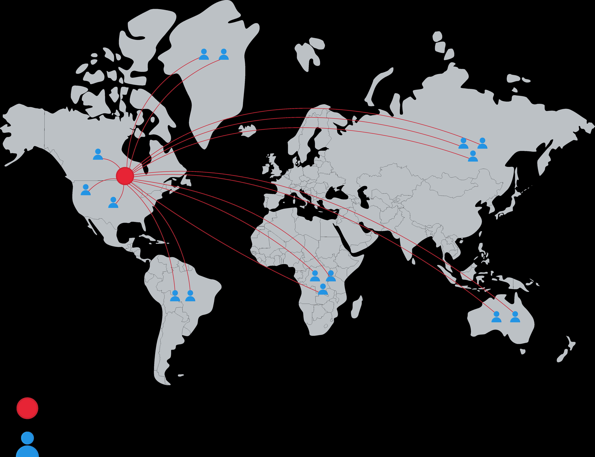
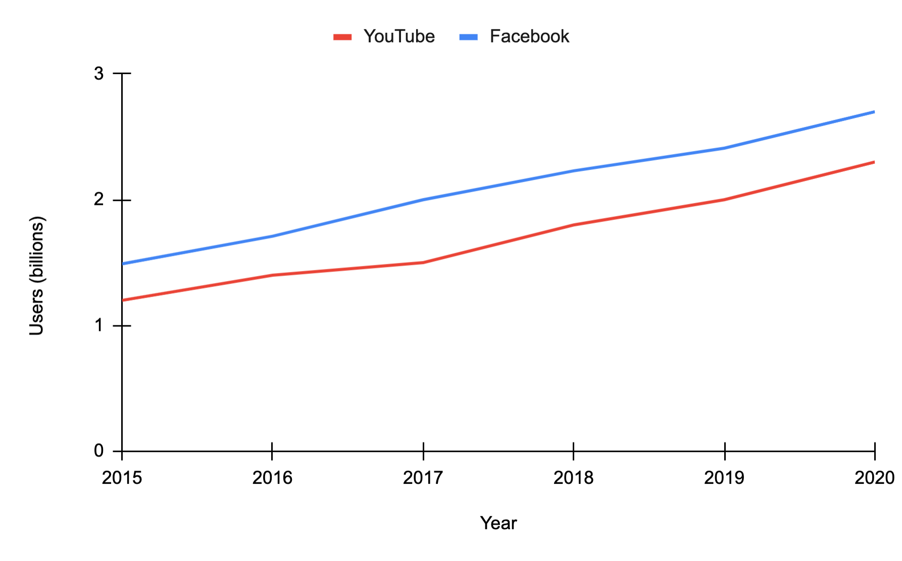
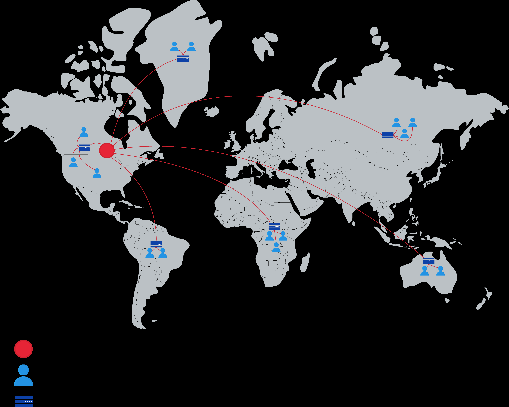
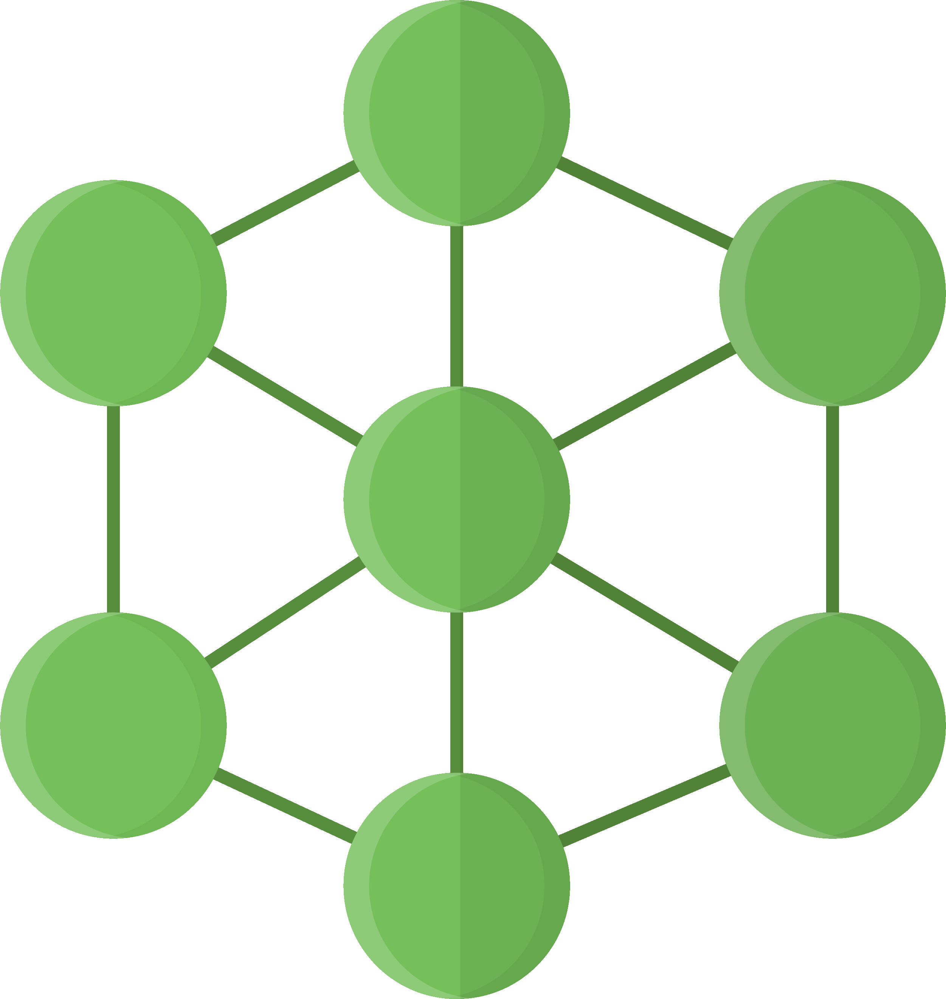
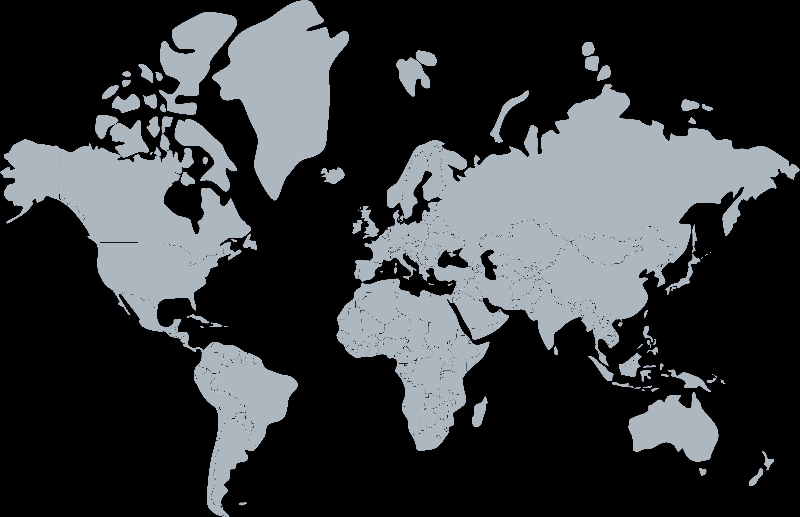
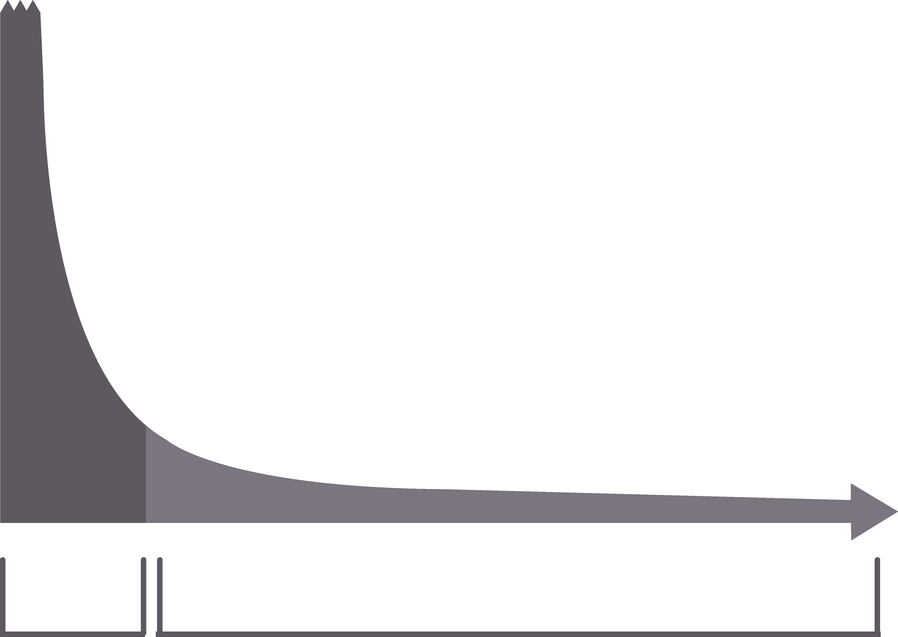
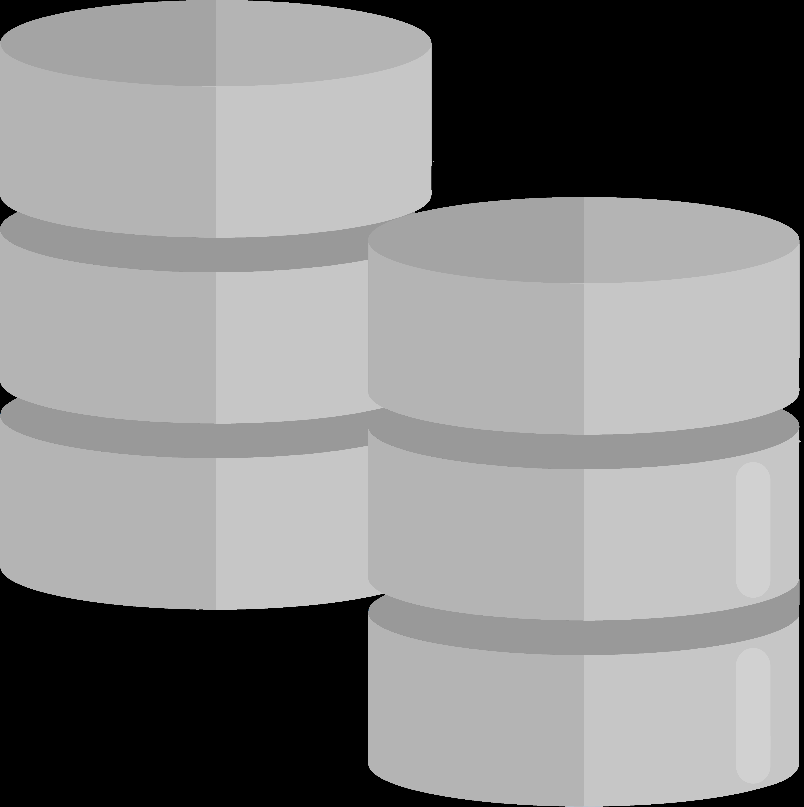

# 011 - Mạng Phân Phối Nội Dung (Content Delivery Network - CDN)

[← Bài trước](010-luu-tru-key-value-store.md) | [Mục lục](README.md) | [Bài tiếp theo →](012-bo-sinh-so-thu-tu-sequencer.md)

---


# Thiết Kế Hệ Thống: Mạng Phân Phối Nội Dung (Content Delivery Network - CDN)

Hiểu rõ những vấn đề mà một hệ thống CDN giải quyết.

**Nội dung sẽ đề cập:**
* Phát biểu bài toán (Problem statement)
* Chúng ta sẽ thiết kế một CDN như thế nào? (How will we design a CDN?)

---

## 1. Phát biểu bài toán (Problem statement)

Hãy bắt đầu bằng một câu hỏi: Nếu hàng triệu người dùng trên toàn thế giới sử dụng các ứng dụng thâm dụng dữ liệu (**Data-intensive applications**) của chúng ta, và dịch vụ chỉ được triển khai trong một trung tâm dữ liệu duy nhất (**Single Data Center**) để phục vụ các yêu cầu từ người dùng, thì những vấn đề nào có thể phát sinh?

Những vấn đề sau đây có thể nảy sinh:

### Độ trễ cao (High latency)
Độ trễ mà người dùng cảm nhận được (**User-perceived latency**) sẽ rất cao do khoảng cách vật lý tính từ trung tâm dữ liệu đang phục vụ. Độ trễ do người dùng cảm nhận bao gồm nhiều thành phần cấu thành, chẳng hạn như:
* **Độ trễ truyền tải (Transmission delays):** Phụ thuộc vào băng thông khả dụng (Available bandwidth).
* **Độ trễ lan truyền (Propagation delays):** Phụ thuộc vào khoảng cách vật lý (Physical distance).
* **Độ trễ hàng đợi (Queuing delays):** Phụ thuộc vào tình trạng tắc nghẽn mạng (Network congestion).
* **Độ trễ xử lý nút mạng (Nodal processing delays).**

Do đó, việc truyền dữ liệu qua một khoảng cách địa lý lớn sẽ dẫn đến độ trễ cao hơn đáng kể. Các ứng dụng thời gian thực (**Real-time applications**) nhìn chung đòi hỏi độ trễ phải dưới $200\text{ ms}$ (mili-giây). Đối với giao thức truyền giọng nói qua Internet (**VoIP - Voice over Internet Protocol**), độ trễ không được vượt quá $150\text{ ms}$, trong khi các ứng dụng phát trực tuyến video (**Video streaming applications**) không thể chịu đựng được độ trễ vượt quá vài giây.

> [!NOTE]
> Theo một phép đo được thực hiện vào ngày 21 tháng 12 năm 2021, độ trễ trung bình từ Miền Đông Hoa Kỳ (US East - N. Virginia) đến Miền Tây Hoa Kỳ (US West - N. California) là $62.9\text{ ms}$. Khi truyền xuyên lục địa — ví dụ: từ Miền Đông Hoa Kỳ (US East - N. Virginia) đến Châu Phi (Cape Town) — con số này lên tới $225.63\text{ ms}$. Đây là độ trễ hai chiều, hay còn được gọi là độ trễ khứ hồi (**Round-trip latency / RTT**).


*Trung tâm dữ liệu gốc (Origin Data Center) tiếp nhận và xử lý các yêu cầu của người dùng trên toàn cầu.*

### Các ứng dụng thâm dụng dữ liệu (Data-intensive applications)
Các ứng dụng thâm dụng dữ liệu đòi hỏi phải truyền tải lưu lượng mạng cực lớn. Trên một khoảng cách xa hơn, điều này có thể trở thành một vấn đề lớn do đường dẫn mạng phải kéo dài qua nhiều nhà cung cấp dịch vụ Internet (**ISP - Internet Service Provider**) khác nhau. Do một số liên kết có Đơn vị truyền tải tối đa trên đường dẫn (**Path MTU - Maximum Transmission Unit**) nhỏ hơn, thông lượng (**Throughput**) của các ứng dụng trên mạng có thể bị suy giảm. Tương tự, các phân đoạn khác nhau trên tuyến đường mạng có thể có những đặc tính tắc nghẽn mạng khác nhau. 

Vấn đề sẽ nhân lên gấp bội khi số lượng người dùng tăng trưởng, bởi các máy chủ gốc (**Origin servers**) sẽ phải phân phối dữ liệu riêng biệt tới từng người dùng một. Nghĩa là, trung tâm dữ liệu chính sẽ buộc phải gửi đi rất nhiều dữ liệu dư thừa, lặp lại (**Redundant data**) khi có nhiều máy khách (clients) cùng yêu cầu dữ liệu đó. Tuy nhiên, các ứng dụng sử dụng dịch vụ phát trực tuyến (**Streaming services**) vừa mang tính thâm dụng dữ liệu (**Data-intensive**), vừa có bản chất động (**Dynamic in nature**).

> [!NOTE]
> Theo một khảo sát, 78% người tiêu dùng tại Hoa Kỳ sử dụng các dịch vụ phát trực tuyến (Streaming services), con số này tăng 25% trong vòng 5 năm.

### Sự khan hiếm tài nguyên trung tâm dữ liệu (Scarcity of data center resources)
Các tài nguyên trọng yếu của trung tâm dữ liệu như năng lực tính toán (**Computational capacity**) và băng thông (**Bandwidth**) sẽ trở thành nút thắt cổ chai giới hạn khi số lượng người dùng của một dịch vụ tăng vọt. Các dịch vụ thu hút hàng triệu người dùng hoạt động đồng thời đòi hỏi phải có khả năng mở rộng quy mô (**Scaling**). 

Ngay cả khi việc mở rộng quy mô được thực hiện thành công bên trong một trung tâm dữ liệu đơn lẻ, nó vẫn phải đối mặt với nguy cơ trở thành điểm hỏng duy nhất (**Single Point of Failure - SPOF**) khi trung tâm dữ liệu đó bị ngắt kết nối (offline) do thiên tai hoặc các sự cố gián đoạn kết nối với mạng Internet.


*Sự tăng trưởng người dùng qua các năm của các ứng dụng Facebook và YouTube.*

> [!NOTE]
> Theo một nghiên cứu, YouTube, Netflix và Amazon Prime cùng nhau tạo ra 80% lưu lượng truy cập Internet vào năm 2020. Khoảng năm 2016, nhà cung cấp dịch vụ CDN Akamai đã phục vụ từ 15% đến 30% lưu lượng truy cập web (khoảng 30 Terabit mỗi giây). Đối với 90% người dùng Internet, máy chủ của Akamai chỉ cách đúng một bước nhảy mạng (Single hop). Do đó, chúng ta có những lý do vô cùng thuyết phục để tối ưu hóa việc phân phối và tiêu thụ dữ liệu này mà không biến vùng lõi của mạng Internet (Internet core) thành một nút thắt cổ chai (Bottleneck).

---

## 2. Chúng ta sẽ thiết kế một CDN như thế nào? (How will we design a CDN?)

Chúng ta chia quá trình thiết kế CDN thành sáu bài học:

1. **Giới thiệu về CDN (Introduction to a CDN):** Chúng ta sẽ cung cấp một cái nhìn tổng quan toàn diện về CDN và xác định rõ các yêu cầu chức năng (**Functional requirements**) cũng như phi chức năng (**Non-functional requirements**).
2. **Thiết kế một CDN (Design of a CDN):** Chúng ta sẽ giải thích cách thức thiết kế kiến trúc CDN. Chúng ta cũng sẽ mô tả ngắn gọn về thiết kế giao diện lập trình ứng dụng (**API design**).
3. **Nghiên cứu chuyên sâu về CDN: Phần 1 (In-depth Investigation of CDN: Part 1):** Bài học này giải thích các chiến lược lưu bộ nhớ đệm (**Caching strategies**) và kiến trúc hạ tầng CDN. Ngoài ra, chúng ta sẽ thảo luận về các cách tiếp cận khác nhau để định vị máy chủ ủy thác (**Proxy server**) gần nhất.
4. **Nghiên cứu chuyên sâu về CDN: Phần 2 (In-depth Investigation of CDN: Part 2):** Chúng ta sẽ thảo luận về cách đảm bảo tính nhất quán của nội dung (**Content consistency**) trong một CDN và việc triển khai các máy chủ ủy thác (Proxy servers). Chúng ta cũng sẽ đi sâu chi tiết vào các kiến trúc CDN tùy biến và chuyên biệt (**Custom and specialized CDN**).
5. **Đánh giá CDN (Evaluation of CDN):** Bài học này sẽ đưa ra đánh giá, phân tích về thiết kế đã được đề xuất của chúng ta.
6. **Bài trắc nghiệm về Thiết kế hệ thống CDN (Quiz on CDN System Design):** Chúng ta sẽ củng cố lại các khái niệm trọng tâm trong thiết kế CDN bằng một bài kiểm tra trắc nghiệm.

Hãy cùng suy ngẫm về giải pháp cho các vấn đề đã được bàn luận trong bài học tiếp theo.

---

## 3. Giới thiệu về một CDN (Introduction to a CDN)

Tìm hiểu về CDN và chuẩn hóa các yêu cầu cho việc thiết kế một CDN.

**Nội dung sẽ đề cập:**
* Giải pháp đề xuất (Proposed solution)
* Các yêu cầu (Requirements)
  * Yêu cầu chức năng (Functional requirements)
  * Yêu cầu phi chức năng (Non-functional requirements)
* Các khối xây dựng thành phần sẽ sử dụng (Building blocks we will use)

---

### Giải pháp đề xuất (Proposed solution)

Giải pháp cho tất cả các vấn đề đã được thảo luận ở bài học trước chính là **Mạng phân phối nội dung (Content Delivery Network - CDN)**. 

Một CDN là một nhóm các máy chủ ủy thác (**Proxy servers**) được phân tán theo vị trí địa lý (**Geographically distributed**). Một máy chủ ủy thác là một máy chủ trung gian nằm giữa máy khách (Client) và máy chủ gốc (**Origin server**). Các máy chủ ủy thác này được đặt tại vùng biên mạng (**Network edge**). Do biên mạng nằm rất gần với người dùng cuối (End users), việc bố trí các máy chủ ủy thác tại đây giúp phân phối nội dung tới người dùng cuối một cách nhanh chóng bằng cách giảm thiểu độ trễ (**Latency**) và tiết kiệm băng thông (**Bandwidth**). Ngoài vai trò là một máy chủ ủy thác đơn thuần, CDN còn được tích hợp thêm các cơ chế thông minh (**Added intelligence**).

Chúng ta có thể đưa dữ liệu lại gần người dùng bằng cách đặt một trung tâm dữ liệu quy mô nhỏ ở gần người dùng và lưu trữ các bản sao dữ liệu tại đó. CDN chủ yếu lưu trữ hai loại dữ liệu: **Tĩnh (Static)** và **Động (Dynamic)**. Một CDN hướng mục tiêu chính vào việc giảm thiểu độ trễ lan truyền (**Propagation delay**) bằng cách mang dữ liệu đến gần hơn với người dùng của nó. 

Các nhà cung cấp CDN luôn nỗ lực để duy trì băng thông khả dụng dồi dào trên toàn bộ đường dẫn và đưa dữ liệu đến gần người dùng nhất có thể (thậm chí nằm ngay bên trong mạng ISP của họ). Họ cũng cố gắng cắt giảm độ trễ truyền tải (**Transmission delay**) và độ trễ hàng đợi (**Queuing delay**) vì theo giả định, nhà cung cấp ISP thường có sẵn nhiều băng thông hơn bên trong hệ thống tự trị (**AS - Autonomous System**) của chính họ.

Hãy cùng xem xét các cách tiếp cận khác nhau mà CDN sử dụng để giải quyết các vấn đề đã thảo luận:

* **Độ trễ cao (High latency):** CDN đưa nội dung đến gần hơn với người dùng cuối. Nhờ đó, nó làm giảm khoảng cách vật lý và giảm thiểu độ trễ mạng.
* **Các ứng dụng thâm dụng dữ liệu (Data-intensive applications):** Vì tuyến đường dẫn đến dữ liệu chỉ bao gồm phạm vi bên trong mạng ISP và các thành phần CDN lân cận, nên không gặp trở ngại nào khi phải phục vụ một lượng lớn người dùng thông qua một vài thành phần CDN trong một khu vực cụ thể. Như được minh họa dưới đây, trung tâm dữ liệu gốc chỉ cần phân phối dữ liệu đến các thành phần CDN cục bộ đúng một lần duy nhất, trong khi các thành phần CDN cục bộ này có thể phân phối dữ liệu đó tới từng người dùng khác nhau một cách độc lập. Không một người dùng nào phải tải trực tiếp bản sao dữ liệu của riêng họ từ các máy chủ gốc.

> [!NOTE]
> Nhiều giao thức phát trực tuyến (**Streaming protocols**) khác nhau được các nhà cung cấp CDN sử dụng để phân phối nội dung động. Ví dụ, CDNsun sử dụng Giao thức truyền tin nhắn thời gian thực (**RTMP - Real-time Messaging Protocol**), Giao thức phát trực tiếp qua HTTP (**HLS - HTTP Live Streaming**), Giao thức phát trực tuyến thời gian thực (**RTSP - Real-time Streaming Protocol**), và nhiều giao thức khác nhằm phân phối nội dung động.

* **Sự khan hiếm tài nguyên trung tâm dữ liệu (Scarcity of data center resources):** CDN được dùng để phục vụ các nội dung phổ biến (**Popular content**). Do nguyên nhân này, phần lớn lưu lượng truy cập được xử lý và phân tải ngay tại CDN thay vì phải dồn về các máy chủ gốc. Nhờ vậy, các thành phần CDN cục bộ hoặc phân tán khác nhau sẽ chia sẻ và giảm tải đáng kể cho các máy chủ gốc.



---

### Phổ biến nội dung tới một CDN phân tán theo vùng địa lý (Dissemination of content to a geographically distributed CDN)

> [!NOTE]
> **Ghi chú:** Một số nhà cung cấp dịch vụ CDN (CDN providers) nổi tiếng gồm có Akamai, StackPath, Cloudflare, Rackspace, Amazon CloudFront và Google Cloud CDN.

#### Điểm cần suy ngẫm (Point to Ponder)
**Câu hỏi:** Liệu một CDN có lưu cache toàn bộ nội dung từ máy chủ gốc (origin server) hay không?

*Hiển thị câu trả lời (Show Answer)*

---

### Yêu cầu hệ thống (Requirements)
Hãy cùng xem xét các yêu cầu chức năng (functional requirements) và phi chức năng (non-functional requirements) mà chúng ta kỳ vọng từ một hệ thống CDN.

#### Yêu cầu chức năng (Functional requirements)
Các yêu cầu chức năng sau đây sẽ là một phần trong thiết kế của chúng ta:

* **Truy xuất (Retrieve):** Tùy thuộc vào loại mô hình CDN (CDN models), CDN phải có khả năng truy xuất nội dung từ các máy chủ gốc (origin servers). Chúng ta sẽ tìm hiểu các mô hình CDN trong bài học tiếp theo.
* **Yêu cầu (Request):** Việc phân phối nội dung từ máy chủ proxy (proxy server) được thực hiện dựa trên yêu cầu từ người dùng (user's request). Các máy chủ CDN proxy phải có khả năng phản hồi từng yêu cầu của người dùng về khía cạnh này.
* **Chuyển giao / Đẩy nội dung (Deliver):** Trong trường hợp mô hình đẩy (push model), các máy chủ gốc (origin servers) phải có khả năng gửi nội dung đến các máy chủ CDN proxy.
* **Tìm kiếm (Search):** CDN phải có khả năng thực thi một truy vấn tìm kiếm (search query) của người dùng đối với nội dung đã được lưu vào bộ nhớ đệm (cached) hoặc được lưu trữ theo cách khác bên trong hạ tầng CDN.
* **Cập nhật (Update):** Trong hầu hết các trường hợp, nội dung đến từ máy chủ gốc (origin server), nhưng nếu chúng ta chạy một tập lệnh (script) bên trong CDN, CDN phải có khả năng cập nhật nội dung giữa các máy chủ CDN proxy đồng cấp (peer proxy servers) trong cùng một Điểm hiện diện PoP (Point of Presence).
* **Xóa (Delete):** Tùy thuộc vào loại nội dung (tĩnh - static hoặc động - dynamic), hệ thống phải cho phép xóa các bản ghi đã lưu cache (cached entries) khỏi các máy chủ CDN sau một khoảng thời gian nhất định.


#### Yêu cầu phi chức năng (Non-functional requirements)
* **Hiệu năng (Performance):** Giảm thiểu độ trễ (latency) là một trong những sứ mệnh cốt lõi của một hệ thống CDN. Thiết kế được đề xuất phải đạt được mức độ trễ thấp nhất có thể.
* **Tính sẵn sàng cao (Availability):** Các mạng CDN được kỳ vọng phải luôn khả dụng tại mọi thời điểm nhờ vào tính hiệu quả của chúng. Tính sẵn sàng bao gồm cả khả năng bảo vệ trước các cuộc tấn công như từ chối dịch vụ phân tán (DDoS - Distributed Denial of Service).
* **Khả năng mở rộng (Scalability):** Lượng người dùng yêu cầu nội dung từ CDN sẽ ngày càng gia tăng. Thiết kế CDN đề xuất của chúng ta phải có khả năng mở rộng theo chiều ngang (scale horizontally) khi các yêu cầu kỹ thuật tăng lên.
* **Độ tin cậy và Bảo mật (Reliability and security):** Thiết kế CDN của chúng ta phải đảm bảo không có điểm lỗi đơn lẻ nào (no single point of failure - SPOF). Bên cạnh việc chịu lỗi (fault tolerance), CDN được thiết kế phải xử lý một cách đáng tin cậy khối lượng tải lưu lượng truy cập khổng lồ (massive traffic loads). Hơn nữa, CDN cần cung cấp khả năng bảo vệ các nội dung được lưu trữ trước các hình thức tấn công mạng khác nhau.


---

### Các khối thành phần nền tảng sẽ sử dụng (Building blocks we will use)
Thiết kế của một CDN tận dụng các khối thành phần nền tảng (building blocks) sau đây:


* **Hệ thống phân giải tên miền (DNS - Domain Name System):** DNS là dịch vụ ánh xạ các tên miền CDN thân thiện với con người sang các địa chỉ IP mà máy móc có thể đọc được. Địa chỉ IP này sẽ dẫn hướng người dùng đến máy chủ proxy được chỉ định.
* **Bộ cân bằng tải (Load Balancers):** Các bộ cân bằng tải phân phối hàng triệu yêu cầu đến các máy chủ proxy đang hoạt động bình thường.

Trong bài học tiếp theo, chúng ta sẽ thảo luận chi tiết về thiết kế của CDN.

---

### Quay lại (Back)
**System Design: The Content Deliver…**  
*Đánh dấu hoàn thành (Mark As Completed)*  
**Tiếp theo (Next)**  
*Thiết kế của một CDN (Design of a CDN)*

---

## Thiết kế của một CDN (Design of a CDN)

Hãy cùng tìm hiểu thiết kế cơ bản của một hệ thống CDN.

Chúng ta sẽ bao quát các nội dung sau:
* Thiết kế CDN (CDN design)
* Các thành phần của CDN (CDN components)
* Luồng công việc (Workflow)
* Thiết kế API (API Design)
  * Truy xuất - Retrieve (máy chủ proxy đến máy chủ gốc)
  * Chuyển giao - Deliver (máy chủ gốc đến các máy chủ proxy)
  * Yêu cầu - Request (máy khách đến các máy chủ proxy)
  * Tìm kiếm - Search (máy chủ proxy đến các máy chủ proxy đồng cấp)
  * Cập nhật - Update (máy chủ proxy đến các máy chủ proxy đồng cấp)

### Thiết kế CDN (CDN design)
Chúng ta sẽ giải thích thiết kế CDN của mình qua hai giai đoạn:
1. **Giai đoạn 1:** Chúng ta sẽ bao quát các thành phần cấu thành nên một CDN. Khi kết thúc giai đoạn này, chúng ta sẽ hiểu rõ lý do vì sao cần từng thành phần cụ thể.
2. **Giai đoạn 2:** Chúng ta sẽ khám phá luồng công việc (workflow) bằng cách giải thích cách thức mỗi thành phần tương tác với các thành phần khác để tạo nên một hệ thống CDN hoạt động hoàn chỉnh. Hãy cùng bắt đầu.

### Các thành phần của CDN (CDN components)
Các thành phần sau đây cấu thành nên một hệ thống CDN:

* **Máy khách (Clients):** Người dùng cuối sử dụng nhiều loại máy khách khác nhau, chẳng hạn như trình duyệt web (browsers), điện thoại thông minh (smartphones) và các thiết bị khác để yêu cầu nội dung từ CDN.
* **Hệ thống định tuyến (Routing system):** Hệ thống định tuyến điều hướng các máy khách đến cơ sở hạ tầng CDN gần nhất. Để thực hiện điều đó một cách hiệu quả, thành phần này nhận dữ liệu đầu vào từ nhiều hệ thống khác nhau nhằm nắm bắt: nội dung đang được đặt ở đâu, có bao nhiêu yêu cầu được thực hiện cho một nội dung cụ thể, mức tải mà một nhóm máy chủ cụ thể đang xử lý, và không gian tên URI (Uniform Resource Identifier namespace) của các nội dung khác nhau.
  > [!TIP]
  > Trong bài học tiếp theo, chúng ta sẽ thảo luận về các cơ chế định tuyến khác nhau (routing mechanisms) để chuyển tiếp người dùng đến cơ sở CDN gần nhất.

* **Máy chủ lọc mã độc / làm sạch lưu lượng (Scrubber servers):** Các máy chủ Scrubber được sử dụng để phân tách lưu lượng hợp lệ (good traffic) khỏi lưu lượng độc hại (malicious traffic) và bảo vệ hệ thống trước các cuộc tấn công phổ biến, chẳng hạn như tấn công từ chối dịch vụ phân tán (DDoS). Các máy chủ Scrubber thường chỉ được kích hoạt sử dụng khi phát hiện có tấn công. Khi đó, lưu lượng truy cập sẽ được lọc sạch (scrubbed or cleaned) trước khi được định tuyến tới đích đến mục tiêu.
* **Các máy chủ Proxy (Proxy servers):** Các máy chủ proxy hoặc proxy biên (edge proxy servers) phục vụ nội dung trực tiếp từ bộ nhớ RAM đến người dùng. Máy chủ proxy lưu trữ dữ liệu nóng (hot data) trên RAM, mặc dù chúng cũng có thể lưu trữ dữ liệu lạnh (cold data) trên ổ cứng thể rắn SSD hoặc ổ đĩa cứng thông thường. Các máy chủ này cũng cung cấp thông tin kế toán/kiểm toán (accounting information) và nhận nội dung từ hệ thống phân phối.
* **Hệ thống phân phối (Distribution system):** Hệ thống phân phối chịu trách nhiệm phân phối nội dung đến tất cả các máy chủ edge proxy tại các cơ sở CDN khác nhau. Hệ thống này sử dụng mạng Internet và các phương pháp tiếp cận dạng phát thanh thông minh (intelligent broadcast-like approaches) để phân phối nội dung trên toàn bộ các máy chủ edge proxy đang hoạt động.
* **Máy chủ gốc (Origin servers):** Hạ tầng CDN hỗ trợ người dùng bằng dữ liệu nhận được từ các máy chủ gốc. Các máy chủ gốc sẽ phục vụ bất kỳ dữ liệu nào mà CDN chưa có sẵn cho máy khách. Các máy chủ gốc sẽ sử dụng kho lưu trữ phù hợp để lưu trữ nội dung và các siêu dữ liệu ánh xạ (mapping metadata) khác. Tuy nhiên, chúng ta sẽ không đi sâu vào kiến trúc nội bộ của hạ tầng máy chủ gốc tại đây.
* **Hệ thống quản trị (Management system):** Hệ thống quản trị giữ vai trò quan trọng trong CDN từ góc độ vận hành và nghiệp vụ kinh doanh, nơi mức độ sử dụng tài nguyên và các số liệu thống kê liên tục được giám sát chặt chẽ. Thành phần này đo lường các chỉ số trọng yếu như: độ trễ (latency), thời gian ngừng hoạt động (downtime), tỷ lệ mất gói tin (packet loss), tải của máy chủ (server load), v.v. Đối với các hệ thống CDN của bên thứ ba, thông tin kế toán/kiểm toán cũng có thể được sử dụng cho mục đích tính cước thanh toán (billing purposes).

---

# Các Thành Phần của CDN (CDN Components)





### Các Thực Thể & Luồng Tương Tác:
- **Clients (Khách hàng / Người dùng cuối)**
- **Edge proxy servers (Máy chủ proxy biên)**
- **Scrubber servers (Máy chủ lọc lưu lượng độc hại)**
- **Request routing system (Hệ thống điều hướng yêu cầu)**
- **Origin servers (Máy chủ gốc)**
- **Distribution system (Hệ thống phân phối)**
- **Management system (Hệ thống quản lý)**

### Chú Thích Ký Hiệu Luồng (Legend):
- Các bước được đánh số từ **1** đến **8**.
- Đường nét đứt biểu diễn **hoạt động định kỳ (periodic activity)**.
- Đường mũi tên biểu diễn **thao tác khi nội dung chưa có sẵn trong proxy server và cần được nạp (fetch) từ máy chủ gốc (origin servers)**.

---

## Quy Trình Xử Lý (Workflow)

Quy trình làm việc (workflow) cho thiết kế trừu tượng được mô tả chi tiết dưới đây:

1. **Origin servers (Máy chủ gốc)** cung cấp việc ủy nhiệm không gian tên định danh tài nguyên (**URI namespace delegation**) của tất cả các đối tượng được lưu trong bộ nhớ tạm (**cache**) trên CDN cho **Request routing system (Hệ thống điều hướng yêu cầu)**.
2. **Origin server** xuất bản (**publish**) nội dung tới **Distribution system (Hệ thống phân phối)** – hệ thống chịu trách nhiệm phân phối dữ liệu trên toàn bộ các **Edge proxy servers** đang hoạt động.
3. **Distribution system** phân phối nội dung giữa các proxy server và gửi thông tin phản hồi (**feedback**) về cho **Request routing system**. Phản hồi này rất hữu ích trong việc tối ưu hóa việc lựa chọn máy chủ proxy gần nhất cho client đang gửi yêu cầu. Thông tin phản hồi này chứa dữ liệu về nội dung nào đang được lưu bộ nhớ đệm (cached) trên proxy server nào để điều hướng lưu lượng truy cập (**route traffic**) đến các proxy server phù hợp.
4. Client gửi yêu cầu đến **Request routing system** để tìm kiếm một máy chủ proxy thích hợp.
5. **Request routing system** trả về địa chỉ IP của một proxy server phù hợp.
6. Yêu cầu của client được điều hướng qua các **Scrubber servers** vì lý do an toàn bảo mật (**security reasons**).
7. **Scrubber server** chuyển tiếp lưu lượng hợp lệ/an toàn (**good traffic**) đến **Edge proxy server**.
8. **Edge proxy server** phục vụ yêu cầu của client và định kỳ chuyển tiếp thông tin hạch toán/thống kê (**accounting information**) đến **Management system (Hệ thống quản lý)**. Hệ thống quản lý sẽ cập nhật cho các máy chủ gốc (**origin servers**) và gửi phản hồi đến hệ thống điều hướng (**routing system**) về số liệu thống kê và chi tiết của nội dung. 

> [!IMPORTANT]
> Tuy nhiên, yêu cầu sẽ được định tuyến thẳng về **Origin servers** nếu nội dung không có sẵn trong các máy chủ proxy (**cache miss**). 
> Hệ thống cũng hoàn toàn có thể thiết lập một cấu trúc phân cấp các máy chủ proxy (**hierarchy of proxy servers**) nếu nội dung không tìm thấy ở các **Edge proxy servers**. Trong những trường hợp như vậy, yêu cầu sẽ được chuyển tiếp lên các máy chủ proxy cha (**parent proxy servers**).

---

## Thiết Kế API (API Design)

Phần này sẽ thảo luận về thiết kế API cho các chức năng được cung cấp bởi CDN. Điều này sẽ giúp chúng ta hiểu cách thức CDN tiếp nhận các yêu cầu từ clients, nhận nội dung từ các origin servers, và giao tiếp với các thành phần khác trong mạng. Hãy cùng phát triển các API cho từng chức năng sau:
- **Retrieve content** (Truy xuất nội dung)
- **Deliver content** (Chuyển giao nội dung)
- **Request content** (Yêu cầu nội dung)
- **Search content** (Tìm kiếm nội dung)
- **Update content** (Cập nhật nội dung)
- **Delete content** (Xóa nội dung)

Nội dung có thể là bất kỳ thứ gì, chẳng hạn như tệp tin (file), video, âm thanh (audio), hoặc các đối tượng web khác. Ở đây, chúng ta sẽ sử dụng từ **"content" (nội dung)** để chỉ chung cho tất cả các đối tượng trên. Để đảm bảo tính rõ ràng, chúng ta sẽ không thảo luận về các tham số liên quan đến quyền riêng tư (privacy-related parameters) — ví dụ như nội dung là công khai (public) hay riêng tư (private), ai có quyền truy cập nội dung này, nội dung có cần được mã hóa hay không, v.v. — trong các API sau đây.

---

### 1. Truy Xuất (Retrieve - Proxy Server tới Origin Server)

Nếu các máy chủ proxy yêu cầu nội dung từ máy chủ gốc, phương thức `GET` sẽ truy xuất nội dung thông qua API `/retrieveContent` dưới đây:

```http
retrieveContent(proxyserver_id, content_type, content_version, description)
```

#### Chi Tiết Các Tham Số (Details of Parameters):

| Tham số (Parameter) | Mô tả (Description) |
| :--- | :--- |
| `proxyserver_id` | Định danh duy nhất (unique ID) của máy chủ proxy đang gửi yêu cầu. |
| `content_type` | Cấu trúc dữ liệu này chứa thông tin về nội dung được yêu cầu: danh mục (audio, video, tài liệu, script,...), đối tượng client gửi yêu cầu, và chất lượng yêu cầu (nếu có). |
| `content_version` | Thể hiện số hiệu phiên bản (**version number**) của nội dung. Đối với `/retrieveContent`, `content_version` sẽ chứa phiên bản hiện tại của nội dung mà proxy server lưu giữ. `content_version` sẽ có giá trị `NULL` nếu máy chủ proxy chưa từng lưu phiên bản trước đó của nội dung này. |
| `description` | Chỉ định chi tiết về nội dung — ví dụ: định dạng mở rộng của video (extension), độ phân giải, v.v., nếu `content_type` là video. |

API trên trả về phản hồi dưới dạng một tệp **JSON**, trong đó chứa văn bản, các loại nội dung, liên kết tới hình ảnh hoặc video trong nội dung, v.v.

*(Nhấp để xem các liên kết trong tệp JSON nơi các đối tượng khác nhau sẽ được tải xuống tại các proxy servers).*

---

### 2. Chuyển Giao (Deliver - Origin Server tới Proxy Servers)

Các máy chủ gốc sử dụng API này để phân phối nội dung được chỉ định (phiên bản cập nhật) đến các máy chủ proxy thông qua hệ thống phân phối (**distribution system**). Chúng ta gọi đây là API `/deliverContent`:

```http
deliverContent(origin_id, server_list, content_type, content_version, description)
```

#### Chi Tiết Các Tham Số (Details of Parameters):

| Tham số (Parameter) | Mô tả (Description) |
| :--- | :--- |
| `origin_id` | Định danh duy nhất cho từng máy chủ gốc (origin server). |
| `server_list` | Xác định danh sách các máy chủ mà nội dung sẽ được đẩy (**push**) tới bởi hệ thống phân phối. |
| `content_version` | Thể hiện phiên bản cập nhật mới của nội dung tại máy chủ gốc. Máy chủ proxy khi nhận được nội dung sẽ hủy bỏ (**discard**) phiên bản cũ trước đó. |

> [!NOTE]
> Các tham số còn lại (`content_type`, `description`) đã được giải thích chi tiết ở phần trước.

---

### 3. Yêu Cầu (Request - Clients tới Proxy Servers)

Người dùng sử dụng API này để yêu cầu nội dung từ các máy chủ proxy. Chúng ta gọi đây là API `/requestContent`:

```http
requestContent(user_id, content_type, description)
```

#### Chi Tiết Tham Số (Details of Parameter):

| Tham số (Parameter) | Mô tả (Description) |
| :--- | :--- |
| `user_id` | Định danh duy nhất của người dùng (client) yêu cầu nội dung. |

Máy chủ proxy được chỉ định sẽ trả về nội dung cụ thể cho người dùng đã gửi yêu cầu tương ứng với API trên.

*(Nhấp để xem các liên kết trong tệp JSON nơi các đối tượng khác nhau sẽ được tải xuống ở phía người dùng).*

---

### 4. Tìm Kiếm (Search - Proxy Server tới Peer Proxy Servers)

Mặc dù nội dung trước tiên luôn được tìm kiếm cục bộ (**local search**) tại chính máy chủ proxy, các máy chủ proxy cũng có thể dò tìm (**probe**) nội dung được yêu cầu tại các máy chủ proxy ngang hàng (**peer proxy servers**) trong cùng một **PoP (Point of Presence)** thông qua API `/searchContent`. 

Hành động này có thể làm tràn ngập truy vấn (**flood query**) đến tất cả các máy chủ proxy trong một PoP. Ngoài ra, chúng ta có thể sử dụng một kho lưu trữ dữ liệu (**data store**) ngay tại PoP để truy vấn nội dung, mặc dù các máy chủ proxy sẽ cần phải duy trì thông tin xem nội dung nào đang có sẵn trên máy chủ proxy nào.

API `/searchContent` được định nghĩa như sau:

```http
searchContent(proxyserver_id, content_type, description)
```

---

### 5. Cập Nhật (Update - Proxy Server tới Peer Proxy Servers)

Các máy chủ proxy sử dụng API `/updateContent` để cập nhật nội dung chỉ định trên các máy chủ proxy ngang hàng trong cùng PoP. Máy chủ thực hiện điều này khi các đoạn mã kịch bản độc lập/cô lập (**isolated scripts**) được thực thi trên CDN nhằm cung cấp các tác vụ như thay đổi kích thước ảnh (image resizing), chuyển đổi độ phân giải video (video resolution conversion), bảo mật và nhiều dịch vụ khác. Loại kịch bản này được gọi là **Serverless Scripting** (Lập trình không máy chủ).

API `/updateContent` được định nghĩa như sau:

```http
updateContent(proxyserver_id, content_type, description)
```

#### Chi Tiết Tham Số (Details of Parameter):

| Tham số (Parameter) | Mô tả (Description) |
| :--- | :--- |
| `proxyserver_id` | Định danh duy nhất máy chủ proxy trong PoP cần cập nhật nội dung. |

> [!NOTE]
> Các tham số còn lại đã được giải thích ở các phần trên.

---

> [!NOTE]
> **Lưu ý về API Xóa (Delete API):** 
> API Xóa không được thảo luận ở đây. Trong chương về Bộ nhớ đệm (Caching), chúng ta đã thảo luận chi tiết về các cơ chế thu hồi/loại bỏ dữ liệu (**eviction mechanisms**). Các cơ chế đó cũng được áp dụng cho việc loại bỏ nội dung trên CDN. Tuy nhiên, trong thực tế vẫn có những trường hợp phát sinh cần đến các API Xóa (Delete APIs). Chúng ta sẽ thảo luận về một vài cơ chế nhất quán nội dung (**content consistency mechanisms**), chẳng hạn như thời gian nội dung được lưu trữ trong bộ nhớ đệm (TTL / cache retention time), trong bài học tiếp theo.

---

Trong các bài học sắp tới, chúng ta sẽ đi sâu vào các đặc tính chuyên sâu của CDN.

---

# Nghiên Cứu Chuyên Sâu Về CDN: Phần 1 (In-depth Investigation of CDN: Part 1)

Tìm hiểu các mô hình **Push**, **Pull** và tối ưu hóa bộ nhớ đệm cho nội dung động (**Dynamic Content Cache Optimization**) trong mạng phân phối nội dung (**CDN - Content Delivery Network**).

---

### Chúng ta sẽ tìm hiểu các nội dung sau:
- Các chiến lược lưu bộ nhớ đệm nội dung trong CDN (**Content caching strategies in CDN**)
- **Push CDN**
- **Pull CDN**
- Tối ưu hóa lưu bộ nhớ đệm cho nội dung động (**Dynamic content caching optimization**)
- Kiến trúc CDN đa tầng (**Multi-tier CDN architecture**)
- Tìm kiếm máy chủ proxy gần nhất để lấy dữ liệu (**Find the nearest proxy server to fetch the data**)
- Các yếu tố quan trọng ảnh hưởng đến độ gần (proximity) của máy chủ proxy (**Important factors that affect the proximity of the proxy server**)
- Điều hướng DNS (**DNS redirection**)
- **Anycast**
- Ghép kênh phía máy khách (**Client multiplexing**)
- Điều hướng HTTP (**HTTP redirection**)

Trong bài học này, chúng ta sẽ đi sâu vào chi tiết của một số khái niệm nhất định, chẳng hạn như các mô hình CDN và kiến trúc CDN đa tầng/phân lớp (**Multi-tier/Layered CDN architecture**) mà chúng ta đã đề cập ở các bài học trước. Chúng ta cũng sẽ giới thiệu một số khái niệm mới, bao gồm tối ưu hóa bộ nhớ đệm nội dung động và các kỹ thuật khác nhau để phát hiện các máy chủ proxy lân cận trong CDN.

---

## Các Chiến Lược Lưu Bộ Nhớ Đệm Nội Dung Trong CDN (Content Caching Strategies in CDN)

Việc xác định nội dung nào cần lưu vào bộ nhớ đệm (**Cache**) đóng vai trò then chốt trong việc phân phối nội dung web luôn mới nhất (**up-to-date**) và phổ biến (**popular**). Để đảm bảo cập nhật kịp thời, hai phân loại mô hình CDN được sử dụng để lấy nội dung từ các máy chủ gốc (**Origin Servers**):
1. **Push CDN**
2. **Pull CDN**

---

### Push CDN

Trong mô hình **Push CDN**, nội dung sẽ được tự động gửi từ máy chủ gốc (**Origin Server**) đến các máy chủ proxy của CDN. Việc phân phối nội dung đến các máy chủ proxy CDN là trách nhiệm của nhà cung cấp nội dung (**Content Provider**). 

Mô hình **Push CDN** rất phù hợp cho việc phân phối nội dung tĩnh (**Static Content Delivery**), nơi máy chủ gốc toàn quyền quyết định nội dung nào sẽ được phân phối tới người dùng thông qua CDN. Nội dung được chủ động đẩy (**pushed**) đến các máy chủ proxy ở nhiều vị trí địa lý khác nhau dựa trên mức độ phổ biến (**popularity**) của nội dung đó. Tuy nhiên, nếu nội dung thay đổi liên tục với tốc độ nhanh, mô hình đẩy có thể gặp khó khăn trong việc bắt kịp tốc độ thay đổi và sẽ dẫn đến việc đẩy nội dung dư thừa không cần thiết (**Redundant Content Pushes**).

#### Đẩy nội dung đến các Điểm Hiện Diện PoP (Push content to PoPs)
- **Origin Server (Máy chủ gốc)**
- **Content pushed to CDN PoPs (Nội dung được đẩy tới các PoP của CDN)**
- **Client (Máy khách)**
- **PoPs (Contain numerous CDN proxy servers - Các PoP chứa nhiều máy chủ proxy CDN)**




---

### Pull CDN

Một hệ thống **Pull CDN** sẽ chủ động kéo (**pulls**) dữ liệu chưa có sẵn từ các máy chủ gốc khi người dùng gửi yêu cầu. Các máy chủ proxy lưu giữ các tệp này trong một khoảng thời gian được chỉ định trước (**Time-to-Live - TTL**) và sau đó sẽ xóa chúng khỏi bộ nhớ đệm nếu chúng không còn được yêu cầu nữa nhằm cân bằng giữa dung lượng lưu trữ (**Capacity**) và chi phí (**Cost**).

Khi người dùng yêu cầu nội dung web trong mô hình **Pull CDN**, chính CDN sẽ chịu trách nhiệm kéo nội dung được yêu cầu từ máy chủ gốc và phân phối đến người dùng. Do đó, loại hình CDN này phù hợp hơn cho việc phục vụ các nội dung động (**Dynamic Content**).

#### Kéo nội dung từ máy chủ gốc về các CDN PoP (Content pull from origin server to the CDN PoPs)
- **Origin Server (Máy chủ gốc)**
- **Send content request to the origin server (Gửi yêu cầu nội dung tới máy chủ gốc)**
- **Client (Máy khách)**
- **Requested content delivered to the PoPs from the origin server (Nội dung được yêu cầu được phân phối từ máy chủ gốc tới các PoP)**
- **PoPs (Contain numerous CDN proxy servers - Các PoP chứa nhiều máy chủ proxy CDN)**


Như đã đề cập, mô hình **Push CDN** chủ yếu được dùng để phục vụ nội dung tĩnh. Do nội dung tĩnh được phân phối tới lượng lớn người dùng trong thời gian dài hơn so với nội dung động, cơ chế **Push CDN** duy trì nhiều bản sao (**Replicas**) hơn so với **Pull CDN**, từ đó cải thiện tính sẵn sàng cao (**High Availability**). 

Mặt khác, mô hình **Pull CDN** lại được ưu tiên lựa chọn cho nội dung thay đổi thường xuyên và tải lưu lượng truy cập cao (**High Traffic Load**). Mức độ tiêu thụ lưu trữ thấp (**Low Storage Consumption**) chính là một trong những lợi ích vượt trội cốt lõi của **Pull CDN**.

> [!NOTE]
> **Lưu ý:** Hầu hết các nhà cung cấp nội dung đều kết hợp sử dụng cả hai phương pháp lưu bộ nhớ đệm **Pull CDN** và **Push CDN** để tận dụng tối đa lợi ích của cả hai mô hình.

---

## Tối Ưu Hóa Lưu Bộ Nhớ Đệm Cho Nội Dung Động (Dynamic Content Caching Optimization)

Bởi vì nội dung động biến đổi liên tục, việc lưu bộ nhớ đệm một cách tối ưu là cực kỳ cần thiết. Phần này sẽ giải quyết bài toán tối ưu hóa cho các nội dung thường xuyên thay đổi.

Việc tạo ra một số nội dung động nhất định đòi hỏi phải thực thi các đoạn mã (**Scripts**) có khả năng chạy trực tiếp ngay tại các máy chủ proxy thay vì phải xử lý tập trung trên máy chủ gốc (**Origin Server**). Dữ liệu động có thể được sinh ra dựa trên nhiều tham số đầu vào khác nhau, và việc tính toán các tham số này ngay tại máy chủ proxy biên mang lại hiệu quả rất lớn. 

Ví dụ: chúng ta có thể tạo nội dung động dựa trên:
- Vị trí địa lý của người dùng (**User Location**)
- Thời gian trong ngày tại vị trí đó (**Time of day at a location**)
- Các API bên thứ ba đặc thù cho vị trí địa lý (ví dụ: API thời tiết - **Weather API**), v.v.

Do đó, việc chạy các đoạn mã kịch bản ngay tại các máy chủ proxy biên thay vì tại máy chủ gốc là giải pháp tối ưu.

Để giảm lưu lượng giao tiếp giữa máy chủ gốc và các máy chủ proxy, đồng thời giảm yêu cầu dung lượng lưu trữ tại các máy chủ proxy, việc áp dụng các kỹ thuật nén dữ liệu (**Compression Techniques**) cũng mang lại hiệu quả cao. Ví dụ: **Cloudflare** sử dụng công nghệ **Railgun** để nén nội dung động.

Một giải pháp phổ biến khác để nén dữ liệu động là ngôn ngữ đánh dấu **Edge Side Includes (ESI)**. Thông thường, chỉ có một phần nhỏ của trang web thay đổi trong một khoảng thời gian nhất định. Điều này đồng nghĩa với việc tải lại toàn bộ trang web mỗi khi có một thay đổi nhỏ sẽ kéo theo rất nhiều dữ liệu dư thừa. Để giải quyết tổn thất hiệu năng (**Performance Penalty**) này, ESI chỉ rõ phần nội dung nào đã bị thay đổi để phần còn lại của trang web tiếp tục được tái sử dụng từ bộ nhớ đệm. ESI thực hiện lắp ráp nội dung động (**Assembles Dynamic Content**) ngay tại máy chủ biên CDN (**CDN Edge Server**) hoặc ngay tại trình duyệt máy khách (**Client Browser**). Mặc dù ESI hiện vẫn chưa được tổ chức **W3C (World Wide Web Consortium)** chuẩn hóa chính thức, nhưng rất nhiều nhà cung cấp CDN lớn trên thế giới đang ứng dụng công nghệ này.

> [!NOTE]
> **Lưu ý:** Chuẩn **Dynamic Adaptive Streaming over HTTP (DASH)** sử dụng một tệp kê khai (**Manifest File**) chứa danh sách các đường dẫn URI của video ở các độ phân giải khác nhau, cho phép máy khách linh hoạt lấy về độ phân giải phù hợp nhất tùy theo tình trạng băng thông mạng và năng lực của nút mạng đầu cuối (**End Node**). **Netflix** sử dụng một phiên bản DASH độc quyền (**Proprietary DASH**) có bổ sung trường **Byte-range** trong URL để tối ưu hóa sâu hơn nữa quá trình yêu cầu và phân phối nội dung.

---

## Kiến Trúc CDN Đa Tầng (Multi-Tier CDN Architecture)

Nhà cung cấp nội dung phân phối dữ liệu tới một số lượng khổng lồ các máy khách thông qua CDN. Việc phân phối dữ liệu tới tất cả các máy chủ proxy CDN cùng một thời điểm là một thách thức cực kỳ lớn và tạo ra áp lực tải nặng nề lên máy chủ gốc. 

Để giải quyết vấn đề này, các mạng CDN áp dụng cấu trúc dạng cây (**Tree-like Structure**) nhằm giảm tải gánh nặng phân phối dữ liệu cho máy chủ gốc:
- Các máy chủ proxy biên (**Edge Proxy Servers**) có một số máy chủ ngang hàng (**Peer Servers**) thuộc cùng một cấp phân cấp.
- Nhóm máy chủ này nhận dữ liệu từ các nút cha (**Parent Nodes**) trong cây.
- Các nút cha này cuối cùng nhận dữ liệu từ các máy chủ gốc (**Origin Servers**).
- Dữ liệu được sao chép từ máy chủ gốc tới các máy chủ proxy theo các đường dẫn phân nhánh khác nhau trong cấu trúc cây.

Cấu trúc hình cây trong phân phối dữ liệu cho phép hệ thống mở rộng quy mô (**Scalability**) linh hoạt để đáp ứng lượng người dùng ngày càng tăng bằng cách bổ sung thêm các nút máy chủ vào cây. Nó cũng giảm đáng kể áp lực tải phân phối dữ liệu cho máy chủ gốc. Một hệ thống CDN thông thường có một hoặc hai tầng máy chủ proxy (các tầng cache).

Minh họa dưới đây thể hiện kiến trúc 2 tầng của các máy chủ proxy:

#### Phân phối dữ liệu giữa các máy chủ proxy CDN (Data distribution among CDN proxy servers)
- **Origin server (Máy chủ gốc)**
- **Distribute data (Phân phối dữ liệu)**
- **Fetch content (Lấy nội dung)**
- **Parent (Tầng cha)**: Các **Proxy server**
- **Child (Tầng con)**: Các **Proxy server**
- **Client (Máy khách)**





Bất cứ khi nào một máy chủ proxy mới gia nhập vào cấu trúc cây của CDN, nó sẽ gửi yêu cầu tới **lõi điều khiển (Control Core)** — thành phần duy trì thông tin của toàn bộ các máy chủ proxy trong mạng CDN — để nhận nội dung ban đầu cùng với dữ liệu cấu hình.

Nghiên cứu chỉ ra rằng nhiều loại nội dung tuân theo **phân phối đuôi dài (Long-tail Distribution)**. Điều này có nghĩa là, tại một thời điểm nhất định, chỉ có một số lượng nhỏ nội dung là cực kỳ phổ biến (**The Hits**), trong khi phần lớn là một danh sách dài các nội dung ít phổ biến hơn (**The Long Tail**). Trong trường hợp này, kiến trúc bộ nhớ đệm đa lớp (**Multi-layer Cache**) có thể được triển khai hiệu quả để xử lý các nội dung thuộc phần "đuôi dài" này.

#### Rất nhiều loại dữ liệu biểu hiện hiện tượng đuôi dài (Many kinds of data exhibit the long-tailed phenomenon)
- **Popularity (Mức độ phổ biến)**
- **Products (Sản phẩm)**
- **The hits (Nội dung nổi bật / ăn khách)**
- **The long tail (Phần đuôi dài)**


---

### Điểm Cần Suy Ngẫm (Point to Ponder)

> [!IMPORTANT]
> **Câu hỏi (Question):** Điều gì sẽ xảy ra nếu một máy chủ proxy con (Child Proxy Server) hoặc máy chủ proxy cha (Parent Proxy Server) bị lỗi, hoặc nếu máy chủ gốc (Origin Server) gặp sự cố ngừng hoạt động?
>
> **Trả lời (Answer):** 
> Mỗi PoP đều chứa một cụm tập hợp các máy chủ proxy CDN. 
> - Khi bất kỳ máy chủ proxy cấp con nào ngừng hoạt động do lỗi, hệ thống **DNS** có thể định tuyến các máy khách sang một máy chủ proxy cấp con khác để thay thế. 
> - Mỗi máy chủ proxy con đều nắm danh sách nhiều máy chủ cha ở tầng trên, và nếu một máy chủ cha bị lỗi, nó có thể chuyển hướng kết nối sang máy chủ cha khác. 
> - Máy chủ gốc được thiết kế dưới dạng một cụm máy chủ với một hoặc nhiều bản sao lưu dự phòng nóng (**Hot Backups**), và toàn bộ nội dung được lưu trữ trong một kho lưu trữ sao chép dữ liệu (**Replicated Store**). Nếu bất kỳ máy chủ gốc nào gặp sự cố, các máy chủ gốc còn lại sẽ lập tức tiếp quản và gánh tải (**Take the load**).

---

Sau khi đã nắm rõ phương thức phân phối nội dung từ máy chủ gốc tới toàn bộ các máy chủ proxy trong CDN, chúng ta cần tìm hiểu tiếp cách người dùng truy cập vào các máy chủ proxy này để lấy dữ liệu một cách hiệu quả nhất. Trong phần tiếp theo, chúng ta sẽ thảo luận chi tiết về cơ chế lựa chọn máy chủ proxy gần nhất khi máy khách gửi yêu cầu và cách thức CDN vận hành...

---

# Tìm Máy Chủ Proxy Gần Nhất Để Lấy Dữ Liệu (Find the nearest proxy server to fetch the data)

Việc người dùng lấy dữ liệu từ máy chủ proxy (proxy server) gần nhất là vô cùng quan trọng, bởi mục tiêu cốt lõi của **CDN (Content Delivery Network - Mạng Phân Phối Nội Dung)** là giảm độ trễ mà người dùng cảm nhận được (**User-Perceived Latency**) bằng cách đưa dữ liệu đến càng gần người dùng càng tốt.

Tuy nhiên, câu hỏi đặt ra là: làm thế nào để người dùng trên toàn thế giới có thể gửi yêu cầu dữ liệu đến đúng máy chủ proxy gần nhất? Mục tiêu của phần này là giải đáp câu hỏi đó.

---

## Các Yếu Tố Quan Trọng Ảnh Hưởng Đến Độ Gần Của Máy Chủ Proxy (Important factors that affect the proximity of the proxy server)

Có hai yếu tố then chốt quyết định việc tìm ra máy chủ proxy gần nhất đối với người dùng:

1. **Khoảng cách mạng giữa người dùng và máy chủ proxy (Network distance between the user and the proxy server):** Yếu tố này mang tính quyết định, được tính toán dựa trên hai thành phần sau:
   - Thành phần thứ nhất là **độ dài của đường đi mạng (length of the network path)**.
   - Thành phần thứ hai là **giới hạn dung lượng/băng thông (capacity / bandwidth limits)** dọc theo đường đi mạng đó.
   
   > Máy chủ proxy gần nhất đối với một người dùng cụ thể chính là máy chủ có **đường đi mạng ngắn nhất sở hữu dung lượng (băng thông - bandwidth) cao nhất**. Tuyến đường tối ưu này giúp người dùng tải nội dung về nhanh chóng hơn.

2. **Tải yêu cầu (Requests load):** Đề cập đến khối lượng tải mà một máy chủ proxy đang phải xử lý tại bất kỳ thời điểm nào. Nếu một nhóm máy chủ proxy đang bị quá tải, hệ thống định tuyến yêu cầu (**Request Routing System**) phải chuyển tiếp yêu cầu đến một vị trí có tải thấp hơn. Hành động này giúp cân bằng tải giữa các máy chủ proxy, và hệ quả là làm giảm độ trễ phản hồi (**Response Latency**).

Hãy cùng xem xét các kỹ thuật có thể được sử dụng để điều hướng người dùng đến máy chủ proxy gần nhất.

---

## Chuyển Hướng DNS (DNS Redirection)

Trong một tiến trình phân giải DNS thông thường (**typical DNS resolution**), chúng ta sử dụng hệ thống DNS để lấy về một địa chỉ IP tương ứng với một tên miền con người có thể đọc được (**human-readable name**). Tuy nhiên, máy chủ DNS cũng có thể trả về một định danh tài nguyên khác (**URI - Uniform Resource Identifier**) thay vì một địa chỉ IP trực tiếp cho client. Cơ chế như vậy được gọi là **chuyển hướng DNS (DNS Redirect)**.

Các nhà cung cấp nội dung (**Content Providers**) có thể sử dụng kỹ thuật chuyển hướng DNS để điều hướng client đến một CDN cụ thể. 

*Ví dụ:* Nếu client cố gắng phân giải một tên miền có chứa từ khóa `"video"`, máy chủ DNS có thẩm quyền (**Authoritative DNS Server**) sẽ cung cấp một URL khác (ví dụ: `cdn.xyz.com`). Lúc này, client sẽ thực hiện thêm một lượt phân giải DNS nữa, và máy chủ DNS có thẩm quyền của CDN (**CDN's Authoritative DNS**) sẽ cung cấp địa chỉ IP của máy chủ proxy CDN phù hợp nhất để lấy nội dung được yêu cầu. Tùy thuộc vào vị trí địa lý của người dùng, phản hồi từ DNS có thể sẽ khác nhau.

Hãy cùng theo dõi các slide dưới đây để hiểu rõ cách thức hoạt động của cơ chế chuyển hướng DNS (**DNS Redirection**):

---

### Quá Trình Hoạt Động Của Chuyển Hướng DNS (Từng Bước)

#### Bước 1: Phân Phối Nội Dung (Distribute Content)
Máy chủ gốc (**Origin server**) phân phối nội dung đến các máy chủ proxy (**Proxy servers**).


*1 of 7: The origin server distributes content to the proxy servers*

---

#### Bước 2: Truy Vấn DNS Ban Đầu (Query DNS)
Client gửi yêu cầu đến máy chủ DNS cục bộ (**Local DNS**) để tìm máy chủ proxy gần nhất.


*2 of 7: The client requests the proxy server that’s nearest to the local DNS*

---

#### Bước 3: Phản Hồi URL CDN (Contact London)
Hệ thống DNS trả về URL của máy chủ DNS có thẩm quyền của CDN (**CDN Authoritative DNS server**) cho các client yêu cầu.


*3 of 7: The DNS gives the URL of the CDN authoritative DNS server to the requested clients*

---

#### Bước 4: Truy Vấn Máy Chủ DNS Có Thẩm Quyền Của CDN (Query CDN Authoritative DNS)
Client tiếp tục gửi yêu cầu tìm máy chủ proxy gần nhất tới máy chủ DNS có thẩm quyền của CDN (**CDN Authoritative DNS**).


*4 of 7: The client requests the proxy server that’s nearest to the CDN authoritative DNS*

---

#### Bước 5: Cung Cấp Địa Chỉ IP Của Máy Chủ Proxy Gần Nhất (London Server IP Address)
Máy chủ DNS có thẩm quyền của CDN (**CDN Authoritative DNS**) trả về địa chỉ IP của máy chủ proxy gần nhất (trong trường hợp này là máy chủ London) cho client.


*5 of 7: The CDN authoritative DNS gives the IP address of the nearest proxy server to the requested clients*

---

#### Bước 6: Yêu Cầu Nội Dung Cụ Thể (Requesting Video)
Client sử dụng địa chỉ IP nhận được để gửi yêu cầu lấy một video cụ thể đến máy chủ proxy London.


*6 of 7: The client requests a particular video*

---

#### Bước 7: Trả Về Dữ Liệu Video (Fetch Video)
Máy chủ proxy phân phối nội dung video được yêu cầu về cho client.


*7 of 7: Proxy server deliver the requested video*

---

> [!NOTE]
> **Lưu ý (Note):** Máy chủ proxy gần nhất không nhất thiết phải là máy chủ có khoảng cách vật lý/địa lý gần nhất (**geographically the closest**). Vị trí địa lý có thể là một yếu tố, nhưng không phải là yếu tố duy nhất quyết định. Các yếu tố quan trọng khác như **khoảng cách mạng (network distance)**, **dung lượng băng thông (bandwidth)** và **tải lưu lượng hiện tại (traffic load)** trên tuyến đường đó cũng đóng vai trò quyết định.

---

### Hai Giai Đoạn Trong Phương Pháp Chuyển Hướng DNS (DNS Redirection Approach)

Có hai bước cốt lõi trong giải pháp chuyển hướng DNS:

1. **Bước 1:** Ánh xạ các client đến vị trí mạng phù hợp (**Map the clients to the appropriate network location**).
2. **Bước 2:** Phân phối tải trên các máy chủ proxy tại vị trí đó để cân bằng tải giữa các máy chủ proxy (**Distribute the load over the proxy servers in that location to balance the load among the proxy servers** - xem thêm phần *DNS and Load Balancing*).

---

### --- Trang 31 ---

...khối xây dựng Bộ cân bằng tải (Load Balancers building blocks) để biết thêm chi tiết về vấn đề này).

Cơ chế điều hướng bằng DNS (**DNS redirection**) xem xét đồng thời cả hai yếu tố quan trọng này—**khoảng cách mạng (network distance)** và **tải lượng yêu cầu (requests load)**—từ đó giúp giảm thiểu độ trễ (**latency**) hướng tới một máy chủ proxy (**proxy server**).

Để chuyển một máy khách (**client**) từ một máy chủ vật lý này sang một máy chủ vật lý khác trong một cụm (**cluster**), các phản hồi DNS ở bước thứ hai được cấu hình với các giá trị **TTL (Time-to-Live)** ngắn để client lặp lại quá trình phân giải tên miền sau một khoảng thời gian ngắn. DNS duy trì việc phân phối nội dung bằng cách định tuyến các yêu cầu tới các máy chủ đang hoạt động khác trong trường hợp xảy ra sự cố phần cứng (**hardware failures**) hoặc tắc nghẽn mạng (**network congestion**). Cơ chế này thực hiện điều đó thông qua việc cân bằng tải lưu lượng (**load balancing the traffic**), áp dụng cơ chế dự phòng chuyển đổi thông minh (**intelligent failover**), và duy trì các máy chủ trên nhiều trung tâm dữ liệu (**data centers**), từ đó đạt được độ tin cậy cao (**high reliability**) và hiệu năng vượt trội (**performance**).

Vì tải tại các máy chủ proxy thay đổi theo thời gian, nhà cung cấp nội dung (**content provider**) cần thực hiện các thay đổi thích hợp trong hệ thống DNS để cơ chế điều hướng DNS đạt hiệu quả tối đa. Rất nhiều nhà cung cấp CDN lớn như Akamai sử dụng cơ chế điều hướng DNS trong hệ thống định tuyến (**routing system**) của họ.

#### Anycast
**Anycast** là một phương pháp định tuyến (**routing methodology**) trong đó toàn bộ các máy chủ biên (**edge servers**) đặt tại nhiều vị trí địa lý khác nhau cùng chia sẻ chung một địa chỉ IP duy nhất. Kỹ thuật này sử dụng Giao thức Cổng Biên (**Border Gateway Protocol - BGP**) để định tuyến các client dựa trên luồng mạng tự nhiên của Internet (**natural network flow**). Một nhà cung cấp CDN có thể sử dụng cơ chế Anycast để các client tự động được chuyển hướng tới các máy chủ proxy gần nhất nhằm lấy nội dung.

#### Dồn kênh phía máy khách (Client multiplexing)
Cơ chế **Client multiplexing** bao gồm việc gửi cho client một danh sách các máy chủ ứng viên (**candidate servers**). Sau đó, client sẽ tự chọn một máy chủ từ danh sách đó để gửi yêu cầu. Cách tiếp cận này không hiệu quả vì client thiếu thông tin toàn cục (**overall information**) để chọn ra máy chủ phù hợp nhất cho yêu cầu của mình. Điều này có thể dẫn đến việc client gửi yêu cầu đến một máy chủ vốn đã bị quá tải (**already-loaded server**) và phải chịu độ trễ truy cập cao hơn (**higher access latency**).

#### Chuyển hướng HTTP (HTTP redirection)
**HTTP redirection** là phương pháp đơn giản nhất trong tất cả các cách tiếp cận. Với mô hình này, client...

---

### --- Trang 32 ---

*Quay lại (Back)*  
**Thiết kế một CDN (Design of a CDN)**  
*Đánh dấu hoàn thành (Mark As Completed)*  
*Tiếp theo (Next)*  
**Khảo sát chuyên sâu về CDN: Phần 2 (In-depth Investigation of CDN: Part 2)**

...yêu cầu nội dung từ máy chủ gốc (**origin server**). Máy chủ gốc phản hồi bằng giao thức HTTP để chuyển hướng người dùng thông qua một URL của nội dung đó.

Dưới đây là một ví dụ về đoạn mã HTML do Facebook cung cấp. Như được làm nổi bật ở dòng 8, người dùng được chuyển hướng đến CDN để tải về logo của Facebook:

**Một ví dụ về HTML chứa URL chuyển hướng (An example of HTML containing a redirection URL)**
```html
1  <!––  The code below is taken from Facebook. -->
2  <div class="fb_content clearfix " id="content" role="main">
3  <div>
4   <div class="_8esj _95k9 _8esf _8opv _8f3m _8ilg _8icx _8op_ _95ka">
5    <div class="_8esk">
6     <div class="_8esl">
7      <div class="_8ice">
8       
10     <h2 class="_8eso">Facebook helps you connect and share with the pe
11    </div>
12   </div>
13  </div>
14 </div>
15 </div>
<
```

Trong bài học tiếp theo, chúng ta sẽ thảo luận về các chi tiết khác nhau liên quan đến tính nhất quán của nội dung (**content consistency**) và việc triển khai máy chủ proxy (**proxy server deployment**) trong hệ thống CDN.

---

### --- Trang 33 ---

# Khảo sát chuyên sâu về CDN: Phần 2 (In-depth Investigation of CDN: Part 2)

Tìm hiểu về các cơ chế nhất quán nội dung (**content consistency mechanisms**) và việc triển khai máy chủ proxy trong một hệ thống CDN.

**Chúng ta sẽ bao gồm các nội dung sau:**
- Tính nhất quán nội dung trong CDN (**Content consistency in CDN**)
- Thăm dò định kỳ (**Periodic polling**)
- Thời gian tồn tại (**Time-to-live - TTL**)
- Hợp đồng thuê (**Leases**)
- Triển khai (**Deployment**)
- Vị trí đặt các máy chủ proxy CDN (**Placement of CDN proxy servers**)
- CDN dưới dạng dịch vụ (**CDN as a service**)
- CDN chuyên biệt (**Specialized CDN**)
- Tại sao Netflix lại tự xây dựng mạng CDN của riêng mình (**Why Netflix built its CDN**)

Trong bài học này, chúng ta sẽ học cách đạt được tính nhất quán nội dung bằng cách sử dụng các cơ chế nhất quán khác nhau. Chúng ta cũng sẽ tìm hiểu về nơi nên triển khai các máy chủ proxy và sự khác biệt giữa CDN dưới dạng dịch vụ (**CDN as a service**) và CDN chuyên biệt (**specialized CDN**).

---

### Tính nhất quán nội dung trong CDN (Content consistency in CDN)

Dữ liệu tại các máy chủ proxy cần phải nhất quán (**consistent**) với dữ liệu tại các máy chủ gốc (**origin servers**). Luôn tồn tại rủi ro người dùng truy cập phải dữ liệu cũ/lỗi thời (**stale data**) nếu các máy chủ proxy không duy trì được tính nhất quán với các máy chủ gốc. Các cơ chế nhất quán khác nhau có thể được áp dụng để đảm bảo tính nhất quán của dữ liệu, tùy thuộc vào mô hình đẩy (**push model**) hoặc mô hình kéo (**pull model**).

#### Thăm dò định kỳ (Periodic polling)
Khi sử dụng mô hình kéo (**pull model**), các máy chủ proxy định kỳ gửi yêu cầu tới máy chủ gốc để lấy dữ liệu cập nhật và thay đổi nội dung trong bộ nhớ đệm (**cache**) cho phù hợp. Khi nội dung hiếm khi thay đổi, cách tiếp cận thăm dò (**polling**) này sẽ tiêu tốn băng thông (**bandwidth**) không cần thiết.

---

### --- Trang 34 ---

Cơ chế thăm dò định kỳ sử dụng **Thời gian làm mới (Time-To-Refresh - TTR)** để điều chỉnh khoảng thời gian gửi yêu cầu lấy dữ liệu cập nhật từ các máy chủ gốc.

#### Thời gian tồn tại (Time-to-live - TTL)
Bởi vì có TTR, các máy chủ proxy có thể gửi các yêu cầu vô ích tới máy chủ gốc để tìm kiếm dữ liệu cập nhật. Một cách tiếp cận tốt hơn có thể được áp dụng để giảm tần suất của các thông điệp làm mới là phương pháp **Thời gian tồn tại (Time-To-Live - TTL)**. Trong cách tiếp cận này, mỗi đối tượng (**object**) được máy chủ gốc gán cho một thuộc tính TTL. TTL định nghĩa thời gian hết hạn (**expiration time**) của nội dung. Các máy chủ proxy phục vụ cùng một phiên bản dữ liệu (**data version**) cho người dùng cho đến khi nội dung đó hết hạn. 

Khi hết hạn, máy chủ proxy sẽ kiểm tra bản cập nhật với máy chủ gốc:
- Nếu dữ liệu đã thay đổi, nó sẽ lấy dữ liệu mới từ máy chủ gốc và sau đó phản hồi các yêu cầu của người dùng bằng dữ liệu cập nhật đó.
- Ngược lại, nó giữ nguyên dữ liệu cũ kèm theo thời gian hết hạn mới được cập nhật từ các máy chủ gốc.

#### Hợp đồng thuê (Leases)
Máy chủ gốc cấp một hợp đồng thuê (**lease**) cho dữ liệu được gửi đến một máy chủ proxy bằng kỹ thuật này. Hợp đồng thuê biểu thị khoảng thời gian mà máy chủ gốc đồng ý sẽ chủ động thông báo cho máy chủ proxy nếu có bất kỳ thay đổi nào đối với dữ liệu. Máy chủ proxy phải gửi một thông điệp yêu cầu gia hạn hợp đồng thuê (**lease renewal**) sau khi hợp đồng thuê hết hạn.

Phương pháp hợp đồng thuê giúp giảm số lượng thông điệp trao đổi giữa máy chủ proxy và máy chủ gốc. Ngoài ra, thời hạn hợp đồng thuê có thể được tối ưu hóa động (**dynamically optimized**) theo tải quan sát được trên các máy chủ proxy. Kỹ thuật này được gọi là **hợp đồng thuê thích ứng (adaptive lease)**.

Trong phần tiếp theo, chúng ta sẽ thảo luận về nơi đặt máy chủ proxy CDN để truyền dữ liệu một cách hiệu quả.

---

### Triển khai (Deployment)

Chúng ta phải làm rõ câu trả lời cho các câu hỏi sau trước khi thiết lập cơ sở hạ tầng CDN:
- Đâu là những vị trí tốt nhất để cài đặt các máy chủ proxy nhằm tận dụng tối đa công nghệ CDN?

---

### --- Trang 35 ---

- Chúng ta nên cài đặt bao nhiêu máy chủ proxy CDN?

#### Vị trí đặt các máy chủ proxy CDN (Placement of CDN proxy servers)
Các máy chủ proxy CDN phải được đặt tại các vị trí mạng có khả năng kết nối tốt. Hãy xem các lựa chọn dưới đây:
- **On-premises (Tại chỗ):** Đại diện cho một trung tâm dữ liệu quy mô nhỏ hơn có thể được đặt gần các điểm trung chuyển Internet chính (**major IXPs - Internet Exchange Points**).
- **Off-premises (Bên ngoài):** Đại diện cho việc đặt các máy chủ proxy CDN bên trong mạng lưới của các nhà cung cấp dịch vụ Internet (**ISPs - Internet Service Providers**).

Ngày nay, việc lưu trữ một phần lớn dữ liệu của một bộ phim trong cơ sở hạ tầng CDN đặt bên trong ISP là điều khả thi. Tuy nhiên, đối với các dịch vụ như YouTube, dữ liệu quá lớn và không ngừng mở rộng đến mức việc quyết định nên đặt nội dung gì gần người dùng trở thành một thách thức lớn. 

Google sử dụng kỹ thuật **chia tách TCP (split TCP)** để giảm độ trễ mà người dùng cảm nhận được bằng cách duy trì các kết nối liên tục (**persistent connections**) với các cửa sổ TCP kích thước lớn (**huge TCP windows**) từ cơ sở hạ tầng cấp IXP tới các trung tâm dữ liệu chính của họ. Các yêu cầu TCP của client sẽ kết thúc (**terminate**) tại cơ sở hạ tầng cấp IXP và sau đó được chuyển tiếp qua các kết nối TCP có độ trễ thấp (**low latency**) đã được thiết lập sẵn.

Việc làm này giúp giảm đáng kể độ trễ theo cảm nhận của client (**client-perceived latency**), do tránh được quy trình bắt tay 3 bước TCP ban đầu (**initial three-way handshake**) và các giai đoạn khởi động chậm (**slow-start stages**) tới một máy chủ ở xa (trong trường hợp client phải kết nối trực tiếp đến các trung tâm dữ liệu chính của Google). Độ trễ khứ hồi (**round-trip delay - RTT**) tới IXP thường rất thấp. Do đó, các quy trình bắt tay 3 bước và khởi động chậm ở cấp độ này là không đáng kể. **Đẩy dự đoán (Predictive push)** là một lĩnh vực nghiên cứu quan trọng để quyết định những nội dung gì nên được đẩy về gần phía khách hàng.

Chúng ta có thể sử dụng các phép đo lường (**measurements**) để hỗ trợ việc đưa ra quyết định về vị trí đặt máy chủ proxy. Một công cụ tiêu biểu là **ProxyTeller**, được dùng để xác định vị trí đặt máy chủ proxy và số lượng máy chủ proxy cần thiết để đạt được hiệu năng cao. ProxyTeller sử dụng:
- Tỷ lệ trúng bộ nhớ đệm (**hit ratio**)
- Băng thông mạng (**network bandwidth**)
- Thời gian phản hồi của client (**client-response time / latency**)

làm các tham số hiệu năng để quyết định vị trí đặt máy chủ proxy. Các thuật toán tham lam (**greedy**), ngẫu nhiên (**random**), và điểm nóng (**hotspot algorithms**) khác cũng được sử dụng cho bài toán định vị máy chủ proxy.

> [!NOTE]
> **Ghi chú:** Akamai và Netflix đã phổ biến hóa ý tưởng đặt các máy chủ proxy CDN của họ ngay bên trong hạ tầng mạng ISP của khách hàng. Đối với nhiều khách hàng của Akamai, nội dung...

---

### --- Trang 36 ---

...chỉ cách đúng một bước nhảy mạng (**one network hop**). Mặt khác, Google cũng sở hữu cơ sở hạ tầng CDN riêng nhưng phụ thuộc nhiều hơn vào các máy chủ của mình đặt gần các điểm IXP. Một lý do cho điều này có thể là do khối lượng dữ liệu khổng lồ và các mô hình thay đổi dữ liệu (**change patterns**) liên tục.

---

> [!IMPORTANT]
> **Điểm cần suy ngẫm (Point to Ponder)**
> 
> **Câu hỏi:**  
> Một ISP có thể nhận được những lợi ích gì bằng cách cho phép đặt các máy chủ proxy CDN bên trong mạng lưới của họ?
> 
> **Ẩn câu trả lời (Hide Answer):**  
> 1. Một nút CDN (**CDN node**) giúp cắt giảm lượng băng thông ra ngoài mạng (**external bandwidth**) mà các ISP cần sử dụng và phải trả chi phí. Thỏa thuận mức dịch vụ (**SLA**) được ISP xác định với các nhà cung cấp máy chủ proxy có thể mang lại lợi ích kinh tế trực tiếp cho ISP.
> 2. Một nút CDN cải thiện tốc độ phản hồi (**responsiveness**) cho khách hàng của ISP, giúp khách hàng hài lòng hơn. Điều này mang lại cho họ lợi thế cạnh tranh trước các ISP khác không tích hợp nút CDN.
> 3. Đưa nội dung đến gần hơn với người dùng giúp giảm tải lưu lượng dữ liệu trên mạng lõi Internet (**Internet core**).

---

### CDN dưới dạng dịch vụ (CDN as a service)

Hầu hết các công ty không tự xây dựng hệ thống CDN cho riêng mình. Thay vào đó, họ sử dụng dịch vụ của một nhà cung cấp CDN chuyên nghiệp, chẳng hạn như Akamai, Cloudflare, Fastly, v.v., để phân phối nội dung của họ. Tương tự như vậy, các ông lớn như AWS cho phép bất kỳ ai cũng có thể sử dụng cơ sở hạ tầng CDN quy mô toàn cầu.

Các công ty ký hợp đồng với nhà cung cấp dịch vụ CDN và phân phối nội dung của họ...

---

nội dung tới CDN, qua đó cho phép CDN phân phối nội dung đến người dùng cuối (*end users*). Một CDN công cộng (*public CDN*) đặt ra các mối quan ngại sau cho các nhà cung cấp nội dung (*content providers*):

* **Nhà cung cấp nội dung hoàn toàn bất lực nếu CDN công cộng gặp sự cố ngừng hoạt động (*down/outage*).**
* **Thiếu hụt hạ tầng cục bộ:** Nếu một CDN công cộng không sở hữu bất kỳ máy chủ ủy nhiệm (*proxy server*) nào đặt tại khu vực hoặc quốc gia nơi phát sinh lưu lượng truy cập (*traffic*) của website, thì nhóm khách hàng cụ thể đó sẽ phải chịu thiệt thòi về trải nghiệm (độ trễ cao). Trong những trường hợp như vậy, nhà cung cấp nội dung buộc phải mua thêm dịch vụ CDN từ các nhà cung cấp khác hoặc tự triển khai và vận hành mạng CDN riêng (*private CDN*).
* **Rủi ro kiểm duyệt và chặn mạng:** Hoàn toàn có khả năng một số tên miền (*domains*) hoặc địa chỉ IP của các nhà cung cấp CDN bị chặn hoặc hạn chế truy cập tại một số quốc gia, do các địa chỉ đó có thể đang đồng thời phân phối các nội dung bị cấm tại các quốc gia sở tại.

> [!NOTE]
> Một số doanh nghiệp lựa chọn tự xây dựng hệ thống CDN riêng (*in-house CDN*) thay vì sử dụng dịch vụ của các nhà cung cấp CDN thương mại. Điển hình như Netflix đã xây dựng một hệ thống CDN chuyên dụng riêng mang tên **Open Connect**.

### Mạng Phân Phối Nội Dung Chuyên Dụng (Specialized CDN)

Chúng ta đã thảo luận rằng nhiều công ty sử dụng CDN dưới dạng dịch vụ thuê ngoài (*CDN as a Service*), tuy nhiên vẫn có những trường hợp doanh nghiệp quyết định tự xây dựng CDN cho riêng mình. Có nhiều yếu tố dẫn đến quyết định này, trong đó một yếu tố quan trọng là chi phí đắt đỏ của dịch vụ CDN thương mại. Một CDN chuyên dụng bao gồm các điểm hiện diện PoP (*Points of Presence*) chỉ phục vụ nội dung độc quyền cho chính doanh nghiệp đó. 

Các PoP này có thể là các máy chủ bộ đệm (*caching servers*), máy chủ ủy nhiệm ngược (*reverse proxies*), hoặc bộ điều khiển phân phối ứng dụng (*Application Delivery Controllers - ADC*). Mặc dù CDN chuyên dụng đòi hỏi chi phí đầu tư ban đầu rất lớn (*high initial setup costs*), nhưng chi phí vận hành sẽ giảm dần theo thời gian. Về bản chất, đây là bài toán kinh điển giữa **"Mua hay Tự xây dựng" (*Buy vs. Build decision*)**.

Các PoP của CDN chuyên dụng bao gồm rất nhiều máy chủ proxy nhằm đáp ứng khối lượng nội dung khổng lồ lên tới hàng petabyte. Một hệ thống CDN riêng (*private CDN*) hoàn toàn có thể cùng tồn tại song song (*coexistence*) với một CDN công cộng (*public CDN*). Trong trường hợp dung lượng/băng thông (*capacity*) của CDN riêng không đủ đáp ứng hoặc xảy ra sự cố lỗi hệ thống dẫn đến suy giảm năng lực phục vụ, CDN công cộng sẽ đóng vai trò là phương án dự phòng (*backup/failover*). Thiết bị **Open Connect Appliance (OCA)** của Netflix là một ví dụ điển hình về hệ thống CDN được thiết kế chuyên biệt hóa tối đa cho việc phân phối nội dung video trực tuyến (*video delivery*).

Các máy chủ OCA của Netflix không lưu trữ dữ liệu cá nhân của người dùng (*user data*). Thay vào đó, chúng đảm nhiệm các nhiệm vụ kỹ thuật cốt lõi sau:

---

Chúng gửi báo cáo định kỳ về trạng thái hệ thống — bao gồm tình trạng sức khỏe máy chủ (*health check*), các tuyến định tuyến đã học (*learned routes* qua BGP), và thông tin chi tiết về nội dung đang được lưu trong bộ nhớ đệm (*cached content metadata*) — về cho tầng điều khiển **Open Connect Control Plane** đặt trên hạ tầng đám mây AWS (*Amazon Web Services*).

Chúng phục vụ trực tiếp các nội dung đã được lưu đệm (*cached content*) khi có yêu cầu từ phía người dùng cuối (*client*).


**Quy trình tương tác kiến trúc Open Connect của Netflix:**
1. **Báo cáo trạng thái:** Máy chủ OCA gửi báo cáo tình trạng hoạt động (*health status*), các tuyến mạng đã học (*learned routes*), và danh mục tệp tin hiện có về cho các dịch vụ thuộc Control Plane của Netflix trên AWS.
2. **Yêu cầu phát nội dung (*Play requests*):** Ứng dụng Client gửi yêu cầu phát video lên hệ thống dịch vụ Netflix trên AWS.
3. **Yêu cầu tệp:** Dựa trên định tuyến tối ưu, Client được điều hướng để gửi yêu cầu lấy tệp tin trực tiếp từ máy chủ OCA gần nhất.
4. **Phục vụ tệp:** Máy chủ OCA truyền tải (*stream/serve*) trực tiếp tệp video đến cho Client.

Tất cả các máy chủ OCA được triển khai đặt tại các điểm trung chuyển Internet IXP (*Internet Exchange Points*) hoặc được nhúng trực tiếp sâu vào bên trong mạng lưới của các nhà cung cấp dịch vụ Internet ISP (*Internet Service Providers*) đều được giám sát liên tục 24/7 bởi đội ngũ vận hành Open Connect (*Open Connect Operation Team*).

### Tại Sao Netflix Tự Xây Dựng CDN Riêng? (Why Netflix Built Its CDN)

Khi Netflix phát triển bùng nổ về quy mô người dùng, họ đã quyết định tự xây dựng và quản trị hạ tầng CDN của riêng mình vì những lý do then chốt sau:

* **Áp lực mở rộng quy mô từ nhà cung cấp thứ ba:** Các nhà cung cấp dịch vụ CDN thương mại gặp khó khăn và chật vật trong việc mở rộng hạ tầng mạng lưới (*infrastructure expansion*) để bắt kịp tốc độ tăng trưởng phi mã về nhu cầu xem video trực tuyến (*video streaming*) của người dùng Netflix.
* **Tối ưu hóa chi phí vận hành:** Khi lưu lượng dữ liệu truyền phát video tăng vọt, chi phí trả cho các dịch vụ CDN thương mại của bên thứ ba trở nên cực kỳ đắt đỏ.
* **Bảo mật và toàn vẹn dữ liệu:** Truyền phát video trực tuyến là hoạt động kinh doanh cốt lõi và là nguồn doanh thu chính của Netflix. Do đó, việc bảo vệ tài sản dữ liệu của toàn bộ các video trên nền tảng mang tính sống còn. Kiến trúc OCA của Netflix giúp kiểm soát và quản trị các nguy cơ rò rỉ dữ liệu (*data leakage risks*) theo cách vượt trội hơn.
* **Tối ưu hóa trải nghiệm truyền tải đa phương tiện:** Để mang lại chất lượng phân phối media tối ưu nhất cho khách hàng, Netflix cần:

---

tối đa hóa quyền kiểm soát toàn diện đối với trình phát video của người dùng (*user’s video player*), đường truyền mạng giữa người dùng cuối, và các máy chủ của Netflix.

* **Kiểm soát giao thức truyền dẫn cấp thấp:** Các máy chủ OCA của Netflix có khả năng sử dụng các mô-đun HTTP tùy biến (*custom HTTP modules*) và các thuật toán thiết lập kết nối TCP tinh chỉnh (*custom TCP connection algorithms*) nhằm phát hiện sự cố mạng nhanh chóng và khắc phục sự cố tức thì trong mạng lưới CDN của họ.
* **Lưu giữ nội dung phổ biến lâu dài với chi phí tối ưu:** Netflix muốn duy trì lưu trữ các nội dung thịnh hành (*popular content*) trong bộ nhớ đệm trong một thời gian dài. Điều này gần như bất khả thi nếu vận hành qua một CDN công cộng do chi phí khổng lồ phát sinh để lưu giữ và duy trì trạng thái bộ đệm đó.

> [!TIP]
> Nhờ hạ tầng OCA chuyên dụng, Netflix có khả năng đạt được tỷ lệ tìm thấy dữ liệu trong bộ nhớ đệm (*cache hit ratio*) lên tới xấp xỉ **95%**.

Chúng ta sẽ tiến hành đánh giá chi tiết thiết kế đề xuất này trong phần tiếp theo.

---

## Đánh Giá Thiết Kế Hệ Thống CDN (Evaluation of CDN's Design)

Hãy cùng đánh giá kiến trúc CDN mà chúng ta đã đề xuất.

**Các nội dung sẽ xem xét:**
* Đánh giá tổng quan (*Evaluation*)
* Hiệu năng (*Performance*)
* Tính sẵn sàng (*Availability*)
* Khả năng mở rộng (*Scalability*)
* Độ tin cậy và Bảo mật (*Reliability and Security*)
* Kết luận (*Conclusion*)

### Đánh Giá Tổng Quan (Evaluation)

Tại phần này, chúng ta sẽ xem xét cách thức thiết kế của mình đáp ứng các yêu cầu kỹ thuật đã đề ra trong các bài học trước. Các yêu cầu cốt lõi bao gồm: **Hiệu năng cao (High Performance)**, **Tính sẵn sàng (Availability)**, **Khả năng mở rộng (Scalability)**, **Độ tin cậy (Reliability)** và **Bảo mật (Security)**. Hãy cùng phân tích chi tiết từng tiêu chí:

### 1. Hiệu Năng (Performance)

Mạng CDN đạt được hiệu năng cao thông qua việc **tối thiểu hóa độ trễ (minimizing latency)**. Một số quyết định thiết kế kiến trúc then chốt giúp giảm độ trễ bao gồm:

* **Truy xuất trực tiếp từ bộ nhớ truy cập ngẫu nhiên (RAM):** Các máy chủ proxy thường ưu tiên phục vụ nội dung trực tiếp từ bộ nhớ RAM để đảm bảo tốc độ phản hồi tính bằng micro-giây.
* **Vị trí biên (*Edge deployment*):** Các máy chủ proxy của CDN được đặt gần với vị trí địa lý của người dùng nhất có thể, mang lại tốc độ truy cập nội dung nhanh hơn.
* **Đặt máy chủ tại hạ tầng mạng ISP và IXP:** CDN có thể triển khai hệ thống máy chủ proxy đặt ngay bên trong các nhà cung cấp dịch vụ mạng (*ISP*) hoặc tại các điểm trung chuyển Internet (*IXPs*) để hấp thụ và xử lý lưu lượng truy cập lớn cục bộ.
* **Hệ thống định tuyến thông minh (*Request Routing System*):** Đảm bảo rằng yêu cầu của người dùng luôn được điều hướng đến máy chủ proxy gần nhất về mặt mạng học, như đã phân tích trước đó.
* **Phân tầng lưu trữ cho nội dung ít phổ biến (*Long-tail content*):** Các máy chủ proxy lưu trữ các nội dung thuộc nhóm "đuôi dài" (*long-tail content* - nội dung ít truy cập hơn) trên các hệ thống lưu trữ bất biến/bền vững (*non-volatile storage*) tốc độ cao như SSD hoặc HDD. Việc phục vụ từ các tài nguyên này vẫn mang lại mức độ trễ thấp hơn rất nhiều so với việc phải kéo nội dung về từ các máy chủ gốc (*origin servers*).

---


* **Kiến trúc phân tầng proxy (*Layered/Hierarchical Proxy Architecture*):** Như đã thảo luận trước đó, các máy chủ proxy có thể được tổ chức theo nhiều tầng lớp (*layers*). Nếu tầng proxy biên (*edge proxy layer*) không có sẵn nội dung (*cache miss*), yêu cầu sẽ được chuyển tiếp và xử lý bởi tầng máy chủ proxy cha (*parent proxy servers*) ở cấp cao hơn trước khi phải gọi về máy chủ gốc. Việc đặt các cụm máy chủ proxy tại các ISP cụ thể sẽ là phương án tối ưu nhất khi phần lớn lưu lượng truy cập bắt nguồn từ khu vực mạng của các ISP đó.

### 2. Tính Sẵn Sàng (Availability)

Nhờ bản chất là một **hệ thống phân tán rộng khắp (*distributed nature*)**, CDN có khả năng chống chịu và xử lý được các đợt lưu lượng truy cập khổng lồ. 

* **Cơ chế lưu đệm dự phòng (*Cached Content Failover*):** CDN đảm bảo tính sẵn sàng cao thông qua nội dung đã được lưu đệm (*cached content*), đóng vai trò như một bản sao lưu sẵn sàng phục vụ bất cứ khi nào cụm máy chủ gốc (*origin servers*) gặp sự cố.
* **Khả năng chịu lỗi của cụm proxy (*Fault Tolerance*):** Nếu một hoặc nhiều máy chủ proxy trong mạng lưới CDN ngừng hoạt động, các máy chủ proxy đang vận hành khác sẽ tự động tiếp quản và tiếp tục điều hướng lưu lượng truy cập web mà không làm gián đoạn dịch vụ.
* **Dự phòng dữ liệu (*Redundancy & Replication*):** Các máy chủ proxy biên (*edge proxy servers*) luôn duy trì mức độ sẵn sàng cao thông qua cơ chế dự phòng — bằng cách nhân bản dữ liệu (*replicating data*) tới nhiều máy chủ proxy khi cần thiết nhằm loại bỏ hoàn toàn điểm nghẽn đơn lẻ (*Single Point of Failure - SPOF*), đồng thời đáp ứng tải yêu cầu lớn.
* **Cân bằng tải (*Load Balancing*):** Hệ thống tích hợp các bộ cân bằng tải (*Load Balancers*) để phân bổ đồng đều các yêu cầu của người dùng tới các máy chủ proxy đang hoạt động tốt ở gần nhất.

### 3. Khả Năng Mở Rộng (Scalability)

Thiết kế kiến trúc của CDN thúc đẩy khả năng mở rộng hệ thống theo các khía cạnh sau:

---

* **Giảm tải băng thông trung tâm:** Việc đưa nội dung đến gần sát người dùng cuối giúp loại bỏ yêu cầu về băng thông kết nối cực lớn tại các trung tâm dữ liệu gốc (*origin datacenters*), từ đó đảm bảo khả năng mở rộng quy mô phục vụ bền vững.
* **Khả năng mở rộng theo chiều ngang (Horizontal Scalability):** Hệ thống có thể mở rộng quy mô đọc không giới hạn bằng cách bổ sung thêm số lượng bản sao đọc (*reading replicas*) dưới dạng các máy chủ proxy biên (*edge proxy servers*).
* **Vượt qua giới hạn phần cứng đơn lẻ:** Những hạn chế liên quan đến giới hạn mở rộng quy mô chiều ngang hoặc dung lượng lưu trữ của một máy chủ proxy đơn lẻ có thể được giải quyết triệt để thông qua **kiến trúc phân tầng của các máy chủ proxy (*layered architecture of proxy servers*)** như đã mô tả ở trên.

### 4. Độ Tin Cậy và Bảo Mật (Reliability and Security)

* **Loại bỏ điểm lỗi đơn lẻ (*Zero Single Point of Failure*):** CDN đảm bảo không tồn tại bất kỳ điểm lỗi đơn lẻ nào bằng cách thực hiện nghiêm ngặt các chu kỳ bảo trì định kỳ có kiểm soát (*maintenance cycles*), đồng thời tích hợp linh hoạt bổ sung phần cứng và phần mềm khi tải hệ thống yêu cầu.
* **Phân phối tải đều:** Ngoài việc khắc phục lỗi phần cứng, CDN xử lý các đợt bùng nổ lưu lượng khổng lồ bằng cách phân phối đều tải công việc tới toàn bộ các máy chủ proxy biên.
* **Bảo vệ chống tấn công DDoS:** Hệ thống có thể triển khai các máy chủ lọc lưu lượng rác (**Scrubber Servers**) chuyên dụng để làm sạch và ngăn chặn các cuộc tấn công từ chối dịch vụ phân tán (*DDoS attacks*), đảm bảo môi trường lưu trữ và truyền phát nội dung an toàn.
* **Giám sát nhịp tim (*Heartbeat Protocol*):** Giao thức tín hiệu định kỳ (*heartbeat*) được ứng dụng để liên tục giám sát trạng thái sức khỏe của các máy chủ, tự động loại bỏ các máy chủ gặp sự cố (*faulty/unhealthy servers*) ra khỏi bảng điều hướng lưu lượng.
* **CDN chuyên dụng cho tính bảo mật cao:** Các ứng dụng thời gian thực (*real-time applications*) cũng có xu hướng tự phát triển mạng CDN chuyên dụng riêng để ngăn chặn hoàn toàn nguy cơ rò rỉ nội dung có bản quyền và phân phối nội dung an toàn tuyệt đối tới người dùng cuối.

### Kết Luận (Conclusion)

Kể từ khi ra đời vào những năm 1990, Mạng Phân Phối Nội Dung (CDN) đã luôn đóng vai trò thiết yếu trong việc cung cấp hạ tầng phân phối nội dung có **Tính sẵn sàng cao (High Availability)** và **Độ trễ thấp (Low-Latency)**. Ngày nay, CDN được khẳng định là một thành phần kiến trúc trụ cột, đóng vai trò then chốt trong việc tối ưu hóa hiệu năng tổng thể của các dịch vụ công nghệ quy mô khổng lồ trên toàn cầu.


---

[← Bài trước](010-luu-tru-key-value-store.md) | [Mục lục](README.md) | [Bài tiếp theo →](012-bo-sinh-so-thu-tu-sequencer.md)
