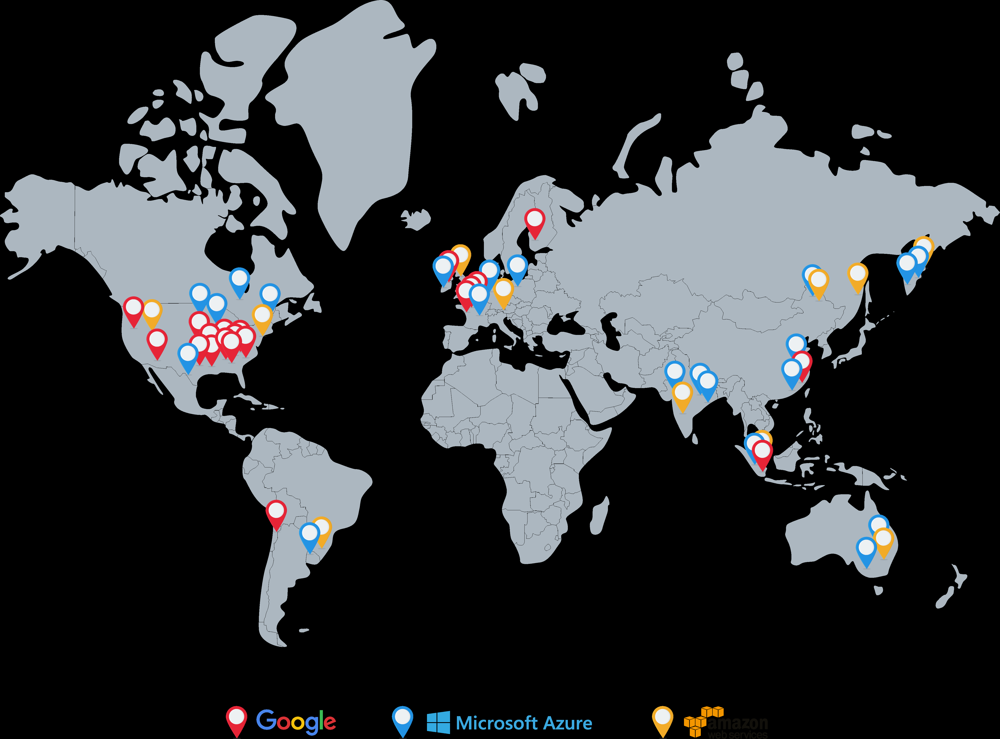
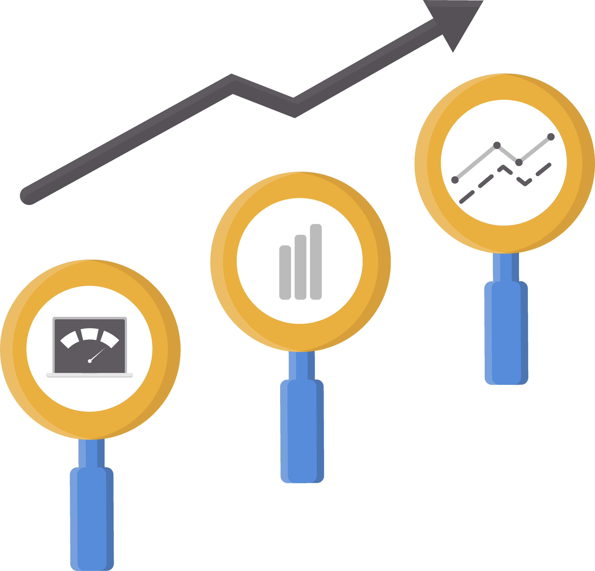

# 013 - Hệ Thống Giám Sát Phân Tán (Distributed Monitoring)

[← Bài trước](012-bo-sinh-so-thu-tu-sequencer.md) | [Mục lục](README.md) | [Bài tiếp theo →](014-giam-sat-loi-server-side.md)

---


# Thiết Kế Hệ Thống: Giám Sát Phân Tán (System Design: Distributed Monitoring)

Tìm hiểu về tầm quan trọng của việc giám sát trong một hệ thống phân tán (distributed system), và khám phá kế hoạch tổng thể ở mức cao (high-level plan) của chúng tôi để thiết kế hệ thống này.

---

### Chúng ta sẽ tìm hiểu các nội dung sau:
* **Giám sát (Monitoring)**
* **Chúng ta sẽ thiết kế một hệ thống giám sát phân tán (Distributed Monitoring System) như thế nào?**

---

## Giám sát (Monitoring)

Nền kinh tế hiện đại phụ thuộc vào sự vận hành liên tục của cơ sở hạ tầng CNTT (IT infrastructure). Cơ sở hạ tầng như vậy bao gồm phần cứng (hardware), các dịch vụ phân tán (distributed services), và tài nguyên mạng (network resources). Các thành phần này liên kết chặt chẽ với nhau trong cơ sở hạ tầng, khiến cho việc duy trì mọi thứ hoạt động trơn tru và không bị gián đoạn thời gian hoạt động của ứng dụng (**application downtime**) trở thành một thách thức lớn.


---

### Xác định vấn đề (Figuring out the issue)

Rất khó để biết điều gì đang thực sự xảy ra ở tầng phần cứng (hardware level) hoặc tầng ứng dụng (application level) khi cơ sở hạ tầng của chúng ta được phân tán trên nhiều địa điểm và bao gồm rất nhiều máy chủ (servers). 

Các thành phần có thể gặp sự cố (failures), độ trễ phản hồi vượt ngưỡng cho phép (**response latency overshoot**), phần cứng bị quá tải hoặc không thể tiếp cận (overloaded or unreachable hardware), và các bộ chứa cạn kiệt tài nguyên (**containers running out of resources**), cùng nhiều vấn đề khác. Có rất nhiều dịch vụ đang cùng chạy trong một cơ sở hạ tầng như vậy, và bất kỳ điều gì cũng có thể đi chệch hướng.


Khi một trong các dịch vụ bị sập (**goes down**), nó có thể là nguyên nhân khiến các dịch vụ khác bị sự cố dây chuyền (**crash**), và kết quả là ứng dụng rơi vào trạng thái không khả dụng đối với người dùng (**unavailable to users**). 

> [!IMPORTANT]
> Nếu chúng ta không sớm phát hiện ra điều gì đã xảy ra lỗi, chúng ta có thể sẽ mất rất nhiều thời gian và công sức để gỡ lỗi hệ thống một cách thủ công (**debug manually**). 

Hơn nữa, đối với các dịch vụ quy mô lớn hơn, chúng ta cần đảm bảo rằng các dịch vụ của mình đang hoạt động trong phạm vi các cam kết chất lượng dịch vụ (**Service-Level Agreements - SLAs**) đã thỏa thuận. Chúng ta cần nắm bắt các xu hướng quan trọng và các tín hiệu báo hiệu sự cố sắp xảy ra dưới dạng cảnh báo sớm (**early warnings**) để bất kỳ mối lo ngại hoặc vấn đề nào cũng có thể được giải quyết kịp thời.

**Giám sát (Monitoring)** giúp phân tích cơ sở hạ tầng phức tạp như vậy – nơi mà luôn có một thành phần nào đó liên tục gặp sự cố. Giám sát hệ thống phân tán đòi hỏi việc thu thập (**gathering**), diễn giải (**interpreting**), và hiển thị dữ liệu (**displaying data**) về các tương tác giữa các tiến trình đang chạy đồng thời. Nó hỗ trợ đắc lực trong việc:
- Gỡ lỗi (**Debugging**)
- Kiểm thử (**Testing**)
- Đánh giá hiệu năng (**Performance Evaluation**)
- Có được góc nhìn bao quát toàn cảnh (**Bird’s-eye view**) trên nhiều dịch vụ khác nhau.

---

## Chúng ta sẽ thiết kế một hệ thống giám sát phân tán như thế nào? (How will we design a distributed monitoring system?)

Chúng tôi đã chia tài liệu thiết kế hệ thống giám sát phân tán thành các chương và bài học sau:

### 1. Giám sát phân tán (Distributed Monitoring)
* **I. Giới thiệu về Giám sát phân tán (Introduction to Distributed Monitoring):** Tìm hiểu lý do tại sao việc giám sát trong một hệ thống phân tán lại mang tính sống còn, chi phí của thời gian ngừng hoạt động (**downtime cost**) đắt đỏ như thế nào, và các loại hình giám sát (**types of monitoring**).
* **II. Các điều kiện tiên quyết cho một Hệ thống giám sát (Prerequisites for a Monitoring System):** Khám phá một số khái niệm thiết yếu về các chỉ số đo lường (**metrics**) và cơ chế cảnh báo (**alerting**) trong một hệ thống giám sát.

### 2. Giám sát các lỗi phía máy chủ (Monitoring Server-side Errors)
* **I. Thiết kế một hệ thống giám sát (Designing a Monitoring System):** Xác định các yêu cầu (**requirements**) và thiết kế mức cao (**high-level design**) của hệ thống giám sát.
* **II. Thiết kế chi tiết hệ thống giám sát (A Detailed Design of the Monitoring System):** Đi sâu vào các chi tiết thiết kế hệ thống giám sát và khám phá các thành phần tham gia vào hệ thống.
* **III. Trực quan hóa dữ liệu trong hệ thống giám sát (Visualize Data in a Monitoring System):** Học một phương pháp độc đáo để trực quan hóa một khối lượng dữ liệu giám sát khổng lồ.

### 3. Giám sát các lỗi phía máy khách (Monitor Client-side Errors)
* **I. Tập trung vào các lỗi phía Client (Focus on Client-side Errors):** Làm quen với các lỗi phía máy khách (client-side errors) và lý do tại sao việc giám sát chúng lại quan trọng.
* **II. Thiết kế hệ thống giám sát phía Client (Design a Client-side Monitoring System):** Học cách thiết kế một hệ thống giám sát các lỗi phía máy khách.

---

> [!NOTE]
> Trong bài học tiếp theo, chúng ta sẽ xem xét lý do tại sao việc giám sát là thiết yếu trong một hệ thống phân tán thông qua một ví dụ cụ thể. Chúng ta cũng sẽ tìm hiểu về chi phí thiệt hại của sự cố ngừng hoạt động (**downtime cost of failures**) và các loại hình giám sát.

---

## Giới thiệu về Giám sát phân tán (Introduction to Distributed Monitoring)

Tìm hiểu lý do tại sao việc giám sát trong một hệ thống phân tán lại mang tính sống còn.

### Chúng ta sẽ tìm hiểu các nội dung sau:
* **Nhu cầu giám sát (Need for monitoring)**
* **Chi phí ngừng hoạt động (Downtime cost)**
* **Các loại hình giám sát (Types of monitoring)**

---

### Nhu cầu giám sát (Need for monitoring)

Hãy cùng điểm qua cách mà sự cố của một dịch vụ đơn lẻ có thể ảnh hưởng đến quá trình thực thi trơn tru của các hệ thống liên quan như thế nào. Để tránh các sự cố sập đổ dây chuyền (**cascading failures**), hệ thống giám sát có thể đóng một vai trò sống còn với các cảnh báo sớm (**early warnings**) hoặc dẫn đường đưa chúng ta trực tiếp tới nguyên nhân gốc rễ của lỗi (**root cause of faults**).

Hãy xem xét một kịch bản trong đó người dùng tải lên một video có tên `intro-to-system-design` lên YouTube:
1. Dịch vụ giao diện người dùng (**UI service**) tại **Server A** tiếp nhận thông tin video và chuyển dữ liệu này cho **Service 2** tại **Server B**.
2. **Service 2** tạo một bản ghi trong cơ sở dữ liệu (**Database**) và lưu trữ tệp video vào kho lưu trữ đối tượng nhị phân lớn (**Blob storage**).
3. Một dịch vụ khác là **Service 3** tại **Server C** quản lý quá trình nhân bản (**replication**) và đồng bộ hóa (**synchronization**) giữa hai cơ sở dữ liệu **Database X** và **Database Y**.

Trong kịch bản này:
- **Service 3** gặp trục trặc và thất bại do một lỗi nào đó, trong khi **Service 2** vẫn thực hiện ghi thành công một bản ghi vào **Database X**.
- Sau đó, **Database X** bị sập (**crashes**), và yêu cầu lấy dữ liệu video được chuyển hướng định tuyến (**routed**) sang **Database Y**.
- Người dùng muốn phát video `intro-to-system-design`, nhưng hệ thống sẽ trả về một lỗi: *"Video not found…"* ("Không tìm thấy video...").

---

#### Minh họa từng bước kịch bản:

**Bước 1: Người dùng tải lên video**
Người dùng thực hiện tải một video lên YouTube thông qua giao diện.


*Hình 1/15: Người dùng tải một video lên YouTube*

---

**Bước 2: Giao diện chuyển tiếp dữ liệu**
Dịch vụ UI trên Server A tiếp nhận thông tin video và chuyển tiếp dữ liệu này cho Service 2 trên Server B.


*Hình 2/15: Dịch vụ UI tại Server A nhận thông tin video và chuyển giao dữ liệu cho Service 2 tại Server B*

---

# 013 - Hệ Thống Giám Sát Phân Tán (Distributed Monitoring)

---

## Trang 7: Ghi Dữ liệu Video và Siêu Dữ liệu (Video Ingestion & Metadata Write)


### Luồng Xử Lý Kỹ Thuật (Technical Flow):
- **User (Người dùng)**
- **Server A (Front End YouTube - Máy chủ Giao diện người dùng):** Tiếp nhận yêu cầu tải video lên (**uploads video**).
- **Server B (DB r/w - Máy chủ Đọc/Ghi Cơ sở dữ liệu):** Phân tách và điều phối hai luồng dữ liệu:
  - **Video metadata (Siêu dữ liệu video):** Được ghi nhận vào cơ sở dữ liệu **DB X**.
  - **Video data (Dữ liệu nhị phân video):** Được đẩy trực tiếp vào kho lưu trữ đối tượng lớn (**Blob Store**).

> [!NOTE]
> **Service 2 makes an entry in the database and stores the video in blob storage**  
> *(Dịch vụ 2 (Service 2) thực hiện ghi một bản ghi vào cơ sở dữ liệu và lưu trữ tệp tin video vào kho lưu trữ đối tượng nhị phân - Blob Storage).*  
> *(Trang 3 / 15)*

---

## Trang 8: Đồng Bộ Hóa Cơ Sở Dữ Liệu Qua Synchronizer Service


### Luồng Xử Lý Kỹ Thuật (Technical Flow):
- **User (Người dùng)**
- **Server A (Front End YouTube):** Tiếp nhận luồng tải video lên (**uploads video**).
- **Server B (DB r/w):** Thực hiện ghi **video data** vào **Blob Store** và **video metadata** vào **DB X**.
- **Server C (Synchronizer - Máy chủ Đồng bộ):** Chạy dịch vụ phụ trách cơ chế sao chép/đồng bộ hóa (**Replication/Synchronization**) sang **DB Y**.

> [!NOTE]
> **Service 3 in server C manages the synchronization of databases X and Y**  
> *(Dịch vụ 3 (Service 3) nằm trên Server C quản lý việc đồng bộ hóa dữ liệu giữa hai cơ sở dữ liệu X và Y).*  
> *(Trang 4 / 15)*

---

## Trang 9: Lỗi Dịch Vụ Đồng Bộ Hóa (Synchronizer Failure)


### Luồng Xử Lý Kỹ Thuật (Technical Flow):
- **User (Người dùng)**
- **Server A (Front End YouTube):** Nhận luồng tải video lên (**uploads video**).
- **Server B (DB r/w):** Gửi **video data** tới **Blob Store** và ghi nhận **video metadata** vào **DB X**.
- **Server C (Synchronizer):** Gặp sự cố ngừng hoạt động hoặc ngoại lệ nội bộ.

> [!WARNING]
> **Service 3 fails due to an error, and service 2 makes an entry in the database X**  
> *(Dịch vụ 3 (Service 3) bị lỗi do gặp sự cố gián đoạn/ngoại lệ, trong khi Dịch vụ 2 (Service 2) vẫn tiếp tục thực hiện ghi bản ghi vào cơ sở dữ liệu DB X).*  
> *(Trang 5 / 15)*

---

## Trang 10: Sự Cố Sập Cơ Sở Dữ Liệu Nguồn (Primary DB Crash)


### Luồng Xử Lý Kỹ Thuật (Technical Flow):
- **User (Người dùng)** tải video lên qua **Server A (Front End YouTube)**.
- **Server B (DB r/w):** Cố gắng ghi **video metadata** vào **DB X** và **video data** vào **Blob Store**.
- **Server C (Synchronizer):** Tiếp nhận yêu cầu đọc các cập nhật mới (**read updates**) để đồng bộ sang **DB Y**, nhưng xuất hiện lỗi mạng/kết nối tới **X**.
- **DB X:** Bị sập (**Database X crashes**).

> [!IMPORTANT]
> **Database X crashes**  
> *(Cơ sở dữ liệu DB X gặp sự cố sập hoàn toàn / dừng hoạt động đột ngột - Node Crash).*  
> *(Trang 6 / 15)*

---

## Trang 11: Mất Tính Nhất Quán Dữ Liệu (Data Inconsistency)

### Luồng Xử Lý Kỹ Thuật (Technical Flow):
- **Server C (Synchronizer):** Báo lỗi không thể đồng bộ hóa dữ liệu với cơ sở dữ liệu DB X (**Failed to synchronize with DB X**).
- **DB Y:** Đang trong tình trạng thiếu hụt dữ liệu do **Replication Lag** hoặc quá trình đồng bộ thất bại.
- **User (Người dùng)** / **Server A** / **Server B** / **Blob Store**.

> [!CAUTION]
> **Database Y doesn’t have an entry of the intro-to-system-design video**  
> *(Cơ sở dữ liệu DB Y không có bản ghi siêu dữ liệu của video "intro-to-system-design" do việc đồng bộ bị gián đoạn).*  
> *(Trang 7 / 15)*

---

## Trang 12: Yêu Cầu Truy Xuất Video (Fetch Video Request)

### Luồng Xử Lý Kỹ Thuật (Technical Flow):
- **User (Người dùng):** Gửi yêu cầu lấy nội dung video (**fetch video**).
- **Server A (Front End YouTube):** Tiếp nhận yêu cầu truy vấn/lấy dữ liệu từ phía người dùng cuối.

> [!NOTE]
> **The user requests to fetch a video**  
> *(Người dùng gửi yêu cầu truy xuất/lấy dữ liệu video từ hệ thống).*  
> *(Trang 8 / 15)*

---

# 013 - Hệ Thống Giám Sát Phân Tán (Distributed Monitoring) & Khả Năng Chịu Lỗi (Fault Tolerance)

---

## Trang 13: Chuyển Tiếp Yêu Cầu Đọc Dữ Liệu (Forwarding Read Request)


### Thành Phần Hệ Thống (System Components)
* **Người dùng (User)**: Khách hàng gửi yêu cầu xem video.
* **Server A (Front-end YouTube)**: Dịch vụ giao diện người dùng (UI service) tiếp nhận các kết nối trực tiếp từ người dùng cuối.
* **Server B (Database Read/Write - DB r/w)**: Dịch vụ backend chuyên xử lý việc đọc và ghi dữ liệu cơ sở dữ liệu.

### Luồng Hoạt Động (Workflow)
1. **User** gửi yêu cầu `fetch video` (lấy video) tới **Server A**.
2. **Server A** thực hiện `read video data` (đọc dữ liệu video) bằng cách chuyển tiếp yêu cầu đến **Server B**.

> [!NOTE]
> **Dịch vụ giao diện người dùng (UI service) trên Server A chuyển tiếp yêu cầu đọc (read request) sang Server B** *(The UI service in server A forwards the read request to Server B)*.

*(9 of 15)*

---

## Trang 14: Sự Cố Cơ Sở Dữ Liệu X Bị Sập (Database X Crashes)


### Thành Phần Bổ Sung
* **DB X**: Node cơ sở dữ liệu chính đang lưu trữ và phục vụ dữ liệu video.

### Luồng Hoạt Động & Sự Cố (Workflow & Failure Incident)
1. **User** gửi yêu cầu `fetch video` tới **Server A**.
2. **Server A** gửi yêu cầu `read video data` tới **Server B**.
3. **Server B** gửi truy vấn `read video data` tới **DB X**.
4. **Sự cố xảy ra**: Node cơ sở dữ liệu **DB X** bị sập hoàn toàn (crashes).

> [!IMPORTANT]
> **Cơ sở dữ liệu X bị sập (The database X crashes)**. Điều này làm gián đoạn luồng truy xuất dữ liệu bình thường của hệ thống.

*(10 of 15)*

---

## Trang 15: Không Thể Lấy Dữ Liệu Do Cơ Sở Dữ Liệu Ngừng Hoạt Động (DB Down)


### Luồng Trạng Thái Lỗi (Error State Flow)
1. **User** tiếp tục duy trì kết nối chờ kết quả `fetch video`.
2. **Server A** vẫn đang đợi phản hồi từ yêu cầu `read video data` gửi tới **Server B**.
3. **DB X** đang trong trạng thái ngừng hoạt động (`db down so can't fetch` - cơ sở dữ liệu bị sập nên không thể truy xuất).

> [!WARNING]
> **Video không thể lấy được do cơ sở dữ liệu đã ngừng hoạt động** *(The video cannot be fetched as database is down)*.

*(11 of 15)*

---

## Trang 16: Cơ Chế Dự Phòng Chuyển Tiếp Sang Cơ Sở Dữ Liệu Y (Failover / Request Forwarded to DB Y)


### Thành Phần Mới
* **DB Y**: Node cơ sở dữ liệu bản sao (Replica / Secondary Database Node) đóng vai trò dự phòng trong mô hình phân tán.

### Cơ Chế Xử Lý Lỗi (Fault-Tolerance Execution)
1. **User** gửi yêu cầu `fetch video`.
2. **Server A** gửi yêu cầu `read video data` tới **Server B**.
3. **DB X** vẫn đang bị lỗi (`db down so can't fetch`).
4. **Server B** chuyển hướng truy vấn sang **DB Y** thông qua lệnh `read video`.

> [!NOTE]
> **Yêu cầu được chuyển tiếp sang cơ sở dữ liệu Y** *(The request is forwarded to database Y)* để nỗ lực duy trì tính sẵn sàng cao (High Availability).

*(12 of 15)*

---

## Trang 17: Không Tìm Thấy Bản Ghi Trên Cơ Sở Dữ Liệu Y (Data Inconsistency / Replication Issue)


### Chi Tiết Phản Hồi Từ DB Y
1. **DB X**: Bị sập (`db down so can't fetch`).
2. **DB Y**: Tiếp nhận yêu cầu đọc video từ **Server B**, nhưng cơ sở dữ liệu này phản hồi lại: `returns "no such entry"` (trả về kết quả "không có bản ghi nào như vậy").

> [!CAUTION]
> **Cơ sở dữ liệu Y không có bất kỳ bản ghi nào của video này** *(The database Y does not have any entry of this video)*. Đây là vấn đề kinh điển trong hệ thống phân tán liên quan đến độ trễ đồng bộ (Replication Lag) hoặc phân mảnh dữ liệu (Data Partitioning/Sharding) chưa nhất quán.

*(13 of 15)*

---

## Trang 18: Trả Về Lỗi "Không Tìm Thấy Video" Cho Phía Máy Chủ UI (Response Returned)


### Luồng Trả Lỗi Hoàn Tất (Error Propagation Flow)
1. **DB X**: Cơ sở dữ liệu bị hỏng (`db down so can't fetch`).
2. **DB Y**: Trả về `returns "no such entry"`.
3. **Server B**: Nhận kết quả từ **DB Y** và phản hồi ngược lại cho **Server A**: `returns no such video` (trả về kết quả không có video như vậy).

> [!IMPORTANT]
> **Phản hồi "Không tìm thấy video" ("Video not found") được trả về cho máy chủ UI (Server A)** *(The response of "Video not found" is returned to the UI server)*.

*(14 of 15)*

---

# Hệ Thống Giám Sát Phân Tán (Distributed Monitoring System)

---

### Sơ đồ luồng xử lý lỗi (Trang 19)


* **Server A** (front end YouTube)
* **Server B** (DB r/w - Đọc/Ghi cơ sở dữ liệu)
* **User** (Người dùng)
* **Trạng thái kết nối**: `db down so can't fetch` *(Cơ sở dữ liệu gặp sự cố nên không thể truy xuất dữ liệu)*
* **DB X**: Trả về `"no such entry"` *(không có bản ghi này)*
* **DB Y**: Trả về `"no such video"` *(không có video này)*
* **Phản hồi người dùng**: `Video not found` *(Không tìm thấy video)*
* **Chi tiết**: Phản hồi `"Video not found"` được trả về cho người dùng.
* *(Bước 15 / 15)*

---

Ví dụ trên tương đối đơn giản. Trong thực tế, chúng ta phải đối mặt với các vấn đề phức tạp hơn nhiều vì hệ thống sở hữu nhiều trung tâm dữ liệu (**data centers**) trải rộng khắp toàn cầu, và mỗi trung tâm dữ liệu chứa hàng triệu máy chủ (**servers**). Do tỷ lệ giữa quản trị viên con người trên số lượng máy chủ (**human administrators to servers ratio**) ngày càng giảm, việc tìm kiếm sự cố thủ công là điều hoàn toàn bất khả thi. Sở hữu một hệ thống giám sát (**monitoring system**) giúp giảm chi phí vận hành (**operational costs**) và thúc đẩy phương thức phát hiện lỗi tự động (**automated failure detection**).

---

### Chi phí do thời gian ngừng hoạt động (Downtime cost)

Hiện có những thiết kế hệ thống chịu lỗi (**fault-tolerant system designs**) giúp che giấu hầu hết các sự cố hỏng hóc khỏi người dùng cuối (**end users**), nhưng điều tối quan trọng là phải phát hiện và xử lý các sự cố trước khi chúng tích tụ thành một vấn đề lớn hơn theo hiệu ứng quả cầu tuyết (**snowball effect**). 

Tình trạng gián đoạn dịch vụ ngoài kế hoạch (**unplanned outage**) có thể gây tổn thất vô cùng nặng nề. Ví dụ:

> [!WARNING]
> Vào tháng 10 năm 2021, các ứng dụng của Meta đã bị sập trong gần 9 giờ đồng hồ, dẫn đến thiệt hại khoảng **13 triệu USD mỗi giờ**. Những mất mát to lớn này nhấn mạnh tác động tiềm tàng của các sự cố gián đoạn dịch vụ (**outages**).

Hạ tầng CNTT (**IT infrastructure**) hiện nay phân bổ rộng khắp trên toàn cầu. Minh họa dưới đoạn văn tiếp theo cung cấp một cái nhìn tổng quan về các trung tâm dữ liệu phân tán (**distributed data centers**) của các nhà cung cấp dịch vụ đám mây lớn trên thế giới, ước tính vào khoảng năm 2021. Các trung tâm dữ liệu này được kết nối thông qua mạng riêng (**private networks**) hoặc mạng công cộng (**public networks**). Việc giám sát các máy chủ trong các trung tâm dữ liệu phân tách về mặt địa lý (**geo-separated data centers**) là điều cốt yếu.

> [!NOTE]
> Theo báo cáo từ Amazon vào ngày 7 tháng 12 năm 2021:  
> *"Vào lúc 7:30 sáng PST, một hoạt động tự động nhằm mở rộng quy mô dung lượng (**scale capacity**) của một trong các dịch vụ AWS đặt tại mạng chính của AWS đã kích hoạt hành vi bất thường từ một lượng lớn client bên trong mạng nội bộ. Điều này dẫn đến sự gia tăng đột biến của các hoạt động kết nối, làm quá tải các thiết bị mạng giữa mạng nội bộ và mạng AWS chính, gây ra độ trễ giao tiếp (**communication delays**) giữa các mạng này.*  
>  
> *Độ trễ này đã làm tăng độ trễ tổng thể (**Latency**) và lỗi cho các dịch vụ đang giao tiếp giữa các mạng, dẫn đến việc phát sinh thêm nhiều nỗ lực kết nối và thử lại (**retries**). Tình trạng này kéo theo tắc nghẽn liên tục và các vấn đề về hiệu năng trên các thiết bị kết nối hai mạng với nhau."*  
>  
> Theo một ước tính, chi phí thiệt hại do thời gian chết (**outage cost**) của Amazon là **66.240 USD mỗi phút**.

---

### Sơ đồ hạ tầng trung tâm dữ liệu toàn cầu (Trang 21)



*Cái nhìn tổng quan về các trung tâm dữ liệu phân tán toàn cầu của AWS, Azure và Google.*

---

### Các loại hình giám sát (Types of monitoring)

Hãy cùng xem xét một ví dụ để hiểu rõ các loại lỗi mà chúng ta cần giám sát. 

Tại Educative, bất cứ khi nào một học viên kết nối vào một môi trường thực thi (**executable environment**), một container sẽ được cấp phát. Hãy xem xét:
* **Service 1** trên **Server A**: chịu trách nhiệm cấp phát container mỗi khi học viên kết nối.
* **Service 2** trên **Server B**: tiếp nhận thông tin này và thông báo cho dịch vụ chịu trách nhiệm xử lý giao diện người dùng (**UI**).
* **UI Service** chạy trên **Server C**: cập nhật giao diện người dùng (**UI**) cho học viên.

Giả sử rằng **Service 2** gặp sự cố do một lỗi nào đó, và học viên nhìn thấy thông báo lỗi: *"Cannot connect..."* *(Không thể kết nối...)*.

Làm thế nào để các kỹ sư phát triển của Educative phát hiện ra rằng học viên đang gặp phải lỗi này?

---

### Trình tự tương tác dịch vụ (Service Interaction Sequence)

#### Bước 1: Yêu cầu kết nối từ người học (Trang 22)


* **Các thành phần tham gia**:
  * **Learner** (Người học)
  * **Front end Server** (Máy chủ giao diện phía trước)
  * **Server A** (`service 1`)
  * **Server B** (`service 2`)
  * **Server C** (`service 3`)
* **Hành động**: `connection request` *(Yêu cầu kết nối)*
* **Chi tiết**: Học viên khởi tạo một yêu cầu kết nối đến Educative.
* *(Bước 1 / 14)*

---

#### Bước 2: Yêu cầu cấp phát container (Trang 23)


* **Các thành phần tham gia**:
  * **Learner** (Người học)
  * **Front end Server** (Máy chủ giao diện phía trước)
  * **Server A** (`service 1`)
  * **Server B** (`service 2`)
  * **Server C** (`service 3`)
* **Hành động**:
  * `connection request` *(Yêu cầu kết nối)*
  * `allocate container` *(Cấp phát container)*
* **Chi tiết**: Front-end server của Educative khởi tạo yêu cầu cấp phát container gửi đến `service 1` trên Server A.
* *(Bước 2 / 14)*

---

#### Bước 3: Kiểm tra trạng thái cấp phát container (Trang 24)

* **Các thành phần tham gia**:
  * **Learner** (Người học)
  * **Front end Server** (Máy chủ giao diện phía trước)
  * **Server A** (`service 1`)
  * **Server B** (`service 2`)
  * **Server C** (`service 3`)
* **Hành động**:
  * `connection request` *(Yêu cầu kết nối)*
  * `allocate container` *(Cấp phát container)*
  * `Is container allocated` *(Container đã được cấp phát chưa)*
* **Chi tiết**: `Service 2` trên Server B cấp phát một container và phản hồi/thông báo lại cho `service 1` trên Server A.
* *(Bước 3 / 14)*

---

# Quy trình tương tác và cấp phát tài nguyên hệ thống (System Interaction & Resource Allocation Flow)

> [!NOTE]
> **Các thành phần tham gia hệ thống (System Entities):**
> - **Learner**: Người học / Phía client (Client-side)
> - **Front end Server**: Máy chủ điều phối giao diện / Tiếp nhận yêu cầu ban đầu (Front-end Server)
> - **Server A (service 1)**: Máy chủ A (Dịch vụ 1 - Service 1)
> - **Server B (service 2)**: Máy chủ B (Dịch vụ 2 - Service 2)
> - **Server C (service 3)**: Máy chủ C (Dịch vụ 3 - Service 3)

---

### --- Trang 25 ---

#### **Các thực thể tham gia (Entities):**
- **Learner** (Người học)
- **Front end Server** (Máy chủ Front-end)
- **Server A (service 1)** (Máy chủ A - Dịch vụ 1)
- **Server B (service 2)** (Máy chủ B - Dịch vụ 2)
- **Server C (service 3)** (Máy chủ C - Dịch vụ 3)

#### **Luồng thông điệp (Message Flow):**
- **connection request** (Yêu cầu kết nối)
- **allocate container** (Cấp phát container)
- **Is container allocated** (Container đã được cấp phát chưa?)
- **Yes** (Đã cấp phát)

#### **Mô tả hành động kỹ thuật:**
> **Service 1 in server A acknowledges the allocation**  
> *(Dịch vụ 1 trên máy chủ A ghi nhận/xác nhận việc cấp phát container)*

`4 of 14` *(Bước 4 / 14)*

---

### --- Trang 26 ---

#### **Các thực thể tham gia (Entities):**
- **Learner** (Người học)
- **Front end Server** (Máy chủ Front-end)
- **Server A (service 1)** (Máy chủ A - Dịch vụ 1)
- **Server B (service 2)** (Máy chủ B - Dịch vụ 2)
- **Server C (service 3)** (Máy chủ C - Dịch vụ 3)

#### **Luồng thông điệp (Message Flow):**
- **connection request** (Yêu cầu kết nối)
- **allocate container** (Cấp phát container)
- **Is container allocated** (Container đã được cấp phát chưa?)
- **Yes** (Đã cấp phát)
- **Update UI** (Cập nhật giao diện người dùng - UI)

#### **Mô tả hành động kỹ thuật:**
> **Service 3 in server C receives the request to update the UI for the learner**  
> *(Dịch vụ 3 trên máy chủ C nhận được yêu cầu cập nhật giao diện người dùng - UI cho người học)*

`5 of 14` *(Bước 5 / 14)*

---

### --- Trang 27 ---

#### **Các thực thể tham gia (Entities):**
- **Learner** (Người học)
- **Front end Server** (Máy chủ Front-end)
- **Server A (service 1)** (Máy chủ A - Dịch vụ 1)
- **Server B (service 2)** (Máy chủ B - Dịch vụ 2)
- **Server C (service 3)** (Máy chủ C - Dịch vụ 3)

#### **Luồng thông điệp (Message Flow):**
- **connection request** (Yêu cầu kết nối)
- **allocate container** (Cấp phát container)
- **Is container allocated** (Container đã được cấp phát chưa?)
- **Yes** (Đã cấp phát)
- **Update UI** (Cập nhật giao diện người dùng - UI)
- **UI updated** (Giao diện người dùng - UI đã được cập nhật thành công)

#### **Mô tả hành động kỹ thuật:**
> **Service 3 in server C updates the UI for the learner**  
> *(Dịch vụ 3 trên máy chủ C cập nhật giao diện người dùng - UI cho người học)*

`6 of 14` *(Bước 6 / 14)*

---

### --- Trang 28 ---

#### **Các thực thể tham gia (Entities):**
- **Learner** (Người học)
- **Front end Server** (Máy chủ Front-end)
- **Server A (service 1)** (Máy chủ A - Dịch vụ 1)
- **Server B (service 2)** (Máy chủ B - Dịch vụ 2)
- **Server C (service 3)** (Máy chủ C - Dịch vụ 3)

#### **Luồng thông điệp (Message Flow):**
- **connection request** (Yêu cầu kết nối)
- **allocate container** (Cấp phát container)
- **Is container allocated** (Container đã được cấp phát chưa?)
- **Yes** (Đã cấp phát)
- **Update UI** (Cập nhật giao diện người dùng - UI)
- **UI updated** (Giao diện người dùng - UI đã được cập nhật)
- **Connected** (Đã kết nối)

#### **Mô tả hành động kỹ thuật:**
> [!IMPORTANT]
> **The connection is established for the learner**  
> *(Kết nối đã được thiết lập thành công cho người học)*

`7 of 14` *(Bước 7 / 14)*

---

### --- Trang 29 ---

#### **Các thực thể tham gia (Entities):**
- **Learner** (Người học)
- **Front end Server** (Máy chủ Front-end)
- **Server A (service 1)** (Máy chủ A - Dịch vụ 1)
- **Server B (service 2)** (Máy chủ B - Dịch vụ 2)
- **Server C (service 3)** (Máy chủ C - Dịch vụ 3)

#### **Luồng thông điệp (Message Flow):**
- **connection request** (Yêu cầu kết nối)
- **allocate container** (Cấp phát container)
- **Is container allocated** (Container đã được cấp phát chưa?)
- **Yes** (Đã cấp phát)
- **Update UI** (Cập nhật giao diện người dùng - UI)
- **UI updated** (Giao diện người dùng - UI đã được cập nhật)
- **connect again** (Kết nối lại lần nữa)
- **Connected** (Đã kết nối)

#### **Mô tả hành động kỹ thuật:**
> **The learner initiates a connection request to Educative again**  
> *(Người học khởi tạo lại một yêu cầu kết nối - connection request tới nền tảng Educative một lần nữa)*

`8 of 14` *(Bước 8 / 14)*

---

### --- Trang 30 ---

#### **Các thực thể tham gia (Entities):**
- **Learner** (Người học)
- **Front end Server** (Máy chủ Front-end)
- **Server A (service 1)** (Máy chủ A - Dịch vụ 1)
- **Server B (service 2)** (Máy chủ B - Dịch vụ 2)
- **Server C (service 3)** (Máy chủ C - Dịch vụ 3)

#### **Luồng thông điệp (Message Flow):**
- **connection request** (Yêu cầu kết nối)
- **allocate container** (Cấp phát container)
- **Is container allocated** (Container đã được cấp phát chưa?)
- **Yes** (Đã cấp phát)
- **Update UI** (Cập nhật giao diện người dùng - UI)
- **UI updated** (Giao diện người dùng - UI đã được cập nhật)
- **connect again** (Kết nối lại lần nữa)
- **allocate container** (Cấp phát container)
- **Connected** (Đã kết nối)

#### **Mô tả hành động kỹ thuật:**
> [!TIP]
> **Educative's front-end server initiates the request to allocate the container**  
> *(Máy chủ Front-end của Educative khởi tạo yêu cầu cấp phát container - allocate container)*

`9 of 14` *(Bước 9 / 14)*

---

# Tài Liệu Thiết Kế Hệ Thống: Giám Sát Phân Tán (Distributed Monitoring)

---

## --- Trang 31 ---

### Sơ đồ tuần tự: Lỗi giao tiếp giữa các dịch vụ nội bộ (Internal Service Failure)

Các thực thể tham gia (Entities):
- **Người học (Learner / Client)**
- **Máy chủ giao diện người dùng (Front-end Server)**
- **Máy chủ A / Dịch vụ 1 (Server A - service 1)**
- **Máy chủ B / Dịch vụ 2 (Server B - service 2)**
- **Máy chủ C / Dịch vụ 3 (Server C - service 3)**

**Luồng tương tác (Flow of interactions):**
1. Người học (Learner) gửi **yêu cầu kết nối (connection request)** đến Máy chủ giao diện người dùng (Front-end Server).
2. Front-end Server gửi lệnh **cấp phát container (allocate container)** đến Máy chủ A (Server A).
3. Truy vấn kiểm tra: **Container đã được cấp phát chưa? (Is container allocated?)** $\rightarrow$ Trả lời: **Có (Yes)**.
4. Gửi yêu cầu **Cập nhật giao diện người dùng (Update UI)**.
5. Giao diện người dùng đã được cập nhật (**UI updated**).
6. Người học thực hiện **kết nối lại (connect again)** đến Front-end Server.
7. Front-end Server gửi yêu cầu **cấp phát container (allocate container)** đến Máy chủ B (Server B).
8. Trạng thái: Đã kết nối (**Connected**).
9. **Sự cố phát sinh:** Máy chủ B gặp sự cố vì một lý do nào đó (**Server B fails due to some reason**).

> *Trang 10 / 14*

---

## --- Trang 32 ---

### Sơ đồ tuần tự: Front-end Server chờ cập nhật trạng thái UI

Các thực thể tham gia (Entities):
- **Người học (Learner)**
- **Máy chủ giao diện người dùng (Front-end Server)**
- **Máy chủ A / Dịch vụ 1 (Server A - service 1)**
- **Máy chủ B / Dịch vụ 2 (Server B - service 2)**
- **Máy chủ C / Dịch vụ 3 (Server C - service 3)**

**Luồng tương tác (Flow of interactions):**
1. Người học gửi **yêu cầu kết nối (connection request)**.
2. Cấp phát container (**allocate container**) tại Server A.
3. Kiểm tra: **Container đã được cấp phát chưa? (Is container allocated?)** $\rightarrow$ **Có (Yes)**.
4. **Cập nhật giao diện người dùng (Update UI)**.
5. Giao diện người dùng đã cập nhật (**UI updated**).
6. Người học thực hiện **kết nối lại (connect again)**.
7. Front-end Server gửi yêu cầu **cấp phát container (allocate container)** đến Server B.
8. Trạng thái: Đã kết nối (**Connected**).
9. **Trạng thái hiện tại:** Máy chủ giao diện người dùng đang chờ quá trình cập nhật giao diện người dùng... (**Front end server waiting for the UI updation..**)

> [!NOTE]
> **Chi tiết cơ chế:** Máy chủ giao diện người dùng (front-end server) duy trì trạng thái chờ (waiting) để giao diện người dùng của người học được cập nhật hoàn tất (*The front-end server waits for the learner’s UI to be updated*).

> *Trang 11 / 14*

---

## --- Trang 33 ---

### Sơ đồ tuần tự: Hết thời gian chờ yêu cầu (Request Timeout)

Các thực thể tham gia (Entities):
- **Người học (Learner)**
- **Máy chủ giao diện người dùng (Front-end Server)**
- **Máy chủ A / Dịch vụ 1 (Server A - service 1)**
- **Máy chủ B / Dịch vụ 2 (Server B - service 2)**
- **Máy chủ C / Dịch vụ 3 (Server C - service 3)**

**Luồng tương tác (Flow of interactions):**
1. Người học gửi **yêu cầu kết nối (connection request)**.
2. Cấp phát container (**allocate container**) tại Server A.
3. Kiểm tra: **Container đã được cấp phát chưa? (Is container allocated?)** $\rightarrow$ **Có (Yes)**.
4. **Cập nhật giao diện người dùng (Update UI)**.
5. Giao diện người dùng đã cập nhật (**UI updated**).
6. Người học gửi yêu cầu **kết nối lại (connect again)**.
7. Gửi lệnh **cấp phát container (allocate container)** đến Server B.
8. Trạng thái: Đã kết nối (**Connected**).
9. **Sự cố Timeout:** Hết thời gian chờ (Timeout): Giao diện người dùng không được cập nhật do máy chủ B gặp sự cố giao tiếp với máy chủ A và máy chủ C (**Timeout: UI is not updated because server B failed to communicate with server A and C**).

> [!WARNING]
> **Trạng thái lỗi:** Yêu cầu đã bị hết thời gian chờ (**The request times out**).

> *Trang 12 / 14*

---

## --- Trang 34 ---

### Sơ đồ tuần tự: Không thể thiết lập kết nối (Connection Establishment Failure)

Các thực thể tham gia (Entities):
- **Người học (Learner)**
- **Máy chủ giao diện người dùng (Front-end Server)**
- **Máy chủ A / Dịch vụ 1 (Server A - service 1)**
- **Máy chủ B / Dịch vụ 2 (Server B - service 2)**
- **Máy chủ C / Dịch vụ 3 (Server C - service 3)**

**Luồng tương tác (Flow of interactions):**
1. Người học gửi **yêu cầu kết nối (connection request)**.
2. Cấp phát container (**allocate container**) tại Server A.
3. Kiểm tra: **Container đã được cấp phát chưa? (Is container allocated?)** $\rightarrow$ **Có (Yes)**.
4. **Cập nhật giao diện người dùng (Update UI)**.
5. Giao diện người dùng đã cập nhật (**UI updated**).
6. Người học gửi yêu cầu **kết nối lại (connect again)**.
7. Gửi lệnh **cấp phát container (allocate container)** đến Server B.
8. Trạng thái: Đã kết nối (**Connected**).
9. **Hết thời gian chờ (Timeout):** Giao diện người dùng không được cập nhật do máy chủ B gặp sự cố giao tiếp với máy chủ A và máy chủ C (**Timeout: UI is not updated because server B failed to communicate with server A and C**).
10. **Thông báo lỗi đến Client:** Kết nối thất bại (**Connection failed**).

> [!CAUTION]
> **Kết luận:** Kết nối của người học không thể thiết lập được (**The connection for the learner could not be established**).

> *Trang 13 / 14*

---

## --- Trang 35 ---

### Vấn Đề Đặt Ra Cho Đội Ngũ Kỹ Sư Phát Triển (Engineering Problem)

Làm thế nào để các nhà phát triển phát hiện ra lỗi kết nối thất bại? (**How will the developers find out about the failed connection error?**)  
Làm thế nào để các nhà phát triển biết về lỗi kết nối thất bại? (**How will the developers know about the connection failed error?**)  

> *Trang 14 / 14*

Bây giờ, điều gì sẽ xảy ra nếu một người học thực hiện một yêu cầu (**request**) nhưng nó **không bao giờ đến được máy chủ** của Educative? Làm thế nào để Educative biết được rằng người học đang gặp sự cố?

Dựa trên các ví dụ trên, chúng ta có thể phân chia trọng tâm giám sát (**monitoring focus**) thành hai nhóm lỗi lớn:

1. **Lỗi phía dịch vụ (Service-side errors):** Đây là những lỗi thường có thể nhìn thấy được đối với các dịch vụ giám sát (**monitoring services**) vì chúng xảy ra trực tiếp trên các máy chủ (**servers**). Những lỗi này thường được báo cáo dưới dạng **mã lỗi 5xx** trong các mã trạng thái phản hồi HTTP (**HTTP response codes**).
2. **Lỗi phía máy khách (Client-side errors):** Đây là những lỗi có nguyên nhân gốc rễ (**root cause**) nằm ở phía máy khách (**client-side**). Những lỗi này thường được báo cáo dưới dạng **mã lỗi 4xx** trong các mã trạng thái phản hồi HTTP. Một số lỗi phía client hoàn toàn **vô hình (invisible)** đối với dịch vụ khi các yêu cầu từ client **không thể gửi tới được dịch vụ**.

---

## --- Trang 36 ---

**Quay lại (Back)**  
**Thiết Kế Hệ Thống: Giám Sát Phân Tán… (System Design: Distributed Monitori…)**  
**Đánh dấu đã hoàn thành (Mark As Completed)**  
**Tiếp theo (Next)**  

### Các Điều Kiện Tiên Quyết Của Một Hệ Thống Giám Sát (Prerequisites of a Monitoring System)

Chúng ta sẽ tìm hiểu cách thiết kế một dịch vụ giám sát (**monitoring service**) để xử lý cả hai kịch bản trên trong các chương sắp tới: **Giám sát lỗi phía máy chủ (Monitoring Server-side Errors)** và **Giám sát lỗi phía máy khách (Monitoring Client-side Errors)**. 

Chúng ta cần các hệ thống giám sát của mình có khả năng phân tích các dịch vụ được phân tán trên toàn cầu (**globally distributed services**). Điều này cho phép:
- **Thấu hiểu rõ ràng hơn về các thành phần bên trong hệ thống (system's components)**.
- **Tăng tính linh hoạt và nhanh nhạy (agility) trong việc phát hiện (detect) và ứng phó (respond) với các sự cố/lỗi hỏng hóc (faults)**.

---

***

# Điều Kiện Tiên Quyết Của Một Hệ Thống Giám Sát (Prerequisites of a Monitoring System)

Tìm hiểu về số liệu đo lường (**metrics**) và cơ chế cảnh báo (**alerting**) trong một hệ thống giám sát.

### Nội dung bao gồm:
* Giám sát: Số liệu đo lường và cảnh báo (**Monitoring: metrics and alerting**)
* Số liệu đo lường (**Metrics**)
* Thu thập / Cung cấp số liệu đo lường (**Populate the metrics**)
* Lưu trữ dữ liệu bền vững (**Persist the data**)
* Số liệu đo lường cấp ứng dụng (**Application metrics**)
* Cảnh báo (**Alerting**)

---

## Giám Sát: Số Liệu Đo Lường và Cảnh Báo (Monitoring: Metrics and Alerting)

Một hệ thống giám sát (**monitoring system**) tốt cần xác định rõ ràng những gì cần đo lường và đo theo đơn vị nào (**metrics**). Hệ thống giám sát cũng cần định nghĩa các giá trị ngưỡng (**threshold values**) cho tất cả các số liệu đo lường và có khả năng thông báo đến các bên liên quan thích hợp (**alerts**) khi các giá trị nằm ngoài phạm vi chấp nhận được. 

Việc nắm bắt trạng thái của cơ sở hạ tầng (**infrastructure**) và hệ thống giúp đảm bảo độ ổn định của dịch vụ (**service stability**). Đội ngũ hỗ trợ (**support team**) có thể phản hồi các sự cố nhanh chóng và tự tin hơn nếu họ có quyền truy cập vào thông tin về tình trạng hoạt động (**health**) và hiệu năng (**performance**) của các bản triển khai (**deployments**). Các hệ thống giám sát thu thập số liệu đo, hiển thị dữ liệu và gửi cảnh báo khi phát hiện điều bất thường sẽ rất hữu ích cho đội ngũ hỗ trợ.

Để hiểu sâu hơn về số liệu đo lường (**metrics**), cảnh báo (**alerts**) và mối liên hệ của chúng với hoạt động giám sát, chúng ta sẽ xem xét tầm quan trọng, lợi ích tiềm năng của chúng và loại dữ liệu mà chúng ta có thể muốn theo dõi.

---

### Điểm Cần Suy Ngẫm (Point to Ponder)

> [!NOTE]
> **Câu hỏi (Question):**  
> Các phương pháp tiếp cận truyền thống để xử lý lỗi trong cơ sở hạ tầng CNTT (IT infrastructure) là gì?

> [!IMPORTANT]
> **Trả lời (Answer):**  
> Hai phương pháp tiếp cận truyền thống để xử lý lỗi cơ sở hạ tầng CNTT là: **Phương pháp tiếp cận phản ứng (Reactive approach)** và **Phương pháp tiếp cận chủ động (Proactive approach)**.
>
> * **Trong phương pháp tiếp cận phản ứng (Reactive approach):** Hành động khắc phục chỉ được thực hiện sau khi sự cố đã xảy ra. Với phương pháp này, ngay cả khi đội ngũ DevOps hành động nhanh chóng để tìm nguyên nhân lỗi và xử lý sự cố kịp thời, hệ thống vẫn bị gián đoạn (**downtime**). Do đó, thời gian ngừng hoạt động (**system downtime**) là điều không thể tránh khỏi trong phương pháp tiếp cận phản ứng, và đây thường là điều không mong muốn đối với các ứng dụng chạy liên tục.
> * **Trong phương pháp tiếp cận chủ động (Proactive approach):** Các hành động chủ động được thực hiện trước khi lỗi xảy ra. Nhờ đó, nó ngăn ngừa được thời gian chết (**downtimes**) và những thiệt hại liên quan. Phương pháp tiếp cận chủ động hoạt động dựa trên việc dự đoán các lỗi hệ thống để đưa ra hành động khắc phục nhằm tránh sự cố. Phương pháp này mang lại độ tin cậy (**reliability**) cao hơn bằng cách ngăn chặn thời gian ngừng hoạt động.
>
> Trong các dịch vụ hiện đại, việc tránh hoàn toàn sự cố là điều bất khả thi. Luôn có một thành phần nào đó bị lỗi bên trong các trung tâm dữ liệu (**data centers**) khổng lồ và các hệ thống triển khai mạng lưới (**network deployments**). Mục tiêu là phát hiện sớm các vấn đề sắp xảy ra và thiết kế hệ thống sao cho các lỗi dịch vụ hoàn toàn vô hình đối với người dùng cuối (**end users**).

---

## Số Liệu Đo Lường (Metrics)

Số liệu đo lường (**Metrics**) xác định một cách khách quan những gì chúng ta nên đo lường và những đơn vị nào sẽ phù hợp. Giá trị của các số liệu đo lường cung cấp cái nhìn sâu sắc (**insight**) về hệ thống tại bất kỳ thời điểm nào. 

Ví dụ: khả năng của một máy chủ web (**web server**) trong việc xử lý một lượng lưu lượng truy cập nhất định mỗi giây, hoặc khả năng gia nhập vào một nhóm máy chủ web (**pool of web servers**) là những ví dụ về dữ liệu cấp cao (**high-level data**) tương quan với mục đích hoặc hoạt động cụ thể của một thành phần. Một ví dụ khác có thể là đo lường hiệu năng mạng theo thông lượng (**throughput** - megabits mỗi giây) và độ trễ (**latency** - thời gian khứ hồi / **round-trip time**). 

Chúng ta cần thu thập giá trị của các số liệu đo lường với mức tiêu hao hiệu năng tối thiểu (**minimal performance penalty**). Chúng ta có thể sử dụng độ trễ mà người dùng cảm nhận được (**user-perceived latency**) hoặc lượng tài nguyên tính toán tiêu thụ để đo lường mức phạt hiệu năng này.



Các giá trị theo dõi lượng tài nguyên vật lý mà hệ điều hành sử dụng có thể là một điểm khởi đầu tốt. Nếu đã có sẵn một hệ thống giám sát, chúng ta không cần tốn quá nhiều công sức để lấy dữ liệu về:
* Tải của bộ xử lý (**processor load**)
* Thống kê CPU như lượt trúng/trượt bộ nhớ đệm (**cache hits and misses**)
* Mức sử dụng RAM của hệ điều hành và các tiến trình (**RAM usage by OS and processes**)
* Lỗi trang (**page faults**)
* Dung lượng ổ đĩa (**disc space**)
* Độ trễ đọc và ghi ổ đĩa (**disc read and write latencies**)
* Mức sử dụng không gian hoán đổi (**swap space usage**), v.v.

Các số liệu đo lường được cung cấp bởi nhiều máy chủ web, máy chủ cơ sở dữ liệu (**database servers**) và các phần mềm khác giúp chúng ta xác định liệu mọi thứ có đang vận hành trơn tru hay không.

> [!NOTE]
> **Lưu ý:** Kết nối tới terminal sau để xem chi tiết về mức sử dụng CPU của các tiến trình hiện đang hoạt động trên máy ảo (virtual machine).

```text
Terminal 1
Terminal
```

Chúng ta sử dụng lệnh `top` để xem các tiến trình Linux. Chạy lệnh này sẽ mở ra một giao diện tương tác của hệ thống đang chạy, bao gồm phần tóm tắt của hệ thống và danh sách các tiến trình (**processes**) hoặc luồng (**threads**). Giao diện mặc định có các thông tin sau:
* **Ở trên cùng:** Chúng ta có thể thấy máy đã được bật trong bao lâu, bao nhiêu người dùng đang đăng nhập, và tải trung bình (**average load**) trên máy trong vài phút qua.
* **Ở dòng tiếp theo:** Chúng ta có thể thấy trạng thái (đang chạy - `running`, đang ngủ - `sleeping`, hoặc đã dừng - `stopped`) của các tác vụ đang chạy trên máy.
* **Tiếp theo:** Các giá trị tiêu thụ CPU (**CPU consumption values**).
* **Cuối cùng:** Tổng quan về bộ nhớ vật lý (**physical memory**) — bao nhiêu dung lượng còn trống (`free`), đã sử dụng (`used`), vùng đệm (`buffered`), hoặc khả dụng (`available`).

Bây giờ, hãy thực hiện các bước sau để quan sát sự thay đổi trong mức sử dụng CPU:
1. Thoát bằng cách nhập `q` vào terminal.
2. Chạy lệnh `nohup ./script.sh &>/dev/null &`. Tập lệnh này chứa một vòng lặp vô tận, và việc chạy lệnh sẽ thực thi tập lệnh dưới nền (**background**).
3. Chạy lệnh `top` để quan sát sự gia tăng trong mức sử dụng CPU.

*(Click to Connect...)*

---

## Thu Thập / Cung Cấp Số Liệu Đo Lường (Populate the Metrics)

Các số liệu đo lường nên được tập trung hóa về mặt logic (**logically centralized**) phục vụ cho mục đích giám sát và cảnh báo toàn cục. Việc truy xuất/lấy số liệu đo lường (**fetching metrics**) mang tính cốt lõi đối với hệ thống giám sát. Số liệu có thể được đẩy (**pushed**) hoặc kéo (**pulled**) vào hệ thống giám sát, tùy thuộc vào tùy chọn cấu hình của người dùng.

Tại đây, chúng ta đối mặt với một thách thức thiết kế cơ bản: **Chúng ta sử dụng mô hình Đẩy (Push) hay Kéo (Pull)?** Máy chủ nên chủ động gửi các giá trị số liệu đo lường ra ngoài, hay nó chỉ nên để lộ ra một điểm cuối (**endpoint**) và chờ đợi các truy vấn một cách thụ động?

* **Trong chiến lược Kéo (Pull strategy):** Mỗi máy chủ được giám sát chỉ cần lưu trữ các số liệu đo lường trong bộ nhớ (**in memory**) và gửi chúng đến một điểm cuối được công khai (**exposed endpoint**). Điểm cuối này cho phép ứng dụng giám sát tự tìm nạp (**fetch**) các số liệu đo lường. Các máy chủ gửi quá nhiều dữ liệu hoặc gửi dữ liệu quá thường xuyên sẽ không thể làm quá tải hệ thống giám sát. Hệ thống giám sát sẽ kéo dữ liệu theo lịch trình riêng của nó.
* **Trong các trường hợp khác, chiến lược Đẩy (Push strategy) có thể có lợi:** Ví dụ như khi tường lửa (**firewall**) ngăn cản hệ thống giám sát truy cập trực tiếp vào máy chủ. Hệ thống giám sát có khả năng điều chỉnh một cấu hình toàn cục (**global configuration**) về dữ liệu cần thu thập và khoảng thời gian mà các máy chủ cùng thiết bị chuyển mạch (**switches**) nên đẩy dữ liệu.

Thuật ngữ đẩy (**push**) và kéo (**pull**) có thể gây nhầm lẫn. Bất cứ khi nào chúng ta thảo luận về chiến lược đẩy hoặc kéo, chúng ta sẽ xem xét nó từ **góc nhìn của hệ thống giám sát**. Nghĩa là: hoặc hệ thống sẽ kéo (**pull**) các giá trị số liệu đo lường từ các ứng dụng, hoặc các số liệu đo lường sẽ được đẩy (**pushed**) tới hệ thống giám sát. Để tránh nhầm lẫn, chúng ta sẽ giữ nguyên góc nhìn của hệ thống giám sát.

> [!NOTE]
> **Lưu ý:** Trong mô hình kéo (**pull model**), hệ thống giám sát yêu cầu các bộ thu thập dữ liệu phân tán (**distributed data collectors**) cung cấp dữ liệu mà chúng đã thu thập cục bộ. Điều này có nghĩa là luồng dữ liệu chỉ diễn ra khi có yêu cầu từ hệ thống giám sát. Ngược lại, trong mô hình đẩy (**push model**), các bộ thu thập phân tán sẽ gửi dữ liệu thu thập được của chúng tới hệ thống giám sát theo định kỳ.

---

### Điểm Cần Suy Ngẫm (Point to Ponder)

> [!NOTE]
> **Câu hỏi (Question):**  
> Ghi log (**Logging**) là hành động lưu trữ các bản ghi về các sự kiện trong một hệ thống phần mềm. Nó giúp ích như thế nào trong việc giám sát (**monitoring**)?

> [!IMPORTANT]
> **Trả lời (Answer):**  
> Trong quá trình ghi log (**logging**), các máy chủ ứng dụng ghi thông tin vào tệp tin. Thông tin có thể là mức sử dụng CPU, thông tin liên quan đến ứng dụng và các thuộc tính liên quan khác mà chúng ta thấy cần thiết để truy vết ngược (**backtrace**) hoặc gỡ lỗi (**debug**) một tệp khi gặp sự cố. Chúng ta có thể tạo/cung cấp các số liệu đo lường (**metrics**) dựa trên các giá trị được ghi lại trong nhật ký (**logs**).
>
> Cả nhật ký (**logs**) và số liệu đo lường (**metrics**) đều giúp ích trong việc giám sát một dịch vụ. Nhưng điều này không phải lúc nào cũng đúng vì việc xử lý thông tin log đòi hỏi thời gian. Trong thời gian thực (**real time**), chúng ta cần hành động nhanh chóng để phát hiện sớm các vấn đề. Do đó, ghi log cũng là một trong những nguồn đầu vào của số liệu đo lường. Ghi log chỉ là một cơ chế để thu thập thông tin, và hệ thống giám sát có thể sử dụng nó để thu thập các thông tin cần thiết.
>
> Ghi log cũng có thể giúp lưu giữ tạm thời dữ liệu trên máy chủ để hấp thụ bất kỳ đợt tăng đột biến dữ liệu tức thời nào (**momentary data spikes**) hoặc để tách rời (**decouple**) hệ thống sinh dữ liệu và hệ thống giám sát.

> [!TIP]
> **Lưu ý:** Đôi khi, chúng ta dùng từ “metrics” (số liệu đo lường) khi đáng lẽ ra nên dùng “metrics’ values” (giá trị của các số liệu đo lường). Tuy nhiên, chúng ta có thể nhận biết thuật ngữ nào đang được đề cập thông qua ngữ cảnh mà chúng được sử dụng.

---

### Lưu trữ dữ liệu lâu dài (Persist the data)

Việc xác định phương thức lưu trữ các số liệu giám sát (**metrics**) thu thập từ các máy chủ là vô cùng quan trọng. Một kho lưu trữ số liệu tập trung trên bộ nhớ trong (**centralized in-memory metrics repository**) có thể là tất cả những gì cần thiết cho quy mô nhỏ. Tuy nhiên, đối với một trung tâm dữ liệu (**data center**) quy mô lớn với hàng triệu đối tượng cần giám sát, khối lượng dữ liệu cần lưu trữ sẽ là khổng lồ, và một cơ sở dữ liệu chuỗi thời gian (**time-series database - TSDB**) có thể hỗ trợ đắc lực trong trường hợp này.

Cơ sở dữ liệu chuỗi thời gian giúp duy trì tính bền vững của dữ liệu (**durability**) – một yếu tố then chốt. Nếu thiếu đi góc nhìn lịch sử về các sự kiện, một hệ thống giám sát (**monitoring system**) sẽ không mang lại nhiều giá trị sử dụng. Các mẫu dữ liệu (**samples**) gắn liền với giá trị mốc thời gian (**timestamp**) được lưu trữ theo trình tự thời gian (**chronological sequence**). Nhờ đó, toàn bộ dòng thời gian của một số liệu giám sát có thể được biểu diễn dưới dạng một chuỗi thời gian (**time series**).


---

### Số liệu từ ứng dụng (Application metrics)

Chúng ta có thể cần bổ sung mã nguồn hoặc các giao diện lập trình ứng dụng (**APIs**) để phơi bày (**expose**) các số liệu mà chúng ta quan tâm cho các thành phần khác, đặc biệt là các ứng dụng do chính chúng ta phát triển. Chúng ta nhúng mã ghi log (**logging code**) hoặc mã giám sát (**monitoring code**) trực tiếp vào bên trong ứng dụng – kỹ thuật này được gọi là **gắn mã đo kiểm (code instrumentation)** – nhằm thu thập các thông tin hữu ích.

Việc quan sát và phân tích các số liệu một cách tổng thể có thể làm sáng tỏ trạng thái hiệu năng (**performance**) cũng như độ ổn định/sức khỏe (**health**) của các hệ thống. Các hệ thống giám sát sử dụng các dữ liệu đầu vào này để:
- Tạo ra một góc nhìn toàn diện về môi trường hệ thống của chúng ta.
- Tự động hóa các phản ứng trước các biến đổi (ví dụ: cấp phát thêm các phiên bản **EC2 instances** nếu lưu lượng truy cập (**traffic**) của ứng dụng tăng vọt).
- Đưa ra cảnh báo cho con người khi cần thiết.

> [!NOTE]
> **Metrics (Số liệu đo lường)** là các phép đo lường hệ thống cho phép phân tích các xu hướng lịch sử (**historical trends**), mối tương quan (**correlations**), và các biến thiên về hiệu năng (**performance**), mức tiêu thụ tài nguyên (**consumption**), hoặc tỷ lệ lỗi (**error rates**).

---

### Cảnh báo (Alerting)

**Cảnh báo (Alerting)** là một thành phần của hệ thống giám sát, chịu trách nhiệm phản ứng lại trước các thay đổi trong giá trị của số liệu (**metric values**) và thực thi hành động tương ứng.

Một định nghĩa cảnh báo (**alert definition**) bao gồm hai thành phần cốt lõi:
1. **Điều kiện hoặc ngưỡng dựa trên số liệu (A metrics-based condition or threshold)**.
2. **Hành động cần thực thi (An action to take)** khi các giá trị vượt ra ngoài phạm vi cho phép.

---

--- Trang 44 ---

* **Quay lại (Back):** Giới thiệu về Giám sát phân tán (Introduction to Distributed Monitoring)
* **Đánh dấu đã hoàn thành (Mark As Completed)**
* **Tiếp theo (Next):** Thiết kế Hệ thống Giám sát (Design of a Monitoring System)


---

[← Bài trước](012-bo-sinh-so-thu-tu-sequencer.md) | [Mục lục](README.md) | [Bài tiếp theo →](014-giam-sat-loi-server-side.md)
