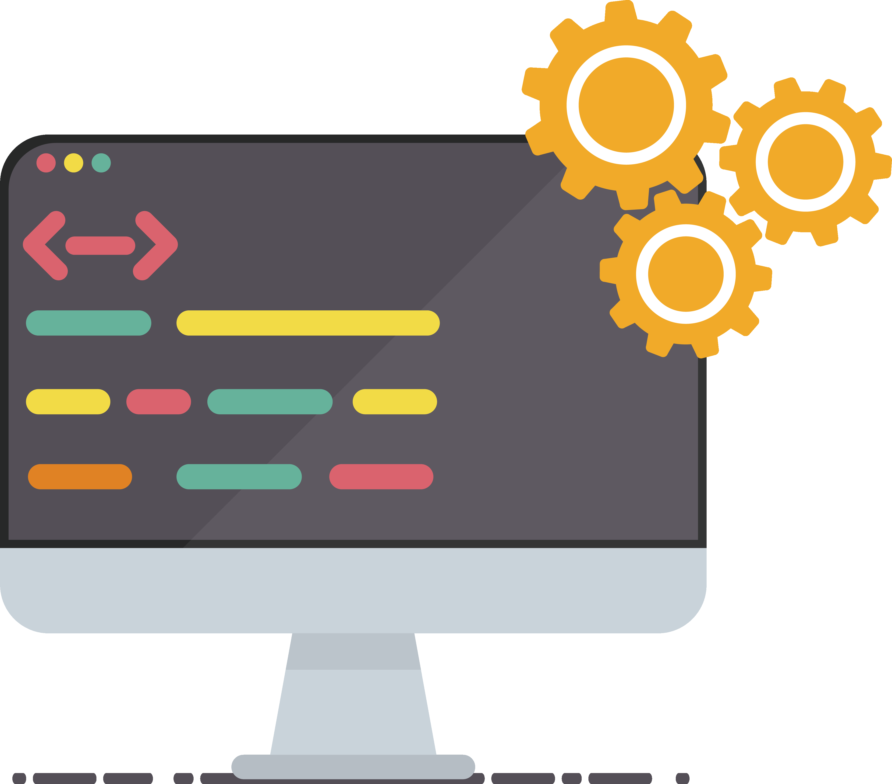
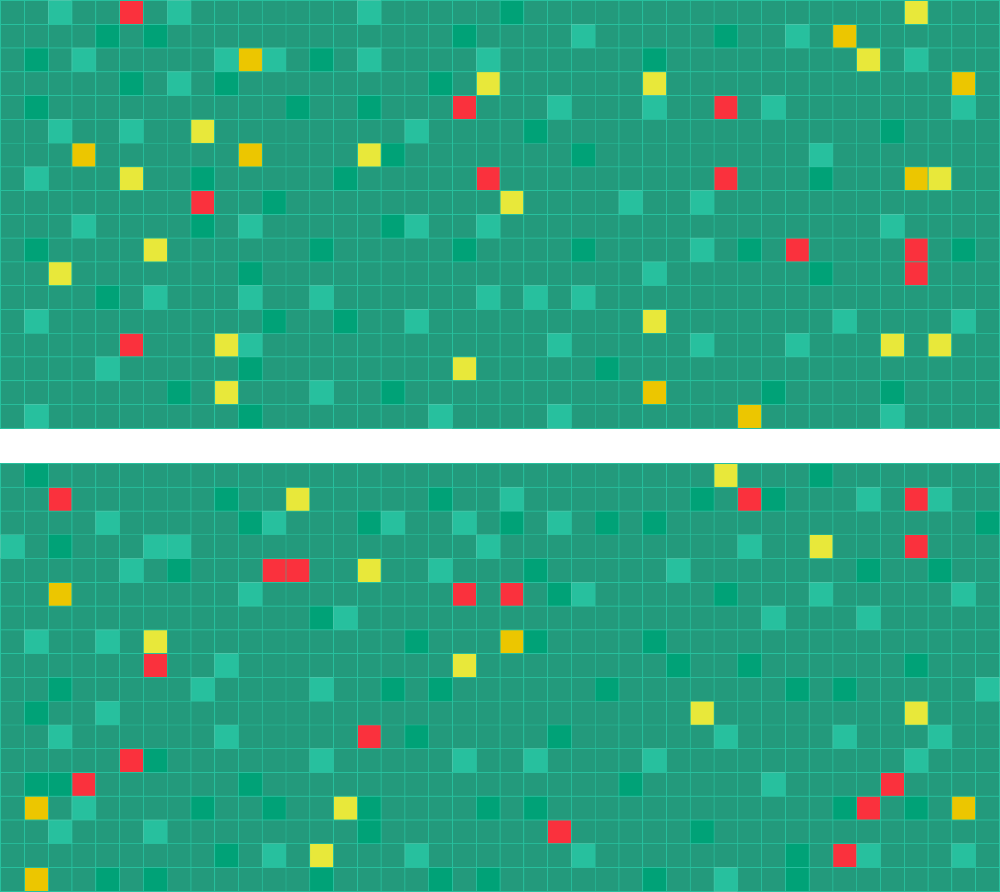

# 014 - Giám Sát Lỗi Phía Máy Chủ (Server-Side Error Monitoring)

[← Bài trước](013-giam-sat-phan-tan-distributed-monitoring.md) | [Mục lục](README.md) | [Bài tiếp theo →](015-giam-sat-loi-client-side.md)

---


# Thiết Kế Hệ Thống Giám Sát (Design of a Monitoring System)

Tìm hiểu về thiết kế ban đầu của một hệ thống giám sát tổng quát (*generic monitoring system*).

**Nội dung bao gồm:**
* Yêu cầu hệ thống (*Requirements*)
* Khối xây dựng nền tảng (*Building block*) sẽ sử dụng
* Thiết kế mức cao (*High-level design*)

---

## Yêu Cầu Hệ Thống (Requirements)

Hãy cùng tổng hợp những gì chúng ta kỳ vọng hệ thống giám sát (*monitoring system*) thực hiện:

* **Giám sát sự cố tiến trình cục bộ:** Giám sát các tiến trình trọng yếu cục bộ (*critical local processes*) trên máy chủ để phát hiện lỗi sập (*crashes*).
* **Giám sát bất thường tài nguyên tiến trình:** Giám sát bất kỳ sự bất thường nào (*anomalies*) trong việc sử dụng CPU / bộ nhớ (Memory) / ổ đĩa (Disk) / băng thông mạng (Network Bandwidth) bởi một tiến trình cụ thể trên máy chủ.
* **Giám sát sức khỏe tổng thể máy chủ:** Giám sát sức khỏe tổng thể của máy chủ (*overall server health*), chẳng hạn như CPU, Memory, Disk, Network Bandwidth, mức tải trung bình (*average load*), v.v.
* **Giám sát lỗi phần cứng:** Giám sát các lỗi thành phần phần cứng (*hardware component faults*) trên máy chủ, chẳng hạn như lỗi bộ nhớ (*memory failures*), ổ đĩa bị lỗi hoặc suy giảm tốc độ đọc/ghi (*failing or slowing disk*), v.v.
* **Giám sát khả năng kết nối ngoại vi:** Giám sát khả năng máy chủ tiếp cận các dịch vụ trọng yếu bên ngoài (*out-of-server critical services*), chẳng hạn như hệ thống tệp mạng (*network file systems - NFS*), v.v.
* **Giám sát thiết bị mạng chuyên dụng:** Giám sát toàn bộ thiết bị chuyển mạch mạng (*network switches*), bộ cân bằng tải (*load balancers*), và bất kỳ phần cứng chuyên dụng nào khác bên trong trung tâm dữ liệu (*data center*).
* **Giám sát tiêu thụ điện năng:** Giám sát mức tiêu thụ điện năng (*power consumption*) ở cấp độ máy chủ (*server*), tủ rack (*rack*), và toàn bộ trung tâm dữ liệu (*data center*).
* **Giám sát sự kiện nguồn điện:** Giám sát bất kỳ sự kiện nguồn điện nào (*power events*) trên các máy chủ, tủ rack và trung tâm dữ liệu.
* **Giám sát định tuyến và DNS:** Giám sát thông tin định tuyến (*routing information*) và DNS phục vụ cho các máy khách bên ngoài (*external clients*).
* **Giám sát độ trễ mạng:** Giám sát độ trễ (*latency*) của các liên kết và đường truyền mạng (*network links and paths*) bên trong nội bộ và xuyên suốt giữa các trung tâm dữ liệu (*across data centers*).
* **Giám sát điểm kết nối ngang hàng:** Giám sát trạng thái mạng tại các điểm kết nối ngang hàng (*peering points*).
* **Giám sát dịch vụ phân tán:** Giám sát sức khỏe tổng thể của dịch vụ (*overall service health*) có phạm vi trải rộng trên nhiều trung tâm dữ liệu—ví dụ: mạng phân phối nội dung (CDN - Content Delivery Network) và hiệu năng của nó.

Chúng ta cần một hệ thống giám sát tự động (*automated monitoring*) có khả năng nhận diện các điểm bất thường (*anomaly*) trong hệ thống và thông báo tới trình quản lý cảnh báo (*alert manager*) hoặc trực quan hóa tiến trình trên bảng điều khiển (*dashboard*). Các nhà cung cấp dịch vụ đám mây (*Cloud Service Providers*) thường cung cấp trạng thái sức khỏe công khai cho dịch vụ của họ:
* **AWS:** [https://health.aws.amazon.com/health/status](https://health.aws.amazon.com/health/status)
* **Azure:** [https://status.azure.com/en-us/status](https://status.azure.com/en-us/status)
* **Google:** [https://status.cloud.google.com/](https://status.cloud.google.com/)

---

## Khối Xây Dựng Nền Tảng Sẽ Sử Dụng (Building Block We Will Use)

Thiết kế của hệ thống giám sát phân tán (*distributed monitoring*) sẽ bao gồm khối thành phần nền tảng sau:

* **Lưu trữ đối tượng nhị phân lớn (Blob Storage):** Chúng ta sẽ sử dụng Blob Storage để lưu trữ thông tin về các chỉ số đo lường (*metrics*).

---

## Thiết Kế Mức Cao (High-Level Design)

Các thành phần kiến trúc mức cao (*high-level components*) của dịch vụ giám sát bao gồm:

* **Lưu trữ (Storage):** Một cơ sở dữ liệu chuỗi thời gian (*Time-Series Database - TSDB*) lưu trữ dữ liệu chỉ số đo lường (*metrics data*), chẳng hạn như mức sử dụng CPU hiện tại hoặc số lượng ngoại lệ (*exceptions*) phát sinh trong một ứng dụng.
* **Dịch vụ thu thập dữ liệu (Data Collector Service):** Thành phần này đảm nhiệm việc trích xuất/lấy dữ liệu liên quan (*fetch data*) từ từng dịch vụ và lưu vào tầng lưu trữ (*storage*).
* **Dịch vụ truy vấn (Querying Service):** Đây là một API cung cấp khả năng truy vấn trên cơ sở dữ liệu chuỗi thời gian và trả về các thông tin liên quan.

---

### Sơ Đồ Thiết Kế Mức Cao Của Hệ Thống Giám Sát (High-Level Design of a Monitoring System)





> [!NOTE]
> Luồng dữ liệu mức cao:
> 1. **Dịch vụ (Services)** / **Máy chủ (Servers)** / **Ứng dụng (Applications)**: Dữ liệu được lấy bởi **Dịch vụ thu thập dữ liệu (Data collector service)** thông qua cơ chế *fetch data*.
> 2. **Dịch vụ thu thập dữ liệu** đẩy dữ liệu (*push data*) vào **Cơ sở dữ liệu chuỗi thời gian (Time series database)**.
> 3. **Dịch vụ truy vấn (Querying service)** thực hiện truy vấn (*query data*) từ cơ sở dữ liệu chuỗi thời gian để phục vụ hiển thị và xử lý.

Chúng ta sẽ đi sâu vào chi tiết các thành phần được đề cập ở trên trong phần tiếp theo.

---

# Thiết Kế Chi Tiết Của Hệ Thống Giám Sát (Detailed Design of a Monitoring System)

Tìm hiểu chi tiết về cách thiết kế một hệ thống giám sát và nắm rõ các ưu điểm cũng như nhược điểm (*pros and cons*) của nó.

**Nội dung bao gồm:**
* Lưu trữ (*Storage*)
* Bộ thu thập dữ liệu (*Data collector*)
* Bộ phát hiện dịch vụ (*Service discoverer*)
* Dịch vụ truy vấn (*Querying service*)
* Trình quản lý cảnh báo (*Alert Manager*)
* Bảng điều khiển (*Dashboard*)
* Ưu điểm (*Pros*)
* Nhược điểm (*Cons*)
* Cải tiến thiết kế (*Improving our design*)

Chúng ta sẽ phân tích các thành phần cốt lõi của hệ thống giám sát, chỉ ra những hạn chế của thiết kế hiện tại và tiến hành tối ưu hóa kiến trúc để đáp ứng trọn vẹn các yêu cầu đặt ra.

---

## 1. Lưu Trữ (Storage)

Chúng ta sẽ sử dụng các **cơ sở dữ liệu chuỗi thời gian (Time-Series Databases)** để lưu dữ liệu cục bộ ngay trên máy chủ nơi dịch vụ giám sát đang vận hành. Sau đó, chúng ta sẽ tích hợp nó với một nút lưu trữ riêng biệt (*separate storage node*). Chúng ta sẽ dùng **Blob Storage** để lưu trữ các chỉ số (*metrics*).

Chúng ta cần lưu trữ các chỉ số đồng thời phải nắm rõ **hành động nào cần thực thi** nếu một chỉ số đạt đến một ngưỡng giá trị cụ thể. Ví dụ: Nếu mức sử dụng CPU vượt quá 90%, hệ thống sẽ kích hoạt một cảnh báo (*alert*) gửi đến người dùng cuối để người nhận cảnh báo có thể thực hiện các bước can thiệp cần thiết, chẳng hạn như cấp phát thêm tài nguyên để mở rộng quy mô (*scale*). 

Để phục vụ mục đích này, chúng ta cần một phân vùng lưu trữ khác chứa các quy tắc và hành động tương ứng. Chúng ta gọi đó là **cơ sở dữ liệu quy tắc (Rules Database)**. Khi có bất kỳ sự vi phạm quy tắc nào xảy ra, chúng ta có thể thực thi hành động phù hợp.

Tại bước này, chúng ta xác định thêm hai thành phần mới trong thiết kế kiến trúc:
1. **Cơ sở dữ liệu quy tắc và hành động (Rules and action database)**.
2. **Nút lưu trữ (Storage node - cụ thể là một Blob Store)**.

### Bổ Sung Blob Storage và Rules & Action Database


---

## 2. Bộ Thu Thập Dữ Liệu (Data Collector)

Chúng ta cần một hệ thống giám sát có khả năng liên tục cập nhật trạng thái hoạt động trên nhiều trung tâm dữ liệu (*data centers*). Chúng ta chỉ có thể duy trì việc cập nhật nếu thông tin về các tiến trình được truyền về một cách đáng tin cậy, điều này thực hiện được thông qua cơ chế ghi nhật ký (*logging*). 

Chúng ta lựa chọn **chiến lược kéo (Pull Strategy)**. Sau đó, chúng ta sẽ trích xuất các chỉ số đo lường liên quan từ nhật ký (*logs*) của ứng dụng. 

Như đã thảo luận trong thiết kế hệ thống ghi nhật ký (*logging design*), chúng ta sử dụng một **hàng đợi tin nhắn phân tán (Distributed Messaging Queue)**. Mỗi thông điệp (*message*) trong hàng đợi chứa:
* Tên dịch vụ (*service name*)
* Mã định danh (*service ID*)
* Mô tả ngắn gọn về bản ghi nhật ký (*short description of the log*)

Cấu trúc này giúp xác định chính xác chỉ số và thông tin tương ứng cho từng dịch vụ cụ thể. Việc phơi bày (*exposing*) các chỉ số liên quan cho bộ thu thập dữ liệu (*data collector*) là điều kiện tiên quyết để giám sát bất kỳ dịch vụ nào, giúp bộ thu thập có thể chủ động kéo các chỉ số từ dịch vụ và ghi vào cơ sở dữ liệu chuỗi thời gian (*time-series database*).

Một ví dụ thực tế về hệ thống giám sát vận hành dựa trên cơ chế kéo (*pull-based approach*) là **DigitalOcean**. Hệ thống này thực hiện giám sát hàng triệu máy chủ phân tán trên phạm vi toàn cầu.

---

> [!IMPORTANT]
> ### Vấn Đề Cần Suy Ngẫm (Point to Ponder)
> 
> **Câu hỏi:** Những nhược điểm khi sử dụng phương pháp tiếp cận đẩy (*push-based approach*) là gì?
> 
> **Lời giải:**
> Công cụ giám sát theo cơ chế đẩy (*push-based monitoring tool*) thu thập dữ liệu chỉ số từ các ứng dụng và máy chủ, sau đó chủ động gửi về nền tảng thu thập trung tâm (*central collection platform*). 
> 
> Việc mỗi vi dịch vụ (*microservice*) liên tục gửi các chỉ số của mình về hệ thống giám sát sẽ dẫn đến **tải lượng lưu lượng mạng rất nặng (heavy traffic load)** đè lên hạ tầng. Đây chính là nguyên nhân khiến hệ thống giám sát có nguy cơ trở thành điểm nghẽn cổ chai (*bottleneck*) đối với các hoạt động vận hành kinh doanh cốt lõi. 
> 
> Mặc dù phương pháp giám sát này có thể đạt trạng thái gần thời gian thực (*near real-time*), tuy nhiên nếu không được kiểm soát và tối ưu cẩn thận, nó có thể **làm tê liệt hạ tầng (overwhelm the infrastructure)** do các yêu cầu đẩy (*push requests*) liên tục từ tất cả các dịch vụ, gây ra hiện tượng tràn ngập lưu lượng mạng (*network floods*). 
> 
> Ngoài ra, chúng ta còn bắt buộc phải cài đặt các tiến trình ngầm (*daemons/agents*) trên từng máy chủ đích để phục vụ việc gửi chỉ số về máy chủ giám sát, điều này làm tăng đáng kể khối lượng công việc quản trị và bảo trì.

---

## 3. Bộ Phát Hiện Dịch Vụ (Service Discoverer)

Bộ thu thập dữ liệu (*data collector*) chịu trách nhiệm lấy các chỉ số đo lường từ những dịch vụ mà nó theo dõi. Nhờ cơ chế này, hệ thống giám sát không cần phải lưu giữ dấu vết (*keep track*) thủ công của từng dịch vụ. Thay vào đó, nó có thể tự động xác định các dịch vụ thông qua **dịch vụ phát hiện (Discoverer Service)**.

Chúng ta sẽ lưu trữ các thông tin liên quan của các dịch vụ cần được giám sát. Chúng ta sẽ áp dụng một giải pháp phát hiện dịch vụ (*service discovery solution*) và tích hợp nó với nhiều nền tảng và công cụ hạ tầng khác nhau, bao gồm:
* **EC2**
* **Kubernetes**
* **Consul**

Cơ chế tích hợp này cho phép hệ thống tự động phát hiện danh sách các dịch vụ đang hoạt động cần đưa vào diện giám sát. Cơ chế phát hiện động (*dynamic discovery*) tương tự cũng có thể được áp dụng đối với các thiết bị phần cứng mới được bổ sung hoặc đưa vào vận hành (*newly commissioned hardware*).

Hãy cùng bổ sung thành phần mới được xác định này vào bản thiết kế hiện tại của chúng ta.

---

# Thiết Kế Hệ Thống Giám Sát Phía Máy Chủ (Server-Side Error Monitoring System)

---

## Thêm Bộ Khám Phá Dịch Vụ (Adding the Service Discoverer)


### Các thành phần luồng dữ liệu kiến trúc:
- **Kho lưu trữ nhị phân / dữ liệu phi cấu trúc (Blob Store)**
- **Các dịch vụ (Services)**
- **Các máy chủ (Servers)**
- **Dịch vụ thu thập dữ liệu (Data Collector Service)**
- **Cơ sở dữ liệu chuỗi thời gian (Time Series Database - TSDB)**
- **Dịch vụ truy vấn (Querying Service)**
- **Các ứng dụng (Applications)**
  - *Kéo dữ liệu (Fetch Data)*
  - *Kéo dữ liệu (Fetch Data)*
  - *Kéo dữ liệu (Fetch Data)*
  - *Đẩy dữ liệu (Push Data)*
  - *Truy vấn dữ liệu (Query Data)*
- **Cơ sở dữ liệu quy tắc và hành động (Rules and Action DB)**
- **Bộ khám phá dịch vụ (Service Discoverer)** (EC2, Kubernetes)
  - Khám phá các dịch vụ cần được giám sát (*Discovers the services to be monitored*).
- **Các kênh thông báo:** Email, Slack, v.v.

---

### Dịch Vụ Truy Vấn (Querying Service)

Chúng ta cần một dịch vụ để truy cập vào cơ sở dữ liệu và lấy ra các kết quả truy vấn phù hợp. Chúng ta cần thành phần này bởi vì chúng ta muốn xem xét các lỗi, chẳng hạn như giá trị mức sử dụng bộ nhớ (memory usage) của một node cụ thể, hoặc gửi cảnh báo nếu một chỉ số (metric) vượt quá giới hạn thiết lập. Hãy bổ sung hai thành phần chúng ta cần song hành cùng tầng truy vấn:

#### 1. Bộ Quản Lý Cảnh Báo (Alert Manager)
**Alert Manager** chịu trách nhiệm gửi đi các cảnh báo khi có vi phạm các quy tắc đã được thiết lập sẵn. Nó có thể gửi cảnh báo dưới dạng email, tin nhắn Slack, v.v.

#### 2. Bảng Điều Khiển Trực Quan Hóa (Dashboard)
Chúng ta có thể thiết lập các **Dashboard** bằng cách sử dụng các chỉ số (metrics) đã thu thập để hiển thị thông tin theo yêu cầu — ví dụ: số lượng yêu cầu (number of requests) trong tuần hiện tại.

Hãy thêm các thành phần đã thảo luận ở trên vào hệ thống, điều này giúp hoàn thiện thiết kế hệ thống giám sát của chúng ta.

---

## Thiết Kế Chi Tiết Của Hệ Thống Giám Sát (Detailed Design of Monitoring System)


Dịch vụ giám sát tất-cả-trong-một (all-in-one monitoring service) của chúng ta hoạt động hiệu quả cho việc chủ động theo dõi các hệ thống và dịch vụ. Hệ thống đảm nhận việc thu thập và lưu trữ dữ liệu, đồng thời hỗ trợ tìm kiếm, vẽ biểu đồ và gửi cảnh báo.

### Ưu Điểm (Pros)
- **Vận hành trơn tru:** Thiết kế dịch vụ giám sát của chúng ta đảm bảo hoạt động trơn tru của toàn bộ quy trình vận hành (operations) và liên tục theo dõi các dấu hiệu của sự cố sắp xảy ra.
- **Tránh nghẽn mạng:** Thiết kế của chúng ta tránh được việc làm quá tải lưu lượng mạng (network traffic overloading) nhờ vào cơ chế tự động chủ động kéo dữ liệu (*pulling/fetching data*).
- **Tính sẵn sàng cao (High Availability):** Dịch vụ giám sát cung cấp mức độ sẵn sàng cao hơn cho toàn bộ hạ tầng.

### Nhược Điểm (Cons)
- **Điểm nghẽn mở rộng và điểm lỗi đơn lẻ (SPOF):** Hệ thống có vẻ có khả năng mở rộng (scalable), nhưng việc quản lý số lượng lớn máy chủ cần giám sát có thể trở thành vấn đề. Ví dụ: chúng ta có một máy chủ chuyên dụng chịu trách nhiệm chạy dịch vụ giám sát. Máy chủ này có thể trở thành một **Điểm lỗi đơn lẻ (Single Point of Failure - SPOF)**. 
  - Để giải quyết vấn đề SPOF, chúng ta có thể triển khai một máy chủ dự phòng chuyển vùng lỗi (**failover server**) cho hệ thống giám sát. 
  - Khi đó, chúng ta cũng cần phải duy trì tính nhất quán dữ liệu (**consistency**) giữa máy chủ chính (actual server) và máy chủ dự phòng (failover server). 
  - Tuy nhiên, một thiết kế như vậy cũng sẽ chạm tới giới hạn mở rộng (scalability ceiling) khi số lượng máy chủ tiếp tục tăng mạnh.
- **Chi phí lưu trữ khổng lồ:** Giám sát thu thập một khối lượng dữ liệu khổng lồ 24/7, và việc lưu giữ toàn bộ dữ liệu này vĩnh viễn có thể là bất khả thi. Chúng ta cần một chính sách (policy) và các cơ chế để định kỳ xóa bỏ dữ liệu không còn cần thiết nhằm tối ưu hóa việc sử dụng tài nguyên phần cứng.

Hãy cùng suy nghĩ về giải pháp khắc phục các vấn đề còn tồn đọng trong dịch vụ giám sát của chúng ta.

---

## Cải Tiến Thiết Kế (Improving Our Design)

Chúng ta muốn cải tiến thiết kế để hệ thống có thể mở rộng quy mô (**scale**) tốt hơn, đồng thời đưa ra quyết định xem dữ liệu nào cần giữ lại và dữ liệu nào cần xóa bỏ. 

Hãy xem xét cách thức hoạt động của phương pháp tiếp cận hướng đẩy (**Push-based approach**). Trong mô hình hướng đẩy, ứng dụng sẽ chủ động đẩy (**push**) dữ liệu của nó đến hệ thống giám sát.

### Hệ Thống Giám Sát Hướng Đẩy (Push-Based Monitoring System)

```
[ APP ]  ----(Push)---->  [                           ]
[ APP ]  ----(Push)---->  [ Hệ Thống Giám Sát         ]
[ APP ]  ----(Push)---->  [ (Monitoring System)       ]
[ APP ]  ----(Push)---->  [                           ]
```

Chúng ta đã từng sử dụng chiến lược hướng kéo (**Pull-based strategy**) để tránh tắc nghẽn mạng (**network congestion**). Cơ chế này cũng giải phóng các ứng dụng khỏi trách nhiệm phải chủ động gửi dữ liệu giám sát tương ứng lên hệ thống; thay vào đó, hệ thống giám sát sẽ tự động lấy hoặc kéo dữ liệu về. 

Tuy nhiên, để đáp ứng nhu cầu mở rộng quy mô lớn (scaling needs), chúng ta cũng cần phải áp dụng cả phương pháp tiếp cận hướng đẩy (**Push-based approach**). Chúng ta sẽ áp dụng một **mô hình tiếp cận lai (Hybrid approach)** bằng cách kết hợp giữa chiến lược hướng kéo (pull-based) và chiến lược hướng đẩy (push-based).

### Kiến Trúc Phân Tầng Lai (Hierarchical Hybrid Strategy):
1. **Tầng Kéo Cục Bộ (Local Pull-Based Strategy):**
   - Chúng ta sẽ tiếp tục sử dụng chiến lược kéo đối với nhiều máy chủ bên trong cùng một trung tâm dữ liệu (**Data Center**).
   - Chúng ta sẽ phân bổ nhiều máy chủ giám sát phụ trách hàng trăm hoặc hàng nghìn máy chủ trong một trung tâm dữ liệu — ví dụ: một máy chủ giám sát sẽ theo dõi 5.000 máy chủ. Chúng ta gọi các máy chủ này là **các máy chủ giám sát thứ cấp (Secondary Monitoring Servers)**.
2. **Tầng Đẩy Phân Cấp (Hierarchical Push-Based Strategy):**
   - Tiếp theo, chúng ta sẽ áp dụng chiến lược đẩy: Các hệ thống giám sát thứ cấp (secondary monitoring systems) sẽ chủ động đẩy (**push**) dữ liệu đã thu thập của chúng lên **máy chủ trung tâm dữ liệu chính (Primary Data Center Server)**.
   - Máy chủ trung tâm dữ liệu chính sẽ tiếp tục đẩy (**push**) dữ liệu lên một **dịch vụ giám sát toàn cầu (Global Monitoring Service)** chịu trách nhiệm kiểm tra tất cả các trung tâm dữ liệu trải rộng trên toàn cầu.
3. **Lưu trữ và Trực quan hóa:**
   - Chúng ta sẽ sử dụng kho lưu trữ nhị phân (**Blob Storage**) để lưu trữ lượng dữ liệu dư thừa, áp dụng **Elasticsearch** cho việc tìm kiếm phân tán, và xem xét các số liệu thống kê liên quan thông qua một công cụ trực quan hóa (**Visualizer**).
   - Khi số lượng máy chủ hoặc các trung tâm dữ liệu gia tăng, chúng ta chỉ cần bổ sung thêm nhiều hệ thống giám sát.

> [!NOTE]
> **Mẫu Thiết Kế Hệ Thống Phân Cấp (Hierarchical Systems Pattern):**  
> Việc sử dụng một cấu trúc phân cấp các hệ thống để mở rộng quy mô là một mẫu thiết kế (**design pattern**) cực kỳ phổ biến trong thiết kế hệ thống phân tán. Bằng cách tăng số lượng các node trên một tầng (level) hoặc bổ sung thêm các tầng mới vào hệ thống phân cấp, chúng ta có được khả năng mở rộng (**scale**) linh hoạt theo đúng nhu cầu hiện tại.

---

### Mô Hình Phân Tầng Giám Sát Cục Bộ Và Toàn Cầu

```
[ Blob Storage ]  <--->  [ Elasticsearch ]  <--->  [ Visualization ]
                                  ^
                                  | (Push)
                 [ Datacenter Monitoring System ] (Primary)
                                  ^
            +---------------------+---------------------+
            | (Push)                                    | (Push)
  [ Monitoring System 1 ]                     [ Monitoring System 2 ] (Secondary)
       | Pull      | Pull                          | Pull      | Pull
    [Server]    [Server]                        [Server]    [Server]
```

*Các hệ thống giám sát (Monitoring systems) kéo dữ liệu từ nhiều máy chủ khác nhau và sau đó đẩy dữ liệu về hệ thống giám sát trung tâm dữ liệu (Data Center Monitoring System).*

---

## Những Điểm Cần Suy Ngẫm (Points to Ponder)

### Câu Hỏi 1:
> **Điều gì sẽ xảy ra nếu một hệ thống giám sát cục bộ (local) hoặc toàn cầu (global) bị sập (down)?**

#### Trả Lời:
Chúng ta có thể lưu trữ dữ liệu cục bộ (**store data locally**) tại node/máy chủ và chờ cho đến khi hệ thống giám sát hoạt động trở lại. 

Tuy nhiên, luôn tồn tại một giới hạn dung lượng đối với việc lưu trữ dữ liệu cục bộ. Do đó, chúng ta buộc phải lựa chọn giữa hai phương án:
1. **Xóa dữ liệu cũ hơn** (delete previous data), hoặc
2. **Không tiếp tục lưu trữ dữ liệu mới** (drop/reject new data).

Để đưa ra quyết định chính xác, các **chính sách (retention/eviction policies)** phù hợp cần phải được thiết lập rõ ràng từ trước.

---

Con người cần phải tiếp nhận và xử lý khối lượng dữ liệu giám sát khổng lồ, và ngay cả sau khi đã áp dụng các phương pháp tóm lược/tổng hợp dữ liệu (**data summarization**) khác nhau, lượng dữ liệu còn lại vẫn có thể vô cùng lớn. Tiếp theo, chúng ta sẽ giải quyết bài toán: làm thế nào để trình bày lượng dữ liệu khổng lồ này cho các quản trị viên hệ thống (human administrators).

---

## Trực Quan Hóa Dữ Liệu Trong Hệ Thống Giám Sát (Visualize Data in a Monitoring System)

*Tìm hiểu một phương pháp trực quan hóa mới mẻ cho khối lượng dữ liệu giám sát khổng lồ.*

### Nội dung sẽ bao gồm:
- Sử dụng biểu đồ nhiệt (**Heat Maps**) để khắc phục sự cố (**Troubleshoot**).
- Tóm tắt (**Summary**).

Các trung tâm dữ liệu lớn sở hữu hàng triệu máy chủ, và việc trực quan hóa dữ liệu trạng thái sức khỏe (**health data**) cho tất cả các máy chủ này là một thách thức cực kỳ to lớn. Một khía cạnh tối quan trọng trong việc giám sát một cụm máy chủ lớn (**fleet of servers**) là phải nhận biết được máy chủ nào đang hoạt động bình thường (*alive*) và máy chủ nào đang ngoại tuyến (*offline*). 

Một trung tâm dữ liệu hiện đại có thể chứa hàng chục nghìn máy chủ chỉ trong một tòa nhà. Chúng ta có thể sử dụng **biểu đồ nhiệt (Heat Map)** để hiển thị thông tin về hàng nghìn máy chủ trong một trung tâm dữ liệu một cách cực kỳ cô đọng và trực quan.

> [!NOTE]
> **Định nghĩa Biểu Đồ Nhiệt (Heat Map):**  
> **Heat map** là một kỹ thuật trực quan hóa dữ liệu hiển thị mức độ/cường độ của một hiện tượng dưới dạng hai chiều thông qua việc sử dụng các dải màu sắc.

### Sử Dụng Biểu Đồ Nhiệt Để Khắc Phục Sự Cố (Using Heat Maps to Troubleshoot)

Chúng ta sẽ xác định xem một máy chủ có bị sập (*down*) hay không thông qua việc sử dụng biểu đồ nhiệt. Mỗi tủ rack chứa máy chủ đều được đặt tên định danh và được phân loại, sắp xếp tuần tự theo:
$$\text{Data Center} \longrightarrow \text{Cluster} \longrightarrow \text{Row}$$

Nhờ vậy, bất kỳ sự cố mang tính cục bộ hoặc hệ thống nào xảy ra ở bất kỳ cấp độ nào trong số các cấp độ này đều trở nên rõ ràng và dễ phát hiện ngay lập tức.

Việc sử dụng biểu đồ nhiệt mô tả trạng thái hoạt động của một số lượng lớn các thành phần phần cứng/dịch vụ là một phương pháp mang lại hiệu quả rất cao:
- Trạng thái sức khỏe (**health**) của từng thành phần được thể hiện thông qua màu sắc của từng ô tương ứng trong một ma trận lớn.
- **Các node có ô màu xanh lá cây (Green):** Đang hoạt động ổn định trong các tham số kỹ thuật cho phép.
- **Các node có ô màu đỏ (Red):** Không phản hồi sau nhiều lần thử lại liên tiếp (**nonresponsive on multiple tries / retries**).

---

### Quan sát các máy chủ trong trung tâm dữ liệu bằng bản đồ nhiệt (Viewing servers in a data center using heat maps)



* **Cụm 1 (Cluster 1)**
* **Cụm 2 (Cluster 2)**

Chúng ta có thể sử dụng bản đồ nhiệt (**heat maps**) cho các hệ thống phân tán toàn cầu (**globally distributed systems**) và liên tục chia sẻ thông tin về trạng thái sức khỏe (**health information**) của máy chủ. Chúng ta có thể sử dụng **1 bit** (1 đại diện cho trạng thái còn sống - *live*, 0 đại diện cho trạng thái ngừng hoạt động - *dead*). Đối với **1.000.000 máy chủ**, chúng ta chỉ tốn **125 KB** dữ liệu. Chúng ta có thể nhanh chóng phát hiện máy chủ nào đang gặp sự cố (**down**) thông qua màu đỏ và tập trung xử lý vào các thành phần đang gặp lỗi.

Chúng ta có thể tạo các bản đồ nhiệt tương tự để có cái nhìn tổng quan toàn cảnh (**bird’s-eye view**) về bất kỳ tài nguyên nào, chẳng hạn như hệ thống tệp tin (**filesystems**), thiết bị chuyển mạch mạng (**networking switches**), các đường truyền kết nối (**links**), v.v.

---

### Tóm tắt (Summary)

* Hệ thống giám sát (**monitoring systems**) đóng vai trò tối quan trọng trong các hệ thống phân tán (**distributed systems**) vì chúng hỗ trợ phân tích hệ thống và cảnh báo (**alerting**) tới các bên liên quan (**stakeholders**) nếu có sự cố xảy ra.
* Chúng ta có thể xây dựng một hệ thống giám sát có khả năng mở rộng cao (**scalable**) bằng cách kết hợp lai (**hybrid**) giữa hai phương thức đẩy (**push method**) và kéo (**pull method**).
* Bản đồ nhiệt (**heat maps**) là một công cụ trực quan hóa mạnh mẽ, giúp chúng ta nắm bắt được tình trạng sức khỏe của hàng ngàn máy chủ trong một không gian hiển thị cô đọng, nhỏ gọn.

---

* **Quay lại (Back):** Thiết kế chi tiết của một Hệ thống Giám sát… (Detailed Design of a Monitoring Syst…)
* **Đánh dấu là đã hoàn thành (Mark As Completed)**
* **Tiếp theo (Next):** Tập trung vào các Lỗi phía Client trong một Hệ thống Giám sát… (Focus on Client-side Errors in a Moni…)


---

[← Bài trước](013-giam-sat-phan-tan-distributed-monitoring.md) | [Mục lục](README.md) | [Bài tiếp theo →](015-giam-sat-loi-client-side.md)
