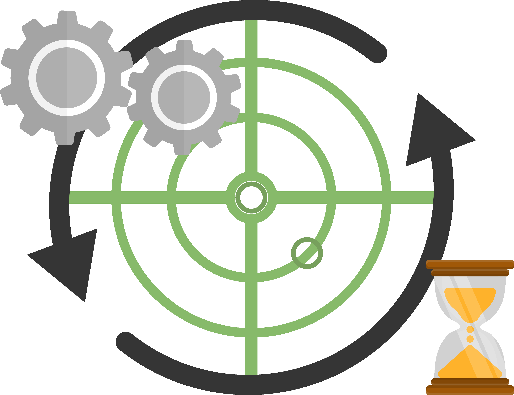

# 015 - Giám Sát Lỗi Phía Máy Khách (Client-Side Error Monitoring)

[← Bài trước](014-giam-sat-loi-server-side.md) | [Mục lục](README.md) | [Bài tiếp theo →](016-bo-nho-dem-phan-tan-distributed-cache.md)

---


# Giám Sát Lỗi Phía Máy Khách Trong Hệ Thống Giám Sát (Focus on Client-Side Errors in a Monitoring System)

Tìm hiểu bản chất của lỗi phía máy khách (client-side errors) và tác động của chúng đối với dịch vụ.

**Nội dung bao gồm:**
* Lỗi phía máy khách (Client-side errors)
* Các sự cố do lỗi định tuyến (Failures due to a routing bug)

---

## Lỗi Phía Máy Khách (Client-side errors)

Trong một **hệ thống phân tán (Distributed System)**, các máy khách (clients) thường truy cập dịch vụ thông qua một yêu cầu HTTP (HTTP request). Chúng ta có thể giám sát nhật ký (logs) của máy chủ web (web server) và máy chủ ứng dụng (application server) nếu một yêu cầu xử lý thất bại. Nếu nhiều yêu cầu cùng thất bại, chúng ta có thể quan sát thấy một đợt tăng đột biến các lỗi nội bộ phía máy chủ (**Internal Errors - HTTP 500**).

Tuy nhiên, những lỗi mà **nguyên nhân gốc rễ (Root Cause)** nằm ở phía máy khách hoặc trên đường truyền mạng lại cực kỳ khó phản ứng, bởi vì dịch vụ gần như không có hoặc có rất ít khả năng quan sát (insight / visibility) vào hệ thống của máy khách. Chúng ta có thể thử tìm kiếm sự sụt giảm về lưu lượng tải (**traffic/load dip**) so với mức trung bình, nhưng việc theo dõi biểu đồ như vậy thường rất khó khăn. Phương pháp này dễ gặp phải các trường hợp **dương tính giả (False Positives)** và **âm tính giả (False Negatives)** do các yếu tố như lưu lượng biến thiên bất thường ngoài dự kiến, hoặc khi chỉ có một nhóm nhỏ người dùng bị ảnh hưởng.

Có rất nhiều yếu tố có thể gây ra sự cố khiến máy khách không thể tiếp cận được máy chủ. Các yếu tố này bao gồm:
* Thất bại trong việc phân giải tên miền DNS (**DNS Name Resolution failure**).
* Bất kỳ lỗi định tuyến nào (**Routing failure**) dọc theo đường truyền từ máy khách tới nhà cung cấp dịch vụ.
* Bất kỳ sự cố nào xảy ra với hạ tầng của bên thứ ba, chẳng hạn như các thiết bị trung gian (**Middleboxes**) và mạng phân phối nội dung (**CDN - Content Delivery Network**).

---

### So Sánh Lỗi Phía Máy Chủ Và Lỗi Phía Máy Khách (Server-side errors versus client-side errors)


* **Lỗi phía máy khách (Client-side errors):** Yêu cầu HTTP (`https://example.com`) bị chặn lại trước khi tới được máy chủ. Rất khó để phát hiện vấn đề một cách nhất quán chỉ dựa vào việc lưu lượng truy cập sụt giảm (**traffic dips**).
* **Lỗi phía máy chủ (Server-side errors):** Yêu cầu HTTP gửi tới máy chủ web và trả về lỗi **HTTP 500 (Internal server error)**. Việc phát hiện sự gia tăng đột biến của các mã lỗi này trên máy chủ là rất dễ dàng.

---

## Các Sự Cố Do Lỗi Định Tuyến (Failures due to a routing bug)

Hãy cùng xem xét một ví dụ thực tế về một lỗi đã ảnh hưởng đến một lượng lớn khách hàng của dịch vụ, nhưng bản thân dịch vụ đó lại không thể nhận biết ngay lập tức.

Một nhà cung cấp dịch vụ Internet (**ISP**) ngang hàng (peer) của Google đã vô tình quảng bá (announce) các tuyến đường Internet mà họ không được phép quảng bá. Kết quả là, lưu lượng truy cập của rất nhiều khách hàng của Google bắt đầu bị định tuyến qua các ISP không mong muốn và không thể đến được Google do sự cố **rò rỉ BGP (BGP Leak)**; một ví dụ về rò rỉ BGP được minh họa trong hình bên dưới. Khách hàng cảm thấy vô cùng ức chế vì không thể truy cập Google, trong khi Google có thể không hề hay biết về sự cố này ngay lập tức vì vấn đề không xảy ra trên hạ tầng của chính họ.

> [!NOTE]
> **Giao thức Cổng Biên (BGP - Border Gateway Protocol)** là giao thức định tuyến kết nối toàn bộ mạng Internet. Định tuyến trong mạng cục bộ (LAN) rất đơn giản vì mọi thiết bị đều kết nối chung vào một mạng máy tính. Tuy nhiên, nó trở nên phức tạp khi quy mô mạng phình to, và Internet được cấu thành từ hàng triệu mạng trên toàn cầu. Các tổ chức lớn và các ISP tự quản lý khả năng kết nối Internet cho nhiều địa điểm và chi nhánh mạng của họ. Thực thể này được gọi là một **Hệ Tự Trị (Autonomous System - AS)**.
>
> Một AS xử lý lưu lượng mạng nội bộ bên trong nó, và **Bộ định tuyến BGP (BGP Router)** quản lý lưu lượng truy cập vào và ra (**Inbound & Outbound Traffic**). Mỗi bộ định tuyến BGP chứa các **bảng định tuyến (Routing Tables)**. Nó cho phép BGP tìm ra đường đi tối ưu nhất trên Internet để gửi gói tin đến đích. Tuy nhiên, hiện tượng rò rỉ tuyến đường định tuyến (**Leaked Route**) hoàn toàn có thể xảy ra. Rò rỉ tuyến đường xuất hiện khi một Hệ Tự Trị lan truyền các thông báo định tuyến ra ngoài phạm vi dự kiến của chúng.

Vào ngày 12 tháng 11 năm 2018, một sự cố rò rỉ BGP đã xảy ra và ảnh hưởng đến người dùng trên toàn thế giới, bao gồm cả Google, Meta và Amazon. Một dịch vụ đã quảng bá dải định tuyến `216.58.192.0/19` đến một số Hệ Tự Trị và quảng bá một dải định tuyến cụ thể hơn (`216.58.192.0/22`) tới một Hệ Tự Trị duy nhất – đơn vị vốn dĩ không được phép tiếp tục quảng bá dải này ra bên ngoài. 

Cơ chế chuyển tiếp IP (**IP Forwarding**) luôn chọn tiền tố dài nhất làm kết quả khớp tối ưu (**Longest Prefix Match**). Trong ví dụ này, tiền tố `/22` dài hơn (chi tiết hơn) so với tiền tố `/19`. Do lỗi cấu hình, tuyến đường cụ thể hơn này đã bị rò rỉ ra toàn bộ mạng Internet, và vì nó quá cụ thể, tất cả lưu lượng truy cập đều bị chuyển hướng qua sai Hệ Tự Trị, dẫn đến việc lưu lượng bị rớt (**Drop Traffic**).

---

### Rò Rỉ Tuyến Định Tuyến BGP (BGP leak)


*Sự cố rò rỉ BGP ngày 12/11/2018: Tuyến hợp lệ (`216.58.192.0/19`) từ Google (AS 15169) và tuyến bị rò rỉ (`216.58.192.0/22`) qua MainONE (AS 37282), Cogent (AS 174), Trans Telecom (AS 20485), China Telecom (AS 4809)... khiến lưu lượng của người dùng từ Charter, Verizon Wireless bị chặn (STOP).*

Sự cố rò rỉ trên không phải là duy nhất. Những vấn đề tương tự vẫn liên tục xuất hiện. Một vụ rò rỉ khác xảy ra vào ngày 16 tháng 4 năm 2021, khi một AS vô tình quảng bá hơn 30.000 tiền tố BGP. Điều này dẫn đến sự gia tăng đột biến gấp 13 lần lưu lượng truy cập đi vào mạng của họ. Tuy nhiên, sự gia tăng lưu lượng đột ngột đã được ghi nhận và sự cố đã được khắc phục sau đó.

Hệ thống giám sát của các dịch vụ bị ảnh hưởng có thể không phát hiện được các sự kiện trên ngay lập tức. Việc giám sát những tình huống như vậy là vô cùng cấp thiết để đảm bảo ứng dụng luôn duy trì tính **Sẵn Sàng Cao (High Availability)** cho toàn bộ khách hàng. Do đó, trong các phần tiếp theo, chúng ta sẽ tìm hiểu các phương pháp giúp giám sát những tình huống nêu trên.

---

# Thiết Kế Hệ Thống Giám Sát Phía Máy Khách (Design of a Client-side Monitoring System)

Tìm hiểu cách thiết kế một hệ thống nhằm giám sát các lỗi không thể tiếp cận được dịch vụ của chúng ta.

**Nội dung bao gồm:**
* Thiết kế ban đầu (Initial design)
* Các vấn đề với Probers (Issues with probers)
* Cải tiến thiết kế (Improve the design)
* Kích hoạt và vô hiệu hóa báo cáo (Activate and deactivate reports)
* Tiếp cận bộ thu thập trong điều kiện lỗi (Reach collectors under faulty conditions)
* Bảo vệ quyền riêng tư người dùng (Protect user privacy)
* Kết luận (Conclusion)

Một dịch vụ hoàn toàn không có khả năng quan sát đối với các lỗi không xảy ra tại hạ tầng của chính nó. Mặc dù vậy, các sự cố này vẫn mang lại trải nghiệm ức chế tương tự cho khách hàng, và họ có thể phải hỏi bạn bè: *"Dịch vụ X có bị sập đối với bạn không?"* hoặc truy cập vào các trang web như Downdetector để xem có ai khác báo cáo sự cố tương tự hay không. Họ cũng có thể phàn nàn về sự cố qua một bài đăng trên X (Twitter) hoặc một kênh truyền thông khác.

Tuy nhiên, tất cả các trường hợp như vậy đều có **vòng lặp phản hồi rất chậm (Slow Feedback Loop)**. Với tư cách là nhà cung cấp dịch vụ, chúng ta muốn phát hiện các vấn đề như vậy càng nhanh càng tốt để đưa ra các biện pháp khắc phục kịp thời. Hãy cùng thiết kế một hệ thống như vậy.

---

## Thiết Kế Ban Đầu (Initial design)

Để đảm bảo các yêu cầu của máy khách có thể đến được máy chủ, chúng ta sẽ đóng vai trò là các máy khách và thực hiện kiểm tra khả năng tiếp cận (**Reachability Check**) cũng như kiểm tra tình trạng hoạt động (**Health Check**). Chúng ta sẽ cần nhiều **vị trí đo kiểm thuận lợi (Vantage Points)** trên toàn cầu. Chúng ta có thể vận hành một dịch vụ, gọi là **Prober** (bộ thăm dò), định kỳ gửi các yêu cầu đến dịch vụ để kiểm tra tính sẵn sàng (**Availability**). Bằng cách này, chúng ta có thể giám sát khả năng tiếp cận dịch vụ từ nhiều vị trí địa lý khác nhau.

### Prober Kiểm Tra Tính Sẵn Sàng Của Website (Prober checking availability of website)


---

## Các Vấn Đề Với Probers (Issues with probers)

Chúng ta có thể gặp phải các vấn đề sau khi sử dụng probers:

* **Độ bao phủ không đầy đủ (Incomplete coverage):** Chúng ta có thể không đạt được độ bao phủ tốt trên tất cả các Hệ Tự Trị (Autonomous Systems). Tính đến tháng 3 năm 2021, có khoảng 100.000 Hệ Tự Trị duy nhất trên Internet. Việc đặt nhiều đầu dò như vậy trên toàn cầu là không hiệu quả về mặt chi phí, thậm chí là bất khả thi. Các quy định pháp lý đặc thù của từng quốc gia hoặc từng ISP cùng nhu cầu bảo trì định kỳ là những rào cản bổ sung khi triển khai phương án này.
* **Thiếu khả năng mô phỏng người dùng thực tế (Lack of user imitation):** Các đầu dò như vậy có thể không đại diện chính xác cho hành vi của một người dùng thông thường để mô tả cách mà một người dùng thực sự sẽ tương tác với dịch vụ.

> [!NOTE]
> Thiết kế ban đầu này dựa trên cơ chế **thăm dò chủ động (Active Probing)**.

---

## Cải Tiến Thiết Kế (Improve the design)



Thay vì đặt các prober tại các điểm quan sát cố định (vantage points), chúng ta có thể nhúng trực tiếp prober vào chính ứng dụng thực tế của người dùng. Hệ thống sẽ bao gồm hai thành phần chính sau:

1. **Agent (Tác tử):** Đây là một prober được nhúng bên trong ứng dụng máy khách (client application), có nhiệm vụ gửi các báo cáo về bất kỳ lỗi nào đến dịch vụ phù hợp.
2. **Collector (Bộ thu thập):** Đây là một hệ thống thu thập báo cáo độc lập hoàn toàn với dịch vụ chính. Nó được tách biệt độc lập nhằm tránh tình huống các agent ở máy khách cố gắng báo cáo lỗi về chính dịch vụ đang gặp sự cố. Chúng ta tổng hợp (**summarize/aggregate**) các báo cáo lỗi từ các collector và theo dõi các đợt tăng đột biến (**spikes**) trên biểu đồ lỗi để phát hiện các sự cố phát sinh từ phía máy khách.

---

# Giám Sát Lỗi Phía Máy Khách (Client-Side Error Monitoring)

---

### Trang 7

Hình minh họa dưới đây mô tả cách một tiến trình trung gian (**Agent**) tiếp cận một bộ thu thập độc lập (**Collector**) khi dịch vụ chính (**Primary Service**) không thể truy cập được:


*Đánh giá báo cáo từ agent để phát hiện lỗi tăng đột biến (Evaluating the agent's report to see a spike in errors)*


```
Trình duyệt web (Web browser)
       |
     DỪNG (STOP)
       |
Yêu cầu HTTP (HTTP request)
(https://example.com)
       |
Gửi báo cáo (send report)
       |
Agent gửi các mục nhật ký yêu cầu (request log entries) tới một bộ thu thập (collector) qua một đường truyền thay thế (alternate path)
       |
Agent ----------> Web server
       \
        --------> Collector
```


Các bộ thu thập (**Collectors**) này tạo thành một hệ thống phân cấp gồm các hệ thống xử lý dữ liệu lớn (**Big Data processing systems**). Chúng ta có thể đặt chúng ở gần mạng của máy khách (**Client Network**), và theo thời gian, chúng ta có thể tích lũy các số liệu thống kê này từ tất cả các vị trí mang tính cục bộ như vậy. Chúng ta sẽ sử dụng các hệ thống xử lý luồng trực tuyến (**Online Stream Processing Systems**) để biến hệ thống này đạt trạng thái cận thời gian thực (**Near Real-Time**). Nếu mục tiêu chính của chúng ta là tìm kiếm các thống kê tóm tắt, hệ thống hoàn toàn có thể chịu đựng được việc mất mát một số báo cáo lỗi. Một số báo cáo sẽ mang tính tương đối so với toàn bộ tập người dùng. Chúng ta có thể xem 1% người dùng dịch vụ là "một phần" (some). Nếu không muốn làm mất bất kỳ báo cáo nào, chúng ta sẽ cần phải thiết kế hệ thống một cách cẩn trọng hơn, và chi phí chắc chắn sẽ tốn kém hơn.

Bây giờ, chúng ta sẽ giải quyết các mối bận tâm sau:
- Người dùng có thể kích hoạt (**Activate**) và vô hiệu hóa (**Deactivate**) các báo cáo phía máy khách hay không?
- Các **Agent** phía máy khách tiếp cận các bộ thu thập (**Collectors**) trong điều kiện xảy ra sự cố (**Faulty Conditions**) như thế nào?
- Chúng ta sẽ bảo vệ quyền riêng tư của người dùng (**User Privacy**) ra sao?

#### Kích hoạt và vô hiệu hóa báo cáo (Activate and deactivate reports)

Chúng ta sẽ sử dụng một HTTP Header tùy chỉnh (**Custom HTML/HTTP Header**) để gửi thông tin thích hợp đến các bộ thu thập (**Collectors**). Mặc dù một máy khách truy cập dịch vụ thông qua trình duyệt, nhưng một trình duyệt cụ thể...

---

### Trang 8

...cần phải biết về tính năng này để điền thông tin header phù hợp vào các yêu cầu HTTP (**HTTP Requests**). Đối với các tổ chức vừa phát triển trình duyệt vừa cung cấp dịch vụ (ví dụ: các trình duyệt dựa trên nền tảng Chromium), những tính năng như vậy có thể được tích hợp và chuẩn hóa theo thời gian.

Một giải pháp khác là sử dụng một ứng dụng phía máy khách (**Client-Side Application**) do chính dịch vụ kiểm soát, khi đó chúng ta có thể dễ dàng đính kèm các header như vậy qua giao thức HTTP.

Phía máy khách có thể điền thông tin vào header của yêu cầu nếu người dùng máy khách đã đồng ý (**Consented**) với điều đó từ trước. Sau đó, dịch vụ có thể phản hồi lại với các giá trị phù hợp dành cho chính sách (**Policy**) và các điểm cuối thu thập (**Collection Endpoints**).


```
Kích hoạt và vô hiệu hóa báo cáo (Activate and deactivate reports)

Trình duyệt web (Web browser) ------------> Máy chủ web (Web server)
                             HTTP request (https://example.com)

Trình duyệt web (Web browser) <------------ Máy chủ web (Web server)
                                 HTTP 200
         Server response with Collector's address (Phản hồi máy chủ kèm địa chỉ của Collector)
```

#### Tiếp cận các bộ thu thập trong điều kiện xảy ra sự cố (Reach collectors under faulty conditions)

Các bộ thu thập (**Collectors**) cần phải nằm trong một vùng chịu lỗi (**Failure Domain**) độc lập với điểm cuối dịch vụ web (**Web Service Endpoint**) mà chúng ta đang nỗ lực giám sát. Phía máy khách có thể thử lần lượt nhiều bộ thu thập khác nhau thuộc các **Failure Domains** khác nhau cho đến khi có một bộ thu thập hoạt động thành công. Chúng ta có thể thấy một mô hình tương tự trong các ví dụ sau. Đôi khi, chúng ta đề cập đến hiện tượng này như là việc nằm ngoài bán kính ảnh hưởng của sự cố (**Blast Radius**).

- Nếu muốn kiểm tra khả năng tiếp cận một địa chỉ IP (**Reachability of an IP**), chúng ta lưu trữ (**Host**) dịch vụ trên một IP khác.
- Nếu chúng ta giám sát tính khả dụng (**Availability**) của một tên miền, chúng ta đặt bộ thu thập (**Collector**) trên một tên miền khác.
- Và nếu muốn phát hiện xem một tuyến định tuyến hệ thống tự trị (**Autonomous System Route**) có bị chiếm đoạt (**Hijacked**) hay không, chúng ta lưu trữ dịch vụ trong một hệ thống tự trị (**Autonomous System - AS**) khác.
- Mặc dù vậy, đối với các lỗi chặng cuối (**Last-Mile Errors**), chúng ta không thể can thiệp được gì nhiều với tư cách là một nhà cung cấp dịch vụ. Chúng ta có thể tích lũy các sự kiện như vậy tại phía máy khách và báo cáo chúng vào lần kết nối tiếp theo. Một dịch vụ chỉ có thể tác động đến các sự cố thành phần còn lại.

---

### Trang 9


#### Tiếp cận các bộ thu thập trong điều kiện xảy ra sự cố (Reaching Collectors Under Faulty Conditions)

| Sự cố phát hiện | Giải pháp kiến trúc đối ứng |
| :--- | :--- |
| **Không thể truy cập 1.2.3.4 (1.2.3.4 unreachable)** | Sử dụng IP máy chủ khác (**Different server IP**) |
| **Không thể phân giải example.com (Can't resolve example.com)** | Sử dụng tên miền khác (**Different domain**) |
| **AS 1234 bị chiếm quyền điều khiển (AS 1234 hijacked)** | Sử dụng số hiệu mạng tự trị khác (**Different ASN**) |
| **Sự cố CDN khả dụng (CDN available)** | Sử dụng CDN khác hoặc không dùng CDN (**Different/no CDN**) |
| **Các vấn đề chặng cuối (Last-mile problems)** | Dịch vụ không có phương án dự phòng sẵn có ngay lập tức (**No readily available fall-back for the service**) |

#### Bảo vệ quyền riêng tư của người dùng (Protect user privacy)

Người dùng (con người) trực tiếp sử dụng phần mềm phía máy khách phải có toàn quyền kiểm soát để biết chính xác dữ liệu nào đang được thu thập và gửi đi kèm với mỗi yêu cầu. Người dùng cũng phải có khả năng kích hoạt lại tính năng này bất cứ lúc nào họ muốn. Nếu chúng ta sử dụng ứng dụng phía máy khách do chính mình phát triển (chứ không phải ứng dụng trên trình duyệt web), chúng ta có rất nhiều sự linh hoạt trong việc quyết định dữ liệu chẩn đoán (**Diagnostic**) nào có thể được đưa vào báo cáo. Đối với một máy khách chạy trên nền tảng trình duyệt, chúng ta có thể tránh thu thập các thông tin sau:

- Chúng ta có thể tránh đưa vào các bước nhảy đường truyền (**Traceroute Hops**) dùng để theo dõi đường dẫn từ máy khách đến dịch vụ. Người dùng có thể rất nhạy cảm với vị trí địa lý của họ. Việc này có thể tương đương với hành vi thu thập thông tin vị trí (**Location Information**).
- Chúng ta có thể tránh đưa vào thông tin về bộ phân giải tên miền (**DNS Resolver**) nào đang được sử dụng. Một lần nữa, các chi tiết về DNS có thể làm rò rỉ một số thông tin liên quan đến vị trí địa lý.
- Chúng ta có thể tránh đưa vào thông tin về thời gian khứ hồi (**Round-Trip-Time - RTT**) và tỷ lệ mất gói tin (**Packet Loss**).

> [!NOTE]
> **Lưu ý:** Như một nguyên tắc kim chỉ nam, chúng ta nên cố gắng thu thập càng ít thông tin càng tốt, và thông tin đó chỉ được sử dụng duy nhất cho mục đích cụ thể mà người dùng đã đồng thuận (**Consent**).

Lý tưởng nhất là đối với một máy khách trên nền web, chúng ta chỉ nên thu thập những thông tin vốn đã được ghi lại trong nhật ký web (**Weblog**) khi bất kỳ yêu cầu nào thành công.

---

### Trang 10

```
Quay lại (Back)
Tập trung vào Lỗi phía Máy khách trong một Hệ thống Giám sát… (Focus on Client-side Errors in a Moni…)
Đánh dấu Đã hoàn thành (Mark As Completed)
Tiếp theo (Next)
Thiết kế Hệ thống: Bộ nhớ đệm Phân tán (System Design: The Distributed Cache)
```

Chúng ta không nên sử dụng bất kỳ cơ chế thăm dò chủ động (**Active Probing**) nào ngoại trừ mục đích kiểm tra chức năng tiêu chuẩn của dịch vụ và báo cáo kết quả của các phép thăm dò đó. Do đó, thông tin về traceroute, RTT hoặc tỷ lệ mất gói tin (**Packet Loss**) đều bị loại trừ.

Bất kỳ thực thể trung gian nào (như các nhà cung cấp dịch vụ Internet - **ISPs** hoặc các thiết bị mạng trung gian - **Middleboxes**) đều không thể thay đổi, thêm vào hoặc gỡ bỏ cơ chế báo cáo lỗi này nhờ vào mã hóa (**Encryption**). Tương tự như vậy, các bộ thu thập (**Collectors**) được chỉ định trước là nơi duy nhất mà dữ liệu dạng này được phép gửi tới.

### Kết luận (Conclusion)

Trong một hệ thống phân tán (**Distributed System**), rất khó để phát hiện và phản ứng kịp thời với các lỗi xảy ra ở phía máy khách (**Client Side**). Vì vậy, việc giám sát các sự kiện như vậy là vô cùng cần thiết để mang lại một trải nghiệm người dùng (**User Experience**) tốt.

Chúng ta có thể xử lý các lỗi bằng cách sử dụng một tiến trình trung gian độc lập (**Independent Agent**) để gửi các báo cáo dịch vụ về bất kỳ sự cố nào tới một bộ thu thập (**Collector**). Các bộ thu thập như vậy phải hoàn toàn độc lập với dịch vụ chính (**Primary Service**) xét về cả mặt hạ tầng phần cứng (**Infrastructure**) lẫn triển khai hệ thống (**Deployment**).


---

[← Bài trước](014-giam-sat-loi-server-side.md) | [Mục lục](README.md) | [Bài tiếp theo →](016-bo-nho-dem-phan-tan-distributed-cache.md)
