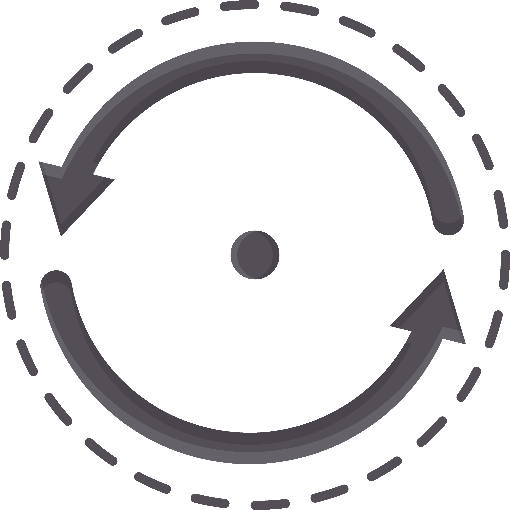

# 016 - Bộ Nhớ Đệm Phân Tán (Distributed Cache)

[← Bài trước](015-giam-sat-loi-client-side.md) | [Mục lục](README.md) | [Bài tiếp theo →](017-hang-doi-thong-diep-messaging-queue.md)

---


# Thiết Kế Hệ Thống: Bộ Nhớ Đệm Phân Tán (System Design: The Distributed Cache)

Tìm hiểu các nguyên lý cơ bản của một bộ nhớ đệm phân tán (**Distributed Cache**).

**Nội dung sẽ bao gồm:**
* Phát biểu bài toán (**Problem statement**)
* Bộ nhớ đệm phân tán là gì? (**What is a distributed cache?**)
* Tại sao lại cần bộ nhớ đệm phân tán? (**Why distributed cache?**)
* Chúng ta sẽ thiết kế bộ nhớ đệm phân tán như thế nào? (**How will we design distributed cache?**)

---

## Phát biểu bài toán (Problem statement)

Một hệ thống điển hình bao gồm các thành phần sau:
* Có một máy khách (**Client**) gửi yêu cầu dịch vụ.
* Có một hoặc nhiều máy chủ dịch vụ (**Service hosts**) tiếp nhận và xử lý các yêu cầu từ máy khách.
* Có một cơ sở dữ liệu (**Database**) được dịch vụ sử dụng để lưu trữ dữ liệu.

Trong các điều kiện bình thường, mô hình trừu tượng này hoạt động tốt. Tuy nhiên, khi số lượng người dùng tăng lên, các truy vấn cơ sở dữ liệu cũng tăng theo. Kết quả là các máy chủ cung cấp dịch vụ bị quá tải, dẫn đến hiệu năng bị suy giảm chậm chạp (**slow performance**).

Trong những trường hợp như vậy, một bộ nhớ đệm (**Cache**) được bổ sung vào hệ thống để giải quyết tình trạng suy giảm hiệu năng. Bộ nhớ đệm là một vùng lưu trữ dữ liệu tạm thời có thể phục vụ dữ liệu nhanh hơn bằng cách giữ các mục dữ liệu trong bộ nhớ chính (**Memory/RAM**). Bộ nhớ đệm chỉ lưu trữ những dữ liệu được truy cập thường xuyên nhất. 

Khi một yêu cầu đến máy chủ phục vụ, nó sẽ lấy dữ liệu từ bộ nhớ đệm (trúng bộ nhớ đệm - **Cache hit**) và phục vụ người dùng. Tuy nhiên, nếu dữ liệu không có sẵn trong bộ nhớ đệm (trượt bộ nhớ đệm - **Cache miss**), dữ liệu sẽ được truy vấn từ cơ sở dữ liệu. Đồng thời, bộ nhớ đệm sẽ được nạp giá trị mới này để tránh bị trượt bộ nhớ đệm ở những lần tiếp theo.

---


*Hình 1: Dịch vụ trước khi sử dụng bộ nhớ đệm (Service before using caching - 1 of 2)*
* Gồm: Máy khách (**Clients**), Dịch vụ Web (**Web service**), Kho lưu trữ dữ liệu (**Data store**).


*Hình 2: Dịch vụ sử dụng bộ nhớ đệm để cải thiện hiệu năng (Service using caching to improve performance - 2 of 2)*
* Gồm: Máy khách (**Clients**), Dịch vụ Web (**Web service**), Bộ nhớ đệm phân tán (**Distributed cache**), Kho lưu trữ dữ liệu (**Data store**).

---

Bộ nhớ đệm là một vùng lưu trữ không bền vững (**Nonpersistent storage**) được sử dụng để lưu giữ dữ liệu được đọc và ghi lặp đi lặp lại nhiều lần, mang lại cho người dùng cuối độ trễ thấp hơn (**Lower Latency**). Do đó, một bộ nhớ đệm phải phục vụ dữ liệu từ một thành phần lưu trữ vừa nhanh, vừa có đủ dung lượng lưu trữ, lại vừa có chi phí tài chính hợp lý (**Affordable cost**) khi chúng ta mở rộng quy mô dịch vụ lưu đệm (**Scale the caching service**).

Hình minh họa dưới đây làm nổi bật sự phù hợp của **RAM** như một khối dựng thô cốt lõi (**Raw building block**) cho việc lưu bộ nhớ đệm:


*Hình 3: Ước lượng mô tả lý do tại sao RAM là lựa chọn tối ưu để phục vụ dữ liệu lưu đệm (An approximation that depicts how RAM is the optimal choice for serving cached data)*


*Hình 4: Phân cấp bộ nhớ và vùng quan tâm (Hierarchy of Storage & Area of interest)*

### Phân tích phân cấp bộ nhớ:
* **Thanh ghi CPU (CPU register)**
* **Bộ nhớ đệm CPU (CPU cache)**
* **RAM (Bộ nhớ truy xuất ngẫu nhiên)** $\leftarrow$ **Vùng quan tâm chính (Area of interest)**
* **Ổ cứng thể rắn (SSD)**
* **Ổ đĩa từ (Magnetic disk)**

> [!NOTE]
> **Đặc tính phân cấp lưu trữ:**
> * **Tốc độ (Speed) & Chi phí (Cost):** Tăng dần khi đi lên phía trên (CPU register đắt nhất và nhanh nhất); giảm dần khi đi xuống phía dưới.
> * **Dung lượng (Capacity):** Tăng dần khi đi xuống phía dưới (Magnetic disk có dung lượng lớn nhất); giảm dần khi đi lên phía trên.
> * **Tính khả biến (Volatile vs Nonvolatile):** Các tầng phía trên (CPU register, CPU cache, RAM) là bộ nhớ khả biến (**Volatile** - mất dữ liệu khi mất điện); các tầng phía dưới (SSD, Magnetic disk) là lưu trữ bất biến (**Nonvolatile** - lưu trữ bền vững).
> 
> **Lý do chọn RAM:**
> * Đủ dung lượng (**Enough capacity**)
> * Đủ tốc độ (**Enough speed**)
> * Chi phí hợp lý/vừa túi tiền (**Affordable cost**)

Chúng ta đã hiểu nhu cầu về bộ nhớ đệm cũng như phần cứng lưu trữ phù hợp, nhưng **bộ nhớ đệm phân tán (Distributed cache)** là gì? Hãy cùng thảo luận tiếp theo.

---

## Bộ nhớ đệm phân tán là gì? (What is a distributed cache?)

Bộ nhớ đệm phân tán (**Distributed Cache**) là một hệ thống lưu trữ đệm trong đó nhiều máy chủ bộ nhớ đệm (**Cache servers**) phối hợp với nhau để lưu trữ dữ liệu được truy cập thường xuyên. Bộ nhớ đệm phân tán là cần thiết trong các môi trường mà một máy chủ bộ nhớ đệm đơn lẻ không đủ khả năng lưu trữ toàn bộ dữ liệu. Đồng thời, nó có khả năng mở rộng (**Scalable**) và đảm bảo mức độ khả dụng cao hơn (**High Availability**).

Các bộ nhớ đệm nhìn chung là vùng lưu trữ ngắn hạn, dung lượng nhỏ, được truy cập thường xuyên với thời gian đọc rất nhanh. Bộ nhớ đệm ứng dụng nguyên lý cục bộ tham chiếu (**Locality of reference principle**).

Nhìn chung, các bộ nhớ đệm phân tán mang lại lợi ích theo những cách sau:
* **Giảm thiểu độ trễ cảm nhận bởi người dùng (User-perceived Latency):** Bằng cách tính toán trước các kết quả và lưu trữ dữ liệu được truy cập thường xuyên.
* **Tạo sẵn các truy vấn tốn kém tài nguyên (Pre-generate expensive queries):** Giảm tải các truy vấn phức tạp từ cơ sở dữ liệu.
* **Lưu trữ dữ liệu phiên người dùng tạm thời (Store user session data temporarily).**
* **Phục vụ dữ liệu ngay cả khi hệ thống chính gặp sự cố:** Phục vụ dữ liệu từ bộ lưu trữ tạm thời ngay cả khi kho lưu trữ dữ liệu (**Data store**) bị gián đoạn tạm thời (**Temporarily down**).
* **Tiết kiệm chi phí băng thông mạng (Reduce network costs):** Bằng cách phục vụ dữ liệu từ các tài nguyên cục bộ.

---

## Tại sao lại cần bộ nhớ đệm phân tán? (Why distributed cache?)

Khi kích thước dữ liệu cần lưu trữ trong bộ nhớ đệm tăng lên, việc lưu trữ toàn bộ dữ liệu trên một hệ thống duy nhất là không thực tế. Điều này xuất phát từ 3 lý do sau:

1. **Điểm lỗi đơn lẻ (Single Point of Failure - SPOF):** Một máy chủ duy nhất có thể trở thành điểm sụp đổ toàn bộ hệ thống nếu gặp sự cố.
2. **Kiến trúc phân tầng (Layered System Design):** Một hệ thống được thiết kế theo nhiều tầng lớp, và mỗi tầng nên có cơ chế lưu đệm riêng để đảm bảo sự tách rời độc lập (**Decoupling**) của các dữ liệu nhạy cảm giữa các tầng khác nhau.
3. **Giảm độ trễ tại từng tầng (Reduce Serving Latency):** Việc lưu đệm tại các vị trí/tầng khác nhau giúp giảm độ trễ phục vụ (**Serving Latency**) ngay tại chính tầng đó.

Bảng dưới đây mô tả cách thức thực hiện lưu đệm tại các tầng khác nhau của một hệ thống thông qua việc sử dụng nhiều công nghệ đa dạng. Điều quan trọng cần lưu ý là các thành phần kho lưu trữ khóa - giá trị (**Key-Value Store**) được sử dụng xuyên suốt ở nhiều tầng khác nhau:

### Lưu đệm tại các tầng khác nhau của một hệ thống (Caching at Different Layers of a System)

| Tầng Hệ Thống (System Layer) | Công Nghệ Sử Dụng (Technology in Use) | Mục Đích Sử Dụng (Usage) |
| :--- | :--- | :--- |
| **Tầng Web (Web Layer)** | Các tiêu đề bộ đệm HTTP (**HTTP cache headers**), bộ tăng tốc web (**Web accelerators**), kho lưu trữ khóa - giá trị (**Key-value store**), Mạng phân phối nội dung (**CDNs**), v.v. | Tăng tốc độ truy xuất nội dung web và quản lý phiên người dùng (**Manage sessions**). |
| **Tầng Ứng Dụng (Application Layer)** | Bộ nhớ đệm cục bộ (**Local cache**) và kho dữ liệu khóa - giá trị (**Key-value data store**). | Tăng tốc các tính toán của ứng dụng và truy xuất dữ liệu tạm thời. |
| **Tầng Cơ Sở Dữ Liệu (Database Layer)** | Bộ nhớ đệm cơ sở dữ liệu (**Database cache**), bộ đệm vùng nhớ (**Buffers**), và kho dữ liệu khóa - giá trị (**Key-value data store**). | Giảm độ trễ truy xuất dữ liệu và giảm tải I/O cho cơ sở dữ liệu (**Reduce data retrieval latency and I/O load from database**). |

> [!IMPORTANT]
> Ngoài 3 tầng hệ thống kể trên, cơ chế lưu đệm còn được thực hiện tại tầng **Hệ thống phân giải tên miền (DNS)** và các công nghệ phía máy khách (**Client-side**) như trình duyệt web (**Browsers**) hoặc các thiết bị đầu cuối (**End-devices**).

---

## Chúng ta sẽ thiết kế bộ nhớ đệm phân tán như thế nào? (How will we design distributed cache?)

Chúng ta sẽ chia nhiệm vụ thiết kế và củng cố kiến thức về các khái niệm cốt lõi của bộ nhớ đệm phân tán thành **5 bài học**:

1. **Kiến thức nền tảng về Bộ nhớ đệm phân tán (Background of Distributed Cache):** Việc xây dựng kiến thức nền tảng là điều bắt buộc để đưa ra các quyết định quan trọng khi thiết kế bộ nhớ đệm phân tán. Bài học này sẽ ôn lại một số khái niệm cơ bản nhưng rất quan trọng.
2. **Thiết kế tổng quan của Bộ nhớ đệm phân tán (High-level Design of a Distributed Cache):** Chúng ta sẽ xây dựng một bản thiết kế mức cao (tổng quan) của một bộ nhớ đệm phân tán trong bài học này.
3. **Thiết kế chi tiết của Bộ nhớ đệm phân tán (Detailed Design of a Distributed Cache):** Chúng ta sẽ xác định một số hạn chế của thiết kế mức cao và tiến tới một giải pháp có khả năng mở rộng (**Scalable**), chi phí hợp lý (**Affordable**) và hiệu năng cao (**Performant**).
4. **Đánh giá thiết kế Bộ nhớ đệm phân tán (Evaluation of a Distributed Cache Design):** Bài học này sẽ đánh giá thiết kế của chúng ta dựa trên các yêu cầu phi chức năng (**Non-functional requirements**) khác nhau, chẳng hạn như khả năng mở rộng (**Scalability**), tính nhất quán (**Consistency**), tính sẵn sàng / độ khả dụng (**Availability**), v.v.
5. **So sánh Memcached với Redis (Memcached versus Redis):** Chúng ta sẽ thảo luận về các giải pháp công nghiệp nổi tiếng, cụ thể là **Memcached** và **Redis**. Chúng ta cũng sẽ đi sâu vào chi tiết của chúng và so sánh các tính năng để giúp hiểu rõ các trường hợp sử dụng tiềm năng (**Use cases**) và mối liên hệ của chúng với thiết kế của chúng ta.

---

*Điều hướng:*
* **Quay lại (Back):** Thiết kế Hệ Thống Giám Sát Phía Máy Khách (Design of a Client-side Monitoring System)
* **Đánh dấu hoàn thành (Mark As Completed)**
* **Tiếp theo (Next):** Kiến thức nền tảng về Bộ nhớ đệm phân tán (Background of Distributed Cache)

Hãy bắt đầu bằng việc khám phá kiến thức nền tảng về bộ nhớ đệm phân tán trong bài học tiếp theo!

---

# Kiến thức nền tảng về Bộ nhớ đệm phân tán (Background of Distributed Cache)

Tìm hiểu các nguyên lý cơ bản để thiết kế một bộ nhớ đệm phân tán (**Distributed Cache**).

**Chúng ta sẽ tìm hiểu các nội dung sau:**
* Chính sách ghi dữ liệu (**Writing policies**)
* Chính sách loại bỏ dữ liệu (**Eviction policies**)
* Vô hiệu hóa bộ nhớ đệm (**Cache invalidation**)
* Cơ chế lưu trữ (**Storage mechanism**)
* Hàm băm (**Hash function**)
* Danh sách liên kết (**Linked list**)
* Phân mảnh dữ liệu trong cụm bộ nhớ đệm (**Sharding in cache clusters**)
* Máy chủ bộ nhớ đệm chuyên dụng (**Dedicated cache servers**)
* Bộ nhớ đệm triển khai đồng vị trí (**Co-located cache**)
* Cache client (Phía máy khách bộ nhớ đệm)
* Kết luận (**Conclusion**)

Mục tiêu chính của chương này là thiết kế một bộ nhớ đệm phân tán (**Distributed Cache**). Để đạt được mục tiêu này, chúng ta cần có kiến thức nền tảng vững chắc, chủ yếu về các kỹ thuật đọc và ghi dữ liệu khác nhau. Bài học này sẽ giúp chúng ta xây dựng khối kiến thức nền tảng đó. Hãy cùng xem cấu trúc của bài học này trong bảng dưới đây:

---

## Cấu trúc của bài học này (Structure of This Lesson)

| Phần (Section) | Mục đích / Động lực (Motivation) |
| :--- | :--- |
| **Chính sách ghi dữ liệu (Writing policies)** | Dữ liệu được ghi vào bộ nhớ đệm (**cache**) và cơ sở dữ liệu (**database**). Thứ tự ghi dữ liệu sẽ ảnh hưởng trực tiếp đến hiệu năng (**performance**). Chúng ta sẽ thảo luận về các chính sách ghi khác nhau để quyết định xem chính sách nào phù hợp cho hệ thống bộ nhớ đệm phân tán mà chúng ta chuẩn bị thiết kế. |
| **Chính sách loại bỏ dữ liệu (Eviction policies)** | Vì bộ nhớ đệm được xây dựng trên dung lượng lưu trữ giới hạn (RAM), lý tưởng nhất là chúng ta muốn lưu trữ dữ liệu được truy cập thường xuyên nhất trong bộ nhớ đệm. Do đó, chúng ta sẽ thảo luận về các chính sách loại bỏ dữ liệu để thay thế dữ liệu ít được truy cập bằng dữ liệu được truy cập nhiều nhất. |
| **Vô hiệu hóa bộ nhớ đệm (Cache invalidation)** | Một số dữ liệu trong bộ nhớ đệm có thể bị lỗi thời. Trong phần này, chúng ta sẽ thảo luận về các phương pháp vô hiệu hóa khác nhau để loại bỏ các bản ghi cũ hoặc lỗi thời (**stale / outdated entries**) khỏi bộ nhớ đệm. |
| **Cơ chế lưu trữ (Storage mechanism)** | Một hệ thống lưu trữ phân tán có rất nhiều máy chủ. Chúng ta sẽ thảo luận về các cân nhắc thiết kế quan trọng, chẳng hạn như bản ghi đệm nào nên được lưu trữ ở máy chủ nào và nên sử dụng cấu trúc dữ liệu nào để lưu trữ. |
| **Cache client (Phía máy khách bộ nhớ đệm)** | Máy chủ bộ nhớ đệm lưu trữ các bản ghi đệm, nhưng cache client sẽ gọi đến máy chủ bộ nhớ đệm để yêu cầu dữ liệu. Chúng ta sẽ thảo luận chi tiết về thư viện cache client trong phần này. |

---

## Chính sách ghi dữ liệu (Writing policies)

Thông thường, bộ nhớ đệm lưu trữ một bản sao (hoặc một phần) dữ liệu được lưu trữ bền vững (**persistently stored**) trong một kho lưu trữ dữ liệu (**data store**). Khi chúng ta lưu trữ dữ liệu vào kho lưu trữ, một số câu hỏi quan trọng được đặt ra:
* Chúng ta lưu dữ liệu vào đâu trước? Cơ sở dữ liệu (**Database**) hay bộ nhớ đệm (**Cache**)?
* Tác động của mỗi chiến lược đối với các mô hình nhất quán dữ liệu (**Consistency models**) sẽ như thế nào?

Câu trả lời ngắn gọn là: điều đó phụ thuộc vào các yêu cầu của ứng dụng. Hãy cùng xem chi tiết về các chính sách ghi dữ liệu khác nhau để hiểu rõ hơn về khái niệm này:

---

### 1. Write-through cache (Ghi xuyên qua)
Cơ chế **write-through** thực hiện ghi dữ liệu vào cả bộ nhớ đệm (**cache**) lẫn cơ sở dữ liệu (**database**). Việc ghi vào cả hai hệ thống lưu trữ có thể diễn ra đồng thời (**concurrently**) hoặc nối tiếp nhau (**one after the other**). Cơ chế này làm tăng độ trễ ghi (**write latency**), nhưng đảm bảo tính nhất quán mạnh mẽ (**strong consistency**) giữa cơ sở dữ liệu và bộ nhớ đệm.

### 2. Write-back cache (Ghi lại / Ghi trễ)
Trong cơ chế **write-back cache**, dữ liệu trước tiên được ghi vào bộ nhớ đệm và sau đó được ghi bất đồng bộ (**asynchronously written**) vào cơ sở dữ liệu. Mặc dù bộ nhớ đệm luôn có dữ liệu đã được cập nhật, sự không nhất quán (**inconsistency**) là không thể tránh khỏi trong các kịch bản mà máy khách (**client**) đọc dữ liệu cũ/lỗi thời (**stale data**) từ cơ sở dữ liệu. Tuy nhiên, các hệ thống sử dụng chiến lược này sẽ có độ trễ ghi (**writing latency**) rất thấp.

### 3. Write-around cache (Ghi vòng qua)
Chiến lược này chỉ thực hiện ghi dữ liệu trực tiếp vào cơ sở dữ liệu. Sau đó, khi một thao tác đọc được kích hoạt đối với dữ liệu đó, dữ liệu mới được ghi vào bộ nhớ đệm sau một lần bị lỡ bộ nhớ đệm (**cache miss**). Cơ sở dữ liệu sẽ có dữ liệu cập nhật, nhưng chiến lược này không thuận lợi cho các trường hợp cần đọc lại dữ liệu vừa mới được cập nhật gần đây.

---

### Câu đố (Quiz)

**Một hệ thống muốn ghi dữ liệu và nhanh chóng đọc lại dữ liệu đó ngay sau đó. Đồng thời, chúng ta muốn có tính nhất quán giữa bộ nhớ đệm và cơ sở dữ liệu. Chính sách ghi nào là sự lựa chọn tối ưu?**

* *Reset Quiz*
* *Câu hỏi 1 / 3*
* *0 lần thử*
* *Gửi câu trả lời (Submit Answer)*
* *1*

---

## Chính sách loại bỏ dữ liệu (Eviction policies)

Một trong những lý do chính khiến bộ nhớ đệm hoạt động nhanh là vì kích thước của chúng nhỏ. Bộ nhớ đệm nhỏ đồng nghĩa với dung lượng lưu trữ bị giới hạn. Do đó, chúng ta cần một cơ chế loại bỏ (**eviction mechanism**) để dọn dẹp bớt dữ liệu ít được truy cập khỏi bộ nhớ đệm.

Một số chiến lược phổ biến được sử dụng để loại bỏ dữ liệu khỏi bộ nhớ đệm bao gồm:
* **Least recently used (LRU)**: Ít được sử dụng gần đây nhất
* **Most recently used (MRU)**: Được sử dụng gần đây nhất
* **Least frequently used (LFU)**: Ít được sử dụng thường xuyên nhất (tần suất thấp nhất)
* **Most frequently used (MFU)**: Được sử dụng thường xuyên nhất (tần suất cao nhất)

Các chiến lược khác như vào trước, ra trước (**First In, First Out - FIFO**) cũng tồn tại. Việc lựa chọn từng thuật toán này phụ thuộc vào hệ thống cụ thể mà bộ nhớ đệm đang được xây dựng cho nó.

> [!NOTE]
> **Ẩn nội dung này (Hide This)**  
> Dữ liệu có thể được phân loại thành ba vùng nhiệt độ dựa trên tần suất truy cập:
> * **Nóng (Hot):** Đây là dữ liệu được truy cập rất nhiều.
> * **Ấm (Warm):** Đây là dữ liệu ít được truy cập thường xuyên hơn.
> * **Lạnh (Cold):** Đây là dữ liệu hiếm khi được truy cập.
> 
> Dữ liệu lạnh (**Cold data**) thường xuyên bị loại bỏ khỏi bộ nhớ đệm và được thay thế bằng dữ liệu nóng (**Hot data**) hoặc dữ liệu ấm (**Warm data**). Hình ảnh sau đây biểu diễn phổ nhiệt độ của dữ liệu:
> 
> **Lạnh (Cold) $\rightarrow$ Ấm (Warm) $\rightarrow$ Nóng (Hot)**

---

## Vô hiệu hóa bộ nhớ đệm (Cache invalidation)

Bên cạnh việc loại bỏ dữ liệu ít được truy cập, một số dữ liệu nằm trong bộ nhớ đệm có thể trở nên cũ kỹ hoặc lỗi thời (**stale / outdated**) theo thời gian. Những bản ghi đệm như vậy là không hợp lệ (**invalid**) và phải được đánh dấu để xóa bỏ.

Tình huống này đặt ra một câu hỏi: **Làm thế nào để chúng ta xác định được các bản ghi đã lỗi thời?**

Việc giải quyết bài toán này đòi hỏi phải lưu trữ siêu dữ liệu (**metadata**) tương ứng với từng bản ghi đệm. Cụ thể là duy trì một giá trị thời gian sống (**Time-To-Live - TTL**) để xử lý các mục đệm đã lỗi thời.

Chúng ta có thể sử dụng hai cách tiếp cận khác nhau để xử lý các mục hết hạn bằng TTL:
* **Hết hạn chủ động (Active expiration):** Phương pháp này chủ động kiểm tra TTL của các bản ghi đệm thông qua một tiến trình chạy ngầm (**daemon process**) hoặc một luồng (**thread**).
* **Hết hạn thụ động (Passive expiration):** Phương pháp này kiểm tra TTL của một bản ghi đệm ngay tại thời điểm bản ghi đó được truy cập.

Mỗi mục đã hết hạn sẽ bị xóa khỏi bộ nhớ đệm ngay khi bị phát hiện.

---

## Cơ chế lưu trữ (Storage mechanism)

Lưu trữ dữ liệu trong bộ nhớ đệm không hề đơn giản như bề ngoài, bởi vì một hệ thống bộ nhớ đệm phân tán (**distributed cache**) bao gồm nhiều máy chủ bộ nhớ đệm (**cache servers**). Khi sử dụng nhiều máy chủ bộ nhớ đệm, các câu hỏi thiết kế sau đây cần phải được trả lời:
* Dữ liệu nào chúng ta nên lưu trữ ở máy chủ bộ nhớ đệm nào?
* Chúng ta nên sử dụng cấu trúc dữ liệu nào để lưu trữ dữ liệu?

Hai câu hỏi trên là những vấn đề thiết kế quan trọng vì chúng sẽ quyết định hiệu năng (**performance**) của bộ nhớ đệm phân tán, vốn là yêu cầu quan trọng nhất đối với chúng ta. Chúng ta sẽ sử dụng các kỹ thuật sau để trả lời các câu hỏi trên.

---

### Hàm băm (Hash function)

Hoàn toàn có thể áp dụng kỹ thuật băm (**hashing**) trong hai kịch bản khác nhau:
1. Xác định máy chủ bộ nhớ đệm trong một hệ thống bộ nhớ đệm phân tán để lưu trữ và truy xuất dữ liệu.
2. Định vị các bản ghi đệm bên trong từng máy chủ bộ nhớ đệm.

Đối với kịch bản đầu tiên, chúng ta có thể sử dụng các thuật toán băm khác nhau. Tuy nhiên, kỹ thuật băm nhất quán (**Consistent Hashing**) hoặc các biến thể của nó thường hoạt động rất tốt trong các hệ thống phân tán, bởi vì kỹ thuật băm đơn giản (**simple hashing**) sẽ không còn lý tưởng trong trường hợp xảy ra sự cố sập máy chủ (**crashes**) hoặc khi cần mở rộng quy mô (**scaling**).

Đối với kịch bản thứ hai, chúng ta có thể sử dụng các hàm băm thông thường để định vị một bản ghi đệm nhằm mục đích đọc hoặc ghi bên trong một máy chủ bộ nhớ đệm. Tuy nhiên, chỉ riêng hàm băm thì chỉ có thể định vị được bản ghi đệm. Nó không đưa ra giải pháp nào cho việc quản lý dữ liệu bên trong máy chủ bộ nhớ đệm. Nghĩa là, nó không cho biết cách triển khai một chiến lược để loại bỏ dữ liệu ít được truy cập khỏi máy chủ bộ nhớ đệm. Nó cũng không nói lên điều gì về cấu trúc dữ liệu nào được sử dụng để lưu trữ dữ liệu bên trong các máy chủ bộ nhớ đệm. Đây chính xác là câu hỏi thiết kế thứ hai của cơ chế lưu trữ. Tiếp theo, chúng ta hãy cùng xem xét cấu trúc dữ liệu.

---

### Danh sách liên kết (Linked list)

Chúng ta sẽ sử dụng danh sách liên kết đôi (**Doubly Linked List**). Lý do chính là tính phổ biến và sự đơn giản của nó. Hơn nữa, việc thêm và xóa dữ liệu khỏi danh sách liên kết đôi trong trường hợp của chúng ta sẽ là thao tác có thời gian hằng số (**constant time operation - $O(1)$**). Điều này là do chúng ta hoặc là loại bỏ một bản ghi cụ thể từ đuôi (**tail**) của danh sách liên kết, hoặc chuyển một bản ghi lên đầu (**head**) của danh sách liên kết đôi. Vì vậy, không cần phải thực hiện bất kỳ vòng lặp duyệt phần tử nào.

> [!NOTE]
> **Bộ lọc Bloom (Bloom filters)** là một sự lựa chọn thú vị để nhanh chóng xác định xem một bản ghi đệm có **không** tồn tại trong các máy chủ bộ nhớ đệm hay không. Chúng ta có thể sử dụng bộ lọc Bloom để xác định chắc chắn rằng một bản ghi đệm chắc chắn không hiện diện trong máy chủ bộ nhớ đệm, nhưng khả năng hiện diện của nó chỉ mang tính xác suất (**probabilistic**). Bộ lọc Bloom rất hữu ích trong các hệ thống bộ nhớ đệm hoặc cơ sở dữ liệu quy mô lớn.

---

## Phân mảnh dữ liệu trong cụm bộ nhớ đệm (Sharding in cache clusters)

Để tránh điểm lỗi đơn lẻ (**Single Point of Failure - SPOF**) và tình trạng tải cao trên một thực thể đệm duy nhất, chúng ta áp dụng kỹ thuật phân mảnh (**Sharding**). Phân mảnh bao gồm việc chia nhỏ dữ liệu bộ nhớ đệm ra nhiều máy chủ bộ nhớ đệm khác nhau. Kỹ thuật này có thể được thực hiện theo hai cách sau đây.

### Máy chủ bộ nhớ đệm chuyên dụng (Dedicated cache servers)
Trong phương pháp sử dụng máy chủ bộ nhớ đệm chuyên dụng, chúng ta tách biệt hoàn toàn máy chủ ứng dụng (**application servers**) và máy chủ web (**web servers**) ra khỏi các máy chủ bộ nhớ đệm (**cache servers**).

---

# Thiết Kế Hệ Thống: Bộ Nhớ Đệm Phân Tán (System Design: The Distributed Cache)

---

### --- Trang 13 ---

Các ưu điểm của việc sử dụng các máy chủ bộ nhớ đệm chuyên dụng (**dedicated cache servers**) bao gồm:
- Có sự linh hoạt về mặt lựa chọn phần cứng cho từng chức năng riêng biệt.
- Có khả năng mở rộng quy mô (**scale**) các máy chủ web/ứng dụng (**web/application servers**) và các máy chủ bộ nhớ đệm (**cache servers**) một cách độc lập.

Bên cạnh những ưu điểm trên, việc hoạt động như một dịch vụ lưu đệm độc lập (**standalone caching service**) cho phép các vi dịch vụ (**microservices**) khác hưởng lợi từ chúng — ví dụ: Dịch vụ Bộ nhớ đệm như một Dịch vụ (**Cache as a Service - CaaS**). Trong trường hợp đó, hệ thống lưu đệm sẽ phải nhận biết được các ứng dụng khác nhau để dữ liệu của chúng không bị xung đột (**collide**).

#### Minh họa các máy chủ dịch vụ phối hợp với các máy chủ bộ nhớ đệm chuyên dụng


```
Service host 1 (Máy chủ dịch vụ 1)
Service host 2 (Máy chủ dịch vụ 2)
Cache server 1 (Máy chủ đệm 1)
Service host N (Máy chủ dịch vụ N)
Cache server N (Máy chủ đệm N)
. . .
. . .
Cache server 2 (Máy chủ đệm 2)
```

---

### Bộ nhớ đệm đặt cùng vị trí (Co-located cache)

Bộ nhớ đệm đặt cùng vị trí (**Co-located cache**) nhúng trực tiếp chức năng lưu đệm (**cache**) và chức năng dịch vụ (**service functionality**) vào bên trong cùng một máy chủ (**host**).

Ưu điểm chính của chiến lược này là giảm chi phí vốn (**CAPEX - Capital Expenditure**) và chi phí vận hành (**OPEX - Operational Expenditure**) cho phần cứng bổ sung. Hơn nữa, khi một dịch vụ mở rộng quy mô (**scale**), dịch vụ còn lại cũng tự động được mở rộng quy mô theo. Tuy nhiên, sự cố hư hỏng của một máy (**machine failure**) sẽ dẫn đến việc mất cả hai dịch vụ cùng một lúc.

---

### --- Trang 14 ---

#### Lưu trữ bộ nhớ đệm và logic ứng dụng trên cùng một máy (Hosting cache and application logic in the same machine)


```
Service host 1 (Máy chủ dịch vụ 1)
Service host 2 (Máy chủ dịch vụ 2)
Service host N (Máy chủ dịch vụ N)
. . .
. . .
```

---

### Cache Client (Trình khách bộ nhớ đệm)

Chúng ta đã thảo luận rằng các hàm băm (**hash functions**) nên được sử dụng cho việc lựa chọn các máy chủ bộ nhớ đệm (**cache servers**). Nhưng thực thể nào thực hiện các phép tính toán băm này?

Một **cache client** là một đoạn mã nguồn cư trú bên trong các máy chủ lưu trữ dịch vụ (**hosting servers**), thực hiện các phép tính toán (băm - hash) để lưu trữ và truy xuất dữ liệu trong các máy chủ bộ nhớ đệm. Ngoài ra, các cache client có thể phối hợp với các thành phần hệ thống khác như dịch vụ giám sát (**monitoring service**) và cấu hình (**configuration service**). Tất cả các cache client đều được lập trình theo cùng một cách để các thao tác `PUT` và `GET` giống nhau từ các client khác nhau sẽ trả về các kết quả như nhau.

Một số đặc tính của **cache client** bao gồm:
- Mỗi cache client sẽ nắm được thông tin về tất cả các cache server trong hệ thống.
- Tất cả các client đều có thể sử dụng các giao thức truyền tải phổ biến như **TCP** hoặc **UDP** để giao tiếp với các cache server.

---

### Điểm Cần Suy Ngẫm (Point to Ponder)

> [!NOTE]
> **Câu hỏi (Question):**
> 
> Hành vi của các cache client đối với một yêu cầu truy cập sẽ như thế nào nếu một trong các cache server bị chết (ngừng hoạt động)?

---

### --- Trang 15 ---

```
Quay lại (Back)
Thiết kế Hệ thống: Bộ nhớ đệm phân tán (System Design: The Distributed Cache)
Đánh dấu là đã hoàn thành (Mark As Completed)
Tiếp theo (Next)
Thiết kế Mức cao của Bộ nhớ đệm phân tán (High-level Design of a Distributed C…)
```

> [!TIP]
> **Ẩn câu trả lời (Hide Answer):**
> 
> Vì dữ liệu bên trong cache server đó sẽ không còn khả dụng nữa, các cache client sẽ đánh dấu yêu cầu truy cập đó là một trường hợp trượt bộ nhớ đệm (**cache miss**).

---

### Kết luận (Conclusion)

Trong bài học này, chúng ta đã tìm hiểu bộ nhớ đệm phân tán (**distributed caches**) là gì và nhấn mạnh tầm quan trọng của chúng trong các hệ thống phân tán (**distributed systems**). Chúng ta cũng đã thảo luận về các cơ chế lưu trữ (**storage**) và thu hồi/loại bỏ dữ liệu (**eviction mechanisms**) khác nhau đối với bộ nhớ đệm. 

Bộ nhớ đệm đóng vai trò sống còn đối với bất kỳ hệ thống phân tán nào và được bố trí tại nhiều vị trí khác nhau trong thiết kế của một hệ thống. Việc hiểu rõ cách thiết kế bộ nhớ đệm phân tán như một phần của một hệ thống quy mô lớn là vô cùng quan trọng.

---

### --- Trang 16 ---

# Thiết Kế Mức Cao Của Bộ Nhớ Đệm Phân Tán (High-level Design of a Distributed Cache)

Tìm hiểu cách chúng ta có thể phát triển một thiết kế mức cao (**high-level design**) cho một bộ nhớ đệm phân tán.

#### Chúng ta sẽ bao quát các nội dung sau:
- **Yêu cầu (Requirements)**
  - Yêu cầu chức năng (**Functional**)
  - Yêu cầu phi chức năng (**Non-functional requirements**)
- **Thiết kế API (API design)**
  - Thao tác chèn (**Insertion**)
  - Thao tác truy xuất (**Retrieval**)
- **Các cân nhắc thiết kế (Design considerations)**
  - Phần cứng lưu trữ (**Storage hardware**)
  - Cấu trúc dữ liệu (**Data structures**)
  - Trình khách bộ nhớ đệm (**Cache client**)
  - Chính sách ghi dữ liệu (**Writing policy**)
  - Chính sách loại bỏ dữ liệu (**Eviction policy**)
- **Thiết kế mức cao (High-level design)**

Trong bài học này, chúng ta sẽ học cách thiết kế một bộ nhớ đệm phân tán (**distributed cache**). Chúng ta cũng sẽ thảo luận về các đánh đổi (**trade-offs**) và các lựa chọn thiết kế (**design choices**) có thể nảy sinh trong suốt hành trình hướng tới việc phát triển một giải pháp hoàn chỉnh.

---

### Các Yêu Cầu (Requirements)

Hãy bắt đầu bằng việc tìm hiểu các yêu cầu cho giải pháp của chúng ta.

#### Yêu Cầu Chức Năng (Functional Requirements)
Dưới đây là các yêu cầu chức năng:
- **Chèn dữ liệu (Insert data):** Người dùng của một hệ thống bộ nhớ đệm phân tán phải có khả năng chèn

---

### --- Trang 17 ---

một mục dữ liệu (**entry**) vào bộ nhớ đệm.
- **Truy xuất dữ liệu (Retrieve data):** Người dùng phải có khả năng truy xuất dữ liệu tương ứng với một khóa (**key**) cụ thể.

#### Các yêu cầu chức năng và phi chức năng của bộ nhớ đệm phân tán


```
Put (Ghi dữ liệu)
Get (Đọc dữ liệu)
Performance (Hiệu năng)
Scalability (Khả năng mở rộng)
Availability (Tính sẵn sàng cao)
Consistency (Tính nhất quán)
Affordability (Tính khả thi về mặt chi phí)
```

---

#### Yêu Cầu Phi Chức Năng (Non-functional Requirements)
Chúng ta sẽ xem xét các yêu cầu phi chức năng sau:
- **Hiệu năng cao (High performance):** Lý do cơ bản hàng đầu của bộ nhớ đệm là cho phép truy xuất dữ liệu nhanh chóng. Do đó, cả hai thao tác chèn (**insert**) và truy xuất (**retrieve**) đều phải nhanh chóng (độ trễ thấp - low **Latency**).
- **Khả năng mở rộng (Scalability):** Hệ thống bộ nhớ đệm phải có khả năng mở rộng theo chiều ngang (**horizontal scalability**) mà không gặp phải điểm nghẽn cổ chai (**bottlenecks**) khi số lượng yêu cầu tăng lên.
- **Tính sẵn sàng cao (High availability):** Việc bộ nhớ đệm không khả dụng sẽ đặt thêm gánh nặng lên các máy chủ cơ sở dữ liệu (**database servers**), vốn cũng có thể bị sập trong các khoảng thời gian tải đỉnh (**peak load intervals**). Chúng ta cũng yêu cầu hệ thống phải sống sót trước các sự cố lỗi ngẫu nhiên của phần cứng thành phần, mạng kết nối (**Fault Tolerance**), cũng như sự cố mất điện.
- **Tính nhất quán (Consistency):** Dữ liệu được lưu trữ trên các máy chủ bộ nhớ đệm phải nhất quán. Ví dụ: các cache client khác nhau khi truy xuất cùng một dữ liệu từ các máy chủ bộ nhớ đệm khác nhau (chính - primary hoặc phụ - secondary) phải nhận được dữ liệu mới nhất (**up to date**).
- **Tính khả thi về chi phí (Affordability):** Lý tưởng nhất, hệ thống lưu đệm nên được thiết kế từ các phần cứng tiêu chuẩn/đại trà (**commodity hardware**) thay vì sử dụng một thành phần hỗ trợ đắt đỏ bên trong thiết kế của hệ thống.

---

### Thiết Kế API (API Design)

---

### --- Trang 18 ---

Thiết kế API cho bài toán này tương đối đơn giản vì chỉ có hai thao tác cơ bản.

#### Thao tác chèn (Insertion)
Lời gọi API để thực hiện thao tác chèn sẽ có dạng như sau:

```
insert(key, value)
```

| Tham số (Parameter) | Mô tả (Description) |
| :--- | :--- |
| `key` | Đây là một định danh duy nhất (**unique identifier**). |
| `value` | Đây là dữ liệu được lưu trữ tương ứng với khóa duy nhất đó. |

Hàm này trả về một xác nhận thành công (**acknowledgment**) hoặc một thông báo lỗi (**error**) mô tả vấn đề phát sinh tại phía máy chủ.

---

#### Thao tác truy xuất (Retrieval)
Lời gọi API để truy xuất dữ liệu từ bộ nhớ đệm sẽ có dạng như sau:

```
retrieve(key)
```

| Tham số (Parameter) | Mô tả (Description) |
| :--- | :--- |
| `key` | Trả về dữ liệu được lưu trữ tương ứng với khóa này. |

Lời gọi này trả về một đối tượng (**object**) cho phía gọi.

---

### Điểm Cần Suy Ngẫm (Point to Ponder)


---

# BỘ NHỚ ĐỆM PHÂN TÁN (DISTRIBUTED CACHE)

---

### **Câu hỏi (Question)**
> Thiết kế API của bộ nhớ đệm phân tán (*distributed cache*) trông hoàn toàn giống với kho lưu trữ khóa - giá trị (*key-value store*). Vậy những điểm khác biệt có thể có giữa một key-value store và một distributed cache là gì?

<details>
<summary><b>Ẩn câu trả lời (Hide Answer)</b></summary>

Một số điểm khác biệt cốt lõi bao gồm:
* **Tính bền vững dữ liệu (Persistence):** Các key-value store cần phải lưu trữ dữ liệu một cách bền bỉ (*durably store data / persistence*). Trong khi đó, một bộ nhớ đệm (*cache*) được sử dụng bổ trợ thêm vào bộ lưu trữ bền vững (*persistent storage*) nhằm tăng cường hiệu năng đọc (*reading performance*).
* **Môi trường lưu trữ:** Cache phục vụ dữ liệu trực tiếp từ bộ nhớ RAM. Key-value store ghi dữ liệu xuống bộ lưu trữ bất biến / không bay hơi (*non-volatile storage* - ổ cứng/SSD).
* **Khả năng chịu lỗi (Fault Tolerance):** Các key-value store rất mạnh mẽ (*robust*) và phải sống sót sau các sự cố hỏng hóc (*failures*). Ngược lại, cache có thể gặp sự cố (*crash*) và hoàn toàn có thể được nạp lại dữ liệu từ đầu (*populated from scratch*) sau khi phục hồi.

</details>

---

## Các Cân Nhắc Thiết Kế (Design Considerations)

Trước khi thiết kế hệ thống bộ nhớ đệm phân tán (*distributed cache system*), việc xem xét kỹ lưỡng một số lựa chọn thiết kế là vô cùng quan trọng. Mỗi lựa chọn này sẽ hoàn toàn dựa trên các yêu cầu cụ thể từ ứng dụng của chúng ta. Tuy nhiên, chúng ta có thể làm nổi bật một số điểm khác biệt cốt lõi sau đây:

### 1. Phần Cứng Lưu Trữ (Storage Hardware)
Nếu dữ liệu của chúng ta có quy mô lớn, chúng ta có thể yêu cầu phân mảnh (*sharding*) và do đó phải sử dụng các máy chủ phân mảnh (*shard servers*) cho các phân vùng cache (*cache partitions*). 

Liệu các máy chủ shard này nên là **phần cứng chuyên dụng (*specialized hardware*)** hay **phần cứng thương mại phổ thông (*commodity hardware*)**? 
* Phần cứng chuyên dụng sẽ mang lại hiệu năng (*performance*) và dung lượng lưu trữ (*storage capacity*) vượt trội, nhưng chi phí sẽ đắt đỏ hơn nhiều.
* Chúng ta có thể xây dựng một cụm cache lớn từ các máy chủ thương mại phổ thông. Nhìn chung, số lượng máy chủ shard sẽ phụ thuộc vào kích thước của cache và tần suất truy cập (*access frequency*).

Hơn nữa, chúng ta có thể cân nhắc việc lưu trữ dữ liệu trên bộ lưu trữ thứ cấp (*secondary storage*) của các máy chủ này nhằm mục đích duy trì tính bền vững (*persistence*), trong khi vẫn phục vụ dữ liệu trực tiếp từ RAM. Bộ lưu trữ thứ cấp có thể được sử dụng trong các tình huống máy chủ bị khởi động lại (*reboot*) và quá trình tái tạo lại dữ liệu cache (*cache rebuilding*) mất nhiều thời gian. Tuy nhiên, tính bền vững (*persistence*) có thể không phải là một yêu cầu bắt buộc trong hệ thống cache nếu đã có sẵn một tầng lưu trữ bền vững chuyên dụng (*dedicated persistence layer*), chẳng hạn như cơ sở dữ liệu (*database*).

---

### 2. Cấu Trúc Dữ Liệu (Data Structures)
Một phần mang tính sống còn của thiết kế phải là **tốc độ truy cập dữ liệu (*speed of accessing data*)**. 
* **Bảng băm (Hash Tables):** Là cấu trúc dữ liệu tiêu tốn thời gian hằng số trên mức trung bình ($O(1)$ on average) để lưu trữ và truy xuất dữ liệu.
* **Danh sách liên kết (Linked Lists):** Chúng ta cần thêm một cấu trúc dữ liệu khác để thực thi thuật toán giải phóng bộ nhớ (*eviction algorithm*) trên dữ liệu được cache. Cụ thể, danh sách liên kết là một lựa chọn tối ưu (như đã thảo luận trong bài học trước).

Bên cạnh đó, chúng ta cần hiểu rõ loại cấu trúc dữ liệu nào mà một cache có thể lưu trữ. Mặc dù trong phần thiết kế API, chúng ta đã thảo luận rằng sẽ sử dụng chuỗi (*strings*) cho đơn giản, nhưng thực tế hoàn toàn có thể lưu trữ nhiều cấu trúc hoặc định dạng dữ liệu khác nhau, chẳng hạn như *hash maps*, *arrays*, *sets*, v.v., bên trong cache. Trong bài học tiếp theo, chúng ta sẽ thấy một ví dụ thực tế về loại cache như vậy.

---

### 3. Tiến Trình Phía Máy Khách (Cache Client)
Đây là tiến trình phía máy khách (*client process*) hoặc thư viện (*library*) thực hiện các lệnh gọi chèn (*insert*) và truy xuất (*retrieve*). Vị trí đặt tiến trình client là một bài toán thiết kế quan trọng:
* **Đặt cùng máy chủ dịch vụ:** Có thể đặt tiến trình client bên trong máy chủ phục vụ (*serving host*) nếu cache chỉ phục vụ cho mục đích nội bộ (*internal use only*).
* **Dịch vụ chuyên dụng:** Trong trường hợp hệ thống caching được cung cấp dưới dạng một dịch vụ cho bên ngoài sử dụng (*external use*), một cache client chuyên dụng (*dedicated cache client*) có thể gửi các yêu cầu của người dùng tới các máy chủ cache (*cache servers*).

---

### 4. Chính Sách Ghi (Writing Policy)
Chiến lược ghi (*writing strategy*) đồng thời lên cache và cơ sở dữ liệu sẽ mang lại các tác động đáng kể đến tính nhất quán dữ liệu (*consistency implications*). 

Nhìn chung, không có sự lựa chọn nào là tối ưu tuyệt đối cho mọi tình huống, nhưng tùy thuộc vào ứng dụng cụ thể, việc ưu tiên chính sách ghi nào là điều đặc biệt quan trọng (ví dụ: *Write-through*, *Write-around*, *Write-back*).

---

### 5. Chính Sách Giải Phóng Bộ Nhớ (Eviction Policy)
Theo thiết kế, bộ nhớ đệm cung cấp khả năng đọc và ghi với **độ trễ cực thấp (*low-latency reads and writes*)**. Để đạt được điều này, dữ liệu thường được phục vụ trực tiếp từ bộ nhớ RAM. 

Thông thường, chúng ta không thể đưa toàn bộ dữ liệu vào cache do kích thước giới hạn của cache so với toàn bộ tập dữ liệu gốc (*full dataset*). Do đó, chúng ta cần phải quyết định cẩn trọng dữ liệu nào được phép ở lại trong cache và làm thế nào để giải phóng không gian cho các bản ghi mới.

Khi có dữ liệu mới được thêm vào, một số dữ liệu hiện có có thể buộc phải bị giải phóng/loại bỏ (*evicted*) khỏi cache. Tuy nhiên, việc lựa chọn bản ghi nạn nhân (*victim entry*) nào để loại bỏ sẽ phụ thuộc vào **chính sách giải phóng bộ nhớ (*eviction policy*)**. 

Có rất nhiều chính sách giải phóng tồn tại, nhưng việc lựa chọn lại phụ thuộc vào tính chất ứng dụng sử dụng nó:
* **Least Recently Used (LRU):** Có thể là một sự lựa chọn tuyệt vời cho các dịch vụ mạng xã hội, nơi nội dung mới tải lên gần đây nhất thường có khả năng nhận được nhiều lượt xem nhất.

Ngoài các chi tiết trong các phần ở trên, việc tối ưu hóa giá trị **Thời gian sống (TTL - Time-To-Live)** có thể đóng vai trò then chốt trong việc giảm thiểu số lượng cache miss (*cache misses*).

---

## Thiết Kế Mức Cao (High-Level Design)

Sơ đồ dưới đây mô tả thiết kế mức cao (*high-level design*) của chúng ta:


> **Mô hình kiến trúc tổng thể:**
> `Client` ➔ `Load Balancer` ➔ `Service with cache client` ➔ `Cache servers` ➔ `Persistence layer`

Các thành phần chính trong thiết kế mức cao này bao gồm:

* **Cache Client:** Thư viện này nằm trực tiếp trong các máy chủ ứng dụng dịch vụ (*service application servers*). Nó nắm giữ toàn bộ thông tin liên quan đến các máy chủ cache (*cache servers*). Cache client sẽ chọn một trong các cache server bằng cách sử dụng thuật toán băm và tìm kiếm (*hash and search algorithm*) cho mỗi yêu cầu chèn (*insert*) và truy xuất (*retrieve*) gửi đến.
  > [!IMPORTANT]
  > Tất cả các cache client **phải có cùng một góc nhìn nhất quán (*consistent view*)** về toàn bộ các cache server. Đồng thời, kỹ thuật phân giải (*resolution technique*) để luân chuyển dữ liệu đến và đi từ các cache server phải hoàn toàn giống nhau. Nếu không, các client khác nhau sẽ gửi yêu cầu tới các server khác nhau cho cùng một dữ liệu.

* **Cache Servers:** Các máy chủ này duy trì dữ liệu cache. Mỗi cache server đều có thể được truy cập bởi tất cả các cache client. Mỗi server được kết nối với cơ sở dữ liệu (*database*) để lưu trữ hoặc truy xuất dữ liệu. 
  Cache client sử dụng giao thức **TCP** hoặc **UDP** để thực hiện truyền tải dữ liệu đến hoặc từ các cache server. Tuy nhiên, nếu bất kỳ cache server nào bị sập (*down*), các yêu cầu gửi đến các server đó sẽ được cache client xử lý như một trường hợp **cache miss**.

---

## Thiết Kế Chi Tiết Của Bộ Nhớ Đệm Phân Tán (Detailed Design of a Distributed Cache)

Hãy cùng tìm hiểu thiết kế chi tiết của một bộ nhớ đệm phân tán.

Chúng ta sẽ bao quát các nội dung sau:
* Tìm và loại bỏ các hạn chế (*Find and remove limitations*)
* Duy trì danh sách máy chủ cache (*Maintain cache servers list*)
* Nâng cao tính sẵn sàng cao (*Improve availability*)
* Cơ chế bên trong của máy chủ cache (*Internals of cache server*)
* Thiết kế chi tiết (*Detailed design*)

Bài học này sẽ xác định một số thiếu sót trong thiết kế mức cao của bộ nhớ đệm phân tán và cải tiến thiết kế để bù đắp các khoảng trống đó. Hãy cùng bắt đầu.

---

### Tìm Và Loại Bỏ Các Hạn Chế (Find and Remove Limitations)

Trước khi đi vào thiết kế chi tiết, chúng ta cần thấu hiểu và vượt qua một số thách thức cốt lõi:

1. **Không có cơ chế nhận biết cấu hình động:** Hoàn toàn không có cách nào để cache client tự động nhận biết việc bổ sung mới (*addition*) hoặc sự cố hư hỏng (*failure*) của một cache server.
2. **Điểm hỏng đơn lẻ (SPOF - Single Point of Failure):** Giải pháp hiện tại sẽ chịu ảnh hưởng nghiêm trọng từ bài toán SPOF, bởi vì chúng ta chỉ có duy nhất một cache server cho mỗi tập dữ liệu cache. Không chỉ vậy, nếu một số dữ liệu trên bất kỳ cache server nào được truy cập với tần suất đột biến (thường được gọi là bài toán **hotkey** - *hotkey problem*), thì hiệu năng hệ thống của chúng ta cũng sẽ bị kéo chậm lại đáng kể.
3. **Chưa làm rõ cơ chế nội bộ:** Giải pháp của chúng ta cũng chưa làm nổi bật được cấu trúc nội tại (*internals*) của các cache server. Cụ thể: nó sẽ sử dụng loại cấu trúc dữ liệu nào để lưu trữ và sẽ áp dụng chính sách giải phóng bộ nhớ (*eviction policy*) nào?

---

### Duy Trì Danh Sách Máy Chủ Cache (Maintain Cache Servers List)

Hãy bắt đầu bằng việc giải quyết vấn đề đầu tiên. Chúng ta sẽ thực hiện từng bước tiếp cận tăng dần (*incremental steps*) hướng tới giải pháp khả thi nhất. 

Hãy theo dõi các slide dưới đây để có được hình dung về từng giải pháp được mô tả:


> **[Giải pháp 1] Duy trì một tệp cấu hình (Configuration File) bên trong mỗi máy chủ mà cache client có thể sử dụng** *(Slide 1 trên 3)*
>
> *(Sơ đồ phân bổ: `Service` chứa `Cache client` đọc trực tiếp từ `Config. file` cục bộ trên từng node dịch vụ)*

---

# Thiết Kế Chi Tiết Bộ Nhớ Đệm Phân Tán (Distributed Cache - Detailed Design)

---

### Quản Lý Cấu Hình & Trạng Thái Cache Server (Metadata Management)


* **[Giải pháp 2]** Duy trì tệp cấu hình (configuration file) tại một vị trí tập trung (centralized location).
* **[Giải pháp 3]** Sử dụng một dịch vụ cấu hình (configuration service) để giám sát các cache server và duy trì trạng thái cập nhật liên tục cho các cache client.

---

### Phân Tích Các Giải Pháp Quản Lý Metadata

#### **Giải pháp 1 (Solution 1): Tệp cấu hình cục bộ (Local Configuration File)**
Chúng ta có thể đặt một tệp cấu hình (configuration file) trực tiếp trên từng máy chủ dịch vụ (service host) nơi các cache client đang chạy. Tệp cấu hình này sẽ chứa thông tin cập nhật về tình trạng hoạt động (health status) và siêu dữ liệu (metadata) cần thiết để cache client có thể khai thác các cache server một cách hiệu quả. Mỗi bản sao của tệp cấu hình có thể được cập nhật thông qua một push service bằng bất kỳ công cụ DevOps nào. 

> [!WARNING]
> **Vấn đề cốt lõi của chiến lược này:** Tệp cấu hình bắt buộc phải được cập nhật thủ công (manual update) và triển khai (deploy) thông qua các công cụ DevOps, dẫn đến rủi ro cao về độ trễ cập nhật và sai sót do con người.

#### **Giải pháp 2 (Solution 2): Vị trí lưu trữ cấu hình tập trung (Centralized Location)**
Chúng ta có thể lưu trữ tệp cấu hình tại một vị trí tập trung (centralized location) mà các cache client có thể truy vấn định kỳ để nhận thông tin cập nhật mới nhất về các cache server. 

> [!NOTE]
> Cách tiếp cận này giải quyết được vấn đề triển khai phân tán (deployment issue), nhưng chúng ta vẫn phải cập nhật tệp cấu hình thủ công và tự giám sát trạng thái hoạt động (health check) của từng server.

#### **Giải pháp 3 (Solution 3): Dịch vụ cấu hình tự động (Configuration Service)**
Một phương pháp tự động hóa hoàn toàn để xử lý vấn đề này là sử dụng một **dịch vụ cấu hình (configuration service)** liên tục giám sát trạng thái hoạt động (health monitoring) của các cache server. Thêm vào đó, các cache client sẽ nhận được thông báo (event notification) ngay khi có một cache server mới được thêm vào cụm (cluster). 

Khi áp dụng chiến lược này, hệ thống sẽ **hoàn toàn không cần sự can thiệp hay giám sát thủ công của con người** trong trường hợp xảy ra sự cố lỗi node (failures) hoặc khi mở rộng thêm các node mới. Cuối cùng, các cache client sẽ lấy danh sách các cache server trực tiếp từ configuration service.

> [!IMPORTANT]
> **Đánh giá kiến trúc:** Dịch vụ cấu hình (configuration service) có chi phí vận hành (operational cost) cao nhất và là giải pháp có độ phức tạp cao nhất. Tuy nhiên, đây lại là giải pháp **vững chắc và có khả năng chịu lỗi tốt nhất (most robust)** trong số tất cả các giải pháp được đề xuất.

---

### Nâng Cao Tính Sẵn Sàng (Improve Availability)

Vấn đề thứ hai liên quan đến tình trạng cache không khả dụng (cache unavailability) khi các cache server gặp sự cố hỏng hóc (fail). Một giải pháp trực diện và đơn giản là bổ sung các node bản sao (replica nodes). Chúng ta có thể bắt đầu bằng việc thiết lập **một node chính (primary node) và hai node dự phòng (backup nodes)** trong cùng một phân mảnh cache (cache shard). 

Khi có các node bản sao (replicas), nguy cơ xảy ra hiện tượng dữ liệu không nhất quán (inconsistency) luôn tồn tại:
* Nếu các replica nằm gần nhau về mặt địa lý (close proximity / cùng Datacenter/AZ), các thao tác ghi dữ liệu lên các replica sẽ được thực hiện **đồng bộ (synchronously)** nhằm triệt tiêu hoàn toàn sự thiếu nhất quán giữa các shard replica.
* Việc phân chia dữ liệu cache giữa các shard đóng vai trò cực kỳ quan trọng để đảm bảo vừa **không phát sinh sự cố mất tính sẵn sàng (unavailability)**, vừa **không lãng phí tài nguyên phần cứng (hardware resources)**.


**Giải pháp này mang lại hai lợi thế cốt lõi:**
1. **Cải thiện tính sẵn sàng (High Availability):** Đảm bảo hệ thống duy trì hoạt động liên tục khi xảy ra lỗi node.
2. **Tối ưu hóa tải đọc cho phân mảnh nóng (Hot Shards):** Các shard chịu tải đọc cao có thể sở hữu nhiều node (mô hình Primary-Secondary) để san sẻ lưu lượng truy vấn đọc (read requests).

> [!TIP]
> Mô hình kiến trúc này không chỉ nâng cao tính sẵn sàng (Availability) mà còn gia tăng đáng kể hiệu năng tổng thể (Performance / Throughput) của hệ thống.

---

### Cơ Chế Bên Trong Của Cache Server (Internals of Cache Server)

Mỗi cache server phải sử dụng ba cơ chế cốt lõi để lưu trữ và thu hồi/loại bỏ (evict) các bản ghi ra khỏi hệ thống:

1. **Bảng băm (Hash map):** Cache server sử dụng một Hash map để lưu trữ hoặc định vị nhanh các bản ghi khác nhau trực tiếp bên trong bộ nhớ RAM của cache server với độ phức tạp $O(1)$. Sơ đồ minh họa bên dưới thể hiện cấu trúc map chứa các con trỏ (pointers) tham chiếu trực tiếp đến từng giá trị cache (cache value).
2. **Danh sách liên kết đôi (Doubly linked list):** Khi cần loại bỏ dữ liệu (evict data) khỏi cache, chúng ta bắt buộc phải sử dụng một danh sách liên kết đôi để có thể sắp xếp thứ tự các bản ghi dựa trên tần suất hoặc thời điểm truy cập. Sơ đồ minh họa cách các mục dữ liệu được xâu chuỗi liên kết với nhau bằng một doubly linked list.
3. **Chính sách loại bỏ dữ liệu (Eviction policy):** Chính sách loại bỏ phụ thuộc vào yêu cầu nghiệp vụ cụ thể của ứng dụng. Ở đây, chúng ta giả định hệ thống áp dụng chính sách **Least Recently Used (LRU)** - loại bỏ bản ghi ít được sử dụng gần đây nhất.

Sơ đồ mô tả chi tiết một cụm phân mảnh (sharded cluster) cùng với cấu trúc dữ liệu bên trong một node:


* **Một Shard gồm Primary và Replica:** Mỗi node đều vận hành cùng một cơ chế cấu trúc dữ liệu bên trong.
* **Cấu trúc Cache Shard:**
  * **Map:** Lưu trữ ánh xạ `Key` $\rightarrow$ `Pointer` (Ví dụ: `Key 1` $\rightarrow$ `ffffx1`, `Key 2` $\rightarrow$ `ffffx5`, `Key 3` $\rightarrow$ `ffffxd`, `Key 4` $\rightarrow$ `ffffxa`).
  * **Doubly Linked List (LRU):** Quản lý chuỗi các node dữ liệu (`Value 3`, `Value 1`, `Value 4`, `Value 2`) với hai đầu con trỏ `Head` và `Tail`.
  * **Mô hình đồng bộ:** Sao chép dữ liệu từ node `Primary` sang node `Secondary`.

---

### Về Delete API và Tính Nhất Quán (Consistency)

Từ phần giải thích chi tiết ở trên, có thể thấy rõ ràng rằng chúng ta **không cung cấp một Delete API công khai (public API)** ra bên ngoài. Lý do là bởi các thao tác trục xuất dữ liệu (thông qua thuật toán loại bỏ - eviction algorithm) và xóa bỏ (các bản ghi hết hạn thông qua thời gian sống - **TTL / Time To Live**) đều được thực thi cục bộ (locally) tại chính các cache server.

Tuy nhiên, trong thực tế vẫn có thể phát sinh các tình huống bắt buộc phải cần đến Delete API:
* **Ví dụ:** Khi chúng ta xóa một bản ghi vừa mới thêm vào trong cơ sở dữ liệu (database), hành động này bắt buộc phải dẫn đến việc loại bỏ ngay lập tức mục dữ liệu tương ứng ra khỏi bộ nhớ cache để đảm bảo tính nhất quán dữ liệu (**Data Consistency**).

---

### Thiết Kế Chi Tiết Hệ Thống (Detailed Design)

Sau khi giải quyết triệt để từng vấn đề trong số ba bài toán lớn đã nêu, chúng ta tiến hành chuẩn hóa kiến trúc thiết kế chi tiết:

```
[Clients]
    │
    ▼
[Load Balancer Layer]
    │
    ▼
[Application Servers (chứa Cache Client)] ◄──► [Configuration Service]
    │                                                     │
    ├──────────────────────────┐                          │
    ▼                          ▼                          ▼
[Cache Shards]            [Cache Shards]         [Monitoring Service]
(Primary / Replica)       (Primary / Replica)
```

#### **Các điểm mấu chốt trong thiết kế chi tiết:**
1. **Điều hướng Request:** Yêu cầu từ Client gửi đến sẽ đi qua tầng cân bằng tải (**Load Balancer Layer**) trước khi chạm tới các máy chủ dịch vụ (**Application Servers** / service hosts) – nơi các **Cache Client** đang cư trú.
2. **Định tuyến qua Băm Nhất Quán (Consistent Hashing):** Từng cache client sẽ tự thực thi thuật toán **Consistent Hashing** để xác định chính xác cache server đích. Tiếp theo, cache client sẽ chuyển tiếp trực tiếp (forward) request tới cache server đang quản lý phân mảnh (shard) cụ thể đó.
3. **Mô hình Shard có dự phòng:** Mỗi phân mảnh cache bao gồm các server chính (**Primary**) và máy chủ bản sao (**Replica**). Về mặt cấu trúc nội tại, tất cả các server đều sử dụng chung một cơ chế lưu trữ và thu hồi cache (Hash Map + Doubly Linked List LRU).
4. **Duy trì góc nhìn đồng nhất (Consistent View):** Dịch vụ cấu hình (**Configuration Service**) bảo đảm tất cả các client đều luôn có một góc nhìn cập nhật và nhất quán tuyệt đối về danh sách cũng như trạng thái của các cache server trong cụm.
5. **Giám sát hệ thống (Observability):** Dịch vụ giám sát (**Monitoring Service**) có thể được bổ sung độc lập để thu thập log, đo lường và báo cáo các chỉ số hiệu năng (**metrics**) quan trọng của toàn bộ hệ thống caching.

> [!NOTE]
> **Điểm cốt lõi trong thiết kế:** Toàn bộ các mục cache đều được lưu trữ và truy xuất trực tiếp từ bộ nhớ truy cập ngẫu nhiên (**RAM**). Sự phù hợp và ưu thế tuyệt đối của RAM đối với bài toán thiết kế hệ thống caching đã được phân tích chi tiết trong bài học trước.

---

### Góc Tư Duy Kiến Trúc Sư (Point to Ponder)

> **Câu hỏi (Question):**  
> Dù thuật toán băm nhất quán (**Consistent Hashing**) là một lựa chọn rất tốt, nhưng nó vẫn có thể dẫn đến tình trạng phân phối dữ liệu không đồng đều (unequal distribution of data), khiến cho một số server cụ thể bị quá tải (overloaded). Chúng ta giải quyết vấn đề này như thế nào?

#### **Câu trả lời (Answer):**

Qua thời gian, nhiều biến thể cải tiến của thuật toán băm nhất quán (Consistent Hashing) đã được đề xuất và chuẩn hóa:

* Chúng ta có thể ứng dụng một biến thể chuyên sâu giúp **phân bổ tải trọng một cách đồng đều (distribute load uniformly)**, đồng thời tự động tạo ra nhiều bản sao (multiple copies) của cùng một khối dữ liệu trên các cache server vật lý khác nhau.
* **Cơ chế Server Ảo (Virtual Nodes / Virtual Servers):** Mỗi cache server vật lý có thể chứa nhiều server ảo bên trong vòng băm (hash ring). Số lượng server ảo được gán cho một máy chủ vật lý sẽ tỷ lệ thuận với năng lực phần cứng (hardware capability) của máy chủ đó. 

> [!TIP]
> **Giá trị mang lại:** Kỹ thuật Virtual Nodes mang đến khả năng kiểm soát mịn và chính xác hơn (**finer-grained control**) đối với dung lượng tải trên từng cache server, triệt tiêu các điểm nóng (hotspots), đồng thời trực tiếp nâng cao tính sẵn sàng (**High Availability**) cho toàn hệ thống.

---

# Đánh Giá Thiết Kế Của Bộ Nhớ Đệm Phân Tán (Evaluation of a Distributed Cache's Design)

Hãy cùng đánh giá thiết kế của chúng ta trong bối cảnh các yêu cầu đã đặt ra.

Chúng ta sẽ bao gồm các nội dung sau:
- **Hiệu năng cao (High performance)**
- **Khả năng mở rộng (Scalability)**
- **Tính sẵn sàng cao (High availability)**
- **Tính nhất quán (Consistency)**
- **Hiệu quả chi phí (Affordability)**
- **Tóm tắt (Summary)**

Hãy đánh giá thiết kế được đề xuất của chúng ta theo các yêu cầu thiết kế.

---

## 1. Hiệu năng cao (High Performance)

Dưới đây là một số lựa chọn thiết kế mà chúng ta đã thực hiện nhằm đóng góp vào hiệu năng tổng thể vượt trội:

- Chúng ta đã sử dụng **Băm nhất quán (Consistent Hashing)**. Việc tìm kiếm một khóa (key) theo thuật toán này đòi hỏi độ phức tạp thời gian là $\mathcal{O}(\log(N))$, trong đó $N$ đại diện cho số lượng phân mảnh bộ nhớ đệm (**cache shards**).
- Bên trong một máy chủ bộ nhớ đệm (**cache server**), các khóa được định vị bằng **bảng băm (hash tables)** với thời gian xử lý trung bình là hằng số ($\mathcal{O}(1)$).
- Phương pháp thu hồi **LRU (Least Recently Used)** sử dụng thời gian hằng số để truy cập và cập nhật các mục nhập bộ nhớ đệm (**cache entries**) trong một **danh sách liên kết đôi (doubly linked list)**.
- Giao tiếp giữa các máy khách bộ nhớ đệm (**cache clients**) và máy chủ (**cache servers**) được thực hiện thông qua các giao thức **TCP** và **UDP**, vốn cũng rất nhanh.
- Vì chúng ta đã bổ sung thêm nhiều **bản sao (replicas)**, các bản sao này có thể làm giảm bớt sự sụt giảm hiệu năng (**performance penalties**) mà chúng ta phải đối mặt nếu có tải lượng yêu cầu cao dồn vào một máy đơn lẻ.
- Một đặc tính quan trọng của thiết kế là thêm, truy xuất và phục vụ dữ liệu trực tiếp từ **RAM**. Do đó, **độ trễ (latency)** để thực hiện các thao tác này là rất thấp.

> [!NOTE]
> Một tham số mang tính quyết định đối với hiệu năng cao là việc lựa chọn **thuật toán thu hồi (eviction algorithm)**, bởi vì số lượng **truy cập trúng bộ nhớ đệm (cache hits)** và **truy cập trượt (cache misses)** phụ thuộc vào nó. Tỷ lệ trúng bộ nhớ đệm (**cache hit rate**) càng cao thì hiệu năng càng tốt.

Để hình dung thuật toán thu hồi quan trọng như thế nào, hãy giả định như sau:
- **Thời gian phục vụ khi cache hit (Phân vị thứ 99.9 - 99.9th percentile):** $5\text{ ms}$
- **Thời gian phục vụ khi cache miss (Phân vị thứ 99.9 - 99.9th percentile):** $30\text{ ms}$ *(thời gian này bao gồm cả thời gian lấy dữ liệu từ cơ sở dữ liệu và ghi vào cache)*

Giả sử chúng ta có tỷ lệ trượt cache (**cache miss rate**) là $10\%$ khi sử dụng thuật toán **MFU (Most Frequently Used)**, trong khi chúng ta có tỷ lệ trượt cache là $5\%$ khi sử dụng thuật toán **LRU**. Sau đó, chúng ta sử dụng công thức sau:

$$\text{EAT} = \text{Ratio}_{\text{hit}} \times \text{Time}_{\text{hit}} + \text{Ratio}_{\text{miss}} \times \text{Time}_{\text{miss}}$$

Trong đó, ý nghĩa các biến như sau:
- $\text{EAT}$: **Thời gian truy cập hiệu dụng (Effective Access Time)**.
- $\text{Ratio}_{\text{hit}}$: Tỷ lệ phần trăm các lần xuất hiện cache hit.
- $\text{Ratio}_{\text{miss}}$: Tỷ lệ phần trăm các lần xuất hiện cache miss.
- $\text{Time}_{\text{hit}}$: Thời gian cần thiết để phục vụ một cache hit.
- $\text{Time}_{\text{miss}}$: Thời gian cần thiết để phục vụ một cache miss.

Đối với **MFU**, chúng ta tính được như sau:

$$\text{EAT} = 0.90 \times 5\text{ ms} + 0.10 \times 30\text{ ms} = 4.5 + 3.0 = 7.5\text{ ms}$$

Đối với **LRU**, chúng ta tính được như sau:

$$\text{EAT} = 0.95 \times 5\text{ ms} + 0.05 \times 30\text{ ms} = 4.75 + 1.5 = 6.25\text{ ms}$$

Các con số trên nhấn mạnh tầm quan trọng của thuật toán thu hồi trong việc gia tăng tỷ lệ trúng bộ nhớ đệm (**cache hit rate**). Mỗi ứng dụng nên tiến hành một nghiên cứu thực nghiệm (**empirical study**) để xác định thuật toán thu hồi nào mang lại kết quả tốt hơn cho khối lượng tải công việc (**workload**) cụ thể của mình.

---

## 2. Khả năng mở rộng (Scalability)

Chúng ta có thể tạo các phân mảnh (**shards**) dựa trên các yêu cầu và sự thay đổi tải của máy chủ. Khi bổ sung các máy chủ bộ nhớ đệm mới vào cụm (**cluster**), chúng ta chỉ phải thực hiện một số lượng giới hạn các phép tính toán băm lại (**rehash computations**), nhờ vào **Băm nhất quán (Consistent Hashing)**.

Việc thêm các bản sao (**replicas**) giúp giảm tải cho các phân mảnh bị truy cập quá mức (**hot shards**). Một cách khác để xử lý vấn đề khóa nóng (**hotkeys**) là thực hiện phân mảnh sâu hơn nữa (**further sharding**) trong phạm vi của các khóa đó. Mặc dù kịch bản mà một khóa đơn lẻ trở nên "nóng" là hiếm gặp, nhưng máy khách bộ nhớ đệm (**cache client**) hoàn toàn có thể đề xuất các giải pháp nhằm tránh vấn đề tranh chấp một khóa nóng đơn lẻ (**single hotkey contention**).

Ví dụ: các cache client có thể tránh tình huống một khóa đơn lẻ trở thành điểm nghẽn cổ chai (**bottleneck**) một cách thông minh, hoặc chúng ta có thể sử dụng cơ chế nhân bản động (**dynamic replication**) cho các khóa cụ thể, v.v. Dẫu vậy, các giải pháp này rất phức tạp và nằm ngoài phạm vi của bài học này.





*Các cam kết/đảm bảo được cung cấp bởi một bộ nhớ đệm phân tán (Guarantees provided by a distributed cache): Khả năng mở rộng (Scalability), Tính sẵn sàng (Availability), Hiệu năng (Performance), Giảm thiểu chi phí (Reduced cost), Tính nhất quán (Consistency).*

---

## 3. Tính sẵn sàng cao (High Availability)

Chúng ta đã cải thiện tính sẵn sàng thông qua các máy chủ bộ nhớ đệm dự phòng (**redundant cache servers**). Tính dự phòng (**Redundancy**) bổ sung một lớp tin cậy (**reliability**) và khả năng chịu lỗi (**fault tolerance**) cho thiết kế của chúng ta. Chúng ta cũng đã sử dụng thuật toán **Leader-Follower** để quản lý một phân mảnh cụm (**cluster shard**) một cách thuận tiện.

Tuy nhiên, chúng ta chưa đạt được tính sẵn sàng cao tuyệt đối vì chúng ta chỉ có hai bản sao phân mảnh (**shard replicas**), và tại thời điểm này, chúng ta đang giả định rằng các bản sao này đều nằm trong cùng một **trung tâm dữ liệu (Data Center)**.

Chúng ta có thể đạt được tính sẵn sàng cao hơn bằng cách phân tách các máy chủ Leader và Follower giữa các trung tâm dữ liệu khác nhau. Nhưng tính sẵn sàng cao như vậy phải trả giá bằng **Tính nhất quán (Consistency)**. Chúng ta đã giả định việc **ghi đồng bộ (synchronous writes)** trong cùng một trung tâm dữ liệu. Tuy nhiên, việc ghi đồng bộ để đạt được **tính nhất quán mạnh (strong consistency)** giữa các trung tâm dữ liệu khác nhau mang lại hệ lụy nghiêm trọng về mặt hiệu năng — điều vốn không được hoan nghênh trong các hệ thống lưu đệm (**caching systems**). Chúng ta thường sử dụng cơ chế **nhân bản bất đồng bộ (asynchronous replication)** xuyên suốt các trung tâm dữ liệu.

> [!IMPORTANT]
> - Đối với việc nhân bản trong nội bộ trung tâm dữ liệu, chúng ta có thể đạt được **tính nhất quán mạnh (strong consistency)** với hiệu năng tốt.
> - Chúng ta có thể đánh đổi tính nhất quán mạnh khi nhân bản giữa các trung tâm dữ liệu khác nhau để đạt được tính sẵn sàng tốt hơn (tham chiếu các định lý **CAP** và **PACELC**).

---

## 4. Tính nhất quán (Consistency)

Chúng ta có thể ghi dữ liệu vào các máy chủ bộ nhớ đệm theo chế độ **đồng bộ (synchronous)** hoặc **bất đồng bộ (asynchronous)**. Trong trường hợp hệ thống lưu trữ bộ nhớ đệm, chế độ bất đồng bộ được ưu tiên hơn để cải thiện hiệu năng. Hệ quả là, hệ thống bộ nhớ đệm của chúng ta phải chịu đựng sự **không nhất quán (inconsistencies)**. Ngược lại, tính nhất quán mạnh đến từ việc ghi đồng bộ, nhưng điều này làm tăng tổng thời gian trễ (**latency**), và hiệu năng sẽ bị ảnh hưởng tiêu cực.

Sự không nhất quán cũng có thể phát sinh từ các dịch vụ và tệp cấu hình bị lỗi. Hãy tưởng tượng một kịch bản trong đó một máy chủ bộ nhớ đệm bị sập (down) trong suốt quá trình thực hiện thao tác ghi, và một thao tác đọc lại được thực hiện trên chính máy chủ đó ngay sau khi nó vừa phục hồi. Chúng ta có thể tránh các kịch bản như vậy đối với bất kỳ máy chủ nào mới gia nhập hoặc tái gia nhập cụm bằng cách **không cho phép nó phục vụ các yêu cầu** cho đến khi có thể chắc chắn một cách hợp lý rằng dữ liệu của nó đã được cập nhật mới nhất (**up to date**).

---

## 5. Hiệu quả chi phí (Affordability)

Thiết kế đề xuất của chúng ta có chi phí thấp vì việc xây dựng một hệ thống như vậy bằng cách sử dụng các **phần cứng phổ thông tiêu chuẩn (commodity hardware)** là hoàn toàn khả thi và mang tính thực tiễn cao.

---

## Những Điểm Cần Suy Ngẫm (Points to Ponder)

### Câu hỏi 1 (Question 1)
**Điều gì sẽ xảy ra nếu nút Leader bị lỗi (fail) trong giao thức Leader-Follower?**

> [!TIP]
> **Ẩn câu trả lời (Hide Answer) - 1 trên 3**
> 
> Hai giải pháp khả thi có thể được áp dụng trong trường hợp đó:
> 1. Sử dụng **thuật toán bầu chọn Leader (leader election algorithm)** để bầu ra một Leader mới từ tập hợp các Follower khả dụng.
> 2. Sử dụng một **dịch vụ quản lý cấu hình phân tán riêng biệt (distributed configuration management service)** để giám sát và lựa chọn các Leader.

---

## Tóm tắt (Summary)

Chúng ta đã nghiên cứu các nguyên lý cơ bản của bộ nhớ đệm và thiết kế một bộ nhớ đệm phân tán đạt được mức độ sẵn sàng tốt (**availability**), hiệu năng cao (**high performance**), khả năng mở rộng cao (**scalability**), và chi phí thấp (**low cost**). Cơ chế của chúng ta duy trì tính sẵn sàng cao bằng cách sử dụng các bản sao (**replicas**), mặc dù nếu tất cả các bản sao đều nằm trong một trung tâm dữ liệu duy nhất, phương án này sẽ không thể chống chịu được các sự cố sập toàn bộ trung tâm dữ liệu.

Bây giờ, khi chúng ta đã nắm vững các kiến thức cơ bản về thiết kế, hãy cùng khám phá các bộ khung mã nguồn mở phổ biến như **Memcached** và **Redis**.

---

**Điều hướng:**
- **Quay lại (Back):** Thiết Kế Chi Tiết Của Bộ Nhớ Đệm Phân Tán (Detailed Design of a Distributed Cache)
- **Đánh dấu hoàn thành (Mark As Completed)**
- **Tiếp theo (Next):** So Sánh Memcached Với Redis (Memcached versus Redis)

---

# So Sánh Memcached và Redis (Memcached versus Redis)

Hãy cùng so sánh Memcached và Redis.

### Nội dung bài học bao gồm:
* Giới thiệu (Introduction)
* Memcached
* Facebook và Memcached (Facebook and Memcached)
* Redis
* Cụm Redis (Redis Cluster)
* Kỹ thuật Pipelining trong Redis (Pipelining in Redis)
* So sánh Memcached và Redis (Memcached versus Redis)
* Kết luận (Conclusion)

---

## 1. Giới thiệu (Introduction)

Bài học này sẽ thảo luận về một số triển khai thực tế được áp dụng rộng rãi nhất của hệ thống **Bộ nhớ đệm phân tán (Distributed Cache)**. Trọng tâm của chúng ta sẽ đặt vào hai framework mã nguồn mở nổi tiếng: **Memcached** và **Redis**. Cả hai đều là các công cụ caching có khả năng mở rộng quy mô cao (**High Scalability**), hiệu năng cực lớn (**High Performance**) và độ ổn định bền bỉ (**Robustness**). 

Cả hai kỹ thuật này đều tuân theo mô hình **Khách - Chủ (Client-Server Model)** và đạt được độ trễ ở mức dưới một mili-giây (**Sub-millisecond Latency**). Hãy cùng phân tích chi tiết từng công nghệ và sau đó so sánh tính hữu dụng của chúng.

---

## 2. Memcached

Memcached được giới thiệu vào năm 2003. Đây là một bộ nhớ đệm phân tán dạng **Key-Value Store** được thiết kế để lưu trữ các đối tượng với tốc độ cực nhanh. Memcached lưu trữ dữ liệu dưới dạng cặp khóa - giá trị (**Key-Value Pair**). Trong đó, cả khóa và giá trị đều là chuỗi ký tự (**Strings**). Điều này đồng nghĩa với việc bất kỳ dữ liệu nào được lưu trữ đều bắt buộc phải được tuần tự hóa (**Serialized**). Do đó, Memcached không hỗ trợ và không thể thao tác xử lý trực tiếp trên các cấu trúc dữ liệu khác nhau (**Data Structures**).

Memcached bao gồm thành phần máy khách (**Client**) và máy chủ (**Server**), mỗi thành phần đều đóng vai trò thiết yếu để vận hành hệ thống. Hệ thống được thiết kế theo cách: một nửa logic được bao bọc trong máy chủ, trong khi nửa còn lại nằm ở phía máy khách. 

Tuy nhiên, mỗi máy chủ đều tuân theo **Kiến trúc Không chia sẻ (Shared-Nothing Architecture)**. Trong kiến trúc này:
* Các máy chủ hoàn toàn không nhận biết về sự hiện diện của nhau (**Unaware of each other**).
* Không có bất kỳ sự đồng bộ hóa dữ liệu (**Synchronization**), chia sẻ dữ liệu (**Data Sharing**) hay giao tiếp liên lạc nào giữa các máy chủ với nhau.

Nhờ thiết kế tách rời và phi kết nối này, Memcached có khả năng đạt được tốc độ truy vấn gần như xác định tuyệt đối:
$$\mathcal{O}(1)$$

Hệ thống có thể phục vụ hàng triệu khóa mỗi giây (**Millions of keys per second**) khi sử dụng phần cứng cao cấp (**High-end system**). Do đó, Memcached mang lại thông lượng cao (**High Throughput**) và độ trễ cực thấp (**Low Latency**).

### Thiết kế của một Cụm Memcached Điển hình (Design of a Typical Memcached Cluster)


* **Tiến trình máy khách (Client process)**
* **Mở rộng theo chiều ngang (Horizontal scaling)**
* **Client tìm kiếm key trong cụm Memcached thông qua hàm băm (Client finds key in Memcached cluster via hash)**

Như thể hiện rõ ràng từ thiết kế của một cụm Memcached điển hình, Memcached có khả năng mở rộng theo chiều ngang rất tốt (**Scales well horizontally**). Tiến trình client thường được duy trì chung trên máy chủ dịch vụ (**Service Host**) — nơi cũng thực hiện tương tác với kho lưu trữ dữ liệu gốc có thẩm quyền (**Authoritative Storage / Back-end Database**).

---

## 3. Facebook và Memcached (Facebook and Memcached)

Mô hình truy cập dữ liệu (**Data Access Pattern**) tại Facebook đòi hỏi các thao tác đọc (**Reads**) và cập nhật (**Updates**) diễn ra liên tục với tần suất cao, bởi vì các giao diện hiển thị (**Views**) được dựng tức thì cho người dùng theo thời gian thực (**On the fly**) thay vì được tạo sẵn trước đó (**Ahead of time**). 

Vì Memcached rất đơn giản, nó là một lựa chọn giải pháp dễ dàng vào thời điểm đó, do Memcached bắt đầu phát triển từ năm 2003 trong khi Facebook được xây dựng vào năm 2004. Trên thực tế, trong một số trường hợp, đội ngũ kỹ sư của Facebook và Memcached đã hợp tác chặt chẽ cùng nhau để tìm ra các giải pháp tối ưu.

> [!NOTE]
> **Ẩn thông tin này (Hide This)**
> Redis được phát triển vào năm 2009. Vì vậy, việc sử dụng Redis hoàn toàn không phải là một khả năng khả thi tại Facebook vào giai đoạn đó.

Một số lệnh cơ bản và đơn giản của Memcached bao gồm:
* `get <key_1> <key_2> <key_3> ...`
* `set <key> <value> ...`
* `delete <key>[<time>] ...`

Tại Facebook, Memcached nằm xen giữa cơ sở dữ liệu **MySQL** và tầng web (**Web Layer**), sử dụng khoảng 28 Terabyte RAM trải rộng trên hơn 800 máy chủ (tính đến số liệu năm 2013). Bằng cách áp dụng thuật toán xấp xỉ chính sách thu hồi dữ liệu ít được sử dụng gần đây nhất (**Approximation of Least Recently Used - LRU Eviction Policy**), Facebook đã đạt được tỷ lệ tìm thấy trong bộ nhớ đệm (**Cache Hit Rate**) lên tới 95%.

Hình minh họa dưới đây mô tả thiết kế mức cao (**High-Level Design**) của kiến trúc caching tại Facebook. Như chúng ta có thể thấy, trong tổng số 50 triệu yêu cầu (**50M requests**) được gửi từ tầng web, chỉ có 2,5 triệu yêu cầu (**2.5M requests**) chạm tới tầng lưu trữ bền vững (**Persistence Layer**).

### Facebook sử dụng tầng Memcached nằm giữa Tầng Lưu trữ Bền vững và Tầng Web (Facebook using a layer of Memcached sitting between persistence and web layer)


* **Tầng Web (Web layer)**
* **Client**
* **Memcached (RAM)**
* **Kho lưu trữ bền vững (Persistent storage) - MySQL**
* **50 triệu yêu cầu (50M requests)**
* **2,5 triệu yêu cầu (2.5M requests)**

---

## 4. Redis

Redis là một **Kho lưu trữ cấu trúc dữ liệu (Data Structure Store)** có thể được sử dụng linh hoạt như một bộ nhớ đệm (**Cache**), cơ sở dữ liệu (**Database**), và trình môi giới thông điệp (**Message Broker**). Nó cung cấp các tính năng phong phú nhưng đánh đổi lại bằng sự phức tạp gia tăng (**Additional Complexity**). Redis sở hữu các đặc tính cốt lõi sau:

* **Kho lưu trữ cấu trúc dữ liệu (Data structure store):** Redis hiểu và nhận biết được các cấu trúc dữ liệu khác nhau mà nó lưu trữ. Chúng ta không cần phải kéo các cấu trúc dữ liệu ra khỏi bộ nhớ đệm, thao tác biến đổi chúng trên ứng dụng rồi mới lưu ngược trở lại. Chúng ta có thể thực hiện các thao tác thay đổi trực tiếp ngay tại nội bộ Redis (**In-house changes**), giúp tiết kiệm đáng kể cả thời gian lẫn chi phí xử lý.
* **Cơ sở dữ liệu (Database):** Redis có khả năng duy trì bền vững (**Persist**) tất cả các khối dữ liệu trong bộ nhớ chính (In-memory blobs) xuống thiết bị lưu trữ thứ cấp (**Secondary Storage**).
* **Trình môi giới thông điệp (Message broker):** Giao tiếp bất đồng bộ (**Asynchronous Communication**) là một yêu cầu sống còn trong các hệ thống phân tán (**Distributed Systems**). Redis có thể luân chuyển và xử lý hàng triệu thông điệp mỗi giây từ thành phần này sang thành phần khác bên trong hệ thống.

Redis cung cấp cơ chế sao chép tích hợp sẵn (**Built-in Replication**), cơ chế tự động chuyển đổi dự phòng khi có sự cố (**Automatic Failover**), cùng nhiều cấp độ lưu trữ bền vững khác nhau (**Levels of Persistence**). 

Bên cạnh đó, Redis hiểu và tương thích với các giao thức của Memcached (**Memcached Protocols**), do đó các giải pháp đang sử dụng Memcached hoàn toàn có thể chuyển dịch trơn tru sang Redis. 

Một khía cạnh thiết kế đặc biệt xuất sắc của Redis là nó tách biệt hoàn toàn giữa việc truy cập dữ liệu (**Data Access**) và quản lý cụm (**Cluster Management**). Nó phân tách rạch ròi giữa mặt phẳng dữ liệu (**Data Plane**) và mặt phẳng điều khiển (**Control Plane**). Điều này dẫn đến sự gia tăng vượt bậc về độ tin cậy (**Reliability**) và hiệu năng (**Performance**). 

> [!IMPORTANT]
> Cuối cùng, Redis **không cung cấp tính nhất quán mạnh (Strong Consistency)** do sử dụng cơ chế sao chép bất đồng bộ (**Asynchronous Replication**).

### Cấu trúc Redis hỗ trợ cơ chế Tự động chuyển đổi dự phòng sử dụng các Bản sao phụ dự phòng (Redis structure supporting automatic failover using redundant secondary replicas)


* **Redis Chính (Primary Redis)**
* **Redis Phụ (Secondary Redis / Replicas)**
* **Tiến trình ghi Cache (Cache writer process)**
* **Tiến trình đọc Cache (Cache reader process)**
* **Cụm Redis (Redis cluster):**
  * Hỗ trợ tự động chuyển đổi dự phòng nếu nút chính bị lỗi (**Supports automatic failover, if primary fails**)
  * Hỗ trợ lưu trữ phân tầng (**Supports tiered storage**)

---

## 5. Cụm Redis (Redis Cluster)

Redis tích hợp sẵn tính năng hỗ trợ phân cụm (**Built-in Cluster Support**) nhằm mang lại tính sẵn sàng cao (**High Availability**). Cơ chế này được gọi là **Redis Sentinel** (hoặc Redis Cluster architecture). 

Một cụm bao gồm một hoặc nhiều cơ sở dữ liệu Redis được truy vấn thông qua các proxy đa luồng (**Multithreaded Proxies**). Các cụm Redis thực hiện kỹ thuật phân mảnh tự động (**Automatic Sharding**), trong đó mỗi phân mảnh (**Shard**) đều sở hữu các nút chính (**Primary Nodes**) và các nút phụ sao chép (**Secondary Nodes**). Tuy nhiên, số lượng phân mảnh trong một cơ sở dữ liệu hoặc node có thể cấu hình linh hoạt để đáp ứng đúng kỳ vọng và yêu cầu chịu tải của ứng dụng.

Mỗi cụm Redis được duy trì và giám sát bởi một bộ quản lý cụm (**Cluster Manager**) với nhiệm vụ phát hiện sự cố lỗi (**Detect Failures**) và thực thi quá trình chuyển đổi dự phòng tự động (**Perform Automatic Failovers**). Tầng quản trị này bao gồm các thành phần phần mềm giám sát (**Monitoring**) và quản lý cấu hình (**Configuration software components**).

### Kiến trúc của các Cụm Redis (Architecture of Redis Clusters)


* **Nút Chính (Primary)**
* **Nút Phụ (Secondary)**
* **Redis Client**
* **Cụm Redis (Redis Cluster)**
* **Phân mảnh 1 và các bản sao của nó (Shard 1 and its replicas)**
* **Phân mảnh 2 và các bản sao của nó (Shard 2 and its replicas)**
* **Phân mảnh 3 và các bản sao của nó (Shard 3 and its replicas)**
* **Phân mảnh 4 và các bản sao của nó (Shard 4 and its replicas)**
* **Bộ quản lý cụm (Cluster Manager)**

---

## 6. Kỹ thuật Pipelining trong Redis (Pipelining in Redis)

Vì Redis sử dụng mô hình Khách - Chủ (**Client-Server Model**), mỗi yêu cầu thông thường sẽ chặn (**Blocks**) máy khách cho đến khi máy chủ xử lý xong và máy khách nhận được kết quả. Một Redis client muốn gửi các yêu cầu tiếp theo sẽ buộc phải chờ máy chủ phản hồi cho yêu cầu đầu tiên. Do đó, độ trễ tổng thể (**Overall Latency**) của toàn bộ chuỗi thao tác sẽ bị đẩy lên cao.

Redis áp dụng kỹ thuật **Ghép ống lệnh (Pipelining)** để tăng tốc quá trình này:
* **Pipelining** là tiến trình kết hợp và gom nhiều yêu cầu gửi đi liên tiếp từ phía client mà không cần phải chờ đợi nhận phản hồi cho từng yêu cầu từ phía server.
* Kết quả là, nó giảm thiểu đáng kể số lần tiêu tốn thời gian khứ hồi mạng (**Round-Trip Time - RTT spans**) cho một chuỗi gồm nhiều yêu cầu.

---

# Giao Thức Truyền Thông Client-Server Trong Redis: Không Dùng Pipelining So Với Có Dùng Pipelining


```
[Truyền thông Redis Client-Server KHÔNG dùng Pipelining]
Redis Client                          Redis Server
     |                                      |
     | ---------- Request 1 --------------> |
     | <------------ Ack ------------------ |
     | ---------- Request 2 --------------> |
     | <------------ Ack ------------------ |
     | ---------- Request 3 --------------> |
     | <------------ Ack ------------------ |
     |                                      |

[Truyền thông Redis Client-Server CÓ dùng Pipelining]
Redis Client                          Redis Server
     |                                      |
     | ---------- Request 1 --------------> |
     | ---------- Request 2 --------------> |
     | ---------- Request 3 --------------> |
     | <------- Ack, Ack, Ack ------------- |
     |                                      |
```

Cơ chế **Pipelining** giúp giảm độ trễ (**Latency**) thông qua việc tối ưu hóa thời gian khứ hồi mạng (**RTT - Round-Trip Time**) và thời gian thực thi I/O ở tầng socket (**socket-level I/O**). Ngoài ra, chi phí chuyển đổi ngữ cảnh (**mode switching**) thông qua các lệnh gọi hệ thống (**system calls**) trong hệ điều hành là một tác vụ rất tốn kém (expensive operation), và chi phí này được giảm tải đáng kể nhờ vào pipelining. 

Việc gom nhóm và gửi hàng loạt câu lệnh (pipelining commands) từ phía client hoàn toàn không làm thay đổi hay ảnh hưởng đến cách thức server xử lý các yêu cầu này.

**Ví dụ:** Khi client gửi một pipeline gồm hai yêu cầu đến server, nếu server không thể tiếp nhận và xử lý yêu cầu thứ hai, server vẫn sẽ trả về kết quả thành công cho yêu cầu thứ nhất và trả về mã lỗi cho yêu cầu thứ hai. Phía client hoàn toàn độc lập và chủ động trong việc gom nhóm các câu lệnh tương tự nhau thành từng lô (**batching**) nhằm đạt được thông lượng tối đa (**maximum throughput**).

> [!NOTE]
> **Lưu ý:** Kỹ thuật Pipelining giúp cải thiện độ trễ tối thiểu gấp 5 lần ngay cả khi cả client và server cùng nằm trên một máy vật lý (yêu cầu được gửi qua địa chỉ loopback `127.0.0.1`). Sức mạnh thực sự của pipelining càng được phát huy vượt trội trong các hệ thống phân tán, nơi các yêu cầu mạng phải truyền qua khoảng cách xa giữa các máy chủ vật lý khác nhau.

---

# So Sánh Memcached Và Redis (Memcached versus Redis)

Mặc dù cả Memcached và Redis đều thuộc hệ sinh thái cơ sở dữ liệu **NoSQL**, nhưng giữa chúng tồn tại những điểm khác biệt tinh tế quyết định trường hợp sử dụng:

* **Tính đơn giản (Simplicity):** Memcached rất đơn giản, nhưng nó đẩy phần lớn trách nhiệm quản trị cụm máy chủ (**managing clusters**) về phía các kỹ sư phát triển hệ thống. Tuy nhiên, điều này đồng nghĩa với việc bạn có khả năng kiểm soát chi tiết và linh hoạt hơn (**finer control**) khi sử dụng Memcached. Ngược lại, Redis tự động hóa hầu hết các tác vụ mở rộng quy mô (**scalability**) và phân chia dữ liệu (**data partitioning/division**).
* **Khả năng lưu trữ bền vững (Persistence):** Redis cung cấp các cơ chế lưu trữ dữ liệu bền vững xuống đĩa thông qua các tính năng như ghi nhật ký nối tiếp tập tin (**Append-Only File - AOF**) và chụp ảnh nhanh trạng thái cơ sở dữ liệu (**Redis Database snapshot - RDB snapshot**). Memcached hoàn toàn không hỗ trợ cơ chế lưu trữ bền vững (chỉ hoạt động thuần in-memory). Tuy nhiên, giới hạn này có thể được khắc phục bằng cách tích hợp các công cụ của bên thứ ba (**third-party tools**).
* **Các kiểu dữ liệu (Data types):** Memcached lưu trữ dữ liệu dưới dạng các đối tượng thuần túy (**objects / raw bytes**), trong khi Redis hỗ trợ phong phú nhiều cấu trúc dữ liệu nguyên bản như: chuỗi ký tự (**strings**), tập hợp có thứ tự (**sorted sets**), bảng băm (**hash maps**), mảng bit (**bitmaps**), và cấu trúc đếm xấp xỉ (**hyperloglogs**). Ngoài ra, kích thước khóa (**key**) hoặc giá trị (**value**) tối đa đều có thể cấu hình được.
* **Mức độ sử dụng bộ nhớ (Memory usage):** Cả hai hệ thống đều cho phép thiết lập giới hạn dung lượng bộ nhớ tối đa cho bộ nhớ đệm (**cache**). Memcached sử dụng phương pháp cấp phát bộ nhớ dạng phiến (**slab allocation method**) nhằm giảm thiểu hiện tượng phân mảnh bộ nhớ (**memory fragmentation**). Tuy nhiên, khi kích thước của các bản ghi hiện có bị thay đổi (cập nhật kích thước) hoặc khi lưu trữ quá nhiều đối tượng kích thước nhỏ, hiện tượng lãng phí bộ nhớ có thể xảy ra. Mặc dù vậy, vẫn có các giải pháp can thiệp cấu hình để xử lý triệt để các vấn đề này.
* **Xử lý đa luồng (Multithreading):** Redis chạy dưới dạng một tiến trình đơn luồng (**single-threaded process**) trên một lõi CPU (core), trong khi Memcached có khả năng tận dụng hiệu quả các hệ thống đa nhân (**multicore systems**) nhờ áp dụng công nghệ đa luồng (**multithreading**). Có thể lập luận rằng Redis được chủ đích thiết kế đơn luồng để loại bỏ độ phức tạp đồng bộ hóa của các hệ thống đa luồng (như race condition, locks). Tuy nhiên, ta hoàn toàn có thể khởi chạy nhiều tiến trình Redis độc lập trên cùng một máy để đạt được tính đồng thời (**concurrency**). Đồng thời, Redis đã liên tục được tối ưu hóa hiệu năng qua nhiều năm. Do đó, Redis có khả năng lưu trữ các mục dữ liệu nhỏ rất hiệu quả, còn Memcached là lựa chọn tối ưu cho các tập dữ liệu có kích thước vượt trên **100 KB**.
* **Cơ chế sao chép (Replication):** Như đã đề cập, Redis tự động hóa quy trình sao chép dữ liệu (**replication**) chỉ qua một vài câu lệnh đơn giản, trong khi tính năng sao chép trong Memcached một lần nữa phụ thuộc vào việc cấu hình thêm các công cụ bên thứ ba. Về mặt kiến trúc, Memcached sở hữu khả năng mở rộng quy mô theo chiều ngang (**horizontal scalability**) rất tốt nhờ vào tính tinh giản của nó. Redis cung cấp khả năng mở rộng quy mô thông qua mô hình phân cụm (**clustering / Redis Cluster**) với độ phức tạp cao hơn đáng kể.

Bảng dưới đây tóm tắt các điểm khác biệt cốt lõi và các tính năng chung giữa Memcached và Redis:

### Các Tính Năng Được Cung Cấp Bởi Memcached Và Redis (Features Offered by Memcached and Redis)

| Tính năng (Feature) | Memcached | Redis |
| :--- | :--- | :--- |
| **Độ trễ thấp (Low latency)** | Có (Yes) | Có (Yes) |
| **Lưu trữ bền vững (Persistence)** | Khả thi qua công cụ bên thứ ba (Possible via third-party tools) | Tích hợp sẵn: AOF, RDB (Built-in) |
| **Hỗ trợ đa ngôn ngữ (Multilanguage support)** | Có (Yes) | Có (Yes) |
| **Phân mảnh dữ liệu (Data sharding)** | Khả thi qua công cụ bên thứ ba / Client-side (Possible via third-party tools) | Tích hợp sẵn qua Redis Cluster (Built-in) |
| **Dễ sử dụng (Ease of use)** | Có (Yes) | Có (Yes) |
| **Hỗ trợ đa luồng (Multithreading support)** | Có (Yes) | Tiến trình đơn luồng cho core engine, đa luồng cho background I/O (Single-threaded core) |
| **Hỗ trợ cấu trúc dữ liệu (Support for data structure)** | Đối tượng thô (Objects / Strings) | Đa dạng cấu trúc: Strings, Hashes, Lists, Sets, Sorted Sets, Bitmaps, HyperLogLogs (Multiple data structures) |
| **Hỗ trợ giao dịch (Support for transaction)** | Không (No) | Có - MULTI/EXEC (Yes) |
| **Chính sách thu hồi dữ liệu (Eviction policy)** | LRU (Least Recently Used) | Đa dạng chính sách: LRU, LFU, Random, TTL (Multiple policies) |
| **Hỗ trợ kịch bản Lua (Lua scripting support)** | Không (No) | Có (Yes) |
| **Hỗ trợ dữ liệu không gian địa lý (Geospatial support)** | Không (No) | Có - Geo API (Yes) |

> [!TIP]
> **Tóm lại:** **Memcached** được ưu tiên lựa chọn cho các hệ thống quy mô nhỏ hơn, kiến trúc đơn giản và chịu tải đọc lớn (**read-heavy systems**). Ngược lại, **Redis** cực kỳ hữu hiệu cho các hệ thống phức tạp, đòi hỏi cấu trúc dữ liệu phong phú và chịu tải lớn ở cả chiều đọc lẫn chiều ghi (**read- and write-heavy systems**).

---

# Các Điểm Cần Suy Ngẫm (Points to Ponder)

### Câu hỏi 1 (Question 1)

Dựa trên các chi tiết triển khai kiến trúc, khung giải pháp nào trong hai nền tảng trên (Memcached hay Redis) có sự tương đồng nổi bật nhất với hệ thống bộ nhớ đệm phân tán (**Distributed Cache**) mà chúng ta đã cùng thiết kế ở bài học trước?

> [!IMPORTANT]
> **Đáp án:** Câu trả lời chính là **Memcached**.
> 
> Các lý do kỹ thuật cụ thể như sau:
> 1. Phần mềm phía client (**Client software**) tự chịu trách nhiệm lựa chọn server cache nào sẽ được sử dụng thông qua một thuật toán băm (**Hashing algorithm / Consistent Hashing**).
> 2. Phần mềm phía máy chủ (**Server software**) lưu trữ các giá trị tương ứng với từng khóa thông qua một bảng băm nội bộ (**internal hash table**).
> 3. Thuật toán **LRU (Least Recently Used)** được sử dụng làm chính sách thu hồi giải phóng dữ liệu (**Eviction policy**).
> 4. Hoàn toàn **không có cơ chế truyền thông** hay trao đổi dữ liệu giữa các server cache với nhau (Shared-nothing architecture).

---

# Kết Luận (Conclusion)

Chúng ta không thể hình dung nổi các giải pháp công nghệ quy mô lớn (**large-scale solutions**) đạt tốc độ cực cao (**high-speed**) mà lại thiếu vắng sự hiện diện của một hệ thống bộ nhớ đệm (**Caching System**). 

Trong chương này, chúng ta đã nắm bắt toàn diện sự cần thiết của một hệ thống cache, mổ xẻ các chi tiết kiến trúc nền tảng, và đã cùng nhau thiết kế nên một hệ thống bộ nhớ đệm phân tán (**Distributed Cache system**) hoàn chỉnh. Chúng ta cũng đã làm quen và hiểu sâu về kiến trúc thiết kế cũng như các đặc tính kỹ thuật cốt lõi của hai nền tảng caching nổi tiếng và phổ biến hàng đầu hiện nay.


---

[← Bài trước](015-giam-sat-loi-client-side.md) | [Mục lục](README.md) | [Bài tiếp theo →](017-hang-doi-thong-diep-messaging-queue.md)
