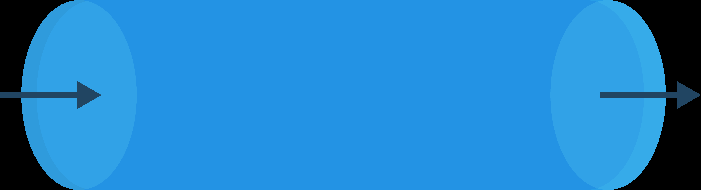

# 017 - Hàng Đợi Thông Điệp Phân Tán (Distributed Messaging Queue)

[← Bài trước](016-bo-nho-dem-phan-tan-distributed-cache.md) | [Mục lục](README.md) | [Bài tiếp theo →](018-mo-hinh-pub-sub.md)

---


# Thiết Kế Hệ Thống: Hàng Đợi Tin Nhắn Phân Tán (System Design: The Distributed Messaging Queue)

Tìm hiểu về hàng đợi tin nhắn (messaging queue), lý do chúng ta sử dụng nó và các trường hợp sử dụng (use cases) quan trọng.

### Nội dung bao gồm:
* Hàng đợi tin nhắn (messaging queue) là gì?
* Động lực thúc đẩy (Motivation)
* Các trường hợp sử dụng hàng đợi tin nhắn (Messaging queue use cases)
* Làm thế nào để thiết kế một hàng đợi tin nhắn phân tán?

---

## Hàng đợi tin nhắn (messaging queue) là gì?

Hàng đợi tin nhắn (messaging queue) là một thành phần trung gian (intermediate component) giữa các thực thể tương tác với nhau, được gọi là **bên sản xuất (producers)** và **bên tiêu thụ (consumers)**. Producer tạo ra các thông điệp (messages) và đẩy chúng vào hàng đợi (queue), trong khi consumer lấy các thông điệp từ hàng đợi ra và xử lý chúng. Có thể có nhiều producer và consumer tương tác với hàng đợi cùng một lúc.

Dưới đây là minh họa về hai ứng dụng tương tác thông qua một hàng đợi tin nhắn đơn lẻ:

*(Không có hình ảnh sơ đồ trong đoạn này)*

**Ví dụ về hai ứng dụng tương tác qua một hàng đợi tin nhắn duy nhất:**
* **Application A (Ứng dụng A)**
* **Application B (Ứng dụng B)**
* **Hi** *(Lời chào/Thông điệp)*
* **Messaging queue (Hàng đợi tin nhắn)**
* ...

---

## Động lực thúc đẩy (Motivation)

Hàng đợi tin nhắn mang lại nhiều lợi thế và có nhiều trường hợp sử dụng (use cases):

* **Cải thiện hiệu năng (Improved performance):** Hàng đợi tin nhắn hỗ trợ cơ chế giao tiếp bất đồng bộ (asynchronous communication) giữa hai thực thể tương tác (producers và consumers), giúp loại bỏ sự chênh lệch về tốc độ tương đối giữa chúng. Producer đẩy các message vào queue mà không cần phải chờ đợi consumer. Tương tự, consumer sẽ xử lý các message ngay khi chúng sẵn sàng. Hơn nữa, các hàng đợi thường được dùng để tách các tác vụ chậm ra khỏi đường dẫn quan trọng (critical path), nhờ đó giúp giảm độ trễ theo cảm nhận của phía máy khách (client-perceived latency). Ví dụ, thay vì phải chờ đợi một tác vụ cụ thể mất nhiều thời gian để hoàn thành, tiến trình producer gửi một thông điệp (thông điệp này sẽ được lưu giữ trong hàng đợi nếu có nhiều yêu cầu) cho tác vụ cần thiết đó rồi tiếp tục các hoạt động khác của mình. Consumer có thể thông báo kết quả xử lý (thành công hay thất bại) cho chúng ta bằng cách sử dụng một hàng đợi khác.

* **Độ tin cậy tốt hơn (Better reliability):** Việc phân tách các thực thể tương tác thông qua hàng đợi tin nhắn giúp hệ thống có khả năng chịu lỗi cao hơn (Fault Tolerance). Ví dụ, một producer hoặc consumer có thể gặp sự cố độc lập mà không ảnh hưởng đến các thực thể khác và có thể khởi động lại sau. Ngoài ra, việc nhân bản (replicating) hàng đợi tin nhắn trên nhiều máy chủ sẽ đảm bảo Tính sẵn sàng cao (High Availability) của hệ thống ngay cả khi một hoặc nhiều máy chủ gặp sự cố (down).

* **Khả năng mở rộng chi tiết (Granular scalability):** Giao tiếp bất đồng bộ làm cho hệ thống có khả năng mở rộng tốt hơn (Scalability). Ví dụ, nhiều tiến trình có thể giao tiếp thông qua một hàng đợi tin nhắn. Thêm vào đó, khi số lượng yêu cầu (requests) tăng lên, chúng ta có thể phân phối khối lượng công việc (workload) trên nhiều consumer. Do đó, một ứng dụng có toàn quyền kiểm soát để tinh chỉnh số lượng tiến trình producer hoặc consumer tùy theo nhu cầu hiện tại của mình.

* **Dễ dàng tách rời (Easy decoupling):** Hàng đợi tin nhắn giúp tách rời các phụ thuộc giữa các thực thể khác nhau trong hệ thống. Các thực thể tương tác sẽ giao tiếp thông qua các message và hoàn toàn không cần biết về cơ chế hoạt động nội bộ của nhau.

* **Giới hạn tốc độ (Rate limiting):** Hàng đợi tin nhắn cũng giúp hấp thụ các đột biến tải (load spikes) và ngăn chặn tình trạng quá tải cho các dịch vụ, đóng vai trò như một dạng sơ khai của cơ chế giới hạn tốc độ (rate limiting) khi cần tránh việc phải hủy bỏ (drop) bất kỳ yêu cầu gửi đến nào.

* **Hàng đợi ưu tiên (Priority queue):** Có thể sử dụng nhiều hàng đợi để thiết lập các mức độ ưu tiên khác nhau — ví dụ, mỗi hàng đợi cho một mức ưu tiên — và phân bổ nhiều thời gian phục vụ hơn cho hàng đợi có mức ưu tiên cao hơn.

---

## Các trường hợp sử dụng hàng đợi tin nhắn (Messaging queue use cases)

Hàng đợi tin nhắn có rất nhiều trường hợp sử dụng, ở cả môi trường đơn máy chủ (single-server) lẫn môi trường phân tán (distributed environments). Ví dụ, nó có thể được sử dụng cho giao tiếp liên tiến trình (IPC - Interprocess Communication) bên trong một hệ điều hành. Nó cũng hỗ trợ giao tiếp giữa các tiến trình trong môi trường phân tán. Một số trường hợp sử dụng của hàng đợi tin nhắn được thảo luận dưới đây:

1. **Gửi số lượng lớn email (Sending many emails):** Email được sử dụng cho rất nhiều mục đích, chẳng hạn như chia sẻ thông tin, xác thực tài khoản, đặt lại mật khẩu, các chiến dịch tiếp thị (marketing campaigns), v.v. Tất cả các email này được viết cho nhiều mục đích khác nhau nhưng đều không cần xử lý ngay lập tức, do đó chúng không làm gián đoạn chức năng cốt lõi của hệ thống. Hàng đợi tin nhắn có thể hỗ trợ điều phối một lượng lớn email giữa các bên gửi và bên nhận khác nhau trong những trường hợp như vậy.
2. **Hậu xử lý dữ liệu (Data post-processing):** Nhiều ứng dụng đa phương tiện (multimedia applications) cần xử lý nội dung cho các nhu cầu xem khác nhau của người dùng, chẳng hạn như để xem trên điện thoại di động hoặc trên TV thông minh. Các ứng dụng thường tải nội dung lên bộ lưu trữ (store) và sử dụng hàng đợi tin nhắn để hậu xử lý nội dung ở chế độ ngoại tuyến (offline). Việc này giúp giảm đáng kể độ trễ mà máy khách cảm nhận được (client-perceived latency) và cho phép dịch vụ lên lịch thực hiện công việc ngoại tuyến vào một thời điểm thích hợp — có thể là vào đêm muộn khi năng lực tính toán (compute capacity) ít bận rộn hơn.
3. **Hệ thống gợi ý (Recommender systems):** Một số nền tảng sử dụng các hệ thống gợi ý để cung cấp nội dung hoặc thông tin phù hợp theo sở thích của người dùng. Hệ thống gợi ý lấy dữ liệu lịch sử của người dùng, xử lý dữ liệu đó và dự đoán nội dung hoặc thông tin liên quan. Vì đây là một tác vụ tốn nhiều thời gian, một hàng đợi tin nhắn có thể được tích hợp vào giữa hệ thống gợi ý và các tiến trình yêu cầu để cải thiện và đẩy nhanh hiệu năng.

---

## Làm thế nào để thiết kế một hàng đợi tin nhắn phân tán?

*(Chuyển hướng: Quay lại: Memcached versus Redis | Đánh dấu hoàn thành | Tiếp theo: Requirements of a Distributed Mess…)*

Chúng ta chia thiết kế của một hàng đợi tin nhắn phân tán thành 5 bài học sau:

1. **Yêu cầu (Requirements):** Tại đây, chúng ta tập trung vào các yêu cầu chức năng (functional requirements) và yêu cầu phi chức năng (non-functional requirements) của việc thiết kế hàng đợi tin nhắn phân tán. Chúng ta cũng thảo luận về hàng đợi tin nhắn trên một máy chủ đơn (single server) và các nhược điểm của nó trong bài học này.
2. **Cân nhắc thiết kế (Design consideration):** Trong bài học này, chúng ta thảo luận về một số yếu tố quan trọng có thể ảnh hưởng đến thiết kế của một hàng đợi tin nhắn phân tán — ví dụ: thứ tự đưa các message vào hàng đợi, việc trích xuất chúng, khả năng hiển thị (visibility) của chúng trong hàng đợi, và tính đồng thời (concurrency) của các message gửi đến.
3. **Thiết kế (Design):** Trong bài học này, chúng ta thảo luận chi tiết về thiết kế của một hàng đợi tin nhắn phân tán. Chúng ta cũng mô tả quy trình nhân bản (replication) của các hàng đợi và sự tương tác giữa các khối xây dựng (building blocks) khác nhau tham gia vào thiết kế.
4. **Đánh giá (Evaluation):** Trong bài học này, chúng ta đánh giá thiết kế của hàng đợi tin nhắn phân tán dựa trên các yêu cầu chức năng và phi chức năng của nó.
5. **Câu hỏi kiểm tra (Quiz):** Ở cuối chương, chúng ta đánh giá mức độ hiểu biết về thiết kế của hàng đợi tin nhắn phân tán thông qua một bài trắc nghiệm (quiz).

Hãy bắt đầu bằng việc tìm hiểu các yêu cầu khi thiết kế một hàng đợi tin nhắn phân tán.

---

## Yêu Cầu Thiết Kế Hàng Đợi Tin Nhắn Phân Tán (Requirements of a Distributed Messaging Queue’s Design)

Tìm hiểu về các yêu cầu thiết kế một hàng đợi tin nhắn phân tán bằng giải pháp mô hình mẫu sơ bộ (strawman solution).

### Nội dung bao gồm:
* Các yêu cầu (Requirements)
* Yêu cầu chức năng (Functional requirements)
* Yêu cầu phi chức năng (Non-functional requirements)
* Hàng đợi tin nhắn trên một máy chủ (Single-server messaging queue)
* Các khối xây dựng sẽ sử dụng (Building blocks we will use)

---

### Các yêu cầu (Requirements)

Trong một hàng đợi tin nhắn phân tán, dữ liệu cư trú trên nhiều máy chủ khác nhau. Mục tiêu của chúng ta là thiết kế một hàng đợi tin nhắn phân tán đáp ứng các yêu cầu chức năng và phi chức năng sau:

#### Yêu cầu chức năng (Functional requirements)
Dưới đây là các hành động mà một máy khách (client) phải thực hiện được:

* **Tạo hàng đợi (Queue creation):** Client phải có khả năng tạo một hàng đợi và thiết lập một số tham số — ví dụ: tên hàng đợi (queue name), kích thước hàng đợi (queue size), và kích thước thông điệp tối đa (maximum message size).
* **Gửi thông điệp (Send message):** Các thực thể producer phải có khả năng gửi các thông điệp đến hàng đợi dành riêng cho chúng.
* **Nhận thông điệp (Receive message):** Các thực thể consumer phải có khả năng nhận các thông điệp từ các hàng đợi tương ứng của chúng.
* **Xóa thông điệp (Delete message):** Các tiến trình consumer phải có khả năng xóa một thông điệp khỏi hàng đợi sau khi đã xử lý thành công thông điệp đó.
* **Xóa hàng đợi (Queue deletion):** Client phải có khả năng xóa một hàng đợi cụ thể.

#### Yêu cầu phi chức năng (Non-functional requirements)
Thiết kế hàng đợi tin nhắn phân tán của chúng ta phải tuân thủ các yêu cầu phi chức năng sau:

* **Độ bền vững dữ liệu (Durability):** Dữ liệu mà hệ thống tiếp nhận phải có tính bền vững (durable) và không được phép bị mất. Các producer và consumer có thể gặp sự cố độc lập với nhau, và một hàng đợi đảm bảo tính bền vững dữ liệu là yếu tố then chốt để toàn bộ hệ thống hoạt động, bởi vì các thực thể khác đều đang phụ thuộc vào hàng đợi này.
* **Khả năng mở rộng (Scalability):** Hệ thống cần phải có khả năng mở rộng (scalable) và có năng lực xử lý khi tải trọng tăng cao, bao gồm số lượng hàng đợi, producers, consumers và số lượng messages. Tương tự, khi tải giảm, hệ thống phải có khả năng thu hẹp (shrink) tài nguyên tương ứng.
* **Tính sẵn sàng cao (High Availability):** Hệ thống phải có tính sẵn sàng cao đối với việc nhận và gửi thông điệp. Hệ thống phải tiếp tục hoạt động không gián đoạn, ngay cả khi xảy ra lỗi ở một hoặc nhiều thành phần của nó.
* **Hiệu năng (Performance):** Hệ thống phải cung cấp thông lượng cao (High Throughput) và độ trễ thấp (Low Latency).

---

### Hàng đợi tin nhắn trên một máy chủ (Single-server messaging queue)

Trước khi bắt đầu hành trình vạch ra thiết kế cho một hàng đợi tin nhắn phân tán, chúng ta nên xem xét lại cách hàng đợi được sử dụng bên trong một máy chủ đơn (single server) - nơi các tiến trình producer và consumer cùng nằm trên một node (nút máy chủ). 

Một producer hoặc consumer có thể truy cập vào hàng đợi của một máy chủ bằng cách sử dụng cơ chế khóa (locking mechanism) để tránh tình trạng dữ liệu không nhất quán (data inconsistency). Hàng đợi được coi là một miền găng / đoạn găng (critical section) mà tại đó chỉ có một thực thể duy nhất, hoặc producer hoặc consumer, có thể truy cập dữ liệu tại một thời điểm.

> [!WARNING]
> Tuy nhiên, có rất nhiều khía cạnh hạn chế chúng ta sử dụng hàng đợi tin nhắn trên một máy chủ đơn lẻ trong mô hình hệ thống phân tán (Distributed Systems) ngày nay:
> * Hàng đợi sẽ trở nên không khả dụng (unavailable) đối với các tiến trình phối hợp (producers và consumers) khi xảy ra sự cố phần cứng hoặc sự cố mạng.
> * Hiệu năng sẽ bị ảnh hưởng nghiêm trọng do hiện tượng tranh chấp khóa (contention on the lock) tăng cao.
> * Hệ thống hoàn toàn không có khả năng mở rộng (Scalability) cũng như không đảm bảo được tính bền vững dữ liệu (Durability).

---

# Thiết Kế Hệ Thống: Hàng Đợi Thông Điệp Phân Tán (System Design: The Distributed Messaging Queue)

---

### [Trang 7]

Nhiều nhà sản xuất (producers) và người tiêu thụ (consumers) tương tác thông qua một hàng đợi thông điệp (messaging queue) đơn lẻ:

```
[a, h, g, f, e, d, c, b]
Phía sau (Back) ──> Các producers gửi thông điệp vào queue ──> [ Hàng đợi (Queue) ] ──> Các consumers nhận thông điệp từ queue ──> Phía trước (Front)
```

> [!NOTE]
> **Điểm Cần Suy Ngẫm (Point to Ponder)**
> 
> **Câu hỏi:** Liệu chúng ta có thể mở rộng thiết kế của một hàng đợi thông điệp đơn server (single-server messaging queue) thành một hàng đợi thông điệp phân tán (distributed messaging queue) hay không?

---

### [Trang 8]

> [!IMPORTANT]
> **Ẩn / Xem Câu Trả Lời (Hide Answer)**
> 
> Một hàng đợi thông điệp đơn server (single-server messaging queue) tồn tại các nhược điểm sau:
> 
> 1. **Độ trễ cao (High Latency):** Tương tự như trường hợp của một hàng đợi thông điệp đơn server, một producer hoặc consumer phải giành lấy khóa (acquire a lock) để truy cập vào hàng đợi. Do đó, cơ chế này trở thành một điểm nghẽn cổ chai (bottleneck) khi có nhiều tiến trình cùng cố gắng truy cập hàng đợi. Điều này làm tăng độ trễ (latency) của dịch vụ.
> 2. **Tính sẵn sàng thấp (Low Availability):** Do thiếu cơ chế sao chép (replication) của hàng đợi thông điệp, tiến trình producer và consumer có thể không truy cập được vào hàng đợi khi xảy ra sự cố (failure). Điều này làm giảm tính sẵn sàng (availability) và độ tin cậy (reliability) của hệ thống.
> 3. **Thiếu tính bền vững của dữ liệu (Lack of Durability):** Do không có cơ chế nhân bản (replication), dữ liệu trong hàng đợi có thể bị mất mát khi hệ thống gặp sự cố (system failure).
> 4. **Khả năng mở rộng (Scalability):** Một hàng đợi thông điệp đơn server chỉ có thể xử lý một số lượng thông điệp, producers và consumers giới hạn. Do đó, nó không có khả năng mở rộng (not scalable).

Để mở rộng thiết kế của một hàng đợi thông điệp đơn server thành một hàng đợi thông điệp phân tán (distributed messaging queue), chúng ta cần nỗ lực rất nhiều để loại bỏ các nhược điểm đã nêu ở trên.

#### Các Khối Xây Dựng Chúng Ta Sẽ Sử Dụng (Building Blocks We Will Use)
Thiết kế của một hàng đợi thông điệp phân tán sử dụng các khối thành phần (building blocks) sau:

*Các khối xây dựng được sử dụng để thiết kế một hàng đợi thông điệp phân tán:*
- **Cơ sở dữ liệu (Database)**
- **Bộ nhớ đệm (Cache)**
- **Bộ cân bằng tải (Load Balancer)**


---

### [Trang 9]

- **Quay lại (Back):** System Design: The Distributed Mes…
- **Đánh dấu hoàn thành (Mark As Completed)**
- **Tiếp theo (Next):** Considerations of a Distributed Mess…

- **(Các) Cơ sở dữ liệu (Database(s)):** Sẽ được yêu cầu để lưu trữ siêu dữ liệu (metadata) của các hàng đợi và người dùng (users).
- **Bộ nhớ đệm (Caches):** Rất quan trọng để lưu giữ dữ liệu được truy cập thường xuyên, cho dù đó là dữ liệu liên quan đến người dùng hay siêu dữ liệu của hàng đợi.
- **Bộ cân bằng tải (Load Balancers):** Được sử dụng để điều hướng các yêu cầu đến (incoming requests) tới các server nơi lưu trữ siêu dữ liệu.

Trong phần thảo luận về hàng đợi thông điệp, chúng ta đã tập trung vào các yêu cầu chức năng (functional requirements) và phi chức năng (non-functional requirements) của chúng. Trước khi chuyển sang quy trình thiết kế một hàng đợi thông điệp phân tán, điều cốt yếu là chúng ta phải thảo luận về một số yếu tố cân nhắc chính và các thách thức có thể ảnh hưởng đến thiết kế.

---

### [Trang 10]

## Các Yếu Tố Cần Cân Nhắc Khi Thiết Kế Hàng Đợi Thông Điệp Phân Tán (Considerations of a Distributed Messaging Queue’s Design)

Tìm hiểu về các yếu tố ảnh hưởng đến thiết kế của một hàng đợi thông điệp.

**Chúng ta sẽ đề cập đến các nội dung sau:**
- Thứ tự của các thông điệp (Ordering of messages)
- Thứ tự nỗ lực tối đa (Best-effort ordering)
- Thứ tự nghiêm ngặt (Strict ordering)
- Sắp xếp (Sorting)
- Ảnh hưởng đến hiệu năng (Effect on performance)
- Quản lý tương tranh (Managing concurrency)

Trước khi bắt đầu hành trình thiết kế một hàng đợi thông điệp phân tán, hãy cùng thảo luận về một số yếu tố chính có thể ảnh hưởng đáng kể đến thiết kế. Chúng bao gồm thứ tự của các thông điệp (order of messages), tác động của việc sắp xếp thứ tự đối với hiệu năng (performance), và việc quản lý truy cập đồng thời (concurrent access) vào hàng đợi. Chúng ta sẽ thảo luận chi tiết từng yếu tố này dưới đây.

### Thứ Tự Của Các Thông Điệp (Ordering of messages)
Một hàng đợi thông điệp được sử dụng để nhận các thông điệp từ các producers. Các thông điệp này được tiêu thụ bởi các consumers theo tốc độ riêng của họ. Một số tác vụ có tính chất trọng yếu (critical) ở chỗ chúng đòi hỏi thứ tự thực thi nghiêm ngặt đối với các tác vụ được thúc đẩy bởi các thông điệp trong hàng đợi. 

Ví dụ: khi nhắn tin qua một ứng dụng trò chuyện với bạn bè, các tin nhắn phải được gửi theo đúng thứ tự; nếu không, cuộc trò chuyện đó ít nhất cũng sẽ gây nhầm lẫn khó hiểu. Tương tự, các email mà một người dùng nhận được từ các người dùng khác nhau có thể không yêu cầu thứ tự nghiêm ngặt. Do đó, trong một số trường hợp, thứ tự nghiêm ngặt của các thông điệp đi vào hàng đợi là thiết yếu, trong khi nhiều trường hợp sử dụng (use cases) khác có thể chấp nhận được việc tái sắp xếp thứ tự (reordering) ở một mức độ nào đó.

---

### [Trang 11]

Hãy cùng thảo luận về hai phân loại sắp xếp thứ tự thông điệp sau đây trong một hàng đợi:
1. **Thứ tự nỗ lực tối đa (Best-effort ordering)**
2. **Thứ tự nghiêm ngặt (Strict ordering)**

> [!NOTE]
> **Ẩn (Hide)**
> 
> Trong một hàng đợi, thứ tự của các thông điệp được liên kết ngầm định với các thông điệp đi vào. Một khi các thông điệp đã được đưa vào một hàng đợi, cùng thứ tự đó sẽ được tuân thủ trong quá trình tiêu thụ và xử lý các thông điệp này.
> 
> - **Đối với các producers đồng thời (concurrent producers)** đưa thông điệp vào cùng một hàng đợi, thứ tự sẽ không được xác định rõ ràng cho đến khi các producers cung cấp thông tin thứ tự — ví dụ như dấu thời gian (timestamps) hoặc số thứ tự (sequence numbers). Nếu không có bất kỳ thông tin thứ tự nào, hàng đợi sẽ nạp các thông điệp vào theo bất kỳ thứ tự nào mà chúng đến dịch vụ.
> - **Đối với các consumers đồng thời (concurrent consumers)** lấy thông điệp từ cùng một hàng đợi, việc đảm bảo thứ tự lại có thể trở thành một vấn đề phức tạp. Mặc dù hàng đợi có thể bàn giao các thông điệp lần lượt theo cùng thứ tự mà chúng được đưa vào hàng đợi, hai consumers xử lý gần như đồng thời hai thông điệp có thể sẽ cần một cơ chế xác định thứ tự đặc thù ở tầng ứng dụng (application-specific ordering mechanism). Hàng đợi có thể hỗ trợ bằng cách gắn thẻ thông tin thứ tự của thông điệp, số thứ tự hoặc timestamp, khi bàn giao một thông điệp ra khỏi hàng đợi.

### Thứ Tự Nỗ Lực Tối Đa (Best-effort ordering)
Với cách tiếp cận thứ tự nỗ lực tối đa (best-effort ordering), hệ thống sẽ đưa các thông điệp vào một hàng đợi được chỉ định theo đúng thứ tự mà chúng được tiếp nhận.

Ví dụ, như minh họa trong hình bên dưới, producer gửi bốn thông điệp: $A$, $B$, $C$, và $D$ theo đúng thứ tự như mô tả. Do tắc nghẽn mạng (network congestion) hoặc một số vấn đề khác, thông điệp $B$ lại được nhận sau thông điệp $D$. Do đó, thứ tự của các thông điệp tại đầu nhận là $A$, $C$, $D$, và $B$. Vì vậy, trong cách tiếp cận này, các thông điệp sẽ được đưa vào hàng đợi theo đúng thứ tự chúng được nhận thay vì thứ tự mà chúng được tạo ra ở phía máy khách (client side).

---

### [Trang 12]

*Best-effort ordering: Các thông điệp được đặt vào một hàng đợi theo cùng thứ tự mà chúng được tiếp nhận chứ không phải theo thứ tự mà chúng được gửi đi.*

```
Producer ──[ D, C, B, A ]──> [ Internet ] ──[ B, D, C, A ]──> [ Queue: B | D | C | A ]
                                                                 ▲               ▲
                                                             Queue tail      Queue head
```


### Thứ Tự Nghiêm Ngặt (Strict ordering)
Kỹ thuật sắp xếp thứ tự nghiêm ngặt (strict ordering) bảo toàn thứ tự của các thông điệp một cách chuẩn xác và chặt chẽ hơn. Thông qua phương pháp này, các thông điệp được đưa vào một hàng đợi theo đúng thứ tự mà chúng được tạo ra (produced).

Trước khi đưa các thông điệp vào một hàng đợi theo đúng trình tự, điều cốt yếu là phải có một cơ chế để xác định thứ tự mà các thông điệp đã được tạo ra ở phía client. Thông thường, một định danh duy nhất (unique identifier) hoặc dấu thời gian (timestamp) được sử dụng để đánh dấu một thông điệp khi nó được tạo ra.

> [!TIP]
> **Điểm Cần Suy Ngẫm (Point to Ponder)**
> 
> **Câu hỏi:** Ai sẽ chịu trách nhiệm cung cấp các số thứ tự (sequence numbers)?
> 
> **Ẩn / Xem Câu Trả Lời (Hide Answer):**  
> Hệ thống cung cấp các thư viện (libraries) hoặc API thiết yếu cho phía client để đánh số thứ tự cho các thông điệp được tạo ra tại phía client side.

---

### --- Trang 13 ---

Một trong ba phương pháp sau có thể được sử dụng để sắp xếp thứ tự các thông điệp gửi đến (*incoming messages*):

#### 1. Các số tăng dần đơn điệu (*Monotonically increasing numbers*)
Một cách để sắp xếp thứ tự các thông điệp gửi đến là gán các số tăng dần đơn điệu (*monotonically increasing numbers*) cho các thông điệp ở phía máy chủ (*server-side*). Khi thông điệp đầu tiên đến, hệ thống sẽ gán cho nó một con số, chẳng hạn như 1. Sau đó, hệ thống gán số 2 cho thông điệp thứ hai, và cứ tiếp tục như vậy.

Tuy nhiên, có những nhược điểm tiềm ẩn đối với cách tiếp cận này:
- **Thứ nhất**, khi nhận phải một lượng yêu cầu tăng đột biến (*burst of requests*), nó sẽ đóng vai trò như một điểm nghẽn cổ chai (*bottleneck*) ảnh hưởng tiêu cực đến hiệu năng của hệ thống (*system’s performance*), bởi vì hệ thống phải gán mã định danh (ID) theo một trình tự xác định cho một thông điệp trong khi các thông điệp khác phải xếp hàng chờ đến lượt.
- **Thứ hai**, nó vẫn không giải quyết được vấn đề phát sinh khi một thông điệp được nhận trước một thông điệp khác vốn đã được tạo ra sớm hơn ở phía máy khách (*client-side*). Do đó, nó không đảm bảo việc tạo ra đúng thứ tự cho các thông điệp được sản xuất tại phía máy khách.

#### 2. Sắp xếp dựa trên quan hệ nhân quả ở phía máy chủ (*Causality-based sorting at the server side*)
Xét đến các nhược điểm của việc sử dụng các số tăng dần đơn điệu, một phương pháp khác có thể được sử dụng để gắn nhãn thời gian (*time-stamping*) và sắp xếp thứ tự các thông điệp gửi đến là sắp xếp dựa trên quan hệ nhân quả (*causality-based sorting*). 

Trong phương pháp này, các thông điệp được sắp xếp dựa trên mốc thời gian (*timestamp*) được tạo ra tại phía máy khách (*client-side*) và được đưa vào hàng đợi một cách tương ứng. Nhược điểm lớn của phương pháp này là đối với nhiều phiên làm việc của máy khách (*multiple client sessions*), dịch vụ không thể xác định được thứ tự theo thời gian thực tế đồng hồ vật lý (*wall-clock time*).

#### 3. Sử dụng nhãn thời gian dựa trên các đồng hồ được đồng bộ hóa (*Using time stamps based on synchronized clocks*)
Để giải quyết các vấn đề tiềm ẩn phát sinh từ cả hai phương pháp đã nêu ở trên, chúng ta có thể sử dụng một phương pháp phù hợp khác để gán nhãn thời gian cho các thông điệp dựa trên các đồng hồ được đồng bộ hóa (*synchronized clocks*).

Trong phương pháp này, nhãn thời gian (ID) được cấp phát cho mỗi thông điệp thông qua một đồng hồ đồng bộ là duy nhất và theo đúng trình tự sản sinh của các thông điệp. Chúng ta có thể gắn kèm một mã định danh tiến trình duy nhất (*unique process identifier*) cùng với nhãn thời gian để biến toàn bộ định danh thông điệp trở thành duy nhất trên toàn hệ thống, đồng thời xử lý được tình huống khi hai phiên đồng thời yêu cầu nhãn thời gian tại cùng một thời điểm chính xác. Hơn nữa, với phương pháp này, máy chủ có thể dễ dàng nhận diện các thông điệp bị trễ dựa vào nhãn thời gian và chờ đợi các thông điệp bị trễ đó.

Như chúng ta đã thảo luận trong phần về khối xây dựng bộ tạo chuỗi tự tăng (*sequencer building block*), chúng ta có thể thu được:

---

### --- Trang 14 ---

các số thứ tự (*sequence numbers*) đáp ứng được cả hai vai trò: vừa là số thứ tự (*sequence numbers*), vừa là nhãn thời gian đồng hồ vật lý được đồng bộ hóa toàn cục (*globally synchronized wall-clock timestamps*). Bằng cách sử dụng phương pháp này, dịch vụ của chúng ta cũng có thể sắp xếp thứ tự thông điệp trên quy mô toàn cục xuyên suốt nhiều phiên làm việc của các máy khách (*globally order messages across client sessions*).

> [!NOTE]
> **Kết luận:** Cơ chế phù hợp nhất để cung cấp một ID hoặc nhãn thời gian duy nhất cho các thông điệp gửi đến trong số ba phương pháp được mô tả ở trên chính là việc **sử dụng các đồng hồ được đồng bộ hóa** (*synchronized clocks*).

#### Sắp xếp (*Sorting*)
Khi các thông điệp đã được nhận tại phía máy chủ, chúng ta cần sắp xếp chúng dựa trên nhãn thời gian. Do đó, chúng ta sử dụng một thuật toán sắp xếp trực tuyến (*online sorting algorithm*) thích hợp cho mục đích này.

---

> [!IMPORTANT]
> ### Điểm Cần Suy Ngẫm (*Point to Ponder*)
> **Câu hỏi (*Question*):**  
> Giả sử một thông điệp được gửi sớm hơn nhưng lại đến trễ do độ trễ mạng (*network delay*). Đâu là phương pháp tiếp cận phù hợp để xử lý tình huống như vậy?
> 
> **Ẩn câu trả lời (*Hide Answer*):**  
> Giải pháp đơn giản trong các trường hợp như vậy là **sắp xếp lại thứ tự hàng đợi** (*reorder the queue*). Hai kịch bản có thể phát sinh từ việc này:
> 1. *Kịch bản thứ nhất:* Việc sắp xếp lại đưa các thông điệp về đúng thứ tự.
> 2. *Kịch bản thứ hai:* Chúng ta đã trao các thông điệp mới hơn cho phía tiêu thụ (*consumers*).
> 
> Nếu một thông điệp cũ đến khi chúng ta đã trao thông điệp mới hơn đi rồi, chúng ta sẽ đưa nó vào một hàng đợi đặc biệt (*special queue*) và phía máy khách sẽ xử lý tình huống đó. Nếu đó là một hàng đợi nỗ lực tối đa (*best-effort queue*), chúng ta có thể chỉ cần đặt thông điệp đó vào đầu hàng đợi (*head of the queue*).

---

### --- Trang 15 ---

#### Tác động đến hiệu năng (*Effect on performance*)
Về cơ bản, một hàng đợi được thiết kế cho các thao tác vào trước, ra trước (FIFO - First-In, First-Out). Các thao tác vào trước, ra trước ngụ ý rằng thông điệp đầu tiên đi vào hàng đợi luôn là thông điệp được lấy ra đầu tiên. Tuy nhiên, việc duy trì thứ tự nghiêm ngặt này trong các hệ thống phân tán (*distributed systems*) là điều không hề dễ dàng.

Bởi vì thông điệp A được sản xuất trước thông điệp B, nên vẫn không có gì chắc chắn rằng thông điệp A sẽ được tiêu thụ trước thông điệp B. Việc sử dụng các mã định danh thông điệp tăng dần đơn điệu (*monotonically increasing identifiers*) hoặc các định danh mang tính quan hệ nhân quả (*causality-bearing identifiers*) mang lại thông lượng cao (*High Throughput*) trong khi đưa các thông điệp vào hàng đợi. Mặc dù vậy, nhu cầu sắp xếp trực tuyến (*online sorting*) để cung cấp một thứ tự nghiêm ngặt sẽ tốn một khoảng thời gian nhất định trước khi các thông điệp sẵn sàng để trích xuất.

> [!TIP]
> Để giảm thiểu độ trễ (*latency*) gây ra bởi việc sắp xếp trực tuyến, chúng ta sử dụng một phương pháp tiếp cận theo cửa sổ thời gian (*time-window approach*).

Tương tự như vậy, đối với thứ tự nghiêm ngặt ở đầu nhận, chúng ta cần tuần tự hóa (*serialize*) toàn bộ các yêu cầu để phát các thông điệp ra lần lượt từng cái một. Nếu điều đó không bắt buộc, chúng ta sẽ đạt được thông lượng tốt hơn (*better throughput*) và độ trễ thấp hơn (*lower latency*) ở đầu nhận.

Do các lý do nêu trên, nhiều giải pháp hàng đợi thông điệp phân tán (*distributed messaging queue solutions*) hoặc là không đảm bảo một thứ tự nghiêm ngặt (*strict order*), hoặc có những hạn chế xoay quanh thông lượng (*throughput*). Như chúng ta đã thấy trước đây, các hàng đợi phải thực hiện rất nhiều hoạt động xác thực và điều phối bổ sung để duy trì thứ tự.

#### Quản lý đồng thời (*Managing concurrency*)
Việc truy cập hàng đợi đồng thời cần được quản lý đúng cách. Xử lý đồng thời (*concurrency*) có thể diễn ra ở các giai đoạn sau:
- Khi nhiều thông điệp đến cùng một thời điểm.
- Khi nhiều bên tiêu thụ (*consumers*) đồng thời yêu cầu lấy thông điệp.

Giải pháp đầu tiên là sử dụng **cơ chế khóa** (*locking mechanism*). Khi một tiến trình hoặc luồng (*thread*) yêu cầu một thông điệp, nó phải giành được khóa (*acquire a lock*) để đặt hoặc tiêu thụ các thông điệp từ hàng đợi. Tuy nhiên, như đã thảo luận trước đó, cách tiếp cận này có một số nhược điểm. Nó vừa không có khả năng mở rộng (*Scalability*), vừa không đảm bảo hiệu năng.

Một giải pháp khác là **tuần tự hóa các yêu cầu** (*serialize the requests*) bằng cách sử dụng bộ đệm của hệ thống (*system's buffer*) ở cả hai đầu của hàng đợi sao cho các thông điệp gửi đến được đặt theo một thứ tự, và

---

### --- Trang 16 ---

các tiến trình tiêu thụ (*consumer processes*) cũng nhận được các thông điệp theo đúng trình tự đến của chúng.

Bằng cách tuần tự hóa các yêu cầu, ý chúng tôi là các yêu cầu (dù là để ghi dữ liệu - *put*, hay trích xuất dữ liệu - *extract*) gửi đến máy chủ sẽ được hệ điều hành (OS) xếp hàng đợi, và một luồng ứng dụng duy nhất (*single application thread*) sẽ đưa chúng vào hàng đợi (chúng ta có thể giả định rằng cả hai loại yêu cầu, ghi và trích xuất, đều đến cùng một cổng - *port*) mà không cần bất kỳ thao tác khóa (*locking*) nào. Đây sẽ là một giải pháp không dùng khóa (*lock-free solution*) khả thi, mang lại thông lượng cao (*High Throughput*). Đây là một giải pháp khả thi hơn vì nó có thể giúp chúng ta tránh được sự xuất hiện của các điều kiện tranh đoạt dữ liệu (*race conditions*).

Các ứng dụng có thể sử dụng nhiều hàng đợi với các nhà sản xuất (*producers*) và người tiêu thụ (*consumers*) chuyên dụng để kiểm soát chi phí sắp xếp thứ tự trên mỗi hàng đợi, mặc dù điều này phải đánh đổi bằng logic ứng dụng phức tạp hơn.


*Tránh các điều kiện tranh chấp (Race Conditions): Producers và consumers được tuần tự hóa ở cả hai đầu của hàng đợi*


```
[Producer 1] ──┐
[Producer 2] ──┼─> [4][3][2][1] (Queue tail) ---> [Queue head] ──┬─> [Consumer 1]
[Producer 3] ──┘                                [5]              ├─> [Consumer 2]
                                                                 └─> [Consumer 3]
```

Trong bài học này, chúng ta đã thảo luận về một số cân nhắc và thách thức then chốt trong quá trình thiết kế một hàng đợi thông điệp (*messaging queue*) và đã trả lời các câu hỏi sau:
- Tại sao thứ tự của các thông điệp lại quan trọng, và làm thế nào để chúng ta thực thi thứ tự đó?
- Thứ tự sắp xếp ảnh hưởng như thế nào đến hiệu năng? Chúng ta xử lý tính đồng thời (*concurrency*) như thế nào

---

### --- Trang 17 ---

*(Quay lại: Yêu cầu của Hàng đợi Thông điệp Phân tán… | Đánh dấu đã hoàn thành | Tiếp theo: Thiết kế Hàng đợi Thông điệp Phân tán…)*

khi truy cập một hàng đợi?

Bây giờ, chúng ta đã sẵn sàng để bắt đầu thiết kế một hàng đợi thông điệp phân tán (*distributed messaging queue*).

---

### --- Trang 18 ---

# Thiết Kế Hàng Đợi Thông Điệp Phân Tán: Phần 1 (*Design of a Distributed Messaging Queue: Part 1*)

Tìm hiểu về thiết kế mức cao (*high-level design*) của một hàng đợi thông điệp và cách mở rộng quy mô (*scale*) siêu dữ liệu (*metadata*) của các hàng đợi.

**Chúng ta sẽ bao gồm các nội dung sau:**
- Hàng đợi thông điệp phân tán (*Distributed messaging queue*)
- Thiết kế mức cao (*High-level design*)
- Bộ cân bằng tải (*Load balancer*)
- Dịch vụ tầng tiếp nhận (*Front-end service*)
- Dịch vụ siêu dữ liệu (*Metadata service*)

Cho đến thời điểm hiện tại, chúng ta đã thảo luận về các yêu cầu và các cân nhắc thiết kế của một hàng đợi thông điệp phân tán. Bây giờ, hãy bắt đầu với việc tìm hiểu về thiết kế mức cao của một hàng đợi thông điệp phân tán.

### Hàng đợi thông điệp phân tán (*Distributed messaging queue*)
Không giống như một hàng đợi thông điệp trên một máy chủ đơn lẻ (*single-server messaging queue*), một hàng đợi thông điệp phân tán cư trú trên nhiều máy chủ. Hàng đợi thông điệp phân tán mang theo những thách thức riêng của nó. Tuy nhiên, nó giải quyết được các nhược điểm của hàng đợi thông điệp đơn máy chủ nếu được thiết kế đúng cách.

Các phần tiếp theo sẽ tập trung vào các vấn đề về khả năng mở rộng (*Scalability*), tính sẵn sàng cao (*High Availability*), và độ bền vững dữ liệu (*Durability*) khi thiết kế một hàng đợi thông điệp phân tán, bằng cách giới thiệu cho chúng ta một kiến trúc có khả năng chịu lỗi tốt hơn (*Fault-Tolerant Architecture*) của một hàng đợi thông điệp.

### Thiết kế mức cao (*High-level design*)
Trước khi đi sâu vào thiết kế chi tiết, hãy giả định các điểm sau để làm cho cuộc thảo luận trở nên đơn giản hơn và dễ hiểu hơn. Trong nội dung sắp tới, chúng ta...

---

# Thiết Kế Hàng Đợi Thông Điệp Phân Tán (Design of a Distributed Messaging Queue)

Chúng ta hãy thảo luận về cách các giả định dưới đây giúp loại bỏ triệt để các vấn đề thường gặp trong giải pháp hàng đợi thông điệp đơn máy chủ (single-server messaging queue):

1. **Dữ liệu hàng đợi (Queue data) được nhân bản (replicated)** thông qua hệ thống **Primary-Secondary** (Chính - Phụ) hoặc hệ thống dựa trên cơ chế đồng thuận số đông (**Quorum-like system**) bên trong cụm máy chủ (cluster) *(tham khảo bài học Sao chép dữ liệu - Data Replication để biết thêm chi tiết)*. Dịch vụ của chúng ta có thể áp dụng kỹ thuật **phân vùng dữ liệu (Data Partitioning)** nếu hàng đợi phát triển quá lớn, vượt quá dung lượng lưu trữ của một máy chủ đơn lẻ. Chúng ta có thể ứng dụng cơ chế băm nhất quán (**Consistent Hashing**) cho mục đích này, hoặc sử dụng một kho lưu trữ khóa - giá trị (**Key-Value Store**) trong đó khóa (key) có thể là số thứ tự định danh (sequence numbers) của các thông điệp. Trong trường hợp đó, mỗi phân mảnh (**shard**) đều được nhân bản dự phòng một cách phù hợp *(tham khảo bài học Phân vùng - Partition để biết thêm chi tiết)*.
2. Chúng ta cũng giả định rằng hệ thống có khả năng **tự động mở rộng (auto-expand)** và **tự động thu hẹp (auto-shrink)** tài nguyên theo nhu cầu thực tế nhằm tối ưu hóa việc sử dụng tài nguyên (resource utilization).

Sơ đồ dưới đây minh họa kiến trúc mức cao (High-Level Architecture) của một hàng đợi thông điệp phân tán bao gồm nhiều thành phần cấu thành:


### Kiến Trúc Mức Cao Của Hàng Đợi Thông Điệp Phân Tán (High-level architecture of distributed messaging queue)
* **Metadata service** (Dịch vụ siêu dữ liệu)
* **Metadata cluster** (Cụm máy chủ siêu dữ liệu)
* **Metadata cache cluster** (Cụm bộ nhớ đệm siêu dữ liệu)
* **Back-end servers** (Các máy chủ phía sau / Back-end)
* **Front-end servers** (Các máy chủ tiếp nhận / Front-end)
* **Load balancers** (Bộ cân bằng tải)
* **Clients** (Ứng dụng phía máy khách: Producers & Consumers)
* **Messaging queues** (Các hàng đợi thông điệp)

Các thành phần cốt lõi trong thiết kế được mô tả chi tiết dưới đây:

---

### Bộ Cân Bằng Tải (Load Balancer)

Tầng cân bằng tải tiếp nhận các yêu cầu (requests) từ các bên sản xuất (**Producers**) và bên tiêu thụ (**Consumers**), sau đó chuyển tiếp chúng đến một trong các máy chủ Front-end. Tầng này bao gồm nhiều bộ cân bằng tải phân tán. Nhờ đó, các yêu cầu được tiếp nhận với **độ trễ tối thiểu (minimal latency)** và mang lại **tính sẵn sàng cao (High Availability)** cho toàn hệ thống.

---

### Dịch Vụ Tiếp Nhận (Front-end Service)

Dịch vụ Front-end bao gồm các cụm máy chủ phi trạng thái (**stateless machines**) được phân bổ trên nhiều trung tâm dữ liệu (data centers). Front-end cung cấp các dịch vụ/tính năng sau:

* **Xác thực yêu cầu (Request validation):** Đảm bảo tính hợp lệ của yêu cầu và kiểm tra xem yêu cầu có chứa đầy đủ tất cả các thông tin cần thiết hay không.
* **Xác thực danh tính và phân quyền (Authentication and authorization):** Kiểm tra xem bên gửi yêu cầu có phải là người dùng hợp lệ hay không, và người dùng đó có được cấp quyền truy cập các dịch vụ tương ứng hay không.
* **Bộ nhớ đệm (Caching):** Tại bộ nhớ đệm của Front-end, thông tin siêu dữ liệu (**metadata**) liên quan đến các hàng đợi được truy cập thường xuyên sẽ được lưu trữ. Song song với đó, dữ liệu liên quan đến người dùng cũng được lưu vào bộ nhớ đệm tại đây nhằm giảm thời gian phản hồi của các dịch vụ xác thực và phân quyền (Authentication & Authorization services).
* **Điều phối yêu cầu (Request dispatching):** Front-end chịu trách nhiệm điều hướng và gọi đến hai dịch vụ khác: **Back-end** và **Metadata Store** (Kho lưu trữ siêu dữ liệu). Việc phân định chính xác các cuộc gọi đến hai dịch vụ này là một trong những trọng trách của Front-end.
* **Khử trùng lặp yêu cầu (Request deduplication):** Front-end theo dõi thông tin liên quan đến tất cả các yêu cầu; do đó, nó ngăn chặn việc các yêu cầu giống hệt nhau bị đẩy trùng lặp vào hàng đợi. Việc xử lý thông điệp trùng lặp có thể đơn giản bằng cách tra cứu một khóa băm (**hash key**) trong kho lưu trữ: nếu tìm thấy khóa đã tồn tại trong kho, điều đó có nghĩa là thông điệp bị trùng lặp và yêu cầu có thể bị từ chối ngay lập tức.
* **Thu thập dữ liệu sử dụng (Usage data collection):** Thu thập dữ liệu theo thời gian thực (**real-time data**) phục vụ cho mục đích kiểm toán (audit) và giám sát hệ thống.

---

### Dịch Vụ Siêu Dữ Liệu (Metadata Service)

Thành phần này chịu trách nhiệm lưu trữ, truy xuất và cập nhật siêu dữ liệu (**metadata**) của các hàng đợi bên trong kho lưu trữ siêu dữ liệu (**Metadata Store**) và bộ nhớ đệm (**Cache**). Bất cứ khi nào một hàng đợi được tạo mới hoặc bị xóa, kho lưu trữ siêu dữ liệu và bộ nhớ đệm sẽ được cập nhật đồng bộ tương ứng. 

Dịch vụ siêu dữ liệu đóng vai trò như một lớp trung gian (**middleware**) nằm giữa các máy chủ Front-end và tầng dữ liệu (data layer). Vì siêu dữ liệu của các hàng đợi được lưu giữ trong bộ nhớ đệm, các máy chủ Front-end sẽ luôn kiểm tra bộ nhớ đệm trước tiên để tìm kiếm các thông tin liên quan ngay khi tiếp nhận yêu cầu. Nếu xảy ra hiện tượng trượt bộ nhớ đệm (**cache miss**), thông tin sẽ được truy xuất từ kho lưu trữ siêu dữ liệu gốc và bộ nhớ đệm sẽ được cập nhật đồng bộ ngay sau đó.

---

Có hai phương pháp tiếp cận khác nhau để tổ chức các cụm bộ nhớ đệm siêu dữ liệu (**metadata cache clusters**):

#### Cách tiếp cận 1:
Nếu dung lượng siêu dữ liệu cần lưu trữ tương đối nhỏ và có thể nằm trọn trên một máy đơn lẻ, dữ liệu sẽ được nhân bản (**replicated**) trên toàn bộ các máy chủ trong cụm. Sau đó, yêu cầu có thể được phục vụ bởi bất kỳ máy chủ ngẫu nhiên nào. Trong phương pháp này, một **bộ cân bằng tải (Load Balancer)** cũng có thể được đưa vào giữa các máy chủ Front-end và dịch vụ siêu dữ liệu (Metadata Services).

> [!NOTE]
> **Bộ cân bằng tải được bổ sung giữa máy chủ Front-end và dịch vụ Metadata:**
> * Front-end servers
> * Load balancer
> * Metadata services / Metadata cluster (Server 1, Server 2)
> * Back-end servers
> * Messaging queues





#### Cách tiếp cận 2:
Nếu dung lượng siêu dữ liệu cần lưu trữ quá lớn, một trong các mô hình sau có thể được áp dụng:

* **Chiến lược thứ nhất:** Sử dụng phương pháp **phân mảnh (Sharding)** để chia nhỏ dữ liệu thành các phân mảnh khác nhau. Việc phân mảnh có thể dựa trên một khóa phân vùng (**partition key**) hoặc các kỹ thuật băm (**hashing techniques**), như đã được thảo luận trong bài học về phân vùng cơ sở dữ liệu (database partitioning). Mỗi phân mảnh được lưu trữ trên một máy chủ (host) khác nhau trong cụm. Hơn nữa, mỗi phân mảnh cũng được nhân bản (**replicated**) sang các máy chủ khác nhau nhằm gia tăng tính sẵn sàng (**High Availability**). Trong mô hình tổ chức cụm này, máy chủ Front-end nắm giữ một bảng ánh xạ (**mapping table**) giữa các phân mảnh (shards) và các máy chủ (hosts). Do đó, máy chủ Front-end chịu trách nhiệm điều hướng yêu cầu trực tiếp đến máy chủ lưu trữ dữ liệu tương ứng.


> [!IMPORTANT]
> **Bảng ánh xạ (Mapping Table) nằm trên các máy chủ Front-end:**
> * **Front-end servers:** Chứa Bảng ánh xạ:
>   * Shard A, B $\rightarrow$ Server 1, Server 2
>   * Shard C, B $\rightarrow$ Server 2, Server 3
>   * Shard C, A $\rightarrow$ Server 1, Server 3
> * **Metadata services / Metadata cluster:**
>   * Server 1 (Chứa Shard A, B)
>   * Server 2 (Chứa Shard C, B)
>   * Server 3 (Chứa Shard C, A)

* **Chiến lược thứ hai:** Tương tự chiến lược thứ nhất. Tuy nhiên, bảng ánh xạ (**mapping table**) trong phương pháp này được lưu trữ trực tiếp trên **từng máy chủ (host)** thay vì chỉ lưu trên các máy chủ Front-end. Nhờ đó, bất kỳ máy chủ ngẫu nhiên nào cũng có thể tiếp nhận yêu cầu và tự động chuyển tiếp nó đến đúng máy chủ đang lưu trữ dữ liệu. Kỹ thuật này đặc biệt phù hợp cho các ứng dụng có lưu lượng đọc lớn (**read-intensive applications**).


> [!TIP]
> **Bảng ánh xạ (Mapping Table) nằm trên từng máy chủ Metadata:**
> * **Front-end servers:** Chuyển tiếp yêu cầu đến bất kỳ node nào của Metadata Service.
> * **Metadata services / Metadata cluster:** Mỗi máy chủ (Server 1, Server 2, Server 3) đều lưu một bản sao của **Bảng ánh xạ (Mapping table)** cục bộ, giúp chúng tự định tuyến sang đúng máy chủ đích chứa dữ liệu phân mảnh (Shard A, B, C).

---

### Tổng Kết Phần 1 & Hướng Tới Phần Tiếp Theo

Trong phần thảo luận về hàng đợi thông điệp phân tán, chúng ta đã tập trung vào thiết kế mức cao (High-Level Design) của hệ thống hàng đợi này. Cụ thể, chúng ta đã đi sâu phân tích từng thành phần trong thiết kế mức cao, bao gồm:
* Các máy chủ **Front-end** và các dịch vụ bắt buộc phải có để đảm bảo vận hành trơn tru.
* Các bộ cân bằng tải (**Load balancers**).
* Dịch vụ siêu dữ liệu (**Metadata services**).
* Cụm máy chủ siêu dữ liệu (**Metadata clusters**) và các phương thức tổ chức cụm.

Một phần tối quan trọng của bản thiết kế chính là việc tổ chức các máy chủ ở tầng phía sau (**Back-end**) phục vụ cho việc tạo hàng đợi, xóa hàng đợi và các hoạt động vận hành tương tự khác. Bài học tiếp theo sẽ tập trung chuyên sâu vào việc tổ chức các máy chủ Back-end và cơ chế quản lý hàng đợi, cùng với các hoạt động then chốt khác liên quan đến việc phân phối (delivery) và truy xuất (retrieval) thông điệp.

---

# Thiết Kế Hàng Đợi Thông Điệp Phân Tán: Phần 2 (Design of a Distributed Messaging Queue: Part 2)

Tìm hiểu chi tiết về thiết kế chuyên sâu của hàng đợi thông điệp và cơ chế quản lý tại các máy chủ Back-end.

**Nội dung sẽ bao gồm:**
* Dịch vụ Back-end (**Back-end service**)
* Mô hình Chính - Phụ (**Primary-Secondary model**)
* Cụm các máy chủ độc lập (**A cluster of independent hosts**)

Trong bài học trước, chúng ta đã mổ xẻ trách nhiệm của các máy chủ Front-end và các dịch vụ Metadata. Trong bài học này, chúng ta sẽ tập trung vào phần cốt lõi của thiết kế — nơi các hàng đợi và thông điệp thực sự được lưu trữ: **Dịch vụ Back-end**.

### Dịch Vụ Phía Sau (Back-end Service)

Đây là thành phần hạt nhân của toàn bộ kiến trúc, nơi diễn ra các hoạt động chính yếu nhất. Khi tầng Front-end tiếp nhận một thông điệp, nó sẽ tham chiếu đến dịch vụ siêu dữ liệu (Metadata Service) để xác định chính xác máy chủ (host) mà thông điệp cần được gửi tới. Thông điệp sau đó được chuyển tiếp đến máy chủ đích và được nhân bản (**replicated**) trên các máy chủ liên quan để giải quyết rủi ro về tính sẵn sàng (**availability**). 

Quá trình nhân bản thông điệp trên các máy chủ khác nhau trong một cụm có thể được thực hiện bằng một trong hai mô hình sau:
1. **Mô hình Chính - Phụ (Primary-Secondary model)**
2. **Cụm các máy chủ độc lập (A cluster of independent hosts)**

Trước khi đi sâu vào chi tiết kỹ thuật của hai mô hình này, chúng ta hãy cùng phân tích hai loại trình quản lý cụm (**Cluster Managers**) chịu trách nhiệm quản trị hàng đợi: **Trình quản lý cụm nội bộ (Internal Cluster Manager)** và **Trình quản lý cụm bên ngoài (External Cluster Manager)**. Sự khác biệt cốt lõi giữa hai loại trình quản lý cụm này được trình bày chi tiết trong bảng so sánh sau.

---

# So Sánh Bộ Quản Lý Cụm Nội Bộ và Bộ Quản Lý Cụm Bên Ngoài (Internal versus External Cluster Managers)

| Tiêu chí | Bộ Quản lý Cụm Nội bộ (Internal Cluster Manager) | Bộ Quản lý Cụm Bên ngoài (External Cluster Manager) |
| :--- | :--- | :--- |
| **Phạm vi phân bổ hàng đợi** | Quản lý việc phân bổ (assignment) các hàng đợi (queues) **bên trong** một cụm (cluster). | Quản lý việc phân bổ các hàng đợi **giữa các cụm với nhau** (across clusters). |
| **Mức độ nhận biết nút (Node Knowledge)** | Nắm rõ chi tiết về từng máy chủ/nút (each and every node) bên trong một cụm. | Nắm rõ thông tin về từng cụm. Tuy nhiên, nó **không có** thông tin chi tiết về từng máy chủ (host) cụ thể nằm bên trong một cụm. |
| **Giám sát sức khỏe (Health Monitoring)** | Lắng nghe tín hiệu nhịp tim (**Heartbeat**) từ từng nút. | Giám sát trạng thái hoạt động (**Health Check**) của từng cụm độc lập. |
| **Xử lý sự cố hạ tầng** | Quản lý sự cố lỗi máy chủ (**Host Failure**), thêm mới cá thể (**Instance Addition**), và loại bỏ cá thể khỏi cụm. | Quản lý và điều phối mức độ sử dụng tài nguyên của các cụm (**Cluster Utilization**). |
| **Chiến lược phân vùng hàng đợi** | Phân vùng một hàng đợi thành nhiều phần (**Partitioning**) và mỗi phần được chỉ định một máy chủ chính (**Primary Server**). | Có thể chia tách một hàng đợi qua nhiều cụm khác nhau, nhờ đó các thông điệp của cùng một hàng đợi được phân phối đều giữa các cụm. |

---

## Mô Hình Máy Chủ Chính - Máy Chủ Phụ (Primary-Secondary Model)

Trong mô hình **Primary-Secondary**, mỗi nút được coi là một máy chủ chính (**Primary Host**) cho một tập hợp các hàng đợi cụ thể. Trách nhiệm của máy chủ chính bao gồm:
* Tiếp nhận các yêu cầu gửi đến cho một hàng đợi nhất định.
* Chịu trách nhiệm hoàn toàn đối với việc sao chép dữ liệu (**Data Replication**).

Yêu cầu ban đầu được tiếp nhận bởi tầng giao diện phía trước (**Front-end**). Tầng này sau đó sẽ giao tiếp với **Dịch vụ Siêu dữ liệu (Metadata Service)** để xác định chính xác máy chủ chính đảm nhận yêu cầu đó.

**Ví dụ minh họa:**
Giả sử hệ thống có hai hàng đợi mang định danh `101` và `102` nằm trên bốn máy chủ khác nhau: `A`, `B`, `C` và `D`. 
* Máy chủ `B` đóng vai trò là máy chủ chính (**Primary Host**) của hàng đợi `101`.
* Các máy chủ phụ (**Secondary Hosts**) nơi hàng đợi `101` được sao chép sang là `A` và `C`.

Khi máy chủ Front-end nhận được các yêu cầu thao tác thông điệp, nó sẽ xác định máy chủ chính thông qua dịch vụ siêu dữ liệu truy vấn từ **Bộ quản lý cụm nội bộ (Internal Cluster Manager)**. Thông điệp được lấy từ máy chủ chính; máy chủ chính này cũng chịu trách nhiệm xóa bỏ thông điệp gốc sau khi sử dụng cùng toàn bộ các bản sao (**Replicas**) của nó.

Như minh họa dưới đây, **Bộ quản lý cụm nội bộ (Internal Cluster Manager)** là thành phần chịu trách nhiệm ánh xạ (**Mapping**) giữa máy chủ chính, các máy chủ phụ và các hàng đợi tương ứng. Ngoài ra, nó còn hỗ trợ tiến trình bầu chọn máy chủ chính (**Primary Host Selection**). Do đó, thành phần này đòi hỏi phải đảm bảo tính tin cậy cao (**Reliable**), khả năng mở rộng (**Scalable**), và hiệu năng tối ưu (**Performant**).


*Mô hình Primary-Secondary của hàng đợi phân tán: Một yêu cầu được tiếp nhận cho hàng đợi ID 101 và được phục vụ tương ứng.*

### Chi tiết luồng điều phối và Bảng ánh xạ:
* **Dịch vụ siêu dữ liệu (Metadata Service):** Gửi yêu cầu `Send: Queue ID 101` / Nhận phản hồi `Receive : Queue ID 101`.
* **Cụm máy chủ (Cluster):** Bao gồm `Host A`, `Host B`, `Host C`, `Host D`.
* **Máy chủ Front-end (Front-end Server)**.
* **Bảng ánh xạ trong Bộ quản lý cụm nội bộ (Internal Cluster Manager):**

| Mã Hàng đợi (Queue ID) | Máy chủ chính (Primary Host) | Máy chủ phụ (Secondary Host) |
| :--- | :--- | :--- |
| **101** | Host B | Host A, Host C |
| **102** | Host D | Host B, Host C |

---

## Mô Hình Cụm Các Máy Chủ Độc Lập (A Cluster of Independent Hosts)

Trong phương pháp tiếp cận sử dụng **Cụm các máy chủ độc lập**, chúng ta có nhiều cụm gồm các máy chủ độc lập được phân bổ trên nhiều trung tâm dữ liệu (**Data Centers**).

Khi máy chủ Front-end nhận được một thông điệp, nó sẽ xác định cụm tương ứng thông qua dịch vụ siêu dữ liệu lấy từ **Bộ quản lý cụm bên ngoài (External Cluster Manager)**. Thông điệp sau đó được chuyển tiếp tới một máy chủ ngẫu nhiên (**Random Host**) bên trong cụm đó. Máy chủ này sẽ thực hiện sao chép thông điệp tới các máy chủ khác nơi hàng đợi được lưu trữ.

---

> [!NOTE]
> ### Điểm Cần Suy Ngẫm (Point to Ponder)
> **Câu hỏi:**
> Làm thế nào để một máy chủ ngẫu nhiên bên trong một cụm có thể sao chép dữ liệu — tức là các thông điệp — vào các hàng đợi trên những máy chủ khác trong cùng một cụm đó?
> 
> **Lời giải:**
> Mỗi máy chủ đều lưu giữ một bảng ánh xạ giữa các hàng đợi và các máy chủ bên trong cụm, giúp quá trình sao chép dữ liệu (**Replication**) trở nên dễ dàng.
> 
> Giả sử chúng ta có một cụm $Y$ gồm các máy chủ $A$, $B$, và $C$. Cụm này có hai hàng đợi mang ID `101` và `103` được lưu trữ trên các máy chủ khác nhau như mô tả trong bảng dưới đây. Bảng ánh xạ này được lưu trữ trực tiếp trên từng máy chủ bên trong cụm $Y$. Khi một máy chủ ngẫu nhiên tiếp nhận một thông điệp (chẳng hạn là máy chủ $C$) dành cho hàng đợi có ID `103`, máy chủ $C$ sẽ chủ động sao chép thông điệp này sang các máy chủ khác nơi hàng đợi `103` được lưu trữ, cụ thể ở đây là `Node A` và `Node B`.
> 
> #### Bảng ánh xạ giữa các hàng đợi và các nút của cụm Y (Mapping between queues and nodes for cluster Y)
> | Mã Hàng đợi (Queue ID) | Các Nút Lưu trữ (Nodes) |
> | :--- | :--- |
> | **101** | Node A, Node C |
> | **103** | Node A, Node B |

---

Quy trình tương tự cũng được áp dụng khi tiếp nhận các yêu cầu lấy thông điệp từ phía tiến trình tiêu thụ (**Consumer**). Tương tự như phương pháp tiếp cận đầu tiên, máy chủ được chọn ngẫu nhiên sẽ chịu trách nhiệm chuyển phát thông điệp (**Message Delivery**) và dọn dẹp/xóa bỏ dữ liệu (**Cleanup**) sau khi thông điệp đã được xử lý thành công.

Hơn nữa, một thành phần mới gọi là **Bộ quản lý cụm bên ngoài (External Cluster Manager)** được đưa vào hệ thống, chịu trách nhiệm duy trì bảng ánh xạ giữa các hàng đợi và các cụm, như được minh họa trong hình ảnh dưới đây. Bộ quản lý cụm bên ngoài cũng chịu trách nhiệm quản lý hàng đợi và phân bổ cụm cho một hàng đợi cụ thể.

Hình minh họa dưới đây mô tả cụm các máy chủ độc lập. Có hai cụm là $A$ và $B$, mỗi cụm bao gồm nhiều nút. Bộ quản lý cụm bên ngoài sở hữu bảng ánh xạ giữa các hàng đợi và cụm tương ứng của chúng. Bất cứ khi nào máy chủ Front-end nhận được yêu cầu cho một hàng đợi, nó sẽ xác định cụm tương ứng của hàng đợi đó và chuyển tiếp yêu cầu đến đúng cụm nơi hàng đợi đang cư trú. Các nút bên trong cụm đó sẽ chịu trách nhiệm lưu trữ và gửi thông điệp tương ứng.


*Cụm các máy chủ độc lập bao gồm các hàng đợi phân tán.*

### Chi tiết kiến trúc phân bổ và ánh xạ:
* **Máy chủ Front-end (Front-end Server)**.
* **Dịch vụ siêu dữ liệu (Metadata Service):** Gửi yêu cầu `Send: Queue ID 101` / Nhận phản hồi `Receive: Queue ID 101`.
* **Cụm A (Cluster A):** Gồm `Host A`, `Host B`, `Host C`.
  * **Bảng ánh xạ lưu trên từng máy chủ trong Cụm A:**
    | Mã Hàng đợi (Queue ID) | Máy chủ (Hosts) |
    | :--- | :--- |
    | **101** | Host A, Host C |
    | **103** | Host B, Host A |
* **Cụm B (Cluster B):** Gồm `Host D`, `Host E`, `Host F`.
  * **Bảng ánh xạ lưu trên từng máy chủ trong Cụm B:**
    | Mã Hàng đợi (Queue ID) | Máy chủ (Hosts) |
    | :--- | :--- |
    | **102** | Host D, Host E |
    | **104** | Host E, Host F |
* **Bộ quản lý cụm bên ngoài (External Cluster Manager):**
  * **Bảng ánh xạ cấp cụm:**
    | Mã Hàng đợi (Queue ID) | Cụm tương ứng (Cluster) |
    | :--- | :--- |
    | **101** | Cluster A |
    | **102** | Cluster B |
    | **103** | Cluster A |
    | **104** | Cluster B |

---

> [!IMPORTANT]
> ### Điểm Cần Suy Ngẫm (Point to Ponder)
> **Câu hỏi:**
> Những dạng bất thường (anomalies) nào có thể phát sinh trong quá trình sao chép thông điệp sang các máy chủ khác?
> 
> **Lời giải:**
> Có hai phương thức để sao chép thông điệp trong một hàng đợi được lưu trữ trên nhiều máy chủ:
> 1. **Sao chép đồng bộ (Synchronous Replication)**
> 2. **Sao chép bất đồng bộ (Asynchronous Replication)**
> 
> * **Trong sao chép đồng bộ (Synchronous Replication):** Máy chủ chính chịu trách nhiệm sao chép thông điệp đến toàn bộ các hàng đợi liên quan trên các máy chủ khác. Sau khi nhận được tín hiệu xác nhận (**Acknowledgment - ACK**) từ các máy chủ phụ, máy chủ chính mới phản hồi cho máy khách (**Client**) về việc đã tiếp nhận thông điệp. Với phương pháp này, thông điệp luôn được đảm bảo tính nhất quán (**Consistency**) trên tất cả các bản sao hàng đợi; tuy nhiên, nó phải đánh đổi bằng việc tăng độ trễ liên lạc (**Communication Delay**) và có thể dẫn đến việc mất tính sẵn sàng một phần hoặc toàn bộ (**Partial to No Availability**) trong thời gian diễn ra quá trình bầu chọn (**Election**) để thăng cấp một máy chủ phụ lên làm máy chủ chính.
> * **Trong sao chép bất đồng bộ (Asynchronous Replication):** Ngay sau khi máy chủ chính tiếp nhận thông điệp, nó phản hồi xác nhận cho máy khách ngay lập tức, rồi ở bước tiếp theo mới bắt đầu sao chép thông điệp sang các máy chủ khác. Phương pháp này lại nảy sinh các vấn đề khác như độ trễ sao chép (**Replication Lag**) và các sự cố mất nhất quán dữ liệu (**Consistency Issues**).
> 
> Tùy thuộc vào yêu cầu nghiệp vụ cụ thể của từng ứng dụng, chúng ta có thể lựa chọn một trong hai phương pháp này.

---

Chúng ta đã hoàn thành phần thiết kế hàng đợi thông điệp phân tán (**Distributed Messaging Queue**) và thảo luận về hai mô hình tổ chức máy chủ phía sau (**Back-end Server**). Chúng ta cũng đã mô tả quy trình quản lý các hàng đợi và cách các thông điệp được xử lý tại hệ thống Back-end. Hơn nữa, chúng ta đã thảo luận về cách các máy chủ Back-end được quản lý thông qua các bộ quản lý cụm khác nhau.

Trong bài học tiếp theo, chúng ta sẽ thảo luận về cách hệ thống của chúng ta đáp ứng các yêu cầu chức năng (**Functional Requirements**) và yêu cầu phi chức năng (**Non-functional Requirements**) đã được mô tả ở phần trước của chương.

---

* **Quay lại (Back):** Thiết kế Hàng đợi Thông điệp Phân tán... (Design of a Distributed Messaging Q…)
* **Đánh dấu hoàn thành (Mark As Completed)**
* **Tiếp theo (Next):** Đánh giá Hàng đợi Thông điệp Phân tán... (Evaluation of a Distributed Messagin…)

---

# Đánh giá Thiết kế Hàng đợi Tin nhắn Phân tán (Evaluation of a Distributed Messaging Queue’s Design)

Đánh giá hệ thống được đề xuất dựa trên các **yêu cầu chức năng (functional requirements)** và **yêu cầu phi chức năng (non-functional requirements)** của một hàng đợi tin nhắn phân tán (*distributed messaging queue*).

### Nội dung bao gồm:
- **Yêu cầu chức năng (Functional requirements)**
- **Yêu cầu phi chức năng (Non-functional requirements)**
- **Kết luận (Conclusion)**

Chúng ta đã hoàn thành quy trình thiết kế một hàng đợi tin nhắn phân tán. Bây giờ, hãy phân tích xem thiết kế này có đáp ứng đầy đủ các yêu cầu chức năng và phi chức năng của một hàng đợi tin nhắn phân tán hay không.

---

## 1. Yêu cầu Chức năng (Functional Requirements)

### Khởi tạo và Xóa Hàng đợi (Queue creation and deletion)
- **Khởi tạo:** Khi nhận được yêu cầu tạo hàng đợi tại tầng tiền sảnh (*front-end*), hàng đợi sẽ được tạo cùng toàn bộ thông tin chi tiết cần thiết do phía máy khách (*client*) cung cấp sau khi đã trải qua một số bước kiểm tra thiết yếu. Trình quản lý cụm (*cluster manager*) tương ứng sẽ gán các máy chủ (*servers*) cho hàng đợi mới được tạo, đồng thời cập nhật thông tin vào các kho lưu trữ siêu dữ liệu (*metadata stores*) và bộ nhớ đệm (*caches*) thông qua một dịch vụ siêu dữ liệu (*metadata service*).
- **Xóa:** Tương tự, hàng đợi sẽ bị xóa khi máy khách không còn nhu cầu sử dụng nữa. Trình quản lý cụm chịu trách nhiệm sẽ thu hồi/giải phóng (*deallocate*) không gian lưu trữ mà hàng đợi chiếm dụng, và theo đó, xóa dữ liệu khỏi toàn bộ các kho lưu trữ siêu dữ liệu và bộ nhớ đệm.

---

> [!NOTE]
> ### Vấn đề cần suy ngẫm (Point to Ponder)
> **Câu hỏi:**
> Làm thế nào để chúng ta xử lý các tin nhắn không thể xử lý được — ở đây hiểu là không thể tiêu thụ (*consumed*) — sau khi đã đạt số lần thử xử lý tối đa (*maximum processing attempts*) bởi phía tiêu thụ (*consumer*)?
> 
> **Ẩn câu trả lời (Hide Answer):**
> Một loại hàng đợi đặc biệt, được gọi là **hàng đợi thư chết (Dead-Letter Queue - DLQ)**, có thể được cung cấp để xử lý các tin nhắn không được tiêu thụ sau khi đã thử xử lý tối đa số lần cho phép từ phía *consumer*. Loại hàng đợi này cũng được sử dụng để lưu trữ các tin nhắn không thể xử lý thành công do các yếu tố sau:
> - Tin nhắn được gửi đến một hàng đợi không còn tồn tại nữa.
> - Vượt quá giới hạn độ dài của hàng đợi (*queue length limit*), mặc dù điều này hiếm khi xảy ra với thiết kế hiện tại của chúng ta.
> - Tin nhắn bị hết hạn do thời gian sống của từng tin nhắn (*per-message Time To Live - TTL*).
> 
> Hàng đợi thư chết (*dead-letter queue*) cũng đóng vai trò quan trọng trong việc xác định nguyên nhân gốc rễ gây ra lỗi (*cause of failure*) và định danh các lỗi hỏng hóc trong hệ thống.

---

### Gửi và Nhận Tin nhắn (Send and receive messages)
- **Gửi tin nhắn:** Các tiến trình sản xuất (*producers*) có thể phân phối tin nhắn đến các hàng đợi cụ thể sau khi chúng được tạo. Tại tầng hậu phương (*back-end*), các tin nhắn nhận vào được sắp xếp dựa trên mốc thời gian (*timestamps*) để bảo toàn thứ tự của chúng và được đưa vào hàng đợi. 
- **Nhận tin nhắn:** Tương tự, một tiến trình tiêu thụ (*consumer*) có thể truy xuất tin nhắn từ một hàng đợi được chỉ định.
- Khi nhận được một tin nhắn từ *producer* cho một hàng đợi cụ thể, tầng *front-end* sẽ xác định máy chủ chính (*primary host*) hoặc cụm máy chủ (*cluster*) nơi hàng đợi đó đang lưu trú (tùy thuộc vào mô hình sao chép - *replication model*). Sau đó, yêu cầu được chuyển tiếp đến thực thể tương ứng và đưa vào hàng đợi.

---

### Xóa Tin nhắn (Message deletion)
Về cơ bản, có hai tùy chọn được sử dụng để xóa một tin nhắn khỏi hàng đợi:

1. **Tùy chọn thứ nhất:** Không xóa tin nhắn ngay sau khi nó được tiêu thụ. Tuy nhiên, trong trường hợp này, phía *consumer* chịu trách nhiệm theo dõi (*keep track*) những gì đã được tiêu thụ. Để làm được điều này, chúng ta cần duy trì thứ tự của các tin nhắn trong hàng đợi và theo dõi vị trí của một tin nhắn bên trong hàng đợi. Một tác vụ định kỳ (*job*) sau đó có thể xóa tin nhắn khi các điều kiện hết hạn (*expiration conditions*) được thỏa mãn. **Apache Kafka** chủ yếu sử dụng ý tưởng này, nơi nhiều tiến trình có thể cùng tiêu thụ một tin nhắn.
2. **Tùy chọn thứ hai:** Phương pháp tiếp cận này cũng không xóa tin nhắn ngay sau khi nó được tiêu thụ. Tuy nhiên, tin nhắn sẽ được làm cho ẩn đi (*invisible*) trong một khoảng thời gian thông qua một thuộc tính — ví dụ như thời gian chờ ẩn/thời gian hết hạn khả kiến (`visibility_timeout`). Bằng cách này, các *consumer* khác sẽ không thể lấy phải những tin nhắn đã và đang được tiêu thụ. Sau đó, tin nhắn sẽ được xóa bởi chính *consumer* thông qua một lệnh gọi API (*API call*).

Trong cả hai trường hợp, tin nhắn đang được *consumer* truy xuất chỉ bị xóa bởi chính *consumer* đó. Lý do đằng sau việc này là nhằm cung cấp **độ bền bỉ cao (High Durability)** nếu một *consumer* không thể xử lý tin nhắn do gặp sự cố nào đó. Trong trường hợp này, vì không có lệnh gọi xóa (*delete call*), *consumer* có thể truy xuất lại tin nhắn khi nó phục hồi trở lại. 

Hơn nữa, phương pháp này cũng cung cấp ngữ nghĩa phân phối **ít nhất một lần (At-Least-Once Delivery)**. Ví dụ, khi một tiến trình xử lý (*worker*) gặp lỗi không thể xử lý tin nhắn, một *worker* khác có thể truy xuất lại tin nhắn đó sau khi nó hiển thị trở lại trong hàng đợi.

---

> [!NOTE]
> ### Vấn đề cần suy ngẫm (Point to Ponder)
> **Câu hỏi:**
> Điều gì sẽ xảy ra khi thời gian chờ ẩn (*visibility timeout*) của một tin nhắn cụ thể bị hết hạn (*expires*) trong khi *consumer* vẫn đang bận xử lý tin nhắn đó?
> 
> **Ẩn câu trả lời (Hide Answer):**
> Tin nhắn sẽ hiển thị trở lại trong hàng đợi, và một tiến trình xử lý (*worker*) khác có thể nhận được tin nhắn đó, dẫn đến việc **xử lý trùng lặp (duplicate processing)**. Để tránh tình trạng này, chúng ta phải đảm bảo rằng ứng dụng thiết lập một ngưỡng an toàn (*safe threshold*) phù hợp cho `visibility_timeout`.

---

## 2. Yêu cầu Phi Chức năng (Non-Functional Requirements)

### Độ bền bỉ (Durability)
Để đạt được **độ bền bỉ (Durability)**, siêu dữ liệu (*metadata*) của các hàng đợi được sao chép (*replicated*) trên nhiều nút (*nodes*) khác nhau. Tương tự, khi một tin nhắn được tiếp nhận, nó cũng được sao chép vào các hàng đợi nằm trên các nút khác nhau. Do đó, nếu một nút gặp sự cố, các nút khác có thể được sử dụng để phân phối hoặc truy xuất tin nhắn thay thế.

### Khả năng mở rộng (Scalability)
Các thành phần trong thiết kế của chúng ta, chẳng hạn như máy chủ tầng tiền sảnh (*front-end servers*), máy chủ siêu dữ liệu (*metadata servers*), bộ nhớ đệm (*caches*), các cụm máy chủ tầng hậu phương (*back-end clusters*), v.v., đều có khả năng **mở rộng theo chiều ngang (Horizontally Scalable)**. Chúng ta có thể bổ sung hoặc cắt giảm dung lượng/tài nguyên của chúng để phù hợp với nhu cầu thực tế. Khả năng mở rộng có thể được chia thành hai chiều:

1. **Gia tăng về số lượng tin nhắn (Increase in the number of messages):** Khi số lượng tin nhắn chạm đến một ngưỡng giới hạn cụ thể — chẳng hạn 80% — hàng đợi chỉ định sẽ được mở rộng (*expanded*). Tương tự, hàng đợi sẽ được thu hẹp (*shrunk*) khi số lượng tin nhắn giảm xuống dưới một ngưỡng nhất định.
2. **Gia tăng về số lượng hàng đợi (Increase in the number of queues):** Với số lượng hàng đợi ngày càng tăng, nhu cầu về số lượng máy chủ cũng tăng theo; khi đó, trình quản lý cụm (*cluster manager*) chịu trách nhiệm bổ sung thêm các máy chủ phụ trợ. Chúng ta vận hành và đưa vào sử dụng (*commission*) các nút sao cho đảm bảo **sự cô lập hiệu năng (performance isolation)** giữa các hàng đợi khác nhau. Tải trọng tăng cao trên một hàng đợi không được phép gây ảnh hưởng đến các hàng đợi khác.

### Tính sẵn sàng (Availability)
Các thành phần dữ liệu của chúng ta, bao gồm siêu dữ liệu (*metadata*) và tin nhắn thực tế, đều được sao chép đúng cách bên trong hoặc bên ngoài trung tâm dữ liệu (*data center*), và bộ cân bằng tải (*Load Balancer*) sẽ định tuyến lưu lượng truy cập vòng qua (*route traffic around*) các nút bị lỗi. Cùng nhau, các cơ chế này đảm bảo rằng hệ thống của chúng ta luôn duy trì **tính sẵn sàng (High Availability)** để phục vụ ngay cả khi xảy ra sự cố hỏng hóc (*faults*).

### Hiệu năng (Performance)
Để đạt hiệu năng tốt hơn, chúng ta sử dụng bộ nhớ đệm (*caches*), sao chép dữ liệu (*data replication*), và phân vùng dữ liệu (*partitioning*), giúp giảm thời gian đọc và ghi dữ liệu (*data reads and writes time*). 

Hơn nữa, chiến lược sắp xếp thứ tự nỗ lực tối đa (*best effort ordering strategy*) để sắp thứ tự tin nhắn luôn sẵn sàng sử dụng nhằm tăng **thông lượng (Throughput)** và giảm **độ trễ (Latency)** khi cần thiết. Trong trường hợp yêu cầu thứ tự nghiêm ngặt (*strict ordering*), chúng tôi cũng đề xuất phương pháp sắp xếp dựa trên cửa sổ thời gian (*time-window based sorting*) để có tiềm năng giảm độ trễ (*latency*).

---

## 3. Kết luận (Conclusion)

Chúng ta đã thảo luận nhiều chi tiết tinh tế (*subtleties*) trong việc thiết kế một hàng đợi FIFO trong môi trường phân tán (*distributed setting*). 

Chúng ta nhận thấy rằng luôn tồn tại sự đánh đổi (*trade-off*) giữa việc duy trì nghiêm ngặt thứ tự sản xuất tin nhắn (*message production order*), thứ tự trích xuất tin nhắn (*message extraction order*) với mức thông lượng (*throughput*) và độ trễ (*latency*) có thể đạt được:
- **Thứ tự nới lỏng (Relaxed ordering):** Mang lại cho chúng ta thông lượng cao hơn và độ trễ thấp hơn.
- **Thứ tự nghiêm ngặt (Strict ordering):** Buộc hệ thống phải thực hiện thêm các tác vụ xử lý phụ trội để thực thi thứ tự dựa trên thời gian thực tế (*wall-clock*) hoặc thứ tự nguyên nhân - kết quả (*causality-based ordering*).

Chúng ta sử dụng các kho lưu trữ dữ liệu khác nhau với các cơ chế sao chép (*replication*) và phân vùng (*partitioning*) phù hợp để mở rộng quy mô theo khối lượng dữ liệu. Bài toán thiết kế thực tế này nhấn mạnh rằng: một cấu trúc hàng đợi Nhà sản xuất - Người tiêu thụ (*Producer-Consumer queue*) vốn rất đơn giản để hiện thực hóa trên một hệ thống đơn hệ điều hành (*single-OS based system*), lại trở nên phức tạp và khó khăn hơn rất nhiều trong một môi trường phân tán (*distributed setting*).


---

[← Bài trước](016-bo-nho-dem-phan-tan-distributed-cache.md) | [Mục lục](README.md) | [Bài tiếp theo →](018-mo-hinh-pub-sub.md)
