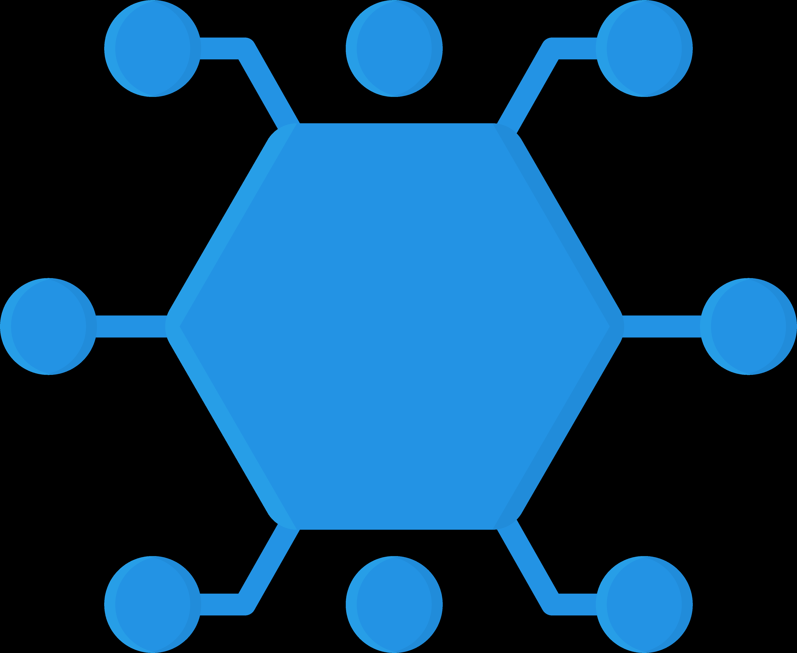
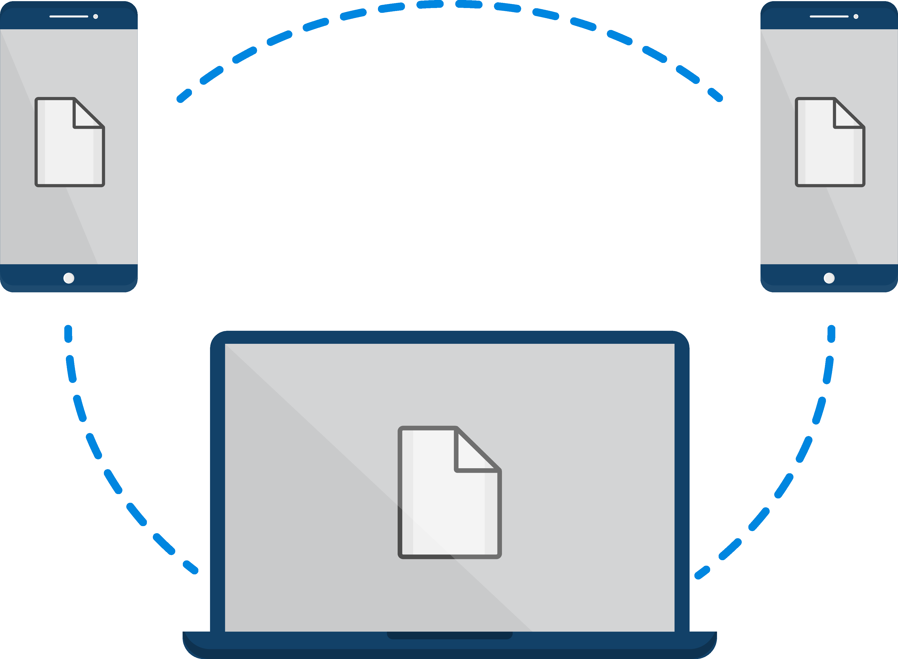
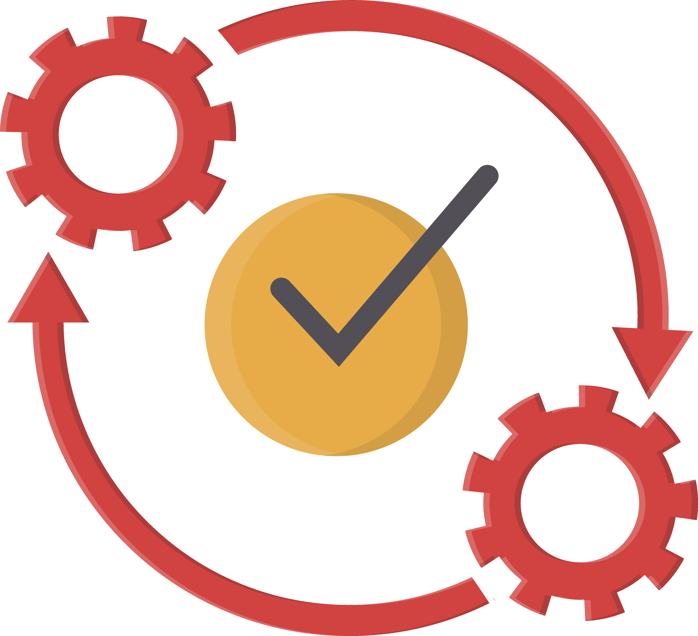
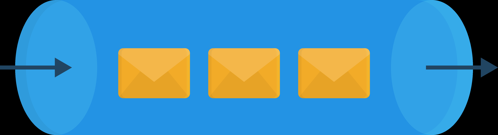

# 018 - Hệ Thống Xuất Bản - Đăng Ký (Pub-Sub Architecture)

[← Bài trước](017-hang-doi-thong-diep-messaging-queue.md) | [Mục lục](README.md) | [Bài tiếp theo →](019-gioi-han-tan-suat-rate-limiter.md)

---


# Thiết Kế Hệ Thống: Trừu Tượng Hóa Pub-Sub (System Design: The Pub-sub Abstraction)

Làm quen với các nguyên lý cơ bản trong thiết kế một hệ thống xuất bản - đăng ký (pub-sub system).

**Nội dung sẽ bao gồm:**
* Hệ thống pub-sub là gì? (What is a pub-sub system?)
* Động lực thúc đẩy (Motivation)
* Thiết kế hệ thống pub-sub như thế nào? (How do we design a pub-sub system?)

---

## 1. Hệ thống pub-sub là gì? (What is a pub-sub system?)

Cơ chế truyền tin nhắn Xuất bản - Đăng ký (Publish-subscribe messaging), thường được gọi tắt là **pub-sub messaging**, là một phương thức giao tiếp bất đồng bộ giữa các dịch vụ với nhau (asynchronous service-to-service communication) rất phổ biến trong các kiến trúc Serverless và Microservices. Thông qua hệ thống pub-sub, các thông điệp/tin nhắn (messages) có thể được gửi bất đồng bộ tới nhiều hệ thống con (subsystems) khác nhau. Toàn bộ các dịch vụ đã đăng ký (subscribed) vào mô hình pub-sub sẽ nhận được thông điệp khi nó được đẩy (pushed) vào hệ thống.

**Ví dụ:** Khi Cristiano Ronaldo — một vận động viên thể thao nổi tiếng — đăng một bài viết lên Instagram hoặc chia sẻ một tweet, tất cả những người theo dõi (followers) của anh ấy đều sẽ nhận được cập nhật. Trong kịch bản này:
* Cristiano Ronaldo là **Bên xuất bản (Publisher)**.
* Bài đăng hoặc tweet là **Thông điệp (Message)**.
* Tất cả người theo dõi là **Bên đăng ký nhận tin (Subscribers)**.

### Sơ đồ Hệ thống Pub-sub (Pub-sub system)


```
[Producer / Nhà sản xuất]  --Msg-->  [Hệ thống Pub-sub]  --Msg-->  [Consumer 1]
[Producer / Nhà sản xuất]  --Msg-->  [Hệ thống Pub-sub]  --Msg-->  [Consumer 2]
                                     [Hệ thống Pub-sub]  --Msg-->  [Consumer 3]
```

---

## 2. Động lực thúc đẩy (Motivation)

Cơ sở hạ tầng phần cứng của các hệ thống phân tán (Distributed Systems) bao gồm hàng triệu máy chủ. Việc sử dụng một hệ thống pub-sub để giao tiếp bất đồng bộ giúp tăng đáng kể **Khả năng mở rộng (Scalability)**. 

Bên sản xuất (Producers) và Bên tiêu thụ (Consumers) hoàn toàn tách biệt (disconnected) và hoạt động độc lập với nhau, từ đó cho phép chúng ta mở rộng quy mô (scale) cũng như phát triển (develop) từng bên một cách riêng rẽ. Tính chất tách rời (decoupling) giữa các thành phần — producers và consumers — mang lại khả năng mở rộng cao hơn, bởi vì việc thêm vào hoặc gỡ bỏ bất kỳ thành phần nào cũng không làm ảnh hưởng đến các thành phần còn lại.



---

## 3. Thiết kế hệ thống pub-sub như thế nào? (How do we design a pub-sub system?)

Chúng tôi chia thiết kế hệ thống pub-sub thành các bài học sau:

1. **Giới thiệu (Introduction):** Trong bài học này, chúng ta tìm hiểu về các trường hợp sử dụng (use cases) của hệ thống pub-sub, xác định các yêu cầu (requirements) và thiết kế giao diện lập trình ứng dụng (API Design) cho hệ thống.
2. **Thiết kế (Design):** Trong bài học này, chúng ta thảo luận về hai phương án thiết kế của hệ thống pub-sub: một phương án sử dụng hàng đợi thông điệp (Messaging Queues) và một phương án sử dụng Broker.


---

# Giới Thiệu Về Pub-sub (Introduction to Pub-sub)

Tìm hiểu về các trường hợp sử dụng (use cases) của hệ thống pub-sub, cách xác định các yêu cầu và thiết kế API cho hệ thống.

**Nội dung sẽ bao gồm:**
* Các trường hợp sử dụng của pub-sub (Use cases of pub-sub)
* Yêu cầu hệ thống (Requirements)
  * Yêu cầu chức năng (Functional requirements)
  * Yêu cầu phi chức năng (Non-functional requirements)
* Thiết kế API (API Design)
* Các khối xây dựng nền tảng sẽ sử dụng (Building blocks we will use)

Cơ chế truyền tin nhắn pub-sub mang lại khả năng giao tiếp bất đồng bộ. Hãy cùng khám phá các trường hợp sử dụng mà ở đó hệ thống pub-sub mang lại nhiều lợi ích vượt trội.

---

## Các trường hợp sử dụng của Pub-sub (Use cases of pub-sub)

Một số trường hợp sử dụng điển hình của pub-sub được liệt kê dưới đây:

* **Cải thiện hiệu năng (Improved performance):** Hệ thống pub-sub cho phép phân phối theo cơ chế đẩy (push-based distribution), loại bỏ việc các bên nhận tin phải liên tục thăm dò (polling/check) định kỳ để tìm thông tin mới hoặc sự thay đổi. Điều này giúp tối ưu thời gian phản hồi (response time) nhanh hơn và giảm thiểu độ trễ phân phối (delivery latency).
* **Xử lý thu nạp dữ liệu (Handling ingestion):** Pub-sub hỗ trợ đắc lực trong việc thu nạp nhật ký (log ingestion). Dữ liệu tương tác của người dùng có thể giúp phân tích hành vi người dùng một cách hiệu quả. Chúng ta có thể thu nạp một khối lượng dữ liệu khổng lồ vào hệ thống pub-sub, đủ để phân phối tới bất kỳ hệ thống phân tích nào nhằm nhận diện mô hình hành vi người dùng. Hơn nữa, chúng ta cũng có thể ghi nhật ký chi tiết về sự kiện diễn ra trong quá trình hoàn thành yêu cầu từ phía người dùng. Các dịch vụ quy mô lớn như Meta sử dụng một hệ thống pub-sub có tên là **Scribe** để biết chính xác bên nào cần dữ liệu gì, đồng thời xóa hoặc lưu trữ (archive) dữ liệu đã xử lý hoặc không còn cần thiết. Điều này là tối quan trọng để quản lý một lượng dữ liệu khổng lồ.
* **Giám sát thời gian thực (Real-time monitoring):** Các thông điệp thô (raw) hoặc đã qua xử lý (processed) của một ứng dụng hay hệ thống có thể được cung cấp đồng thời cho nhiều ứng dụng khác để phục vụ việc giám sát hệ thống theo thời gian thực (real-time monitoring).
* **Sao chép dữ liệu (Replicating data):** Hệ thống pub-sub có thể được sử dụng để phân phối các thay đổi dữ liệu. Ví dụ, trong giao thức Leader-Follower, nút Leader sẽ gửi các thay đổi tới các nút Followers thông qua hệ thống pub-sub, cho phép các follower cập nhật dữ liệu một cách bất đồng bộ. Các hệ thống bộ nhớ đệm phân tán (Distributed Caches) cũng có thể tự làm mới (refresh) dữ liệu bằng cách nhận các biến đổi bất đồng bộ. Tương tự, các ứng dụng như WhatsApp hỗ trợ hiển thị đồng thời cùng một cuộc trò chuyện trên nhiều thiết bị — ví dụ: trên điện thoại di động và trình duyệt máy tính — có thể vận hành hiệu quả nhờ pub-sub, trong đó mỗi giao diện hiển thị có thể đóng vai trò vừa là Publisher vừa là Subscriber.

### Động lực và các trường hợp sử dụng của hệ thống Pub-sub (Motivation and use cases of the pub-sub system)



* **Handling ingestion** (Xử lý nạp dữ liệu)
* **Increase scalability** (Tăng khả năng mở rộng)
* **Increased performance** (Nâng cao hiệu năng)
* **Replicating data** (Sao chép dữ liệu)
* **Real-time monitoring** (Giám sát thời gian thực)

---

## Điểm Cần Suy Ngẫm (Points to Ponder)

### Câu hỏi 1: Điểm giống và khác nhau giữa hệ thống Pub-Sub và Hàng Đợi (Queues) là gì?

> [!NOTE]
> **Giải đáp:**
> * **Điểm tương đồng:** Cả hệ thống pub-sub và hàng đợi (queues) đều có nhiệm vụ truyền tải thông tin được sản xuất bởi Producer tới Consumer.
> * **Điểm khác biệt:** Trong hàng đợi (Queue), **chỉ duy nhất một Consumer** tiêu thụ một thông điệp cụ thể; trong khi ở hệ thống Pub-Sub, **có thể có nhiều Consumers** cùng nhận và xử lý cùng một thông điệp.

---

## Yêu cầu hệ thống (Requirements)

Chúng ta hướng tới việc thiết kế một hệ thống pub-sub thỏa mãn các yêu cầu sau:

### Yêu cầu chức năng (Functional requirements)

Hãy cùng xác định các yêu cầu chức năng của hệ thống pub-sub:

1. **Tạo chủ đề (Create a topic):** Producer phải có khả năng khởi tạo một topic mới.
2. **Ghi thông điệp (Write messages):** Producers phải có khả năng ghi (publish) các thông điệp vào topic.
3. **Đăng ký nhận tin (Subscription):** Consumers phải có khả năng đăng ký (subscribe) vào topic để nhận thông điệp.
4. **Đọc thông điệp (Read messages):** Consumer phải có khả năng đọc các thông điệp từ topic đã đăng ký.
5. **Chỉ định thời gian lưu giữ (Specify retention time):** Phía Consumer/người dùng phải có khả năng chỉ định thời gian lưu giữ (retention time), sau khoảng thời gian này thông điệp sẽ bị xóa khỏi hệ thống.
6. **Xóa thông điệp (Delete messages):** Một thông điệp phải được tự động xóa khỏi topic hoặc hệ thống sau một khoảng thời gian lưu giữ nhất định theo cấu hình của người dùng hệ thống.


---

### Yêu cầu phi chức năng (Non-functional requirements)

Chúng ta xem xét các yêu cầu phi chức năng sau khi thiết kế hệ thống pub-sub:

* **Khả năng mở rộng (Scalable):** Hệ thống phải có khả năng mở rộng linh hoạt khi số lượng topics tăng lên cũng như khi tải trọng ghi (từ phía Producers) và tải trọng đọc (từ phía Consumers) tăng cao.
* **Tính sẵn sàng cao (High Availability):** Hệ thống phải duy trì tính sẵn sàng cao (highly available) để các Producers có thể đưa dữ liệu vào và Consumers có thể đọc dữ liệu ra bất cứ lúc nào.
* **Độ bền vững dữ liệu (Durability):** Hệ thống phải đảm bảo tính bền bỉ của dữ liệu. Các thông điệp khi đã được hệ thống chấp nhận từ Producer thì tuyệt đối không được phép mất mát (must not be lost) và phải được phân phối thành công tới đúng các subscribers dự kiến.
* **Khả năng chịu lỗi (Fault tolerance):** Hệ thống phải duy trì khả năng hoạt động ổn định và chính xác ngay cả khi xảy ra sự cố phần cứng hoặc mạng (failures).
* **Xử lý đồng thời (Concurrent):** Hệ thống phải giải quyết triệt để các vấn đề đồng thời (concurrency issues) khi các thao tác đọc và ghi diễn ra cùng một thời điểm.




---

## Thiết kế API (API Design)

Chúng ta sẽ lược bỏ một số tham số trong các hàm bên dưới, chẳng hạn như định danh (ID) của producer hoặc consumer. Giả định rằng thông tin định danh này đã có sẵn thông qua ngữ cảnh kết nối nền tảng (underlying connection context). Thiết kế API cho bài toán này cụ thể như sau:

### Tạo một chủ đề (Create a topic)

Lời gọi API để khởi tạo một topic sẽ có cấu trúc như sau:

```text
create(topic_ID, topic_name)
```

> [!IMPORTANT]
> Hàm này sẽ trả về một tín hiệu xác nhận (**acknowledgment - ACK**) nếu việc tạo topic thành công, hoặc trả về một **lỗi (error)** nếu thao tác thất bại.

---

### Bảng tham số (tiếp theo)

| Tham số (`Parameter`) | Mô tả (`Description`) |
| :--- | :--- |
| `topic_ID` | Định danh duy nhất của chủ đề (*topic*). |
| `topic_name` | Chứa tên của chủ đề (*topic*). |

#### Ghi một thông điệp (`Write a message`)

Lời gọi API để ghi dữ liệu vào hệ thống Pub-Sub có cấu trúc như sau:

```text
write(topic_ID, message)
```

Lời gọi API này sẽ ghi một thông điệp vào một chủ đề (*topic*) có định danh là `topic_ID`. Mỗi thông điệp có kích thước tối đa là 1 MB. Hàm này sẽ trả về một gói tin xác nhận (**acknowledgment - ACK**) nếu ghi dữ liệu thành công vào hệ thống, hoặc trả về mã lỗi thích hợp nếu thất bại.

| Tham số (`Parameter`) | Mô tả (`Description`) |
| :--- | :--- |
| `message` | Thông điệp cần ghi vào hệ thống. |

#### Đọc một thông điệp (`Read a message`)

Lời gọi API để đọc dữ liệu từ hệ thống có cấu trúc như sau:

```text
read(topic_ID)
```

Chủ đề (*topic*) được định vị thông qua `topic_ID`, và lời gọi hàm sẽ trả về một đối tượng chứa thông điệp cho bên gọi (*caller*).

| Tham số (`Parameter`) | Mô tả (`Description`) |
| :--- | :--- |
| `topic_ID` | Định danh của chủ đề (*topic*) mà thông điệp sẽ được đọc từ đó. |

#### Đăng ký nhận tin từ một chủ đề (`Subscribe to a topic`)

Lời gọi API để đăng ký nhận tin từ một chủ đề trong hệ thống có cấu trúc như sau:

```text
subscribe(topic_ID)
```

Hàm này thêm tiến trình tiêu thụ dữ liệu (**Consumer**) với tư cách là một bên đăng ký (**Subscriber**) vào chủ đề có định danh là `topic_ID`.

| Tham số (`Parameter`) | Mô tả (`Description`) |
| :--- | :--- |
| `topic_ID` | Định danh của chủ đề (*topic*) mà tiến trình tiêu thụ dữ liệu (**Consumer**) sẽ đăng ký. |

#### Hủy đăng ký nhận tin từ một chủ đề (`Unsubscribe from a topic`)

Lời gọi API để hủy đăng ký nhận tin từ một chủ đề trong hệ thống có cấu trúc như sau:

```text
unsubscribe(topic_ID)
```

Hàm này loại bỏ tiến trình tiêu thụ dữ liệu (**Consumer**) khỏi danh sách các bên đăng ký (**Subscriber**) của chủ đề có định danh là `topic_ID`.

| Tham số (`Parameter`) | Mô tả (`Description`) |
| :--- | :--- |
| `topic_ID` | Định danh của chủ đề (*topic*) mà các tiến trình tiêu thụ dữ liệu (**Consumers**) sẽ hủy đăng ký. |

#### Xóa một chủ đề (`Delete a topic`)

Lời gọi API để xóa một chủ đề khỏi hệ thống có cấu trúc như sau:

```text
delete_topic(topic_ID)
```

Hàm này xóa chủ đề dựa trên `topic_ID`.

| Tham số (`Parameter`) | Mô tả (`Description`) |
| :--- | :--- |
| `topic_ID` | Định danh của chủ đề (*topic*) cần xóa. |

---

### Các khối kiến trúc nền tảng được sử dụng (`Building blocks we will use`)

Thiết kế của hệ thống Pub-Sub tận dụng nhiều khối kiến trúc nền tảng (*building blocks*) đã được thảo luận trong các chương mở đầu. Chúng ta sẽ xem xét các bài học về khối kiến trúc nền tảng sau:




* **Cơ sở dữ liệu (Database):** Chúng ta sẽ sử dụng cơ sở dữ liệu để lưu trữ các thông tin như chi tiết đăng ký nhận tin (*subscription details*).
* **Hàng đợi thông điệp phân tán (Distributed messaging queue):** Chúng ta sẽ sử dụng hàng đợi thông điệp để lưu trữ các thông điệp được gửi từ bên sản xuất dữ liệu (**Producer**).
* **Kho lưu trữ Khóa - Giá trị (Key-value store):** Chúng ta sẽ sử dụng kho lưu trữ khóa - giá trị để lưu giữ thông tin về các tiến trình tiêu thụ (**Consumers**).

Trong bài học tiếp theo, chúng ta sẽ tập trung vào việc thiết kế chi tiết một hệ thống Pub-Sub.

---

```text
[Quay lại] Thiết kế hệ thống: Khái niệm trừu tượng Pub-Sub...
[Đánh dấu hoàn thành]
[Tiếp theo] Thiết kế một hệ thống Pub-Sub
```

---

# Thiết kế một hệ thống Pub-Sub (`Design of a Pub-sub System`)

Đi sâu vào thiết kế một hệ thống Pub-Sub và các thành phần cấu thành của nó.

Chúng ta sẽ bao quát các nội dung sau:
* Thiết kế đầu tiên (*First design*)
* Thiết kế thứ hai (*Second design*)
* Thiết kế mức cao (*High-level design*)
* Bộ điều phối thông điệp (*Broker*)
* Trình quản lý cụm (*Cluster manager*)
* Trình quản lý người tiêu thụ (*Consumer manager*)
* Thiết kế hoàn thiện (*Finalized design*)
* Kết luận (*Conclusion*)

---

### Thiết kế đầu tiên (`First design`)

Trong bài học trước, chúng ta đã thảo luận rằng bên sản xuất (**Producer**) ghi dữ liệu vào các chủ đề (**Topics**), và các bên tiêu thụ (**Consumers**) đăng ký một chủ đề để đọc các thông điệp từ chủ đề đó. Vì các thông điệp mới được nối tiếp vào cuối hàng đợi, chúng ta có thể sử dụng các **hàng đợi thông điệp phân tán (Distributed Messaging Queues)** cho các chủ đề.

Các thành phần chúng ta cần được liệt kê dưới đây:

* **Hàng đợi chủ đề (Topic queue):** Mỗi chủ đề (*topic*) sẽ là một hàng đợi thông điệp phân tán để chúng ta có thể lưu trữ các thông điệp gửi đến từ Producer. Một Producer sẽ ghi các thông điệp của họ vào hàng đợi đó.
* **Cơ sở dữ liệu (Database):** Chúng ta sẽ sử dụng một cơ sở dữ liệu quan hệ (**Relational Database**) để lưu trữ chi tiết việc đăng ký nhận tin (*subscription details*). Ví dụ: chúng ta cần lưu trữ Consumer nào đã đăng ký Topic nào để có thể phân phối cho các Consumer các thông điệp họ mong muốn. Chúng ta dùng cơ sở dữ liệu quan hệ vì dữ liệu liên quan đến Consumer có cấu trúc rõ ràng và chúng ta muốn đảm bảo tính toàn vẹn dữ liệu (**Data Integrity**).
* **Bộ điều hướng thông điệp (Message director):** Dịch vụ này sẽ đọc thông điệp từ hàng đợi của chủ đề (*Topic queue*), truy vấn danh sách các Consumer từ cơ sở dữ liệu, và chuyển tiếp thông điệp tới hàng đợi của Consumer tương ứng.
* **Hàng đợi bên tiêu thụ (Consumer queue):** Thông điệp từ hàng đợi của chủ đề sẽ được sao chép sang hàng đợi của Consumer để Consumer có thể đọc được thông điệp. Với mỗi Consumer, chúng ta sẽ định nghĩa một hàng đợi phân tán riêng biệt.
* **Dịch vụ đăng ký (Subscriber service):** Khi Consumer yêu cầu đăng ký nhận tin từ một Topic, dịch vụ này sẽ thêm một bản ghi vào cơ sở dữ liệu.

Consumer sẽ đăng ký nhận tin từ một Topic, và hệ thống sẽ lưu thông tin chi tiết của Subscriber vào cơ sở dữ liệu. Producer sẽ ghi thông điệp vào các Topic, bộ điều hướng thông điệp (*Message director*) sẽ đọc thông điệp từ hàng đợi, truy xuất chi tiết các đối tượng cần nhận thông điệp, và phân phối tới các hàng đợi của họ. Các Consumer sau đó sẽ tiêu thụ thông điệp từ chính hàng đợi riêng của mình.

> [!NOTE]  
> Chúng ta sẽ triển khai các dịch vụ dự phòng chuyển đổi dự phòng (**Fail-over services**) cho cả *Message director* và *Subscriber service* để phòng chống các sự cố lỗi đơn điểm (**Single Point of Failure - SPOF**).


Việc sử dụng các hàng đợi thông điệp phân tán giúp thiết kế của chúng ta trở nên đơn giản. Tuy nhiên, số lượng khổng lồ các hàng đợi cần khởi tạo là một mối quan ngại lớn. Nếu chúng ta có hàng triệu...

---

# Thiết Kế Hệ Thống Xuất Bản - Đăng Ký (Pub-Sub System Architecture)

---

### [Trang 13]

...người đăng ký (*subscribers*) cho hàng ngàn chủ đề (*topics*), việc định nghĩa và duy trì hàng triệu hàng đợi (*queues*) là vô cùng tốn kém tài nguyên. Hơn nữa, chúng ta sẽ phải sao chép cùng một thông điệp (*message*) của một chủ đề vào tất cả các hàng đợi của người đăng ký, điều này gây ra sự trùng lặp không cần thiết và chiếm dụng dung lượng lưu trữ.

---

### Những Điểm Cần Cân Nhắc (Points to Ponder)

#### Câu hỏi 1 (Question 1)
> **Có cách nào để tránh việc phải duy trì một hàng đợi riêng biệt cho mỗi người đọc (*reader*) hay không?**

> [!NOTE] **Ẩn / Hiện Câu trả lời (Hide Answer)**  
> Trong các hàng đợi thông điệp (*messaging queues*), thông điệp sẽ biến mất sau khi người đọc tiêu thụ (*consume*) nó. Vậy, điều gì sẽ xảy ra nếu chúng ta thêm một bộ đếm (*counter*) cho mỗi thông điệp? Giá trị của bộ đếm sẽ giảm dần (*decrements*) khi một người đăng ký (*subscriber*) tiêu thụ thông điệp đó. Hệ thống sẽ không xóa thông điệp cho đến khi bộ đếm này trở về giá trị 0. Bằng cách này, chúng ta không cần phải duy trì một hàng đợi riêng biệt cho từng người đọc nữa.

*(1 trên 2)*

---

## Thiết Kế Thứ Hai (Second Design)

Hãy cùng xem xét một cách tiếp cận khác để thiết kế một hệ thống xuất bản - đăng ký (*pub-sub system*).

### Thiết Kế Mức Cao (High-Level Design)

Ở mức độ tổng quan (*high level*), hệ thống xuất bản - đăng ký sẽ bao gồm các thành phần sau:

* **Broker (Máy chủ trung gian điều phối):** Máy chủ này sẽ xử lý các thông điệp. Nó sẽ lưu trữ các thông điệp được gửi từ bên sản xuất (*producer*) và cho phép các bên tiêu thụ (*consumers*) đọc chúng.
* **Cluster Manager (Trình quản lý cụm):** Chúng ta sẽ có rất nhiều máy chủ broker để đáp ứng nhu cầu mở rộng quy mô (*scalability*). Chúng ta cần một trình quản lý cụm để giám sát tình trạng hoạt động (*health check*) của broker.

---

### [Trang 14]

Nó sẽ gửi thông báo cho chúng ta nếu một broker gặp sự cố (*failure*).

* **Storage (Lưu trữ):** Chúng ta sẽ sử dụng một cơ sở dữ liệu quan hệ (*relational database*) để lưu trữ thông tin chi tiết về người tiêu thụ (*consumer details*), chẳng hạn như thông tin đăng ký (*subscription information*) và thời gian lưu giữ dữ liệu (*retention period*).
* **Consumer Manager (Trình quản lý người tiêu thụ):** Thành phần này chịu trách nhiệm quản lý các bên tiêu thụ. Ví dụ, nó sẽ xác thực xem người tiêu thụ có được ủy quyền (*authorized*) để đọc thông điệp từ một chủ đề nhất định hay không.

Bên cạnh các thành phần này, chúng ta cũng có các cân nhắc thiết kế (*design considerations*) sau:

* **Acknowledgment (Xác nhận nhận tin - ACK):** Một tín hiệu xác nhận được sử dụng để thông báo cho bên sản xuất (*producer*) rằng thông điệp nhận được đã được lưu trữ thành công. Hệ thống cũng sẽ chờ một xác nhận từ bên tiêu thụ (*consumer*) khi nó đã tiêu thụ thông điệp thành công.
* **Retention Time (Thời gian lưu giữ):** Các bên tiêu thụ có thể chỉ định thời gian lưu giữ cho các thông điệp của họ. Mặc định sẽ là bảy ngày, nhưng tham số này có thể cấu hình được (*configurable*). Một số ứng dụng như ứng dụng ngân hàng đòi hỏi dữ liệu phải được lưu trữ trong vài tuần theo yêu cầu nghiệp vụ, trong khi một ứng dụng phân tích (*analytical application*) có thể không cần giữ lại dữ liệu sau khi đã tiêu thụ xong.

---

### Thiết Kế Mức Cao Của Hệ Thống Pub-Sub (High-level design of a pub-sub system)


*Sơ đồ luồng tương tác tổng quan:*
* **Cluster manager (Trình quản lý cụm):** Quản lý các broker (*Manages brokers*).
* **Consumer manager (Trình quản lý người tiêu thụ):** Quản lý các consumer (*Manages consumers*).
* **Pub-sub system (Hệ thống xuất bản - đăng ký):** Chứa cụm các broker (*Cluster of brokers*) gồm Broker, Broker, Broker...
* **Storage (Lưu trữ):** Lưu trữ thông tin metadata của hệ thống.
* **Producer (Bên sản xuất):** Gửi thông điệp (*Send message*) tới Broker.
* **Consumer (Bên tiêu thụ):** Kéo thông điệp (*Pull message*) từ Broker.

---

Hãy cùng tìm hiểu vai trò chi tiết của từng thành phần.

### Broker (Máy Chủ Trung Gian)

---

### [Trang 15]

Máy chủ broker là thành phần cốt lõi (*core component*) của hệ thống pub-sub của chúng ta. Nó sẽ xử lý các yêu cầu ghi (*write requests*) và yêu cầu đọc (*read requests*). Một broker sẽ quản lý nhiều chủ đề (*topics*), trong đó mỗi topic có thể có nhiều phân vùng (*partitions*) liên kết với nó. Chúng ta sử dụng các phân vùng để lưu trữ thông điệp vào bộ lưu trữ cục bộ (*local storage*) nhằm đảm bảo tính bền bỉ của dữ liệu (*persistence*). Do đó, điều này giúp cải thiện tính sẵn sàng (*availability*).

Các phân vùng chứa các thông điệp được đóng gói bên trong các phân đoạn (*segments*). Phân đoạn giúp xác định điểm bắt đầu và điểm kết thúc của một thông điệp thông qua việc sử dụng một địa chỉ độ lệch (*offset address*). Nhờ sử dụng các phân đoạn, các bên tiêu thụ có thể tiêu thụ thông điệp mà họ lựa chọn từ một phân vùng bằng cách đọc từ một địa chỉ offset cụ thể. Hình minh họa dưới đây mô tả khái niệm vừa được trình bày ở trên.

---

#### Minh Họa Cách Các Thông Điệp Được Lưu Trữ Trong Các Phân Đoạn Bên Trong Một Phân Vùng (A depiction of how messages are stored within segments inside a partition)


*Cấu trúc phân cấp:*
* **Topic A (Chủ đề A)**
  * **Partitions of topic A (Các phân vùng của Topic A)**
    * **Messages of topic A encapsulated in segments (Các thông điệp của Topic A được đóng gói trong các segment)**
      * **Segment (Phân đoạn)**
      * **Message (Thông điệp)**
      * **Offset (Độ lệch)**

---

Như chúng ta đã biết, một topic là một chuỗi thông điệp tuần tự có tính bền vững (*persistent sequence of messages*) được lưu trữ trong bộ nhớ cục bộ (*local storage*) của broker. Một khi dữ liệu đã được ghi thêm vào topic, nó không thể bị chỉnh sửa (*immutable*). Việc đọc và ghi một thông điệp từ hoặc tới một topic là một tác vụ I/O đối với máy tính, và việc mở rộng quy mô (*scaling*) cho các tác vụ như vậy là rất thách thức. Đây chính là lý do chúng ta chia nhỏ các topic thành nhiều phân vùng (*partitions*). Dữ liệu thuộc về một topic đơn lẻ có thể hiện diện trên nhiều phân vùng khác nhau.

Ví dụ, giả sử chúng ta có **Topic A** và chúng ta phân bổ ba phân vùng (*partitions*) cho nó. Các bên sản xuất (*producers*) sẽ gửi thông điệp của họ đến topic tương ứng. Các thông điệp nhận được sẽ được phân phối tới các phân vùng khác nhau dựa trên thuật toán Round-Robin. Chúng ta sẽ sử dụng một biến thể của Round-Robin: **Weighted Round-Robin (Round-Robin có trọng số)**. Các slide sau đây minh họa cách các thông điệp được lưu trữ vào các phân vùng khác nhau thuộc về cùng một topic:

---

### [Trang 16]

#### Bước 1: Bên Sản Xuất Tạo Và Gửi Thông Điệp

> **Topic A:** Bao gồm Partition 0, Partition 1, Partition 2.  
> Các bên sản xuất (*producers*) tạo ra các thông điệp của cùng một topic và gửi chúng tới hệ thống.  
> *(1 trên 9)*

---

#### Bước 2: Thuật Toán Round-Robin Quyết Định Phân Vùng

> **Topic A:** Bao gồm Partition 0, Partition 1, Partition 2.  
> Thuật toán Round-Robin quyết định phân vùng nơi chúng ta cần lưu trữ thông điệp.  
> *(2 trên 9)*

---

### [Trang 17]

#### Bước 3: Gửi Thông Điệp Đầu Tiên Tới Partition 0

> **Topic A:** Bao gồm Partition 0, Partition 1, Partition 2.  
> Thuật toán Round-Robin gửi thông điệp tới **Partition 0** và quyết định phân vùng tiếp theo cho thông điệp đang đến.  
> *(3 trên 9)*

---

#### Bước 4: Gửi Thông Điệp Tiếp Theo Tới Partition 1

> **Topic A:** Bao gồm Partition 0, Partition 1, Partition 2.  
> Thuật toán Round-Robin gửi thông điệp tới **Partition 1** và quyết định phân vùng tiếp theo cho thông điệp đang đến.  
> *(4 trên 9)*

---

### [Trang 18]

#### Bước 5: Điều Phối Tiếp Theo Của Thuật Toán Phân Phối

> **Topic A:** Bao gồm Partition 0, Partition 1, Partition 2.  
> Thuật toán Round-Robin gửi thông điệp tới **Partition 1** và quyết định phân vùng tiếp theo cho thông điệp đang đến.  
> *(5 trên 9)*

---

#### Bước 6: Gửi Thông Điệp Tiếp Theo Tới Partition 2

> **Topic A:** Bao gồm Partition 0, Partition 1, Partition 2.  
> Thuật toán Round-Robin gửi thông điệp tới **Partition 2** và quyết định phân vùng tiếp theo cho thông điệp đang đến.  
> *(6 trên 9)*

---

### Trang 19


* **Topic A (Chủ đề A)**
  * **Partition 0 (Phân vùng 0)**
  * **Partition 1 (Phân vùng 1)**
  * **Partition 2 (Phân vùng 2)**
* **Round-robin (Thuật toán điều phối vòng tròn)**
* Thuật toán round-robin gửi thông điệp (*message*) tới **Partition 0** và quyết định phân vùng cho thông điệp đang đến.
* *Slide 7/9*

---

* **Topic A (Chủ đề A)**
  * **Partition 0 (Phân vùng 0)**
  * **Partition 1 (Phân vùng 1)**
  * **Partition 2 (Phân vùng 2)**
* **Round-robin (Thuật toán điều phối vòng tròn)**
* Thuật toán round-robin gửi thông điệp (*message*) tới **Partition 2** và quyết định phân vùng cho thông điệp đang đến.
* *Slide 8/9*

---

### Trang 20


* **Topic A (Chủ đề A)**
  * **Partition 0 (Phân vùng 0)**
  * **Partition 1 (Phân vùng 1)**
  * **Partition 2 (Phân vùng 2)**
* **Round-robin (Thuật toán điều phối vòng tròn)**
* Các thông điệp được thêm vào các phân vùng tương ứng (*relative partitions*).
* *Slide 9/9*

---

#### Những điểm cần suy ngẫm (*Points to Ponder*)

##### Câu hỏi 1 (*Question 1*)
Thứ tự nghiêm ngặt (*Strict ordering*) đảm bảo rằng các thông điệp được lưu trữ theo đúng thứ tự mà chúng được tạo ra (*produced*). Làm thế nào chúng ta có thể đảm bảo thứ tự nghiêm ngặt cho các thông điệp của mình?

---

### Trang 21

**Ẩn câu trả lời (*Hide Answer*)**

Chúng ta sẽ gán cho mỗi phân vùng một mã định danh duy nhất, `partition_ID`. Người dùng có thể cung cấp `partition_ID` trong quá trình ghi vào hệ thống. Bằng cách này, các thông điệp sẽ được gửi đến phân vùng được chỉ định và thứ tự sẽ được đảm bảo nghiêm ngặt (*strict ordering*). Lệnh gọi API để ghi vào hệ thống pub-sub của chúng ta trông như sau:

```text
write(topic_ID, partition_ID, message)
```

Nếu người dùng không cung cấp `partition_ID`, chúng ta sẽ sử dụng thuật toán **Weighted Round-Robin** (điều phối vòng tròn có trọng số) để quyết định thông điệp nào phải được gửi đến phân vùng nào.

> [!NOTE]
> Việc trao quyền chọn phân vùng cho máy khách (*client*) của hệ thống pub-sub có vẻ kỳ lạ. Tuy nhiên, một cơ chế như vậy có thể là nền tảng để các máy khách lấy dữ liệu cho một khoảng thời gian cụ thể nào đó — ví dụ: lấy dữ liệu từ ngày hôm qua. Để đơn giản hóa, chúng ta sẽ không đưa tính năng đọc theo thời gian (*time-based reading*) vào thiết kế này.

*Slide 1/4*

Chúng ta sẽ phân bổ các phân vùng (*partitions*) cho nhiều **broker** (nút điều phối trung gian) khác nhau trong hệ thống. Điều này có nghĩa là các phân vùng khác nhau của cùng một chủ đề (*topic*) sẽ nằm trên các broker khác nhau. Chúng ta sẽ tuân theo thứ tự nghiêm ngặt trong các phân vùng bằng cách thêm nội dung mới hơn vào cuối các thông điệp hiện có (*append-only*).

Hãy xem xét các slide bên dưới. Chúng ta có nhiều broker khác nhau trong hệ thống của mình. Mỗi broker chứa các chủ đề khác nhau. Chủ đề được chia thành nhiều phân vùng.

---

### Trang 22

* **Topic A**
* **Topic B**
* **Topic C**
* **Topic D**
* .....
* **Broker**
* **Một broker chứa nhiều topic.**
* *Slide 1/3*

---

* **Topic A**
* **Topic B**
* **Topic C**
* **Topic D**
* .....
* **Broker**
* **Partition 0 của topic B**
* **Partition 1 của topic B**
* **Partition 2 của topic B**
* **Partition n của topic B**
* ....
* **Góc nhìn vật lý (*Physical view*): Một topic được chia tách thành nhiều phân vùng (*partitions*) và được lưu trữ trên các broker khác.**
* *Slide 2/3*

---

### Trang 23

* **Topic A**
* **Topic B**
* **Topic C**
* **Topic D**
* .....
* **Broker**
* **Partition 0**
* **Partition 1**
* **Partition 2**
* **Partition 3**
* .....
* **Partition n**
* **Góc nhìn logic (*Logical view*): Chúng ta có thể biểu diễn các phân vùng theo một cách khác. Tại đây, Topic B được chia thành nhiều phân vùng.**
* *Slide 3/3*

---

Chúng ta đã thảo luận rằng một thông điệp sẽ được lưu trữ trong một phân đoạn (**segment**). Chúng ta sẽ định danh mỗi phân đoạn bằng một giá trị độ lệch (**offset**). Vì đây là các bản ghi bất biến (**immutable records**), các tiến trình đọc (**readers**) hoàn toàn độc lập và chúng có thể đọc thông điệp tại bất kỳ vị trí nào từ tệp này bằng cách sử dụng các hàm API cần thiết. Các slide sau đây minh họa chi tiết ở cấp độ phân đoạn (*segment level*).

* .....
* **offset: 0**
* **offset: 1**
* **offset: 2**
* **offset: 3**
* **offset: 4**
* **offset: 5**
* **offset: 6**
* **offset: 7**
* Bản ghi đầu tiên được ghi (*First entry written*) 
* Bản ghi tiếp theo sẽ ghi (*Next entry to write*) 
* **segment (phân đoạn)** 
* **Một mục mới sẽ được thêm vào cuối tệp (*end of the file*).**
* *Slide 1/2*

---

### Trang 24

* .....
* **offset: 0**
* **offset: 1**
* **offset: 2**
* **offset: 3**
* **offset: 4**
* **offset: 5**
* **offset: 6**
* **offset: 7**
* **Consumer 1 (Tiến trình tiêu thụ 1):** đọc (*reads*)
* **Consumer 2 (Tiến trình tiêu thụ 2):** đọc (*reads*)
* **Producer x (Tiến trình sản xuất x):** ghi (*writes*)
* **Các consumer có thể đọc từ bất kỳ vị trí nào trong tệp. Producer luôn ghi thêm vào cuối tệp.**
* *Slide 2/2*

---

Kiến trúc **Broker** đã giải quyết triệt để các vấn đề mà thiết kế đầu tiên của chúng ta gặp phải:
1. Chúng ta đã tránh được việc phải duy trì một số lượng quá lớn các hàng đợi (**queues**) bằng cách phân vùng chủ đề (**partitioning the topic**).
2. Chúng ta đã đưa vào khả năng xử lý song song (**parallelism**) thông qua các phân vùng (*partitions*), giúp loại bỏ các điểm nghẽn cổ chai (**bottlenecks**) trong quá trình tiêu thụ thông điệp (*consuming the message*).

---

### Bộ quản lý cụm (*Cluster Manager*)

Chúng ta sẽ triển khai nhiều broker trong cụm (**cluster**) của mình. Bộ quản lý cụm (*Cluster Manager*) sẽ đảm nhận các tác vụ cốt lõi sau:

* **Sổ đăng ký Broker và Topic (*Broker and topics registry*):** Nơi đây lưu trữ danh sách các chủ đề (*topics*) cho từng broker tương ứng.
* **Quản lý sao chép dữ liệu (*Manage replication*):** Cluster manager quản lý cơ chế sao chép bằng cách áp dụng phương pháp **Leader-Follower** (Nút chủ động - Nút phụ thuộc). 
  * Một trong các broker sẽ đóng vai trò là **Leader**. Nếu Leader gặp sự cố (*fails*), Cluster Manager sẽ phân xử và quyết định nút nào sẽ trở thành Leader tiếp theo.
  * Trong trường hợp một **Follower** gặp sự cố (*fails*), Cluster Manager sẽ bổ sung một broker mới và bảo đảm đồng bộ hóa nó trở thành một Follower cập nhật dữ liệu đầy đủ.
  * Cluster Manager sẽ cập nhật siêu dữ liệu (**metadata**) tương ứng.
  * Chúng ta sẽ duy trì **3 bản sao (*3 replicas*)** cho mỗi phân vùng (*partition*) trên các broker khác nhau.

---

# Thiết Kế Hệ Thống Xuất Bản - Đăng Ký (Pub-Sub System Architecture)

---

## 1. Nhân Bản Dữ Liệu Ở Cấp Độ Phân Vùng (Replication at the Partitioning Level)

Hệ thống triển khai cơ chế nhân bản (replication) trực tiếp trên từng phân vùng (partition) để đảm bảo tính sẵn sàng cao (**High Availability**) và khả năng chịu lỗi (**Fault Tolerance**):


* **Broker 1**: 
  - Partition 0
  - Partition 2 (replica)
  - Partition 1 (replica)
* **Broker 2**: 
  - Partition 0 (replica)
  - Partition 1 (replica)
  - Partition 2 (replica)
* **Broker 3**: 
  - Partition 1
  - Partition 2 (replica)
  - Partition 0 (replica)
* **Broker 4**: 
  - Partition 2
  - Partition 0 (replica)
  - Partition 1 (replica)

---

## 2. Quản Lý Consumer (Consumer Manager)

Bộ quản lý Consumer (**Consumer Manager**) chịu trách nhiệm điều phối và quản lý toàn bộ các consumer trong hệ thống. Thành phần này đảm nhiệm các vai trò cụ thể sau:

### Xác thực Consumer (Verify the Consumer)
Bộ quản lý sẽ truy xuất dữ liệu từ cơ sở dữ liệu và xác minh xem consumer có được phép đọc một tin nhắn cụ thể hay không. 
* *Ví dụ:* Nếu consumer đã đăng ký theo dõi (subscribe) **Topic A** (nhưng không đăng ký **Topic B**), thì consumer đó tuyệt đối không được phép đọc dữ liệu từ Topic B. Consumer Manager sẽ kiểm tra và xác thực yêu cầu này của consumer.

### Quản lý Thời Gian Lưu Trữ (Retention Time Management)
Consumer Manager cũng sẽ kiểm tra tính hợp lệ về thời gian truy cập tin nhắn của consumer. Nếu theo chính sách thời gian lưu trữ (**Retention Time**), tin nhắn đó đã hết hạn và không thể truy cập được nữa, hệ thống sẽ ngăn chặn không cho consumer đọc tin nhắn đó.

### Quản lý Tùy Chọn Nhận Tin Nhắn (Message Receiving Options Management)
Có hai phương pháp để consumer nhận dữ liệu:

1. **Push Model (Hệ thống chủ động đẩy dữ liệu):**
   - Hệ thống của chúng ta chủ động đẩy dữ liệu đến các consumer. 
   - *Nhược điểm:* Phương pháp này có thể dẫn đến tình trạng quá tải (**Overloading**) cho consumer do phải tiếp nhận các luồng tin nhắn liên tục vượt quá năng lực xử lý.

2. **Pull Model (Consumer chủ động kéo dữ liệu):**
   - Consumer chủ động gửi yêu cầu đến hệ thống để đọc dữ liệu từ một chủ đề (topic) cụ thể. 
   - *Nhược điểm:* Một số consumer có nhu cầu muốn nhận biết về tin nhắn ngay khi nó vừa được xuất bản (as soon as it is published), nhưng hệ thống lại không hỗ trợ chức năng thông báo tức thì này ở chế độ thuần pull.

> [!IMPORTANT]
> **Giải pháp kiến trúc:** Chúng ta sẽ hỗ trợ đồng thời cả hai kỹ thuật (**Push** và **Pull**). Mỗi consumer sẽ chủ động thông báo cho broker biết liệu nó muốn dữ liệu được đẩy tự động (**push automatically**) hay nó muốn tự chủ động đọc dữ liệu (**read itself**). Bằng cách này, chúng ta vừa tránh được tình trạng quá tải cho consumer, vừa cung cấp sự linh hoạt và quyền tự chủ tối đa cho consumer. Thông tin cấu hình này sẽ được lưu trữ trong cơ sở dữ liệu quan hệ (**Relational Database**) cùng với các thông tin chi tiết khác của consumer.

### Cho Phép Đọc Lại Nhiều Lần (Allow Multiple Reads)
Consumer Manager chịu trách nhiệm lưu trữ thông tin độ lệch (**Offset**) của từng consumer. 
* Hệ thống sử dụng một kho lưu trữ khóa - giá trị (**Key-Value Store**) để lưu trữ thông tin offset tương ứng với từng consumer. Cơ chế này cho phép truy xuất cực nhanh (**Fast Fetching**) và gia tăng tính sẵn sàng (**Availability**) cho các consumer.
* *Quy trình xử lý:* Nếu Consumer 1 đã đọc dữ liệu từ offset 0 và gửi lại tín hiệu xác nhận (**Acknowledgment - ACK**), hệ thống sẽ ghi nhận và lưu lại trạng thái đó. Nhờ vậy, khi consumer muốn tiếp tục đọc dữ liệu ở lần tiếp theo, chúng ta có thể cung cấp ngay offset kế tiếp để tiến trình đọc tin nhắn được diễn ra liền mạch.

---

## 3. Thiết Kế Hoàn Thiện (Finalized Design)

Kiến trúc hoàn thiện tổng thể của hệ thống Pub-Sub được thể hiện chi tiết dưới đây:


### Các thành phần chính trong kiến trúc:
* **Hệ thống Pub-Sub (Pub-Sub System)**
* **Cụm các Broker (Cluster of Brokers):**
  - **Broker**: Quản lý Topic A, Topic B, ...
  - **Broker**: Quản lý Topic A, Topic B, ...
  - Cơ chế **Replication** (Nhân bản dữ liệu) đồng bộ giữa các Broker.
* **Tầng Lưu Trữ (Storage):**
  - **Key-Value Store**: Lưu trữ chi tiết phân quyền (**Authorization Detail**) và thông tin vị trí offset.
  - Cơ sở dữ liệu quan hệ lưu trữ danh mục đăng ký Broker và Topics (**Broker and Topics Registry**).
* **Bộ Quản Lý Cụm (Cluster Manager):** Quản lý trạng thái và điều phối các Broker (**Manages Broker**).
* **Bộ Quản Lý Consumer (Consumer Manager):** Giám sát và điều phối các Consumer (**Manages Consumers**).
* **Nhà Xuất Bản (Producer):** Gửi tin nhắn (**Send Message**).
* **Bên Tiêu Thụ (Consumer):** Kéo/nhận tin nhắn (**Pull Message**).

---

## 4. Điều Hướng & Đánh Dấu Tiến Độ

* **Quay lại:** Giới thiệu về Pub-sub (Introduction to Pub-sub)
* **Đánh dấu:** Đã hoàn thành (Mark As Completed)
* **Tiếp theo:** Thiết kế hệ thống: Bộ giới hạn tốc độ (System Design: The Rate Limiter)

---

## 5. Kết Luận (Conclusion)

Chúng ta đã cùng phân tích hai phương án thiết kế hệ thống pub-sub: sử dụng hàng đợi (**Queues**) và sử dụng kho lưu trữ tùy biến (**Custom Storage**) được tối ưu hóa chuyên biệt cho tác vụ ghi và đọc dữ liệu kích thước nhỏ.

Hệ thống Pub-Sub có rất nhiều ca sử dụng (**Use Cases**) thực tế đa dạng. Nhờ vào sự tách rời (**Decoupling**) triệt để giữa Producer và Consumer, hệ thống có thể mở rộng quy mô một cách linh hoạt (**Scale Dynamically**), đồng thời các sự cố hỏng hóc đều được khoanh vùng xử lý tốt (**Failures are well-contained**). 

> [!NOTE]
> Ngoài ra, nhờ vào cơ chế theo dõi và hạch toán chính xác tiến trình tiêu thụ dữ liệu (**Proper Accounting of Data Consumption**), Pub-Sub chính là sự lựa chọn hàng đầu cho các hệ thống quy mô lớn (**Large-Scale Systems**) có khối lượng sản sinh dữ liệu khổng lồ. Chúng ta có thể xác định một cách chuẩn xác dữ liệu nào là cần thiết và dữ liệu nào không còn cần thiết.


---

[← Bài trước](017-hang-doi-thong-diep-messaging-queue.md) | [Mục lục](README.md) | [Bài tiếp theo →](019-gioi-han-tan-suat-rate-limiter.md)
