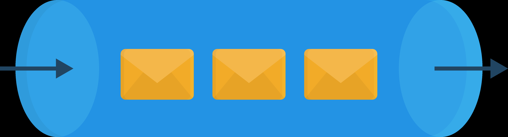
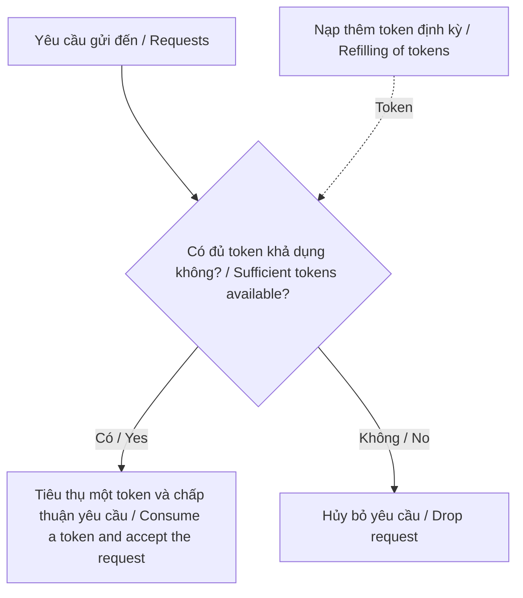
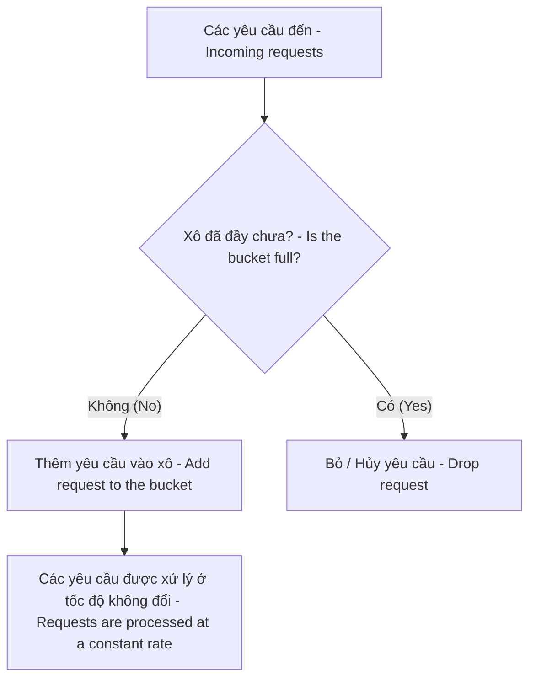

# 019 - Bộ Giới Hạn Tần Suất Truy Cập (Rate Limiter)

[← Bài trước](018-mo-hinh-pub-sub.md) | [Mục lục](README.md) | [Bài tiếp theo →](020-kho-luu-tru-blob-store.md)

---


# Thiết Kế Hệ Thống: Bộ Giới Hạn Tần Suất Truy Cập (System Design: The Rate Limiter)

Hãy cùng tìm hiểu các chi tiết cơ bản để thiết kế một bộ giới hạn tần suất truy cập (**Rate Limiter**).

Chúng ta sẽ bao quát các nội dung sau:
* **Bộ giới hạn tần suất truy cập (Rate Limiter) là gì?**
* **Tại sao chúng ta cần một bộ giới hạn tần suất truy cập?**
* **Chúng ta sẽ thiết kế một bộ giới hạn tần suất truy cập như thế nào?**

---

## 1. Bộ giới hạn tần suất truy cập (Rate Limiter) là gì?

Đúng như tên gọi của nó, một bộ giới hạn tần suất truy cập (**Rate Limiter**) áp đặt một giới hạn lên số lượng yêu cầu (**requests**) mà một dịch vụ có thể đáp ứng và xử lý. Nó thực hiện điều tiết/ngắt dòng (**throttles**) các yêu cầu vượt quá giới hạn đã được định nghĩa trước. 

*Ví dụ:* Một máy khách (**Client**) sử dụng API của một dịch vụ cụ thể được cấu hình cho phép tối đa $500\text{ requests/phút}$ sẽ bị chặn các yêu cầu gửi đến tiếp theo nếu số lượng yêu cầu mà client đó thực hiện vượt quá ngưỡng giới hạn đó.

---

## 2. Tại sao chúng ta cần một bộ giới hạn tần suất truy cập?

Bộ giới hạn tần suất truy cập thường được sử dụng như một lớp phòng thủ (**defensive layer**) cho các dịch vụ nhằm tránh việc bị lạm dụng hoặc sử dụng quá mức, dù là vô tình hay cố ý. Nó cũng bảo vệ các dịch vụ trước các hành vi tấn công phá hoại nhắm vào tầng ứng dụng (**Application Layer**), chẳng hạn như:
- Tấn công từ chối dịch vụ (**Denial-of-Service - DoS**)
- Các cuộc tấn công dò mật khẩu bằng vét cạn (**Brute-force password attempts**)

Dưới đây là danh sách các kịch bản thực tế nơi bộ giới hạn tần suất truy cập có thể được áp dụng để giúp dịch vụ hoạt động tin cậy và ổn định hơn (**more reliable**):

* **Ngăn chặn tình trạng cạn kiệt tài nguyên (Preventing resource starvation):** Một số sự cố từ chối dịch vụ xuất phát từ các lỗi phần mềm hoặc sai sót cấu hình bên trong hệ thống, dẫn đến việc tài nguyên bị cạn kiệt. Những sự cố kiểu này được gọi là hiện tượng *từ chối dịch vụ do "bắn nhầm quân mình"* (**friendly-fire denial of service**). Một trong những trường hợp sử dụng phổ biến nhất của rate limiter là ngăn chặn tình trạng cạn kiệt tài nguyên gây ra bởi các cuộc tấn công từ chối dịch vụ như vậy, dù là cố ý hay vô tình.
* **Quản lý chính sách và hạn ngạch (Managing policies and quotas):** Rate limiter cũng cần thiết để đảm bảo việc phân chia và sử dụng dung lượng tài nguyên một cách công bằng và hợp lý (**fair and reasonable use**) khi chúng được chia sẻ giữa nhiều người dùng. Chính sách (**Policy**) ở đây đề cập đến việc áp dụng các giới hạn theo khoảng thời gian hoặc theo số lượng được phân bổ (**quota**).
* **Kiểm soát luồng dữ liệu (Controlling data flow):** Rate limiter còn có thể được sử dụng trong các hệ thống đòi hỏi phải xử lý một khối lượng dữ liệu khổng lồ. Rate limiter kiểm soát luồng dữ liệu để phân phối công việc đồng đều giữa các máy chủ khác nhau, tránh gây quá tải hoặc dồn gánh nặng lên một máy chủ đơn lẻ.
* **Tránh phát sinh chi phí vượt mức (Avoiding excess costs):** Cơ chế giới hạn tần suất truy cập cũng có thể được dùng để kiểm soát chi phí vận hành (**cost of operations**). Ví dụ: các tổ chức có thể sử dụng rate limiting để ngăn các thử nghiệm hệ thống chạy mất kiểm soát dẫn đến các hóa đơn chi phí khổng lồ. Một số nhà cung cấp dịch vụ đám mây (**Cloud Providers**) cũng áp dụng khái niệm này bằng cách cung cấp các gói dịch vụ miễn phí giới hạn (**freemium**) đến một ngưỡng nhất định, và ngưỡng này chỉ có thể tăng lên theo yêu cầu khi người dùng trả thêm phí.

---

### Điều tiết số lượng yêu cầu đến các máy chủ API thông qua Rate Limiter


> **Mô hình luồng yêu cầu:**
> `Client` $\xrightarrow{\text{Requests}}$ `Rate limiter` $\xrightarrow{\text{Filtered Requests}}$ `API servers`

---

## 3. Chúng ta sẽ thiết kế một bộ giới hạn tần suất truy cập như thế nào?

Trong các bài học tiếp theo, chúng ta sẽ lần lượt tìm hiểu về các khía cạnh sau:

1. **Yêu cầu hệ thống (Requirements):** Đây là nơi chúng ta thảo luận về các yêu cầu chức năng (**Functional Requirements**) và yêu cầu phi chức năng (**Non-Functional Requirements**) của rate limiter. Chúng ta cũng sẽ mô tả các kiểu điều tiết (**Types of Throttling**) và các vị trí đặt rate limiter để nó thực thi nhiệm vụ một cách hiệu quả nhất.
2. **Thiết kế tổng quan (High-Level Design):** Trong phần này, chúng ta sẽ xem xét bản thiết kế ở mức khái quát để có được cái nhìn tổng thể về một rate limiter.
3. **Thiết kế chi tiết (Detailed Design):** Trong phần này, chúng ta sẽ thảo luận sâu về thiết kế chi tiết của rate limiter và giải thích các khối thành phần nền tảng (**Building Blocks**) tham gia vào cấu trúc thiết kế chi tiết.
4. **Các thuật toán giới hạn tần suất truy cập (Rate Limiter Algorithms):** Trong bài học này, chúng ta sẽ giải thích các thuật toán khác nhau đóng vai trò cốt lõi trong hoạt động vận hành của một rate limiter.
5. **Câu hỏi ôn tập (Quiz):** Để đánh giá mức độ hiểu biết của bạn về rate limiter, chúng tôi có cung cấp một bài trắc nghiệm ở cuối chương này.

Trong bài học tiếp theo, hãy bắt đầu bằng việc tìm hiểu các yêu cầu và thiết kế của một bộ giới hạn tần suất truy cập.

---

## 4. Các Yêu Cầu Thiết Kế Của Bộ Giới Hạn Tần Suất Truy Cập (Requirements of a Rate Limiter's Design)

Nắm vững các yêu cầu kỹ thuật và những khái niệm trọng tâm của một rate limiter.

Chúng ta sẽ bao quát các nội dung sau:
* **Yêu cầu (Requirements)**
  * Yêu cầu chức năng (**Functional requirements**)
  * Yêu cầu phi chức năng (**Non-functional requirements**)
* **Các kiểu điều tiết (Types of throttling)**
* **Vị trí đặt bộ giới hạn tần suất truy cập (Where to place the rate limiter)**
* **Hai mô hình triển khai bộ giới hạn tần suất truy cập (Two models for implementing a rate limiter)**
* **Các khối thành phần nền tảng sẽ sử dụng (Building blocks we will use)**

---

### Yêu cầu (Requirements)

Trọng tâm của chúng ta trong bài học này là thiết kế một rate limiter đáp ứng đầy đủ các yêu cầu chức năng và phi chức năng sau đây:

#### Yêu cầu chức năng (Functional Requirements)
* **Giới hạn số lượng yêu cầu:** Giới hạn số lượng yêu cầu mà một client có thể gửi đến một API trong một khung thời gian (**Time Window**) xác định.
* **Cấu hình linh hoạt:** Giới hạn số lượng yêu cầu trên mỗi time window phải có khả năng tùy biến cấu hình (**Configurable**).
* **Thông báo cho Client:** Đảm bảo rằng client nhận được thông báo phản hồi (thông báo lỗi hoặc cảnh báo) bất cứ khi nào ngưỡng quy định bị vượt quá, dù là trong phạm vi một máy chủ đơn lẻ (**single server**) hay trên toàn bộ cụm kết hợp nhiều máy chủ (**combination of servers**).

#### Yêu cầu phi chức năng (Non-Functional Requirements)
* **Tính sẵn sàng cao (High Availability):** Về bản chất, rate limiter đóng vai trò như tấm khiên bảo vệ toàn bộ hệ thống của chúng ta. Do đó, bản thân nó phải đạt mức độ sẵn sàng cực cao (**Highly Available**).
* **Độ trễ thấp (Low Latency):** Bởi vì tất cả các yêu cầu API đều phải đi qua rate limiter trước khi đến server, nó phải hoạt động với độ trễ tối thiểu (**Minimum Latency**) để không làm suy giảm trải nghiệm người dùng (**User Experience**).
* **Khả năng mở rộng (Scalability):** Thiết kế của chúng ta phải có khả năng mở rộng quy mô cao (**Highly Scalable**). Hệ thống phải duy trì khả năng giới hạn tần suất truy cập hiệu quả trước số lượng yêu cầu từ client ngày một tăng tiến theo thời gian.

---

### Các kiểu điều tiết (Types of Throttling)

Một bộ giới hạn tần suất truy cập có thể thực hiện ba hình thức điều tiết khác nhau:

1. **Điều tiết cứng (Hard Throttling):** Kiểu điều tiết này áp đặt một giới hạn tuyệt đối và nghiêm ngặt lên số lượng yêu cầu API. Do đó, bất cứ khi nào một yêu cầu vượt qua giới hạn quy định, nó sẽ lập tức bị hủy bỏ/loại bỏ (**Discarded**).
2. **Điều tiết mềm (Soft Throttling):** Dưới cơ chế điều tiết mềm, số lượng yêu cầu được phép vượt quá giới hạn đã xác định trước theo một tỷ lệ phần trăm nhất định. 
   - *Ví dụ:* Nếu hệ thống của chúng ta có giới hạn định sẵn là $500\text{ messages/phút}$ cùng mức dung sai vượt hạn là $5\%$, chúng ta có thể cho phép client gửi tối đa $525\text{ requests/phút}$.
3. **Điều tiết đàn hồi hoặc động (Elastic or Dynamic Throttling):** Trong cơ chế điều tiết này, số lượng yêu cầu có thể vượt qua giới hạn định sẵn nếu hệ thống đang có sẵn nguồn tài nguyên dư thừa (**Excess Resources Available**). Tuy nhiên, không có một tỷ lệ phần trăm cụ thể nào được ấn định cố định cho giới hạn trên. 
   - *Ví dụ:* Nếu hệ thống của chúng ta cho phép $500\text{ requests/phút}$, nó vẫn có thể cho phép người dùng gửi nhiều hơn $500\text{ requests}$ khi tài nguyên hệ thống đang rảnh rỗi.

---

> [!NOTE]
> **Kiến thức chuyên sâu về cgroups trên Linux:**
> 
> Hệ điều hành Linux cung cấp một tính năng nhân (**kernel feature**) mạnh mẽ được gọi là **cgroups** (*control groups*), cho phép giới hạn, hạch toán và cô lập tài nguyên—bao gồm thời gian CPU (**CPU time**), bộ nhớ hệ thống (**system memory**), dung lượng đĩa (**disk storage**), I/O và băng thông mạng (**network bandwidth**)—của một tập hợp các tiến trình. 
> 
> Bằng cách sử dụng cgroups, quản trị viên hệ thống có thể giám sát, từ chối quyền truy cập vào các tài nguyên cụ thể và tái cấu hình cgroups một cách linh hoạt (**dynamically**) ngay trên một hệ thống đang vận hành trực tiếp. Tính năng cgroups mang lại những lợi ích vượt trội sau, giúp quản trị viên kiểm soát tài nguyên hệ thống ở mức độ chi tiết cao (**fine-grain control**):
> 
> * **Giới hạn tài nguyên (Resource limiting):** Sử dụng tính năng này, một hạn chế có thể được áp đặt lên các nhóm tiến trình để không vượt quá giới hạn bộ nhớ và bộ nhớ đệm hệ thống tệp (**file system cache**) đã cấu hình.
> * **Phân cấp ưu tiên (Prioritization):** Thông qua tính năng này, một số nhóm có thể được ưu tiên sử dụng tỷ trọng chu kỳ CPU lớn hơn hoặc thông lượng I/O đĩa (**disk I/O throughput**) cao hơn.
> * **Hạch toán (Accounting):** Tính năng này được dùng để đo lường mức độ sử dụng tài nguyên của một nhóm, dữ liệu này cũng có thể phục vụ cho mục đích tính phí/lập hóa đơn (**billing**).
> * **Kiểm soát (Control):** Quản trị viên hệ thống có thể kiểm soát các nhóm tiến trình, điểm kiểm tra (**checkpoints**) và khởi động lại (**restart**) chúng thông qua tính năng này.
> 
> Với việc cung cấp các tính năng phong phú như vậy, **cgroup** có thể được sử dụng ở cấp độ hệ thống (trên một máy chủ đơn lẻ) để giới hạn mức sử dụng tài nguyên không chỉ cho một người dùng duy nhất mà còn cho các nhóm người dùng hoặc các nhóm tiến trình.
> 
> Chúng ta hoàn toàn có thể mở rộng các khái niệm trên bằng cách thiết kế một dịch vụ chuyên biệt nhận đầu vào từ dịch vụ giới hạn tần suất truy cập (**rate-limiting service**) và thực thi các giới hạn này trên từng node cục bộ (**local nodes**) của một cụm phân tán (**cluster**).

---

### Vị trí đặt bộ giới hạn tần suất truy cập (Where to Place the Rate Limiter)

Có ba phương án khác nhau để bố trí vị trí cho bộ giới hạn tần suất truy cập:

1. **Ở phía máy khách (On the client side):** Việc bố trí bộ giới hạn tần suất truy cập ở phía client rất dễ dàng và trực quan để triển khai.

---

# Thiết Kế Hệ Thống: Bộ Giới Hạn Tần Suất Truy Cập (Rate Limiter)

---

### --- Trang 7 ---

Tuy nhiên, chiến lược này không an toàn vì nó có thể dễ dàng bị can thiệp trái phép bởi các hành vi độc hại (*malicious activity*). Hơn nữa, việc cấu hình ở phía máy khách (*client-side*) cũng rất khó áp dụng trong cách tiếp cận này.

**2. Đặt ở phía máy chủ (*Server-side*):** Như được minh họa trong hình bên dưới, bộ giới hạn tần suất truy cập (*rate limiter*) được đặt ở phía máy chủ (*server-side*). Trong cách tiếp cận này, một máy chủ nhận một yêu cầu (*request*), yêu cầu này sẽ đi qua bộ giới hạn tần suất truy cập nằm trực tiếp trên máy chủ đó.


*Bộ giới hạn tần suất truy cập được đặt ở phía máy chủ (Rate limiter placed at the server side)*

- **API servers** (Các máy chủ API)
- **Client** (Máy khách)
- **Requests** (Các yêu cầu)
- **Rate limiter** (Bộ giới hạn tần suất truy cập)

**3. Đóng vai trò là Middleware (*As middleware*):** Trong chiến lược này, bộ giới hạn tần suất truy cập hoạt động như một tầng trung gian (*middleware*), thực hiện điều tiết/bóp nghẽn (*throttling*) các yêu cầu gửi đến các máy chủ API (*API servers*) như thể hiện trong hình sau.


*Bộ giới hạn tần suất truy cập dưới dạng Middleware (Rate limiter as middleware)*

- **API servers** (Các máy chủ API)
- **Client** (Máy khách)
- **Requests** (Các yêu cầu)
- **Rate limiter** (Bộ giới hạn tần suất truy cập)

Việc lựa chọn vị trí đặt bộ giới hạn tần suất truy cập phụ thuộc vào nhiều yếu tố và là một quyết định mang tính chủ quan, dựa trên ngăn xếp công nghệ (*technology stack*), nguồn lực kỹ thuật (*engineering resources*), các mức độ ưu tiên, kế hoạch, mục tiêu của tổ chức, v.v.

> [!NOTE]
> Nhiều dịch vụ hiện đại sử dụng API để cung cấp chức năng cho các máy khách (*clients*). Các điểm cuối API (*API endpoints*) có thể là một vị trí quan sát và kiểm soát đắc địa (*good vantage point*) để giới hạn tần suất lưu lượng truy cập từ máy khách gửi đến, bởi vì toàn bộ lưu lượng (*traffic*) đều phải đi qua chúng.

---

### --- Trang 8 ---

## Hai Mô Hình Triển Khai Bộ Giới Hạn Tần Suất Truy Cập (Two models for implementing a rate limiter)

Một bộ giới hạn tần suất truy cập đơn lẻ có thể không đủ khả năng xử lý lưu lượng truy cập khổng lồ nhằm hỗ trợ hàng triệu người dùng. Do đó, một giải pháp tốt hơn là sử dụng nhiều bộ giới hạn tần suất truy cập tạo thành một cụm các nút độc lập (*cluster of independent nodes*). Vì sẽ có rất nhiều bộ giới hạn tần suất truy cập cùng với các bộ đếm tương ứng của chúng (hoặc giới hạn tần suất của chúng), nên có hai phương pháp sử dụng cơ sở dữ liệu để lưu trữ, truy xuất và cập nhật các bộ đếm cùng với thông tin người dùng:

**1. Bộ giới hạn tần suất truy cập với cơ sở dữ liệu tập trung (*A rate limiter with a centralized database*):** Trong cách tiếp cận này, các bộ giới hạn tần suất truy cập tương tác với một cơ sở dữ liệu tập trung (*centralized database*), ưu tiên sử dụng Redis hoặc Cassandra. 
- **Ưu điểm:** Các bộ đếm được lưu trữ tập trung trong cơ sở dữ liệu, do đó một máy khách (*client*) không thể vượt quá giới hạn đã được xác định trước.
- **Nhược điểm:** Làm tăng độ trễ (*latency*) nếu một lượng lớn yêu cầu tấn công/truy cập dồn dập vào cơ sở dữ liệu tập trung. Một vấn đề nghiêm trọng và quy mô lớn khác là nguy cơ xảy ra tranh chấp điều kiện (*race conditions*) khi có các yêu cầu đồng thời cao (*highly concurrent requests*) hoặc tình trạng tranh chấp khóa liên quan (*associated lock contention*).

**2. Bộ giới hạn tần suất truy cập với cơ sở dữ liệu phân tán (*A rate limiter with a distributed database*):** Sử dụng một cụm các nút độc lập là một cách tiếp cận khác, trong đó trạng thái giới hạn tần suất (*rate-limiting state*) được đặt trong một cơ sở dữ liệu phân tán (*distributed database*). Trong cách tiếp cận này, mỗi nút phải tự theo dõi giới hạn tần suất. 
- **Vấn đề:** Máy khách có thể vượt quá giới hạn tần suất — ít nhất là trong chốc lát, trong khi trạng thái đang được thu thập/đồng bộ từ tất cả các nút — khi gửi yêu cầu đến các nút (*rate-limiters*) khác nhau. Để thực thi giới hạn một cách nghiêm ngặt, chúng ta phải thiết lập các phiên dính (*sticky sessions*) trên bộ cân bằng tải (*Load Balancer*) để định tuyến mỗi người tiêu dùng (*consumer*) đến chính xác một nút duy nhất. Tuy nhiên, cách tiếp cận này thiếu khả năng chịu lỗi (*Fault Tolerance*) và đặt ra các thách thức lớn về khả năng mở rộng quy mô (*Scalability*) khi các nút bị quá tải.

Bên cạnh hai khái niệm trên, một vấn đề khác cần cân nhắc là liệu nên sử dụng **bộ đếm toàn cục (*global counter*)** được chia sẻ bởi tất cả các yêu cầu gửi đến hay sử dụng **bộ đếm riêng lẻ (*individual counters*)** cho từng người dùng. Ví dụ, thuật toán thùng thẻ (*Token Bucket algorithm*) có thể được triển khai theo hai cách:
- Ở phương pháp đầu tiên, tất cả các yêu cầu có thể chia sẻ tổng số token trong một thùng duy nhất (*single bucket*).
- Ở phương pháp thứ hai, các thùng riêng lẻ được chỉ định cho từng người dùng.

Việc lựa chọn sử dụng bộ đếm (hoặc thùng) dùng chung hay riêng biệt tùy thuộc vào kịch bản sử dụng (*use case*) cụ thể và các quy tắc giới hạn tần suất (*rate-limiting rules*).

---

### --- Trang 9 ---

## Những Điểm Cần Suy Ngẫm (Points to Ponder)

### Câu hỏi 1 (Question 1)
**Liệu một bộ giới hạn tần suất truy cập có thể được sử dụng như một bộ cân bằng tải (Load Balancer) hay không?**

> **Ẩn câu trả lời (Hide Answer)**
> 
> Bộ cân bằng tải (*Load Balancers*) ngăn chặn việc có quá nhiều yêu cầu được chuyển tiếp đến một máy chủ ứng dụng (*application server*). Chúng từ chối yêu cầu dựa trên một ngưỡng giới hạn hoặc đẩy yêu cầu vào hàng đợi (*queue*) để xử lý sau. Tuy nhiên, bộ cân bằng tải không có sự thiên vị đối với các yêu cầu gửi đến mà xử lý chúng một cách bình đẳng như nhau.
> 
> Ví dụ, giả sử dịch vụ web của chúng ta cung cấp nhiều thao tác (*operations*). Một số thao tác diễn ra nhanh, và một số thao tác diễn ra chậm. Một yêu cầu đối với các thao tác chậm sẽ tốn nhiều thời gian và năng lực tính toán/xử lý hơn so với các thao tác nhanh. Bộ cân bằng tải hoàn toàn không biết chi phí tài nguyên (*cost*) của các thao tác này. Do đó, nếu mục tiêu của chúng ta là giới hạn số lượng yêu cầu cho một thao tác cụ thể, chúng ta nên thực hiện điều đó ở cấp độ máy chủ ứng dụng (*application server level*) thay vì ở cấp độ bộ cân bằng tải (*load balancer level*).

*1 trên 2 (1 of 2)*

---

## Các Khối Thành Phần Xây Dựng Chúng Ta Sẽ Sử Dụng (Building blocks we will use)

Thiết kế của bộ giới hạn tần suất truy cập (*rate limiter*) sử dụng các khối thành phần nền tảng (*building blocks*) sau đây mà chúng ta đã thảo luận trong các chương mở đầu:

- **Cơ sở dữ liệu (Database)**
- **Bộ nhớ đệm (Cache)**
- **Hàng đợi (Queue)**

---

### --- Trang 10 ---

[Quay lại (Back)]  
**Thiết Kế Hệ Thống: Bộ Giới Hạn Tần Suất Truy Cập (System Design: The Rate Limiter)**  
[Đánh dấu đã hoàn thành (Mark As Completed)]  
[Tiếp theo (Next)]

## Thiết Kế Bộ Giới Hạn Tần Suất Truy Cập (Design of a Rate Limiter)

### Các khối thành phần trong thiết kế bộ giới hạn tần suất truy cập (Building blocks in the design of a rate limiter)

- **Cơ sở dữ liệu (Databases):** Được sử dụng để lưu trữ các quy tắc (*rules*) được định nghĩa bởi nhà cung cấp dịch vụ và siêu dữ liệu (*metadata*) của những người dùng đang sử dụng dịch vụ.
- **Bộ nhớ đệm (Caches):** Được sử dụng để lưu tạm thời các quy tắc và dữ liệu người dùng nhằm phục vụ cho việc truy cập thường xuyên với tốc độ cao.
- **Hàng đợi (Queues):** Đóng vai trò thiết yếu để lưu giữ các yêu cầu gửi đến đã được bộ giới hạn tần suất truy cập cho phép đi qua (*allowed requests*).

Trong bài học tiếp theo, chúng ta sẽ tập trung vào thiết kế mức cao (*High-level design*) và thiết kế chi tiết (*Detailed design*) của một bộ giới hạn tần suất truy cập dựa trên các yêu cầu đã được thảo luận trong bài học này.

---

### --- Trang 11 ---

# Thiết Kế Bộ Giới Hạn Tần Suất Truy Cập (Design of a Rate Limiter)

*Tìm hiểu cách thiết kế các bộ giới hạn tần suất truy cập giúp đo lường và điều tiết tài nguyên đang được sử dụng trên toàn bộ hệ thống của chúng ta.*

### Chúng ta sẽ tìm hiểu các nội dung sau:
- Thiết kế mức cao (*High-level design*)
- Thiết kế chi tiết (*Detailed design*)
- Xử lý yêu cầu (*Request processing*)
- Tranh chấp điều kiện (*Race condition*)
- Bộ giới hạn tần suất truy cập không được nằm trên đường dẫn trọng yếu (*critical path*) của máy khách
- Kết luận (*Conclusion*)

---

## Thiết Kế Mức Cao (High-level design)

Một bộ giới hạn tần suất truy cập (*rate limiter*) có thể được triển khai như một dịch vụ độc lập (*separate service*) tương tác với máy chủ web (*web server*), như được minh họa trong hình dưới đây. Khi nhận được một yêu cầu, bộ giới hạn tần suất sẽ đưa ra chỉ thị liệu yêu cầu đó có nên được chuyển tiếp đến máy chủ hay không. 

Bộ giới hạn tần suất truy cập bao gồm các quy tắc (*rules*) mà mỗi yêu cầu gửi đến đều phải tuân thủ. Các quy tắc này định nghĩa giới hạn điều tiết (*throttling limit*) cho từng thao tác cụ thể. Hãy cùng xem qua một quy tắc giới hạn tần suất từ Lyft, đơn vị đã mở mã nguồn (*open-sourced*) thành phần giới hạn tần suất truy cập của họ.

### Quy tắc giới hạn tần suất từ Lyft (Rate-limiting rules from Lyft):

```yaml
1 domain: messaging
2 descriptors:
3   - key: message_type
4     value: marketing
5     rate_limit:
6       unit: day
7       request_per_unit: 5
```

Trong quy tắc giới hạn tần suất ở trên, đơn vị thời gian `unit` được thiết lập là `day` (ngày) và số yêu cầu trên mỗi đơn vị `request_per_unit` là `5`. 

---

### --- Trang 12 ---

Các tham số này xác định rằng hệ thống chỉ có thể cho phép tối đa 5 tin nhắn tiếp thị (*marketing messages*) mỗi ngày.

. . .


*(Sơ đồ cấu trúc luồng xử lý tổng thể giữa Clients, Rate limiter, Web servers, Cache, Database và API servers)*


*(Minh họa chi tiết các khối thành phần hệ thống)*


*(Luồng định tuyến yêu cầu từ Client qua Rate Limiter)*


*(Trạng thái ban đầu: Request ID 101 gửi tới Web Server)*

- **Clients** (Các máy khách)
- **Rate limiter** (Bộ giới hạn tần suất truy cập)
- **Web servers** (Các máy chủ web)
- **Cache** (Bộ nhớ đệm)
- **API server** (Máy chủ API)
- **Database** (Cơ sở dữ liệu)

**ID: 101**

| ID | Allowed Count (Số lượng cho phép) |
| :---: | :---: |
| 100 | 5 |
| | 4 |
| 101 | 5 |
| | 3 |

*Một yêu cầu có ID 101, được nhận bởi một trong các máy chủ web (A request with ID 101, received by one of the web servers)*  
*1 trên 6 (1 of 6)*


*(Minh họa bước 2: Web server truy vấn bộ đếm tới Cache/Rate Limiter)*


*(Minh họa bước 3: Rate Limiter kiểm tra hạn ngạch của ID 101)*


*(Minh họa bước 4: Giảm bộ đếm và phản hồi quyết định)*


*(Minh họa bước 5: Web server chuyển tiếp request đến API server backend)*

---

# Thiết Kế Bộ Giới Hạn Tần Suất Truy Cập (Rate Limiter Design)

---

### Trang 13


#### Các thành phần kiến trúc:
* **Clients (Máy khách / Phía máy khách)**
* **Rate limiter (Bộ giới hạn tần suất truy cập)**
* **Web servers (Máy chủ web)**
* **Cache (Bộ nhớ đệm)**
* **API server (Máy chủ API)**
* **Database (Cơ sở dữ liệu)**

#### Luồng dữ liệu (Data Flow):
* Yêu cầu với `ID: 101` từ Client được gửi đến Web server.
* Web server chuyển tiếp yêu cầu với `ID: 101` đến Rate limiter.

#### Bảng trạng thái bộ đếm trong Cache (Cache State):
| ID | Allowed (Số lượng cho phép) | Count (Số lượng hiện tại) |
| :--- | :--- | :--- |
| **100** | 5 | 4 |
| **101** | 5 | 3 |

**The request is forwarded to the rate limiter**  
*(Yêu cầu được chuyển tiếp đến bộ giới hạn tần suất truy cập)*  
**2 of 6** *(Bước 2 trên 6)*

---

### Trang 14


#### Các thành phần kiến trúc:
* **Clients**
* **Rate limiter**
* **Web servers**
* **Cache**
* **API server**
* **Database**

#### Luồng dữ liệu (Data Flow):
* Yêu cầu có `ID: 101`.
* Rate limiter kiểm tra bộ đếm trong Cache (`ID: 101`, `Count` đang là 3, nhỏ hơn giới hạn cho phép là 5).
* Rate limiter trả về trạng thái: **Allowed (Được phép)** cho Web server.
* Giá trị bộ đếm `Count` của `ID: 101` được tăng lên thành 4.

#### Bảng trạng thái bộ đếm trong Cache (Cache State):
| ID | Allowed (Số lượng cho phép) | Count (Số lượng hiện tại) |
| :--- | :--- | :--- |
| **100** | 5 | 4 |
| **101** | 5 | 4 |

**If the request is allowed, the corresponding count is incremented**  
*(Nếu yêu cầu được cho phép, số lượng đếm tương ứng sẽ được tăng lên [incremented])*  
**3 of 6** *(Bước 3 trên 6)*

---

### Trang 15


#### Các thành phần kiến trúc:
* **Clients**
* **Rate limiter**
* **Web servers**
* **Cache**
* **API server**
* **Database**

#### Luồng dữ liệu (Data Flow):
* Yêu cầu `ID: 101` đã nhận phản hồi **Allowed** từ Rate limiter.
* Web server tiến hành chuyển tiếp yêu cầu `ID: 101` đến một trong các API server backend.

#### Bảng trạng thái bộ đếm trong Cache (Cache State):
| ID | Allowed (Số lượng cho phép) | Count (Số lượng hiện tại) |
| :--- | :--- | :--- |
| **100** | 5 | 4 |
| **101** | 5 | 4 |

**The web server forwards the request to one of the API servers**  
*(Máy chủ web chuyển tiếp yêu cầu đến một trong các máy chủ API)*  
**4 of 6** *(Bước 4 trên 6)*

---

### Trang 16

#### Các thành phần kiến trúc:
* **Clients**
* **Rate limiter**
* **Web servers**
* **Cache**
* **API server**
* **Database**

#### Luồng dữ liệu (Data Flow):
* Yêu cầu `ID: 101` đã được chấp thuận (**Allowed**).
* API server xử lý logic nghiệp vụ (truy vấn Database nếu cần) và trả về phản hồi: **Response**.
* Phản hồi **Response** được gửi ngược trở lại Web server.

#### Bảng trạng thái bộ đếm trong Cache (Cache State):
| ID | Allowed (Số lượng cho phép) | Count (Số lượng hiện tại) |
| :--- | :--- | :--- |
| **100** | 5 | 4 |
| **101** | 5 | 4 |

**The response is sent back to the web server after serving the request**  
*(Phản hồi được gửi ngược lại cho máy chủ web sau khi đã phục vụ xong yêu cầu)*  
**5 of 6** *(Bước 5 trên 6)*

---

### Trang 17

#### Các thành phần kiến trúc:
* **Clients**
* **Rate limiter**
* **Web servers**
* **Cache**
* **API server**
* **Database**

#### Luồng dữ liệu (Data Flow):
* Yêu cầu `ID: 101` hợp lệ (**Allowed**).
* Web server nhận được kết quả **Response** từ API server.
* Web server chuyển tiếp kết quả **Response** cuối cùng về cho Client tương ứng.

#### Bảng trạng thái bộ đếm trong Cache (Cache State):
| ID | Allowed (Số lượng cho phép) | Count (Số lượng hiện tại) |
| :--- | :--- | :--- |
| **100** | 5 | 4 |
| **101** | 5 | 4 |

**Web server send the response back to the corresponding client**  
*(Máy chủ web gửi phản hồi ngược lại cho máy khách tương ứng)*  
**6 of 6** *(Bước 6 trên 6)*

---

## Thiết kế chi tiết (Detailed Design)

Thiết kế cấp cao (high-level design) được trình bày ở trên vẫn chưa trả lời được các câu hỏi sau:
* **Các quy tắc (rules) được lưu trữ ở đâu?**
* **Chúng ta xử lý các yêu cầu bị giới hạn tần suất truy cập (rate limited) như thế nào?**

Trong phần này, trước tiên chúng ta sẽ mở rộng kiến trúc cấp cao thành nhiều thành phần thiết yếu khác. Chúng ta cũng sẽ giải thích chi tiết từng thành phần, như được minh họa trong sơ đồ dưới đây.

---

### Trang 18

> **The rate limiter accepts or rejects requests based on throttle rules**  
> *(Bộ giới hạn tần suất truy cập chấp nhận hoặc từ chối các yêu cầu dựa trên các quy tắc tiết lưu / throttle rules)*

#### Các thành phần và luồng xử lý trong sơ đồ thiết kế chi tiết:

```
[User request] (Yêu cầu người dùng)
       │
       ▼
[Request processor] (Bộ xử lý yêu cầu)
       ├──► [Client identifier builder] (Bộ tạo định danh máy khách)
       ▼
[Decision-maker] (Bộ ra quyết định) ◄──► [Throttle rules cache] (Cache quy tắc tiết lưu)
       │                                         ▲
       │                                         │
       │                                [Throttle rule retriever] (Bộ thu hồi / đồng bộ quy tắc)
       │                                         ▲
       │                                         │
       │                                [Rule database] (Cơ sở dữ liệu quy tắc)
       │
       ├──► Allow (Cho phép) ─────────────► [Servers] (Các máy chủ backend)
       │
       └──► Rejects (Từ chối)
              ├──► [Queue] (Hàng đợi để xử lý sau)
              ├──► 503 (Service unavailable - Dịch vụ không khả dụng)
              ├──► 429 (Too many requests - Quá nhiều yêu cầu)
              └──► Discarded (Bị hủy / Loại bỏ)
```

---

Hãy cùng thảo luận chi tiết từng thành phần xuất hiện trong thiết kế chi tiết của một bộ giới hạn tần suất truy cập (Rate Limiter):

* **Rule database (Cơ sở dữ liệu quy tắc):**  
  Đây là cơ sở dữ liệu lưu trữ các quy tắc được định nghĩa bởi chủ sở hữu dịch vụ (service owner). Mỗi quy tắc chỉ định cụ thể số lượng yêu cầu được phép đối với một máy khách (client) cụ thể trong một đơn vị thời gian (per unit of time).

* **Rules retriever (Bộ nạp/thu hồi quy tắc):**  
  Đây là một tiến trình chạy ngầm (background process) định kỳ kiểm tra các thay đổi đối với các quy tắc trong cơ sở dữ liệu (`Rule database`). Bộ nhớ đệm quy tắc (`Rule cache`) sẽ được cập nhật nếu có bất kỳ sửa đổi nào đối với các quy tắc hiện có.

* **Throttle rules cache (Bộ nhớ đệm quy tắc tiết lưu):**  
  Bộ nhớ đệm này chứa các quy tắc được nạp từ cơ sở dữ liệu quy tắc. Bộ nhớ đệm (cache) phục vụ các yêu cầu của bộ giới hạn tần suất nhanh hơn so với bộ lưu trữ bền bỉ (persistent storage). Nhờ đó, nó làm tăng hiệu năng tổng thể của toàn bộ hệ thống (system performance, giảm Latency và tăng Throughput). Vì vậy, khi bộ giới hạn tần suất nhận được một yêu cầu tương ứng với một định danh (`ID / key`), nó sẽ đối soát `ID` này với các quy tắc có sẵn trong cache.

* **Decision-maker (Bộ ra quyết định):**  
  Thành phần này chịu trách nhiệm đưa ra quyết định dựa trên các quy tắc được nạp trong bộ nhớ đệm cache. Thành phần này hoạt động dựa trên một trong các thuật toán giới hạn tần suất (rate-limiting algorithms) sẽ được thảo luận chi tiết trong bài học tiếp theo.

* **Client identifier builder (Bộ tạo định danh máy khách):**  
  Thành phần này tạo ra một định danh duy nhất (`unique ID`) cho một yêu cầu nhận được từ máy khách. Định danh này có thể là địa chỉ IP từ xa (remote IP address), thông tin định danh đăng nhập (login ID), hoặc một... *(tiếp tục ở trang tiếp theo)*

---

Sự kết hợp của nhiều thuộc tính khác nhau khiến cho một bộ sinh số thứ tự tuần tự (sequencer) không thể được sử dụng ở đây. ID này được coi là một khóa (key) để lưu trữ dữ liệu người dùng trong cơ sở dữ liệu khóa - giá trị (key-value database). Do đó, khóa này được chuyển tiếp tới bộ ra quyết định (decision-maker) để đưa ra các quyết định xử lý dịch vụ tiếp theo.

Trong trường hợp vượt quá giới hạn định trước, các API sẽ trả về mã phản hồi HTTP `429 Too Many Requests` (Quá nhiều yêu cầu), và một trong các chiến lược sau sẽ được áp dụng cho yêu cầu:
- **Hủy bỏ yêu cầu (Drop the request)** và trả về một phản hồi cụ thể cho máy khách (client), chẳng hạn như *"too many requests"* (quá nhiều yêu cầu) hoặc *"service unavailable"* (dịch vụ không khả dụng).
- Nếu một số yêu cầu bị giới hạn tần suất do hệ thống quá tải (system overload), chúng ta có thể **giữ các yêu cầu đó trong một hàng đợi (queue)** để xử lý sau.

### Xử lý yêu cầu (Request processing)

Khi nhận được một yêu cầu, bộ xây dựng định danh máy khách (client identifier builder) sẽ nhận diện yêu cầu và chuyển tiếp nó đến bộ ra quyết định (decision-maker). Bộ ra quyết định xác định các dịch vụ mà yêu cầu đòi hỏi, sau đó kiểm tra bộ nhớ đệm (cache) đối chiếu với số lượng yêu cầu được phép, cũng như các quy tắc được cung cấp bởi chủ sở hữu dịch vụ (service owner). Nếu yêu cầu không vượt quá giới hạn số lượng (count limit), nó sẽ được chuyển tiếp đến bộ xử lý yêu cầu (request processor) – thành phần chịu trách nhiệm phục vụ yêu cầu đó.

Bộ ra quyết định đưa ra các quyết định dựa trên các thuật toán điều tiết (throttling algorithms). Việc điều tiết lưu lượng (throttling) có thể là **chặt chẽ (hard)**, **mềm dẻo (soft)**, hoặc **co giãn/đàn hồi (elastic)**:
- Dựa trên điều tiết mềm dẻo (soft throttling) hoặc co giãn (elastic throttling), các yêu cầu được phép vượt quá giới hạn đã xác định. Các yêu cầu này hoặc sẽ được phục vụ ngay, hoặc được giữ trong hàng đợi (queue) và phục vụ sau khi tài nguyên sẵn sàng.
- Tương tự, nếu sử dụng điều tiết chặt chẽ (hard throttling), các yêu cầu vượt ngưỡng sẽ bị từ chối thẳng thừng và một phản hồi lỗi sẽ được gửi ngược lại cho client.

---

### Điểm cần suy ngẫm (Point to Ponder)

**Câu hỏi:**
> Trong trường hợp xảy ra sự cố (failure), một bộ giới hạn tần suất (rate limiter) không thể thực hiện tác vụ điều tiết lưu lượng (throttling). Trong các kịch bản này, yêu cầu nên được chấp nhận hay bị từ chối?

**Ẩn/Hiện câu trả lời:**
> Trong một kịch bản như vậy, hệ thống được đề xuất phải tuân thủ các yêu cầu phi chức năng (non-functional requirements), bao gồm tính sẵn sàng cao (High Availability) và khả năng chịu lỗi (Fault Tolerance). Vì vậy, trong trường hợp xảy ra sự cố, bộ giới hạn tần suất sẽ không thể hoạt động. Tuy nhiên, **quyết định mặc định sẽ là không điều tiết (không chặn) bất kỳ yêu cầu nào**. Lý do cho điều này là chúng ta sẽ có nhiều bộ giới hạn tần suất ở các cấp độ dịch vụ (service levels) khác nhau. Ngay cả khi không có bộ giới hạn tần suất nào khác, bộ cân bằng tải (load balancer) cũng sẽ thực hiện tác vụ này ở một cấp độ nhất định, như đã được giải thích trước đó.

---

### Điều kiện tranh chấp (Race condition)

Có khả năng xảy ra điều kiện tranh chấp (Race condition) trong tình huống có các mẫu yêu cầu đồng thời cao (high concurrency request patterns). Hiện tượng này xảy ra khi phương pháp **"lấy-rồi-ghi" (get-then-set)** được áp dụng: trong đó giá trị biến đếm hiện tại được truy xuất ra, tăng lên 1 đơn vị, rồi được đẩy ngược lại cơ sở dữ liệu. 

Khi thực hiện theo phương pháp này, một số yêu cầu bổ sung có thể xen vào giữa chừng, khiến giá trị biến đếm đã tăng bị mất tính hợp lệ (invalid). Điều này cho phép một máy khách gửi một lượng yêu cầu với tốc độ rất cao, vượt qua mặt các cơ chế kiểm soát giới hạn tần suất (bypassing rate-limiting controls). 

Để tránh vấn đề này:
1. Có thể sử dụng **cơ chế khóa (locking mechanism)**: nơi chỉ một tiến trình được phép cập nhật biến đếm tại một thời điểm trong khi các tiến trình khác phải chờ khóa được giải phóng. Tuy nhiên, vì phương pháp này có thể tạo ra điểm nghẽn cổ chai tiềm ẩn (bottleneck), nó làm suy giảm hiệu năng nghiêm trọng và không thể mở rộng quy mô tốt (does not scale well).
2. Một phương pháp khác có thể được sử dụng là phương pháp **"ghi-rồi-lấy" (set-then-get)**: trong đó một giá trị được tăng lên theo cách có hiệu năng rất cao, tránh được phương pháp dùng khóa. Phương pháp này hoạt động tốt nếu mức độ tranh chấp tài nguyên (contention) là tối thiểu.
3. Tuy nhiên, người ta cũng có thể sử dụng các phương pháp tiếp cận khác: trong đó hạn ngạch cho phép (quota) được phân chia vào nhiều vị trí khác nhau để phân tán tải lên chúng, hoặc sử dụng **các bộ đếm phân mảnh (sharded counters)** để mở rộng quy mô giải pháp.

---

> [!NOTE]
> Chúng ta có thể sử dụng các bộ đếm phân mảnh (sharded counters) cho việc giới hạn tần suất (rate-limiting) dưới bản chất lưu lượng truy cập có tính đồng thời cao (highly concurrent traffic). Bằng cách tăng số lượng phân mảnh (shards), chúng ta giảm thiểu được xung đột ghi (write contention). Tuy nhiên, vì chúng ta phải thu thập và tổng hợp các bộ đếm từ tất cả các phân mảnh, tốc độ đọc (reading) có thể sẽ bị chậm lại.

---

### Bộ giới hạn tần suất không nên nằm trên đường đi quan trọng (Critical Path) của máy khách

Hãy giả định một kịch bản thời gian thực (real-time scenario) nơi có hàng triệu yêu cầu gửi tới các máy chủ tiền sảnh (front-end servers). Mỗi yêu cầu sẽ phải truy xuất, cập nhật và đẩy ngược số lượng đếm về bộ nhớ đệm (cache) tương ứng. Sau tất cả các thao tác này, yêu cầu mới được chuyển tiếp đi để phục vụ. Cách tiếp cận này có thể gây ra độ trễ cao (high latency) nếu số lượng yêu cầu là rất lớn.

Để tránh vô số các phép tính toán nằm trên đường đi quan trọng (critical path) của máy khách, chúng ta nên chia công việc thành hai phần: **ngoại tuyến (offline)** và **trực tuyến (online)**.

1. **Giai đoạn trực tuyến (Online):** Ban đầu, khi nhận được yêu cầu từ máy khách, hệ thống sẽ chỉ kiểm tra số lượng đếm tương ứng. Nếu số lượng này nhỏ hơn giới hạn tối đa, hệ thống sẽ cho phép yêu cầu của máy khách đi qua.
2. **Giai đoạn ngoại tuyến (Offline):** Trong giai đoạn thứ hai, hệ thống sẽ cập nhật số lượng đếm tương ứng và đồng bộ bộ nhớ đệm (cache) một cách ngoại tuyến (offline/asynchronous). 

Đối với một vài yêu cầu đơn lẻ, điều này sẽ không tạo ra sự khác biệt về hiệu năng, nhưng đối với hàng triệu yêu cầu, phương pháp tiếp cận này giúp gia tăng hiệu năng (performance) một cách đáng kể.

Hãy cùng tìm hiểu phương pháp cập nhật trực tuyến và ngoại tuyến thông qua một ví dụ. Trong tập hợp các hình minh họa sau đây, khi nhận được một yêu cầu, mã định danh (ID) của nó được chuyển tiếp tới bộ giới hạn tần suất (rate limiter), nơi sẽ kiểm tra điều kiện:
`if(request(ID).Count <= Max. Limit)` bằng cách truy xuất dữ liệu từ bộ nhớ đệm (cache). 

Để cho đơn giản, giả sử một trong các ID của yêu cầu là `101`, tức là `request(ID) = 101`. Bảng dưới đây thể hiện số lượng yêu cầu đã thực hiện bởi mỗi máy khách và số lượng yêu cầu tối đa trên một đơn vị thời gian mà một máy khách có thể thực hiện:

| Request ID | Maximum Limit (Giới hạn tối đa) | Count (Số đếm hiện tại) |
| :--- | :--- | :--- |
| **100** | 5 | 4 |
| **101** | 5 | 3 |

Nếu điều kiện là đúng (`true`), bộ giới hạn tần suất trước tiên sẽ phản hồi lại cho máy chủ front-end một tín hiệu Cho phép (**Allowed**). Số lượng đếm tương ứng và các thông tin liên quan khác sẽ được cập nhật ngoại tuyến trong các bước tiếp theo. Bộ giới hạn tần suất sẽ ghi ngược lại dữ liệu đã cập nhật vào bộ nhớ đệm (cache). Thực hiện theo phương pháp này giúp giảm độ trễ (latency) và tránh được sự tranh chấp (contention) mà các yêu cầu gửi đến dồn dập có thể gây ra.

---

#### Minh họa từng bước xử lý trực tuyến và ngoại tuyến


*Hình 1/4: Một yêu cầu với ID: 101 được nhận. Số đếm hiện tại cho ID này là 3.*

```
If(Request(ID).Count < Max. Limit)
{
    Request(ID).Allowed = True
    Request.Count++
}
```

---


*Hình 2/4: Yêu cầu được cho phép (Allowed), vì 3 nhỏ hơn 5 đối với ID 101.*


*Hình 3/4: Ở bước tiếp theo, biến Count và các dữ liệu liên quan khác được cập nhật cho máy khách có ID 101.*

---


*Hình 4/4: Sau các khoảng thời gian cụ thể (specific intervals), dữ liệu được ghi ngược trở lại bộ nhớ đệm (cache).*

---

> [!NOTE]
> Chúng ta đã thấy một hình thức giới hạn tần suất (rate limiting) trong giao thức mạng TCP, nơi bên nhận (recipient) có thể điều tiết (throttle) bên gửi (sender) bằng cách thông báo kích thước của cửa sổ nhận (advertised window - lượng dữ liệu tồn đọng chưa xử lý mà bên nhận sẵn sàng tiếp nhận). Bên gửi sẽ truyền đi lượng dữ liệu theo giá trị nhỏ nhất giữa cửa sổ tắc nghẽn (congestion window) hoặc cửa sổ thông báo (advertised window). Nhiều bộ định hình lưu lượng mạng (network traffic shapers) cũng sử dụng các cơ chế tương tự để cung cấp sự xử lý ưu tiên cho các luồng mạng (network flows) khác nhau.

### Kết luận (Conclusion)

Trong bài học này, chúng ta đã thảo luận về thiết kế của một bộ giới hạn tần suất truy cập (rate limiter) trong các hệ thống phân tán (distributed systems).

---

# Yêu Cầu Thiết Kế Bộ Giới Hạn Tốc Độ (Requirements of a Rate Limiter's Design)

---

### [Trang 25]

*Quay lại (Back)*  
**Yêu cầu thiết kế của một bộ giới hạn tốc độ (Requirements of a Rate Limiter’s Design)**  
*Đánh dấu đã hoàn thành (Mark As Completed)*  
*Tiếp theo (Next)*  
**Các thuật toán giới hạn tốc độ (Rate Limiter Algorithms)**

Hãy cùng phân tích các yêu cầu phi chức năng (non-functional requirements) mà chúng ta đã cam kết ở bài học trước:

* **Tính sẵn sàng cao (High Availability):** Nếu một bộ giới hạn tốc độ (rate limiter) gặp sự cố, nhiều bộ giới hạn tốc độ khác sẽ luôn sẵn sàng để xử lý các yêu cầu (requests) gửi đến. Do đó, điểm lỗi đơn lẻ (Single Point of Failure - SPOF) hoàn toàn bị loại bỏ.
* **Độ trễ thấp (Low Latency):** Hệ thống của chúng ta truy xuất và cập nhật dữ liệu của mỗi yêu cầu gửi đến từ bộ nhớ đệm (cache) thay vì truy vấn trực tiếp vào cơ sở dữ liệu (database). Ban đầu, các yêu cầu gửi đến sẽ được chuyển tiếp (forward) ngay lập tức nếu chúng không vượt quá giới hạn tốc độ (rate limit), sau đó bộ nhớ đệm (cache) và cơ sở dữ liệu (database) mới được cập nhật.
* **Khả năng mở rộng (Scalability):** Số lượng các bộ giới hạn tốc độ (rate limiters) có thể được tăng lên hoặc giảm đi linh hoạt dựa trên số lượng yêu cầu gửi đến nằm trong ngưỡng giới hạn đã định nghĩa.

Hiện tại, hệ thống của chúng ta đã đáp ứng đầy đủ tính sẵn sàng cao (High Availability), độ trễ thấp (Low Latency), và khả năng mở rộng (Scalability) dựa trên những phân tích chuyên sâu ở trên.

---

### [Trang 26]

## Các Thuật Toán Giới Hạn Tốc Độ (Rate Limiter Algorithms)

Hiểu rõ nguyên lý hoạt động của các thuật toán giới hạn tốc độ khác nhau.

**Nội dung sẽ bao gồm các phần sau:**
* Các thuật toán dùng cho việc giới hạn tốc độ (Algorithms for rate limiting)
* Thuật toán Thùng chứa Token (Token bucket algorithm)
  * Các tham số cốt lõi (Essential parameters)
  * Ưu điểm (Advantages)
  * Nhược điểm (Disadvantages)
* Thuật toán Thùng rò rỉ (The leaking bucket algorithm)
  * Các tham số cốt lõi (Essential parameters)
  * Ưu điểm (Advantages)
  * Nhược điểm (Disadvantages)
* Thuật toán Đếm theo cửa sổ cố định (Fixed window counter algorithm)
  * Các tham số cốt lõi (Essential parameters)
  * Ưu điểm (Advantages)
  * Nhược điểm (Disadvantages)
* Thuật toán Nhật ký cửa sổ trượt (Sliding window log algorithm)
  * Các tham số cốt lõi (Essential parameters)
  * Ưu điểm (Advantages)
  * Nhược điểm (Disadvantages)
* Thuật toán Đếm theo cửa sổ trượt (Sliding window counter algorithm)
  * Các tham số cốt lõi (Essential parameters)
  * Ưu điểm (Advantages)
  * Nhược điểm (Disadvantages)
* So sánh các thuật toán giới hạn tốc độ (A comparison of rate-limiting algorithms)
* Kết luận (Conclusion)

---

### [Trang 27]

### Các thuật toán dùng cho việc giới hạn tốc độ (Algorithms for rate limiting)

Nhiệm vụ của một bộ giới hạn tốc độ (rate limiter) được điều phối bởi các thuật toán có hiệu năng cao, mỗi thuật toán đều sở hữu những ưu điểm và nhược điểm riêng biệt. Tuy nhiên, chúng ta luôn có quyền lựa chọn một thuật toán cụ thể hoặc kết hợp nhiều thuật toán tùy thuộc vào bài toán và nhu cầu thực tế tại một thời điểm nhất định. Bên cạnh các thuật toán khác được sử dụng trên thực tế, chúng ta sẽ xem xét các thuật toán phổ biến sau đây:

1. Thùng chứa Token (**Token bucket**)
2. Thùng rò rỉ (**Leaking bucket**)
3. Đếm theo cửa sổ cố định (**Fixed window counter**)
4. Nhật ký cửa sổ trượt (**Sliding window log**)
5. Đếm theo cửa sổ trượt (**Sliding window counter**)

---

### Thuật toán Thùng chứa Token (Token bucket algorithm)

Thuật toán này sử dụng hình ảnh ẩn dụ về một chiếc thùng (bucket) chứa các token với dung lượng được định trước. Chiếc thùng này được định kỳ nạp đầy các token với một tốc độ không đổi (constant rate). Một token có thể được xem như một gói dữ liệu (packet) có kích thước cụ thể nhất định. Do đó, thuật toán sẽ kiểm tra sự tồn tại của token trong thùng mỗi khi nhận được một yêu cầu (request). Cần phải có ít nhất một token để yêu cầu có thể tiếp tục được xử lý.

Luồng xử lý (flow) của thuật toán Thùng chứa Token (Token bucket algorithm) diễn ra như sau:

Giả sử rằng chúng ta có một giới hạn tốc độ (rate limit) được xác định trước là $R$ và tổng dung lượng (capacity) của thùng là $C$.

1. Thuật toán sẽ thêm một token mới vào thùng sau mỗi $\frac{1}{R}$ giây.
2. Thuật toán sẽ loại bỏ (discard) các token mới nạp vào khi số lượng token hiện có trong thùng đã bằng với tổng dung lượng $C$ của thùng.
3. Nếu có $N$ yêu cầu gửi đến và thùng có ít nhất $N$ token, các token này sẽ được tiêu thụ và các yêu cầu sẽ được chuyển tiếp (forwarded) để xử lý tiếp.
4. Nếu có $N$ yêu cầu gửi đến nhưng thùng lại có số lượng token ít hơn $N$, thì số lượng yêu cầu được chấp thuận sẽ bằng đúng với số lượng token khả dụng hiện có trong chiếc thùng.

Sơ đồ minh họa sau đây thể hiện nguyên lý hoạt động của thuật toán Thùng chứa Token.

---

### [Trang 28]

#### Cách thức hoạt động của thuật toán Thùng chứa Token (How the token bucket algorithm works)



> **Chi tiết các bước trong sơ đồ:**
> - **Yêu cầu (Requests)** gửi đến hệ thống.
> - **Nạp thêm token (Refilling of tokens)**: Bổ sung token vào thùng theo chu kỳ định sẵn.
> - **Kiểm tra:** Có đủ token khả dụng không? (**Sufficient tokens available?**)
>   - **Có (Yes):** Tiêu thụ một token và chấp thuận yêu cầu (**Consume a token and accept the request**).
>   - **Không (No):** Hủy bỏ yêu cầu (**Drop request**).

Minh họa tiếp theo mô tả chi tiết cách thức tiêu thụ token và logic giới hạn tốc độ hoạt động trong thực tế. Trong ví dụ này, dung lượng của thùng (capacity) là **ba** ($3$), và nó được nạp đầy với tốc độ **ba token mỗi phút** ($3\text{ tokens/minute}$).

---

### [Trang 29]

#### Minh họa bước 1: Tiêu thụ token ban đầu

* **Thùng chứa (Bucket):** Ban đầu có sẵn $3$ token.
* **Yêu cầu (Request):** Một yêu cầu xuất hiện trong vòng một phút.
* **Kiểm tra:** Có đủ token khả dụng không? (**Sufficient tokens available?**)
* **Kết quả:** Được phép (**Allowed**).

> Ban đầu, có $3$ token trong thùng. Một yêu cầu đến trong vòng một phút và tiêu thụ một token từ thùng (lúc này thùng còn lại $2$ token).  
> *(1 trên 4 - 1 of 4)*

---

### [Trang 30]

#### Minh họa bước 2: Tiêu thụ hết các token còn lại

* **Thùng chứa (Bucket):** Đang còn $2$ token.
* **Yêu cầu (Request) & Yêu cầu (Request):** Hai yêu cầu tiếp theo cùng đến trong cùng một phút đó.
* **Kiểm tra:** Có đủ token khả dụng không? (**Sufficient tokens available?**)
* **Kết quả:** Cả hai yêu cầu đều được phép (**Allowed**, **Allowed**).

> Thêm hai yêu cầu nữa đến trong cùng một phút đó và tiêu thụ nốt $2$ token còn lại trong thùng (lúc này thùng còn $0$ token).  
> *(2 trên 4 - 2 of 4)*

---

### Trang 31

* **Xô (Bucket)**
* **Còn đủ token khả dụng không? (Sufficient tokens available?)**
* **Yêu cầu (Request)**
* **Bị từ chối (Rejected)**

> Thêm một yêu cầu nữa (yêu cầu thứ tư) đến trong cùng một phút đó. Từ chối yêu cầu này vì xô đã hết token.  
> *(3 / 4)*

---

### Trang 32

* **Xô (Bucket)**
* **Còn đủ token khả dụng không? (Sufficient tokens available?)**

> Nạp đầy lại xô sau một phút (Refill the bucket after one minute).  
> *(4 / 4)*

#### Các tham số thiết yếu (Essential parameters)
Chúng ta cần các tham số thiết yếu sau đây để triển khai thuật toán **Token Bucket**:

* **Dung lượng xô - Bucket capacity ($C$)**: Số lượng token tối đa có thể chứa trong xô.
* **Giới hạn tốc độ - Rate limit ($R$)**: Số lượng yêu cầu chúng ta muốn giới hạn trên một đơn vị thời gian.
* **Tốc độ nạp đầy - Refill rate ($R_1$)**: Số lượng token được nạp vào xô trên mỗi đơn vị thời gian.
* **Số đếm yêu cầu - Requests count ($N$)**: Tham số này theo dõi số lượng yêu cầu đến và so sánh chúng với dung lượng của xô.

#### Ưu điểm (Advantages)

---

### Trang 33

* Thuật toán này có thể cho phép một **đợt bùng nổ lưu lượng (burst of traffic)** miễn là còn đủ token trong xô.
* **Hiệu quả về không gian bộ nhớ (Space efficient)**: Dung lượng bộ nhớ cần thiết cho thuật toán là danh nghĩa (rất nhỏ) do số lượng trạng thái bị giới hạn.

#### Nhược điểm (Disadvantages)
* Việc lựa chọn giá trị tối ưu cho các tham số thiết yếu là một nhiệm vụ khó khăn.

---

#### Điểm cần suy ngẫm (Point to Ponder)

> [!NOTE]
> **Câu hỏi:**  
> Ngoài việc cho phép các đợt lưu lượng bùng nổ (bursts), liệu thuật toán **Token Bucket** có thể bị vượt quá giới hạn tại các biên thời gian (edges) hay không?

---

### Trang 34

> [!IMPORTANT]
> **Ẩn câu trả lời (Hide Answer)**  
> **Có**, thuật toán **Token Bucket** đôi khi có thể bị vượt quá giới hạn tại các thời điểm biên (edges), như được chứng minh qua ví dụ sau:
> 
> Hãy xem xét một kịch bản với dung lượng xô bằng $3$ ($C = 3$), và số lượng yêu cầu được phép mỗi phút cũng là $3$ ($R = 3$). Điều này dẫn đến tốc độ nạp lại là $0.33$ phút/token, có nghĩa là một token mới sẽ được nạp vào sau mỗi $0.33$ phút.
> 
> Trong hình minh họa dưới đây:
> * Tại thời điểm kết thúc phút đầu tiên (thời điểm $1$), đã có $3$ token được tích lũy. Cùng lúc đó, một đợt bùng nổ yêu cầu (burst of requests) ập đến và tiêu thụ toàn bộ $3$ token, khiến xô trống rỗng.
> * Tại thời điểm $1.33$ phút (theo tốc độ nạp lại là $0.33$), một token mới được thêm vào xô. Đồng thời, một yêu cầu mới ập đến và tiêu thụ ngay token đó.
> * Tuy nhiên, nếu chúng ta xét khoảng thời gian từ $0.66$ đến $1.33$ phút (chu kỳ $0.67$ phút, chưa đầy 1 phút), chúng ta sẽ thấy có tổng cộng $4$ token đã bị tiêu thụ.
> 
> Ví dụ này cho thấy thuật toán **Token Bucket** hoàn toàn có thể vượt quá giới hạn định mức tại các điểm biên thời gian.

```
0       0.33      0.66      1.0       1.33      1.66      2.0
+---------+---------+---------+---------+---------+---------+---> Thời gian (phút)
                              |         |
                              |         +-- 1 yêu cầu đến & tiêu thụ 1 token mới nạp
                              +------------ Bùng nổ 3 yêu cầu tiêu thụ hết 3 token
                              
Tổng cộng 4 yêu cầu được xử lý trong khoảng thời gian hẹp từ 0.66 đến 1.33 phút!
```

---


---

### Thuật toán xô rò rỉ (The Leaking Bucket Algorithm)

Thuật toán **Leaking Bucket** là một biến thể của thuật toán **Token Bucket** với một số sửa đổi nhỏ. Thay vì sử dụng token, thuật toán xô rò rỉ sử dụng một chiếc xô để chứa các yêu cầu đến và xử lý chúng ở một tốc độ đầu ra không đổi (**constant outgoing rate**). 

Thuật toán này sử dụng hình ảnh ẩn dụ về một xô nước bị rò rỉ ở tốc độ không đổi. Tương tự như vậy, trong thuật toán này, các yêu cầu đến với tốc độ biến thiên (**variable rate**).

---

### Trang 35

Thuật toán sẽ xử lý các yêu cầu này ở một tốc độ cố định theo thứ tự vào trước, ra trước (**FIFO - First-In-First-Out**).

Hãy cùng xem thuật toán **Leaking Bucket** hoạt động như thế nào qua hình minh họa dưới đây:

#### Cách thức hoạt động của thuật toán Leaking Bucket (How the leaking bucket algorithm works)



* **Yêu cầu (Requests)**
* **Xô đã đầy chưa? (Is the bucket full?)**
* **Xô (Bucket)**
* **Các yêu cầu được xử lý ở tốc độ không đổi (Requests are processed at a constant rate)**
* **Yêu cầu gửi đến (Incoming requests)**
* **Thêm yêu cầu vào xô (Add request to the bucket)**
* **Không (No)**
* **Có (Yes)**
* **Hủy yêu cầu (Drop request)**

#### Các tham số thiết yếu (Essential parameters)
Thuật toán **Leaking Bucket** yêu cầu các tham số sau:

* **Dung lượng xô - Bucket capacity ($C$)**: Xác định dung lượng tối đa của xô. Thuật toán sẽ loại bỏ các yêu cầu gửi đến khi xô đạt đến giới hạn tối đa là $C$.
* **Tốc độ dòng vào - Inflow rate ($R_{in}$)**: Tham số này thể hiện tốc độ dòng yêu cầu gửi đến. Đây là một đại lượng biến thiên phụ thuộc vào ứng dụng và bản chất của các yêu cầu.

---

### Trang 36

Chúng ta sử dụng tham số này để xác định dung lượng ban đầu của xô.

* **Tốc độ dòng ra - Outflow rate ($R_{out}$)**: Tham số này xác định số lượng yêu cầu được xử lý trên một đơn vị thời gian.

#### Ưu điểm (Advantages)
* Nhờ có tốc độ dòng ra không đổi ($R_{out}$), nó ngăn chặn được các đợt bùng nổ yêu cầu (**burst of requests**), khác với thuật toán **Token Bucket**.
* Thuật toán này cũng **hiệu quả về không gian bộ nhớ (Space efficient)** vì nó chỉ yêu cầu lưu trữ ba trạng thái: tốc độ dòng vào ($R_{in}$), tốc độ dòng ra ($R_{out}$) và dung lượng xô ($C$).
* Vì các yêu cầu được xử lý ở một tốc độ cố định, nó rất phù hợp cho các ứng dụng yêu cầu tốc độ dòng ra ổn định (**stable outflow rate**).

#### Nhược điểm (Disadvantages)
* Một đợt bùng nổ yêu cầu có thể làm đầy xô, và nếu không được xử lý trong thời gian quy định, các yêu cầu gần đây có thể bị ảnh hưởng/hủy bỏ.
* Việc xác định kích thước xô và tốc độ dòng ra tối ưu là một thách thức.

---

### Thuật toán đếm cửa sổ cố định (Fixed Window Counter Algorithm)

Thuật toán này chia thời gian thành các khoảng cố định được gọi là **các cửa sổ (windows)** và gán một bộ đếm (**counter**) cho mỗi cửa sổ. Khi một cửa sổ cụ thể nhận được một yêu cầu, bộ đếm sẽ được tăng thêm một đơn vị. Một khi bộ đếm đạt đến giới hạn định mức, các yêu cầu mới sẽ bị loại bỏ trong cửa sổ đó.

Như được thể hiện trong hình bên dưới, một đường nét đứt biểu thị giới hạn trong mỗi cửa sổ:
* Nếu bộ đếm thấp hơn giới hạn: chuyển tiếp/chấp thuận yêu cầu (**forward/allowed**).
* Ngược lại: hủy bỏ yêu cầu (**discard/rejected**).

* **Được phép (Allowed)**
* **Khoảng thời gian (Time interval)**
* **Giới hạn yêu cầu (Requests limit)**
* **Bị loại bỏ (Discarded)**
* **Được phép (Allowed)**

---

# Thuật toán Đếm Cửa Sổ Cố Định (Fixed Window Counter Algorithm): Loại Bỏ Yêu Cầu Vượt Quá Giới Hạn

Tồn tại một vấn đề nghiêm trọng đối với thuật toán này. Một đợt bùng nổ lưu lượng truy cập (**burst of traffic**) lớn hơn số lượng yêu cầu được phép có thể xảy ra tại các biên giới hạn của cửa sổ thời gian (**window edges**). 

Trong mô tả bên dưới, hệ thống cho phép tối đa 10 yêu cầu mỗi phút. Tuy nhiên, số lượng yêu cầu trong cửa sổ 1 phút kéo dài từ `01:30` đến `02:30` là 20 yêu cầu, vượt quá ngưỡng số lượng yêu cầu được phép:

> **Vấn đề trường hợp biên (Edge case problem) trong thuật toán Fixed Window Counter**: Số lượng yêu cầu trong vòng 1 phút từ `01:30` đến `02:30` vượt quá giới hạn được định nghĩa trước là 10 yêu cầu/phút.

* **Khoảng thời gian (Time interval)**:
  * `01:00` - `02:00`: Cho phép (Allowed) — Giới hạn 10 yêu cầu/phút (10 requests per min)
  * `02:00` - `03:00`: Cho phép (Allowed) — Giới hạn 10 yêu cầu/phút (10 requests per min)
  * `03:00` - `04:00`
* **Vùng biên vi phạm**: Từ `01:30` đến `02:30` ghi nhận tổng cộng 20 yêu cầu.

---

### Các Tham Số Thiết Yếu (Essential Parameters)

Thuật toán đếm cửa sổ cố định yêu cầu các tham số sau:

* **Kích thước cửa sổ - Window size ($W$)**: Biểu thị độ dài của cửa sổ thời gian. Nó có thể là một phút, một giờ, hoặc bất kỳ phân đoạn thời gian (**time slice**) phù hợp nào khác.
* **Giới hạn tốc độ - Rate limit ($R$)**: Cho biết số lượng yêu cầu được phép xử lý trong mỗi cửa sổ thời gian.
* **Số lượng yêu cầu - Requests count ($N$)**: Tham số này hiển thị số lượng yêu cầu gửi đến trong mỗi cửa sổ. Các yêu cầu gửi đến được chấp thuận nếu $N$ nhỏ hơn hoặc bằng $R$ ($N \le R$).

---

### Ưu Điểm (Advantages)
* Rất tối ưu về dung lượng bộ nhớ (**space efficient**) nhờ vào các ràng buộc đối với tốc độ của yêu cầu.
* So với các thuật toán thuộc họ **Token Bucket** (vốn sẽ loại bỏ các yêu cầu mới nếu không còn đủ token), thuật toán này vẫn phục vụ các yêu cầu mới [khi bước sang cửa sổ mới].

---

### Nhược Điểm (Disadvantages)
* Một đợt bùng nổ lưu lượng truy cập liên tục (**consistent burst of traffic**) — lên tới gấp đôi số lượng yêu cầu được phép trên mỗi cửa sổ — tại các biên của cửa sổ (**window edges**) có thể dẫn đến sự sụt giảm hiệu năng tiềm tàng (**potential decrease in performance**).

---

# Thuật Toán Nhật Ký Cửa Sổ Trượt (Sliding Window Log Algorithm)

Thuật toán nhật ký cửa sổ trượt theo dõi từng yêu cầu gửi đến. Khi một yêu cầu đến, thời gian đến (**arrival time**) của nó sẽ được lưu trữ trong một bảng băm (**hash map**), thường được gọi là nhật ký (**log**). 

Các bản ghi log được sắp xếp dựa trên mốc thời gian (**timestamp**) của các yêu cầu gửi đến. Các yêu cầu được cho phép tùy thuộc vào kích thước của log và thời gian đến của chúng.

> [!NOTE]
> **Ưu điểm cốt lõi**: Lợi thế chính của thuật toán này là nó không gặp phải các điều kiện biên (**edge conditions**) như thuật toán đếm cửa sổ cố định (**Fixed Window Counter**).

Hãy cùng tìm hiểu cách thuật toán nhật ký cửa sổ trượt hoạt động trong phần minh họa dưới đây. Giả định rằng chúng ta có giới hạn tốc độ tối đa (**maximum rate limit**) là **2 yêu cầu trong 1 phút**.

---

### Quá Trình Thực Thi Chi Tiết (1 đến 4)

#### 1 of 4
* **User A**
* **Thời gian (Time)**: `01:00`
* **Nhật ký (Log)**: 
  * `01:00`

> Một yêu cầu mới đến lúc `01:00`. Thời gian đến của nó được thêm vào log và yêu cầu được chấp nhận. Cửa sổ thời gian được đánh dấu từ `01:00` đến `02:00`.

---

#### 2 of 4
* **User A** (Yêu cầu 1): `01:00`
* **User A** (Yêu cầu 2): `01:20`
* **Nhật ký (Log)**:
  * `01:00`
  * `01:20`

> Một yêu cầu khác đến lúc `01:20` và mốc thời gian (**timestamp**) của nó được thêm vào log. Do kích thước của log hiện tại nhỏ hơn giới hạn tốc độ tối đa, nên yêu cầu này được cho phép tiếp nhận.

---

#### 3 of 4
* **User A** (Yêu cầu 1): `01:00`
* **User A** (Yêu cầu 2): `01:20`
* **User A** (Yêu cầu 3): `01:45`
* **Nhật ký (Log)**:
  * `01:00`
  * `01:20`
  * `01:45`

> Yêu cầu thứ ba đến vào lúc `01:45` và mốc thời gian của nó được ghi nhận vào log. Thuật toán **từ chối (reject)** yêu cầu này vì kích thước log lúc này đã đạt giá trị 3, vượt quá giới hạn tối đa cho phép.

---

#### 4 of 4
* **User A** (Yêu cầu 1): `01:00`
* **User A** (Yêu cầu 2): `01:20`
* **User A** (Yêu cầu 3): `01:45`
* **User A** (Yêu cầu 4): `02:25`
* **Nhật ký (Log)**:
  * `02:25`

> Một yêu cầu mới gửi đến vào lúc `02:25`, và chúng ta bắt đầu cửa sổ thời gian mới từ điểm đó. Chúng ta giữ lại phạm vi một cửa sổ gần nhất (từ `01:25` đến `02:25`) trong log. Dữ liệu cũ [trước `01:25`] được xóa bỏ khỏi log, và kích thước log được giảm xuống tương ứng.

---

### Các Tham Số Thiết Yếu (Essential Parameters)

Các tham số sau đây là bắt buộc để triển khai thuật toán nhật ký cửa sổ trượt (**Sliding Window Log**):

* **Kích thước log - Log size ($L$)**: Tham số này tương tự như giới hạn tốc độ (**rate limit** - $R$), vì nó xác định số lượng yêu cầu được phép tiếp nhận trong một khung thời gian cụ thể.
* **Thời gian đến - Arrival time ($T$)**: Tham số này theo dõi mốc thời gian (**timestamp**) của các yêu cầu gửi đến và dùng để xác định số lượng tổng của chúng.

---

### --- Trang 43 ---

* **Khoảng thời gian (Time range - $T_r$):** Tham số này xác định khung thời gian (*time frame*). Dấu thời gian (*timestamps*) của các yêu cầu cũ sẽ bị xóa nếu chúng không nằm trong khoảng này. Thời điểm bắt đầu của cửa sổ (*window*) được xác định dựa trên yêu cầu đầu tiên đi vào và hết hạn sau một phút. Tương tự, khi một yêu cầu khác đến sau thời gian hết hạn, các phạm vi của cửa sổ sẽ được cập nhật tương ứng.

#### Ưu điểm (Advantages)
* Thuật toán không gặp phải các vấn đề về điều kiện biên (*boundary conditions*) của cửa sổ cố định (*fixed windows*).

#### Nhược điểm (Disadvantages)
* Thuật toán tiêu tốn thêm bộ nhớ để lưu trữ thông tin bổ sung, cụ thể là dấu thời gian (*timestamps*) của các yêu cầu gửi đến. Nó duy trì các dấu thời gian này để tạo ra một cửa sổ động (*dynamic window*), ngay cả khi yêu cầu đó bị từ chối (*rejected*).

---

### Thuật toán bộ đếm cửa sổ trượt (Sliding window counter algorithm)

Không giống như thuật toán cửa sổ cố định (*fixed window algorithm*) đã đề cập trước đó, thuật toán bộ đếm cửa sổ trượt không giới hạn các yêu cầu dựa trên các đơn vị thời gian cố định. Thuật toán này kết hợp cả hai thuật toán: **bộ đếm cửa sổ cố định (Fixed window counter)** và **nhật ký cửa sổ trượt (Sliding window log)** để giúp luồng yêu cầu trở nên mượt mà (*smooth*) hơn. Hãy cùng xem luồng hoạt động của thuật toán trong hình bên dưới.

```
01:00              01:15        02:00        02:15              03:00
  |------------------|------------|------------|------------------|
                     [==== Cửa sổ trượt 1 phút =====]
                                  Thời gian hiện tại: 02:15
  Giới hạn (Limit): 100 yêu cầu / phút (100 requests per minute)

  * Số lượng yêu cầu trong cửa sổ trước (Previous window): 88
  * Số lượng yêu cầu trong cửa sổ hiện tại (Current window): 12
```

---

### --- Trang 44 ---

> **Hình minh họa:** Thuật toán bộ đếm cửa sổ trượt (*Sliding window counter algorithm*), trong đó vùng bóng mờ màu xanh lá thể hiện cửa sổ trượt (*rolling window*) có kích thước 1 phút.

Trong hình trên, chúng ta có 88 yêu cầu trong cửa sổ trước (*previous window*) và 12 yêu cầu trong cửa sổ hiện tại (*current window*). Chúng ta đã thiết lập giới hạn tốc độ (*rate limit*) là 100 yêu cầu mỗi phút. Hơn nữa, cửa sổ trượt (*rolling window*) gối đầu/chồng lấn (*overlaps*) 15 giây với cửa sổ hiện tại. Bây giờ giả sử một yêu cầu mới đến lúc **02:15**. Chúng ta sẽ quyết định chấp nhận (*accept*) hay từ chối (*reject*) yêu cầu đó bằng công thức toán học sau:

$$\text{Rate} = R_p \times \frac{\text{time frame} - \text{overlap time}}{\text{time frame}} + R_c$$

Trong đó:
* $R_p$: là số lượng yêu cầu trong cửa sổ trước (*number of requests in the previous window*), trong trường hợp này là **88**.
* $R_c$: là số lượng yêu cầu trong cửa sổ hiện tại (*number of requests in the current window*), trong trường hợp này là **12**.
* $\text{time frame}$: trong trường hợp của chúng ta là **60 giây**.
* $\text{overlap time}$: là **15 giây**.

Thay số vào công thức:

$$\text{Rate} = 88 \times \frac{60 - 15}{60} + 12$$

$$\text{Rate} = 78 < 100$$

Vì **78 nhỏ hơn 100**, nên yêu cầu gửi đến được phép đi qua (*allowed*).

#### Các tham số thiết yếu (Essential parameters)
Thuật toán này tương đối phức tạp hơn so với các thuật toán khác được mô tả ở trên. Nó yêu cầu các tham số sau:

* **Giới hạn tốc độ (Rate limit - $R$):** Xác định số lượng yêu cầu tối đa được phép trên mỗi cửa sổ.
* **Kích thước cửa sổ (Size of the window - $W$):** Tham số này đại diện cho kích thước của một cửa sổ thời gian, có thể là một phút, một giờ hoặc bất kỳ phân đoạn thời gian (*time slice*) nào.
* **Số lượng yêu cầu trong cửa sổ trước (The number of requests in the previous window - $R_p$):** Xác định tổng số lượng yêu cầu đã nhận được trong cửa sổ thời gian trước đó.
* **Số lượng yêu cầu trong cửa sổ hiện tại (The number of requests in the current window - $R_c$):** Đại diện cho số lượng yêu cầu nhận được trong cửa sổ hiện tại.
* **Thời gian gối đầu/chồng lấn (Overlap time - $O_t$):** Tham số này thể hiện khoảng thời gian chồng lấn của cửa sổ trượt (*rolling window*) với cửa sổ hiện tại.

---

### --- Trang 45 ---

#### Ưu điểm (Advantages)
* Thuật toán này cũng **tối ưu về mặt không gian lưu trữ (space efficient)** do chỉ cần duy trì các trạng thái (*states*) có giới hạn: số lượng yêu cầu trong cửa sổ hiện tại, số lượng yêu cầu trong cửa sổ trước đó, tỷ lệ phần trăm chồng lấn, v.v.
* Nó giúp làm mượt các đợt lưu lượng bùng phát (*bursts of requests*) và xử lý chúng với một tốc độ trung bình ước tính dựa trên cửa sổ trước đó.

#### Nhược điểm (Disadvantages)
* Thuật toán này giả định rằng số lượng yêu cầu trong cửa sổ trước đó được phân bổ đều (*evenly distributed*), điều mà trong thực tế không phải lúc nào cũng xảy ra.

---

### So sánh các thuật toán giới hạn tốc độ (A comparison of rate-limiting algorithms)

Hai yếu tố chính phổ biến giữa tất cả các thuật toán giới hạn tốc độ (*rate-limiting algorithms*) là:

* **Bộ nhớ (Memory):** Đặc tính này đề cập đến số lượng trạng thái (*states*) mà một thuật toán cần duy trì cho hoạt động bình thường. Ví dụ: nếu một thuật toán yêu cầu ít biến số (trạng thái) hơn thuật toán khác, nó sẽ tiết kiệm không gian bộ nhớ hơn (*more space efficient*).
* **Lưu lượng bùng phát (Burst):** Đề cập đến sự gia tăng đột biến của lưu lượng truy cập trong một đơn vị thời gian vượt quá giới hạn đã định.

Bảng sau đây thể hiện hiệu quả không gian bộ nhớ (*space efficiency*) và khả năng cho phép bùng phát lưu lượng (*burst of traffic*) của tất cả các thuật toán đã được mô tả trong bài học này.

---

### --- Trang 46 ---

#### Bảng so sánh các thuật toán giới hạn tốc độ (A Comparison of Rate-limiting Algorithms)

| Thuật toán (Algorithm) | Tối ưu không gian (Space efficient) | Cho phép bùng phát? (Allows burst?) |
| :--- | :--- | :--- |
| **Token bucket** *(Thùng chứa thẻ bài)* | **Có (Yes)** | **Có (Yes)**, cho phép bùng phát lưu lượng trong giới hạn đã định. |
| **Leaking bucket** *(Thùng rò rỉ)* | **Có (Yes)** | **Không (No)** |
| **Fixed window counter** *(Bộ đếm cửa sổ cố định)* | **Có (Yes)** | **Có (Yes)**, cho phép bùng phát ở rìa của cửa sổ thời gian (*edge of the time window*) và có thể vượt quá giới hạn quy định. |
| **Sliding window log** *(Nhật ký cửa sổ trượt)* | **Không (No)**, việc duy trì nhật ký đòi hỏi thêm bộ nhớ lưu trữ. | **Không (No)** |
| **Sliding window counter** *(Bộ đếm cửa sổ trượt)* | **Có (Yes)**, nhưng đòi hỏi tương đối nhiều không gian hơn các thuật toán tiết kiệm không gian khác. | **Làm mượt đợt bùng phát (Smooths out the burst)** |

> [!NOTE]
> Khóa (*Locking*) không phải lúc nào cũng xấu khi áp dụng các thuật toán trên. Nếu có ít tranh chấp khóa (*lock contention*), việc chiếm giữ khóa (*acquiring the lock*) chỉ mất rất ít thời gian. Nếu chúng ta gặp phải tình trạng tranh chấp khóa cao (*high lock contention*), cần phân tích kỹ lưỡng để quản lý tình huống này, có thể bằng cách phân mảnh dữ liệu (**Sharding**) và sử dụng nhiều khóa / khóa với độ chi tiết mịn hơn (*finer-grained locks*).

#### Kết luận (Conclusion)
Trong bài học này, chúng ta đã tìm hiểu nhiều thuật toán giới hạn tốc độ (*rate-limiting algorithms*) phổ biến. Chúng ta cũng đã làm rõ ưu điểm và nhược điểm của các thuật toán này. Mỗi thuật toán có thể được triển khai dựa trên sự lựa chọn của người dùng và loại trường hợp sử dụng (*use case*).

---

### --- Trang 47 ---

* **Quay lại (Back)**: Thiết kế một bộ giới hạn tốc độ (*Design of a Rate Limiter*)
* **Đánh dấu đã hoàn thành (Mark As Completed)**
* **Tiếp theo (Next)**: Bài kiểm tra về Thiết kế Bộ giới hạn tốc độ (*Quiz on the Rate Limiter’s Design*)


---

[← Bài trước](018-mo-hinh-pub-sub.md) | [Mục lục](README.md) | [Bài tiếp theo →](020-kho-luu-tru-blob-store.md)
