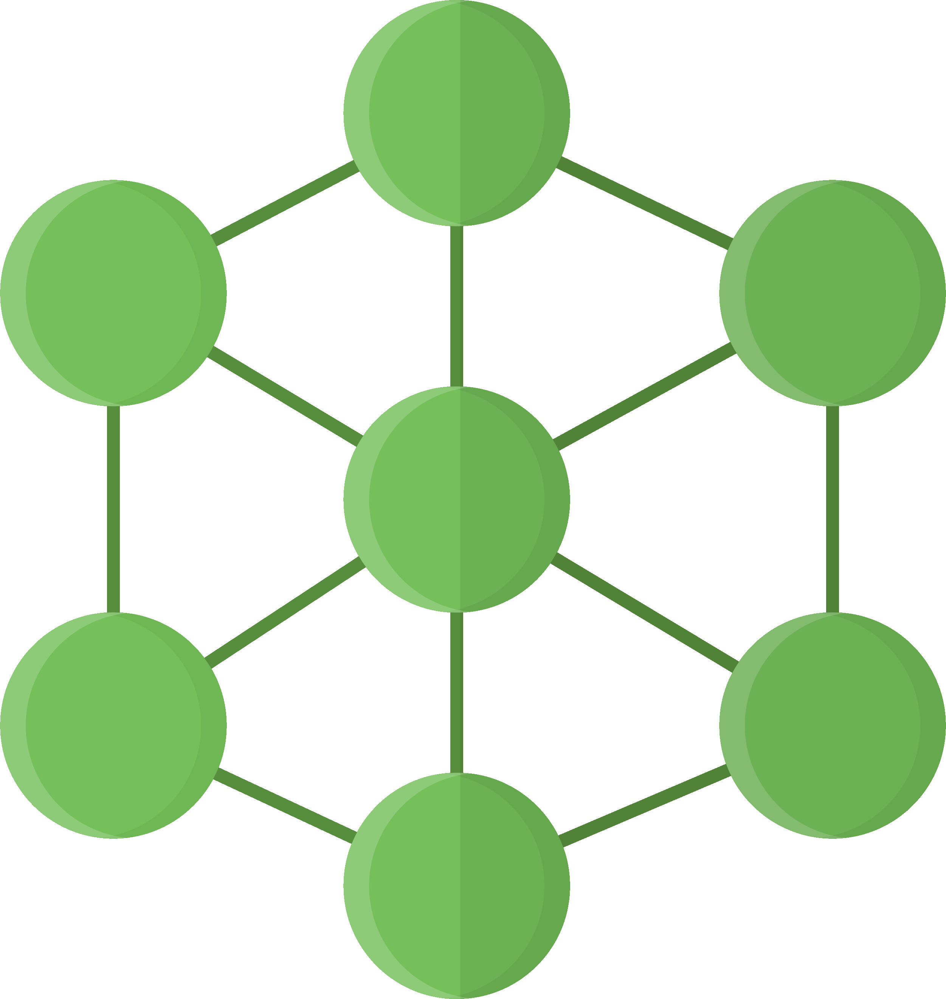
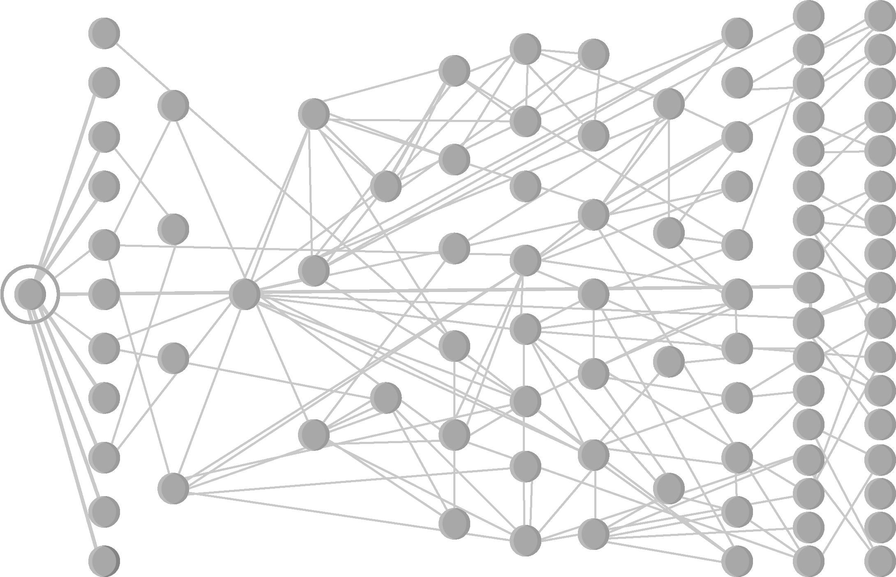
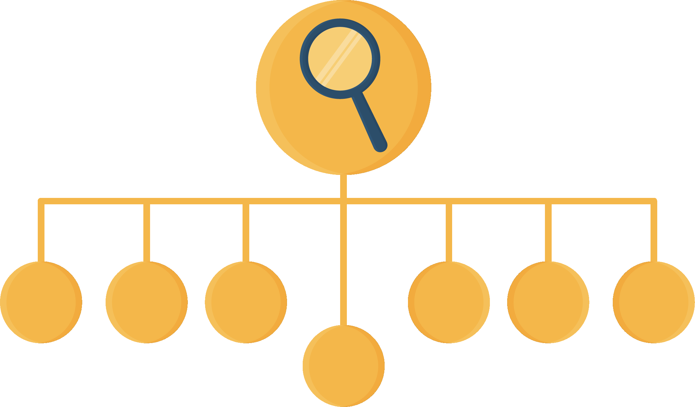
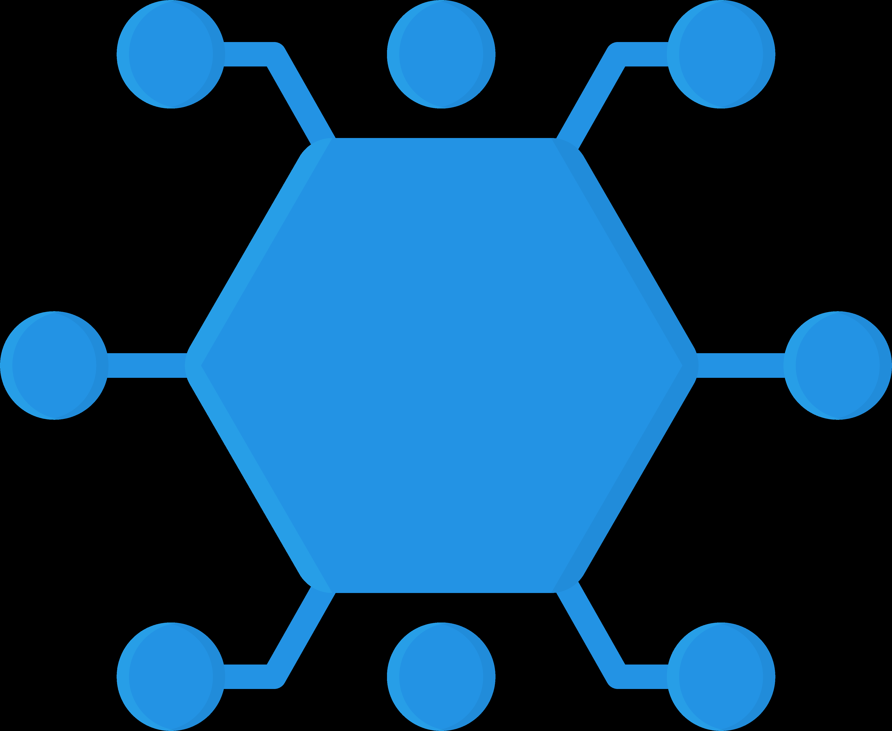

# 022 - Hệ Thống Ghi Log Phân Tán (Distributed Logging)

[← Bài trước](021-tim-kiem-phan-tan-distributed-search.md) | [Mục lục](README.md) | [Bài tiếp theo →](023-dieu-phoi-tac-vu-task-scheduler.md)

---


# Thiết Kế Hệ Thống: Hệ Thống Ghi Log Phân Tán (System Design: Distributed Logging)

Hãy cùng tìm hiểu những nguyên lý cơ bản trong việc thiết kế một hệ thống ghi log phân tán (*distributed logging system*).

Chúng ta sẽ bao quát các nội dung sau:
* **Ghi log (Logging)**
* **Sự cần thiết của việc ghi log (Need for logging)**
* **Chúng ta sẽ thiết kế một hệ thống ghi log phân tán như thế nào? (How will we design a distributed logging system?)**

---

## Ghi Log (Logging)

Một tệp log (*log file*) ghi lại chi tiết về các sự kiện diễn ra trong một ứng dụng phần mềm. Các thông tin chi tiết này có thể bao gồm các vi dịch vụ (*microservices*), giao dịch (*transactions*), hành động của dịch vụ (*service actions*), hoặc bất kỳ dữ liệu nào hữu ích cho việc gỡ lỗi (*debug*) luồng thực thi của một sự kiện trong hệ thống. Ghi log là yếu tố sống còn để giám sát luồng vận hành của ứng dụng (*application's flow*).

---

## Sự Cần Thiết Của Việc Ghi Log (Need for Logging)

Ghi log là điều thiết yếu để hiểu rõ luồng của một sự kiện trong một hệ thống phân tán (*distributed system*). Công việc này thoạt nhìn có vẻ tẻ nhạt, nhưng khi đối mặt với một sự cố hỏng hóc (*failure*) hoặc vi phạm bảo mật (*security breach*), việc ghi log giúp xác định chính xác thời điểm và cách thức mà hệ thống bị lỗi hoặc bị xâm phạm. Nó cũng hỗ trợ tìm ra nguyên nhân gốc rễ (*root cause*) của sự cố hoặc vụ rò rỉ an ninh. Việc này giúp giảm đáng kể thời gian trung bình để sửa chữa/phục hồi hệ thống (**MTTR** - *Mean Time To Repair*).

Tại sao chúng ta không đơn giản là in các câu lệnh ra màn hình (*print statements*) để theo dõi luồng ứng dụng? Cách này khả thi nhưng không hề lý tưởng:
* Các câu lệnh in đơn thuần không có cơ chế theo dõi mức độ nghiêm trọng (*severity*) của thông điệp.
* Đầu ra của các hàm `print` thường chỉ đẩy ra terminal (bảng điều khiển), trong khi nhu cầu thực tế của chúng ta là phải lưu trữ bền vững (*persist*) dữ liệu đó trên một kho lưu trữ cục bộ (*local store*) hoặc kho lưu trữ từ xa (*remote store*).
* Hơn nữa, chúng ta có thể có hàng triệu câu lệnh in, do đó tốt hơn hết là cấu trúc hóa (*structure*) và lưu trữ chúng một cách bài bản, đúng chuẩn.

---

### Những Vấn Đề Khi Sử Dụng Câu Lệnh In (Print Statements) Thay Thế Cho Ghi Log





**Các vấn đề khi sử dụng câu lệnh in (*print statements*):**
* **Không có mức độ nghiêm trọng (No severity)**
* **Không có cấu trúc (No structure)**
* **Rất khó theo dõi (Hard to track)**

Hoạt động đồng thời (*concurrent activity*) của một dịch vụ chạy trên nhiều nút (*nodes*) có thể đòi hỏi thông tin về mối quan hệ nhân quả (*causality information*) để ghép nối chính xác luồng sự kiện theo đúng trình tự. Chúng ta phải hết sức cẩn trọng khi xử lý tính nhân quả trong một hệ thống phân tán. Chúng ta sử dụng một dịch vụ ghi log (*logging service*) để quản lý một cách thích hợp các dữ liệu chẩn đoán (*diagnostic data*) và dữ liệu khám phá (*exploratory data*) của phần mềm phân tán.

Ghi log cho phép chúng ta hiểu rõ mã nguồn của mình, định vị các lỗi không lường trước được, khắc phục các lỗi đã xác định, và trực quan hóa hiệu năng của ứng dụng (*application's performance*). Bằng cách này, chúng ta nắm rõ môi trường production đang hoạt động ra sao, và biết được các tiến trình (*processes*) đang vận hành như thế nào trong hệ thống.

Phân tích log (*log analysis*) giúp ích cho chúng ta trong các kịch bản sau:
* Khắc phục sự cố ứng dụng (*troubleshoot applications*), sự cố trên các nút (*nodes*), hoặc sự cố mạng (*network issues*).
* Tuân thủ các chính sách bảo mật nội bộ, các quy định và tiêu chuẩn tuân thủ pháp lý bên ngoài (*compliance*).
* Nhận diện và ứng phó với các vi phạm dữ liệu (*data breaches*) cùng các vấn đề an ninh bảo mật khác.
* Nắm bắt và thấu hiểu hành vi của người dùng để làm đầu vào cho hệ thống gợi ý (*recommender system*).

---

## Chúng Ta Sẽ Thiết Kế Một Hệ Thống Ghi Log Phân Tán Như Thế Nào? (How Will We Design a Distributed Logging System?)

Chúng tôi chia thiết kế hệ thống ghi log phân tán thành hai bài học sau:

1. **Giới thiệu (Introduction):** Chúng ta sẽ thảo luận về cách thức hoạt động của việc ghi log ở cấp độ phân tán (*distributed level*). Chúng ta cũng sẽ chỉ ra cách giới hạn kích thước khổng lồ của một tệp log, và cấu trúc hóa chúng. Bài học này sẽ hướng dẫn chúng ta về các yêu cầu cần xem xét khi ghi lại thông tin về một hệ thống.
2. **Thiết kế (Design):** Trong bài học này, chúng ta sẽ xác định các yêu cầu (*requirements*), thiết kế API (*API design*), và thiết kế chi tiết (*detailed design*) cho hệ thống ghi log phân tán của chúng ta.

---

## Giới Thiệu Về Ghi Log Phân Tán (Introduction to Distributed Logging)

Tìm hiểu lý do tại sao chúng ta cần ghi log trong một hệ thống phân tán.

Chúng ta sẽ bao quát các nội dung sau:
* **Ghi log trong một hệ thống phân tán (Logging in a distributed system)**
* **Hạn chế kích thước log (Restrain the log size)**
* **Sử dụng phương pháp lấy mẫu (Use sampling)**
* **Sử dụng phân loại (Use categorization)**
* **Cấu trúc hóa log (Structure the logs)**
* **Các điểm cần cân nhắc khi ghi log (Points to consider while logging)**
* **Lỗ hổng bảo mật trong hạ tầng ghi log (Vulnerability in logging infrastructure)**

---

### Ghi Log Trong Một Hệ Thống Phân Tán (Logging in a Distributed System)

Trong thế giới ngày nay, ngày càng có nhiều thiết kế chuyển dịch sang kiến trúc vi dịch vụ (*microservice architecture*) thay vì kiến trúc nguyên khối (*monolithic architecture*). Trong kiến trúc vi dịch vụ, log của từng vi dịch vụ được tích lũy riêng biệt tại máy chủ tương ứng. Nếu chúng ta muốn tìm hiểu về một sự kiện nhất định vốn được xử lý qua nhiều vi dịch vụ khác nhau, việc truy cập vào từng nút một (*node*), tìm hiểu luồng đi, và xem các thông báo lỗi là vô cùng khó khăn. Tuy nhiên, mọi thứ sẽ trở nên vô cùng thuận tiện nếu chúng ta có thể truy vết log (*trace the log*) cho bất kỳ luồng cụ thể nào từ đầu đến cuối (*end-to-end*).

Hơn nữa, một vi dịch vụ không nhất thiết chỉ được triển khai trên một nút duy nhất. Nó có thể được triển khai trên hàng ngàn nút. Hãy xem xét ví dụ dưới đây, nơi hàng trăm vi dịch vụ phụ thuộc lẫn nhau, và sự cố hỏng hóc của một dịch vụ có thể dẫn đến lỗi dây chuyền của các dịch vụ khác. Nếu không có log, chúng ta khó lòng xác định được nguyên nhân gốc rễ của sự cố (*root cause of failure*). Điều này càng nhấn mạnh sự cần thiết của việc ghi log.

---

#### Chuỗi Lan Truyền Sự Cố Giữa Các Vi Dịch Vụ (Microservices Cascading Failure)



> **Hình 1 trên 6 (1 of 6):**  
> *Client* kết nối vào Điểm tương tác dành cho client (*Point of interaction for client*).  
> Các vi dịch vụ trong một hệ thống phân tán (*Microservices in a distributed system*).

---


> **Hình 2 trên 6 (2 of 6):**  
> *Client* gửi yêu cầu. Một dịch vụ khác vốn phụ thuộc vào dịch vụ trước đó cũng bị lỗi theo vì dịch vụ đó (*Another service that was dependent on the previous service also failed because of it*).

---


> **Hình 3 trên 6 (3 of 6):**  
> *Client* nhận lỗi. Một dịch vụ khác phụ thuộc vào dịch vụ trước đó cũng gặp sự cố vì nó (*Another service that was dependent on the previous service also failed because of it*).

---


> **Hình 4 trên 6 (4 of 6):**  
> *Client* tương tác. Tương tự như vậy, các dịch vụ phụ thuộc khác cũng gặp sự cố hỏng hóc theo chuỗi (*Similarly, other dependent services also fail*).

---

### Trang 7

**Client (Phía máy khách)**

Tương tự, các dịch vụ phụ thuộc khác cũng gặp sự cố (*Similarly, other dependent services also fail*)


*5 trên 6 (5 of 6)*

Chúng ta cần biết microservice nào đã bị lỗi và dẫn đến chuỗi sự cố dây chuyền này (*chain of failures / cascading failures*).

Vậy làm thế nào để khắc phục sự cố (*troubleshoot*) đối với bất kỳ sự kiện nào và đồng thời nắm bắt được luồng luân chuyển của sự kiện (*flow of event*) trong hệ thống phân tán (*distributed system*)?

Tương tự, các dịch vụ phụ thuộc khác cũng gặp sự cố (*Similarly other dependent services also fails*)


*6 trên 6 (6 of 6)*

---

### Trang 8

#### Kiểm soát và hạn chế kích thước log (*Restrain the log size*)

Số lượng log gia tăng dần theo thời gian. Tại một thời điểm, có thể có hàng trăm thông điệp đồng thời (*concurrent messages*) cần được ghi lại. Nhưng câu hỏi đặt ra là: liệu tất cả chúng có thực sự quan trọng đến mức cần phải ghi log hay không? Để giải quyết vấn đề này, log cần phải được cấu trúc hóa (*structured*). Chúng ta cần quyết định những gì sẽ được ghi log vào hệ thống ở cấp độ ứng dụng (*application level*) hoặc cấp độ ghi log (*logging level*).

#### Sử dụng kỹ thuật lấy mẫu (*Use sampling*)

Trong phương pháp tiếp cận này, chúng ta sẽ xác định những thông điệp nào nên được ghi vào hệ thống.

Hãy xem xét một tình huống khi chúng ta có rất nhiều thông điệp phát sinh từ cùng một nhóm sự kiện (*set of events*). Ví dụ: có nhiều người đang bình luận vào một bài viết, trong đó Người X bình luận vào bài viết của Người Y, sau đó Người Z lại bình luận vào bài viết của Người Y, và cứ tiếp tục như vậy. Thay vì ghi lại toàn bộ thông tin, chúng ta có thể sử dụng một dịch vụ lấy mẫu (*sampler service*) chỉ ghi lại một tập hợp nhỏ các thông điệp từ một khối dữ liệu lớn (*larger chunk*). Bằng cách này, chúng ta có thể quyết định các thông điệp quan trọng nhất cần được ghi log.

> [!NOTE]
> Đối với các hệ thống quy mô lớn như Facebook, nơi có hàng tỷ sự kiện xảy ra mỗi giây, việc ghi log toàn bộ là bất khả thi (*not viable*). Một ngưỡng lấy mẫu (*sampling threshold*) và chiến lược lấy mẫu thích hợp là điều bắt buộc để chọn lọc ra một tập dữ liệu mang tính đại diện (*representative data set*).

Chúng ta cũng có thể phân loại các kiểu thông điệp và áp dụng một bộ lọc (*filter*) nhằm nhận diện các thông điệp quan trọng và chỉ ghi chúng vào hệ thống.

#### Điểm cần suy ngẫm (*Point to Ponder*)

**Câu hỏi (Question):**
Đâu là kịch bản mà phương pháp lấy mẫu (*sampling approach*) sẽ không hoạt động hiệu quả hoặc không thể áp dụng được?

---

### Trang 9

**Xem câu trả lời (Show Answer)**

#### Sử dụng phân loại mức độ (*Use categorization*)

Hãy xem xét sự hỗ trợ ghi log được cung cấp bởi các ngôn ngữ lập trình khác nhau. Ví dụ: chúng ta có `log4j` trong Java và thư viện `logging` trong Python. Các mức độ nghiêm trọng (*severity levels*) sau đây thường được sử dụng phổ biến trong ghi log:

* **DEBUG**
* **INFO**
* **WARNING**
* **ERROR**
* **FATAL / CRITICAL**

Thông thường, log trên môi trường thực tế (*production logs*) được thiết lập để in ra các thông điệp có mức độ nghiêm trọng từ **WARNING** trở lên. Tuy nhiên, để theo dõi luồng thực thi chi tiết hơn (*detailed flow*), các mức độ nghiêm trọng cũng có thể được cấu hình ở mức **DEBUG** và **INFO**.

Nhấp vào nút "Run" để xem quá trình thực thi của một ví dụ sử dụng thư viện `logging` của Python nhằm in log ra màn hình:

```python
1  import logging as log
2  # thiết lập cấp độ ghi log là DEBUG
3  log.basicConfig(level=log.DEBUG)
4  for i in range(6):
5      if i == 0:
6          log.debug("Debug level")
7      elif i == 1:
8          log.info("Info level")
9      elif i == 2:
10         log.warning("Warning level")
11     elif i == 3:
12         log.error("Error level")
13     elif i == 4:
14         log.critical("Critical level")
15     elif i == 5:
16         print("Uncomment the following to view a system generated error")
17         #print(3/0)
```

---

### Trang 10

**Chạy (Run) | Lưu (Save) | Thiết lập lại (Reset)**

Kết quả đầu ra sẽ tương tự như sau:
```text
DEBUG:root:Debug level
INFO:root:Info level
WARNING:root:Warning level
ERROR:root:Error level
CRITICAL:root:Critical level
```

Hãy bỏ chú thích (*uncomment*) dòng 17 để xem lỗi do hệ thống sinh ra khi thực hiện phép chia một số nguyên cho số 0. Bản thân Python sẽ tự động ghi log lỗi ra console:

#### Cấu trúc hóa log (*Structure the logs*)

Các ứng dụng có toàn quyền tự do lựa chọn cấu trúc cho dữ liệu log của mình. Ví dụ: một ứng dụng có thể tùy ý ghi log dưới dạng nhị phân (*binary*) hoặc dữ liệu văn bản thuần (*text data*), nhưng việc áp đặt một cấu trúc nhất định lên log mang lại rất nhiều lợi ích:
1. **Lợi ích thứ nhất của log có cấu trúc (*structured logs*):** Khả năng tương tác tốt hơn (*better interoperability*) giữa bên ghi log (*log writers*) và bên đọc log (*log readers*).
2. **Lợi ích thứ hai:** Cấu trúc rõ ràng giúp công việc xử lý của hệ thống xử lý log (*log processing system*) trở nên dễ dàng và hiệu quả hơn rất nhiều.

> [!NOTE]
> Việc cấu trúc hóa log tự nó là một đề tài nghiên cứu rất chuyên sâu (*dense topic*). Đối với những độc giả quan tâm, chúng tôi khuyến nghị tham khảo luận án Tiến sĩ của Ryan Braud với tiêu đề *"Query-based debugging of distributed systems"* (Gỡ lỗi hệ thống phân tán dựa trên truy vấn).

#### Các điểm cần cân nhắc khi ghi log (*Points to consider while logging*)

Chúng ta cần hết sức cẩn trọng trong quá trình ghi log. Thông tin ghi log chỉ nên chứa những dữ liệu liên quan và tuyệt đối không được vi phạm các quy chuẩn an toàn bảo mật (*security concerns*). Đối với các dữ liệu cần bảo mật, chúng ta phải ghi dữ liệu đã được mã hóa (*encrypted data*). Chúng ta nên lưu ý các điểm sau đây khi ghi log:

---

### Trang 11

**Quay lại (Back)**  
**Thiết Kế Hệ Thống: Ghi Log Phân Tán (System Design: Distributed Logging)**  
**Đánh dấu đã hoàn thành (Mark As Completed)**  
**Tiếp theo (Next): Thiết kế dịch vụ ghi log phân tán (Design of a Distributed Logging Ser…)**

* **Tránh ghi lại thông tin nhận dạng cá nhân (PII - Personally Identifiable Information):** ví dụ như họ tên, địa chỉ cư trú, email, v.v.
* **Tránh ghi lại các thông tin nhạy cảm (Sensitive Information):** chẳng hạn như số thẻ tín dụng, mật khẩu đăng nhập, khóa bảo mật, v.v.
* **Tránh thông tin dư thừa (Avoid excessive information):** Việc ghi lại toàn bộ mọi thông tin là không cần thiết. Nó chỉ làm tiêu tốn thêm dung lượng lưu trữ và gây suy giảm hiệu năng nghiêm trọng. Việc ghi log bản chất là một tác vụ nặng về I/O (*I/O-heavy operation*), do đó luôn đi kèm với chi phí suy giảm hiệu năng (*performance penalties*).
* **Cơ chế ghi log phải an toàn và không có lỗ hổng:** Bởi vì log chứa đựng toàn bộ luồng hoạt động nội bộ của ứng dụng, nên một cơ chế ghi log không an toàn sẽ tạo cơ hội cho tin tặc (*hackers*) khai thác.

#### Lỗ hổng bảo mật trong hạ tầng ghi log (*Vulnerability in logging infrastructure*)

Một lỗ hổng zero-day (*zero-day vulnerability*) trong Log4j — một framework ghi log rất nổi tiếng cho Java — đã được phát hiện gần đây. Log4j đã chứa lỗ hổng ẩn này, mang tên **Log4Shell (CVE-2021-44228)**, từ tận năm 2013. Tổ chức Apache đã chấm điểm tối đa hiện có cho lỗ hổng này với mức độ nghiêm trọng CVSS là 10/10. 

Mã khai thác (*exploit*) rất đơn giản để thực thi nhưng lại gây ảnh hưởng tới hàng trăm triệu thiết bị trên toàn cầu. Các chuyên gia an ninh mạng khẳng định rằng lỗ hổng này có thể tạo điều kiện cho các cuộc tấn công mạng tàn khốc trên quy mô quốc tế, bởi vì nó cho phép kẻ tấn công thực thi mã độc từ xa (*remote code execution*) và chiếm quyền kiểm soát hoàn toàn máy chủ (*take control of the machine*).

---

### Trang 12

### Thiết Kế Dịch Vụ Ghi Log Phân Tán (*Design of a Distributed Logging Service*)

Tìm hiểu cách thiết kế một dịch vụ ghi log phân tán hoàn chỉnh.

**Chúng ta sẽ bao quát các nội dung sau:**
* Các yêu cầu (*Requirements*)
  * Yêu cầu chức năng (*Functional requirements*)
  * Yêu cầu phi chức năng (*Non-functional requirements*)
* Các thành phần khối dựng sẽ sử dụng (*Building blocks we will use*)
* Thiết kế API (*API design*)
* Thiết kế ban đầu (*Initial design*)
* Ghi log ở các cấp độ khác nhau (*Logging at various levels*)
  * Trong một máy chủ (*In a server*)
  * Ở cấp độ trung tâm dữ liệu (*At datacenter level*)
* Kết luận (*Conclusion*)

Bây giờ chúng ta sẽ tiến hành thiết kế hệ thống ghi log phân tán. Hệ thống ghi log của chúng ta cần ghi lại toàn bộ các hoạt động hoặc thông điệp (chúng ta sẽ không đưa khả năng lấy mẫu - *sampling ability* vào trong bản thiết kế này).

#### Các yêu cầu (*Requirements*)

Hãy liệt kê các yêu cầu phục vụ cho việc thiết kế hệ thống ghi log phân tán:

##### Yêu cầu chức năng (*Functional requirements*)

Các yêu cầu chức năng của hệ thống chúng ta bao gồm:

* **Ghi log (Writing logs):** Các dịch vụ trong hệ thống phân tán phải có khả năng ghi log vào hệ thống ghi log tập trung.
* **Tìm kiếm log dễ dàng (Searchable logs):** Hệ thống phải có khả năng tìm kiếm log một cách dễ dàng và nhanh chóng. Tương tự, việc truy vết luồng luân chuyển của ứng dụng từ đầu đến cuối (*end-to-end flow*) cũng phải diễn ra thuận tiện.
* **Lưu trữ log (Storing logging):** Dữ liệu log phải được lưu trữ trên hệ thống lưu trữ phân tán (*distributed storage*) để thuận tiện cho việc truy xuất và đảm bảo an toàn dữ liệu...

---

# Thiết Kế Hệ Thống Ghi Log Phân Tán (Distributed Logging System)

truy cập.
* **Bộ trực quan hóa nhật ký tập trung (Centralized logging visualizer):** Hệ thống phải cung cấp một giao diện hiển thị hợp nhất (unified view) cho các dịch vụ phân tán trên toàn cầu.

### Yêu Cầu Phi Chức Năng (Non-functional requirements)
Các yêu cầu phi chức năng của hệ thống chúng ta bao gồm:
* **Độ trễ thấp (Low latency):** Ghi log (logging) là một tác vụ tiêu tốn I/O (I/O-intensive operation) và thường chậm hơn đáng kể so với các tác vụ xử lý của CPU. Chúng ta cần thiết kế hệ thống sao cho việc ghi log không nằm trên đường thực thi trọng yếu (critical path) của ứng dụng.
* **Khả năng mở rộng (Scalability):** Hệ thống ghi log phải có khả năng mở rộng. Nó cần xử lý được khối lượng log gia tăng theo thời gian cũng như đáp ứng lượng người dùng đồng thời (concurrent users) ngày càng tăng.
* **Tính sẵn sàng (Availability):** Hệ thống ghi log phải đạt mức độ sẵn sàng cao (High Availability) để ghi nhận dữ liệu liên tục.

### Các Khối Xây Dựng Sẽ Sử Dụng (Building blocks we will use)
Thiết kế của một hệ thống ghi log phân tán sẽ tận dụng các khối nền tảng (building blocks) sau:
* **Hệ thống Pub-sub (Pub-sub system):** Chúng ta sẽ sử dụng một hệ thống xuất bản - đăng ký (pub-sub system) để xử lý kích thước khổng lồ của các bản ghi log.
* **Tìm kiếm phân tán (Distributed search):** Chúng ta sẽ sử dụng tìm kiếm phân tán để truy vấn các bản ghi log một cách hiệu quả.

```
Các khối xây dựng sẽ sử dụng:
├── Hệ thống Pub-sub (Pub-sub system)
└── Tìm kiếm phân tán (Distributed search)
```

---

## Thiết Kế API (API design)
Thiết kế API cho bài toán này được trình bày dưới đây:

### 1. Ghi một thông điệp (Write a message)
Lời gọi API để thực hiện thao tác ghi sẽ có định dạng như sau:
```text
write(unique_ID, message_to_be_logged)
```

| Tham số (Parameter) | Mô tả (Description) |
| :--- | :--- |
| `unique_ID` | Là một định danh dạng số (numeric ID) bao gồm `application-id`, `service-id`, và một nhãn thời gian (`time stamp`). |
| `message_to_be_logged` | Là nội dung thông điệp log được lưu trữ tương ứng với một khóa duy nhất (unique key). |

### 2. Tìm kiếm nhật ký (Search log)
Lời gọi API để tìm kiếm dữ liệu sẽ có định dạng như sau:
```text
searching(keyword)
```
Lời gọi này trả về một danh sách các bản ghi log có chứa từ khóa đó.

| Tham số (Parameter) | Mô tả (Description) |
| :--- | :--- |
| `keyword` | Được sử dụng để tìm kiếm các bản ghi log chứa từ khóa chỉ định. |

---

## Thiết Kế Ban Đầu (Initial design)
Trong một hệ thống phân tán (distributed system), các máy khách (clients) trên toàn cầu tạo ra các sự kiện bằng cách gửi yêu cầu dịch vụ tới các node phục vụ (serving nodes) khác nhau. Các node này sinh ra log trong quá trình xử lý từng yêu cầu. Những bản ghi log này được tích lũy ngay trên từng node tương ứng.

Bên cạnh các khối nền tảng cốt lõi, hãy cùng liệt kê các thành phần chính của hệ thống:
* **Bộ tích lũy log (Log accumulator):** Một tiến trình đại lý (agent) thực hiện thu thập log từ từng node và đẩy chúng vào bộ lưu trữ (storage). Nhờ đó, nếu muốn tra cứu về một sự kiện cụ thể, chúng ta không cần phải truy cập vào từng node riêng lẻ mà có thể truy xuất trực tiếp từ bộ lưu trữ của mình.
* **Bộ lưu trữ (Storage):** Các bản ghi log cần được lưu trữ ở một nơi nào đó sau khi tích lũy. Chúng ta sẽ chọn lưu trữ dạng đối tượng nhị phân (Blob storage) để lưu các tệp log.
* **Bộ lập chỉ mục log (Log indexer):** Số lượng tệp log ngày càng tăng sẽ ảnh hưởng trực tiếp đến hiệu năng tìm kiếm. Bộ lập chỉ mục log sẽ sử dụng công nghệ tìm kiếm phân tán (Distributed Search) để phục vụ việc tra cứu hiệu quả.
* **Bộ trực quan hóa (Visualizer):** Bộ trực quan hóa được dùng để cung cấp một góc nhìn hợp nhất (unified view) cho toàn bộ dữ liệu log.

Thiết kế cho phương pháp này được minh họa như sau:


Có hàng triệu máy chủ trong một hệ thống phân tán, do đó việc chỉ sử dụng một bộ tích lũy log duy nhất (single log accumulator) sẽ làm suy giảm nghiêm trọng khả năng mở rộng (scalability). Tiếp theo, hãy cùng tìm hiểu cách chúng ta mở rộng quy mô hệ thống.

---

## Ghi Log Ở Nhiều Cấp Độ Khác Nhau (Logging at various levels)
Hãy cùng khám phá cách hệ thống ghi log vận hành ở nhiều cấp độ khác nhau.

### Tại Một Máy Chủ (In a server)
Trong phần này, chúng ta sẽ tìm hiểu cách các dịch vụ khác nhau thuộc về nhiều ứng dụng khác nhau thực hiện ghi log bên trong một máy chủ.

Hãy xem xét trường hợp có nhiều ứng dụng khác nhau cùng chạy trên một máy chủ, chẳng hạn như App 1, App 2, v.v. Mỗi ứng dụng lại có nhiều vi dịch vụ (microservices) khác nhau đang hoạt động đồng thời. Ví dụ: một ứng dụng thương mại điện tử có thể đồng thời chạy các dịch vụ như xác thực người dùng (authenticating users), lấy thông tin giỏ hàng (fetching carts), v.v. Mỗi dịch vụ đều sinh ra các bản ghi log.

Chúng ta sử dụng một định danh (ID) kết hợp giữa `application-id`, `service-id` và nhãn thời gian (`time stamp`) của nó để phân biệt duy nhất giữa các dịch vụ của nhiều ứng dụng. Các nhãn thời gian (time stamps) có thể hỗ trợ xác định mối quan hệ nhân quả của các sự kiện (causality of events).

Mỗi dịch vụ sẽ đẩy dữ liệu của nó tới dịch vụ tích lũy log (log accumulator service). Dịch vụ này chịu trách nhiệm cho các hành động sau:
1. Tiếp nhận các bản ghi log (Receiving the logs).
2. Lưu trữ log cục bộ (Storing the logs locally).
3. Đẩy log vào một hệ thống pub-sub (Pushing the logs to a pub-sub system).

Chúng ta sử dụng hệ thống pub-sub để giải quyết bài toán về khả năng mở rộng (scalability). Giờ đây, mỗi máy chủ sẽ có bộ tích lũy log riêng (hoặc nhiều bộ tích lũy) để đẩy dữ liệu vào pub-sub. Hệ thống pub-sub hoàn toàn có khả năng quản lý khối lượng log khổng lồ.

Để đáp ứng thêm yêu cầu về độ trễ thấp (low latency), chúng ta không muốn việc ghi log làm ảnh hưởng đến hiệu năng của các tiến trình khác, do đó chúng ta gửi các bản ghi log theo cơ chế bất đồng bộ (asynchronously) thông qua một luồng có mức ưu tiên thấp (low-priority thread). Bằng cách này, hệ thống ghi log không can thiệp vào hiệu năng xử lý của các tiến trình khác và đảm bảo được tính sẵn sàng (availability).




*Hình 1/3: Nhiều ứng dụng chạy trên một máy chủ, và mỗi ứng dụng bao gồm nhiều vi dịch vụ khác nhau.*


*Hình 2/3: Mỗi dịch vụ sinh ra các bản ghi log và gửi chúng tới bộ tích lũy log (log accumulator).*




*Hình 3/3: Bộ tích lũy log đẩy các bản ghi log vào một hệ thống pub-sub.*

> [!WARNING]
> Chúng ta cần lưu ý rằng dữ liệu có thể bị mất mát trong quá trình ghi nhận một lượng lớn các thông điệp. Luôn tồn tại một sự đánh đổi (trade-off) giữa độ trễ mà người dùng cảm nhận được (user-perceived latency) và tính đảm bảo dữ liệu log được lưu trữ bền vững (data persistence). 
> 
> Để đạt được độ trễ thấp hơn, các dịch vụ ghi log thường lưu giữ dữ liệu trên bộ nhớ RAM và thực hiện ghi đĩa bền vững theo cơ chế bất đồng bộ (persist asynchronously). Ngoài ra, chúng ta có thể giảm thiểu nguy cơ mất mát dữ liệu bằng cách bổ sung thêm các bộ tích lũy log dự phòng (redundant log accumulators) nhằm xử lý số lượng người dùng đồng thời ngày càng tăng cao.

### Điểm Cần Suy Ngẫm (Point to Ponder)
**Câu hỏi (Question)**

---

# Kiến Trúc Hệ Thống Ghi Log Phân Tán (Distributed Logging System)

Hệ thống ghi log trong môi trường phân tán quy mô lớn đòi hỏi kiến trúc vừa đảm bảo hiệu năng cao, vừa đáp ứng tính toàn vẹn, bảo mật và khả năng phân tích sự cố nhanh chóng mà không làm ảnh hưởng đến luồng xử lý chính (*critical execution path*).

---

## 1. Môi Trường Đa Thuê Bao (Multi-Tenancy) vs. Đơn Thuê Bao (Single-Tenancy)

Khi triển khai hệ thống log trên hạ tầng chia sẻ (như đám mây công cộng) so với hạ tầng chuyên biệt (như các trung tâm dữ liệu độc quyền):

* **Bảo mật và Tách biệt (Security & Isolation):** 
  * Môi trường **Multi-tenant** đòi hỏi sự phân tách rạch ròi giữa dữ liệu của các tenant khác nhau, thường cần các phiên bản pub-sub riêng biệt hoặc cơ chế mã hóa đầu cuối (*end-to-end encryption*). Điều này dẫn đến sự đánh đổi về chi phí tài nguyên và độ trễ (*latency*).
  * Môi trường **Single-tenant** cho phép tối ưu hóa dung lượng lưu trữ và năng lực xử lý dùng chung trên quy mô toàn hệ thống mà không cần tách biệt phức tạp.
* **Quy mô xử lý:** Với quy mô hàng triệu máy chủ tạo ra hàng petabyte log mỗi giờ (tương tự trường hợp của Meta/Facebook với hệ thống Scribe), log được đẩy vào cụm hàng đợi phân tán có khả năng mở rộng ngang (*horizontally scalable pub-sub*) để lưu trữ tạm thời trước khi chuyển tiếp vào các kho lưu trữ phân tán dài hạn.

---

## 2. Kiến Trúc Thu Thập và Pipeline Xử Lý Log Ở Cấp Độ Data Center

Một pipeline ghi log phân tán tiêu chuẩn bao gồm các thành phần cốt lõi sau:

```
[Server] -> [Log Accumulator] --\
[Server] -> [Log Accumulator] ---> [Pub-Sub System] ---> [Blob Storage / Long-term Store]
[Server] -> [Log Accumulator] --/        |
                                         +--> [Filterer]
                                         +--> [Error Aggregator]
                                         +--> [Alert Aggregator]
```


### Các dịch vụ xử lý thời gian thực trên tầng Pub-Sub:

* **Log Accumulator (Bộ gom log tại nút nguồn):** Thu thập và đệm các bản ghi log từ máy chủ cục bộ nhằm giảm thiểu tần suất I/O và tránh tắc nghẽn mạng cục bộ.
* **Pub-Sub System (Hệ thống phân phối thông điệp):** Hoạt động như một bộ đệm phân tán (*distributed buffer*), tách rời tốc độ tạo log của dịch vụ với tốc độ tiêu thụ/ghi đĩa của hệ thống hạ tầng.
* **Filterer (Bộ lọc dữ liệu):** Phân loại và định tuyến log theo từng định danh ứng dụng hoặc dịch vụ trước khi đưa vào kho lưu trữ đối tượng (*blob storage*).
* **Error Aggregator & Alert Aggregator:** Trích xuất các sự kiện lỗi nghiêm trọng ngay trong hàng đợi để kích hoạt cảnh báo hoặc gửi đến các công cụ giám sát tức thì, giúp giảm thiểu tối đa thời gian khắc phục sự cố (Mean Time to Repair - MTTR) mà không cần phải chờ truy vấn quét đĩa.


---

## 3. Quản Lý Vòng Đời Dữ Liệu và Giao Diện Phân Tích


* **Expiration Checker (Quản lý hết hạn & Lưu trữ lạnh):** 
  * Log thông thường chỉ cần lưu trữ trong vài ngày hoặc vài tháng.
  * Các loại log phục vụ tuân thủ (*compliance logs*) cần được chuyển sang kho lưu trữ lạnh (*cold/archival storage*) với thời hạn lưu trữ từ 3 đến 5 năm trước khi hủy hoàn toàn.
* **Log Indexer & Visualizer:** Xây dựng chỉ mục tìm kiếm và cung cấp giao diện đồ họa phân tích (phía sau tầng Load Balancer) cho người dùng cuối và kỹ sư vận hành.

---

## 4. Xâu Chuỗi Log Đầu-Cuối và Quan Hệ Nhân Quả (Distributed Tracing & Causality)

Khi một yêu cầu API duy nhất kích hoạt hàng loạt lệnh gọi phân tán qua hàng trăm microservices:

1. **Bộ tạo định danh duy nhất (Unique Sequencer):** 
   * Máy chủ Gateway/Front-end gán cho mỗi yêu cầu một mã định danh duy nhất (`Trace ID` / `Request ID`).
   * Mã định danh này được truyền tuần tự trong metadata/header qua tất cả các lời gọi hàm phân tán (*fan-out requests*).
2. **Quan hệ xảy ra trước (Happens-Before Relationship):**
   * Các bộ sinh số thứ tự (như Snowflake, Vector Clocks hoặc Sequencer phân tán) đảm bảo các ID có tính chất thứ tự nhân quả: nếu $\text{ID}_1 < \text{ID}_2$ thì sự kiện 1 diễn ra trước sự kiện 2.
3. **Tổng hợp và Tái hiện:**
   * Việc kết hợp mã định danh duy nhất với nhãn thời gian (*timestamp*) cho phép hệ thống phân tích tái tạo chính xác luồng thực thi toàn diện của một request từ đầu đến cuối một cách tuần tự.

---

## 5. Đánh Đổi Kiến Trúc: Lưu Trữ Tập Trung vs. Tìm Kiếm Phân Tán

Bên cạnh giải pháp chuyển toàn bộ log về kho lưu trữ tập trung (như Scribe hoặc Blob Storage), một số hệ thống lưu trữ quy mô siêu lớn (tiêu biểu như Windows Azure Storage System - WAS) áp dụng kiến trúc lưu trữ log tại chỗ trên đĩa cục bộ của từng node. Thay vì chịu tải truyền tải dữ liệu khổng lồ qua mạng, họ sử dụng công cụ tìm kiếm phân tán (tương tự như công cụ *grep* phân tán) để truy vấn trực tiếp trên các node khi cần điều tra sự cố.

---

Bạn có muốn tiếp tục đi sâu vào phần tóm tắt và phân tích kiến trúc của chương/chủ đề kế tiếp không?


---

[← Bài trước](021-tim-kiem-phan-tan-distributed-search.md) | [Mục lục](README.md) | [Bài tiếp theo →](023-dieu-phoi-tac-vu-task-scheduler.md)
