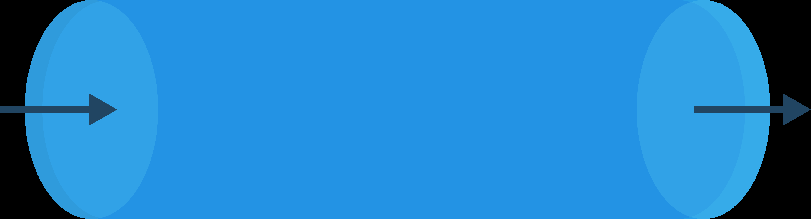
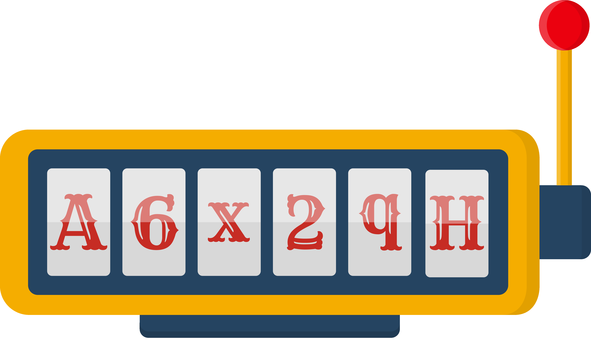

# 023 - Bộ Điều Phối Tác Vụ Phân Tán (Distributed Task Scheduler)

[← Bài trước](022-ghi-log-phan-tan-distributed-logging.md) | [Mục lục](README.md) | [Bài tiếp theo →](024-bo-dem-phan-manh-sharded-counters.md)

---


# Thiết Kế Hệ Thống: Bộ Điều Phối Tác Vụ Phân Tán (System Design: The Distributed Task Scheduler)

Tìm hiểu các nguyên lý cơ bản trong thiết kế một bộ điều phối tác vụ phân tán (**Distributed Task Scheduler**).

**Nội dung sẽ bao gồm:**
* Bộ điều phối tác vụ (**Task Scheduler**) là gì?
* Khi nào nên sử dụng bộ điều phối tác vụ?
* Điều phối tác vụ phân tán (**Distributed Task Scheduling**).
* Chúng ta sẽ thiết kế một hệ thống điều phối tác vụ như thế nào?

---

## Bộ Điều Phối Tác Vụ (Task Scheduler) Là Gì?

Một tác vụ (**task**) là một đơn vị công việc tính toán đòi hỏi các tài nguyên hệ thống (thời gian CPU, bộ nhớ RAM, lưu trữ/storage, băng thông mạng/network bandwidth, v.v.) trong một khoảng thời gian xác định. Ví dụ: việc tải lên một bức ảnh hoặc video trên Facebook hay Instagram sẽ bao gồm các tác vụ chạy ngầm (**background tasks**) sau:

1. **Mã hóa (Encode)** ảnh hoặc video thành nhiều độ phân giải khác nhau.
2. **Kiểm duyệt (Validate)** ảnh hoặc video để xác minh bản quyền kiếm tiền từ nội dung (**content monetization copyrights**), cùng nhiều bước kiểm tra khác.

Việc thực thi thành công tất cả các tác vụ trên mới làm cho bức ảnh hoặc video hiển thị công khai. Tuy nhiên, người dùng tải ảnh/video lên không cần phải chờ các tác vụ trên hoàn tất.

Một ví dụ khác là khi chúng ta đăng một bình luận trên Facebook. Chúng ta không bắt người đăng bình luận phải chờ đợi cho đến khi bình luận đó được phân phối tới toàn bộ người theo dõi (**followers**). Quá trình phân phối đó được ủy quyền cho một bộ điều phối tác vụ bất đồng bộ (**asynchronous task scheduler**) xử lý ngoại tuyến (**offline**).


Trong một hệ thống, có rất nhiều tác vụ cùng cạnh tranh nguồn tài nguyên tính toán hữu hạn. Một hệ thống đóng vai trò trung gian giữa các tác vụ và tài nguyên bằng cách phân bổ tài nguyên một cách thông minh cho các tác vụ sao cho đáp ứng được cả mục tiêu cấp độ tác vụ (**task-level goals**) lẫn mục tiêu cấp độ hệ thống (**system-level goals**) được gọi là **bộ điều phối tác vụ (Task Scheduler)**.

---

## Khi Nào Nên Sử Dụng Bộ Điều Phối Tác Vụ?

Bộ điều phối tác vụ là một thành phần then chốt trong hệ thống nhằm giải quyết công việc một cách hiệu quả. Nó cho phép chúng ta hoàn thành một khối lượng lớn tác vụ chỉ với nguồn tài nguyên giới hạn. Nó cũng hỗ trợ tận dụng tối đa tài nguyên hệ thống, mang lại trải nghiệm thực thi liền mạch không gián đoạn cho người dùng, và nhiều lợi ích khác. Dưới đây là một số ca sử dụng (**use cases**) của việc điều phối tác vụ:

* **Nút dựa trên một hệ điều hành đơn lẻ (Single-OS-based node):** Nút này có nhiều tiến trình (**processes**) hoặc tác vụ cạnh tranh nguồn tài nguyên tính toán giới hạn của chính nó. Vì vậy, chúng ta có thể sử dụng bộ điều phối tác vụ cục bộ của hệ điều hành (**local OS task scheduler**) để phân bổ tài nguyên hiệu quả cho các tác vụ. Bộ điều phối này sử dụng các hàng đợi đa cấp phản hồi (**multi-level feedback queues**) để chọn các tác vụ và chạy chúng trên một bộ xử lý (**processor**) nào đó.
* **Các dịch vụ điện toán đám mây (Cloud computing services):** Nơi có rất nhiều tài nguyên phân tán và đa dạng các tác vụ đến từ nhiều khách thuê (**multi-tenants**), nhu cầu cấp thiết là phải có một bộ điều phối tác vụ để tận dụng tài nguyên điện toán đám mây hiệu quả và đáp ứng nhu cầu của các đối tượng thuê tài nguyên. Bộ điều phối tác vụ cục bộ của hệ điều hành không đủ khả năng cho mục đích này vì số lượng tác vụ lên đến hàng tỷ, nguồn gốc tác vụ không duy nhất, và tài nguyên cần quản trị không nằm trên một máy đơn lẻ. Chúng ta bắt buộc phải sử dụng một giải pháp phân tán (**distributed solution**).
* **Các hệ thống phân tán quy mô lớn (Large distributed systems):** Trong hệ thống này, có vô số tác vụ chạy ngầm được kích hoạt chỉ bởi một yêu cầu đơn lẻ từ người dùng. Hãy hình dung một hệ thống phổ biến như Facebook, WhatsApp, hay Instagram có hàng triệu đến hàng tỷ người dùng. Các hệ thống này đòi hỏi một bộ điều phối tác vụ đủ mạnh để xử lý hàng tỷ tác vụ. Facebook điều phối các tác vụ của mình trước hàng tỷ yêu cầu bất đồng bộ song song từ người dùng bằng hệ thống **Async**.

> [!NOTE]
> **Async** là bộ điều phối tác vụ phân tán nội bộ do Facebook tự phát triển để điều phối toàn bộ tác vụ của họ. Một số tác vụ nhạy cảm về mặt thời gian (**time-sensitive**), ví dụ như tác vụ gửi thông báo cho người dùng rằng một sự kiện phát trực tiếp (**livestream**) đã bắt đầu. Sẽ là vô nghĩa nếu người dùng nhận được thông báo về buổi livestream sau khi sự kiện đó đã kết thúc. Một số tác vụ khác có thể trì hoãn lại, ví dụ như tác vụ gợi ý kết bạn cho người dùng. Async điều phối các tác vụ dựa trên các mức độ ưu tiên (**priorities**) phù hợp.

---

## Điều Phối Tác Vụ Phân Tán (Distributed Task Scheduling)

Quá trình đưa ra quyết định và gán tài nguyên cho các tác vụ một cách kịp thời được gọi là **điều phối tác vụ (task scheduling)**. Sự khác biệt trực quan giữa bộ điều phối tác vụ cấp hệ điều hành (**OS-level task scheduler**) và bộ điều phối tác vụ cấp trung tâm dữ liệu (**data center-level task scheduler**) được thể hiện trong hình minh họa sau:

### So sánh bộ điều phối tác vụ cấp hệ điều hành và cấp trung tâm dữ liệu (An OS-level task scheduler vs. a data center-level task scheduler)


Bộ điều phối tác vụ của hệ điều hành (**OS task scheduler**) điều phối các tác vụ hoặc tiến trình cục bộ của một nút lên các tài nguyên tính toán của chính nút đó. Trong khi đó, bộ điều phối tác vụ của trung tâm dữ liệu (**data center task scheduler**) điều phối hàng tỷ tác vụ đến từ nhiều khách thuê (**multi-tenants**) sử dụng tài nguyên của toàn bộ trung tâm dữ liệu.

Mục tiêu của chúng ta là thiết kế một bộ điều phối tác vụ tương tự như bộ điều phối cấp trung tâm dữ liệu, nơi các yếu tố sau được xem xét:
* Các tác vụ sẽ đến từ nhiều nguồn khác nhau, nhiều đối tượng thuê (**tenants**) và các hệ thống con (**sub-systems**) khác nhau.
* Rất nhiều tài nguyên sẽ nằm rải rác trong một trung tâm dữ liệu (hoặc có thể trải rộng trên nhiều trung tâm dữ liệu - data centers).

Hai yêu cầu trên khiến cho bài toán điều phối tác vụ trở nên vô cùng thách thức.

Chúng ta sẽ thiết kế một bộ điều phối tác vụ phân tán có thể xử lý tất cả các tác vụ này bằng cách đảm bảo tính mở rộng (**Scalability**), độ tin cậy (**Reliability**) và khả năng chịu lỗi (**Fault Tolerance**).

---

## Chúng Ta Sẽ Thiết Kế Một Hệ Thống Điều Phối Tác Vụ Như Thế Nào?

Chúng ta chia quy trình thiết kế bộ điều phối tác vụ thành bốn bài học:

1. **Yêu cầu (Requirements):** Chúng ta sẽ xác định các yêu cầu chức năng (**Functional Requirements**) và phi chức năng (**Non-Functional Requirements**) của hệ thống điều phối tác vụ trong bài học này.
2. **Thiết kế (Design):** Bài học này sẽ thảo luận về thiết kế kiến trúc hệ thống của bộ điều phối tác vụ, khám phá các thành phần cấu thành hệ thống và lược đồ cơ sở dữ liệu (**Database Schema**).
3. **Các cân nhắc thiết kế (Design Considerations):** Trong bài học này, chúng ta sẽ làm nổi bật các yếu tố thiết kế quan trọng như mức độ ưu tiên tác vụ (**task prioritization**), tối ưu hóa tài nguyên (**resource optimization**), v.v.
4. **Đánh giá (Evaluation):** Chúng ta sẽ đánh giá thiết kế của bộ điều phối tác vụ dựa trên các yêu cầu đã đặt ra ban đầu.

Hãy bắt đầu bằng việc tìm hiểu các yêu cầu của một hệ thống điều phối tác vụ.

---

## Yêu Cầu Thiết Kế Của Bộ Điều Phối Tác Vụ Phân Tán (Requirements of a Distributed Task Scheduler's Design)

Tìm hiểu về các yêu cầu chức năng (**Functional Requirements**) và yêu cầu phi chức năng (**Non-Functional Requirements**) của bộ điều phối tác vụ.

**Nội dung sẽ bao gồm:**
* Yêu cầu (**Requirements**)
* Yêu cầu chức năng (**Functional requirements**)
* Yêu cầu phi chức năng (**Non-functional requirements**)
* Các khối xây dựng căn bản (**Building blocks**) chúng ta sẽ sử dụng

---

### Yêu Cầu (Requirements)

Hãy bắt đầu bằng việc nắm bắt các yêu cầu chức năng và phi chức năng để thiết kế một bộ điều phối tác vụ.

#### Yêu Cầu Chức Năng (Functional Requirements)

Các yêu cầu chức năng của bộ điều phối tác vụ phân tán bao gồm:

* **Gửi tác vụ (Submit tasks):** Hệ thống phải cho phép người dùng gửi các tác vụ của họ vào để thực thi.
* **Phân bổ tài nguyên (Allocate resources):** Hệ thống phải có khả năng phân bổ các tài nguyên cần thiết cho từng tác vụ.
* **Hủy tác vụ (Remove tasks):** Hệ thống phải cho phép người dùng hủy các tác vụ đã gửi.
* **Giám sát thực thi tác vụ (Monitor task execution):** Quá trình thực thi tác vụ phải được giám sát chặt chẽ và phải được lên lịch lại (**rescheduled**) nếu tác vụ gặp sự cố không thể thực thi.
* **Sử dụng tài nguyên hiệu quả (Efficient resource utilization):** Các tài nguyên (CPU và bộ nhớ RAM) phải được sử dụng một cách hiệu quả xét trên phương diện thời gian, chi phí và tính công bằng (**fairness**). Hiệu quả có nghĩa là chúng ta không làm lãng phí tài nguyên. Ví dụ: nếu chúng ta phân bổ một tài nguyên mạnh (đắt tiền) cho một tác vụ nhẹ vốn có thể dễ dàng thực thi trên một tài nguyên rẻ tiền, điều đó đồng nghĩa với việc chúng ta chưa tận dụng tài nguyên hiệu quả. Tính công bằng (**fairness**) là khả năng mà tất cả các đối tượng thuê (**tenants**) đều có xác suất nhận được tài nguyên ngang nhau trong cùng một phân hạng chi phí.
* **Thu hồi tài nguyên (Release resources):** Sau khi thực thi thành công một tác vụ, hệ thống phải thu hồi lại các tài nguyên đã cấp phát cho tác vụ đó.
* **Hiển thị trạng thái tác vụ (Show task status):** Hệ thống phải hiển thị cho người dùng biết trạng thái hiện tại của tác vụ.

### Các Yêu Cầu Chức Năng Của Bộ Điều Phối Tác Vụ Phân Tán (Functional requirements of the distributed task scheduler)


| Nhóm chức năng | Chi tiết chức năng | Mô tả vai trò |
| :--- | :--- | :--- |
| **Giao tiếp người dùng** | **Gửi tác vụ (Submit task)** | Tiếp nhận các tác vụ mới từ phía người dùng |
| | **Hủy tác vụ (Remove task)** | Cho phép người dùng chủ động hủy bỏ tác vụ |
| | **Hiển thị trạng thái (Show task status)** | Cung cấp tiến độ và trạng thái hiện tại của tác vụ |
| **Quản lý tài nguyên & Thực thi** | **Phân bổ tài nguyên (Allocate resources)** | Gán CPU, RAM, Network phù hợp cho từng tác vụ |
| | **Giám sát thực thi (Monitor task execution)** | Theo dõi tiến trình chạy và điều phối lại nếu thất bại |
| | **Thu hồi tài nguyên (Release resources)** | Giải phóng tài nguyên sau khi tác vụ hoàn tất |
| | **Tối ưu tài nguyên (Efficient resource utilization)** | Đảm bảo tính công bằng và chống lãng phí tài nguyên |

---

#### Yêu Cầu Phi Chức Năng (Non-Functional Requirements)

Các yêu cầu phi chức năng của bộ điều phối tác vụ phân tán bao gồm:

* **Tính sẵn sàng cao (Availability):** Hệ thống phải đạt tính sẵn sàng cao (**High Availability**) để tiếp nhận điều phối và thực thi các tác vụ.
* **Tính bền vững dữ liệu (Durability):** Các tác vụ được hệ thống tiếp nhận phải có tính bền bỉ, lưu trữ an toàn và tuyệt đối không bị mất mát dữ liệu (**should not be lost**).
* **Khả năng mở rộng (Scalability):** Hệ thống phải có khả năng mở rộng quy mô để điều phối và thực thi số lượng tác vụ ngày càng tăng theo thời gian mỗi ngày.
* **Khả năng chịu lỗi (Fault-Tolerance):** Hệ thống phải có khả năng chịu lỗi bằng cách cung cấp dịch vụ liên tục, không bị gián đoạn ngay cả khi một hoặc nhiều thành phần bên trong gặp sự cố hỏng hóc.
* **Thời gian chờ có giới hạn (Bounded waiting time):** Đây là khoảng thời gian mà một tác vụ phải chờ đợi trước khi bắt đầu thực thi. Chúng ta không được phép để các tác vụ thực thi trễ hơn quá nhiều so với dự kiến. Người dùng không thể bị giữ ở trạng thái chờ đợi trong một khoảng thời gian vô hạn. Nếu thời gian chờ của người dùng vượt qua một ngưỡng (**threshold**) nhất định, hệ thống bắt buộc phải gửi thông báo cho họ.

---

# Thiết Kế Hệ Thống: Bộ Điều Phối Tác Vụ Phân Tán (Distributed Task Scheduler)

---

## 1. Các Yêu Cầu Phi Chức Năng Của Bộ Điều Phối Tác Vụ Phân Tán (Non-functional Requirements)



Hệ thống điều phối tác vụ phân tán cần đáp ứng các yêu cầu phi chức năng cốt lõi sau:

*   **Khả năng mở rộng (Scalability):** Khả năng mở rộng quy mô hệ thống theo chiều ngang để xử lý số lượng tác vụ và khối lượng công việc ngày càng tăng mà không làm suy giảm hiệu năng.
*   **Tính sẵn sàng cao (High Availability):** Đảm bảo hệ thống luôn hoạt động liên tục, sẵn sàng tiếp nhận và điều phối tác vụ mà không có điểm lỗi đơn lẻ (Single Point of Failure - SPOF).
*   **Tính bền vững dữ liệu (Durability):** Dữ liệu tác vụ sau khi được hệ thống chấp nhận phải được lưu trữ bền vững, tuyệt đối không bị mất mát ngay cả khi xảy ra sự cố sập phần cứng hoặc lỗi mạng.
*   **Thời gian chờ có giới hạn (Bounded Waiting Time):** Các tác vụ sau khi đưa vào hệ thống phải được thực thi trong một khoảng thời gian trễ tối đa cho phép, tránh tình trạng "bỏ đói" tác vụ (starvation).
*   **Khả năng chịu lỗi (Fault-tolerant):** Hệ thống có khả năng tự phát hiện lỗi, cô lập lỗi và tự phục hồi khi các nút worker, hàng đợi hoặc dịch vụ gặp sự cố trong quá trình thực thi.


Cho đến thời điểm này của bài học, chúng ta đã tìm hiểu tổng quan về các bộ điều phối tác vụ (task schedulers) và phân biệt rõ sự khác nhau giữa kiến trúc tập trung (centralized) và phân tán (distributed). Cuối cùng, chúng ta đã liệt kê toàn bộ các yêu cầu của hệ thống điều phối tác vụ phân tán.

---

## 2. Các Thành Phần Xây Dựng Sẽ Sử Dụng (Building Blocks)

Chúng ta sẽ sử dụng các khối xây dựng kiến trúc (building blocks) sau đây trong việc thiết kế hệ thống điều phối tác vụ:




*   **Bộ giới hạn tốc độ (Rate Limiter):** Cần thiết để giới hạn số lượng tác vụ gửi đến, bảo vệ hệ thống khỏi tình trạng quá tải và đảm bảo tính tin cậy (reliability) của dịch vụ.
*   **Bộ tạo chuỗi / định danh duy nhất (Sequencer / Unique ID Generator):** Cần thiết để gán định danh duy nhất (unique identifier) trên phạm vi toàn cầu cho từng tác vụ.
*   **Cơ sở dữ liệu (Database - RDB & Graph DB):** Được sử dụng để lưu trữ siêu dữ liệu (metadata), trạng thái và đồ thị phụ thuộc của tác vụ.
*   **Hàng đợi phân tán (Distributed Queue):** Cần thiết để sắp xếp, đệm và phân phối các tác vụ theo đúng thứ tự ưu tiên và lịch trình thực thi.
*   **Hệ thống giám sát (Monitoring):** Đóng vai trò thiết yếu để kiểm tra sức khỏe (health checks) của tài nguyên tính toán và phát hiện kịp thời các tác vụ thất bại, từ đó cung cấp dịch vụ tin cậy cho người dùng.

> [!NOTE]
> Chúng ta đã xác định rõ các yêu cầu của bộ điều phối tác vụ. Trong phần tiếp theo, chúng ta sẽ tiến hành thiết kế chi tiết hệ thống điều phối tác vụ dựa trên các yêu cầu này.

---

## 3. Thiết Kế Bộ Điều Phối Tác Vụ Phân Tán (Design of a Distributed Task Scheduler)

Khám phá và kết nối các thành phần thiết kế của bộ điều phối tác vụ phân tán.

Nội dung bao gồm:
*   **Các thành phần (Components)**
*   **Kiến trúc thiết kế (Design)**
*   **Bộ tiếp nhận tác vụ (Task Submitter)**

### 3.1. Các thành phần chính (Components)

Chúng ta có thể xem xét bài toán điều phối ở nhiều cấp độ khác nhau:
1.  **Điều phối nội bộ doanh nghiệp:** Được yêu cầu thiết kế cơ chế điều phối nội bộ trong một tổ chức để chạy các tác vụ trên cụm máy chủ (cluster of machines) riêng của họ. Tại đây, hệ thống phải tìm kiếm đủ tài nguyên khả dụng và quyết định tác vụ nào cần được thực thi trước.
2.  **Điều phối trên nền tảng đám mây (Cloud Provider):** Được yêu cầu thiết kế hệ thống điều phối của một nhà cung cấp đám mây phục vụ tác vụ từ nhiều khách hàng (multi-tenant). Nhà cung cấp đám mây cần quyết định tác vụ nào chạy trước, khách hàng nào được ưu tiên xử lý trước để đảm bảo tính cô lập tài nguyên (resource isolation) phù hợp giữa các đối tượng thuê khác nhau.

Nhìn chung, ba thành phần vĩ mô của hệ thống bao gồm:
*   **Clients (Khách hàng):** Đối tượng khởi tạo và gửi yêu cầu thực thi tác vụ.
*   **Resources (Tài nguyên):** Nơi các tác vụ được trực tiếp thực thi (CPU, RAM, máy ảo, container).
*   **Scheduler (Bộ điều phối):** Đóng vai trò trung gian giữa clients và resources, chịu trách nhiệm xử lý logic và ra quyết định tác vụ nào sẽ được cấp phát tài nguyên trước.

---

## 4. Cơ Chế Đưa Tác Vụ Vào Hàng Đợi (Queueing Mechanism)


Như minh họa ở trên, việc đưa các tác vụ gửi đến vào một hàng đợi (queue) là điều bắt buộc vì các lý do kỹ thuật sau:
1.  **Thiếu hụt tài nguyên tức thời:** Hệ thống có thể chưa có đủ tài nguyên tính toán sẵn sàng tại thời điểm tác vụ được gửi đến.
2.  **Sự phụ thuộc giữa các tác vụ (Task Dependency):** Tồn tại các ràng buộc phụ thuộc, một số tác vụ bắt buộc phải chờ các tác vụ tiền đề hoàn tất trước khi có thể chạy.
3.  **Tách rời (Decoupling):** Phân tách hoàn toàn phía client khỏi quá trình thực thi tác vụ. Client có thể bàn giao công việc cho hệ thống rồi tiếp tục tác vụ khác (asynchronous hand-off), hệ thống sẽ chịu trách nhiệm xếp hàng để thực thi sau.

> [!IMPORTANT]
> **Đặc điểm vòng đời tác vụ:**
> *   Phần lớn các tác vụ thường có thời gian chạy ngắn (short-lived) — từ vài giây đến vài phút.
> *   Đối với các tác vụ chạy dài hạn (long-running tasks), hệ thống có thể cần cơ chế định kỳ kiểm tra tính toàn vẹn (checksumming / checkpointing) và phục hồi trạng thái ở tầng ứng dụng (application-level restoration) để phục hồi sau sự cố.
> *   **Giả định tài nguyên:** Giả định rằng một máy chủ đơn lẻ trong nhóm máy chủ (fleet) có thể đáp ứng đủ nhu cầu tính toán của từng tác vụ đơn lẻ. Đối với các tác vụ đòi hỏi nhiều máy chủ, ứng dụng bắt buộc phải tự chia nhỏ chúng thành các tác vụ con (sub-tasks) để gửi vào hệ thống, hoặc phải áp dụng cơ chế chiếm giữ tài nguyên dài hạn từ trình quản lý cụm (cluster manager).

---

## 5. Kiến Trúc Chi Tiết Của Hệ Thống (Detailed Architecture & Design)

Khi một tác vụ được gửi đến để lập lịch, nó cần mang theo các thông tin sau:

1.  **Yêu cầu tài nguyên (Resource requirements):**
    *   Bao gồm: Số lượng lõi CPU (CPU cores), dung lượng bộ nhớ RAM, dung lượng ổ đĩa, tốc độ truy xuất đĩa (IOPS - Input/Output Operations Per Second), số lượng cổng TCP (TCP ports) cần thiết để thực thi, v.v.
    *   Tuy nhiên, rất khó để khách hàng định lượng chính xác các thông số chi tiết này.
    *   **Giải pháp:** Cung cấp các gói tài nguyên định sẵn (resource tiers) như: **Cơ bản (Basic)**, **Tiêu chuẩn (Regular)**, và **Cao cấp (Premium)**. Khách hàng chỉ cần lựa chọn gói tài nguyên phù hợp.
2.  **Mối quan hệ phụ thuộc (Dependency):**
    *   Về cơ bản, tác vụ được chia thành 2 loại:
        *   **Tác vụ phụ thuộc (Dependent tasks):** Đòi hỏi phải thực thi một hoặc nhiều tác vụ khác trước khi nó có thể chạy trọn vẹn. Các tác vụ này bắt buộc phải chạy tuần tự (in sequence). Khách hàng phải cung cấp danh sách các tác vụ tiền đề mà tác vụ hiện tại phụ thuộc vào.
        *   **Tác vụ độc lập (Independent tasks):** Không phụ thuộc vào kết quả thực thi của bất kỳ tác vụ nào khác. Các tác vụ độc lập có thể chạy song song (in parallel).
    *   Hệ thống cần xác định rõ loại tác vụ. Thông tin phụ thuộc giúp điều phối các tác vụ phụ thuộc đúng tuần tự và các tác vụ độc lập chạy song song nhằm tối ưu hóa hiệu suất sử dụng tài nguyên (resource utilization).

---

### 5.1. Sơ Đồ Kiến Trúc Hệ Thống Điều Phối Tác Vụ


### 5.2. Chức Năng Chi Tiết Của Từng Thành Phần

*   **Clients (Khách hàng):** Khách hàng của các nhà cung cấp đám mây là các cá nhân hoặc tổ chức, từ doanh nghiệp nhỏ đến quy mô lớn, có nhu cầu gửi và thực thi tác vụ.
*   **Rate limiter (Bộ giới hạn tốc độ):**
    *   Lượng tài nguyên khả dụng cấp cho một khách hàng phụ thuộc vào chi phí/gói cước họ chi trả. Việc giới hạn số lượng tác vụ là vô cùng quan trọng đối với độ tin cậy của dịch vụ.
    *   Ví dụ: Cho phép tối đa $X$ tác vụ mỗi giờ đi vào hệ thống. Những tác vụ vượt ngưỡng sẽ nhận phản hồi thông báo *"Limit exceeded"* ngay lập tức, thay vì hệ thống chấp nhận tác vụ rồi phản hồi trễ.
    *   Bộ giới hạn tốc độ giới hạn số tác vụ khách hàng có thể lập lịch dựa trên gói đăng ký (subscription). Nếu vượt ngưỡng cho phép, nó sẽ trả về thông báo lỗi báo rằng giới hạn tốc độ đã bị vượt quá.
*   **Task submitter (Bộ tiếp nhận tác vụ):** Tiếp nhận tác vụ nếu nó vượt qua bộ kiểm soát tốc độ thành công. Thành phần này không phải là một nút đơn lẻ, mà là một cụm các nút (cluster of nodes) nhằm mở rộng khả năng tiếp nhận số lượng tác vụ ngày càng tăng.
*   **UUID generator / Unique ID generator (Bộ tạo mã định danh duy nhất):** Chịu trách nhiệm gán một ID duy nhất trên toàn hệ thống cho mỗi tác vụ mới được tiếp nhận.
*   **Database (Cơ sở dữ liệu):** Toàn bộ các tác vụ được tiếp nhận bởi Task Submitter đều được lưu trữ trong một cơ sở dữ liệu phân tán (distributed database). Đối với mỗi tác vụ, chúng ta có nhiều thuộc tính; tất cả các thuộc tính ngoại trừ một thuộc tính duy nhất (mối quan hệ phụ thuộc) sẽ được lưu trữ trong cơ sở dữ liệu quan hệ (RDB).
    *   **Cơ sở dữ liệu quan hệ (Relational Database - RDB):** Lưu trữ các thông tin như `TaskID`, `UserID`, tài nguyên yêu cầu, giới hạn thực thi (execution caps), tổng số lần thử lại (retries) do khách hàng thiết lập, độ trễ chấp nhận được (delay tolerance), v.v.
    *   **Cơ sở dữ liệu đồ thị (Graph Database - GDB):** Là cơ sở dữ liệu phi quan hệ (non-relational database) sử dụng cấu trúc dữ liệu đồ thị để lưu trữ. Chúng ta sử dụng nó để xây dựng và lưu trữ **đồ thị có hướng không chu trình (Directed Acyclic Graph - DAG)** thể hiện mối quan hệ phụ thuộc giữa các tác vụ. Đồ thị này được sắp xếp tô-pô (topologically sorted) bởi Task Submitter để hệ thống có thể điều phối và thực thi tác vụ theo đúng trình tự của DAG.

---

### 5.3. Lược Đồ Cơ Sở Dữ Liệu Quan Hệ (Database Schema)

| Tên Cột (Column Name) | Kiểu Dữ Liệu (Datatype) | Mô Tả Kỹ Thuật (Description) |
| :--- | :--- | :--- |
| `TaskID` | `Integer` | Định danh duy nhất cho từng tác vụ trong toàn hệ thống (Uniquely identifies task). |
| `UserID` | `Integer` | Mã định danh của người dùng/khách hàng sở hữu tác vụ này (ID of the user). |
| `SchedulingType` | `VarChar` | Loại hình lập lịch: có thể là chạy một lần (once), lặp lại theo giờ (hourly), theo ngày (daily), theo tuần (weekly), theo tháng (monthly), v.v. |
| `TotalAttempts` | `Integer` | Số lần thử lại tối đa cho phép trong trường hợp tác vụ thực thi thất bại (Max retries in case of failure). |
| `ResourceRequirements` | `VarChar` | Gói tài nguyên yêu cầu mà khách hàng lựa chọn từ các gói hệ thống cung cấp sẵn như Basic, Regular, Premium. Hạng mục tài nguyên được chọn sẽ được lưu tại đây. |

---

# Thiết Kế Bộ Điều Phối Tác Vụ Phân Tán (Distributed Task Scheduler)

---

### Bảng Thuộc Tính Tác Vụ (Tiếp theo)

| Tên trường (Field Name) | Kiểu dữ liệu (Data Type) | Mô tả (Description) |
| :--- | :--- | :--- |
| **ExecutionCap** | `Time` | Đây là khoảng thời gian tối đa cho phép tác vụ thực thi (`allowed for the task`). (Thời gian này bắt đầu tính từ khi tài nguyên được cấp phát). |
| **Status** | `VarChar` | Trạng thái của tác vụ, có thể là đang chờ (`waiting`), đang thực thi (`executing`), hoàn thành (`done`), hoặc lỗi/thất bại (`failed`). |
| **DelayTolerance** | `Time` | Chỉ số cho biết mức dung sai trễ (thời gian tối đa hệ thống có thể trì hoãn tác vụ) mà chúng ta có thể chấp nhận trước khi bắt buộc phải thực thi tác vụ. |
| **ScriptPath** | `VarChar` | Đường dẫn của kịch bản/tệp thực thi cần chạy. Kịch bản được đặt trong một tệp và cần được cấp quyền khả thi (`executable`) để có thể chạy được (tương tự như cách chúng ta mount Google Drive vào Google Colaboratory để thực thi mã nguồn). |

> [!NOTE]
> **Lưu ý (Note):** Nếu chúng ta sử dụng các kho lưu trữ dữ liệu sao chép địa lý (geo-replicated data stores), chúng ta có thể chạy nhiều phiên bản (multiple instances) của hệ thống điều phối tác vụ (task scheduling system) trên nhiều trung tâm dữ liệu (data centers) khác nhau nhằm đạt được quy mô mở rộng lớn hơn nữa (larger scale) và tối ưu hóa hiệu suất sử dụng tài nguyên cao hơn (higher resource utilization).

#### Gom lô và Phân cấp ưu tiên (Batching and Prioritization)
Sau khi lưu trữ các tác vụ vào cơ sở dữ liệu quan hệ (Relational Database - RDB), các tác vụ sẽ được gom nhóm thành các lô (batches). Việc phân cấp ưu tiên (prioritization) được dựa trên các thuộc tính của tác vụ, chẳng hạn như mức dung sai trễ (delay tolerance), tác vụ có giới hạn thời gian thực thi ngắn (short execution cap), v.v. 

Top $K$ tác vụ có độ ưu tiên cao nhất sẽ được đẩy vào hàng đợi phân tán (distributed queue), trong đó $K$ là giới hạn số lượng phần tử tối đa có thể đẩy vào hàng đợi tại một thời điểm. Giá trị của $K$ phụ thuộc vào rất nhiều yếu tố:
- Lượng tài nguyên khả dụng hiện tại (currently available resources).
- Độ ưu tiên của khách hàng hoặc tác vụ (client or task priority).
- Cấp độ gói dịch vụ đăng ký (subscription level).

---

> [!IMPORTANT]
> **Điểm Cần Suy Ngẫm (Point to Ponder)**
> 
> **Câu hỏi:** Tại sao chúng ta lại lưu trữ các tác vụ vào cơ sở dữ liệu? Tại sao không đẩy trực tiếp các tác vụ vào hàng đợi (queue)?
> 
> **Trả lời:** Cơ sở dữ liệu đóng vai trò là nguồn dữ liệu chân lý bền vững (durable source of truth), đảm bảo tính bền vững (durability), khả năng phục hồi khi gặp sự cố (fault tolerance/recovery) và cho phép truy vấn, phân loại, sắp xếp mức độ ưu tiên hoặc lập lịch trước khi tác vụ thực sự sẵn sàng để đưa vào hàng đợi thực thi.

#### Hàng đợi phân tán (Distributed Queue)
Thành phần này bao gồm một hàng đợi (queue) và một bộ quản lý hàng đợi (queue manager). 
- **Queue manager**: Thực hiện thêm, cập nhật, hoặc xóa các tác vụ trong hàng đợi. Nó theo dõi các loại hàng đợi đang được sử dụng và chịu trách nhiệm giữ tác vụ trong hàng đợi cho đến khi tác vụ đó được thực thi thành công. Trong trường hợp tác vụ thực thi thất bại, tác vụ đó sẽ được chuyển sang trạng thái hiển thị lại (made visible) trong hàng đợi. Bộ quản lý hàng đợi cũng biết chính xác hàng đợi nào cần được chạy trong giờ cao điểm (peak time) và hàng đợi nào chạy vào giờ thấp điểm (off-peak time).
- **Bộ quản lý hàng đợi (Queue Manager chi tiết):** Xóa tác vụ khỏi hàng đợi nếu nó thực thi thành công; tái hiển thị tác vụ nếu lần thực thi trước đó bị thất bại; thực hiện cơ chế thử lại (retry) theo số lần thử tối đa cho phép đối với một tác vụ khi gặp sự cố.

#### Bộ quản lý tài nguyên (Resource Manager)
Bộ quản lý tài nguyên nắm được tài nguyên nào đang rảnh rỗi (free). Nó kéo (pull) các tác vụ từ hàng đợi phân tán và phân bổ tài nguyên cho chúng. Bộ quản lý tài nguyên giám sát quá trình thực thi của từng tác vụ và gửi trạng thái phản hồi về cho bộ quản lý hàng đợi. 
Nếu một tác vụ vượt quá mức sử dụng tài nguyên đã cam kết hoặc yêu cầu ban đầu, tác vụ đó sẽ bị chấm dứt ngay lập tức (terminated). Trạng thái này sẽ được gửi ngược lại cho bộ tiếp nhận tác vụ (task submitter), từ đó thông báo cho máy khách (client) về việc chấm dứt tác vụ thông qua một thông báo lỗi.

#### Dịch vụ giám sát (Monitoring Service)
Thành phần này chịu trách nhiệm kiểm tra sức khỏe (health check) của bộ quản lý tài nguyên và các tài nguyên phần cứng/hạ tầng. Nếu một tài nguyên nào đó bị lỗi/hỏng, nó sẽ gửi cảnh báo tới quản trị viên để sửa chữa hoặc bổ sung tài nguyên mới nếu cần thiết. Nếu tài nguyên không được sử dụng, nó sẽ cảnh báo quản trị viên để thu hồi hoặc tắt nguồn chúng nhằm tối ưu chi phí.

---

#### Bộ tiếp nhận tác vụ (Task Submitter)
Như đã phân tích ở trên, mọi thành phần trong thiết kế của bộ điều phối tác vụ phân tán đều mang tính chất phân tán, do đó đạt được khả năng mở rộng (scalability) và tính sẵn sàng cao (high availability). Tuy nhiên, bộ tiếp nhận tác vụ (task submitter) có thể trở thành một điểm lỗi đơn lẻ (Single Point of Failure - SPOF). 

Để giải quyết vấn đề này, chúng ta sử dụng một cụm các nút (cluster of nodes):
- Mỗi nút tiếp nhận các tác vụ, gửi tác vụ tới bộ tạo định danh duy nhất (Unique ID Generator) để gán ID, sau đó lưu trữ tác vụ cùng với Task ID vào cơ sở dữ liệu phân tán.
- Có một bộ quản lý cụm (cluster manager) tiếp nhận tín hiệu nhịp tim (heartbeat) định kỳ từ mỗi nút nhằm xác nhận nút đó vẫn đang hoạt động bình thường. 
- Mỗi nút sẽ cập nhật cho cluster manager thông tin về các tác vụ đã tiếp nhận. Cluster manager duy trì danh sách các tác vụ cùng với Node ID đã tiếp nhận tác vụ đó. 
- Trong trường hợp một nút bị lỗi khi đang xử lý tác vụ, cluster manager sẽ bàn giao tác vụ đó cho một nút khác trong cụm để tiếp quản. Bản thân cluster manager cũng được sao chép dự phòng (replicated) để loại bỏ rủi ro SPOF.

---

# Các Cân Nhắc Thiết Kế Cho Bộ Điều Phối Tác Vụ Phân Tán (Design Considerations of a Distributed Task Scheduler)

Tìm hiểu về các cân nhắc thiết kế cốt lõi đối với bộ điều phối tác vụ phân tán. Nội dung bao gồm:
- Hàng đợi (Queueing)
- Giới hạn thời gian thực thi (Execution cap)
- Phân cấp độ ưu tiên (Prioritization)
- Tối ưu hóa năng lực tài nguyên (Resource capacity optimization)
- Tính lũy đẳng của tác vụ (Task idempotency)
- Lập lịch và thực thi các tác vụ không tin cậy (Schedule and execute untrusted tasks)

### Hàng đợi (Queueing)
Hàng đợi phân tán (distributed queue) là khối thành phần nền tảng chính (major building block) được sử dụng bởi bộ điều phối (scheduler). Phương pháp lập lịch đơn giản nhất là đẩy tác vụ vào hàng đợi theo cơ chế đến trước - phục vụ trước (First-Come, First-Served - FCFS). Nếu có 10.000 nút (tài nguyên) trong một cụm (đám mây), bộ điều phối tác vụ sẽ nhanh chóng trích xuất các tác vụ từ hàng đợi và lập lịch chúng lên các nút. Tuy nhiên, nếu tất cả tài nguyên hiện đang bận, các tác vụ sẽ buộc phải chờ trong hàng đợi, và các tác vụ nhỏ có thể sẽ phải chịu thời gian chờ rất dài.

Cơ chế điều phối này có thể ảnh hưởng tiêu cực đến độ tin cậy (reliability), tính sẵn sàng (availability) của hệ thống và mức độ ưu tiên của các tác vụ. Có những trường hợp chúng ta cần thực thi tác vụ khẩn cấp—ví dụ: một tác vụ gửi cảnh báo cho người dùng rằng tài khoản của họ vừa được truy cập từ một thiết bị lạ. Do đó, chúng ta không thể chỉ phụ thuộc hoàn toàn vào cơ chế FCFS để lập lịch tác vụ. Thay vào đó, chúng ta phân loại các tác vụ và thiết lập các mức ưu tiên phù hợp. Chúng ta chia tác vụ thành 3 danh mục sau:
1. **Tác vụ không thể trì hoãn (Urgent / Tasks that can't be delayed).**
2. **Tác vụ có thể trì hoãn (Tasks that can be delayed).**
3. **Tác vụ cần được thực thi định kỳ (Periodic tasks)** (ví dụ: mỗi 5 phút, mỗi giờ, hoặc mỗi ngày).


Hệ thống của chúng ta đảm bảo rằng các tác vụ trong các hàng đợi không khẩn cấp không bao giờ bị "đói tài nguyên" (starvation). Ngay khi giới hạn trễ (delay limit / delay tolerance) của một tác vụ sắp đạt ngưỡng, nó sẽ tự động được chuyển sang hàng đợi tác vụ khẩn cấp (urgent tasks queue) để được phục vụ kịp thời.

---

### Giới Hạn Thời Gian Thực Thi (Execution Cap)
Một số tác vụ mất rất nhiều thời gian để thực thi và chiếm dụng tài nguyên, gây nghẽn và chặn các tác vụ khác. Giới hạn thời gian thực thi (execution cap) là một tham số tối quan trọng cần cân nhắc khi lập lịch tác vụ. Nếu chúng ta phân bổ hoàn toàn một tài nguyên cho một tác vụ duy nhất và chờ đợi tác vụ đó hoàn tất, một số tác vụ có thể sẽ không bao giờ dừng lại do lỗi (bug) logic trong kịch bản khiến nó chạy vô hạn.

- Chúng ta cho phép khách hàng (clients) thiết lập giới hạn thời gian thực thi cho tác vụ của họ. Sau khoảng thời gian quy định đó, hệ thống sẽ cưỡng chế dừng thực thi tác vụ, giải phóng tài nguyên và phân bổ nó cho tác vụ tiếp theo trong hàng đợi.
- Nếu việc thực thi tác vụ bị dừng do chạm ngưỡng giới hạn thời gian thực thi, hệ thống sẽ gửi thông báo đến các khách hàng tương ứng. Khách hàng cần thực hiện các biện pháp khắc phục phù hợp cho các trường hợp này.
- Nếu khách hàng không thiết lập execution cap, bộ điều phối sẽ áp dụng giá trị chặn trên mặc định (default upper bound) về thời gian tối đa cho phép trước khi tiêu diệt (kill) tác vụ.

Giả sử một tác vụ thực sự đòi hỏi thời gian chạy rất dài—chẳng hạn như quá trình huấn luyện mô hình học máy (Machine Learning model training). Trong trường hợp đó, bộ điều phối có thể cần phải tạm dừng (pause) và tiếp tục lại (resume) tác vụ nhiều lần để nhường chỗ xử lý các tác vụ khác. Sẽ hoàn toàn không công bằng nếu một tác vụ ngắn chỉ cần 2 giây xử lý lại phải chờ đợi tới 2 ngày chỉ để giành quyền sử dụng tài nguyên.

Các nhà cung cấp đám mây (Cloud providers) không thể cho phép một tác vụ chạy vô thời hạn trên các tài khoản cơ bản (miễn phí), bởi vì việc duy trì tài nguyên tiêu tốn chi phí vận hành nhất định. Để xử lý các trường hợp này, khách hàng sẽ được thông báo về các giới hạn sử dụng tối đa để họ có thể chủ động thiết kế các tác vụ dài. Ví dụ: khách hàng có thể thiết kế tác vụ theo hướng định kỳ lưu điểm kiểm tra (checkpointing) sau một khoảng thời gian nhất định và tải lại trạng thái từ checkpoint đó để tiếp tục tiến trình nếu tài nguyên bị hệ thống thu hồi do vượt ngưỡng giới hạn.

> [!IMPORTANT]
> **Điểm Cần Suy Ngẫm (Point to Ponder)**
> 
> **Câu hỏi:** Điều gì sẽ xảy ra nếu một tác vụ dài đã thực thi được 90%, nhưng trước khi nó hoàn tất, máy chủ đang thực thi tác vụ này gặp sự cố (failure)?
> 
> **Trả lời:** Bộ điều phối tác vụ sẽ thực thi lại tác vụ đó trên một máy chủ khác. Các tác vụ cần phải đảm bảo:
> 1. **Tính lũy đẳng (Idempotent):** Đảm bảo việc chạy lại nhiều lần không làm sai lệch dữ liệu kết quả (sẽ được thảo luận chi tiết ở phần sau của bài học).
> 2. **Khôi phục trạng thái từ điểm kiểm tra (Checkpoint):** Khả năng tải lại trạng thái đã lưu gần nhất. 
> 
> Một khi trạng thái đã được lưu vết, chúng ta có thể phục hồi và tiếp tục thực thi tác vụ đó trên bất kỳ máy chủ nào khác. Điều này giúp hệ thống đạt khả năng chịu lỗi (Fault Tolerance) cao và tiết kiệm đáng kể tài nguyên tính toán.

---

### Phân Cấp Độ Ưu Tiên (Prioritization)
Có những tác vụ mang tính chất cấp bách cần được xử lý ngay lập tức. Ví dụ, trong một ứng dụng mạng xã hội như Facebook, người dùng có thể kích hoạt tính năng đánh dấu bản thân an toàn (Safety Check) trong các tình huống khẩn cấp như động đất hay thiên tai. Các tác vụ đảm nhiệm hoạt động này cần phải được ưu tiên xử lý tức thì so với các tác vụ thông thường khác.

---

### --- Trang 19 ---

...được thực thi một cách kịp thời, nếu không tính năng này sẽ trở nên vô dụng đối với người dùng Facebook. Gửi thông báo qua email cho khách hàng rằng tài khoản của họ vừa bị ghi nợ một số tiền nhất định là một ví dụ khác về các tác vụ đòi hỏi phải thực thi khẩn cấp.

Để thiết lập mức độ ưu tiên cho các tác vụ, bộ lập lịch tác vụ (**task scheduler**) duy trì một tham số **dung sai độ trễ** (**delay tolerance**) cho từng tác vụ và thực thi tác vụ đó gần với ngưỡng dung sai độ trễ của nó. 

> [!IMPORTANT]
> **Delay tolerance (Dung sai độ trễ)** là khoảng thời gian tối đa mà việc thực thi một tác vụ có thể bị trì hoãn.

Tác vụ có thời gian dung sai độ trễ ngắn nhất sẽ được thực thi trước. Bằng cách sử dụng tham số dung sai độ trễ, chúng ta có thể hoãn lại các tác vụ có giá trị dung sai độ trễ lớn hơn để nhường tài nguyên cho các tác vụ khẩn cấp trong các khung giờ cao điểm (**peak times**).

#### Điểm cần suy ngẫm (Point to Ponder)

> **Câu hỏi:**  
> Làm thế nào để chúng ta xác định được giá trị của dung sai độ trễ (**delay tolerance**)?

---

### --- Trang 20 ---

*(Ẩn câu trả lời)*

Vì có nhiều phân loại tác vụ khác nhau trong các ứng dụng đa dạng, các chủ sở hữu ứng dụng (**application owners**) hoặc máy khách (**clients**) có thể tự thiết lập hoặc tự động hóa các giá trị này tùy thuộc vào danh mục tác vụ (**task category**). 

Ví dụ, trong một ứng dụng mạng xã hội như Facebook, chúng ta có thể:
* Tạo bảng tin (**newsfeed**)
* Gợi ý kết bạn (**suggest friends**)
* Cho phép người dùng đánh dấu bản thân an toàn sau thảm họa (**mark safe after disaster**)
* Gửi thông báo về một sự kiện phát trực tiếp (**live stream event notification**)
* Và nhiều tác vụ khác.

Trong số các tác vụ được liệt kê, các tác vụ ưu tiên phải là đánh dấu một người an toàn trong trận động đất và gửi thông báo về các sự kiện phát trực tiếp. Phía Client có thể siết chặt giá trị dung sai độ trễ của các tác vụ này xuống mức mili-giây (**milliseconds**) hoặc vài giây, trong khi các tác vụ như gợi ý bạn bè có thể bị trì hoãn tới vài ngày.

Bản thân hệ thống lập lịch tác vụ (**task scheduling system**) cũng có thể tự động gán giá trị dung sai độ trễ tùy thuộc vào danh mục tác vụ và mức độ nghiêm trọng (**severity**) của nó.

> [!NOTE]
> Có các mức chi phí khác nhau cho các mức độ ưu tiên khác nhau (ví dụ: thường có chi phí cao hơn cho các tác vụ có độ ưu tiên cao) để khách hàng có thể cân nhắc phân loại tác vụ của họ một cách cẩn trọng.

#### Tối ưu hóa dung lượng tài nguyên (Resource capacity optimization)

Có thể có thời điểm các tài nguyên đạt tới ngưỡng quá tải (ví dụ: trên 80% mức sử dụng tài nguyên - **utilization**). Thời điểm này được gọi là **giờ cao điểm** (**peak time**). Cùng một tài nguyên đó có thể rơi vào trạng thái nhàn rỗi (**idle**) trong các **khung giờ thấp điểm** (**off-peak times**). Do đó, chúng ta phải tính toán việc tận dụng tài nguyên tốt hơn trong các khung giờ thấp điểm và cách duy trì tính sẵn sàng của tài nguyên (**resource availability**) trong các khung giờ cao điểm.

Có những tác vụ không cần thực thi khẩn cấp. Ví dụ, trong một ứng dụng xã hội như Facebook, gợi ý bạn bè không phải là một tác vụ khẩn cấp. Chúng ta có thể tạo một hàng đợi riêng (**separate queue**) cho các tác vụ thuộc loại này và thực thi chúng vào các khung giờ thấp điểm. 

Nếu chúng ta liên tục có nhiều khối lượng công việc phải xử lý hơn lượng tài nguyên hiện có, chúng ta có thể đang gặp sự cố về dung lượng (**capacity problem**), và để giải quyết vấn đề đó, chúng ta cần cấp phát bổ sung thêm tài nguyên (**commission more resources**). Một nhà cung cấp dịch vụ đám mây (**cloud provider**) cần phải có một tỷ lệ mục tiêu giữa tài nguyên trên nhu cầu (**resources-to-demand ratio**). Khi...

---

### --- Trang 21 ---

...nhu cầu bắt đầu gia tăng, tỷ lệ này sẽ dịch chuyển dần về 0. Nếu tỷ lệ này bắt đầu biến đổi theo thời gian, nhà cung cấp có thể quyết định cấp phát bổ sung hoặc thu hồi bớt tài nguyên (**commission more or fewer resources**).

#### Tính lũy kế / Tính bất biến của tác vụ (Task idempotency)

Nếu một tác vụ thực thi thành công, nhưng vì một lý do nào đó máy chủ gặp lỗi không gửi được gói tin xác nhận (**acknowledgement - ACK**), bộ lập lịch sẽ lên lịch lại cho tác vụ đó. Tác vụ bị thực thi một lần nữa, và kết quả là chúng ta nhận được kết quả sai, điều này đồng nghĩa với việc tác vụ đó là **không có tính lũy kế** (**non-idempotent**).

Một ví dụ về tính chất không lũy kế (**non-idempotence**) được thể hiện trong chuỗi minh họa từng bước sau đây:

```
[ A ]                [ Server ]                [ B ]
(20$)                                          (0$)
  |                      |                      |
  |--- Request: -------->|                      |
  |    Gửi 10$ cho B     |                      |
  |    (Try)             |                      |
```

* **Bước 1 trên 11 (1 of 11):**  
  **A** có 20 đô la. A gửi một yêu cầu (**request**) chuyển 10 đô la cho **B**, người hiện đang có 0 đô la. A là người gửi (**sender**), và B là người nhận (**receiver**).

---

### --- Trang 22 ---

```
[ A ]                [ Server ]                [ B ]
(20$)                    |                     (0$)
  |                      |                      |
  |                      |-- Cộng 10$ vào ----->|
  |                      |   tài khoản của B    |
  |                      |   (Thất bại)         |
```

* **Bước 2 trên 11 (2 of 11):**  
  Máy chủ bắt đầu thao tác cộng 10 đô la vào tài khoản của B, nhưng thao tác này không thực thi thành công.

```
[ A ]                [ Server ]                [ B ]
(20$)                    |                     (0$)
  |                      |                      |
  |<-- error ------------|                      |
  |    (Báo lỗi)         |                      |
```

* **Bước 3 trên 11 (3 of 11):**  
  Máy chủ gửi một thông báo lỗi (**error message**) về cho A.

---

### --- Trang 23 ---

```
[ A ]                [ Server ]                [ B ]
(20$)                    |                     (0$)
  |                      |                      |
  |--- 1: Retry -------->|                      |
  |    Request:          |                      |
  |    Gửi 10$ cho B     |                      |
```

* **Bước 4 trên 11 (4 of 11):**  
  A thực hiện thử lại giao dịch (**retry transaction**).

```
[ A ]                [ Server ]                [ B ]
(10$)                    |                     (10$)
  |                      |                      |
  |                      |-- Cộng 10$ vào ----->|
  |                      |   tài khoản của B    |
```

* **Bước 5 trên 11 (5 of 11):**  
  Máy chủ bắt đầu thao tác cộng 10 đô la vào tài khoản của B.

---

### --- Trang 24 ---

```
[ A ]                [ Server ]                [ B ]
(10$)                    |                     (10$)
  |                      |                      |
  |                      |-- Confirm ---------->|
  |                      |   (Cập nhật số dư)   |
```

* **Bước 6 trên 11 (6 of 11):**  
  Lần này máy chủ đã có thể thực thi thành công thao tác cộng 10 đô la vào tài khoản của B, và số dư của B đã được cập nhật.

```
[ A ]                [ Server ]                [ B ]
(10$)                    |                     (10$)
  |                      |                      |
  |<-- [X] Ack ----------|                      |
  |    (Gặp lỗi khi gửi) |                      |
```

* **Bước 7 trên 11 (7 of 11):**  
  Máy chủ gửi một thông điệp xác nhận (**acknowledgment - ACK**) về cho A, nhưng điều này đã không thể hoàn tất do xảy ra một lỗi nào đó.

---

### --- Trang 25 ---

#### **Bước 8 / 11 (8 of 11)**

* **Các thực thể tham gia (Entities):**
  * **A** (Client/Tài khoản nguồn)
  * **B** (Tài khoản đích)
  * **Server** (Máy chủ xử lý giao dịch)
* **Luồng tương tác & Trạng thái (Interaction Flow & State):**
  * `A -> Server`: Yêu cầu (Request): gửi 10 đô la cho B (`send 10 dollars to B`)
  * `Server -> B`: Thêm 10 đô la vào tài khoản của B (`Add 10 dollars to B's account`)
  * `Server -> A`: Lỗi (`error`)
  * Thử nghiệm (`Try`)
  * `A -> Server`: Yêu cầu (Request): gửi 10 đô la cho B (`send 10 dollars to B`)
  * `Server -> B`: Thêm 10 đô la vào tài khoản của B (`Add 10 dollars to B's account`)
  * Số dư B: `10`
  * Xác nhận (`Confirm`)
  * Phản hồi báo nhận (`Ack` - Acknowledgement)
  * Số dư B: `10`
  * Thử lại lần 1 (`1: Retry`)
  * `A -> Server`: Yêu cầu (Request): gửi 10 đô la cho B (`send 10 dollars to B`)
  * Thử lại lần 2 (`2: Retry`)
* **Mô tả chi tiết:**
  > A thử lại giao dịch lần thứ hai (re-retries the transaction).

---

#### **Bước 9 / 11 (9 of 11)**

* **Các thực thể tham gia (Entities):**
  * **A**
  * **B**
  * **Server**
* **Luồng tương tác & Trạng thái (Interaction Flow & State):**
  * `A -> Server`: Yêu cầu (Request): gửi 10 đô la cho B (`send 10 dollars to B`)
  * `Server -> B`: Thêm 10 đô la vào tài khoản của B (`Add 10 dollars to B's account`)
  * `Server -> A`: Lỗi (`error`)
  * Thử nghiệm (`Try`)
  * `A -> Server`: Yêu cầu (Request): gửi 10 đô la cho B (`send 10 dollars to B`)
  * `Server -> B`: Thêm 10 đô la vào tài khoản của B (`Add 10 dollars to B's account`)
  * Số dư: `20`
  * Xác nhận (`Confirm`)
  * Phản hồi báo nhận (`Ack`)
  * Số dư: `0`
  * Thử lại lần 1 (`1: Retry`)
  * `A -> Server`: Yêu cầu (Request): gửi 10 đô la cho B (`send 10 dollars to B`)
  * `Server -> B`: Thêm 10 đô la vào tài khoản của B (`Add 10 dollars to B's account`)
  * Thử lại lần 2 (`2: Retry`)
* **Mô tả chi tiết:**
  > Máy chủ (Servers) bắt đầu thực hiện lại thao tác cộng 10 đô la vào tài khoản của B.

---

### --- Trang 26 ---

#### **Bước 10 / 11 (10 of 11)**

* **Các thực thể tham gia (Entities):**
  * **A**
  * **B**
  * **Server**
* **Luồng tương tác & Trạng thái (Interaction Flow & State):**
  * `A -> Server`: Yêu cầu (Request): gửi 10 đô la cho B (`send 10 dollars to B`)
  * `Server -> B`: Thêm 10 đô la vào tài khoản của B (`Add 10 dollars to B's account`)
  * `Server -> A`: Lỗi (`error`)
  * Thử nghiệm (`Try`)
  * `A -> Server`: Yêu cầu (Request): gửi 10 đô la cho B (`send 10 dollars to B`)
  * `Server -> B`: Thêm 10 đô la vào tài khoản của B (`Add 10 dollars to B's account`)
  * Số dư: `20`
  * Xác nhận (`Confirm`)
  * Phản hồi báo nhận (`Ack`)
  * Số dư: `0`
  * Thử lại lần 1 (`1: Retry`)
  * `A -> Server`: Yêu cầu (Request): gửi 10 đô la cho B (`send 10 dollars to B`)
  * `Server -> B`: Thêm 10 đô la vào tài khoản của B (`Add 10 dollars to B's account`)
  * Xác nhận (`Confirm`)
  * Thử lại lần 2 (`2: Retry`)
* **Mô tả chi tiết:**
  > Thao tác thêm 10 đô la vào tài khoản của B được thực thi thành công, và 10 đô la lại được cộng thêm một lần nữa vào tài khoản của B. Số dư của B đã thay đổi thành 20.

---

#### **Bước 11 / 11 (11 of 11)**

* **Các thực thể tham gia (Entities):**
  * **A**
  * **B**
  * **Server**
* **Luồng tương tác & Trạng thái (Interaction Flow & State):**
  * `A -> Server`: Yêu cầu (Request): gửi 10 đô la cho B (`send 10 dollars to B`)
  * `Server -> B`: Thêm 10 đô la vào tài khoản của B (`Add 10 dollars to B's account`)
  * `Server -> A`: Lỗi (`error`)
  * Thử nghiệm (`Try`)
  * `A -> Server`: Yêu cầu (Request): gửi 10 đô la cho B (`send 10 dollars to B`)
  * `Server -> B`: Thêm 10 đô la vào tài khoản của B (`Add 10 dollars to B's account`)
  * Số dư: `20`
  * Xác nhận (`Confirm`)
  * Phản hồi báo nhận (`Ack`)
  * Số dư: `0`
  * Thử lại lần 1 (`1: Retry`)
  * `A -> Server`: Yêu cầu (Request): gửi 10 đô la cho B (`send 10 dollars to B`)
  * `Server -> B`: Thêm 10 đô la vào tài khoản của B (`Add 10 dollars to B's account`)
  * Xác nhận (`Confirm`)
  * Báo nhận (`Acknowledgement`)
  * Thử lại lần 2 (`2: Retry`)
* **Mô tả chi tiết:**
  > Client (phía máy khách) đã nhận được gói tin báo nhận (acknowledgement), nhưng hệ thống lại kết thúc với một kết quả sai lệch. 20 đô la đã bị cộng vào tài khoản của B thay vì 10 đô la, và 10 đô la dôi dư đã bị trừ thêm từ tài khoản của A.

---

### --- Trang 27 ---

Chúng ta không muốn kết quả cuối cùng bị thay đổi khi thực thi lại tác vụ (task). Điều này mang tính chất sống còn (critical) trong các ứng dụng tài chính (financial applications) khi thực hiện chuyển tiền. Chúng ta bắt buộc các tác vụ phải có **tính lũy đẳng (Idempotent)**. 

Một tác vụ lũy đẳng (idempotent task) sẽ luôn tạo ra cùng một kết quả duy nhất, bất kể chúng ta có thực thi nó bao nhiêu lần đi chăng nữa. Quá trình thực thi một tác vụ lũy đẳng được minh họa trong sơ đồ sau:

> [!IMPORTANT]
> **Định nghĩa tính Lũy đẳng (Idempotence):** $f(f(x)) = f(x)$. Trong kiến trúc phân tán, việc gọi lại một API hoặc thực thi lại một thao tác nhiều lần (do mạng chập chờn, retry mechanism) không được phép làm thay đổi trạng thái hệ thống vượt quá kết quả của lần thực thi thành công đầu tiên.

---

#### **Bước 1 / 10 (1 of 10)**

* **Các thực thể tham gia (Entities):**
  * **A**
  * **B**
  * **Server**
* **Luồng tương tác & Trạng thái (Interaction Flow & State):**
  * `A -> Server`: Yêu cầu (Request): gửi 10 đô la cho B, khóa lũy đẳng (`send 10 dollars to B, idempotence key`)
  * Thử nghiệm (`Try`)
  * `0`
  * `20`
* **Mô tả chi tiết:**
  > A gửi một yêu cầu chuyển 10 đô la cho B kèm theo **khóa lũy đẳng (idempotence key)** được gắn thêm bởi tầng ứng dụng (application).

---

### --- Trang 28 ---

#### **Bước 2 / 10 (2 of 10)**

* **Các thực thể tham gia (Entities):**
  * **A**
  * **B**
  * **Server**
* **Luồng tương tác & Trạng thái (Interaction Flow & State):**
  * `A -> Server`: Yêu cầu (Request): gửi 10 đô la cho B, khóa lũy đẳng (`send 10 dollars to B, idempotence key`)
  * `Server -> B`: Thêm 10 đô la vào tài khoản của B (`Add 10 dollars to B's account`)
  * Thử nghiệm (`Try`)
  * `0`
  * `20`
* **Mô tả chi tiết:**
  > Máy chủ (Server) bắt đầu thực hiện thao tác cộng 10 đô la vào tài khoản của B, nhưng thao tác này không thực thi thành công.

---

#### **Bước 3 / 10 (3 of 10)**

* **Các thực thể tham gia (Entities):**
  * **A**
  * **B**
  * **Server**
* **Luồng tương tác & Trạng thái (Interaction Flow & State):**
  * `A -> Server`: Yêu cầu (Request): gửi 10 đô la cho B, khóa lũy đẳng (`send 10 dollars to B, idempotence key`)
  * `Server -> B`: Thêm 10 đô la vào tài khoản của B (`Add 10 dollars to B's account`)
  * `Server -> A`: Lỗi (`error`)
  * Thử nghiệm (`Try`)
  * `0`
  * `20`
* **Mô tả chi tiết:**
  > Máy chủ gửi một thông điệp báo lỗi (error message) phản hồi về cho A.

---

### --- Trang 29 ---

#### **Bước 4 / 10 (4 of 10)**

* **Các thực thể tham gia (Entities):**
  * **A**
  * **B**
  * **Server**
* **Luồng tương tác & Trạng thái (Interaction Flow & State):**
  * `A -> Server`: Yêu cầu (Request): gửi 10 đô la cho B, khóa lũy đẳng (`send 10 dollars to B, idempotence key`)
  * `Server -> B`: Thêm 10 đô la vào tài khoản của B (`Add 10 dollars to B's account`)
  * `Server -> A`: Lỗi (`error`)
  * Thử nghiệm (`Try`)
  * `0`
  * `20`
  * Thử lại lần 1 (`1: Retry`)
  * `A -> Server`: Yêu cầu (Request): gửi 10 đô la cho B, khóa lũy đẳng (`send 10 dollars to B, idempotence key`)
* **Mô tả chi tiết:**
  > A thực hiện thử lại (retry) giao dịch, và **cùng một khóa lũy đẳng (same idempotence key)** đó được đính kèm theo yêu cầu được gửi lại.

---

#### **Bước 5 / 10 (5 of 10)**

* **Các thực thể tham gia (Entities):**
  * **A**
  * **B**
  * **Server**
* **Luồng tương tác & Trạng thái (Interaction Flow & State):**
  * `A -> Server`: Yêu cầu (Request): gửi 10 đô la cho B, khóa lũy đẳng (`send 10 dollars to B, idempotence key`)
  * `Server -> B`: Thêm 10 đô la vào tài khoản của B (`Add 10 dollars to B's account`)
  * `Server -> A`: Lỗi (`error`)
  * Thử nghiệm (`Try`)
  * `Server -> B`: Thêm 10 đô la vào tài khoản của B (`Add 10 dollars to B's account`)
  * `10`
  * `10`
  * Thử lại lần 1 (`1: Retry`)
  * `A -> Server`: Yêu cầu (Request): gửi 10 đô la cho B, khóa lũy đẳng (`send 10 dollars to B, idempotence key`)
* **Mô tả chi tiết:**
  > Máy chủ bắt đầu thực hiện thao tác cộng 10 đô la vào tài khoản của B.

---

### --- Trang 30 ---

#### **Bước 6 / 10 (6 of 10)**

* **Các thực thể tham gia (Entities):**
  * **A**
  * **B**
  * **Server**
* **Luồng tương tác & Trạng thái (Interaction Flow & State):**
  * `A -> Server`: Yêu cầu (Request): gửi 10 đô la cho B, khóa lũy đẳng (`send 10 dollars to B, idempotence key`)
  * `Server -> B`: Thêm 10 đô la vào tài khoản của B (`Add 10 dollars to B's account`)
  * `Server -> A`: Lỗi (`error`)
  * Thử nghiệm (`Try`)
  * `Server -> B`: Thêm 10 đô la vào tài khoản của B (`Add 10 dollars to B's account`)
  * `10`
  * Xác nhận (`Confirm`)
  * `10`
  * Thử lại lần 1 (`1: Retry`)
  * `A -> Server`: Yêu cầu (Request): gửi 10 đô la cho B, khóa lũy đẳng (`send 10 dollars to B, idempotence key`)
* **Mô tả chi tiết:**
  > Lần này máy chủ đã có thể thực thi thao tác cộng 10 đô la vào tài khoản của B một cách thành công.

---

#### **Bước 7 / 10 (7 of 10)**

* **Các thực thể tham gia (Entities):**
  * **A**
  * **B**
  * **Server**
* **Luồng tương tác & Trạng thái (Interaction Flow & State):**
  * `A -> Server`: Yêu cầu (Request): gửi 10 đô la cho B, khóa lũy đẳng (`send 10 dollars to B, idempotence key`)
  * `Server -> B`: Thêm 10 đô la vào tài khoản của B (`Add 10 dollars to B's account`)
  * `Server -> A`: Lỗi (`error`)
  * Thử nghiệm (`Try`)
  * `Server -> B`: Thêm 10 đô la vào tài khoản của B (`Add 10 dollars to B's account`)
  * `10`
  * Xác nhận (`Confirm`)
  * Báo nhận (`Ack` - Acknowledgement)
  * `10`
  * Thử lại lần 1 (`1: Retry`)
  * `A -> Server`: Yêu cầu (Request): gửi 10 đô la cho B, khóa lũy đẳng (`send 10 dollars to B, idempotence key`)
* **Mô tả chi tiết:**
  > Máy chủ gửi thông điệp báo nhận (acknowledgement) về cho A, nhưng thông điệp này đã bị thất lạc (lost) do một lỗi phát sinh nào đó.

---

# Thiết Kế và Đánh Giá Bộ Điều Phối Tác Vụ Phân Tán (Distributed Task Scheduler)

---

## 1. Cơ Chế Idempotency (Tính Bất Biến / Tính Tương Đương Phép Toán) Trong Xử Lý Lỗi

### Quá trình Thử Lại (Retry) và Khóa Idempotency (Idempotency Key)

#### Bước 8/10:
* **Bên gửi (A)**
* **Bên nhận (B)**
* **Máy chủ (Server)**
* **Request ban đầu:** Gửi 10 đô la cho B, kèm theo **idempotency key** (`Request: send 10 dollars to B, idempotence key`).
* **Hành động:** Cộng 10 đô la vào tài khoản của B (`Add 10 dollars to B's account`).
* **Lỗi (Error):** Quá trình thử (Try) cộng 10 đô la vào tài khoản B (tổng là 10). Máy chủ xác nhận (Confirm), nhưng gói tin xác nhận (**Ack**) bị lỗi mạng không gửi về được cho A.
* **1: Thử lại (Retry):** Request: gửi 10 đô la cho B, kèm idempotency key (`Request: send 10 dollars to B, idempotence key`).
* **2: Thử lại tiếp (Retry):** Request: gửi 10 đô la cho B, kèm idempotency key (`Request: send 10 dollars to B, idempotence key`).
* **Mô tả:** **A thực hiện thử lại (re-retries) giao dịch, và khóa idempotency (idempotence key) cũng được đính kèm vào yêu cầu gửi lại này.**
*(8 of 10)*

---

#### Bước 9/10:
* **Bên gửi (A)**
* **Bên nhận (B)**
* **Máy chủ (Server)**
* **Request:** Gửi 10 đô la cho B, kèm idempotency key.
* **1: Retry:** Request: gửi 10 đô la cho B, kèm idempotency key.
* **2: Retry:** Request: gửi 10 đô la cho B, kèm idempotency key.
* **Tìm thấy khóa Idempotency (Idempotency key found):** 
* **Mô tả:** **Máy chủ đã tìm thấy khóa idempotency, do đó máy chủ không cộng thêm 10 đô la vào tài khoản của B một lần nữa.**
*(9 of 10)*

---

#### Bước 10/10:
* **Bên gửi (A)**
* **Bên nhận (B)**
* **Máy chủ (Server)**
* **Phản hồi:** Gói tin xác nhận (**Ack**) được gửi về cho Client A sau lần thử lại thứ 2 (**2: Retry**).
* **Tìm thấy khóa Idempotency (Idempotency key found)**.
* **Mô tả:** **Client nhận được gói tin xác nhận (acknowledgement - Ack), và chúng ta đạt được kết quả chính xác: A có 10 đô la và B có 10 đô la.**
*(10 of 10)*

---

### Ứng Dụng Tính Idempotency Trong Lưu Trữ

Hãy biến tác vụ tải video lên cơ sở dữ liệu (**database**) thành một thao tác mang tính **idempotent** (bất biến / khả hoán). Chúng ta không muốn video bị nhân bản trùng lặp trong cơ sở dữ liệu trong trường hợp người tải lên không nhận được gói tin xác nhận (**acknowledgment**). 

**Tính Idempotency (Idempotency)** đảm bảo rằng video sẽ không bao giờ bị trùng lặp. Đặc tính này được các kỹ sư triển khai bằng cách định danh video thông qua một giá trị duy nhất (ví dụ: tên file hoặc hash) và ghi đè (**overwrite**) lên bản ghi cũ. Bằng cách này, bất kể người dùng có gửi yêu cầu tải lên bao nhiêu lần đi chăng nữa, kết quả cuối cùng thu được vẫn hoàn toàn đồng nhất. 

> [!TIP]
> **Tính Idempotency (Idempotency)** cho phép hệ thống phân tán có thể an tâm tái thực thi (**re-execute**) một tác vụ bị lỗi mà không lo ngại về vấn đề sai lệch trạng thái hoặc dư thừa dữ liệu.

---

### Điểm Cần Suy Ngẫm (Point to Ponder)

> [!NOTE]
> **Câu hỏi:**
> Chúng ta nên xử lý việc thực thi một tác vụ không bao giờ có thể hoàn thành do xuất hiện vòng lặp vô tận (**infinite loop**) trong khối dữ liệu tải (**payload**) của tác vụ đó như thế nào?
> 
> *(Xem lời giải chi tiết tại phần cơ chế Fault Tolerance bên dưới)*

---

## 2. Lập Lịch và Thực Thi Các Tác Vụ Không Đáng Tin Cậy (Untrusted Tasks)

Trước khi tiếp tục, hãy tự đặt cho mình một câu hỏi: **Thế nào là các tác vụ không đáng tin cậy (untrusted tasks), và chúng ta nên quản lý chúng ra sao?**

> [!IMPORTANT]
> **Gợi ý (Hint):**
> **Các tác vụ không đáng tin cậy (untrusted tasks)** là những tác vụ tiềm ẩn nguy cơ chứa các tập lệnh độc hại (**malicious instructions**) có thể gây ảnh hưởng tiêu cực đến quá trình thực thi của các tác vụ khác. Các tác vụ bị ảnh hưởng có thể thuộc về những khách thuê khác (**other tenants**) trong hệ thống đa người thuê (Multi-tenant). Ngoài ra, các tác vụ không đáng tin cậy còn có thể gây tổn hại trực tiếp đến hệ điều hành (**operating system**) hoặc hạ tầng tài nguyên phần cứng mà chúng đang được thực thi.

Các chương trình phần mềm luôn tồn tại những lỗi tiềm ẩn (**latent bugs**) hoặc có thể mang ý đồ độc hại. Khi sử dụng các bộ điều phối tác vụ (**task schedulers**), chúng ta cần phải đặc biệt cẩn trọng để ngăn chặn tình trạng một tác vụ gây ảnh hưởng tiêu cực đến các tác vụ khác. 

Nếu chúng ta cung cấp dịch vụ hạ tầng dưới dạng dịch vụ (**Infrastructure as a Service - IaaS**), thì **Bảo mật (Security)** là một thành phần cốt tử. Lý do là vì trong môi trường dùng chung (**shared environment**), các bên thuê dịch vụ (**tenants**) sẽ dễ dàng gây hại chéo đến tác vụ của nhau hơn thông qua việc chạy mã độc. Việc thực thi mã độc cũng có thể phá hủy hạ tầng của chính chúng ta.

Do đó, chúng ta cần ghi nhớ các yếu tố then chốt sau:

1. **Xác thực và phân quyền:** Sử dụng cơ chế xác thực (**authentication**) và ủy quyền tài nguyên (**resource authorization**) phù hợp.
2. **Cô lập môi trường thực thi (Code Sandboxing):** Cân nhắc triển khai cơ chế cô lập mã nguồn (**code sandboxing**) bằng cách sử dụng **Docker containers** hoặc máy ảo (**Virtual Machines - VMs**).
3. **Cô lập hiệu năng (Performance Isolation):** Áp dụng giải pháp cô lập hiệu năng giữa các tác vụ bằng cách liên tục giám sát mức độ sử dụng tài nguyên (**resource utilization**) của từng tác vụ, đồng thời giới hạn trần (**capping**) hoặc hủy bỏ / cưỡng chế dừng (**terminating**) các tác vụ có hành vi bất thường/xấu.

---

### Điểm Cần Suy Ngẫm (Point to Ponder)

> [!NOTE]
> **Câu hỏi:**
> Điều gì sẽ xảy ra khi cùng một tác vụ bị thất bại lặp đi lặp lại nhiều lần?
> 
> **Câu trả lời:**
> Chúng ta có thể sử dụng cơ chế **Hàng đợi thư chết (Dead-Letter Queue - DLQ)** để cô lập các tác vụ liên tục gặp sự cố (repeatedly failing tasks).

---

## 3. Đánh Giá Thiết Kế Của Bộ Điều Phối Tác Vụ Phân Tán (Evaluation of a Distributed Task Scheduler's Design)

Đánh giá hệ thống điều phối tác vụ đề xuất dựa trên các yêu cầu đã đặt ra ban đầu.

### Nội dung bao gồm:
* **Tính sẵn sàng (Availability)**
* **Tính bền vững dữ liệu (Durability)**
* **Khả năng mở rộng (Scalability)**
* **Khả năng chịu lỗi (Fault Tolerance)**
* **Thời gian chờ có giới hạn (Bounded Waiting Time)**
* **Kết luận (Conclusion)**

---

### Tính Sẵn Sàng (Availability)

* Thành phần đầu tiên trong kiến trúc của chúng ta là **Bộ giới hạn tốc độ (Rate Limiter)** được nhân bản dự phòng (**replicated**) một cách phù hợp để đảm bảo tính sẵn sàng cao (**High Availability**).
* Quá trình gửi tác vụ (**task submission**) được đảm nhiệm bởi nhiều node độc lập. Nếu một node thực hiện gửi tác vụ gặp sự cố (**fail**), các node khác sẽ lập tức thay thế vị trí của nó.
* Hàng đợi (**queue**) tiếp nhận tác vụ bản chất cũng là một hàng đợi phân tán (**distributed queue**), giúp đảm bảo tính sẵn sàng.
* Chúng ta luôn đảm bảo có sẵn tài nguyên (**resources available**) nhờ vào cơ chế giám sát liên tục để quyết định thời điểm cần cấp phát thêm hoặc thu hồi tài nguyên.
* **Từng thành phần trong thiết kế đều mang tính phân tán (distributed), qua đó đảm bảo tính sẵn sàng cao cho toàn bộ tổng thể hệ thống.**

---

### Tính Bền Vững Dữ Liệu (Durability)

* Chúng ta lưu trữ các tác vụ trong một cơ sở dữ liệu phân tán bền bỉ (**persistent distributed database**) và chỉ đẩy các tác vụ vào hàng đợi (**queue**) khi đến gần thời điểm thực thi của chúng.
* Một khi tác vụ đã được gửi lên (**submitted**), nó sẽ được lưu giữ an toàn bên trong cơ sở dữ liệu cho đến tận thời điểm thực thi.

---

### Khả Năng Mở Rộng (Scalability)

Bộ điều phối tác vụ của chúng ta cung cấp **khả năng mở rộng (Scalability)** vượt trội nhờ vào các đặc điểm kiến trúc:
* **Task Submitter:** Bộ phận tiếp nhận tác vụ được thiết kế theo mô hình phân tán. Chúng ta có thể dễ dàng bổ sung thêm các node vào cụm máy chủ (**cluster**) để tiếp nhận khối lượng tác vụ ngày càng gia tăng.
* **Cơ sở dữ liệu:** Các tác vụ sau đó được lưu trữ vào một cơ sở dữ liệu quan hệ phân tán (**distributed relational database - RDB**), vốn cũng sở hữu khả năng mở rộng quy mô linh hoạt.
* **Hàng đợi phân tán:** Các tác vụ từ RDB sau đó được đẩy sang một hàng đợi phân tán (**distributed queue**), có khả năng mở rộng quy mô tuyến tính tương ứng với sự gia tăng của số lượng tác vụ. Chúng ta hoàn toàn có thể bổ sung thêm nhiều hàng đợi chuyên biệt cho từng loại tác vụ khác nhau.
* **Tài nguyên linh hoạt:** Chúng ta cũng có thể bổ sung thêm tài nguyên tính toán tùy thuộc vào tỷ lệ giữa tài nguyên sẵn có và nhu cầu thực tế (**resource-to-demand ratio**).

---

### Sơ Đồ Kiến Trúc Đáp Ứng Yêu Cầu Phi Chức Năng

Dưới đây là các hình ảnh trực quan hóa các yêu cầu phi chức năng (**Non-functional requirements**) mà hệ thống điều phối tác vụ phân tán của chúng ta đã đáp ứng:


> **Các yêu cầu phi chức năng được đáp ứng bởi hệ thống điều phối tác vụ:**
> * **Khả năng chịu lỗi (Fault-tolerance)**
> * **Khả năng mở rộng (Scalability)**
> * **Thời gian chờ có giới hạn (Bounded waiting time)**
> * **Tính sẵn sàng (Availability)**
> * **Tính bền vững dữ liệu (Durability)**

---

### Khả Năng Chịu Lỗi (Fault Tolerance)

* Một tác vụ **không bị xóa khỏi hàng đợi ngay lần đầu tiên** nó được gửi đi thực thi.
* Nếu quá trình thực thi thất bại, hệ thống sẽ thực hiện thử lại (**retry**) cho đến khi đạt số lần thử tối đa cho phép (**maximum number of allowed attempts**).
* Trong trường hợp tác vụ chứa vòng lặp vô tận (**infinite loop**), hệ thống sẽ chủ động cưỡng chế hủy bỏ tác vụ (**kill the task**) sau một khoảng thời gian quy định trước (timeout) và gửi thông báo cho người dùng.

---

### Thời Gian Chờ Có Giới Hạn (Bounded Waiting Time)

* Chúng ta không để người dùng phải chờ đợi vô hạn định (**infinite time**).
* Hệ thống thiết lập một ngưỡng giới hạn cho thời gian chờ tối đa (**maximum waiting time**). 
* Nếu chạm đến ngưỡng giới hạn này mà hệ thống vẫn không thể lập lịch cho tác vụ vì bất kỳ lý do gì, chúng ta sẽ gửi thông báo đến người dùng và yêu cầu họ thử lại sau.

---

# --- Trang 37 ---

**Back** (Quay lại)  
*Design Considerations of a Distributed Task Scheduler* (Các cân nhắc thiết kế của một Bộ lập lịch tác vụ phân tán)  
**Mark As Completed** (Đánh dấu đã hoàn thành)  
**Next** (Tiếp theo)  
*System Design: The Sharded Counter* (Thiết kế hệ thống: Bộ đếm phân mảnh)  

---

## Conclusion (Kết luận)

Chúng ta đã thảo luận về sự khác biệt giữa bộ lập lịch tác vụ cấp độ hệ điều hành (**OS-level task scheduler**) và bộ lập lịch tác vụ cấp độ trung tâm dữ liệu (**data center-level task scheduler**). Chúng ta đã giải thích rằng việc lập lịch tác vụ ở cấp độ trung tâm dữ liệu đòi hỏi một giải pháp phân tán (**distributed solution**) do có sự hiện diện của nhiều bên thuê (**multi-tenancy**) và các tài nguyên phân tán (**dispersed resources**). 

Chúng ta đã tìm hiểu rằng hàng đợi (**queue**) là một thành phần khối xây dựng cốt lõi (**major building block**) của một bộ lập lịch tác vụ (**task scheduler**). Chúng ta cũng đã sử dụng các hàng đợi phân tán (**distributed queues**) – nơi chúng ta có thể mở rộng quy mô (**scale**) theo số lượng tác vụ ngày càng tăng để tận dụng tối đa lượng tài nguyên cũng đang tăng lên.

Bài học này đã giúp chúng ta đánh giá các vấn đề còn tồn đọng với hàng đợi vào trước - ra trước (**FIFO queue - First-In-First-Out queue**). Qua quan sát, nhiệm vụ chính của bộ lập lịch tác vụ là thiết lập mức độ ưu tiên (**priorities**) cho các tác vụ, và để làm được điều đó, chúng ta đã sử dụng tham số dung sai độ trễ (**delay tolerance parameter**). 

Chúng ta đã thảo luận về cách bộ lập lịch tác vụ xác định giá trị dung sai độ trễ (**delay tolerance value**) và đã sử dụng các cơ sở dữ liệu phân tán (**distributed databases**) khác nhau để lưu trữ chi tiết tác vụ. Chúng ta đã đảm bảo rằng các tác vụ phụ thuộc (**dependent tasks**) được thực thi đúng thứ tự bằng cách chạy các tác vụ dựa theo đồ thị có hướng không chu trình (**DAG - Directed Acyclic Graph**) được lưu trữ trong cơ sở dữ liệu đồ thị (**graph database**). 

Tùy thuộc vào số lượng tác vụ (hoặc nhu cầu tải - **demand**), chúng ta đã thêm hoặc bớt các tài nguyên nhằm tối ưu hóa dung lượng (**capacity**). Cuối cùng, chúng ta đã sử dụng dịch vụ giám sát (**monitoring service**) để gửi cảnh báo (**alerts**) tới các quản trị viên (**administrators**) trong trường hợp cần bổ sung hoặc thu hồi tài nguyên.

---

> [!NOTE]
> **Tóm lược các khối kiến trúc cốt lõi (Key Building Blocks):**
> - **Distributed Queues**: Đảm bảo khả năng mở rộng (**Scalability**) và phân phối khối lượng công việc linh hoạt.
> - **Delay Tolerance**: Tiêu chí phân loại và gán mức độ ưu tiên (**Priority**) thay thế cho cơ chế FIFO truyền thống.
> - **DAG (Directed Acyclic Graph) & Graph Database**: Quản lý và thực thi đúng tuần tự các tác vụ có quan hệ phụ thuộc.
> - **Elastic Capacity & Monitoring**: Giám sát thời gian thực và co giãn tài nguyên theo tải nhu cầu thực tế.


---

[← Bài trước](022-ghi-log-phan-tan-distributed-logging.md) | [Mục lục](README.md) | [Bài tiếp theo →](024-bo-dem-phan-manh-sharded-counters.md)
